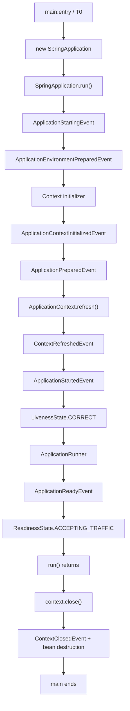

# Building a Spring Boot `NONE` Application to Record Startup Milestones with Relative Time

## 1. Practice Objectives

We will build a **Spring Boot Application Runtime** in `WebApplicationType.NONE` mode and directly observe the key milestones from the moment Java enters `main()` until the context is closed.

The application **does not open an HTTP port** and has no embedded Tomcat/Jetty/Netty; it is a CLI application managed by Boot. However, it still executes all steps related to `SpringApplication`, `Environment`, `ApplicationContext`, `refresh()`, singleton beans, `ApplicationRunner`, application events, and lifecycle shutdown.

Requirements for this practice:

1. Use **a single time origin**, right at the start of `main()`, to print relative milestones `T+... ms`.
2. Also print the **delta from the previous milestone** (`step+... ms`) to identify which segments consume time.
3. Capture events **before `ApplicationContext` exists** using `SpringApplication.addListeners(...)`, without relying on `@EventListener` beans for early events.
4. Distinguish `ApplicationPreparedEvent` (before refresh), `ContextRefreshedEvent` (after refresh), `ApplicationStartedEvent` (before runners), and `ApplicationReadyEvent` (after runners).
5. Observe `LivenessState.CORRECT` and `ReadinessState.ACCEPTING_TRAFFIC` while properly understanding that **`NONE` has no web server to receive HTTP traffic**.
6. Add an `ApplicationRunner` that waits for a configurable duration to experimentally observe how *started* differs from *ready*.
7. Include a resource owned by the context, printing creation and closure timestamps to cross-check `ContextClosedEvent` and bean destruction.
8. Compare the relative time from `System.nanoTime()` against `ApplicationStartedEvent.getTimeTaken()`, `ApplicationReadyEvent.getTimeTaken()`, and JVM uptime.
9. Have runnable Maven/JDK 17+ commands, honest illustrative output, fast/slow execution variants, and a startup failure scenario.
10. Know the limitations of the measurement and do not confuse time from `main` with time **from JVM start, container start, or Pod creation**.

This lab uses **Java 17**, **Spring Boot 3.3.13**, and Maven. No database, network, Actuator, Docker, or Kubernetes configuration is required.

## 2. Why Choose `WebApplicationType.NONE`?

Spring Boot is often known as a framework for building API servers. However, `SpringApplication` can also build a container to run:

- Batch jobs or migration tasks.
- CLIs with dependency injection.
- Data import/export tools.
- Workers that receive and process a set of tasks.
- Runtime configuration verification programs.
- Practice labs for observing startup events without interference from HTTP server startup time.

To prevent Boot from automatically creating an embedded web server, we set:

```java
application.setWebApplicationType(WebApplicationType.NONE);
```

Equivalently, this can be configured via properties:

```properties
spring.main.web-application-type=none
```

In the complete example, we use an **explicit Java call** so learners immediately see the decision not to start a web server. `spring-boot-starter` is sufficient for the core part: do not add `spring-boot-starter-web` or `spring-boot-starter-webflux`.

`NONE` **does not mean skipping Spring**:

- Spring still creates the `ApplicationContext`.
- Spring still calls `refresh()` on the context and creates non-lazy singleton beans.
- `ApplicationRunner` and `CommandLineRunner` are still invoked by Boot.
- Boot still publishes the appropriate startup and availability events.
- The context still has an init/destroy lifecycle.
- `SpringApplication.run()` can still fail due to configuration/bean/runner errors.

A `NONE` program can terminate right after runners finish if no non-daemon threads keep the JVM alive, or it can stay alive long-term if the application itself starts background workers. This lab intentionally **closes the context after `run()`** so the shutdown path is clear and there are no unmanaged workers.

## 3. Measuring Clock: Taking Origin `T0` at the Start of `main()`

The core solution uses:

```java
long t0 = System.nanoTime();
```

Each subsequent milestone reads:

```java
long now = System.nanoTime();
long elapsedNanos = now - t0;
long elapsedMs = TimeUnit.NANOSECONDS.toMillis(elapsedNanos);
```

To know the cost **between two consecutive milestones**:

```java
long stepMs = TimeUnit.NANOSECONDS.toMillis(now - previous);
previous = now;
```

Here `previous` is the timestamp of the previously recorded milestone. This is an illustrative snippet; in the full example, a `Timeline` class manages these variables.

### 3.1. `System.nanoTime()` Is Suitable for Duration

`System.nanoTime()` provides a monotonic clock for measuring *elapsed time* within the same JVM. It is **not** nanoseconds since the Unix epoch; do not use it as a real-world timestamp, do not directly compare absolute values across two JVMs, and do not convert it to time of day.

Because `Timeline` only samples once per milestone, the result is **wall elapsed duration** on the monotonic clock, not CPU time. It includes time when the thread was paused by the scheduler, I/O blocking, `Thread.sleep`, GC pauses, and log printing.

### 3.2. Why Not Use `System.currentTimeMillis()` as the Primary Clock?

`System.currentTimeMillis()` is useful for logging absolute timestamps, but the wall-clock can be adjusted by the OS or time synchronization. When the goal is to measure short durations between milestones within the same process, `nanoTime()` is more appropriate.

We can still record `Instant.now()` at the start of execution to correlate with external logs outside the JVM, but **durations** should be calculated from a consistent clock.

### 3.3. An Origin at `main()` Is Not the JVM Origin

Before Java enters `main()`, the JVM has already had to bootstrap, load/initialize classes, and prepare the runtime. If you need to know the JVM's age when `main` begins, Java provides:

```java
long uptimeMs = ManagementFactory.getRuntimeMXBean().getUptime();
```

This line requires importing `java.lang.management.ManagementFactory`. It **does not replace** `T0`; it reports a different kind of time.

| Origin Milestone | Question Answered |
| --- | --- |
| `System.nanoTime()` at the start of `main()` | How long did it take from the first code we recorded to milestone X? |
| JVM start via `RuntimeMXBean` | How long has the JVM existed up to milestone X? |
| Time OS spawned the Java process | How long did process initialization → X take? |
| Container started timestamp | How long did container started → X take? |
| Kubernetes Pod creation timestamp | How long did it take from Pod creation to milestone X? |

Do not merge the definitions above into a single unannotated "startup time" number.

## 4. Spring Boot 3.3 Milestones in a Successful Startup

A simple flow:



The diagram illustrates a single successful `run()` with a single context and default synchronous listeners. Singleton bean creation happens during refresh. With a context hierarchy, custom event multicaster, or other listeners, additional events and interleaved work may occur.

### 4.1. Meaning of Each Event

| Milestone | When It Occurs | Permitted Conclusion |
| --- | --- | --- |
| `ApplicationStartingEvent` | At the very start of `SpringApplication.run()` | Boot has entered the run process |
| `ApplicationEnvironmentPreparedEvent` | Environment is prepared, context not yet created | Environment can be read/modified per contract |
| `ApplicationContextInitializedEvent` | Context is created and initializers ran, bean definitions not yet fully loaded | Context object now exists |
| `ApplicationPreparedEvent` | Bean definitions loaded, right before refresh | Ready to enter the refresh step |
| `ContextRefreshedEvent` | Spring Framework completes refresh | Container has been refreshed |
| `ApplicationStartedEvent` | After refresh, **before** runners | Boot's started milestone |
| `AvailabilityChangeEvent(LivenessState.CORRECT)` | After started | Boot considers the app live |
| `ApplicationRunner` | After started, before ready | Application's startup work |
| `ApplicationReadyEvent` | After runners | Boot reaches the ready milestone |
| `AvailabilityChangeEvent(ReadinessState.ACCEPTING_TRAFFIC)` | After ready | Boot publishes readiness accepting |
| `ContextClosedEvent` | When closing the context | Context closing sequence has started |
| `@Bean(destroyMethod="close")` | When Spring destroys an owned singleton bean | Resource is closed via bean destruction mechanism |

**Note:** `ContextRefreshedEvent` is a Spring Framework event, not specific to Boot; `ApplicationStartedEvent` and `ApplicationReadyEvent` are Boot events.

### 4.2. Which Events Should Not Be Registered with an `@EventListener` Bean?

Early events such as `ApplicationStartingEvent` and `ApplicationEnvironmentPreparedEvent` are published **before Spring can create application beans**. A normal `@Component`/`@Bean` listener discovered in the context cannot receive events published before it exists.

Therefore, the example uses:

```java
application.addListeners(
        (ApplicationListener<ApplicationStartingEvent>)
                event -> timeline.mark("boot:starting"));
```

This is a snippet; `timeline` and imports are required. The key point is **registering before `application.run(args)`**.

Similarly, we use `application.addInitializers(...)` to mark when the application context is being initialized. An initializer does not replace a listener, and it does not prove that `refresh()` has finished.

## 5. Complete Project Structure

Create the following files:

```text
none-startup-timeline/
├── pom.xml
└── src/main/
    ├── java/com/example/timeline/
    │   └── NoneStartupTimelineApplication.java
    └── resources/
        └── application.properties
```

There is only **one Java file** to simplify copying. The `Timeline` and `ManagedResource` classes are defined as nested static classes inside the main class.

The application uses no database, controller, HTTP endpoint, or Actuator starter. Therefore, if a request to `http://localhost:8080` is refused while the program is running, this is **expected behavior**, not a startup error.

## 6. `pom.xml` — Spring Boot 3.3.13 and Java 17

```xml
<project xmlns="http://maven.apache.org/POM/4.0.0"
         xmlns:xsi="http://www.w3.org/2001/XMLSchema-instance"
         xsi:schemaLocation="http://maven.apache.org/POM/4.0.0 https://maven.apache.org/xsd/maven-4.0.0.xsd">
    <modelVersion>4.0.0</modelVersion>

    <parent>
        <groupId>org.springframework.boot</groupId>
        <artifactId>spring-boot-starter-parent</artifactId>
        <version>3.3.13</version>
        <relativePath/>
    </parent>

    <groupId>com.example</groupId>
    <artifactId>none-startup-timeline</artifactId>
    <version>0.0.1-SNAPSHOT</version>

    <properties>
        <java.version>17</java.version>
    </properties>

    <dependencies>
        <dependency>
            <groupId>org.springframework.boot</groupId>
            <artifactId>spring-boot-starter</artifactId>
        </dependency>
    </dependencies>

    <build>
        <plugins>
            <plugin>
                <groupId>org.springframework.boot</groupId>
                <artifactId>spring-boot-maven-plugin</artifactId>
            </plugin>
        </plugins>
    </build>
</project>
```

`spring-boot-starter-parent` manages compatible versions of Spring Boot dependencies and Maven plugins according to the Boot 3.3.13 ecosystem.

`spring-boot-starter` includes enough foundation to run DI, configuration, and startup events; `spring-boot-starter-web` is not needed for `NONE`.

`spring-boot-maven-plugin` packages an executable JAR. When running `java -jar`, the actual Java entrypoint is the application's `main` via the Boot launcher. You should not measure startup in an IDE and in a JAR and assume they are identical.

## 7. Complete Java Source

Create `src/main/java/com/example/timeline/NoneStartupTimelineApplication.java`:

```java
package com.example.timeline;

import java.lang.management.ManagementFactory;
import java.time.Duration;
import java.util.Locale;
import java.util.concurrent.TimeUnit;

import org.springframework.boot.ApplicationRunner;
import org.springframework.boot.Banner;
import org.springframework.boot.SpringApplication;
import org.springframework.boot.WebApplicationType;
import org.springframework.boot.autoconfigure.SpringBootApplication;
import org.springframework.boot.availability.ApplicationAvailability;
import org.springframework.boot.availability.AvailabilityChangeEvent;
import org.springframework.boot.availability.LivenessState;
import org.springframework.boot.availability.ReadinessState;
import org.springframework.boot.context.event.ApplicationContextInitializedEvent;
import org.springframework.boot.context.event.ApplicationEnvironmentPreparedEvent;
import org.springframework.boot.context.event.ApplicationFailedEvent;
import org.springframework.boot.context.event.ApplicationPreparedEvent;
import org.springframework.boot.context.event.ApplicationReadyEvent;
import org.springframework.boot.context.event.ApplicationStartedEvent;
import org.springframework.boot.context.event.ApplicationStartingEvent;
import org.springframework.context.ApplicationListener;
import org.springframework.context.ConfigurableApplicationContext;
import org.springframework.context.annotation.Bean;
import org.springframework.context.event.ContextClosedEvent;
import org.springframework.context.event.ContextRefreshedEvent;
import org.springframework.core.env.Environment;

@SpringBootApplication(proxyBeanMethods = false)
public class NoneStartupTimelineApplication {

    // Only for a single-run demo; do not use as global state
    // in systems with multiple ApplicationContexts.
    private static final Timeline TIMELINE = new Timeline();

    public static void main(String[] args) {
        TIMELINE.startAtMain();

        TIMELINE.mark("main:jvm-uptime-ms="
                + ManagementFactory.getRuntimeMXBean().getUptime());

        SpringApplication application =
                new SpringApplication(NoneStartupTimelineApplication.class);

        TIMELINE.mark("springapplication:constructed");

        application.setWebApplicationType(WebApplicationType.NONE);
        application.setBannerMode(Banner.Mode.OFF);
        application.setLogStartupInfo(false);

        registerTimelineListeners(application);

        application.addInitializers(context ->
                TIMELINE.mark("context:initializer"));

        TIMELINE.mark("run:invoke");

        try (ConfigurableApplicationContext context =
                     application.run(args)) {

            TIMELINE.mark("run:returned");

            ApplicationAvailability availability =
                    context.getBean(ApplicationAvailability.class);

            TIMELINE.mark("main:readiness="
                    + availability.getReadinessState());
        }

        TIMELINE.mark("main:done");
    }

    private static void registerTimelineListeners(
            SpringApplication application) {

        application.addListeners(
                (ApplicationListener<ApplicationStartingEvent>)
                        event -> TIMELINE.mark("boot:starting"),

                (ApplicationListener<ApplicationEnvironmentPreparedEvent>)
                        event -> TIMELINE.mark("boot:environment-prepared"),

                (ApplicationListener<ApplicationContextInitializedEvent>)
                        event -> TIMELINE.mark("boot:context-initialized"),

                (ApplicationListener<ApplicationPreparedEvent>)
                        event -> TIMELINE.mark("boot:prepared"),

                (ApplicationListener<ContextRefreshedEvent>)
                        event -> TIMELINE.mark("context:refreshed"),

                (ApplicationListener<ApplicationStartedEvent>)
                        event -> TIMELINE.mark(
                                "boot:started boot-duration="
                                + durationText(event.getTimeTaken())),

                (ApplicationListener<ApplicationReadyEvent>)
                        event -> TIMELINE.mark(
                                "boot:ready boot-duration="
                                + durationText(event.getTimeTaken())),

                (ApplicationListener<AvailabilityChangeEvent<?>>)
                        event -> {
                            if (LivenessState.CORRECT.equals(event.getState())) {
                                TIMELINE.mark("liveness:correct");
                            }

                            if (ReadinessState.ACCEPTING_TRAFFIC
                                    .equals(event.getState())) {
                                TIMELINE.mark("readiness:accepting");
                            }
                        },

                (ApplicationListener<ContextClosedEvent>)
                        event -> TIMELINE.mark("context:closing"),

                (ApplicationListener<ApplicationFailedEvent>)
                        event -> TIMELINE.mark(
                                "boot:failed cause="
                                + event.getException()
                                       .getClass()
                                       .getSimpleName())
        );
    }

    @Bean(destroyMethod = "close")
    ManagedResource managedResource() {
        return new ManagedResource(TIMELINE);
    }

    @Bean
    ApplicationRunner warmupRunner(
            ManagedResource resource,
            Environment environment) {

        return args -> {
            long sleepMs = environment.getProperty(
                    "demo.warmup-ms", Long.class, 600L);

            if (sleepMs < 0L || sleepMs > 30_000L) {
                throw new IllegalArgumentException(
                        "demo.warmup-ms must be in [0, 30000]");
            }

            TIMELINE.mark("runner:begin");

            Thread.sleep(sleepMs);

            TIMELINE.mark("runner:end");
        };
    }

    private static String durationText(Duration value) {
        return value == null
                ? "unknown" : value.toMillis() + "ms";
    }

    static final class ManagedResource implements AutoCloseable {

        private final Timeline timeline;

        ManagedResource(Timeline timeline) {
            this.timeline = timeline;
            timeline.mark("resource:created");
        }

        @Override
        public void close() {
            timeline.mark("resource:closed");
        }
    }

    static final class Timeline {

        private long origin;
        private long previous;

        synchronized void startAtMain() {
            origin = System.nanoTime();
            previous = origin;
            mark("main:entry");
        }

        synchronized void mark(String name) {
            long now = System.nanoTime();

            long fromStartMs =
                    TimeUnit.NANOSECONDS.toMillis(now - origin);

            long fromPreviousMs =
                    TimeUnit.NANOSECONDS.toMillis(now - previous);

            previous = now;

            System.out.printf(
                    Locale.ROOT,
                    "T+%6d ms  step+%5d ms  %s%n",
                    fromStartMs,
                    fromPreviousMs,
                    name);
        }
    }
}
```

### 7.1. Why Is This Source a Complete Program?

All types in the program are already defined or imported:

- `SpringApplication`, `WebApplicationType`, `ApplicationRunner`.
- Events and `ApplicationAvailability` from `spring-boot`.
- `ApplicationListener`, `ConfigurableApplicationContext`, `@Bean` from Spring Framework.
- `ManagedResource` and `Timeline` are nested types within the same source file.
- `Duration`, `TimeUnit`, `Locale`, and `ManagementFactory` belong to JDK 17.

There are no undeclared placeholder business methods. No additional configuration class is required. The project has `@SpringBootApplication`, so the Boot launcher has a clear main class to package.

### 7.2. Why Not Use `SpringApplication.run(Class, args)`?

The following shortcut works, but is inconvenient for this problem:

```java
SpringApplication.run(NoneStartupTimelineApplication.class, args);
```

It constructs `SpringApplication` inside the static call. We would have difficulty registering **our lab's early listeners before Boot emits `ApplicationStartingEvent`**.

Therefore, the lab uses:

```java
SpringApplication application =
        new SpringApplication(NoneStartupTimelineApplication.class);

application.addListeners(...);
application.run(args);
```

In the real program, `...` represents the listeners in the `registerTimelineListeners` method. This approach lets us record milestones early without writing a `spring.factories` file.

### 7.3. Why Does `Timeline` Have `synchronized`?

Default listeners usually run synchronously, but the code may be extended to log from other threads. `synchronized` ensures that updating `previous` and printing the entire log line are protected as a single operation against concurrent `mark()` calls on the same instance.

However, `synchronized` **does not make other application activities sequential**. If background jobs are added later, one event can be logged interleaved among others. Ordering conclusions must be tied to the lifecycle contract and specific context, not merely based on the phrase "thread-safe".

### 7.4. What Is Recorded at Each Milestone?

Example format:

```text
T+     0 ms  step+    0 ms  main:entry
T+   185 ms  step+   29 ms  boot:starting
T+   922 ms  step+  604 ms  context:refreshed
```

Both time columns are in **ms units**:

- `T+`: total duration since `startAtMain()`.
- `step+`: duration since **the previous `mark()` call**.

The numbers above are **illustrative**, not fixed output. `step+` is not the duration of a single method: it can include multiple methods/callbacks between two milestones, logging time, scheduling, and GC. If you want to measure an individual method, place probes at **the exact boundaries of that method**.

### 7.5. Why Is the `ManagedResource` Bean Created During Refresh?

`managedResource()` is a singleton bean not declared as lazy. On the normal startup path, Spring creates eager singletons during context refresh. The `ManagedResource` constructor calls:

```java
timeline.mark("resource:created");
```

so the `resource:created` milestone appears after `boot:prepared` and before `context:refreshed`.

When the context is closed, Spring calls `close()` on this bean according to:

```java
@Bean(destroyMethod = "close")
```

Therefore, `resource:closed` appears after `context:closing` on the normal close path. `ManagedResource` in the example does not open a real socket; it only records the lifecycle so learners can focus on the milestones.

`ApplicationRunner` receives `ManagedResource` via dependency injection to show that the runner uses a context-owned resource rather than creating or closing that resource itself.

### 7.6. Why `try-with-resources` in `main()`?

`ConfigurableApplicationContext` implements the context closing contract. The code:

```java
try (ConfigurableApplicationContext context = application.run(args)) {
    TIMELINE.mark("run:returned");
}
```

calls `context.close()` when the block finishes.

We intentionally close the context after `run()` returns so we can see:

```text
boot:ready
readiness:accepting
run:returned
context:closing
resource:closed
main:done
```

This is a **CLI demo lab**, not a template to apply verbatim to a web server that needs to stay running continuously. With a Boot server, closing the context right after `run()` would immediately stop the server as well.

A `NONE` program does not need `System.exit(0)` on the happy path; once no non-daemon workers remain, the JVM normally exits with status 0.

## 8. `application.properties`

Create `src/main/resources/application.properties`:

```properties
demo.warmup-ms=600
logging.level.root=ERROR
```

`demo.warmup-ms` is a **custom property defined by the example**. It is not a standard Boot property. `Environment#getProperty("demo.warmup-ms", Long.class, 600L)` reads the value with a 600 ms fallback.

`logging.level.root=ERROR` makes the example's output easy to observe, avoiding numerous framework INFO lines. An ERROR log level should not be treated as a mandatory production policy: production needs appropriate logging for troubleshooting.

The source already contains:

```java
application.setBannerMode(Banner.Mode.OFF);
application.setLogStartupInfo(false);
```

so startup INFO lines do not appear through the default logging path. These two settings only tidy up the output and **do not disable lifecycle events**.

Do not add `server.port=8080` because the application has no web server; changing the port has no effect in NONE mode.

## 9. Building and Running the Correct Entrypoint

Open a terminal in the directory containing `pom.xml`.

Verify JDK/Maven:

```bash
java -version
mvn -version
```

Build the executable JAR:

```bash
mvn package
```

Run:

```bash
java -jar target/none-startup-timeline-0.0.1-SNAPSHOT.jar
```

If the project was created with the Maven Wrapper, you can build with:

```bash
./mvnw package
```

In Windows PowerShell if the wrapper is present:

```powershell
.\mvnw.cmd package
```

**JDK 17+**, Maven, and Spring Boot dependencies already downloaded or access to a Maven repository are required. If `mvn package` is blocked due to network issues or missing dependencies in the local cache, that is a build environment issue, not a startup event issue in Java code.

### 9.1. Why Run `java -jar` Instead of Only `mvn spring-boot:run`?

Both can serve development, but when you need to accurately compare startup and process behavior, `java -jar` tests the actual packaged artifact that will be deployed.

`mvn spring-boot:run` goes through Maven/plugin wrappers and can add extra overhead before the Java application runs. Do not equate the wall time from typing `mvn` until seeing ready with Boot's internal duration.

### 9.2. PowerShell

The run command in PowerShell is also:

```powershell
java -jar .\target\none-startup-timeline-0.0.1-SNAPSHOT.jar
```

After the CLI finishes, the status can be checked with:

```powershell
$LASTEXITCODE
```

In Bash/zsh, check with:

```bash
echo $?
```

A normal happy path returns `0`; do not set a non-zero exit code merely to illustrate relative timing.

## 10. Expected Output: Stable Order, Non-Fixed Numbers

The **milestone names printed by the demo code** in a typical order for a successful single-context run:

```text
main:entry
main:jvm-uptime-ms=<varying number>
springapplication:constructed
run:invoke
boot:starting
boot:environment-prepared
context:initializer
boot:context-initialized
boot:prepared
resource:created
context:refreshed
boot:started boot-duration=<varying number>ms
liveness:correct
runner:begin
runner:end
boot:ready boot-duration=<varying number>ms
readiness:accepting
run:returned
main:readiness=ACCEPTING_TRAFFIC
context:closing
resource:closed
main:done
```

This is a **list of trailing values from each line**, with the `T+... ms step+... ms` prefix stripped for readability. The `<varying number>` placeholders represent dynamic values; they are not literal text printed by Java. If `getTimeTaken()` returns `null`, the example prints `unknown` instead of a number.

To visualize the **full line format**, a hypothetical run might look like:

```text
T+     0 ms  step+    0 ms  main:entry
T+    11 ms  step+   11 ms  main:jvm-uptime-ms=95
T+   137 ms  step+  126 ms  springapplication:constructed
T+   143 ms  step+    6 ms  run:invoke
T+   168 ms  step+   25 ms  boot:starting
T+   359 ms  step+  191 ms  boot:environment-prepared
T+   402 ms  step+   43 ms  context:initializer
T+   410 ms  step+    8 ms  boot:context-initialized
T+   532 ms  step+  122 ms  boot:prepared
T+   824 ms  step+  292 ms  resource:created
T+  1001 ms  step+  177 ms  context:refreshed
T+  1040 ms  step+   39 ms  boot:started boot-duration=897ms
T+  1043 ms  step+    3 ms  liveness:correct
T+  1045 ms  step+    2 ms  runner:begin
T+  1645 ms  step+  600 ms  runner:end
T+  1648 ms  step+    3 ms  boot:ready boot-duration=1504ms
T+  1650 ms  step+    2 ms  readiness:accepting
T+  1653 ms  step+    3 ms  run:returned
T+  1654 ms  step+    1 ms  main:readiness=ACCEPTING_TRAFFIC
T+  1656 ms  step+    2 ms  context:closing
T+  1662 ms  step+    6 ms  resource:closed
T+  1663 ms  step+    1 ms  main:done
```

**All numbers are hypothetical examples**, not a guarantee of output when running on a specific machine. Actual times depend on the JVM, hardware, warm/cold classpath, GC, scheduler, logging configuration, and version. Only **the sequence of milestones and lifecycle relationships** serve as the primary expectation.

In environments with other listeners/framework extensions, there may be extra work before/after events; this example illustrates the default sequence on Boot 3.3.13 with one context and no web server opened.

### 10.1. Reading the `T+` Column

From the line:

```text
T+  1040 ms  step+   39 ms  boot:started boot-duration=897ms
```

we deduce:

- The timestamp when the listener recorded `ApplicationStartedEvent` is about 1040 ms from the start of `main()`.
- The gap from **the immediately preceding recorded milestone** to here is about 39 ms.
- The duration Boot itself measured up to started is about 897 ms.

Do not equate `T+1040 ms` with `boot-duration=897ms`. Boot's timer starts near `SpringApplication.run` and samples at points chosen by Boot, differing from Timeline's `main()` origin.

### 10.2. Reading the `step+` Column

If we have:

```text
runner:begin
runner:end
```

and the `T+` difference between them is close to 600 ms, that is due to `Thread.sleep(600)` per the default property, plus overhead. `step+` at `runner:end` measures the interval since the previous `mark`, so in this short example it typically closely reflects the runner sleep.

However, in a real application, another listener/task might record a milestone between runner begin and end. In that case `step+` no longer measures the entire runner, only the portion from **the nearest milestone**. To measure the runner's exact scope, save `long runnerStart=System.nanoTime()` inside the runner and compute it when the runner finishes.

### 10.3. Why Does `resource:created` Appear Before `context:refreshed`?

Because `ManagedResource` is an eager singleton bean created during refresh. `ApplicationPreparedEvent` occurs before refresh, while `ContextRefreshedEvent` occurs after the refresh process has completed. The position of `resource:created` shows at least one piece of work **inside the refresh region**.

This does **not** prove every singleton in the application is created at this exact moment: lazy beans, prototypes, or beans created by background tasks may appear at other times.

### 10.4. Why Is `main:readiness=ACCEPTING_TRAFFIC` Printed Even Without a Web Server?

`ReadinessState` describes **Spring Boot's internal availability state**, not proof of an HTTP listener. In `NONE`, Boot can still publish `ACCEPTING_TRAFFIC` once startup and runners have finished. It means the application has reached the logical *ready* milestone, **not** that socket 8080 is open or Kubernetes has routed traffic.

`ApplicationAvailability` is a bean managed by Spring Boot; after a successful `run()`, the example retrieves the bean to inspect the readiness state. After the context is closed, do not continue using the old bean to process new work.

## 11. Experiment A: Changing the Warm-up Duration

The default is `demo.warmup-ms=600`. Run three times:

```bash
java -jar target/none-startup-timeline-0.0.1-SNAPSHOT.jar --demo.warmup-ms=0
```

```bash
java -jar target/none-startup-timeline-0.0.1-SNAPSHOT.jar --demo.warmup-ms=1200
```

```bash
java -jar target/none-startup-timeline-0.0.1-SNAPSHOT.jar --demo.warmup-ms=3000
```

Under similar runtime conditions, predict:

- `springapplication:constructed`: virtually unaffected **directly** by the runner's sleep duration.
- `boot:starting → boot:prepared`: not directly changed by runner sleep.
- `boot:prepared → context:refreshed`: not directly changed by runner sleep.
- `boot:started`: occurs before the runner; Boot's duration to started typically does not increase with the sleep property.
- `runner:begin → runner:end`: increases by roughly the `demo.warmup-ms` value.
- `boot:ready` and `readiness:accepting`: shifted later correspondingly with the runner duration.
- `main:done`: also shifted later because the context is only closed after `run()` returns.

**Predictions are trends**, not a guarantee that ms numbers between individual runs will match. GC, scheduling, JIT, filesystem cache, and other startup beans can unexpectedly alter durations.

### 11.1. Result Recording Table

Learners can fill in the following table with actual measurements without changing the source:

| Warm-up | `boot:started` T+ | `runner:end - runner:begin` | `boot:ready` T+ | Boot ready duration |
| ---: | ---: | ---: | ---: | ---: |
| 0 ms | Measured | Measured | Measured | Measured |
| 600 ms | Measured | Measured | Measured | Measured |
| 1200 ms | Measured | Measured | Measured | Measured |
| 3000 ms | Measured | Measured | Measured | Measured |

After several runs, check how much **the started→ready interval** changes. If the sleep property increases by 2400 ms but another interval increases much more, there may be measurement noise or other work occurring. Use additional profiling if detailed quantification is needed.

### 11.2. Condition `0` Does Not Mean Milestones Have the Same Timestamp

Even with `Thread.sleep(0)`, there is still method call and log printing cost between runner begin and end. Because output rounds down to **integer milliseconds**, multiple lines may share the same `T+` or `step+0`, yet event ordering remains meaningful.

Do not assert that every duration is non-zero or that every `T+` milestone must increase by at least 1 ms.

## 12. Experiment B: Running with an Error to Observe the Failure Branch

The example has validation at the very beginning of the runner:

```java
if (sleepMs < 0L || sleepMs > 30_000L) {
    throw new IllegalArgumentException(
            "demo.warmup-ms must be in [0, 30000]");
}
```

Run:

```bash
java -jar target/none-startup-timeline-0.0.1-SNAPSHOT.jar --demo.warmup-ms=-1
```

Depending on how Boot handles the exception, the important part of the output will include:

```text
boot:started ...
liveness:correct
boot:failed cause=...
context:closing
resource:closed
```

**Do not expect**:

```text
runner:begin
runner:end
boot:ready
readiness:accepting
run:returned
main:done
```

Because the runner throws the exception **before** logging `runner:begin`; `SpringApplication.run()` does not return normally so the `try-with-resources` block is never entered along the success path. Boot enters failure handling and attempts to close the context it already created.

The outermost exception name in `boot:failed cause=...` may be a framework-wrapped exception, so **do not force a literal** `IllegalArgumentException` across all environments. Inspect the stack trace/cause chain to identify the actual business validation error.

In a CLI run via `java -jar`, an unhandled startup failure leads to a non-zero/unsuccessful process exit; the exact exit code can be affected by the failure path, launcher, and operating system. Do not hard-code status 1 solely from seeing `ApplicationFailedEvent`.

### 12.1. Lesson on Timeline Completeness

A timeline that only records milestones **on the success path** will lack data when startup fails. That is why the example registers `ApplicationFailedEvent` early via `addListeners(...)`.

However, if a failure occurs very early before listeners are registered or the JVM fails to start, the Java application cannot print milestones that never occurred. That is a natural limitation of an observer created inside the process.

If you need to observe errors like a launcher `ClassNotFoundException` before Java `main` runs, you need logs/monitors at the **process/launcher** level, not just listeners inside Spring.

## 13. Experiment C: Changing Measurement Approaches to Avoid Misinterpretation

### 13.1. Comparing `T+` with `getTimeTaken()`

In the code:

```java
event.getTimeTaken()
```

on `ApplicationStartedEvent` and `ApplicationReadyEvent` returns a `Duration` recorded by Boot. Do not treat it as "time from `main()`":

- `T+` is measured from `Timeline.startAtMain()` before constructing `SpringApplication`.
- `getTimeTaken()` uses the clock and milestones managed by `SpringApplication`.
- Logging code inside listeners adds slight overhead.
- Boot duration can be `null` when unknown; the demo converts that to `"unknown"`.

The difference between the two numbers is useful data about the region before `SpringApplication.run`, **not the sole exact measurement of JVM bootstrap**.

### 13.2. Distinguishing the Interval Near Refresh from Exact `refresh()`

The milestones:

```text
boot:prepared
resource:created
context:refreshed
boot:started
```

allow us to infer:

- `boot:prepared → context:refreshed`: approximate window of the refresh block.
- `resource:created`: an activity inside container refresh.
- `context:refreshed → boot:started`: work/events after refresh and before the started milestone.

**Do not call `boot:prepared → boot:started` the exact duration of the `refresh()` method**. Within that window there can be event dispatch, logging, bookkeeping, and other callbacks.

To measure each `StartupStep` of refresh in detail, use `ApplicationStartup` or Java Flight Recorder; do not extrapolate the full cost from two event timestamps.

### 13.3. `ContextRefreshedEvent` Can Also Repeat in Other Systems

The sample application has a single `NONE` context, so the output examples only record one `context:refreshed`. In applications with a parent/child hierarchy or a management context, a listener may see events from multiple contexts.

When reusing this code to profile larger applications, add context identity:

```java
String id = event.getApplicationContext().getId();
```

This applies to events with `getApplicationContext()` such as `ContextRefreshedEvent`. Do not lump multiple context refresh events into a single summary and assume one context refreshed multiple times.

## 14. Extension: Adding the JVM Clock at a Ready Milestone

The example already prints:

```java
ManagementFactory.getRuntimeMXBean().getUptime()
```

at the start of main. To compare JVM age when Boot is ready, you can modify just that listener:

```java
(ApplicationListener<ApplicationReadyEvent>)
        event -> {
            TIMELINE.mark("boot:ready boot-duration="
                    + durationText(event.getTimeTaken()));
            TIMELINE.mark("jvm:uptime-at-ready-ms="
                    + ManagementFactory.getRuntimeMXBean().getUptime());
        }
```

This is a **replacement snippet inside `registerTimelineListeners`**, not a standalone Java method. The JVM time to ready will typically be greater than the Boot duration because it includes steps before Boot begins measuring.

Do not arbitrarily subtract two numbers from two different clocks to deduce an exact method duration. `RuntimeMXBean.getUptime()` is suited for measuring JVM age; `System.nanoTime()` is suited for measuring intervals **within the same process** from a chosen origin.

## 15. Extension: What If You Need a Detailed Timeline Inside Refresh?

Spring Framework supports `ApplicationStartup`/`StartupStep` to collect steps such as bean instantiation or context refresh. Spring Boot can use `BufferingApplicationStartup`:

```java
import org.springframework.boot.context.metrics.buffering.BufferingApplicationStartup;

application.setApplicationStartup(
        new BufferingApplicationStartup(2048));
```

This is an **optional** snippet in main, which must be added before `application.run(args)`. It is not required for the basic lab. If using Actuator and configuring the appropriate startup endpoint, you can retrieve the timeline via `/actuator/startup` in an application with an HTTP management interface.

However, in this lab's `NONE` application **there is no HTTP server**, so merely adding `BufferingApplicationStartup` and the Actuator dependency will not make `/actuator/startup` automatically appear on localhost. To read the buffer in NONE, you must access the buffer via the appropriate Java API or export it through another channel; do not add `curl localhost:8080/actuator/startup` as if running a web app.

### 15.1. Java Flight Recorder

An option for deep profiling:

```java
import org.springframework.core.metrics.jfr.FlightRecorderApplicationStartup;

application.setApplicationStartup(
        new FlightRecorderApplicationStartup());
```

Example run with JFR on a supported JDK:

```bash
java -XX:StartFlightRecording=filename=none-startup.jfr,duration=30s -jar target/none-startup-timeline-0.0.1-SNAPSHOT.jar
```

For a short CLI, a JFR recording using `duration=30s` may still be scheduled to record after the CLI has finished; verify the actual recording file and dump behavior of the JDK/tool you use. To ensure the recording finishes before process exit, use a recording configuration appropriate for CLIs, such as `dumponexit=true`, and check JFR messages in your environment.

JFR helps correlate Spring startup steps with GC, class loading, allocation, JIT, and scheduling. It introduces overhead; do not compare a run with JFR to a run without JFR as completely equivalent measurements.

### 15.2. Do Not Double-Count Nested StartupSteps

`StartupStep` can have a nested structure: a parent refresh step contains many child bean initialization steps. If you sum every `duration`, you will count the same time interval **multiple times**.

Use a timeline, parent step IDs, and each step's scope rather than blindly summing every ms number.

## 16. Log Design When Reusing for Real Applications

### 16.1. Do Not Put Heavy Business Logic Inside Listeners

The `ApplicationListener` in the demo only takes a timestamp and prints one line. In production applications, do not call network APIs, write to databases, or sleep for long periods inside a startup listener just to record metrics.

By default, event listeners usually run synchronously. A slow listener can **slow down the very startup it is measuring**, distorting the numbers. If heavy telemetry is needed, separate lightweight data capture from flushing/exporting, and ensure proper cleanup.

### 16.2. Keep Markers Stable

Markers such as:

```text
boot:starting
boot:prepared
context:refreshed
boot:started
runner:begin
runner:end
boot:ready
readiness:accepting
```

are easy to use for log filtering and automated verification. Avoid asserting verbatim entire stdout lines that contain ms/PID/timestamps that change on every run.

If JSON or OpenTelemetry spans are needed in production, preserve the equivalent **milestone semantics** and a clear clock. Do not send raw `System.nanoTime()` over the network as an epoch timestamp.

### 16.3. Adjusting Log Sinks

`System.out.printf(...)` works well for the demo because ordering is clearly visible. In production, use a logging framework/metrics/tracing and include service ID, version, and correlation keys. When comparing performance, keep the logging level and appender identical across runs.

Recording milestones does not make all startup steps sequential: some integrations launch background threads; the timeline only records the order *the observer received events*, not the entire execution order across all threads.

### 16.4. Do Not Use a Static `Timeline` for Multiple Contexts in One JVM

In the demo source, `private static final Timeline TIMELINE` allows listeners and beans to share one observer during **a single CLI run**. This is a simple choice for the practice lab.

With multiple independent `ApplicationContext` instances, parallel tests, or application reloads, a static instance can mix milestones from different runs. When extending, create a timeline **per run/context**, passed via constructor/initializer or a bean managed by the owning context, along with context ID in the markers.

## 17. When It Is No Longer NONE: What Changes?

If you switch to:

```java
application.setWebApplicationType(WebApplicationType.SERVLET);
```

then you must add the appropriate web dependencies, such as `spring-boot-starter-web`. Do not merely change the enum and expect the web server to have all required classes.

Differences:

- The embedded server may initialize during refresh.
- An additional `WebServerInitializedEvent` may occur.
- The web port may open **before** runners complete, while readiness is not yet accepting.
- Web applications typically keep the process alive after `run()`; keeping `try-with-resources` to close the context immediately afterward would stop the server right away.
- Actuator `/readyz`, `/livez`, and `/actuator/startup` can be used once appropriate web dependencies/configuration are added.

However, this lab intentionally keeps `NONE` so learners observe **the application lifecycle** without being distracted by networking, servlet containers, and request lifecycles.

## 18. Common Mistakes During the Lab

### Mistake 1 — Placing the Origin Timestamp After `application.run()`

If you only capture `T0` after `run()` returns, startup is already over; you cannot measure pre-refresh, started, and runners. The origin must be **before `run()`**, at the start of main if the goal is main-to-ready.

### Mistake 2 — Using an `@EventListener` Bean to Listen to `ApplicationStartingEvent`

The listener bean has not been created yet when early events are published. Use `SpringApplication.addListeners(...)` before `run()` or an external listener registration mechanism outside the context.

### Mistake 3 — Using `currentTimeMillis()` as a Monotonic Clock

The wall clock can change, causing negative/anomalous durations. Use `nanoTime()` for internal intervals within the same process.

### Mistake 4 — Treating `T+` as JVM Start-to-Ready Time

The lab's `T0` is at the start of main. JVM bootstrap happens before that. Use `RuntimeMXBean` or a process-level observer for JVM time before main.

### Mistake 5 — Equating `ContextRefreshedEvent` and `ApplicationReadyEvent`

Finishing refresh does not mean runners are done. The lab uses runner sleep specifically so you can observe this gap.

### Mistake 6 — Thinking `NONE` Has No Readiness Events

NONE mode does not open a web server, yet Boot still has an application availability lifecycle. `ACCEPTING_TRAFFIC` here is Boot's logical state, not an open HTTP port.

### Mistake 7 — Calling `run()`, Closing Context, and Reporting a Startup Failure

This is **a CLI intentionally closing the context after success**, not an error. `context:closing` and `resource:closed` appear after readiness in normal output.

### Mistake 8 — Putting `Thread.sleep(600)` in a Bean Creation Callback and Attributing All Time to Runner

If you sleep in a `@Bean` constructor, the delay occurs during refresh; if you sleep in `ApplicationRunner`, the delay occurs **after started**. Where a cost is placed affects milestone semantics, not just the millisecond count.

### Mistake 9 — Seeing Two Lines with `step+0` and Assuming a Measurement Bug

Durations are truncated down to milliseconds; two close events can fall within the same millisecond. For higher resolution, keep nanoseconds or microseconds in raw data, while still keeping overhead under control.

### Mistake 10 — Subtracting `System.nanoTime()` in JVM B from `System.nanoTime()` in JVM A

The two values do not share an epoch. Never subtract them as distributed timestamps.

### Mistake 11 — `NullPointerException` When `getTimeTaken()` Is `null`

The Spring Boot API allows an unknown duration. The example includes `durationText(Duration)` to convert null to `"unknown"` so logging does not crash because of measurement.

### Mistake 12 — Printing Too Much in Every Event and Treating Measurement as Non-Intrusive

`printf` can consume time, synchronization, and flushing. The demo prioritizes readability, not microbenchmarking Boot core. When comparing nanoseconds, instrumentation overhead must be minimized.

### Mistake 13 — Using `@Bean(destroyMethod="close")` and Manually Closing the Same Resource in Runner

This can cause a double-close, making resource lifecycle order confusing. A context-owned resource should be closed by the context in this example, with the runner only using it.

### Mistake 14 — Waiting for an HTTP Request on Port 8080 to Observe Startup

A `NONE` application opens no port. Watch console output, do not `curl`. To get HTTP endpoints, intentionally change the application type and dependencies.

### Mistake 15 — Running `mvn spring-boot:run` and Counting from When Maven Started as Boot Duration

Maven has overhead; do not confuse the command's wall duration with `SpringApplication` event duration.

### Mistake 16 — Omitting `ApplicationFailedEvent` from Startup Measurement

When a runner or configuration fails, the ready milestone may never appear. Never report `ready=0` just because it wasn't measured. Classify the run as failed and inspect the cause.

### Mistake 17 — Deleting or Truncating Data When Milestones Are Missing

If an event is not emitted due to a startup failure, **missing milestones** in the timeline are important information. Do not fill in fake timestamps just to make charts look "pretty".

### Mistake 18 — Measuring Once and Comparing Two Boot Versions

Class loading/JIT, file caches, GC, heap, CPU quota, and environment can make individual runs vary. Use comparable sample sets and distinguish cold start from warm start.

## 19. Extension Exercises

### Exercise 1 — Estimate the Pre-Refresh Startup Interval

Record `T+` of:

```text
run:invoke
boot:prepared
```

The difference represents the window for preparing the Environment, context, and bean definitions before refresh, plus listener overhead. Explain why this should not be called "the `ApplicationContext` constructor time".

### Exercise 2 — Move the Sleep Location to Observe the Difference

In a separate practice project, you can add a component with an init callback that waits 600 ms **during refresh**, then compare it against a 600 ms runner sleep **after started**.

Prediction: sleeping during bean initialization generally increases time to started; sleeping in the runner mainly increases the started→ready interval. Do not put both sleeps in the same test without clearly noting their locations.

### Exercise 3 — Add a `CommandLineRunner`

Create a `CommandLineRunner` bean that logs:

```text
command-line-runner:begin
command-line-runner:end
```

If the application has multiple runners, use `@Order` or `Ordered` when an intentional order is needed. Do not assume Spring runs them in the order of method names in the source file.

### Exercise 4 — Compute a Duration Table from Stdout

Take the milestones `main:entry`, `boot:prepared`, `context:refreshed`, `boot:started`, `runner:begin`, `runner:end`, `boot:ready`, `main:done` and calculate:

- Main → Prepared.
- Prepared → ContextRefreshed (estimated refresh window).
- Started → Ready.
- Runner begin → Runner end.
- Main → Ready.
- Ready → Main done.

Clearly annotate that these intervals are only **windows between log milestones**, not all exact durations of a single framework method.

### Exercise 5 — Compare `getTimeTaken()` with Timeline

Take both values at started/ready and analyze why `T+` differs from `boot-duration`. Check where the code marked T0 and when Boot begins `run()`.

### Exercise 6 — Observe the Failure Path

Run with `--demo.warmup-ms=-1`, inspect the failed milestone and missing milestones. Explain why there is no `ApplicationReadyEvent` and why elapsed time from main to failed must not be treated as ready duration.

### Exercise 7 — Reduce Log Overhead

Replace `System.out.printf` with a recorder that stores `{name, elapsedNanos}` entries in memory and dumps them at the end. Analyze the tradeoff: less I/O during startup, but if the process fails before dumping, milestones may be lost.

### Exercise 8 — Run Under Resource Quotas

Run multiple times under a low CPU quota in a container and compare median/tail startup. Do not use numbers from a fast dev machine as a baseline for small serverless/container environments.

## 20. Self-Check Criteria for the Practice Lab

| Criterion | How to Verify |
| --- | --- |
| Valid JDK and Maven | `java -version`, `mvn -version` |
| Successful build | `mvn package` builds an executable JAR |
| Runs in NONE mode | Does not open an embedded web server/HTTP port |
| Has timeline origin | `main:entry` is the first milestone |
| Has two time columns | Each marker has `T+` and `step+` |
| Has early listeners | `boot:starting`, `boot:environment-prepared` appear |
| Has pre-refresh milestone | `boot:prepared` |
| Has post-refresh milestone | `context:refreshed` |
| Has ready lifecycle | `boot:started` before runner, `boot:ready` after runner |
| Has liveness/readiness | `liveness:correct`, `readiness:accepting` |
| Has Boot durations | `boot-duration=...ms` or `unknown` |
| Observes JVM uptime | `main:jvm-uptime-ms=...` |
| Has runner config | Changing `--demo.warmup-ms` alters the runner gap |
| Has resource ownership | `resource:created` and `resource:closed` |
| Has close flow | `context:closing` before `resource:closed` |
| Has failure path | Invalid warm-up leads to `boot:failed`, no ready |
| Distinguishes clocks | Does not treat T0 in main as JVM/Pod start |
| Does not guess absolute output | Only asserts markers/order, does not hard-code ms |

### 20.1. Filtering Markers in Bash

Redirect stdout/stderr to a log file if you want to analyze it:

```bash
java -jar target/none-startup-timeline-0.0.1-SNAPSHOT.jar > timeline.log 2>&1
```

View timeline lines:

```bash
grep '^T+' timeline.log
```

Filter specifically for started/ready:

```bash
grep -E 'boot:started|boot:ready|runner:begin|runner:end' timeline.log
```

`grep` requires a POSIX/Linux/macOS environment or a shell providing equivalent tools. These commands only filter generated logs and do not modify artifacts.

### 20.2. PowerShell

```powershell
java -jar .\target\none-startup-timeline-0.0.1-SNAPSHOT.jar *> timeline.log
Get-Content .\timeline.log | Select-String '^T\+'
```

In PowerShell 5.1, encoding of redirection and `Get-Content` can depend on code page/version. The markers are written in ASCII so they remain easy to find; if you extend markers with Vietnamese text and need standard UTF-8 output, configure encoding properly for the environment.

### 20.3. Assert Order, Do Not Assert Numbers

A valid manual check is locating each marker's position and confirming:

```text
boot:prepared
    BEFORE
context:refreshed
    BEFORE
boot:started
    BEFORE
runner:begin
    BEFORE
runner:end
    BEFORE
boot:ready
    BEFORE
readiness:accepting
```

Do not assert that `boot:ready` is always exactly 1400 ms or that runner sleep is 600 ms accurate to the millisecond. The scheduler and `Thread.sleep` have variance; solid tests should check **relationships** and time bounds with headroom, not an absolute number unguaranteed by the framework.

## 21. When Applying to Production Systems

### 21.1. Recording All Phases Does Not Mean You Have Found the Bottleneck

An event-level timeline shows **which interval is worth investigating**:

- Main → Run: constructors/configuration in main code.
- Run → Prepared: Environment/context preparation, bean definitions.
- Prepared → Started: refresh window and overhead.
- Started → Ready: runners and event callbacks.
- Ready → external ready: readiness probes, routing, platform.
- Close → process exit: resource cleanup, non-daemon threads, and shutdown sequence.

If you want to know which bean took 300 ms, go deeper: `StartupStep`, JFR, profiling, or custom timers around initialization methods. Do not blame a specific bean when your data only has two aggregate milestones.

### 21.2. Do Not Optimize "Ready" by Dropping Mandatory Work

Pushing cache warming to the background may make `ApplicationReadyEvent` arrive earlier, yet the first requests may not be servable. If warm-up is a mandatory prerequisite, place it in a runner with a reasonable deadline or publish a custom readiness state/health gate to avoid receiving traffic prematurely.

In batch-style `NONE` applications, "ready" may simply mean "startup hooks finished", not necessarily readiness to receive HTTP requests.

### 21.3. Measure Multiple Times Under Identical Conditions

JVM class loading, GC, container CPU throttling, logging, and filesystem cache all cause numbers to vary. When preparing a report:

- Record Java version, Boot version, JVM flags, and profile.
- Record number of runs, cold/warm conditions, CPU/memory limits.
- Report median and variance, not just the fastest run.
- Compare against the same T0 origin and same runner configuration.
- Separate pre-JVM startup time from Boot run time.
- Keep sample logs with markers and configuration to reproduce results.

### 21.4. Separate Observability Data from Sensitive Data

The demo timeline prints to stdout and contains no secrets. In production, avoid logging passwords, tokens, connection strings, user IDs, or sensitive exception payloads merely for startup measurement. Recording milestone names, durations, context IDs, and normalized status codes is sufficient for most observability needs.

## 22. Review Questions and Answers

**Q1.** Why is `WebApplicationType.NONE` needed for this lab?

**Answer:** To run the Boot core lifecycle and runners without opening a web server, making startup easier to observe. NONE does not skip refresh or application events.

**Q2.** Why is `ApplicationStartingEvent` registered via `addListeners` before `run`?

**Answer:** Because it is published before the context and bean listeners exist. A listener declared in a regular bean cannot receive events published prior to its creation.

**Q3.** Does `T+1200ms` mean the JVM started 1200 ms ago?

**Answer:** No; in this example, it is 1200 ms from the start of `main()` when `Timeline.startAtMain` captured T0.

**Q4.** What does `step+50ms` measure?

**Answer:** The interval from the previous `mark` call to the current `mark` call, not inherently the duration of a single Spring internal method.

**Q5.** Why does `boot:started` appear before `runner:begin`?

**Answer:** Boot publishes `ApplicationStartedEvent` after context refresh but before invoking `ApplicationRunner`/`CommandLineRunner`.

**Q6.** Increasing warm-up from 600 ms to 3000 ms primarily affects which segment?

**Answer:** The runner begin→end and started→ready intervals; it does not directly slow down refresh by a corresponding amount.

**Q7.** `NONE` has no HTTP server, so is `readiness:accepting` nonsensical?

**Answer:** No. It is Boot's application availability state, not proof of an open port accepting HTTP.

**Q8.** Why does `resource:created` appear before `context:refreshed`?

**Answer:** Because it is an eager singleton created during context refresh.

**Q9.** Who calls `ManagedResource.close()` in the demo?

**Answer:** Spring when the context is closed according to `@Bean(destroyMethod="close")`; the runner only holds a reference.

**Q10.** Why can `boot-duration` and `T+` differ at the same ready milestone?

**Answer:** Because Boot's measurement origin and T0 at the start of main differ, plus sampling locations and listener overhead.

**Q11.** If a warm-up property error causes the ready milestone to vanish, can it be treated as ready=0?

**Answer:** No. Startup failed; it must be reported as FAILED while preserving real milestones, without filling in fake ready values.

**Q12.** To know the exact cost of a specific bean, is an event-level timeline enough?

**Answer:** No. You need `ApplicationStartup`/JFR instrumentation/analysis or timers placed around the specific bean method being measured.

**Q13.** When a process runs in Kubernetes, does `T+` start from when the Pod was created?

**Answer:** No. T0 is inside `main()`; Pod scheduling, image pull, init containers, and JVM bootstrap happen before that.

**Q14.** Why can a single-run benchmark be misleading?

**Answer:** Because GC, CPU quota, JIT, filesystem cache, background load, network, and logging introduce noise; runs must be repeated under identical conditions.

## 23. Official References

- [Spring Boot 3.3 — SpringApplication and Application Events](https://docs.spring.io/spring-boot/3.3/reference/features/spring-application.html): event ordering, runners, ApplicationAvailability, and ready timing.
- [Spring Boot — Creating a Non-Web Application](https://docs.spring.io/spring-boot/3.3/how-to/application.html): configuring `WebApplicationType.NONE` and application logic in runners.
- [Spring Boot 3.3 — Disabling the Embedded Web Server](https://docs.spring.io/spring-boot/3.3/how-to/webserver.html): `spring.main.web-application-type=none`.
- [Spring Boot 3.3.13 API — `SpringApplication`](https://docs.spring.io/spring-boot/3.3/api/java/org/springframework/boot/SpringApplication.html): constructor, `addListeners`, `addInitializers`, `run`, and mode settings.
- [Spring Boot 3.3 API — `ApplicationStartedEvent`](https://docs.spring.io/spring-boot/3.3/api/java/org/springframework/boot/context/event/ApplicationStartedEvent.html): after refresh, before runners, `getTimeTaken()`.
- [Spring Boot 3.3 API — `ApplicationReadyEvent`](https://docs.spring.io/spring-boot/3.3/api/java/org/springframework/boot/context/event/ApplicationReadyEvent.html): after runners, `getTimeTaken()`.
- [Spring Boot 3.3 API — `ApplicationAvailability`](https://docs.spring.io/spring-boot/3.3/api/java/org/springframework/boot/availability/ApplicationAvailability.html): reading readiness/liveness state.
- [Java 17 — `System.nanoTime()`](https://docs.oracle.com/en/java/javase/17/docs/api/java.base/java/lang/System.html#nanoTime()): clock for elapsed time.
- [Java 17 — `RuntimeMXBean`](https://docs.oracle.com/en/java/javase/17/docs/api/java.management/java/lang/management/RuntimeMXBean.html): JVM start time and uptime.
- [Spring Framework — `ApplicationContext.refresh()`](https://docs.spring.io/spring-framework/docs/6.1.x/javadoc-api/org/springframework/context/ConfigurableApplicationContext.html): refresh/close contract.
- [Spring Framework — ApplicationStartup/StartupStep](https://docs.spring.io/spring-framework/reference/core/beans/context-introduction.html): observing container initialization steps.

## 24. Summary

A Spring Boot `NONE` application still has a full lifecycle; it simply does not create an embedded web server. Recording **relative timestamps** from the start of `main()` reveals the differences between context preparation, refresh, started, runners, ready, and context closing. `System.nanoTime()` returns elapsed duration within the same JVM; `ApplicationStartedEvent.getTimeTaken()` and `ApplicationReadyEvent.getTimeTaken()` use Boot's own measurement origin.

The lab directly demonstrates that **`ApplicationStartedEvent` occurs before `ApplicationRunner`, while `ApplicationReadyEvent` occurs after runners**. Increasing `demo.warmup-ms` increases the started→ready interval, whereas the interval before runners is not directly increased by that sleep operation.

To draw reliable conclusions, clearly state **origin T0**, understand that `step+` is merely the difference between two observed milestones, avoid guessing the duration of uninstrumented methods, verify the failure path, and compare multiple runs under equivalent conditions. This forms the foundation for moving from a simple timeline to `ApplicationStartup`, JFR, and startup measurements in Docker/Kubernetes without confusing clocks and boundaries.