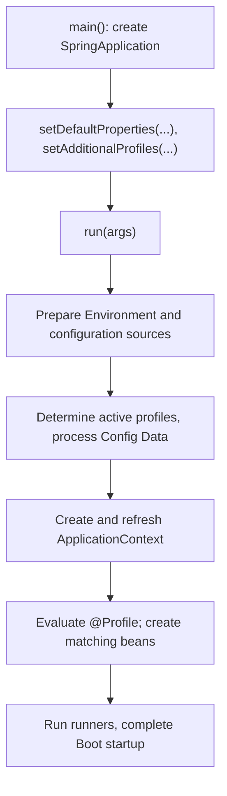

# Setting Defaults and Additional Profiles via `SpringApplication`

## 1. Purpose and Context

In a Spring Boot application, the same Java code can run on a developer's machine, in a testing environment, or in production. Instead of modifying source code for each deployment, the application retrieves configuration values from `Environment` and selects beans according to the active **profiles**.

When startup behavior needs to be controlled directly from `main()`, `SpringApplication` provides two APIs that are very close in where they are called yet different in their effects:

- `setDefaultProperties(...)` sets **fallback property values** with low precedence; higher-precedence configuration sources can override them.
- `setAdditionalProfiles(...)` registers one or more additional **active profiles** for that application run; these profiles participate in selecting configuration and beans.

This article focuses on configuring these two APIs through a `SpringApplication` instance, understanding precedence order, choosing the appropriate usage, and verifying behavior with a runnable Java application.

> "Default properties" and "default profile" are **two different concepts**. Default properties are fallback key–value pairs; the default profile is the profile Spring uses when no active profile is set.

## 2. Where Does `SpringApplication` Fit in the Configuration Mechanism?

Spring Boot's `SpringApplication` orchestrates bootstrap, which includes preparing `Environment` and processing configuration steps. `Environment`/`PropertySource` are Spring Framework abstractions. Spring Boot adds the **Config Data** loading mechanism (e.g., `application.properties`, `application.yml`, `application-{profile}.properties` files) and convenient startup options.

High-level flow:



Both APIs must be called **before** `run(args)` to affect configuration loading and bean registration. Modifying `Environment` after the context has refreshed does not automatically reload all `application-*` files or recreate beans excluded by `@Profile`.

Quick comparison table:

| Need | API / Configuration | Effect |
| --- | --- | --- |
| Provide fallback values from Java | `app.setDefaultProperties(Map)` | Adds low-precedence properties. |
| Enable additional profiles in Java at startup | `app.setAdditionalProfiles("audit")` | Adds `audit` to the active profiles group. |
| Select a profile at deployment time | `--spring.profiles.active=prod` or appropriate environment variable | Configures active profiles from outside the application. |
| Select a profile when no active profile exists | `spring.profiles.default=local` | Defines the **default profile**; not an arbitrary fallback value. |
| Use a profile-specific configuration file | `application-audit.properties` | File evaluated when `audit` is an active profile. |
| Create beans conditionally | `@Profile("audit")` | Spring Framework registers the bean based on active profiles. |

## 3. `setDefaultProperties(...)`: Setting Fallback Values

### 3.1. Meaning and Usage

`SpringApplication#setDefaultProperties` accepts a `Map<String, Object>` or `Properties` containing fallback values. Example:

```java
SpringApplication application = new SpringApplication(MyApplication.class);

application.setDefaultProperties(Map.of(
    "demo.feature-enabled", "false",
    "demo.timeout-seconds", "10",
    "demo.region", "unknown"
));

application.run(args);
```

*The snippet above illustrates the API call; running it standalone requires an application class, imports, and Spring Boot dependencies. The full example is in section 6.*

After `run()` prepares `Environment`, the application can retrieve those values via `Environment#getProperty`, `@Value`, or `@ConfigurationProperties` binding. If a higher-precedence configuration source declares the same key, the fallback value is replaced.

Example of what a single property means:

- Java default: `demo.timeout-seconds=10`.
- `application.properties`: `demo.timeout-seconds=20`.
- Command line: `--demo.timeout-seconds=30`.

With Spring Boot's default execution, when all three are present, the effective value is `30`. Without the command-line argument, it is `20`; without the file configuration as well, it is `10`.

This is a **fallback mechanism**, not an operation that writes data into `application.properties`. `setDefaultProperties` does not create or edit any file under `src/main/resources`.

### 3.2. Precedence Order to Know

Spring Boot combines multiple `PropertySource`s. For the sources commonly seen in this example, the relative order from highest to lowest is:

1. Command-line arguments of the form `--demo.timeout-seconds=...` (when command-line properties are enabled, which is the default).
2. Java system properties (`-D...`) and OS environment variables, with detailed ordering following Boot's precedence rules.
3. Config Data loaded from `application.properties` and profile-specific variants.
4. Default properties supplied by `setDefaultProperties`.

This is a simplified view of the property-source system; Boot also supports many other sources such as application JSON, test properties, servlet context, and custom configuration sources. Do not use this simplified list to infer the order of **every** source in every environment.

Two design implications:

- Values that deployers need to customize should live in `application.properties` or the deployment configuration system; Java defaults should only provide a **safe fallback**.
- When tracking down an unexpected value, check **which source has higher priority** before suspecting `setDefaultProperties` is not working.

### 3.3. Choosing Key Names and Values

Use meaningful names like `demo.timeout-seconds`, `feature.audit-enabled`, `client.retry-limit` rather than a generic `timeout`. For multi-field configuration with validation, `@ConfigurationProperties` is generally more suitable than reading individual strings with `@Value`.

In the `Map`, numbers or booleans can be passed as objects; for common configuration values, Spring has type conversion when reading/binding. In the example below, the string `"7"` is used for easy comparison with `.properties` files and read as an `Integer` using `Environment#getProperty(key, Integer.class)`.

Do not put passwords, secret keys, or tokens into `setDefaultProperties` in source code. This API is suitable for non-sensitive values that can safely be public in the repository.

## 4. `setAdditionalProfiles(...)`: Activating Additional Profiles

### 4.1. What Do Profiles Affect?

A profile is a logical label for an environment or capability, such as `local`, `test`, `prod`, `audit`, `metrics`. When a profile is activated, Spring Boot can load the corresponding configuration and Spring Framework can register beans annotated with `@Profile` conditions.

Example:

```java
SpringApplication application = new SpringApplication(MyApplication.class);
application.setAdditionalProfiles("audit", "metrics");
application.run(args);
```

In this startup, `audit` and `metrics` are **added** profiles. If the deployment environment also sets `spring.profiles.active=prod`, the configuration will include both the externally requested profile and the additional profiles, rather than treating `setAdditionalProfiles` as a command that completely replaces `spring.profiles.active`.

**Important point:** `setAdditionalProfiles` declares profiles that should participate in startup; it does not directly assign values to individual properties, nor does it guarantee that an `application-audit.properties` file exists. If the file does not exist, the profile can still be used for `@Profile("audit")`.

### 4.2. How Do Profiles Affect Beans?

```java
@Configuration
class AuditConfiguration {

    @Bean
    @Profile("audit")
    AuditService auditService() {
        return new AuditService();
    }
}
```

This is an illustrative snippet requiring `AuditService` in the project. When `audit` is active, this bean definition is registered. If `audit` is inactive, the bean is excluded from normal registration; components that unconditionally inject `AuditService` must be designed to handle its conditional presence.

`@Profile` is a Spring Framework mechanism. Boot helps resolve the profiles before the container evaluates that condition.

You can write profile expressions such as `@Profile("!prod")` to exclude a bean from the `prod` profile, though caution is needed when combining multiple profiles and conditions. For example, `@Profile({"audit", "metrics"})` on a component has **OR** semantics (only one matching profile is needed), rather than requiring both profiles simultaneously.

### 4.3. Active Profiles vs. Default Profiles

- **Active profiles** are the profiles actually activated, such as `audit` or `prod`, observable via `Environment#getActiveProfiles()`.
- **Default profiles** are Spring's fallback when there are no active profiles; by default Spring uses the profile named `default`. This can be adjusted via `spring.profiles.default`.
- If `setAdditionalProfiles("audit")` is called, the application already has at least one active profile. Therefore, relying solely on the default profile to select `@Profile("local")` may no longer behave as before.

Distinguish clearly:

```properties
# Fallback configuration value for an arbitrary property
demo.timeout-seconds=7

# Default profile name when no active profile is set
spring.profiles.default=local
```

These two lines have different responsibilities. Also do not confuse `setDefaultProperties(Map.of("spring.profiles.active", "local"))` with `setAdditionalProfiles("local")`: the former sets **a fallback property** that can be overridden; the latter **adds a profile via API**.

## 5. How `application-{profile}.properties` Files Are Selected

Suppose the application's resources consist of:

```text
src/main/resources/
├── application.properties
├── application-audit.properties
└── application-prod.properties
```

`application.properties` contains base configuration. When `audit` is an active profile, Boot loads configuration for `audit`; when `prod` is an active profile, Boot evaluates configuration for `prod`. Precedence rules in Config Data depend on file location, location groups, document order, and profile order; therefore, do not guess conflict outcomes if multiple profiles declare the same key without clearly verifying the application order.

An easy-to-maintain convention is:

- `application.properties`: shared configuration and sensible values for most environments.
- `application-prod.properties`: differences genuinely specific to production.
- `application-audit.properties`: configuration needed only when the audit feature is enabled.
- Environment variables / secret manager: values owned by the deployment system.

With YAML, you can use `application-audit.yml` or YAML documents activated via `spring.config.activate.on-profile`; you do not need both styles for the same configuration.

Important Config Data rule (Boot 2.4+): do not place `spring.profiles.active` or `spring.profiles.default` inside **profile-activated configuration documents** or `application-{profile}.properties` files. Determine active profiles from a source that does not depend on that profile itself, such as startup arguments, environment variables, or an appropriate base configuration document. If you want to declare additional profiles via configuration, look into `spring.profiles.include` and profile groups in valid locations.

## 6. Complete Example: Defaults + Additional Profile + CLI Override

The example below uses Java 17+ and Spring Boot 3.x, requiring only the `spring-boot-starter` dependency. The application does not start a web server, allowing you to observe profile configuration independently of HTTP.

### 6.1. Java Code

Create `src/main/java/com/example/runtime/ProfileDefaultsApplication.java`:

```java
package com.example.runtime;

import java.util.Map;

import org.springframework.boot.Banner;
import org.springframework.boot.SpringApplication;
import org.springframework.boot.WebApplicationType;
import org.springframework.boot.autoconfigure.SpringBootApplication;
import org.springframework.context.ConfigurableApplicationContext;
import org.springframework.context.annotation.Bean;
import org.springframework.context.annotation.Profile;
import org.springframework.core.env.Environment;

@SpringBootApplication
public class ProfileDefaultsApplication {

    public static void main(String[] args) {
        SpringApplication application =
                new SpringApplication(ProfileDefaultsApplication.class);

        application.setWebApplicationType(WebApplicationType.NONE);
        application.setBannerMode(Banner.Mode.OFF);
        application.setLogStartupInfo(false);

        // Fallback: only takes effect if no higher-precedence source declares the key.
        application.setDefaultProperties(Map.of(
                "demo.message", "from-java-default",
                "demo.timeout-seconds", "7"
        ));

        // Enable audit, even if the deployer also selects another profile.
        application.setAdditionalProfiles("audit");

        try (ConfigurableApplicationContext context = application.run(args)) {
            Environment environment = context.getEnvironment();

            System.out.println("activeProfiles="
                    + String.join(",", environment.getActiveProfiles()));
            System.out.println("demo.message="
                    + environment.getProperty("demo.message"));
            System.out.println("demo.timeout-seconds="
                    + environment.getProperty("demo.timeout-seconds", Integer.class));
            System.out.println("auditMarker="
                    + context.containsBean("auditMarker"));
        }
    }

    @Bean("auditMarker")
    @Profile("audit")
    public String auditMarker() {
        return "enabled";
    }
}
```

The code uses `Map.of` (Java 9+) and try-with-resources to close the `ApplicationContext` after printing. The `auditMarker` bean is a small example illustrating the `@Profile` condition: `context.containsBean(...)` confirms whether the bean was registered with the context.

`setWebApplicationType(WebApplicationType.NONE)` is only for this demo so no web port needs to be opened. For real server applications, do not force `NONE` if you want to run a web server.

### 6.2. Two Configuration Files

Create `src/main/resources/application.properties`:

```properties
demo.message=from-application
```

Create `src/main/resources/application-audit.properties`:

```properties
demo.message=from-audit-profile
```

Do not declare `demo.timeout-seconds` in either file above. That way, the run clearly demonstrates one value overridden by the profile and one value still coming from Java defaults.

If using Spring Initializr, choose Java 17+ and the **Spring Boot Starter** dependency; the project comes with Maven Wrapper or Gradle Wrapper to run the corresponding commands below.

### 6.3. Running and Reading the Output

From the root directory of a Maven project:

```bash
./mvnw spring-boot:run
```

If using Gradle:

```bash
./gradlew bootRun
```

On Windows, use `.\mvnw.cmd spring-boot:run` or `.\gradlew.bat bootRun`.

In a clean environment, with no profile or `demo.*` property assigned externally, **the lines produced by `System.out` in the example** will be:

```text
activeProfiles=audit
demo.message=from-audit-profile
demo.timeout-seconds=7
auditMarker=true
```

Depending on logging configuration and build tool, the console may include additional logs. Explanation of each line:

1. `audit` is an active profile due to `setAdditionalProfiles("audit")`.
2. `application-audit.properties` defines `demo.message`, which takes precedence over the Java default and base configuration for the same key in this simple case.
3. No file and no external argument declares `demo.timeout-seconds`, so the program reads the fallback `7`.
4. The bean with `@Profile("audit")` is registered, so `containsBean` returns `true`.

### 6.4. Overriding with Command-Line Arguments

If using Gradle, run:

```bash
./gradlew bootRun --args='--demo.message=from-command-line'
```

If using Maven, run:

```bash
./mvnw spring-boot:run -Dspring-boot.run.arguments=--demo.message=from-command-line
```

In PowerShell, place the corresponding argument inside double quotes according to how you invoke your wrapper.

The four lines printed by the program when no other external source interferes:

```text
activeProfiles=audit
demo.message=from-command-line
demo.timeout-seconds=7
auditMarker=true
```

This verifies that command-line arguments take precedence over both profile-specific file values and Java defaults. To see the Java default for `demo.message` get used, temporarily remove that key from **both** properties files and run without overriding arguments.

### 6.5. Combining a Deployment Profile with an Additional Profile

Run again:

```bash
./gradlew bootRun --args='--spring.profiles.active=prod'
```

In the same application, `prod` is requested via deployment configuration and `audit` is still added via `setAdditionalProfiles`. `Environment#getActiveProfiles()` will contain both `prod` and `audit` (without needing to rely on printed string order). The `auditMarker` bean is still registered.

If you add `application-prod.properties` and both `application-prod.properties` and `application-audit.properties` define `demo.message`, the final result depends on how Boot orders/prioritizes Config Data during that run. Inspect the actual winning source when a scenario has multiple profiles, or design properties to avoid ambiguous overrides across independent profiles.

## 7. How Does `setAdditionalProfiles` Differ from `spring.profiles.active` and Other Mechanisms?

| Activation Method | Who Configures It? | Characteristics |
| --- | --- | --- |
| `application.setAdditionalProfiles("audit")` | Bootstrap code | Adds profiles to the run; suits profiles that must be activated consistently from Java. |
| `--spring.profiles.active=prod` | Operator | Selects active profiles at runtime without modifying source code. |
| `SPRING_PROFILES_ACTIVE=prod` | OS environment | A common way to select profiles in deployments/containers. |
| `spring.profiles.active=prod` in a valid base document | Configuration file | Can be replaced by a higher-precedence `spring.profiles.active` source. |
| `spring.profiles.default=local` | Profile fallback config | Only applies when there are no active profiles. |
| `spring.profiles.include=audit` | Profile inclusion config | Adds included profiles via Boot's Config Data mechanism and placement rules. |
| `spring.profiles.group.production=prod,metrics` | Group configuration | Activates a group of profiles when the representative profile (`production`) is enabled. |

If the deployer needs to decide whether to run `local`, `test`, or `prod`, prefer external configuration like `SPRING_PROFILES_ACTIVE`. Hard-coding `setAdditionalProfiles("prod")` in `main()` causes the production profile to be active even during local runs and is usually unintended.

Conversely, a profile such as `audit` is sometimes a capability the application always wants to include when running in a mode determined by bootstrap. In that case, `setAdditionalProfiles(...)` can express intent clearly. Do not use a profile merely to toggle a single simple number when a property is enough.

If the goal is to provide a **fallback for the `spring.profiles.active` value**, you can set that property via `setDefaultProperties`. However, this is still an overridable property value and does not carry the same semantics as adding a profile with `setAdditionalProfiles`.

## 8. Designing Around Configuration for Easier Testing and Operations

### 8.1. Separating "Environment" and "Feature"

Profiles like `local`, `test`, `prod` typically represent **environments**. Profiles like `audit`, `metrics` can represent **features or bean groups**. Separating the two groups helps avoid accidentally enabling two conflicting environment configurations.

An application can run `prod` + `audit`, but check whether the profile files overwrite critical keys such as endpoints or timeouts. If a setting is just a simple on/off flag, a property (`feature.audit-enabled`) and `@ConditionalOnProperty` are usually a better fit than a dedicated profile.

### 8.2. Placing Values in the Right Owning Source

Example:

```text
Java default properties:
    demo.timeout-seconds=7

application.properties:
    demo.message=from-application

application-prod.properties:
    demo.timeout-seconds=20

Deployment environment:
    DEMO_TIMEOUTSECONDS=30  (must follow Boot's environment variable naming rules)
```

When using environment variables to bind to `@ConfigurationProperties`, variable names are normally transformed from canonical property form: dots become underscores, hyphens are removed, and letters are uppercased. To avoid confusion, verify binding results in the target environment; the canonical name in the example is `demo.timeout-seconds`.

For secrets, use an appropriate secret management mechanism. In real environments, you can log profile **names** and non-sensitive property names for diagnostics; avoid printing passwords or sensitive information into logs.

### 8.3. When Should `SpringApplicationBuilder` Be Used?

Spring Boot also provides `SpringApplicationBuilder`, which allows configuring properties/profiles in builder style, useful when constructing complex contexts. If you are only starting a single application, instantiating `SpringApplication` directly, calling `setDefaultProperties`, `setAdditionalProfiles`, and then calling `run(args)` keeps startup order easy to read and inspect.

The familiar static call:

```java
SpringApplication.run(MyApplication.class, args);
```

is suitable when no instance customization is needed. When you want to call the setters just learned, create an **instance** `new SpringApplication(...)` before running, as in the complete example.

## 9. Common Mistakes and How to Diagnose Them

### Mistake 1: "I set a default, yet the application didn't pick up that value"

`setDefaultProperties` sits at the bottom of the precedence order. Search for the same key in command-line args, system properties, environment variables, `application.properties`, and profile-specific files. A value in a higher source legitimately wins.

### Mistake 2: "`setAdditionalProfiles("audit")` did not make the program run audit logic"

The program might be checking a **property** without any `@Profile`/configuration for `audit`, or the file might be misnamed (`application-audit.properties` must be on the classpath in a loaded location). A profile only activates mechanisms declared for that profile; it does not generate audit business logic on its own.

### Mistake 3: "The profile is right, yet the bean is missing"

Check `@Profile` on the bean itself or its `@Configuration`, other auto-configuration conditions, `@ComponentScan`, and whether the bean is actually registered in the current context. A bean excluded by `@Profile("!audit")` does not appear when `audit` is active.

### Mistake 4: "Changed active profiles after the app started, yet beans didn't change"

Profile conditions and Config Data are evaluated during bootstrap/refresh. Mutating the active profiles array at runtime is not a hot-reload mechanism. Changing environment configuration generally requires restarting the context or using a purpose-built refresh solution with consistency analysis.

### Mistake 5: "Used `spring.profiles.default`, yet the default profile doesn't run"

If at least one active profile exists (for instance due to `setAdditionalProfiles`), the default profile is not used as a fallback profile. Check `Environment#getActiveProfiles()` and `getDefaultProfiles()` to see the actual state.

### Mistake 6: "Profile configuration throws an error at startup"

Do not declare `spring.profiles.active`, `spring.profiles.default`, or `spring.profiles.include` in profile-specific locations disallowed by Config Data rules. Move profile activation directives to an appropriate source, such as environment variables, command-line arguments, or an allowed base configuration document.

### Mistake 7: "There are multiple profiles and it's unclear which file wins"

Check profile order and configuration source order. You can enable detailed logging for Config Data processing in development to inspect loaded sources, e.g., configuring logging for `org.springframework.boot.context.config`. Note that verbose log levels may expose configuration data, so enable only when needed and manage logs appropriately.

### Mistake 8: "Tests behave differently from the main application"

Test frameworks can add property sources or profiles via `@ActiveProfiles`, `@TestPropertySource`, `@SpringBootTest(properties = ...)`. These test sources have their own precedence rules. When testing, verify how the test context initialized SpringApplication and which profiles are active; do not assume tests always replicate `main()` identically.

## 10. Scenario Comparison Practice

Suppose the Java code has:

```java
application.setDefaultProperties(Map.of(
        "demo.message", "fallback",
        "demo.retry-count", "2"
));
application.setAdditionalProfiles("audit");
```

And resources have:

```properties
# application.properties
demo.message=base
```

```properties
# application-audit.properties
demo.message=audit
```

| Scenario | `demo.message` | `demo.retry-count` | `audit` Profile? |
| --- | --- | --- | --- |
| Run with no extra arguments | `audit` | `2` | Yes |
| Run with `--demo.message=cli` | `cli` | `2` | Yes |
| Run with `--demo.retry-count=5` | `audit` | `5` | Yes |
| Run with `--spring.profiles.active=prod`, no other conflicting source for `demo.message` | `audit` | `2` | Yes |

This table assumes a clean environment with no other system properties or environment variables overriding the same keys; `prod` also has no additional property file conflicting with `audit`.

### Self-Check Exercises

1. **If you remove `setAdditionalProfiles("audit")` and declare no active profiles**, is `application-audit.properties` loaded automatically?  
   No. Unless another configuration mechanism enables `audit`, that profile-specific file is not selected.

2. **If you add `demo.timeout-seconds=12` to `application.properties` in the section 6 example**, what does the program print?  
   `12`, unless a higher-precedence source defines the same key.

3. **If you move `setAdditionalProfiles("audit")` to after `application.run(args)`**, does the profile govern `@Profile("audit")` for the refresh that just happened?  
   No. Profiles must be added before configuration/bean definition processing steps.

4. **If you use `spring.profiles.default=local` and always call `setAdditionalProfiles("audit")`**, is the `local` profile activated via the fallback mechanism?  
   No. Because the `audit` active profile already exists, the default profile does not take its place.

5. **If production needs to change an endpoint without rebuilding the application**, should you use hard-coded `setDefaultProperties` or deployment configuration?  
   Use an external configuration source suited to the deployment system. `setDefaultProperties` should only supply fallbacks.

## 11. Operational Checklist

Before releasing an application:

- Declare non-sensitive, meaningful fallbacks with `setDefaultProperties` only if Java-owned defaults are genuinely needed.
- Add profiles via `setAdditionalProfiles` only when there is a clear bootstrap logic reason; let the deployment environment choose `local`/`test`/`prod`.
- Call setters **before** `run(args)`.
- Verify `application-{profile}.properties` is actually on the classpath and the corresponding profile is active.
- Do not mix up "default property" and "default profile"; avoid creating arbitrary conflicts across profile files.
- Test at least three paths: fallback only, file configuration, and command-line override.
- When a value is unexpected, trace the **effective property source** and bean conditions rather than randomly editing files.

`SpringApplication` lets you configure **fallback values** and **additional profiles** before Spring Framework creates the context. `setDefaultProperties` decides where to fall back when no higher-precedence setting exists; `setAdditionalProfiles` decides which extra configuration classes and bean conditions participate in that startup. Separating these two mechanisms keeps application configuration both consistent and flexible at deployment time.