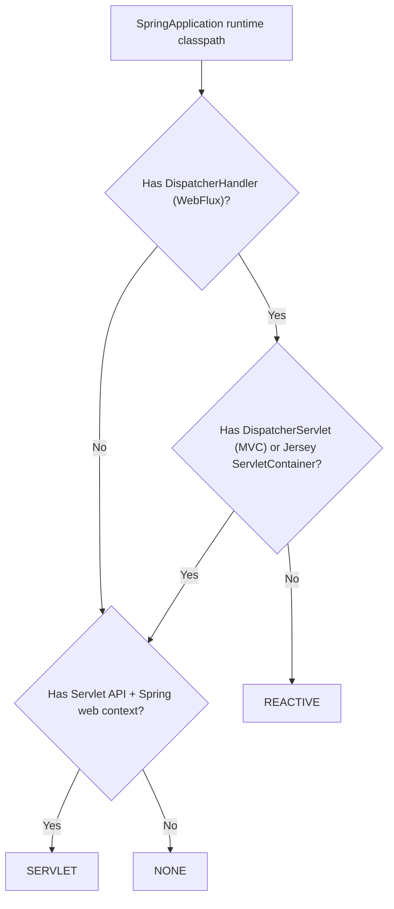

# How Spring Boot Infers the Application Type from the Classpath

## 1. The Problem to Understand

A Spring Boot application is not necessarily a web server. The same `main` class calling `SpringApplication.run(...)` can initialize a **non-web application**, a **Servlet-based web application**, or a **reactive web application**. Under default configuration, the initial decision is **inferred from the classes actually present on the runtime classpath**.

For example, adding `spring-boot-starter-web` typically makes the application a Servlet web application; adding only `spring-boot-starter-webflux` typically makes it a reactive web application; if none of the detectable web infrastructure is present, the application typically falls under `NONE`. When both Spring MVC and WebFlux are present, **MVC/Servlet takes precedence in typical starter setups**.

This article describes the mechanism in **Spring Boot 3.x (especially 3.3.x), running on Java 17+**. Spring Boot 4.x has some internal changes in how the detector is organized; when upgrading major versions, consult the source code/documentation for the exact version rather than mechanically applying internal method names from 3.x.

### 1.1. What Is the Runtime Classpath?

The *classpath* is the set of classes and libraries that the class loader can load when the program actually runs. It includes the application's classes and direct or transitive dependencies present at runtime. In a Spring Boot executable JAR, library JARs packaged by the Boot launcher mechanism also participate in the application's logical classpath.

Distinguish between:

- **Dependency declarations** in `build.gradle`/`pom.xml`: describe intent.
- **Resolved runtime classpath**: contains the classes the application actually sees after accounting for dependencies, exclusions, build profiles/configurations, and packaging.
- **Started ApplicationContext and web server**: the result of the bootstrap step after selecting the application type.

Spring Boot does not decide solely by the artifact name `starter-web` or a module name. It detects **the presence of characteristic infrastructure classes**. Consequently, transitive dependencies can also alter the outcome.

## 2. Three WebApplicationType Values

Spring Boot 3.x uses the enum `org.springframework.boot.WebApplicationType`:

| Value | Meaning | Context Type Boot Typically Creates by Default | Embedded HTTP Server |
| --- | --- | --- | --- |
| `NONE` | Java/Spring application not running in web mode | `AnnotationConfigApplicationContext` | Not auto-started |
| `SERVLET` | Servlet API-based web application, typically using Spring MVC | `AnnotationConfigServletWebServerApplicationContext` | Typically present, e.g., Tomcat |
| `REACTIVE` | Reactive web application, typically using Spring WebFlux | `AnnotationConfigReactiveWebServerApplicationContext` | Typically present, e.g., Reactor Netty |

**Note:** The context names in the table are typical results with Spring Boot 3.x's default `ApplicationContextFactory`. Applications can configure a custom factory/context. The inferred type also **does not guarantee startup success**: an application may be detected as `SERVLET` or `REACTIVE` yet lack a web server factory, be misconfigured, or have dependency conflicts.

What differs here is the **application infrastructure type**; all three run on the JVM and can use dependency injection, `@Configuration`, `@Bean`, services/repositories, and the Spring lifecycle.

## 3. When Does Spring Boot Perform Inference?

When creating a `SpringApplication` with default configuration, Spring Boot 3.x picks an initial `WebApplicationType` based on loadable classes. Later during `run(...)`, Boot prepares the environment and binds `spring.main.*` properties; a value explicitly set by the developer can replace the initial choice.

Simplified flow:

```text
java -jar / bootRun
        |
        v
Resolved runtime classpath
        |
        v
new SpringApplication(...)
        |
        v
Check indicator classes for WebFlux / MVC / Jersey / Servlet
        |
        +--> REACTIVE, SERVLET, or NONE (initial inferred value)
        |
        v
Read and apply relevant SpringApplication configuration
        |    e.g., spring.main.web-application-type
        v
Select appropriate ApplicationContext type
        |
        v
Refresh context, auto-configuration, create embedded server if needed
        |
        v
ApplicationReadyEvent on successful startup
```

**Application type inference is distinct from auto-configuration.** Inference answers "which runtime model should `SpringApplication` organize around?". Auto-configuration then uses classpath, bean, and property conditions to choose appropriate infrastructure beans. For example, inferring `SERVLET` does not mean "Tomcat has already started successfully".

## 4. Spring Boot 3.x Inference Algorithm

### 4.1. Indicator Classes

In Spring Boot 3.x's internal mechanism, the key class names include:

| Indicator | Fully Qualified Class Name | Used to Detect |
| --- | --- | --- |
| WebFlux handler | `org.springframework.web.reactive.DispatcherHandler` | Spring WebFlux request-handling infrastructure |
| Spring MVC dispatcher | `org.springframework.web.servlet.DispatcherServlet` | Spring MVC request-handling infrastructure |
| Jersey servlet | `org.glassfish.jersey.servlet.ServletContainer` | Jersey Servlet infrastructure, preventing some classpaths from being mistaken as reactive |
| Servlet API | `jakarta.servlet.Servlet` | Spring Boot 3.x Servlet API infrastructure |
| Spring servlet context | `org.springframework.web.context.ConfigurableWebApplicationContext` | Spring web context infrastructure |

In **Spring Boot 2.x**, Servlet API classes belonged to the `javax.servlet.*` namespace; **Spring Boot 3.x** uses `jakarta.servlet.*`. Copying an algorithm with `javax.servlet.Servlet` from an older article and applying it to Boot 3.x will lead to wrong conclusions.

Spring checks class presence (e.g., `ClassUtils.isPresent`), rather than scanning source-code packages for `@Controller` or reading a starter's name.

### 4.2. Steps and Precedence Order

Equivalent decision logic in **Spring Boot 3.x** (pseudocode using readable names; this is not a public API for direct user invocation):

```text
if classpath has WebFlux DispatcherHandler
   and does NOT have Spring MVC DispatcherServlet
   and does NOT have Jersey ServletContainer:
       WebApplicationType = REACTIVE
else if classpath has BOTH jakarta.servlet.Servlet
        and ConfigurableWebApplicationContext:
       WebApplicationType = SERVLET
else:
       WebApplicationType = NONE
```

Three important observations:

1. **REACTIVE has its own detection branch**, requiring the WebFlux indicator and the absence of MVC or Jersey indicators.
2. If it does not enter the REACTIVE branch, Boot checks for **both** Servlet indicator classes to choose `SERVLET`.
3. If neither branch matches, the result is `NONE`. Therefore, do not infer "seeing any class with the word web means it must be a web application".

In projects using standard starters, the algorithm above is often summarized as **MVC first, WebFlux second, otherwise NONE**. This shorthand is useful to remember, though actual class checks include the Servlet/Jersey conditions above.

### 4.3. Decision Flowchart Illustration



The diagram is scoped to **Spring Boot 3.x's** default inference rules. It does not account for cases where the application **overrides the web type** via configuration or customizes context creation.

## 5. Typical Classpath Scenarios

The following table assumes dependencies resolve via common Spring Boot 3.3.x starters, without excluding key classes and without a `spring.main.web-application-type` override:

| Main Runtime Dependencies | Typically Present Indicators | Default Result | Reason |
| --- | --- | --- | --- |
| `spring-boot-starter`, no web stack | Lacks MVC/WebFlux and lacks full Servlet indicators | `NONE` | Project has a Spring context but no web runtime |
| `spring-boot-starter-web` | `DispatcherServlet` along with Servlet API and Spring web context | `SERVLET` | Spring MVC/Servlet detected |
| `spring-boot-starter-webflux`, no MVC/Jersey | `DispatcherHandler` | `REACTIVE` | WebFlux detected, not blocked by MVC/Jersey |
| Both `spring-boot-starter-web` and `spring-boot-starter-webflux` | Both MVC and WebFlux indicators | `SERVLET` | MVC is present so reactive branch is skipped; Servlet conditions satisfied |
| Only a library using Reactor, no WebFlux dispatcher | No `DispatcherHandler` | Usually `NONE` | Reactor Core does not equal WebFlux web runtime |
| Has `spring-webflux` to use `WebClient` in an MVC app | MVC and WebFlux typically both appear | `SERVLET` | Adding `WebClient` does not turn an MVC server into WebFlux |

**Common example:** An MVC API using `WebClient` to call external services can still use Tomcat + `DispatcherServlet`. A reactive client library **differs from** the application's own HTTP server model.

**Jersey scenario:** Having `org.glassfish.jersey.servlet.ServletContainer` prevents the REACTIVE priority branch from being chosen in 3.x's mechanism. However, a `SERVLET` outcome still requires full Servlet indicators; do not claim the presence of a single Jersey class alone proves a working servlet server exists.

## 6. Hands-On Lab: Running the Same Main with Three Different Classpaths

The example uses **Java 17+ and Spring Boot 3.3.x**. You can generate a Spring Boot Gradle Groovy project via Spring Initializr, select Java 17, and swap dependencies as shown below. The core of the experiment is **keeping the Java source unchanged and only changing runtime dependencies**.

### 6.1. The build.gradle File

Complete Gradle Java configuration example (designed for Spring Boot 3.3.13):

```groovy
plugins {
    id 'java'
    id 'org.springframework.boot' version '3.3.13'
    id 'io.spring.dependency-management' version '1.1.7'
}

group = 'com.example'
version = '0.0.1-SNAPSHOT'

java {
    toolchain {
        languageVersion = JavaLanguageVersion.of(17)
    }
}

repositories {
    mavenCentral()
}

dependencies {
    implementation 'org.springframework.boot:spring-boot-starter'
}
```

In the first pass, only `spring-boot-starter` is present (no web starter). In subsequent passes, **replace only the `dependencies` section** with one of the blocks below:

**Servlet pass:**

```groovy
dependencies {
    implementation 'org.springframework.boot:spring-boot-starter-web'
}
```

**Reactive pass:**

```groovy
dependencies {
    implementation 'org.springframework.boot:spring-boot-starter-webflux'
}
```

**Mixed MVC + WebFlux pass:**

```groovy
dependencies {
    implementation 'org.springframework.boot:spring-boot-starter-web'
    implementation 'org.springframework.boot:spring-boot-starter-webflux'
}
```

Use only one dependency block at a time per pass and rerun the application. Web starters already pull in core Spring infrastructure, so the examples do not need a separate `spring-boot-starter` when using the web/webflux starter.

### 6.2. Java File Measuring Application Type and Context

Create **`src/main/java/com/example/webtype/WebTypeLabApplication.java`**:

```java
package com.example.webtype;

import java.util.Map;

import org.springframework.boot.SpringApplication;
import org.springframework.boot.autoconfigure.SpringBootApplication;
import org.springframework.boot.web.context.WebServerApplicationContext;
import org.springframework.context.ConfigurableApplicationContext;

@SpringBootApplication
public class WebTypeLabApplication {

    public static void main(String[] args) {
        SpringApplication application =
                new SpringApplication(WebTypeLabApplication.class);

        // Pick a random port for experiments with a web server.
        // Default values can be overridden by command-line arguments.
        application.setDefaultProperties(Map.of(
                "server.port", "0",
                "spring.main.banner-mode", "off",
                "logging.level.root", "ERROR"
        ));

        try (ConfigurableApplicationContext context = application.run(args)) {
            System.out.println("Type: " + application.getWebApplicationType());
            System.out.println("Context: " + context.getClass().getSimpleName());
            System.out.println("WebServerContext: "
                    + (context instanceof WebServerApplicationContext));
        }
    }
}
```

**Why does this code measure the exact thing we need to learn?**

- `new SpringApplication(...)` creates the bootstrap object and performs the default type selection.
- `application.run(args)` initializes the actual context while applying properties configured during startup.
- `getWebApplicationType()` reports the type `SpringApplication` is using after bootstrap. Do not call the internal `deduceFromClasspath()` method because it is not a public application API in Boot 3.x.
- `context.getClass().getSimpleName()` reports the actual context class created.
- `instanceof WebServerApplicationContext` distinguishes a web server context from a standard context in default scenarios.
- `server.port=0` lets the OS choose an available port for web runs, avoiding port 8080 conflicts; `try` closes the context after printing so the application does not keep serving HTTP indefinitely.

### 6.3. Run Commands

**Windows PowerShell:**

```powershell
.\gradlew.bat bootRun
```

**macOS/Linux:**

```bash
./gradlew bootRun
```

The example assumes the project has a Gradle Wrapper and dependencies are resolved. Gradle may print build task info before/after the application's stdout.

### 6.4. Expected Results

**`spring-boot-starter` only:**

```text
Type: NONE
Context: AnnotationConfigApplicationContext
WebServerContext: false
```

**`spring-boot-starter-web` only:**

```text
Type: SERVLET
Context: AnnotationConfigServletWebServerApplicationContext
WebServerContext: true
```

**`spring-boot-starter-webflux` only:**

```text
Type: REACTIVE
Context: AnnotationConfigReactiveWebServerApplicationContext
WebServerContext: true
```

**Both web starters:**

```text
Type: SERVLET
Context: AnnotationConfigServletWebServerApplicationContext
WebServerContext: true
```

These are the three lines **printed by the sample code itself** for each case with Boot 3.3.x's default `ApplicationContextFactory`; actual logs can vary by build tool, configuration, and dependencies. If a custom context factory or override configuration is used, reason based on the actual configuration.

## 7. Overriding WebApplicationType When You Do Not Want the Inferred Result

### 7.1. Via application.properties

This setting tells Spring Boot not to start the application in web mode even if MVC/WebFlux is on the classpath:

```properties
spring.main.web-application-type=none
```

YAML equivalent:

```yaml
spring:
  main:
    web-application-type: none
```

Used for batch jobs, CLIs, workers, or run-and-exit tasks when the project still carries web libraries for other purposes. Apply this setting in the appropriate environment; if the application genuinely needs to accept HTTP requests, `NONE` will not create a web server for you.

**Distinguishing commonly confused properties:**

| Configuration | Main Effect |
| --- | --- |
| `spring.main.web-application-type=none` | Chooses a non-web application context, does not auto-start an embedded web server |
| `server.port=0` | Still a web application; web server listens on an OS-assigned available port |
| `server.port=-1` | With supporting web server setups, disables the HTTP listener while keeping the web application context; not equivalent to `NONE` |
| `server.port=8081` | Changes the HTTP port; does not switch `SERVLET` to `REACTIVE` or vice versa |

**Switching to `REACTIVE` via configuration** only makes sense when the classpath has **sufficient WebFlux infrastructure and a compatible reactive web server factory**. If only the Servlet starter is present and `REACTIVE` is forced, the application can fail during context creation/refresh. Overriding the enum **does not automatically download additional libraries**.

### 7.2. Via Java Code

With `SpringApplication`:

```java
SpringApplication application = new SpringApplication(WebTypeLabApplication.class);
application.setWebApplicationType(WebApplicationType.NONE);
application.run(args);
```

Required imports:

```java
import org.springframework.boot.SpringApplication;
import org.springframework.boot.WebApplicationType;
```

This is a **standalone illustration snippet**, placed in `main` in place of the corresponding run logic from the earlier example; it is not a second standalone Java file.

Or using `SpringApplicationBuilder`:

```java
new SpringApplicationBuilder(WebTypeLabApplication.class)
        .web(WebApplicationType.NONE)
        .run(args);
```

Additional import is `org.springframework.boot.builder.SpringApplicationBuilder`.

When file configuration, command-line arguments, and programmatic setup all exist, verify **the final value `SpringApplication` uses** and how Boot binds `spring.main.*` in that version; do not infer precedence from the position of statements in source code.

### 7.3. Testing an Override Directly on the Command Line

In the Gradle example you created, try:

```powershell
.\gradlew.bat bootRun --args="--spring.main.web-application-type=none"
```

```bash
./gradlew bootRun --args='--spring.main.web-application-type=none'
```

When the project has `starter-web` and no other custom configuration, the result switches to:

```text
Type: NONE
Context: AnnotationConfigApplicationContext
WebServerContext: false
```

**No dependency changes** were made in this test: the `spring.main.web-application-type` setting itself altered the runtime type, proving that the classpath only determines the **default**.

## 8. Adding Dependencies or Editing Configuration: What Actually Changes?

Suppose the project initially is an HTTP API running Spring MVC:

```groovy
dependencies {
    implementation 'org.springframework.boot:spring-boot-starter-web'
}
```

Later the team wants to call an external system with `WebClient` and adds:

```groovy
dependencies {
    implementation 'org.springframework.boot:spring-boot-starter-web'
    implementation 'org.springframework.boot:spring-boot-starter-webflux'
}
```

The usual outcome remains `SERVLET`. `WebClient` can act as an HTTP client inside a Servlet application; **the outbound client API a controller calls does not determine the web server handling inbound requests**.

Conversely, to actually use a reactive web server for inbound requests, design dependencies so no MVC indicator creeps in; use the WebFlux starter, appropriate controllers/handlers, and verify the `REACTIVE` type. If both stacks are present for special reasons, consider an intentional override while checking all required beans/web server factories. Choosing `REACTIVE` merely because you want a non-blocking HTTP client confuses the client and server models.

## 9. Inspecting the Classpath and Diagnosing Wrong Application Types

### 9.1. Inspect Runtime Dependencies, Not Project Names

In Gradle:

```powershell
.\gradlew.bat dependencies --configuration runtimeClasspath
```

Or on macOS/Linux:

```bash
./gradlew dependencies --configuration runtimeClasspath
```

With Maven:

```bash
./mvnw dependency:tree
```

Look for `spring-webmvc`, `spring-webflux`, `jakarta.servlet-api`, web server starters, and transitive dependencies. If you unexpectedly get `SERVLET`, check which dependency pulled `spring-webmvc`/`DispatcherServlet` into runtime. If you unexpectedly get `NONE`, check whether Servlet/WebFlux indicator classes are missing. **A dependency's presence on the compile classpath does not guarantee it is present when running the deployed JAR**.

When evaluating an executable JAR, ensure it is the right artifact and right runtime environment. Local IDE, `bootRun`, and `java -jar` can run with different dependency sets or properties if build/deployment configuration is inconsistent.

### 9.2. Reading the Actual Context After Running

A successfully started app can print:

```java
System.out.println(context.getClass().getName());
```

Context classes in Spring Boot or Spring Context packages show how the app was bootstrapped. Combine this with reading `application.getWebApplicationType()`, `spring.main.web-application-type` configuration lines, and the dependency tree to locate the root cause. **Do not use "has an HTTP endpoint" as the sole signal**, because a web context may not have opened a port yet or an endpoint may be restricted by routing/security.

### 9.3. Common Errors

| Symptom | Possible Cause | How to Handle |
| --- | --- | --- |
| Expected WebFlux, but logs/context show Servlet | `spring-webmvc`/`DispatcherServlet` was pulled onto the classpath | Inspect dependency tree; remove unnecessary MVC dependency or choose a verified override |
| Expected a web server, but got `NONE` | Missing indicator classes; dependency excluded or runtime differs from compile time | Check runtime classpath, packaging, and `spring.main.web-application-type` configuration |
| `SERVLET` selected, but startup fails | Missing `ServletWebServerFactory`/embedded server or wrong server configuration | Restore appropriate web server starter; check root cause in the exception |
| Forced `REACTIVE` and hit missing reactive web server factory | Enum value is `REACTIVE` but actual reactive web infrastructure is missing | Add compatible WebFlux/reactive server or remove the override |
| App still uses a web context, yet no HTTP port is open | `server.port=-1` or another setting disabled the listener | Clarify intent: do you need a web context or `NONE` |
| Added `WebClient` and thought the app switched to reactive | Confusing HTTP client with reactive server model | Check `WebApplicationType`; MVC still typically wins when both are present |
| Assumed context type depends on `@RestController` annotations | Inference is based on classes on the runtime classpath, not controller count | Check dependencies and indicator classes instead of counting annotations |

Having no `@Controller` can still create a web server if classpath and config indicate a web type. Conversely, placing controller annotations in source does not provide full Servlet/WebFlux at runtime when required libraries are missing.

## 10. Misconceptions to Avoid

1. **"`@SpringBootApplication` means it is a web application."** False. This annotation is also used for CLIs, batch jobs, and services that open no HTTP port.
2. **"Boot looks at the name `spring-boot-starter-web` to pick the enum."** Inaccurate. It detects indicator classes on the runtime classpath; starters are simply the usual way to bring those classes in.
3. **"`WebClient` means the app runs a WebFlux server."** False. Outbound client and inbound request-handling server are two distinct roles.
4. **"Having both Web MVC + WebFlux starters makes Boot pick REACTIVE."** The common Boot 3.x default is `SERVLET` because MVC takes precedence.
5. **"Having any WebFlux class yields REACTIVE."** False. The 3.x algorithm checks `DispatcherHandler` and the absence of MVC/Jersey indicators.
6. **"Just one Servlet API class yields SERVLET."** False. Boot 3.x also checks Spring's Servlet web context, and the REACTIVE branch comes before it.
7. **"Inferring SERVLET means the server is already running."** False. Runtime type selection happens before refresh/startup; missing a server factory still causes failure.
8. **"Setting `server.port=0` turns the app into NONE."** False. Port 0 requests a random available port; `spring.main.web-application-type=none` explicitly chooses non-web.
9. **"One classpath inference applies to every deployment."** False. Dependencies and properties across artifacts, profiles, and environments can differ.
10. **"Always apply the Boot 2.x or 4.x algorithm unchanged to 3.x."** False. Servlet namespaces and detection mechanisms can change across major versions.

## 11. Self-Check Questions

**Question 1.** A project has only `spring-boot-starter`, no WebFlux/MVC indicators, no override. What type?

> `NONE`. The application still has a Spring container and beans, but does not auto-run an HTTP server.

**Question 2.** Add `spring-boot-starter-web` to the project and configure nothing else?

> Typically `SERVLET`, creating a Servlet web server context; Tomcat is brought in by the starter by default in Boot 3.3.x.

**Question 3.** Add both `spring-boot-starter-web` and `spring-boot-starter-webflux`?

> Typically `SERVLET` because `DispatcherServlet` and Servlet infrastructure are present. `WebClient` can still be used.

**Question 4.** WebFlux `DispatcherHandler` is present, no MVC/Jersey indicators?

> `REACTIVE` under Boot 3.x's inference branch. Startup still subsequently requires complete compatible reactive infrastructure.

**Question 5.** Classpath has Servlet, yet `spring.main.web-application-type=none` is configured?

> The effective configured type is `NONE` when the property is applied. The classpath only provides the default choice.

**Question 6.** Seeing `MissingWebServerFactoryBeanException` means the inference algorithm has a bug?

> Not necessarily. It can indicate Boot chose a web type but lacks the required web server factory to start; check dependencies and stack trace.

**Question 7.** Why can't looking only at `server.port` determine whether the model is MVC or WebFlux?

> `server.port` controls the web server listener; it does not indicate whether HTTP requests flow through Servlet MVC or the reactive WebFlux stack.

## 12. Takeaways and Reference Documentation

- **The classpath determines the default type.** With standard Boot 3.x starters: MVC → `SERVLET`; if no MVC and WebFlux is present → `REACTIVE`; no suitable web infrastructure → `NONE`.
- **The exact algorithm checks indicator conditions**, including Spring MVC, WebFlux, Jersey, and two Servlet indicators. Transitive dependencies and exclusions can affect the result.
- **Configuration can override.** `spring.main.web-application-type` or the `SpringApplication.setWebApplicationType` API allows deliberate selection; compatible dependencies must be ensured.
- **Always verify two layers:** the `WebApplicationType` value `SpringApplication` is using, and the context/server class actually created after startup. Distinguish inference, configuration, auto-configuration, and server startup.

Official documentation aligned with Spring Boot 3.x:

- [Spring Boot 3.3 — SpringApplication / Web Environment](https://docs.spring.io/spring-boot/docs/3.3.0-M2/reference/html/features.html) — describes how Boot selects the context for MVC/WebFlux/non-web.
- [Spring Boot 3.3 — Embedded Web Servers](https://docs.spring.io/spring-boot/3.3/how-to/webserver.html) — how to configure `spring.main.web-application-type=none`, `server.port`, and embedded servers.
- [Spring Boot 3.4 API — `WebApplicationType`](https://docs.spring.io/spring-boot/3.4/api/java/org/springframework/boot/WebApplicationType.html) — enum values and related APIs in the same Boot 3.x generation.

For applications requiring an exact determination on a specific minor/patch version, inspect the `org.springframework.boot.WebApplicationType` and `SpringApplication` source for the version in use, and verify the actual runtime dependencies.
