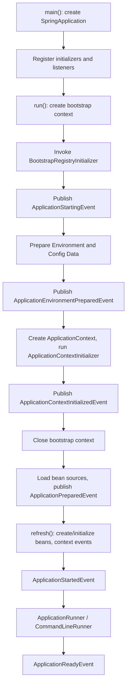

# Preparing the Bootstrap Context and Startup Notification in Spring Boot

## 1. The Problem: Before `ApplicationContext` Exists, What Does Spring Boot Do?

A Spring Boot application typically starts with:

```java
SpringApplication.run(MyApplication.class, args);
```

This concise call hides an important phase: Boot must organize certain work **before `Environment` is complete and before `ApplicationContext` is created**. One component that supports this early phase is the **bootstrap context**. After registering the required startup components, Boot publishes **`ApplicationStartingEvent`**, the event announcing that a `SpringApplication` run has just begun.

The two concepts in the title are closely related, yet have distinct responsibilities:

- **Bootstrap context:** A temporary object registry used during bootstrap, especially when an object must be created or accessed before the main IoC container is ready.
- **Startup notification (`ApplicationStartingEvent`):** An application-level lifecycle signal sent very early so that registered `ApplicationListener` instances can perform appropriate startup actions.

They are not two names for the same object. The bootstrap context holds or supplies objects; the event announces that the run has entered the starting milestone. Both are orchestrated by `SpringApplication`.

This lesson uses the API and package names of **Spring Boot 3.3.x, Java 17+**. Spring Boot 4 changes package organization for certain bootstrap APIs; when working with a 3.x project, use the imports matching your project version.

## 2. Why Is a Separate Bootstrap Context Needed?

Spring Framework manages beans through `ApplicationContext` and `BeanFactory`. However, to create `ApplicationContext`, Boot must prepare the environment, compute configuration sources, and run several very early hooks. Those hooks may need to share an expensive object or reuse one across multiple bootstrap steps.

For example, an external configuration integration component may need a client to read initial metadata. That client may need to be created before the Spring container manages ordinary beans. The bootstrap context allows registering **instance suppliers by type** and instantiating them when a bootstrap component actually requests them.

Key characteristics:

| Property | Bootstrap context | Spring's `ApplicationContext` |
| --- | --- | --- |
| Purpose | Supports the very early preparation phase, especially `Environment` processing and bootstrap resources | Main IoC container managing application and infrastructure beans |
| Lifetime | From the start of `SpringApplication.run()` until the main context is prepared | Created after `Environment` is prepared, then refreshed |
| Access | Register/retrieve by `Class<T>` via `BootstrapRegistry` / `BootstrapContext` | Bean lookup, dependency injection, bean scopes, events |
| Object creation | Typically singletons supplied lazily via `InstanceSupplier` | Based on bean definitions, scopes, dependency graph, post-processors |
| Closing | Has a dedicated `BootstrapContextClosedEvent` during the context preparation phase | Closed via `ApplicationContext.close()`, tied to bean lifecycle |
| Automatically becomes a bean? | **No** | Beans are registered/discovered through container mechanisms |

One easy misconception is that **the bootstrap context here is not the Spring Cloud bootstrap application context** once used with `bootstrap.yml` in some Spring Cloud setups. This is the `BootstrapContext` / `BootstrapRegistry` mechanism belonging to **Spring Boot** for very early application preparation. It is also not a servlet container, Tomcat, or a Docker container.

## 3. The APIs and Their Roles

In Spring Boot 3.3, the key types belong to package `org.springframework.boot`:

- `BootstrapContext`: Interface for retrieving registered instances, such as `get(MyClient.class)` or `isRegistered(MyClient.class)`.
- `BootstrapRegistry`: Interface for registering instance suppliers with `register(...)` or `registerIfAbsent(...)`, and supporting `addCloseListener(...)`.
- `ConfigurableBootstrapContext`: Combines the retrieval capabilities of `BootstrapContext` with the registration capabilities of `BootstrapRegistry`.
- `DefaultBootstrapContext`: The standard implementation created by Boot during the bootstrap phase.
- `BootstrapRegistryInitializer`: Callback for registering components into `BootstrapRegistry` before the registry is used.
- `BootstrapContextClosedEvent`: Event published when the bootstrap context closes and `ApplicationContext` has been prepared.

The corresponding API on `SpringApplication` is:

```java
SpringApplication app = new SpringApplication(MyApplication.class);

app.addBootstrapRegistryInitializer(registry -> {
    registry.register(MyBootstrapClient.class,
            bootstrapContext -> new MyBootstrapClient());
});

app.run(args);
```

**This is an illustrative snippet**, requiring classes `MyApplication` and `MyBootstrapClient` to be defined. A complete runnable example is in section 7.

Worth remembering: call `addBootstrapRegistryInitializer(...)` **before** `run(args)`. Boot invokes the initializers when creating the bootstrap context, and only then notifies the starting event. Registering an `InstanceSupplier` usually **does not** instantiate the object immediately; the object is retrieved the first time `get(...)` is called when needed.

### 3.1. `register`, `registerIfAbsent`, and `get`

Suppose we have a type `BootstrapClient`:

```java
registry.register(BootstrapClient.class,
        bootstrapContext -> new BootstrapClient());

BootstrapClient client = bootstrapContext.get(BootstrapClient.class);
```

In practice, `registry` is typically received from a `BootstrapRegistryInitializer` callback, while `bootstrapContext` is received from a hook or event at the corresponding stage. The code above **illustrates both sides of the API**, not two variables available in the same scope.

- `register(Type.class, supplier)`: Registers a supplier for a type; may replace a previous registration per the API contract.
- `registerIfAbsent(Type.class, supplier)`: Registers only if no supplier is already registered for that type.
- `isRegistered(Type.class)`: Checks whether the type is in the registry without needing to instantiate the object.
- `get(Type.class)`: Retrieves the instance of the registered type, creating it lazily if not yet created; may throw `IllegalStateException` if not registered.

The registry stores entries by **class key**, so it is unlike a bean factory that can have multiple beans implementing the same interface distinguished by name or qualifier. Do not treat the registry as a full IoC container.

### 3.2. When the Bootstrap Context Closes

`BootstrapRegistry#addCloseListener(...)` registers a listener that receives `BootstrapContextClosedEvent` when the bootstrap phase ends. At that moment the main `ApplicationContext` has been **prepared**, but **refresh** and normal singleton instantiation may not have occurred yet.

This is the milestone for handing off early-initialized resources to the main context **if a handoff is truly needed and explicitly designed**. Just because an instance sits in the bootstrap registry does not mean it is automatically placed into the Spring bean registry or receives all bean lifecycle callbacks.

"Closing the bootstrap context" **does not mean** "shutting down the application". It happens right inside the startup sequence, before the application is ready to serve.

## 4. `ApplicationStartingEvent`: The Earliest Startup Notification

`ApplicationStartingEvent` is published by Boot very early when a `SpringApplication.run()` run begins. It occurs **before `Environment` and `ApplicationContext` are available**. Initial listener and initializer preparation has already taken place so that Boot can publish and deliver this event.

In Spring Boot 3.3, the event provides:

| Method | Meaning |
| --- | --- |
| `getSpringApplication()` | The `SpringApplication` instance for the current run |
| `getArgs()` | Input arguments of the current run |
| `getBootstrapContext()` | The early bootstrap context of the current run |
| `getTimestamp()` | Timestamp from the `ApplicationEvent` mechanism |

Do not call `event.getApplicationContext()` at this milestone: `ApplicationStartingEvent` does not represent a main context that has already been created. If you need to read configured properties or access application beans, pick a later milestone.

Example using a `SpringApplication` instance:

```java
SpringApplication app = new SpringApplication(MyApplication.class);

app.addListeners(
    (ApplicationListener<ApplicationStartingEvent>) event -> {
        System.out.println("Spring Boot run is starting");
    }
);

app.run(args);
```

The corresponding imports are `org.springframework.context.ApplicationListener` and `org.springframework.boot.context.event.ApplicationStartingEvent`. This illustrative snippet requires configuration class `MyApplication`; the complete example is in section 7.

### 4.1. Why Can `@EventListener` in a Bean Miss the Event?

The example below is **not a reliable way to catch `ApplicationStartingEvent`**:

```java
@Component
class TooLateListener {
    @EventListener
    void whenStarting(ApplicationStartingEvent event) {
        System.out.println("starting");
    }
}
```

Reason: the listener bean is only created after the context has processed bean definitions, whereas `ApplicationStartingEvent` has already been published earlier. If a listener needs early events, register it with `SpringApplication.addListeners(...)` before `run(args)`, use `SpringApplicationBuilder.listeners(...)`, or register the `ApplicationListener` via Boot's `META-INF/spring.factories` mechanism.

A listener defined as a `@Bean` or `@EventListener` is a good choice for **events after beans have been registered**, but it is not the default tool for bootstrap events occurring before the container exists.

### 4.2. `ApplicationStartingEvent` vs. `ApplicationStartedEvent`

Two names that are easy to confuse:

- **`ApplicationStartingEvent`**: Starts the bootstrap sequence, very early, **before** `Environment` or a complete `ApplicationContext` exists.
- **`ApplicationStartedEvent`**: `ApplicationContext` has finished **refreshing**, but `ApplicationRunner` and `CommandLineRunner` have **not** been invoked yet.
- **`ApplicationReadyEvent`**: Boot has invoked the runners and reached completion of the normal startup process.

`ApplicationStartingEvent` is a *starting* signal, not proof that the server is ready. If a runner throws an error after refresh, `ApplicationStartedEvent` may already have occurred while the success-path `ApplicationReadyEvent` will not be published.

## 5. Execution Order Inside `SpringApplication.run()`

Conceptual model of Spring Boot 3.3 on a successful startup:



The diagram focuses on the key milestones for this lesson and does not show every internal hook. In practice, `ApplicationEnvironmentPreparedEvent` is also part of the process where listeners/processors contribute to processing `Environment`; you should not infer that **all configuration sources** have already finished processing inside an arbitrary listener merely because the event name contains the word "Prepared".

Specifically in Spring Boot 3.3, the bootstrap context is closed while preparing the application context, **before** `ApplicationPreparedEvent` is published after loading bean sources. That shows the bootstrap registry lifecycle finishes before the entire Spring IoC context is refreshed.

### Milestones to Distinguish

| Milestone | What is ready | What should not be assumed yet |
| --- | --- | --- |
| After `BootstrapRegistryInitializer` | Registry and registered suppliers exist | Complete `Environment`, application beans |
| `ApplicationStartingEvent` | `SpringApplication`, args, bootstrap context exist | `ApplicationContext` exists |
| `ApplicationEnvironmentPreparedEvent` | `Environment` object exists for the system to prepare/adjust | Spring bean factory is refreshed |
| `ApplicationContextInitializedEvent` | Main context exists and `ApplicationContextInitializer` instances have run | Bean definitions are fully loaded or singletons are created |
| `BootstrapContextClosedEvent` | Main context has been prepared; bootstrap registry ends its role | `ApplicationContext` has finished refreshing |
| `ApplicationPreparedEvent` | Bean sources have been loaded; context is about to refresh | Singleton beans have finished initializing |
| `ApplicationStartedEvent` | Context has refreshed | Runners have finished executing |
| `ApplicationReadyEvent` | Runners have finished on the success branch | External systems will remain healthy indefinitely |

If an error occurs along the startup path, the success sequence may stop early and Boot publishes `ApplicationFailedEvent` per its error-handling mechanism. Do not write business logic assuming every event in the table always arrives in full.

## 6. Why Have Both a Registry and an Event?

The two mechanisms solve two different requirements.

**Requirement 1: Sharing bootstrap resources.** An `EnvironmentPostProcessor` or early integration component may need a client to fetch configuration. `BootstrapRegistry` lets multiple components retrieve the same registered instance rather than each creating its own. In complex cases, the registry also helps organize handoff once `ApplicationContext` has been created.

**Requirement 2: Milestone notification.** Logging or startup metrics may need to know that a run has just started. `ApplicationStartingEvent` provides this signal to early-registered listeners, even before any application bean exists.

| Question | What to use? |
| --- | --- |
| "I need to share an instance used in environment processing steps before beans exist." | `BootstrapRegistry` and `BootstrapRegistryInitializer` |
| "I need to run logic extremely early when Boot starts running." | `ApplicationListener<ApplicationStartingEvent>` |
| "I need to adjust a configuration property before loading bean definitions." | Choose a standard extension point for `Environment`/Config Data such as `EnvironmentPostProcessor`, or an appropriate listener with explicit ordering |
| "I need to initialize state for an injected singleton." | `@PostConstruct` / custom init, no bootstrap registry needed |
| "I need to validate data after refresh and possibly fail startup." | `ApplicationRunner` or `CommandLineRunner` |
| "I need to know when runners have finished." | `ApplicationReadyEvent` |

In ordinary applications, there is no need to create a bootstrap registry yourself. Spring Boot uses that mechanism at the infrastructure layer and provides extension APIs for specialized bootstrap cases.

## 7. Runnable Example: Observing the Bootstrap Context and Starting Event

This example runs with **Java 17+ and Spring Boot 3.3.x**. Create a Spring Boot project with the `spring-boot-starter` dependency; no web starter is needed. The program registers a token in the bootstrap registry, retrieves the token in the listener catching the starting event, tracks subsequent milestones, and closes the application context after `run()` returns.

Place the file at `src/main/java/com/example/bootstrap/BootstrapSequenceDemo.java`:

```java
package com.example.bootstrap;

import org.springframework.boot.Banner;
import org.springframework.boot.CommandLineRunner;
import org.springframework.boot.SpringApplication;
import org.springframework.boot.WebApplicationType;
import org.springframework.boot.autoconfigure.SpringBootApplication;
import org.springframework.boot.context.event.ApplicationContextInitializedEvent;
import org.springframework.boot.context.event.ApplicationEnvironmentPreparedEvent;
import org.springframework.boot.context.event.ApplicationPreparedEvent;
import org.springframework.boot.context.event.ApplicationReadyEvent;
import org.springframework.boot.context.event.ApplicationStartedEvent;
import org.springframework.boot.context.event.ApplicationStartingEvent;
import org.springframework.context.ApplicationListener;
import org.springframework.context.annotation.Bean;

@SpringBootApplication
public class BootstrapSequenceDemo {

    public static void main(String[] args) {
        SpringApplication app = new SpringApplication(BootstrapSequenceDemo.class);
        app.setWebApplicationType(WebApplicationType.NONE);
        app.setBannerMode(Banner.Mode.OFF);
        app.setLogStartupInfo(false);

        // Very early phase: register the supplier and the bootstrap context close callback.
        app.addBootstrapRegistryInitializer(registry -> {
            System.out.println("01 - BootstrapRegistryInitializer");
            registry.register(StartupToken.class,
                    context -> new StartupToken("registered"));
            registry.addCloseListener(event ->
                    System.out.println("05 - BootstrapContextClosedEvent"));
        });

        // Early listener: must be registered directly before run().
        app.addListeners((ApplicationListener<ApplicationStartingEvent>) event -> {
            System.out.println("02 - ApplicationStartingEvent");
            StartupToken token =
                    event.getBootstrapContext().get(StartupToken.class);
            System.out.println("token=" + token.value());
        });

        app.addListeners(
                (ApplicationListener<ApplicationEnvironmentPreparedEvent>)
                        event -> System.out.println(
                                "03 - ApplicationEnvironmentPreparedEvent"));

        app.addListeners(
                (ApplicationListener<ApplicationContextInitializedEvent>)
                        event -> System.out.println(
                                "04 - ApplicationContextInitializedEvent"));

        app.addListeners(
                (ApplicationListener<ApplicationPreparedEvent>)
                        event -> System.out.println(
                                "06 - ApplicationPreparedEvent"));

        app.addListeners(
                (ApplicationListener<ApplicationStartedEvent>)
                        event -> System.out.println(
                                "07 - ApplicationStartedEvent"));

        app.addListeners(
                (ApplicationListener<ApplicationReadyEvent>)
                        event -> System.out.println(
                                "09 - ApplicationReadyEvent"));

        try (var context = app.run(args)) {
            System.out.println("10 - SpringApplication.run returned");
        }
    }

    @Bean
    CommandLineRunner startupRunner() {
        return args -> System.out.println("08 - CommandLineRunner");
    }

    record StartupToken(String value) {
    }
}
```

### 7.1. Running the Project

With Maven Wrapper in the project directory:

```bash
./mvnw spring-boot:run
```

With Gradle Wrapper and the Spring Boot plugin:

```bash
./gradlew bootRun
```

On Windows PowerShell, substitute `.\mvnw.cmd spring-boot:run` or `.\gradlew.bat bootRun`. These commands run a Spring Boot project that already has dependencies and build configuration, not a plain `javac` command on a single file without Spring libraries on the classpath.

### 7.2. Expected Output

On a normal startup, the lines produced by **the example program** appear in this order:

```text
01 - BootstrapRegistryInitializer
02 - ApplicationStartingEvent
token=registered
03 - ApplicationEnvironmentPreparedEvent
04 - ApplicationContextInitializedEvent
05 - BootstrapContextClosedEvent
06 - ApplicationPreparedEvent
07 - ApplicationStartedEvent
08 - CommandLineRunner
09 - ApplicationReadyEvent
10 - SpringApplication.run returned
```

The console may still interleave Spring Boot or build-tool logs between lines depending on configuration. The program does not open an HTTP port because `WebApplicationType.NONE` was chosen.

### 7.3. Explaining the Output

1. `app.run(args)` creates the bootstrap context and invokes `BootstrapRegistryInitializer`; only the supplier for `StartupToken` is registered at this point.
2. Boot publishes `ApplicationStartingEvent`. The early listener calls `event.getBootstrapContext().get(StartupToken.class)` to **create/retrieve the token for the first time**. The line `token=registered` proves the registry is already usable before the main context exists.
3. Boot proceeds through preparing `Environment`, then creates and initializes the main context.
4. The bootstrap context closes, publishing `BootstrapContextClosedEvent` to the listener registered via `addCloseListener`.
5. Boot then completes context preparation, loads bean sources, notifies `ApplicationPreparedEvent`, and refreshes.
6. Once refresh finishes, Boot publishes `ApplicationStartedEvent`, invokes `CommandLineRunner`, and then publishes `ApplicationReadyEvent`.
7. `SpringApplication.run(args)` returns the context to `main()`; try-with-resources closes the context at the end of the block.

Try removing the `get(StartupToken.class)` call from the listener: **the supplier does not need to run**, because registering a supplier is different from requesting instance creation. To verify this visually, add a log statement inside the supplier and compare the two runs.

### 7.4. Why Use a `record` in the Example?

`record StartupToken(String value)` is simply an illustrative Java value object, requiring Java 16+; a Java 17+ project already satisfies this. It is **not** a Spring bean and does not need `@Component`. The bootstrap registry holds instances by class key; that is the very property being observed.

### 7.5. What Happens on a Startup Error?

If an initializer or very early listener throws an exception, startup can stop before the main context is created. If an exception occurs after refresh inside a runner, `ApplicationStartedEvent` may already have been published while `ApplicationReadyEvent` is not published.

Do not design bootstrap callbacks assuming a Spring bean will always be there to handle cleanup. A resource created outside the IoC container needs its own **resource ownership and closing procedure**, especially when startup fails midway.

## 8. Integrating via `META-INF/spring.factories` When Building a Library

In a standalone application, `app.addListeners(...)` and `app.addBootstrapRegistryInitializer(...)` are easy to see and control. However, a library may not own the `main()` class of the application using it. In that case, Spring Boot 3.3 provides a mechanism to declare certain startup components in `META-INF/spring.factories`.

Illustrative configuration example:

```properties
org.springframework.boot.BootstrapRegistryInitializer=\
com.example.library.LibraryBootstrapInitializer

org.springframework.context.ApplicationListener=\
com.example.library.EarlyStartupListener
```

This is **metadata for Boot to discover classes provided by a library**, not two standalone Java code lines. The classes must actually exist, implement the right interfaces, and have appropriate constructors. `SpringFactoriesLoader` has its own rules for classpath, constructors, and ordering; when writing a production library, test with the exact Boot version.

Initializer implementation template:

```java
package com.example.library;

import org.springframework.boot.BootstrapRegistry;
import org.springframework.boot.BootstrapRegistryInitializer;

public final class LibraryBootstrapInitializer
        implements BootstrapRegistryInitializer {

    @Override
    public void initialize(BootstrapRegistry registry) {
        registry.registerIfAbsent(LibraryClient.class,
                context -> new LibraryClient());
    }
}
```

This is an **integration snippet**, assuming an appropriate `LibraryClient` class exists. A library can register its own `ApplicationListener<ApplicationStartingEvent>` to catch early events. For simple use cases, prefer the complete example in section 7 before using the library mechanism.

**Do not confuse `BootstrapRegistryInitializer` with `ApplicationContextInitializer`.**

- `BootstrapRegistryInitializer` works with the very early **bootstrap context registry**.
- `ApplicationContextInitializer<ConfigurableApplicationContext>` customizes the **main application context** after it is created, before normal bean definitions are loaded.
- `BeanFactoryPostProcessor` intervenes in bean metadata after the bean factory exists; it belongs to a different phase.
- `@PostConstruct` runs on a bean already created/injected by Spring; much later than `ApplicationStartingEvent`.

## 9. Connecting the Bootstrap Context to `EnvironmentPostProcessor`

Components that need to prepare remote configuration or special configuration sources often run near the `Environment` creation phase. In Spring Boot 3.x, `EnvironmentPostProcessor` is an extension point for modifying `ConfigurableEnvironment` before the application finishes setting up the main context. The APIs support retrieving resources from the bootstrap context, allowing early-running post-processors to share clients or bootstrap state.

However, installing a custom `EnvironmentPostProcessor` is not the default choice just to override a property. Most applications should use `application.properties`/YAML, environment variables, command-line arguments, and supported Config Data options.

If you build an external configuration fetching mechanism, design clearly:

- When to register the client, and when to actually open the connection.
- Ordering among processors and other configuration sources.
- Timeouts, retries, and error handling if the external source is unavailable.
- How to hand off or close the client after the main context is prepared.
- How to avoid logging sensitive information when observing early events.

Do not call business service beans or request autowiring of a repository from `ApplicationStartingEvent`, because the main container has not been created yet.

## 10. Common Errors and How to Fix Them

### "I declared `@EventListener(ApplicationStartingEvent.class)` but see no logs"

The listener bean is created too late. Register an `ApplicationListener<ApplicationStartingEvent>` via `SpringApplication.addListeners(...)` **before** `run(args)` or use early registration via `spring.factories`.

### "I registered a supplier, but the constructor never ran"

That may be the expected behavior: the registry supplies instances **lazily**. `register` does not force immediate object instantiation. Check whether any hook actually calls `get(Type.class)`.

### "I called `bootstrapContext.get(...)` and got `IllegalStateException`"

The requested type may not have been registered, or may have been registered under the wrong class key. Check `isRegistered(...)`, the exact class key, and where the initializer is configured. Use `registerIfAbsent` if a library wants to avoid overwriting a registration from elsewhere.

### "I want to read a bean in `ApplicationStartingEvent`"

`ApplicationContext` does not exist at this milestone. Move the logic to an appropriate milestone after the context is ready, such as a runner or a bean lifecycle callback. Do not force manual container initialization inside a very early listener.

### "`BootstrapContextClosedEvent` appears before `ApplicationPreparedEvent`"

In the standard Spring Boot 3.3 sequence, closing the bootstrap context happens while preparing the main context, before bean sources finish loading and `ApplicationPreparedEvent` is published. This order makes sense: the bootstrap context supports the early preparation phase and then hands over to the main context.

### "Does closing the bootstrap context mean the application has stopped?"

No. That is the end of **the bootstrap phase**, not shutdown. For the application to stop, the main context must be closed or the JVM process must terminate according to the application lifecycle.

### "Why does the listener print multiple times?"

In applications with multiple contexts or multiple `SpringApplication.run()` invocations, a listener can receive multiple events. Spring Framework also propagates events across contexts in a parent–child hierarchy. Do not assume only a single event per process in every topology.

### "I see `ApplicationStartingEvent`, so is the application ready?"

No. It is one of the earliest events; many bootstrap steps, refresh, and runners have not occurred yet. Only use `ApplicationReadyEvent` or the appropriate readiness state to judge whether startup has completed; even readiness can change state at runtime.

### "I put a network connection in the starting listener and startup became slow"

Listeners are invoked synchronously by default; long-running network tasks can delay or block bootstrap. Put only strictly necessary work in the very early phase. For business checks that can run after refresh, consider `ApplicationRunner` with explicit timeout and failure handling.

## 11. Thought Exercises and Verification

**Exercise 1 — Distinguishing three contexts.** For a Spring Boot application with embedded Tomcat, explain:
- What does the bootstrap context provide before the main context is ready?
- What kinds of beans does `ApplicationContext` create and manage?
- What role does Tomcat perform for HTTP requests?

*Hint:* The three objects have three distinct jobs: early bootstrap resources, IoC/bean lifecycle, and HTTP Servlet handling.

**Exercise 2 — Event order.** Put these in the right order for a successful run:

```text
ApplicationPreparedEvent
ApplicationStartingEvent
ApplicationReadyEvent
ApplicationEnvironmentPreparedEvent
ApplicationStartedEvent
```

*Answer:* `ApplicationStartingEvent` → `ApplicationEnvironmentPreparedEvent` → `ApplicationPreparedEvent` → `ApplicationStartedEvent` → `ApplicationReadyEvent`. Many other steps happen between these milestones.

**Exercise 3 — Verifying the lazy supplier.** In the section 7 example, change the supplier to:

```java
registry.register(StartupToken.class, context -> {
    System.out.println("creating StartupToken");
    return new StartupToken("registered");
});
```

Run once with `get(StartupToken.class)` and once without calling `get`. Predict when the `creating StartupToken` line appears. Answer: only in the run where the instance is actually requested for the first time (or another component accesses the same type).

**Exercise 4 — Choosing an extension point.** You want to read a property from `Environment` after necessary configuration loading finishes, but **do not** want to handle the Config Data mechanism yourself. Should you do this in `ApplicationStartingEvent`?  
*Answer:* No, because `Environment` is not ready at this point. Use a milestone after configuration has been appropriately processed or bean binding mechanisms.

**Exercise 5 — Expensive resource.** A startup library needs a client to read remote metadata before the IoC container exists. Design where to register the supplier, where to use it, timeouts, and when to clean up/hand off.  
*Hint:* `BootstrapRegistryInitializer` → register `InstanceSupplier` → bootstrap component retrieves via `BootstrapContext` → plan handling on close event and on the failure branch.

## 12. Knowledge Summary

In Spring Boot, the startup phase **begins before Spring Framework refreshes any main `ApplicationContext`**. Boot creates the bootstrap context, invokes `BootstrapRegistryInitializer`, and publishes `ApplicationStartingEvent` so early listeners can execute. Only then does Boot proceed to prepare `Environment`, create/prepare the main context, load bean sources, and refresh.

Remember three practical rules:

1. **Use the bootstrap registry to store and share resources for the ultra-early preparation phase**, with clear awareness of lazy creation and resource closing/handoff.
2. **Use listeners registered before `run()` to catch `ApplicationStartingEvent`**; `@EventListener` beans are usually created too late.
3. **Do not equate "starting", "started", and "ready"**; choose callbacks according to the exact readiness level of `Environment`, the container, beans, and runners.

Once you understand those boundaries, you can observe and extend the bootstrap mechanism in a controlled way without placing business logic into the phase before the IoC container exists.