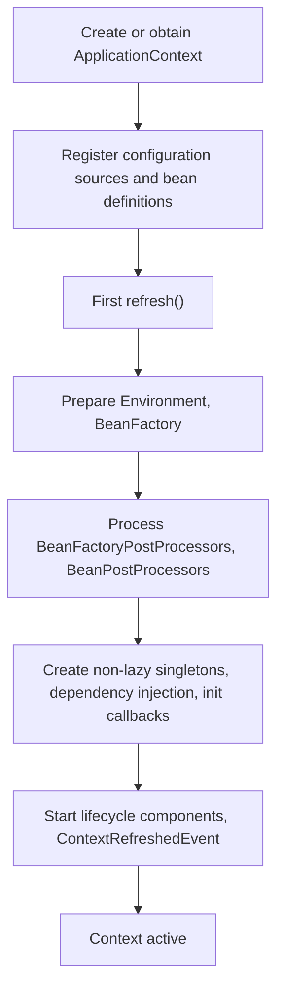
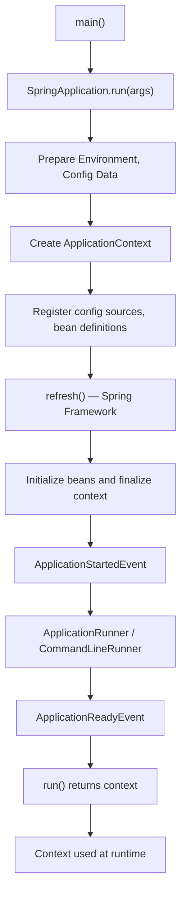
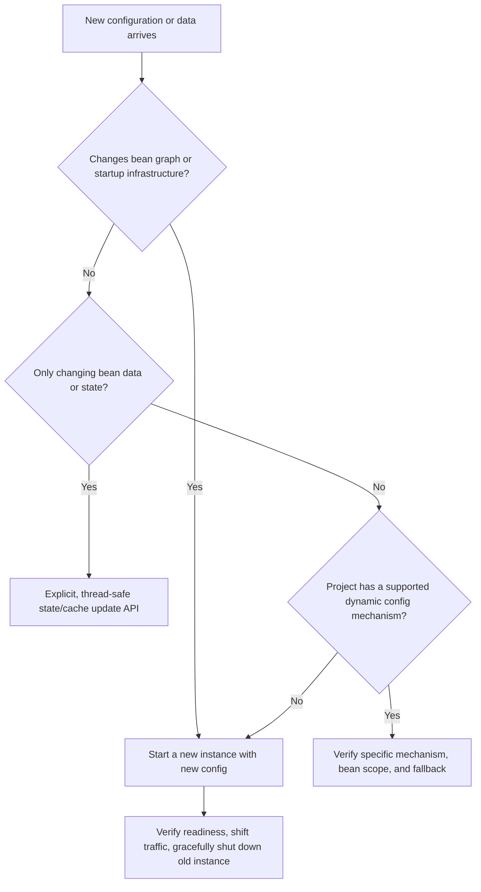

# Limitations of Re-Refreshing an Already Used `ApplicationContext`

## 1. Why Is Calling `refresh()` a Second Time a Problem?

In Spring Framework, `ApplicationContext` is the container managing bean definitions, dependency injection, singletons, lifecycle callbacks, event listeners, and many infrastructure components. `ConfigurableApplicationContext` provides the `refresh()` method to **initialize or refresh the configuration state of the context**.

The name `refresh()` easily leads to the assumption: "Once the application is running, when configuration changes just call `context.refresh()` again." That assumption is **false for many context types used by Spring Boot**.

In particular, `GenericApplicationContext` and its subclasses, including `AnnotationConfigApplicationContext`, use an internal `BeanFactory` created for the context's lifetime. By this class's contract, `refresh()` **may only be called once**. Attempting to call it a second time results in an `IllegalStateException`.

Some other context types are designed to create a new `BeanFactory` on refresh and **do support multiple refreshes**, yet that does not turn refresh into a non-disruptive config update. Old beans can be destroyed, new beans created, and external resources must be handled carefully.

This lesson focuses on three questions:

1. Why does the limitation depend on the **`ApplicationContext` type**, rather than simply looking at the `refresh()` method on the interface?
2. What happens if you try to refresh an already-running context, especially a Spring Boot application context?
3. When you need to pick up new configuration or update a running component, which solution should you choose?

## 2. What Does `refresh()` Actually Do on Initial Startup?

`refresh()` is not simply "re-reading a properties file." In `AbstractApplicationContext`, it is the **process of preparing and initializing the container**, consisting of multiple steps that affect the entire bean graph.

At a high level:



The exact process depends on the implementation, though key mechanisms typically include:

- Preparing the context and property sources.
- Building or using the internal `BeanFactory`.
- Processing bean definitions through processors.
- Registering `BeanPostProcessor`s, creating proxies, and executing initialization callbacks.
- Instantiating non-lazy singletons and resolving the dependency graph.
- Starting beans managed by `Lifecycle`/`SmartLifecycle` if configuration allows.
- Publishing `ContextRefreshedEvent` at the end of a successful refresh.

In a typical Spring Boot application, **`SpringApplication.run(...)` already performs the necessary refresh step**. When this method returns a `ConfigurableApplicationContext` on a successful startup path, the context has already gone through container initialization; you do not need to call `refresh()` manually again.

**Distinction:** "Refreshing an existing context" is different from "starting a new context for the first time." The fact that an implementation has a `refresh()` method does not mean it permits multiple calls on the same instance.

## 3. Why Can `GenericApplicationContext` Only Be Refreshed Once?

`GenericApplicationContext` is a common Spring Framework implementation. It creates and holds **a single `DefaultListableBeanFactory` instance** from the beginning so the program can register bean definitions directly before calling `refresh()`.

Typical usage:

```java
GenericApplicationContext context = new GenericApplicationContext();
context.registerBean(GreetingService.class);
context.refresh(); // First time: valid
```

The snippet above is **illustrative code**, requiring the `GreetingService` class and imports. A standalone runnable example is in section 6.

After a successful refresh, that `BeanFactory` has already processed the bean definitions and created the required singletons. Re-running the entire refresh pipeline on that very same `BeanFactory` is not a contract `GenericApplicationContext` provides. Therefore, calling `refresh()` a second time is rejected.

### 3.1. The Limitation Comes from the Implementation, Not the Interface Name

`ConfigurableApplicationContext` declares:

```java
void refresh() throws BeansException, IllegalStateException;
```

It explicitly allows implementations to throw `IllegalStateException` when the context is already initialized and **does not support multiple refreshes**. This is part of the API contract, not an accidental bug in Spring Boot.

Comparison:

| Context type | BeanFactory mechanism | Re-refresh same instance? |
| --- | --- | --- |
| `GenericApplicationContext` | Holds a single internal `DefaultListableBeanFactory` | **No.** `refresh()` is supported once. |
| `AnnotationConfigApplicationContext` | Extends `GenericApplicationContext`, uses annotation config | **No.** Does not create a new BeanFactory for a subsequent refresh. |
| `AnnotationConfigServletWebServerApplicationContext` in a typical Boot servlet app | Built on Spring Boot's generic/web context classes | **Do not call** `refresh()` a second time; generic context types do not support re-initialization this way. |
| Implementations based on `AbstractRefreshableApplicationContext` | Can discard the old BeanFactory and create a new BeanFactory | **Intentionally supports** multiple refreshes at the framework level, but you must accept replacing the bean graph. |
| `ClassPathXmlApplicationContext`/`FileSystemXmlApplicationContext` | Belong to the context family capable of reloading definitions from XML | Can support re-refresh, subject to lifecycle and resource constraints. |

Implementation class names may vary by application type, Spring Boot version, and configuration mechanism. When troubleshooting in practice, use `context.getClass().getName()` to check the context type, then consult the corresponding Javadoc. Do not assume all `ApplicationContext`s are refreshable or all forbid it.

### 3.2. Contexts Supporting Multiple Refreshes Still Carry Costs

`AbstractRefreshableApplicationContext` is designed to create a **new BeanFactory on each refresh**. If an old BeanFactory exists, the framework must handle resources and singletons before replacing it.

Example consequences:

- An old singleton does not magically "morph into" the new instance; components holding old references can become stale.
- `@PostConstruct`, factory methods, and initialization callbacks can execute again on new instances.
- Destruction/lifecycle callbacks of old beans can run; connection pools, schedulers, or HTTP clients may close and be recreated.
- In-flight requests, asynchronous jobs, subscriptions, or listeners outside context management can be disrupted.
- A refresh failing midway can leave the context non-functional; there is no guarantee of rolling back all application side effects.

Thus, an implementation's ability to "be refreshed again" is **bounded technical support**, not a zero-downtime guarantee or hot config update for every component.

## 4. When Has Spring Boot Already Refreshed the Context?

A successful Spring Boot run follows this basic flow:



Things to remember:

- Boot **creates and refreshes** the context during `run()`.
- After `run()`, the context is meant to be used for application execution.
- `ContextRefreshedEvent` is a Framework event when refresh completes; it is not a command requesting another refresh.
- `ApplicationReadyEvent` marks that Boot has finished calling runners in normal startup; it is also not a refresh command.
- Changing property sources, profiles, or config files after this point does not make Boot automatically re-run the entire bootstrap chain.

Example to **avoid**:

```java
ConfigurableApplicationContext context =
        SpringApplication.run(MyApplication.class, args);

context.refresh(); // Wrong in a normal Boot application:
                   // the context was already refreshed by SpringApplication.run().
```

This is a warning snippet, not a standalone runnable example. Depending on context type, the second call can throw `IllegalStateException` and leave the context in an unsafe state. Do not catch the exception and keep serving requests with the same context as if nothing happened.

## 5. Consequences of Trying to Refresh an Already-Used Context

### 5.1. A Second Refresh Can Corrupt Active State

In `AbstractApplicationContext`, when a refresh fails, the Framework destroys already-created singletons and cancels the refresh state to avoid leaving half-initialized resources. Therefore, **a failed refresh attempt does not mean the running context stays intact**.

With `GenericApplicationContext`, calling refresh multiple times is an API usage error (`IllegalStateException`). Never try calling it on a production context serving requests just to test whether it accepts it.

### 5.2. The Stale-Reference Problem

Suppose:

```java
PaymentService savedReference =
        context.getBean(PaymentService.class);
```

This is an illustrative snippet requiring the `PaymentService` type. If an implementation allows refreshing the BeanFactory and recreates `PaymentService`, the `savedReference` variable can still point to the **old** object. Java does not automatically update existing references after a bean is replaced.

This is especially dangerous for:

- Controllers or services held inside singletons in another context.
- Background Runnables/tasks already holding references.
- Schedulers, executors, connection pools, or resource-opening clients.
- Callbacks and event listeners registered with external systems.

A proxy with a dedicated target-swapping mechanism can solve some cases, yet **not every Spring bean is a refreshable proxy**.

### 5.3. Lifecycle and Resource Issues

A refresh that replaces the bean graph can cause effects like:

```text
Old context:
  DataSource / Executor / HTTP client / Listener
                |
                | refresh creates a new BeanFactory
                v
New context:
  DataSource' / Executor' / HTTP client' / Listener'
```

Without careful synchronization, you can encounter windows rejecting requests, connections closed while tasks still run, duplicate listener registrations, or jobs running twice. Even a successful Framework-level refresh does not guarantee external dependencies are safe.

### 5.4. Risks with Conditional Configuration

Many beans depend on `@Profile`, `@ConditionalOnProperty`, `@ConditionalOnClass`, classpath, or other conditions. Changing a configuration value at runtime **does not automatically re-evaluate** every condition to build a new graph inside a generic context.

If a change affects **bean graph structure**, such as enabling an extra security filter, swapping a datasource, changing the web server, or switching profiles, starting a new context in a new process is usually far easier to control than trying to mutate an existing graph.

## 6. Runnable Example: Distinguishing First and Second Refresh

The example below uses **Java 17+ and Spring Boot 3.3.x**, with the `spring-boot-starter` dependency. It has two parts:

1. Run a Spring Boot application without a web server and use the context already refreshed by `SpringApplication`.
2. Create **a separate probe context**, with just one bean, to verify that `GenericApplicationContext` rejects a second `refresh()`.

Testing the failure on a separate context avoids touching the application's main context.

Create file `src/main/java/com/example/refresh/RefreshBoundaryApplication.java`:

```java
package com.example.refresh;

import org.springframework.boot.Banner;
import org.springframework.boot.SpringApplication;
import org.springframework.boot.WebApplicationType;
import org.springframework.boot.autoconfigure.SpringBootApplication;
import org.springframework.context.ConfigurableApplicationContext;
import org.springframework.context.annotation.Bean;
import org.springframework.context.support.GenericApplicationContext;
import org.springframework.core.env.Environment;

@SpringBootApplication
public class RefreshBoundaryApplication {

    public static void main(String[] args) {
        SpringApplication app =
                new SpringApplication(RefreshBoundaryApplication.class);
        app.setWebApplicationType(WebApplicationType.NONE);
        app.setBannerMode(Banner.Mode.OFF);
        app.setLogStartupInfo(false);

        // Boot automatically refreshes ApplicationContext inside run().
        try (ConfigurableApplicationContext bootContext = app.run(args)) {
            MessageService service = bootContext.getBean(MessageService.class);
            System.out.println("boot.active=" + bootContext.isActive());
            System.out.println("boot.message=" + service.message());
            // Do not call bootContext.refresh() again.
        }

        // A single-use probe context, not serving business logic.
        try (GenericApplicationContext probe = new GenericApplicationContext()) {
            probe.registerBean(ProbeService.class);
            probe.refresh();
            System.out.println("probe.first=OK");
            System.out.println("probe.value="
                    + probe.getBean(ProbeService.class).value());

            try {
                probe.refresh();
                System.out.println("probe.second=UNEXPECTED");
            } catch (IllegalStateException expected) {
                System.out.println("probe.second=REJECTED");
            }

            // Do not continue looking up/using beans from probe after failure.
        }
    }

    @Bean
    MessageService messageService(Environment environment) {
        return new MessageService(
                environment.getProperty("demo.message", "hello"));
    }

    record MessageService(String message) {
    }

    public static final class ProbeService {
        public String value() {
            return "sample";
        }
    }
}
```

### 6.1. Running the Program

With the Maven Wrapper of a Spring Boot project that declares the dependency:

```bash
./mvnw spring-boot:run
```

With the Gradle Wrapper and Boot plugin:

```bash
./gradlew bootRun
```

On Windows PowerShell:

```powershell
.\mvnw.cmd spring-boot:run
```

Or:

```powershell
.\gradlew.bat bootRun
```

Java 17 or higher can be used; `record` in the example is fully supported in Java 17. This is a Spring Boot program requiring dependencies on the classpath, so do not run it directly with plain `javac`/`java` without configuring the classpath.

### 6.2. Expected Output

When no external configuration is supplied for `demo.message`, the lines **printed by the program itself** appear in order:

```text
boot.active=true
boot.message=hello
probe.first=OK
probe.value=sample
probe.second=REJECTED
```

Spring Boot/Framework or the build tool may print additional logs in between. What to check are the lines prefixed with `boot.` and `probe.` above.

**Explanation:**

- `app.run(args)` creates and refreshes the application context, so `boot.active=true`.
- `@Bean` receives `Environment` and reads `demo.message`; when the property is undeclared, `getProperty` returns the fallback `hello`.
- With `GenericApplicationContext`, the first `probe.refresh()` is valid, so the bean is looked up and returns `sample`.
- The second `probe.refresh()` throws `IllegalStateException`. The program simply prints `REJECTED`, without depending on the exact wording of the exception message.
- After the expected failure, the example does not attempt to reuse `probe` and exits its scope.

Some Spring Framework versions may log an additional message about cancelling a failed refresh; that is why the program only verifies **its own output lines**, without asserting that the entire process stdout matches the block above verbatim.

### 6.3. Verifying Property Changes Properly

Restart **the process from scratch** with different configuration.

Gradle:

```bash
./gradlew bootRun --args='--demo.message=updated'
```

Maven:

```bash
./mvnw spring-boot:run -Dspring-boot.run.arguments=--demo.message=updated
```

The main lines are now:

```text
boot.active=true
boot.message=updated
probe.first=OK
probe.value=sample
probe.second=REJECTED
```

The new data is loaded when **a new run initializes a new context**. That is the result of starting up with different configuration, not calling `refresh()` twice on an old context.

### 6.4. Why Not Test Directly on the Boot Context?

The goal of this lesson is to observe the API boundary safely. `probe` only has a single simple bean, with no database connections or open server. If you call `bootContext.refresh()` a second time and keep running the program, you can leave a working application in a failed state with no clean recovery mechanism.

In production, test configuration-change scenarios in test/staging environments, or start a new instance to verify readiness before shifting traffic.

## 7. When Is a Context Allowed to `refresh()` Multiple Times?

`AbstractRefreshableApplicationContext` is a Spring Framework base class designed for contexts that **re-read bean definitions and create a new `BeanFactory` on every refresh**.

For an implementation based on this class, a subsequent refresh can:

1. Stop/destroy singletons of the old BeanFactory.
2. Create a new BeanFactory.
3. Reload bean definitions from the configuration source the implementation uses.
4. Run processors, recreate beans, and start lifecycle components.
5. Complete the new context or fail if configuration/resources are invalid.

For example, in traditional XML-based systems, some contexts support this mechanism. Even so, you cannot infer from that that editing Spring Boot's `application.yml` and calling `refresh()` on an arbitrary context is valid.

| Checklist question | Meaning |
| --- | --- |
| Does the implementation extend `GenericApplicationContext`? | If yes, expect single-use refresh; do not call again. |
| Is the implementation documented to support multiple refreshes? | If unclear, avoid guessing; check Javadoc and source of the version in use. |
| Are external references holding onto old beans? | If yes, replacing the BeanFactory can leave stale references. |
| Are singletons managing external resources? | Requires exact stop/close/reopen workflows. |
| Are requests/jobs in flight? | Requires draining/coordination strategy; refresh cannot be treated as system-wide atomic. |
| What happens if refresh fails? | Recover with a new instance/process; do not continue using a context in an indeterminate state. |

**Key boundary:** whether the API permits it is one thing; whether it is **safe to use on a live running application** is a larger operational problem.

## 8. "I Just Want to Reload Configuration" — Appropriate Options

Depending on the need, there are different solutions. Do not lump them together as "refreshing the Spring context," because each changes a different scope.

| Need | Typically appropriate approach | Is the entire context `refresh()`ed? |
| --- | --- | --- |
| Change config when deploying a new version | Restart/rolling deployment, configuring via environment/Config Data | A new context instance starts in a new process/instance. |
| Read values from a dynamic source per request | A service querying a controlled config source with caching/timeouts | Not needed. |
| Update a subset of beans/config via an intentional mechanism | Spring Cloud Context `@RefreshScope` if using compatible Spring Cloud | Not the same as calling `ConfigurableApplicationContext.refresh()` twice. |
| Change logging levels at runtime | Supported logging/Actuator mechanism with proper access control | Usually not needed. |
| Toggle feature flags | Dynamic feature-flag source with appropriate caching/sync | No need to rebuild the bean graph. |
| Tests needing a fresh context with different config | `@DirtiesContext` or creating a separate test context | Creates another context rather than re-refreshing the same generic instance. |
| Change DI wiring, auto-configuration, profiles, datasource | Restart the application/instance with the new configuration | Produces a new context with clean bootstrap. |

### 8.1. Restarting Is the Clear Choice When Changing Application Structure

When changing profiles, `@Conditional...` conditions, datasources, security filters, bean wiring, or web server configuration, those changes may require **re-evaluating all bean definitions**.

In multi-instance deployments, a safe workflow is typically:

1. Prepare the new configuration and start new instances.
2. Wait for startup/readiness checks on essential dependencies.
3. Gradually shift traffic to the new instances.
4. Stop accepting new requests and gracefully shut down old instances per deployment policy.
5. Monitor errors, latency, and resources after the cutover.

This cleanly separates the lifecycles of old and new contexts, enabling rollback at the deployment layer if needed. It is especially valuable for Spring Boot web applications continuously serving requests.

### 8.2. Spring Cloud's `@RefreshScope` Is a Different Mechanism

When a project includes compatible Spring Cloud Context, `@RefreshScope` can place selected beans into a scope that **destroys the current target and creates a new target on next access**, after Spring Cloud's refresh mechanism updates the appropriate conditions.

**Illustrative** example, not runnable standalone with only `spring-boot-starter`:

```java
@RefreshScope
@Component
class GreetingService {

    @Value("${greeting.message:hello}")
    private String message;

    String greeting() {
        return message;
    }
}
```

To compile this snippet, you need the Spring Cloud Context dependency and imports for `@RefreshScope`, `@Component`, and `@Value`. A real example also needs a new data source configuration, a way to trigger refresh, and access control. **Simply adding the annotation does not automatically watch or reload YAML files.**

Distinguish carefully:

- `@RefreshScope` does not recreate **every** singleton.
- Beans in the scope use proxies/cached targets per Spring Cloud's mechanism; a new target appears on subsequent access after the cache is invalidated.
- A `@Configuration` class with `@RefreshScope` does not mean every bean declared by `@Bean` inside that class is automatically in refresh scope too.
- Changing a property that was already injected into a normal singleton does not automatically update fields on existing instances.
- Refresh capability and supported beans also depend on the Spring Cloud version, config source, AOT/native image, and deployment setup.

If you need Spring Cloud's refresh endpoint, understand the dependency, exposure settings, authorization, and blast radius. It is not a default Spring Boot Actuator endpoint for every application.

### 8.3. `Environment` and `@ConfigurationProperties` Also Have Limits

`Environment#getProperty()` reads values from existing property sources; if a value inside a property source changes and that source itself is mutable/dynamic, a later read **may** return the new value. However, that **does not mean** `application.yml` on disk is automatically reloaded when edited.

`@ConfigurationProperties` typically binds configuration into state on a bean during initialization/binding. Changing an external file on disk does not force all beans to rebind automatically. Depending on integrations, an intentional rebind mechanism may exist; verify exactly which framework provides it.

An important note: if the application defines a `@Bean` only when `@ConditionalOnProperty` matches, changing the property at runtime does not dynamically remove or add the bean. Conditions are normally evaluated when registering bean definitions.

## 9. "Refreshing" Data Differs from "Refreshing" the Context

Many cases only need to update data or a cache inside a bean, without rebuilding the bean graph.

Example of a catalog cache service:

```java
public final class CatalogCache {

    private volatile java.util.Map<String, String> items = java.util.Map.of();

    public void replace(java.util.Map<String, String> nextItems) {
        items = java.util.Map.copyOf(nextItems);
    }

    public String find(String id) {
        return items.get(id);
    }
}
```

This is plain Java 17 and compiles in a `CatalogCache.java` file. It shows a simple way to **swap an immutable snapshot** of data via a `volatile` reference. There is no need to call `ApplicationContext.refresh()` because the `CatalogCache` bean remains the exact same object; only the data it manages changes.

Note: the example illustrates cross-thread visibility and omits validation, persistence, security, or synchronization across concurrent writers. For distributed data, add versioning, cache invalidation, or appropriate consistency mechanisms.

If you need to update a runtime config value, you can apply a similar pattern in a component with an explicit update API and validation before publishing. That is far easier to control than refreshing the entire bean container.

## 10. Distinguishing Operations That Use the Word "Refresh"

| Name / mechanism | Actual scope |
| --- | --- |
| `ConfigurableApplicationContext.refresh()` | Initializes/refreshes the entire context per the implementation's contract; **may not be callable twice**. |
| `ContextRefreshedEvent` | Event notifying that the context just finished refreshing; not a request to refresh. |
| `SpringApplication.run()` | Boot coordinates context creation and startup, including one primary refresh. |
| Spring Cloud `RefreshScope.refresh(...)` / `refreshAll()` | Invalidates target caches of refresh-scoped beans without re-initializing the entire IoC container. |
| Spring Cloud `/refresh` mechanism | Depends on Spring Cloud and configuration; involves environment/refresh-scope beans. |
| Re-reading `Environment#getProperty()` | Queries current property sources; does not guarantee disk files were reloaded. |
| `@DirtiesContext` in Spring Test | Marks the test context as no longer reusable from the cache; the test framework manages a new context. |
| Restarting process/application instance | Initializes a new context with the full startup logic and new config. |
| Browser HTTP "Refresh" | Sends a new request; unrelated to `ApplicationContext.refresh()`. |

Similar names are a common source of mistakes when reading docs or troubleshooting: always ask **what object is being refreshed**, **whether a new context is created**, **which beans are recreated**, and **who is responsible for cleanup**.

## 11. Common Errors and How to Solve Them

### Error A — `GenericApplicationContext does not support multiple refresh attempts`

**Cause:** Calling `refresh()` a second time on the same `GenericApplicationContext` or a subclass that does not support multiple refreshes.

**Fix:** Find the redundant call. In Boot apps, remove any `context.refresh()` call after `SpringApplication.run()`. If you need to load different config, design a restart/new context or an appropriately scoped refresh mechanism. **Do not keep using the failed context as if it were healthy.**

### Error B — "Edited `application.properties` and called refresh, yet the app still uses old config"

**Cause:** Boot Config Data is processed during bootstrap; the context does not automatically watch and reload all resources when files change.

**Fix:** Restart the application to reload Config Data, or use a specifically supported dynamic configuration infrastructure. Check source precedence (CLI, environment variables, profile files) if new values do not take effect.

### Error C — "Called refresh yet bean `@Profile` did not change"

**Cause:** `@Profile` conditions are typically evaluated during bean definition registration. Changing the active profiles array after the context is active does not rebuild the bean graph.

**Fix:** Choose profiles before bootstrapping a new context. When changing deployment environments, use externalized configuration and planned restarts.

### Error D — "Refreshed a refreshable context yet a bean/service keeps the old reference"

**Cause:** A Java instance already assigned to an external variable is not automatically replaced when the container creates a new instance.

**Fix:** Design clear ownership and lifecycle boundaries, avoiding holding direct references across BeanFactory replacements; for production runtime services, consider spinning up new instances and shifting traffic.

### Error E — "Updated a value in `Environment`, yet `@Value` did not change"

**Cause:** `@Value` normally injects a value into an instance when the bean initializes. Updating a property source does not automatically re-run injection across all singletons.

**Fix:** Choose an appropriate dynamic configuration mechanism, manage replaceable state explicitly, or restart; avoid forcing `ApplicationContext.refresh()`.

### Error F — "Using `@RefreshScope`, yet another bean keeps old values"

**Cause:** A dependent bean already computed/cached the result at initialization, or was not proxied/scoped as expected. Refreshing the scoped bean's target does not automatically reinitialize every dependency outside the scope.

**Fix:** Explicitly identify which beans need refresh, how dependents consume them, and when refresh events flow through. Test the concrete request path before assuming it applies app-wide.

### Error G — "Restarted the app right inside an HTTP request and hit a timeout"

**Cause:** The request is actively using the web server/context that shutdown/restart may close mid-request.

**Fix:** Coordinate restarts at the deployment layer or via a lifecycle manager outside the request. Wait for the new instance to become ready before shifting traffic; use graceful shutdown.

### Error H — "A test mutated properties and affected other tests"

**Cause:** Spring Test caches contexts. If a test mutates state or config of a shared cached context, subsequent tests can observe unintended state.

**Fix:** Separate test contexts by configuration or use `@DirtiesContext` when appropriate so the test framework evicts the old context from cache. Never call `refresh()` a second time on a cached context.

## 12. Scenario Exercises

### Scenario 1 — `SpringApplication.run()` Has Returned

The application obtains:

```java
ConfigurableApplicationContext ctx =
        SpringApplication.run(App.class, args);
```

A few lines later it calls `ctx.refresh()` to "make sure beans are initialized." Is this right?

**Answer:** No. `run()` already completed refresh during the successful startup flow. For contexts based on `GenericApplicationContext`, calling it again is rejected. If you need to verify startup, use health/readiness or inspect beans/lifecycle via appropriate APIs.

### Scenario 2 — Only Changing Timeout on an API Client

The goal is adjusting the timeout without dropping connections or reinitializing the entire application. Do you need to refresh `ApplicationContext`?

**Answer:** No. If the client or its configuration supports runtime updates, use an update API with synchronization checks and thread safety. If the client only accepts the timeout in its constructor, construct a new client and swap references cleanly before closing the old client, or restart the instance.

### Scenario 3 — Switching Beans by `@Profile("prod")`

Currently running in `dev` and wanting to switch to `prod` without restarting. Is adding `prod` via `Environment.setActiveProfiles(...)` enough?

**Answer:** No. Conditions tied to `@Profile` were evaluated during bean registration. Switching profiles properly normally happens before creating a new context.

### Scenario 4 — `ClassPathXmlApplicationContext` Can Refresh Again

Can you conclude that all contexts in Spring Framework and Spring Boot can be refreshed again?

**Answer:** No. The contract of `AbstractRefreshableApplicationContext` differs from `GenericApplicationContext`. Having one implementation support multiple refreshes does not change another implementation's limits.

### Scenario 5 — Publishing `ContextRefreshedEvent`

Should a listener receiving `ContextRefreshedEvent` call `context.refresh()` to "update further"?

**Answer:** No. This event is published **after** context refresh succeeds; calling refresh again from the callback can cause errors, uncontrolled recursion, or corrupted state. Listeners should react to the completion milestone, not trigger another refresh to handle the same milestone.

### Scenario 6 — Spring Cloud `@RefreshScope`

A `@RefreshScope` bean is refreshed, yet another `@Component` still holds a copy of a string read in its constructor. Is `@RefreshScope` broken?

**Answer:** Not necessarily. `@RefreshScope` manages the target of the scoped bean; it does not automatically update derived data copied and stored externally. Check the dependency flow and when the data is queried.

## 13. Practical Decision Workflow

When hearing a request to "refresh the app with zero downtime," identify **the exact kind of change** before picking a tool:



Note when the change takes effect, whether it can be rolled back, who owns resources, and whether in-flight requests are affected. Never pick a second `refresh()` on the same generic context as a shortcut for lifecycle design.

## 14. References and Self-Check Questions

Useful official documentation for Spring Framework 6.1 / Spring Boot 3.x:

- [Javadoc `GenericApplicationContext` 6.1.2](https://docs.spring.io/spring-framework/docs/6.1.2/javadoc-api/org/springframework/context/support/GenericApplicationContext.html): states that the context holds a single BeanFactory and `refresh()` may only be called once.
- [Javadoc `AbstractRefreshableApplicationContext` 6.1](https://docs.spring.io/spring-framework/docs/6.1.0-M5/javadoc-api/org/springframework/context/support/AbstractRefreshableApplicationContext.html): describes context types that recreate their BeanFactory on refresh.
- [Javadoc `ConfigurableApplicationContext.refresh()` 6.1](https://docs.spring.io/spring-framework/docs/6.1.0/javadoc-api/org/springframework/context/ConfigurableApplicationContext.html): defines the contract and `IllegalStateException` when an implementation does not support multiple refreshes.
- [Spring Cloud Context Documentation — Refresh Scope](https://docs.spring.io/spring-cloud/docs/current/reference/htmlsingle/spring-cloud.html): clarifies the scope of refreshable beans and `@RefreshScope`.

Answer these yourself:

1. Why does `AnnotationConfigApplicationContext` carry the single-refresh limitation?
2. Does an implementation supporting multiple refreshes guarantee existing references to old beans are updated?
3. Why shouldn't you test calling `refresh()` on a Boot context actively serving requests?
4. What are the differences between `@RefreshScope`, updating a property source, `ContextRefreshedEvent`, and restarting the process?
5. If a change affects `@Profile` and auto-configuration, what is the safer way to roll out the new configuration?

### Key Takeaways

**`refresh()` is a container initialization/refresh operation governed by the contract of a specific implementation.** Many Spring generic contexts, especially those commonly used in Spring Boot, accept only one pass. Other contexts may support recreating the BeanFactory, but come with lifecycle and stale-reference risks.

If the goal is reading new config, updating caches, or toggling features, choose a mechanism with the right scope. If changing the bean graph or foundational infrastructure, start a new context/instance with verified configuration. That keeps lifecycle boundaries clear and prevents corrupting an already-used context.