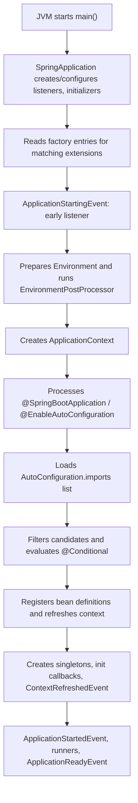

# Distinguishing Extension Registration via `spring.factories` from Auto-Configuration Declarations

## 1. Two mechanisms sitting side by side that solve two different problems

When building applications or libraries with **Spring Boot 3.3.x**, two "auto-discovered on the classpath" mechanisms are very easy to confuse:

1. **Registering an extension point via `META-INF/spring.factories`:** a library declares an implementation for **a kind of hook** that Spring Boot knows how to load, such as `ApplicationListener`, `ApplicationContextInitializer`, or `EnvironmentPostProcessor`. The hook is invoked at **the appropriate phase of startup**.
2. **Registering auto-configuration via `META-INF/spring/org.springframework.boot.autoconfigure.AutoConfiguration.imports`:** a library declares **candidate configuration classes**. When an application enables auto-configuration (typically via `@SpringBootApplication`), Boot evaluates those classes, checks conditions, and registers matching bean definitions.

Both files live inside `META-INF`, both can be packaged into a JAR, and both help a library integrate with an application without editing `main()`. However, **they are not interchangeable**: an `ApplicationListener` does not become auto-configuration simply by being listed in the imports file; conversely, a Boot 3.x `@AutoConfiguration` is not properly registered solely via the legacy `EnableAutoConfiguration` key in `spring.factories`.

> Version scope: this exercise uses **Java 17+ and Spring Boot 3.3.x**. For Boot 2.x applications, part of the auto-configuration registration rules differ by version; the migration section (section 5) explains the details.

## 2. Comparing by responsibility, timing, and registration style

| Criterion | Hook from `spring.factories` | Auto-configuration from `AutoConfiguration.imports` |
| --- | --- | --- |
| Goal | Extend a Boot phase or behavior: listeners, environment processing, initializers, failure analysis... | Supply conditional default bean configuration to the application |
| Registration file | `META-INF/spring.factories` | `META-INF/spring/org.springframework.boot.autoconfigure.AutoConfiguration.imports` |
| Syntax | Java properties file: **interface/extension key name** `=` list of implementations | Each line is **the fully qualified name of one auto-configuration class**, without `key=` |
| Example class | `ApplicationListener<ApplicationStartingEvent>` | `@AutoConfiguration` class with `@Bean` methods |
| Loading mechanism | `SpringFactoriesLoader` and Boot components dedicated to loading each extension type | Auto-configuration selection mechanism triggered by `@EnableAutoConfiguration` |
| Active milestone | Depends on hook type; starting listener can run before `ApplicationContext` creation | During configuration/bean-definition processing, before matching beans are instantiated |
| Must create a Spring bean? | No. Bootstrap listeners can be instantiated very early, independent of the bean factory | Configuration class participates in bean registration; `@Bean`s are managed by the IoC container |
| Enable/disable conditions | Primarily per the hook's contract; hook code may check conditions itself | Supports `@ConditionalOnClass`, `@ConditionalOnProperty`, `@ConditionalOnMissingBean`, etc. |
| Back off for user beans? | Not a general behavior of every hook | Can be designed to **back off** via `@ConditionalOnMissingBean` |
| Affected by component scan? | Does not need component scan to discover factory entries | Auto-configuration should stay outside component scan and be imported via the imports file |
| When to use? | Need to intervene at a startup milestone or specific extension service | Need to provide default beans/infrastructure for a library/starter |

**Decision question:** "Do I want Boot to **invoke a callback at some point**?" → usually think of an extension point. "Do I want the application to **automatically get a bean if conditions match**?" → think of auto-configuration.

Not every class declared in `spring.factories` runs before the context. For example, `FailureAnalyzer` is used on the error path, whereas `ApplicationContextInitializer` runs after context creation but before refresh. **The key type determines the lifecycle**, not the filename itself.

## 3. `spring.factories`: registering extensions by interface key

### 3.1. What does the registration file look like?

A library can package the file:

```text
src/main/resources/META-INF/spring.factories
```

Example contents:

```properties
org.springframework.context.ApplicationListener=\
com.example.lib.bootstrap.EarlyStartupListener

org.springframework.boot.env.EnvironmentPostProcessor=\
com.example.lib.bootstrap.DemoEnvironmentPostProcessor
```

This uses Java properties syntax: on the left is the **extension key**, on the right is the implementation class. A trailing `\` allows line continuation per `.properties` format. With a single implementation, you can write it right after `=` without `\`.

When the application starts, corresponding Boot components read factory entries from the classpath. This lets extensions reside inside a dependency/library JAR without requiring application controllers or services to import those classes directly.

Crucially, **there is no single "run all factories" command**. Each subsystem consumes its own matching factory entries:

- `org.springframework.context.ApplicationListener`: listeners receiving application events, including ultra-early ones.
- `org.springframework.context.ApplicationContextInitializer`: callbacks customizing a created context before refresh.
- `org.springframework.boot.env.EnvironmentPostProcessor`: callbacks that can add/modify `PropertySource`s during environment preparation.
- `org.springframework.boot.BootstrapRegistryInitializer`: can register resources into the bootstrap registry very early.
- `org.springframework.boot.diagnostics.FailureAnalyzer`: analyzes supported startup exceptions to produce helpful diagnostics.

`spring.factories` is also used for other internal Boot extensions. Do not guess keys from class names: check the API/docs of the **exact Spring Boot version**, because each type has its own constructor contract, invocation order, and data prerequisites.

### 3.2. Why must a starting listener be registered early?

`ApplicationStartingEvent` is one of the very first events in `SpringApplication.run()`. It occurs **before `Environment` and `ApplicationContext` are fully prepared**. A listener needing this event must be registered before application beans are created.

Therefore, a class like:

```java
package com.example.lib.bootstrap;

import org.springframework.boot.context.event.ApplicationStartingEvent;
import org.springframework.context.ApplicationListener;

public final class EarlyStartupListener
        implements ApplicationListener<ApplicationStartingEvent> {

    @Override
    public void onApplicationEvent(ApplicationStartingEvent event) {
        System.out.println("factory-listener=starting");
    }
}
```

can be declared under key `org.springframework.context.ApplicationListener` in `spring.factories`. Boot knows to instantiate/register the listener via its bootstrap mechanism. The program does not need to annotate the class with `@Component`.

Conversely, a bean with `@EventListener(ApplicationStartingEvent.class)` usually **is born too late** to receive this event. An auto-configuration registering `@Bean ApplicationListener<...>` also only creates the bean while the context is being processed, so it is **not** a suitable solution for catching events fired before the context exists.

### 3.3. `EnvironmentPostProcessor` example

`EnvironmentPostProcessor` is used when a library needs to contribute configuration to `ConfigurableEnvironment` before the bean graph is constructed. Example of a non-sensitive fallback property:

```java
package com.example.lib.bootstrap;

import java.util.Map;

import org.springframework.boot.SpringApplication;
import org.springframework.boot.env.EnvironmentPostProcessor;
import org.springframework.core.env.ConfigurableEnvironment;
import org.springframework.core.env.MapPropertySource;

public final class DemoEnvironmentPostProcessor
        implements EnvironmentPostProcessor {

    @Override
    public void postProcessEnvironment(
            ConfigurableEnvironment environment,
            SpringApplication application) {

        environment.getPropertySources().addLast(
                new MapPropertySource(
                        "demoExtensionDefaults",
                        Map.of("demo.origin", "from-spring-factories")
                )
        );
    }
}
```

Here `addLast` intentionally places a property source as a low-priority fallback in the existing list. If a higher-priority source also declares `demo.origin`, the higher-priority source wins. This example snippet is unrelated to declaring the `GreetingService` bean; it simply illustrates another extension that can be registered in the same file.

For regular applications, prefer `application.properties`/YAML, environment variables, and Config Data mechanisms before writing a custom `EnvironmentPostProcessor`. This hook fits infrastructure libraries that must supply a configuration source users do not declare via standard mechanisms.

## 4. Auto-configuration: declaring candidate classes for Boot to pick matching beans

### 4.1. The new imports file in Spring Boot 3.x

The file must have **this exact path**:

```text
src/main/resources/META-INF/spring/org.springframework.boot.autoconfigure.AutoConfiguration.imports
```

Contents:

```text
com.example.lib.autoconfigure.GreetingAutoConfiguration
```

Each line is one fully qualified class name; multiple lines and comments starting with `#` are supported. **Do not write**:

```properties
org.springframework.boot.autoconfigure.EnableAutoConfiguration=\
com.example.lib.autoconfigure.GreetingAutoConfiguration
```

into `spring.factories` expecting Spring Boot 3.x to use that line to enable auto-configuration. That key format belongs to the legacy registration mechanism removed **specifically for auto-configuration** in Spring Boot 3.0.

`AutoConfiguration.imports` is solely **a candidate list**. From it, Boot performs auto-configuration selection and condition evaluation. A class annotated with `@AutoConfiguration` that is **absent from the imports file or not explicitly imported via another mechanism** will not be discovered automatically just because of the annotation.

In a library/starter, use the imports file as the official registration source and keep auto-configuration classes in their own package, outside the consuming application's component scan scope.

### 4.2. Example of conditional `@AutoConfiguration` and backing off

```java
package com.example.lib.autoconfigure;

import com.example.lib.core.GreetingService;

import org.springframework.boot.autoconfigure.AutoConfiguration;
import org.springframework.boot.autoconfigure.condition.ConditionalOnMissingBean;
import org.springframework.boot.autoconfigure.condition.ConditionalOnProperty;
import org.springframework.context.annotation.Bean;

@AutoConfiguration
@ConditionalOnProperty(
        prefix = "demo.greeting",
        name = "enabled",
        havingValue = "true",
        matchIfMissing = true)
public class GreetingAutoConfiguration {

    @Bean
    @ConditionalOnMissingBean(GreetingService.class)
    GreetingService defaultGreetingService() {
        return () -> "auto";
    }
}
```

Assuming `GreetingService` is an interface with `String message()`:

- If `demo.greeting.enabled` is omitted, `matchIfMissing = true` lets the property condition match.
- If `demo.greeting.enabled=false`, the class-level condition does not match; Boot does not register this configuration in the standard flow.
- If the user has already defined a matching `GreetingService` bean, `@ConditionalOnMissingBean` lets the default bean **back off**.
- If no user bean exists and the property condition matches, the default bean is registered.

This is standard auto-configuration behavior: providing sensible defaults while giving the application full control to customize.

`@ConditionalOnClass` is commonly used when a library should only configure a feature if an optional dependency is present. When a type might be absent from the classpath, place the condition appropriately (often on a separate nested configuration class) so the JVM does not have to resolve a `@Bean` method's return type before the condition is evaluated.

### 4.3. `@AutoConfiguration` is not an "early listener"

An `@AutoConfiguration` class is a specialized `@Configuration` eligible for Boot selection via imports/conditions. It participates in bean-definition processing during context refresh. It **does not run before `ApplicationStartingEvent`** and does not replace `EnvironmentPostProcessor`.

When two separate tasks are needed, a library can cleanly use **both files**:
- `spring.factories` to register an extension running at the right bootstrap milestone.
- `AutoConfiguration.imports` to register the library's default bean configuration.

This combination is valid architecture; there is no requirement to pick only one for every use case.

## 5. Version history: why do older articles still mention `EnableAutoConfiguration` in `spring.factories`?

| Spring Boot version | How auto-configuration is declared | Status of other factory keys |
| --- | --- | --- |
| Boot 2.6 and earlier | Typically used `org.springframework.boot.autoconfigure.EnableAutoConfiguration` in `META-INF/spring.factories` | `spring.factories` also held listeners, initializers, post-processors... |
| Boot 2.7 | Introduced `AutoConfiguration.imports`; kept backward compatibility with legacy registration, with deduplication | Other extensions in `spring.factories` continued to work |
| Boot 3.0–3.3 | **Only `AutoConfiguration.imports` registers auto-configuration in the standard way**; the `EnableAutoConfiguration` key in `spring.factories` is no longer used to discover auto-configs | Entries under **other keys** in `spring.factories` were not removed by this change |

A tutorial written for Boot 2.5 may have been completely accurate at publication time yet **no longer work in Boot 3.3**. When migrating libraries, inspect the actual packaged JAR; do not just look at annotations or assume "having `spring.factories` means Boot will find auto-configuration".

The Spring Boot 3.0 Migration Guide clearly states the change: Boot 2.7 introduced the imports file with backward compatibility; Boot 3.0 removed support for registering auto-configuration under the `EnableAutoConfiguration` key in `spring.factories`, while preserving other factory keys.

If a library must support both Boot 2.7 and Boot 3.x, it can maintain matching declarations for each generation, provided compatible dependencies and APIs are tested. Including both files does not guarantee that bytecode/dependencies built for Boot 3.x will run on Boot 2.x.

## 6. Complete hands-on lab: a single application using both `spring.factories` and auto-configuration

The example below targets **Spring Boot 3.3.13, Java 17+**, using only Maven and the `spring-boot-starter` dependency. The program does not open a web server so observed output stays concise.

Key structural point: the application class resides in `com.example.app`, whereas extensions and auto-configuration reside in `com.example.lib`. Therefore, `@SpringBootApplication` in the application package **does not component-scan `com.example.lib`**. When those components are discovered, it happens through their respective `META-INF` registration files.

### 6.1. Directory structure

```text
extension-registration-demo/
├── pom.xml
└── src/main/
    ├── java/
    │   └── com/example/
    │       ├── app/
    │       │   └── DemoApplication.java
    │       └── lib/
    │           ├── core/
    │           │   └── GreetingService.java
    │           ├── bootstrap/
    │           │   ├── EarlyStartupListener.java
    │           │   └── DemoEnvironmentPostProcessor.java
    │           └── autoconfigure/
    │               └── GreetingAutoConfiguration.java
    └── resources/
        └── META-INF/
            ├── spring.factories
            └── spring/
                └── org.springframework.boot.autoconfigure.AutoConfiguration.imports
```

To keep compilation simple and self-contained, this example places all packages in one project. In a production library, `com.example.lib.*` and the two `META-INF` files are typically packaged into a **separate library JAR**, then added to the application's classpath.

### 6.2. `pom.xml`

```xml
<project xmlns="http://maven.apache.org/POM/4.0.0"
         xmlns:xsi="http://www.w3.org/2001/XMLSchema-instance"
         xsi:schemaLocation="http://maven.apache.org/POM/4.0.0 https://maven.apache.org/xsd/maven-4.0.0.xsd">
    <modelVersion>4.0.0</modelVersion>

    <parent>
        <groupId>org.springframework.boot</groupId>
        <artifactId>spring-boot-starter-parent</artifactId>
        <version>3.3.13</version>
        <relativePath/>
    </parent>

    <groupId>com.example</groupId>
    <artifactId>extension-registration-demo</artifactId>
    <version>0.0.1-SNAPSHOT</version>

    <properties>
        <java.version>17</java.version>
    </properties>

    <dependencies>
        <dependency>
            <groupId>org.springframework.boot</groupId>
            <artifactId>spring-boot-starter</artifactId>
        </dependency>
    </dependencies>

    <build>
        <plugins>
            <plugin>
                <groupId>org.springframework.boot</groupId>
                <artifactId>spring-boot-maven-plugin</artifactId>
            </plugin>
        </plugins>
    </build>
</project>
```

`spring-boot-starter` brings the core Spring Boot, Spring Framework, and auto-configuration components onto the classpath. The program needs no web or database starters.

### 6.3. Interface `GreetingService.java`

```java
package com.example.lib.core;

@FunctionalInterface
public interface GreetingService {
    String message();
}
```

Creating a dedicated interface lets the application's own bean replace the auto-configuration's default bean under the same type.

### 6.4. Listener registered by `spring.factories`

File `src/main/java/com/example/lib/bootstrap/EarlyStartupListener.java`:

```java
package com.example.lib.bootstrap;

import org.springframework.boot.context.event.ApplicationStartingEvent;
import org.springframework.context.ApplicationListener;

public final class EarlyStartupListener
        implements ApplicationListener<ApplicationStartingEvent> {

    @Override
    public void onApplicationEvent(ApplicationStartingEvent event) {
        System.out.println("factory-listener=starting");
    }
}
```

When `SpringApplication` fires `ApplicationStartingEvent`, the early-registered listener receives the event. There is no `@Component`, `@Bean`, or component scanning here.

### 6.5. Environment post-processor also registered by `spring.factories`

File `src/main/java/com/example/lib/bootstrap/DemoEnvironmentPostProcessor.java`:

```java
package com.example.lib.bootstrap;

import java.util.Map;

import org.springframework.boot.SpringApplication;
import org.springframework.boot.env.EnvironmentPostProcessor;
import org.springframework.core.env.ConfigurableEnvironment;
import org.springframework.core.env.MapPropertySource;

public final class DemoEnvironmentPostProcessor
        implements EnvironmentPostProcessor {

    @Override
    public void postProcessEnvironment(
            ConfigurableEnvironment environment,
            SpringApplication application) {

        environment.getPropertySources().addLast(
                new MapPropertySource(
                        "demoExtensionDefaults",
                        Map.of("demo.origin", "from-spring-factories")
                )
        );
    }
}
```

This post-processor contributes the `demo.origin` property. It has no `@Configuration` and creates no business beans.

### 6.6. Conditional auto-configuration

File `src/main/java/com/example/lib/autoconfigure/GreetingAutoConfiguration.java`:

```java
package com.example.lib.autoconfigure;

import com.example.lib.core.GreetingService;

import org.springframework.boot.autoconfigure.AutoConfiguration;
import org.springframework.boot.autoconfigure.condition.ConditionalOnMissingBean;
import org.springframework.boot.autoconfigure.condition.ConditionalOnProperty;
import org.springframework.context.annotation.Bean;

@AutoConfiguration
@ConditionalOnProperty(
        prefix = "demo.greeting",
        name = "enabled",
        havingValue = "true",
        matchIfMissing = true)
public class GreetingAutoConfiguration {

    @Bean
    @ConditionalOnMissingBean(GreetingService.class)
    GreetingService defaultGreetingService() {
        return () -> "auto";
    }
}
```

This class belongs to `com.example.lib.autoconfigure` and is not component-scanned by `com.example.app`. Boot's discovery of it must come from the **imports file**.

### 6.7. Main application and custom bean

File `src/main/java/com/example/app/DemoApplication.java`:

```java
package com.example.app;

import java.util.Map;

import com.example.lib.core.GreetingService;

import org.springframework.boot.Banner;
import org.springframework.boot.SpringApplication;
import org.springframework.boot.WebApplicationType;
import org.springframework.boot.autoconfigure.SpringBootApplication;
import org.springframework.context.ConfigurableApplicationContext;
import org.springframework.context.annotation.Bean;
import org.springframework.context.annotation.Profile;

@SpringBootApplication
public class DemoApplication {

    @Bean
    @Profile("manual")
    GreetingService customGreetingService() {
        return () -> "manual";
    }

    public static void main(String[] args) {
        SpringApplication app = new SpringApplication(DemoApplication.class);
        app.setWebApplicationType(WebApplicationType.NONE);
        app.setBannerMode(Banner.Mode.OFF);
        app.setLogStartupInfo(false);

        try (ConfigurableApplicationContext context = app.run(args)) {
            Map<String, GreetingService> services =
                    context.getBeansOfType(GreetingService.class);

            System.out.println("origin="
                    + context.getEnvironment()
                             .getProperty("demo.origin", "absent"));
            System.out.println("greeting-bean-count=" + services.size());
            System.out.println("greeting="
                    + services.values().stream()
                              .findFirst()
                              .map(GreetingService::message)
                              .orElse("none"));
        }
    }
}
```

`@Profile("manual")` creates a custom bean when the `manual` profile is active. The goal is to prove `@ConditionalOnMissingBean` lets auto-config **back off in favor of the application-declared bean**.

### 6.8. The two required registration files

The **first** file is `src/main/resources/META-INF/spring.factories`:

```properties
org.springframework.context.ApplicationListener=\
com.example.lib.bootstrap.EarlyStartupListener

org.springframework.boot.env.EnvironmentPostProcessor=\
com.example.lib.bootstrap.DemoEnvironmentPostProcessor
```

The **second** file is `src/main/resources/META-INF/spring/org.springframework.boot.autoconfigure.AutoConfiguration.imports`:

```text
com.example.lib.autoconfigure.GreetingAutoConfiguration
```

Note the syntax difference: `spring.factories` is a properties file with `key=value`; the imports file is a list of class names. Although both are plain text resources, **you cannot arbitrarily rename them or change their paths** and expect Boot to find them.

### 6.9. Build and run

From the directory containing `pom.xml`:

```bash
mvn package
java -jar target/extension-registration-demo-0.0.1-SNAPSHOT.jar
```

If the project has a Maven Wrapper, you can also run `./mvnw package` (Windows: `.\mvnw.cmd package`). Maven Wrapper does not appear automatically just from creating `pom.xml`; generate it separately if desired.

In an environment with no overriding properties or profiles, **the lines printed by the example code** appear in this expected order:

```text
factory-listener=starting
origin=from-spring-factories
greeting-bean-count=1
greeting=auto
```

`factory-listener=starting` shows the `ApplicationListener` extension from `spring.factories` received an ultra-early event. `origin=from-spring-factories` shows `EnvironmentPostProcessor` contributed its property. `greeting=auto` shows the class from the imports file was evaluated, conditions matched, and the default bean was created.

Spring Boot/Maven logs may interleave; the example verifies **the relative order of lines printed by the program**, without claiming total stdout consists only of four lines.

### 6.10. Testing disabling auto-configuration via property

```bash
java -jar target/extension-registration-demo-0.0.1-SNAPSHOT.jar --demo.greeting.enabled=false
```

Lines produced by the code:

```text
factory-listener=starting
origin=from-spring-factories
greeting-bean-count=0
greeting=none
```

`spring.factories` still loads the listener and environment processor. However, `@ConditionalOnProperty` does not match, so the auto-config's default bean does not appear.

**Experiment conclusion:** auto-configuration conditions can disable the configured bean without disabling other extensions registered via `spring.factories`.

### 6.11. Testing declaring a user bean so auto-configuration backs off

```bash
java -jar target/extension-registration-demo-0.0.1-SNAPSHOT.jar --spring.profiles.active=manual
```

Main output lines:

```text
factory-listener=starting
origin=from-spring-factories
greeting-bean-count=1
greeting=manual
```

The application's `customGreetingService()` bean is registered because the `manual` profile is active. Auto-configuration's `@ConditionalOnMissingBean(GreetingService.class)` sees the existing matching bean definition, so it does not create the default bean. This is **backing off** as designed.

Try combining both arguments:

```bash
java -jar target/extension-registration-demo-0.0.1-SNAPSHOT.jar --spring.profiles.active=manual --demo.greeting.enabled=false
```

`greeting=manual` still appears: `demo.greeting.enabled` controls **the auto-configuration's default bean**, and does not automatically disable the user-declared application bean.

### 6.12. Self-verifying by removing one registration file

**Experiment A:** remove only `META-INF/spring.factories` from the build and repackage. Then the example's listener and environment processor are no longer discovered via that file. You will not see `factory-listener=starting`; `origin` will be `absent` if no other source sets `demo.origin`. The auto-config bean still appears thanks to the imports file.

**Experiment B:** keep `spring.factories` but remove only `AutoConfiguration.imports` and rebuild. The listener and environment processor still work; however, `GreetingAutoConfiguration` is not selected via auto-configuration. Without an application-declared bean, `greeting-bean-count=0` and `greeting=none`.

Note that the two experiments are **two separate builds**. Do not delete files inside a running JAR expecting the live instance to update immediately; Spring Boot performs discovery at startup.

## 7. How Boot processes both registrations during the startup lifecycle

Diagram illustrating major milestones of a successful startup run:



The diagram only shows high-level relationships and ordering. In reality, multiple callbacks interleave, and other extensions in `spring.factories` can run at different milestones.

Points to observe:

- `ApplicationStartingEvent` listeners must be ready **before** context creation.
- `EnvironmentPostProcessor` processes `Environment` before refresh finishes, so it can influence property-based conditions.
- Auto-configuration is selected from the imports source and conditions while processing application configuration, then participates in bean-definition registration.
- An auto-configuration `@Bean` **is not a replacement callback for a bootstrap listener**, even though both are discovered from the classpath.

An `ApplicationListener` can receive later events if registered for those event types; "factory listener" does not automatically mean always running early. Exact timing depends on **the event type and listener ordering**.

## 8. Auto-configuration conditions: "being in imports" does not guarantee a bean

### 8.1. Classpath conditions

`@ConditionalOnClass` fits when a feature should only exist when an optional dependency is present. For a library using a third-party API, you can place `@ConditionalOnClass(name = "com.vendor.SomeClient")` at the configuration class level.

If a `@Bean` method declares a return type that is absent from the classpath, the JVM may need to resolve the method signature before method-level conditions are evaluated. The usual practice is isolating it into a static nested `@Configuration(proxyBeanMethods = false)` annotated with `@ConditionalOnClass`, keeping the bean method inside the guarded class.

Do not use `try/catch ClassNotFoundException` where beans are created as a substitute for proper classpath condition design.

### 8.2. Property conditions

`@ConditionalOnProperty` checks property state in `Environment`. When `havingValue="true"`, the bean is only configured if the corresponding value is `"true"` per matcher rules; `matchIfMissing=true` allows the case where the property is absent.

This condition is not a continuous file watcher. Editing `application.yml` after the context has refreshed **does not automatically register/unregister beans** under `@ConditionalOnProperty` in the running instance.

### 8.3. Bean conditions and ordering

`@ConditionalOnMissingBean` is evaluated against bean definitions already processed up to that moment. To give users a chance to override defaults, such conditions should live inside auto-configuration, because auto-configuration is normally processed **after application-declared configuration**.

If multiple auto-configurations propose beans of the same type, evaluation order can affect the outcome. Spring Boot provides tools:

- `@AutoConfiguration(before = ..., after = ...)`;
- `@AutoConfiguration(beforeName = ..., afterName = ...)` when avoiding direct type coupling;
- `@AutoConfigureBefore`, `@AutoConfigureAfter`;
- `@AutoConfigureOrder`.

These annotations primarily control **the processing/registration order of auto-configuration bean definitions**, not necessarily constructor call order for every bean. Instantiation order also depends on the dependency graph, `@DependsOn`, eager/lazy settings, and lifecycle.

### 8.4. Do not put auto-configuration into component scan

A design mistake is placing `GreetingAutoConfiguration` in a package scanned by `@SpringBootApplication` **and** simultaneously listing it in the imports file. That creates an unintended registration path, making exclusions, conditions, or diagnostics confusing.

Put auto-configs in an independent package like `com.example.lib.autoconfigure`, do not put `@Component` on that class, and do not add `@ComponentScan` inside auto-config to pick up internal beans arbitrarily. To group sub-configurations, use explicit, controlled `@Import`.

## 9. Distinguishing registration files from other metadata files

Inside Spring Boot JARs you may see several files starting with `META-INF/spring...`, yet their purposes differ greatly.

| File | Meaning |
| --- | --- |
| `META-INF/spring.factories` | Declares extension types actively loaded by Boot/Framework by key |
| `META-INF/spring/org.springframework.boot.autoconfigure.AutoConfiguration.imports` | **Candidate list of auto-configurations** for Boot 3.x |
| `META-INF/spring-autoconfigure-metadata.properties` | Condition metadata optionally generated by annotation processors to optimize candidate filtering; **does not replace the imports file** |
| `META-INF/spring-configuration-metadata.json` | Property metadata for IDEs/configuration guidance; **does not register beans** |
| `META-INF/services/...` | Java `ServiceLoader` mechanism for certain SPIs; not synonymous with the registration files above |

A library with polished `spring-configuration-metadata.json` and IDE property autocompletion can still have **zero auto-configurations activated** if the imports file is missing. Conversely, lacking optimization metadata does not prevent a valid auto-config class from being discovered.

When authoring a feature-rich starter, the `spring-boot-autoconfigure-processor` annotation processor can generate optimization metadata; that is a performance/IDE enhancement rather than a change to registration rules.

## 10. Packaging libraries/starters and managing compatibility

### 10.1. Structure of a shared library

An infrastructure library can be split into:

```text
greeting-core
    Independent API / implementation

greeting-autoconfigure
    @AutoConfiguration
    META-INF/spring/...AutoConfiguration.imports
    Boot extensions genuinely needed in META-INF/spring.factories

greeting-spring-boot-starter
    Convenient dependencies for applications to add once
```

Not every library needs all three modules. For small features, a single JAR holding core code, auto-config, and metadata can suffice. What matters is keeping **the role of each registration file and dependency clear**.

### 10.2. When do you need to register in `spring.factories`?

Appropriate situations:

- A library needs to catch `ApplicationStartingEvent` to detect a startup right from the beginning.
- A library needs to add a configuration source during environment preparation via `EnvironmentPostProcessor`.
- A library needs to customize the main context before refresh via `ApplicationContextInitializer`.
- A library provides a `FailureAnalyzer` to explain a specialized startup exception.

Each hook type has its own contract for constructors, ordering, and error handling. Choose the hook by **the milestone needing intervention**; avoid putting business/HTTP/database logic into an early phase just because a hook is available.

### 10.3. When do you need auto-configuration?

Auto-configuration fits:

- Supplying a default HTTP client, cache adapter, `DataSource` support, or metrics bridge when matching dependencies are present.
- Registering a default service while letting users override the bean.
- Enabling/disabling an integration via a property.
- Configuring a feature differently for servlet/reactive/non-web via conditions.
- Composing beans belonging to an integration with centralized configuration.

A regular `@Configuration` class imported from application code is fine if the feature is used in only one project and needs no auto-discovery; there is no need to package an imports file for every internal configuration class.

### 10.4. Do not mix application and library namespaces

Libraries should use their own property prefix, such as `acme.greeting.*`, rather than occupying standard namespaces like `spring.*`, `server.*`, or `management.*` for custom features. This reduces conflicts when applications add multiple starters or upgrade Spring Boot.

If an auto-config class changes package, review the imports contents and any ordering/exclusion references in use. Do not keep the old class in the list just "to be safe" once a supported replacement mechanism exists in the current version. On Boot 3.3, prefer stable class names or provide a clear versioning plan and migration guide.

## 11. Testing each mechanism properly

### 11.1. Testing auto-configuration with `ApplicationContextRunner`

Spring Boot provides `ApplicationContextRunner` to spin up lightweight contexts across different property/bean scenarios. Libraries usually test at least three branches:

1. No user bean → default bean exists.
2. `demo.greeting.enabled=false` → no default bean exists.
3. User defined `GreetingService` → auto-config backs off.

JUnit 5 example, adding `spring-boot-starter-test` test dependency to the build:

```java
package com.example.app;

import com.example.lib.autoconfigure.GreetingAutoConfiguration;
import com.example.lib.core.GreetingService;

import org.junit.jupiter.api.Test;
import org.springframework.boot.autoconfigure.AutoConfigurations;
import org.springframework.boot.test.context.runner.ApplicationContextRunner;
import org.springframework.context.annotation.Bean;
import org.springframework.context.annotation.Configuration;

import static org.assertj.core.api.Assertions.assertThat;

class GreetingAutoConfigurationTest {

    private final ApplicationContextRunner runner =
            new ApplicationContextRunner()
                    .withConfiguration(
                            AutoConfigurations.of(GreetingAutoConfiguration.class));

    @Test
    void createsDefaultBean() {
        runner.run(context -> {
            assertThat(context).hasSingleBean(GreetingService.class);
            assertThat(context.getBean(GreetingService.class).message())
                    .isEqualTo("auto");
        });
    }

    @Test
    void isDisabledByProperty() {
        runner.withPropertyValues("demo.greeting.enabled=false")
                .run(context -> assertThat(context)
                        .doesNotHaveBean(GreetingService.class));
    }

    @Test
    void backsOffForUserBean() {
        runner.withUserConfiguration(UserConfiguration.class)
                .run(context -> {
                    assertThat(context).hasSingleBean(GreetingService.class);
                    assertThat(context.getBean(GreetingService.class).message())
                            .isEqualTo("manual");
                });
    }

    @Configuration(proxyBeanMethods = false)
    static class UserConfiguration {

        @Bean
        GreetingService customGreetingService() {
            return () -> "manual";
        }
    }
}
```

This test compiles when the test classpath contains JUnit Jupiter, AssertJ, and `spring-boot-test`, such as via `spring-boot-starter-test`. It **focuses on testing auto-configuration** without running full `SpringApplication` bootstrap.

### 11.2. Why is `ApplicationContextRunner` not enough for `spring.factories`?

`ApplicationContextRunner` is designed to build a lean context and evaluate conditions; it does not always execute the full `SpringApplication.run()` lifecycle and startup listeners/processors like a real application.

Therefore, to prove an `ApplicationStartingEvent` listener from `spring.factories` runs, you need an **integration test starting a real `SpringApplication`** or run section 6's example. To unit-test an `EnvironmentPostProcessor`, you can call its `postProcessEnvironment` method with a `MockEnvironment`/test environment or start a real `SpringApplication`.

Do not conclude "`spring.factories` is broken" merely because an `ApplicationContextRunner` test did not trigger the event/processor. The test may simply not have traversed the bootstrap phase that the extension depends on.

### 11.3. Inspecting startup with `--debug`

To diagnose auto-configuration, run:

```bash
java -jar target/extension-registration-demo-0.0.1-SNAPSHOT.jar --debug
```

Spring Boot outputs a **conditions evaluation report** in the logs, helping identify why an auto-config class was applied or excluded.

`--debug` is not a mechanism that lists all implementations in `spring.factories` in the same way as the conditions report. For extension registration, verify the classpath/resource file location, exact interface key, public class/valid constructor, and whether the event/hook was actually fired/invoked.

### 11.4. Verifying packaged resources

Files under `src/main/resources/META-INF` must actually be present in the runnable artifact. In an executable JAR built by Boot's Maven plugin, they usually live under `BOOT-INF/classes/META-INF/...`.

You can inspect the structure:

```bash
jar tf target/extension-registration-demo-0.0.1-SNAPSHOT.jar
```

Look for both paths under `BOOT-INF/classes`. In a plain library JAR, they may sit directly under `META-INF`. Distinguish source JARs, repackaged JARs, and dependency JARs when verifying the classpath.

If multiple JARs contain `META-INF/spring.factories` or imports files, discovery collects matching resources across the classpath. Never fix an issue by merging all metadata into the application's single file and deleting metadata from dependencies.

## 12. Common errors and misconceptions

### Mistake 1 — Copying Boot 2.x auto-configuration setup into Boot 3.x

```properties
# META-INF/spring.factories (legacy auto-config registration)
org.springframework.boot.autoconfigure.EnableAutoConfiguration=\
com.example.lib.autoconfigure.GreetingAutoConfiguration
```

On Spring Boot 3.x, the official auto-config registration is `AutoConfiguration.imports`. Move the FQCN to the imports file at the exact path and verify at runtime; **do not delete other factory entries** like `ApplicationListener` and `EnvironmentPostProcessor` if the library still needs them.

### Mistake 2 — Putting `ApplicationListener` into the imports file

```text
com.example.lib.bootstrap.EarlyStartupListener
```

If the imports file lists a regular listener instead of an auto-configuration, Boot does not treat it as an early-registered hook. Use `spring.factories` with key `org.springframework.context.ApplicationListener`, or `SpringApplication.addListeners(...)`.

### Mistake 3 — `@AutoConfiguration` is present, yet the bean is missing

Several causes are possible:

- Class name is missing from the imports file.
- Wrong package/class name, or the file was not packaged into the JAR.
- The application did not enable auto-configuration.
- `@ConditionalOnClass`, `@ConditionalOnProperty`, `@ConditionalOnMissingBean`, or another condition did not match.
- The class was excluded via `@SpringBootApplication(exclude = ...)` or `spring.autoconfigure.exclude`.
- Another auto-config claimed the bean slot first and the back-off condition worked as designed.

Read the **conditions report** before guessing with extra annotations or configuration edits.

### Mistake 4 — Listener exists, yet misses `ApplicationStartingEvent`

A listener bean registered after the context starts processing bean definitions misses the ultra-early event. Put the listener in `spring.factories` or register it directly on `SpringApplication` before `run()`.

### Mistake 5 — Wrong key in `spring.factories`

For example, `org.springframework.boot.autoconfigure.AutoConfiguration` is not a replacement key for the imports file. In factories, keys must match Boot-supported extension types; in imports, list only auto-configuration classes, one class per line.

### Mistake 6 — Using `@ComponentScan` to "patch" missing imports

Doing so can pull the auto-config class into the context through a different path and break the auto-configuration contract. Fix the imports file or JAR packaging properly. For published libraries, auto-configs must have clear package boundaries and never depend on users accidentally scanning the library's package.

### Mistake 7 — Assuming factory entries always create Spring beans

An `ApplicationListener<ApplicationStartingEvent>` instantiated early by Boot to receive events is not automatically a bean in `ApplicationContext`. If business logic needs an injectable bean for other services, define it via proper configuration/bean registration instead of forcing a bootstrap listener to act as a service.

### Mistake 8 — Assuming `@ConditionalOnMissingBean` always runs after all configuration

Conditions are evaluated against definitions known **at evaluation time**. Between normal user configuration and auto-configuration, Spring Boot ensures user beans get a chance to register first. Among multiple auto-config classes, however, ordering must be explicitly designed if dependencies exist. Do not blindly scatter this condition across component-scanned `@Configuration` classes.

### Mistake 9 — Changing a property at runtime and expecting auto-config to rebuild beans

Conditions are evaluated when the context registers bean definitions. Changing a file or environment property after startup does not automatically recreate the bean graph. Use dedicated dynamic runtime config mechanisms or restart the instance if changes affect bean wiring.

### Mistake 10 — Declaring the same extension twice

If the same listener is both registered in `spring.factories` and added manually via `addListeners(new EarlyStartupListener())`, the application may instantiate/register multiple instances and process events redundantly depending on the mechanism. Avoid duplicate registration paths; if a library needs customization, provide a clear contract for users.

## 13. Practical project selection rules

Use this checklist before adding new metadata resources:

1. **Decide whether the requirement is a callback or a bean definition.** Need early event capture or environment contribution → pick the right extension. Need a conditional default service → pick auto-configuration.
2. **Check Boot version.** For 3.3, auto-config registration uses `AutoConfiguration.imports`. Do not copy Boot 2.6 examples using `EnableAutoConfiguration` in `spring.factories`.
3. **Place classes in independent packages and package resources properly.** An annotated class that isn't discovered won't run; a resource at the wrong path effectively doesn't exist.
4. **Design conditions and fallbacks.** Use `@ConditionalOnClass`, `@ConditionalOnProperty`, and `@ConditionalOnMissingBean` as needed; allow user beans to override if that is the desired contract.
5. **Keep early hooks lean and avoid heavy side effects.** Do not call repository beans before the context exists; avoid slow network calls, unbounded threads, or logging sensitive data in startup listeners.
6. **Test both discovery and behavior.** Unit tests with `ApplicationContextRunner` for auto-config; startup/integration tests for listeners, environment processors, and metadata packaging.
7. **Gather diagnostic evidence.** Inspect the actual classpath, `jar tf`, and conditions report; after editing registration files, rebuild and rerun the artifact.

### One-line decision table

| Scenario | Where to put code | Where to register |
| --- | --- | --- |
| Log `ApplicationStartingEvent` before context exists | `ApplicationListener<ApplicationStartingEvent>` | `spring.factories` / `SpringApplication.addListeners` |
| Add property sources during environment preparation | `EnvironmentPostProcessor` | `spring.factories` |
| Customize context before refresh | `ApplicationContextInitializer` | `spring.factories` or `SpringApplication` setup |
| Create default `GreetingService` when missing | `@AutoConfiguration` + `@ConditionalOnMissingBean` | `AutoConfiguration.imports` |
| Toggle bean by property | `@ConditionalOnProperty` inside auto-config | `AutoConfiguration.imports` |
| Explicit bean config inside one application | `@Configuration`, `@Bean` | Component scan / `@Import` in app, no auto-config discovery needed |

## 14. Scenario exercises

**Scenario A.** A library wants to print a log line right when `SpringApplication.run()` begins, even before `Environment` exists. Is registering `@Bean ApplicationListener<ApplicationStartingEvent>` inside auto-configuration reliable?

**Answer:** No. The bean is created after the event has already fired. Use an `ApplicationListener` registered early via `spring.factories` or `SpringApplication.addListeners` before `run()`.

**Scenario B.** A starter wants to create `Client` when a vendor library is present, while letting users override `Client` with their own bean. What should be used?

**Answer:** An `@AutoConfiguration` class registered in `AutoConfiguration.imports`, with classpath conditions and `@ConditionalOnMissingBean(Client.class)` in the proper place. This is a bean-definition problem, not a bootstrap listener.

**Scenario C.** Upgrading a library from Boot 2.6 to Boot 3.3, `EnvironmentPostProcessor` still runs, yet the library's default beans disappear. Why?

**Answer:** Most likely `spring.factories` still registers `EnvironmentPostProcessor`, while auto-configuration was still registered solely under the legacy `EnableAutoConfiguration` key. Move the auto-config class to `AutoConfiguration.imports`.

**Scenario D.** Both the imports file and `@AutoConfiguration` class exist, and `@ConditionalOnProperty` sets `havingValue="true"`; the user sets the property to `false`. Is the class selected to provide the default bean?

**Answer:** Not under that condition. The imports file supplies candidates, while conditions decide whether to apply them; `--debug` reveals match/non-match reasons.

**Scenario E.** An `ApplicationContextRunner` test proves the default bean is created. Does that prove the `ApplicationStartingEvent` listener received the event?

**Answer:** No. Auto-configuration tests focus on context/bean conditions; to verify bootstrap listeners, test the real `SpringApplication.run()` flow.

**Scenario F.** A library JAR contains both `AutoConfiguration.imports` and `spring.factories`. Is that a broken duplicate?

**Answer:** No, as long as each file registers **different kinds of functionality**: imports for auto-config classes, factories for corresponding extensions. Unintended duplication happens when the same hook/bean is fed into multiple registration paths with identical effect.

## 15. Official documentation for reference

- [Spring Boot 3.3.13 — Creating Your Own Auto-configuration](https://docs.spring.io/spring-boot/3.3/reference/features/developing-auto-configuration.html): `AutoConfiguration.imports`, `@Conditional`, starter design, and `ApplicationContextRunner`.
- [Spring Boot — SpringApplication Events and Listeners](https://docs.spring.io/spring-boot/reference/features/spring-application.html): why listeners must be registered early and `META-INF/spring.factories` examples.
- [Spring Boot 3.3.13 API — EnvironmentPostProcessorApplicationListener](https://docs.spring.io/spring-boot/3.3/api/java/org/springframework/boot/env/EnvironmentPostProcessorApplicationListener.html): mechanism for running `EnvironmentPostProcessor` from `spring.factories`.
- [Spring Boot 3.0 Migration Guide — Auto-configuration Files](https://github.com/spring-projects/spring-boot/wiki/Spring-Boot-3.0-Migration-Guide): migration from the `EnableAutoConfiguration` key in `spring.factories` to `AutoConfiguration.imports` in Boot 3.0.

## 16. Takeaways

**`spring.factories` is a key-based registry for specific extension points; `AutoConfiguration.imports` is a candidate list of configuration classes for the auto-configuration mechanism.** Spring Boot 3.x still uses `spring.factories` for supported extensions, but no longer uses the `EnableAutoConfiguration` key in that file to register auto-configurations.

When authoring a library, pick registration paths by actual responsibility: **bootstrap listeners and environment processors** go through extension factories; **default beans, classpath/property conditions, and backing off for user beans** go through auto-configuration. Both mechanisms can complement each other inside the same starter, provided each is declared and verified in the right phase.