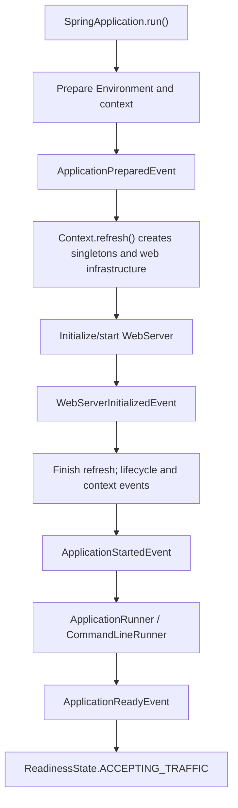

# `WebServerInitializedEvent` and Its Servlet or Reactive Variants

## 1. Why Do We Need an Event When the Web Server Is Initialized?

When running a Spring Boot application with an embedded web server, `SpringApplication.run(...)` must build the `ApplicationContext`, configure HTTP infrastructure, and start the server. There are times when the application needs to know **which server was initialized and which port it is actually listening on**: for example, choosing `server.port=0` so the OS assigns an ephemeral port, recording diagnostics, or wiring test components.

Spring Boot emits `WebServerInitializedEvent` when a `WebServer` managed by a web application context is ready. The two concrete variants are:

- `ServletWebServerInitializedEvent`: for the **Servlet** stack, typically Spring MVC on supported Tomcat/Jetty/Undertow.
- `ReactiveWebServerInitializedEvent`: for the **Reactive** stack, typically Spring WebFlux on Reactor Netty or a compatible reactive server.

Crucial point: **the web server finishing initialization does not mean the whole application is ready**. Spring Boot may still have to run `ApplicationRunner` or `CommandLineRunner` beans, validate data, and finish the startup flow before publishing the appropriate readiness state.

This lesson is based on **Spring Boot 3.3.x / Java 17+** APIs and the context types created by Boot. Do not confuse this event with `ApplicationStartedEvent`, `ApplicationReadyEvent`, or `ContextRefreshedEvent`.

## 2. Distinguishing `WebServer`, `ApplicationContext`, and the Event

In a web application, three components must be kept distinct:

| Component | Responsibility | Example |
| --- | --- | --- |
| Spring `ApplicationContext` | IoC container managing beans, dependencies, lifecycles, and event publishing | `ServletWebServerApplicationContext`, `ReactiveWebServerApplicationContext` |
| `WebServer` | Runtime infrastructure accepting and handling HTTP connections/requests | Tomcat, Jetty, or Reactor Netty via Boot's abstraction |
| `WebServerInitializedEvent` | Notification that the server has been initialized/is ready, carrying the server and owning context | A listener reading the actual HTTP port |

`WebServerInitializedEvent` belongs to the `org.springframework.boot.web.context` package. It is an **abstract class** extending `ApplicationEvent`; application code typically receives **one of the two subclasses** at runtime.

Core API:

```java
WebServerInitializedEvent event = ...; // Received from listener, do not instantiate manually
int boundPort = event.getWebServer().getPort();
WebServerApplicationContext sourceContext = event.getApplicationContext();
```

The snippet above only illustrates the calls; the actual `event` must come from Spring's event-publishing mechanism, and `WebServerApplicationContext` resides in `org.springframework.boot.web.context`.

- `getWebServer()` returns the `WebServer` object; `getPort()` provides the actual port the server is using.
- `getApplicationContext()` returns the **web context that owns the server**, very helpful when multiple contexts exist.
- `getSource()` also returns the `WebServer`.
- `getTimestamp()` is the timestamp from `ApplicationEvent`, not a measurement of startup duration or connection latency.

A listener can handle both stacks generically via a `WebServerInitializedEvent` parameter, or handle only one stack using the specific subclass parameter.

## 3. Servlet and Reactive Variants

### 3.1. Servlet Variant

Fully qualified class:

```text
org.springframework.boot.web.servlet.context.ServletWebServerInitializedEvent
```

This object extends `WebServerInitializedEvent`, and its `getApplicationContext()` returns `ServletWebServerApplicationContext`. In a typical Spring Boot MVC setup, the embedded server is usually Tomcat brought in by `spring-boot-starter-web`.

Key points to remember:

- The event says the **web server** has been prepared; it does not say all runners have finished.
- You can obtain the **actually assigned** port, especially when `server.port=0` is set.
- When the application is deployed as a WAR into an external servlet container rather than using a Boot-managed web server, lifecycle behavior and event reception can differ; do not assume an embedded-server event is always emitted.

### 3.2. Reactive Variant

Fully qualified class:

```text
org.springframework.boot.web.reactive.context.ReactiveWebServerInitializedEvent
```

This subclass is paired with `ReactiveWebServerApplicationContext`. If you select `spring-boot-starter-webflux` without Spring MVC, Boot typically configures a reactive application with Reactor Netty.

Crucially, **being reactive does not change the meaning of the event**: it is still a signal that the server is ready, still exposes `getWebServer().getPort()` and the owning context; the difference is the context type and web infrastructure.

If both Spring MVC and WebFlux are placed on the classpath, Boot usually selects the **Servlet stack** by default. To build a clear reactive demo, use a separate project containing only the WebFlux starter or set `WebApplicationType.REACTIVE` when intentionally controlling dependencies.

### 3.3. Comparison Table

| Question | Servlet | Reactive |
| --- | --- | --- |
| Event class | `ServletWebServerInitializedEvent` | `ReactiveWebServerInitializedEvent` |
| Context | `ServletWebServerApplicationContext` | `ReactiveWebServerApplicationContext` |
| Common starter | `spring-boot-starter-web` | `spring-boot-starter-webflux` |
| Common default server | Embedded Tomcat | Reactor Netty |
| Receiving the generic event | `@EventListener(WebServerInitializedEvent)` | The very same listener receives it too |
| Reading the actual bound port | `event.getWebServer().getPort()` | Same |
| Does the event mean Boot `ApplicationReadyEvent` has fired? | **No** | **No** |
| Emitted if `WebApplicationType.NONE`? | No embedded web server to emit it | No embedded web server to emit it |

The shared `WebServer` interface enables common diagnostic code without writing two branches just to read the port.

## 4. Position of the Event in the Startup Sequence

In a typical web startup:



The diagram highlights the position of the server event relative to Boot milestones. Internal ordering details inside `refresh()` depend on the context implementation, web server, and version; do not treat the diagram as a fixed contract for every internal callback. Boot documentation places both `WebServerInitializedEvent` and `ContextRefreshedEvent` between `ApplicationPreparedEvent` and `ApplicationStartedEvent` on the success path.

Accurate distinctions:

- **`ApplicationPreparedEvent`**: bean sources have been loaded into the context, about to start refresh.
- **`WebServerInitializedEvent`**: the web context's server is ready; the port can be read.
- **`ContextRefreshedEvent`**: Spring Framework indicates the context has finished refreshing.
- **`ApplicationStartedEvent`**: Boot has refreshed the context, **runners have not run yet**.
- **`ApplicationReadyEvent`**: Boot has finished calling runners and reached the normal startup ready milestone.
- **`AvailabilityChangeEvent<ReadinessState>`**: indicates whether the application is ready to accept traffic at the application level.

Depending on startup progress, the HTTP port may already be bound while readiness is still `REFUSING_TRAFFIC`. Infrastructure such as Kubernetes should use the **readiness probe**, not treat "port is open" as proof that the application has finished startup tasks.

## 5. How to Receive the Event: Direct Registration or via a Bean?

### 5.1. `@EventListener` in a Spring Bean

This is the simplest way since the context creates listeners before the server emits the event.

```java
@Component
public class ServerPortObserver {

    @EventListener
    public void onInitialized(WebServerInitializedEvent event) {
        int actualPort = event.getWebServer().getPort();
        System.out.println("httpPort=" + actualPort);
    }
}
```

The snippet above requires imports from Spring Boot and Spring Framework; see the complete runnable example in Section 7.

Using the `WebServerInitializedEvent` base class lets one listener handle both Servlet and Reactive stacks. If you only want Servlet, accept `ServletWebServerInitializedEvent` in the method; if you only want Reactive, accept `ReactiveWebServerInitializedEvent`.

### 5.2. `ApplicationListener` as a `@Bean`

When a simple listener is needed, you can declare an `ApplicationListener<ServletWebServerInitializedEvent>` bean in configuration and obtain the server from the event. Boot also documents this pattern for discovering the actual HTTP port, especially with `server.port=0`.

Do not infer from a bean listener that it will receive **every** ultra-early Boot event. For instance, `ApplicationStartingEvent` is emitted before the bean context exists, so listeners for that event must be registered directly on `SpringApplication` or via a supported bootstrap mechanism. `WebServerInitializedEvent` is emitted during the phase when the context has already created regular beans/listeners.

### 5.3. Listeners with Specific Event Subtypes

Illustrative example filtering the two variants by class:

```java
@EventListener
public void onServlet(ServletWebServerInitializedEvent event) {
    System.out.println("servletPort=" + event.getWebServer().getPort());
}

@EventListener
public void onReactive(ReactiveWebServerInitializedEvent event) {
    System.out.println("reactivePort=" + event.getWebServer().getPort());
}
```

Both methods must live in a Spring bean with the corresponding imports. In an application running only Servlet or only Reactive, normally only one method is called. Having both methods does not cause the app to run two web stacks simultaneously.

**Do not manually call `new ServletWebServerInitializedEvent(...)` to check the port.** Real events are emitted by Boot's lifecycle machinery. When writing listener unit tests you can construct mocks as needed, but do not publish fake events in production to mark the server ready.

## 6. Configured Port vs. Actual Port

When configured with:

```properties
server.port=8080
```

Boot attempts to bind the HTTP server to port 8080. If it succeeds and there is only one primary web server, `event.getWebServer().getPort()` normally returns `8080`.

When configured with:

```properties
server.port=0
```

Boot asks the OS to pick an ephemeral free port. At this point:

- Reading `Environment#getProperty("server.port")` directly may still show the configured **`"0"`**.
- `event.getWebServer().getPort()` returns the **actual port** after the server binds.
- Boot may publish `local.server.port` after the server is initialized; at very early milestones, that property may not exist yet.
- In web tests with a random port, `@LocalServerPort` is Spring Boot Test's convenient API for receiving the assigned port.

Example of what not to do:

```java
@Value("${server.port}")
int configuredPort;
```

and then using `configuredPort` to connect to the server when `server.port=0`. In that case the configured value is `0`, not the bound random port.

For applications with a management web server running on a separate port, there is also `local.management.port` and a separate web context. Avoid taking "whichever event appears first" and assuming it is the main API port.

## 7. Runnable Spring Boot 3.x Example for Servlet and Reactive

The example uses Java 17+ and Spring Boot 3.3.x. The Java code stays identical across both runs; we swap only the **web starter** so Boot chooses the corresponding stack.

### 7.1. Create a Maven Project

Create the following minimal `pom.xml`:

```xml
<project xmlns="http://maven.apache.org/POM/4.0.0"
         xmlns:xsi="http://www.w3.org/2001/XMLSchema-instance"
         xsi:schemaLocation="http://maven.apache.org/POM/4.0.0 https://maven.apache.org/xsd/maven-4.0.0.xsd">
    <modelVersion>4.0.0</modelVersion>

    <parent>
        <groupId>org.springframework.boot</groupId>
        <artifactId>spring-boot-starter-parent</artifactId>
        <version>3.3.13</version>
        <relativePath/>
    </parent>

    <groupId>com.example</groupId>
    <artifactId>web-event-demo</artifactId>
    <version>0.0.1-SNAPSHOT</version>

    <properties>
        <java.version>17</java.version>
    </properties>

    <dependencies>
        <dependency>
            <groupId>org.springframework.boot</groupId>
            <artifactId>spring-boot-starter-web</artifactId>
        </dependency>
    </dependencies>

    <build>
        <plugins>
            <plugin>
                <groupId>org.springframework.boot</groupId>
                <artifactId>spring-boot-maven-plugin</artifactId>
            </plugin>
        </plugins>
    </build>
</project>
```

On the first run, this is a **Servlet** application because `spring-boot-starter-web` brings Spring MVC and embedded Tomcat onto the classpath.

### 7.2. Main Class

Create `src/main/java/com/example/webevent/WebEventDemoApplication.java`:

```java
package com.example.webevent;

import org.springframework.boot.ApplicationRunner;
import org.springframework.boot.SpringApplication;
import org.springframework.boot.autoconfigure.SpringBootApplication;
import org.springframework.context.annotation.Bean;

@SpringBootApplication
public class WebEventDemoApplication {

    public static void main(String[] args) {
        SpringApplication.run(WebEventDemoApplication.class, args);
    }

    @Bean
    ApplicationRunner afterRefresh() {
        return args -> System.out.println("02 - runner-finished");
    }
}
```

### 7.3. Listener

Create `src/main/java/com/example/webevent/WebEvents.java`:

```java
package com.example.webevent;

import org.springframework.boot.context.event.ApplicationReadyEvent;
import org.springframework.boot.web.context.WebServerInitializedEvent;
import org.springframework.context.event.EventListener;
import org.springframework.stereotype.Component;

@Component
public class WebEvents {

    @EventListener
    public void onWebServerInitialized(WebServerInitializedEvent event) {
        System.out.println("01 - eventType="
                + event.getClass().getSimpleName());
        System.out.println("portAssigned="
                + (event.getWebServer().getPort() > 0));
    }

    @EventListener
    public void onApplicationReady(ApplicationReadyEvent event) {
        System.out.println("03 - application-ready");
    }
}
```

`getClass().getSimpleName()` shows the **concrete subclass** Boot emitted. The line `portAssigned=true` demonstrates a check on the actual port without hardcoding an unpredictable random port number in the expected output.

### 7.4. Properties

Create `src/main/resources/application.properties`:

```properties
server.port=0
spring.main.banner-mode=off
logging.level.root=WARN
```

`server.port=0` asks the OS to assign an available port. Banner and log level settings simply keep the demo easy to inspect; other logs may appear depending on runtime configuration.

### 7.5. Running Servlet

From the Maven root directory:

```bash
mvn spring-boot:run
```

Or if the project has a Maven Wrapper:

```bash
./mvnw spring-boot:run
```

In Windows PowerShell you can use `.\mvnw.cmd spring-boot:run`.

The four lines **printed by the example code itself** normally follow this order:

```text
01 - eventType=ServletWebServerInitializedEvent
portAssigned=true
02 - runner-finished
03 - application-ready
```

The actual port is a positive integer chosen by the OS. The program keeps the server running until you stop the process, because `SpringApplication.run(...)` does not close the context in this web example.

### 7.6. Running Reactive

To verify the Reactive variant, in `pom.xml` **replace only the web starter dependency**:

```xml
<dependency>
    <groupId>org.springframework.boot</groupId>
    <artifactId>spring-boot-starter-webflux</artifactId>
</dependency>
```

Rebuild from scratch, ensuring `spring-boot-starter-web` is not pulled in transitively by another dependency. In a project using only the WebFlux starter, Boot chooses the reactive web context.

Run `mvn spring-boot:run` again. Lines printed by the code:

```text
01 - eventType=ReactiveWebServerInitializedEvent
portAssigned=true
02 - runner-finished
03 - application-ready
```

**One listener code, two event subclasses:** that is the benefit of accepting `WebServerInitializedEvent` instead of coupling port-diagnostic logic to a single web stack.

The Maven commands above require a project with `pom.xml` as instructed, Maven/JDK installed, and dependencies downloaded; it is not a plain Java program run with a single `javac` command without a classpath.

## 8. When an Application Has More Than One Web Server/Context

A Spring Boot process does not always emit only one event.

For example, using Spring Boot Actuator and configuring:

```properties
server.port=8080
management.server.port=9090
```

When the management server is configured on a **separate port**, Boot may create a separate management context with its own web server. Events from a child context can propagate up to the parent context via Spring Framework's application event mechanism.

Consequences:

- A listener in the parent context can observe multiple different `WebServerInitializedEvent` instances.
- Those events can have different ports and owning `ApplicationContext` instances.
- `event.getApplicationContext()` is the reliable source of truth to distinguish the originating context.
- Do not store a global `int port` field overwritten by every event if you only want the primary HTTP port.

Example filtering events in a bean inside the main context:

```java
@Component
public class PrimaryPortListener {

    private final ApplicationContext current;

    public PrimaryPortListener(ApplicationContext current) {
        this.current = current;
    }

    @EventListener
    public void onWebServer(WebServerInitializedEvent event) {
        if (event.getApplicationContext() != current) {
            return; // Event belongs to another context, e.g., management child
        }
        System.out.println("mainPort="
                + event.getWebServer().getPort());
    }
}
```

The illustration requires imports for `ApplicationContext`, `Component`, `EventListener`, and `WebServerInitializedEvent`. Comparing **context identity** is the right approach when you want to ensure the event belongs to the observed instance. In multi-context systems, you can also use an application-assigned context ID/name for logging or diagnostics.

With `@SpringBootTest(webEnvironment = RANDOM_PORT)`, `@LocalServerPort` is suitable when targeting the primary server of the **test context**. When managing multiple ports, distinguish `local.server.port` from `local.management.port`.

## 9. The Event Is Not a Readiness or Health Check

### 9.1. Milestones Easily Conflated

| Signal | Reality | Does it guarantee the app is ready for traffic? |
| --- | --- | --- |
| Successfully bound port 8080 | The HTTP listener opened a socket | No |
| `WebServerInitializedEvent` | The Boot-managed web server is ready | No |
| `ContextRefreshedEvent` | The container finished refreshing | Does not guarantee runners finished |
| `ApplicationStartedEvent` | Context refresh succeeded; runners not executed yet | No |
| `ApplicationReadyEvent` | Runners completed on the normal startup flow | It is Boot's startup-completion milestone, though readiness can still be adjusted by the app |
| `ReadinessState.ACCEPTING_TRAFFIC` | The application signals readiness to accept traffic | Appropriate orchestration signal if integrated properly with probes |

With Actuator, Spring Boot provides `/actuator/health/liveness` and `/actuator/health/readiness` health groups in supported setups. Which endpoints exist and how they are exposed depend on the Actuator dependency, configuration, environment, and port mapping.

### 9.2. When the Server Is Open Yet Runners Are Still Running

Suppose `ApplicationRunner` loads reference data for 30 seconds. The web server may have initialized and emitted its event, yet Boot has not emitted `ApplicationReadyEvent`. Default readiness still indicates the application is unready until the runner phase completes.

For deployments, check the **readiness endpoint** rather than relying solely on TCP connect or an arbitrary HTTP endpoint returning 200. A failed readiness probe typically makes the orchestrator temporarily **stop routing traffic**, unlike a failed liveness probe which typically restarts the container.

### 9.3. Do Not Perform Heavy Work Directly Inside the Listener

`@EventListener` runs synchronously by default under the standard publishing mechanism. A listener receiving `WebServerInitializedEvent` and then making slow network requests or running database migrations can prolong startup or even fail the entire startup.

Use this event primarily for tasks that are **brief and directly tied to the web server**: reading the port, logging diagnostics, or configuring components that need the actual port. Post-refresh work should live in runners or an explicit startup orchestration mechanism, with proper consideration for timeouts, errors, and readiness.

## 10. Common Errors and How to Verify

### Error A — Event Missing Even Though the App Started

Verify whether the application is genuinely a **web application with a Boot-managed WebServer**. If `spring.main.web-application-type=none` is set, there is no embedded web server to emit the event. If the listener bean is outside component scan, `@EventListener` will not be registered either.

### Error B — Reading `server.port` as 0 and Thinking the Web Server Failed

`0` is the **configured port** asking the OS to assign an ephemeral port. Once the server binds, retrieve the actual port from `event.getWebServer().getPort()` or `@LocalServerPort` in integration tests.

### Error C — Seeing a Reactive Event When Expecting Spring MVC

Check dependencies and web application type. Pure `spring-boot-starter-webflux` creates a reactive stack; `spring-boot-starter-web` creates a servlet stack. Mixing both starters can make the classpath and `WebApplicationType` resolution differ from expectations.

### Error D — Seeing Two Events with Two Ports

Check for an Actuator management server on a separate port and parent/child context structures. Use `event.getApplicationContext()` rather than grabbing the first or last event by coincidence.

### Error E — Listener Mistakenly Receives the Management Server's Event

In a context hierarchy, events can propagate to the parent context. Filter by identity or ID of `event.getApplicationContext()`, handling only the primary application context.

### Error F — Receiving the Event and Immediately Calling an API, Getting Business Errors

The server being ready at the HTTP level does not mean runners have finished loading data, caches, or setting up dependencies. Send traffic only after readiness reaches an allowing state.

### Error G — Using `ApplicationStartedEvent` to Measure Port and Not Knowing Which Server

`ApplicationStartedEvent` is an application-level milestone. When you need **the exact web server/context**, `WebServerInitializedEvent` carries more specific data. In apps with multiple web contexts, inferring the primary server from an application-level event lacks context detail.

### Error H — Testing in a Unit Test That Only Creates `AnnotationConfigApplicationContext`

A non-web context will not automatically create an embedded web server or emit `WebServerInitializedEvent`. To verify Boot actually emits the event, use a web test that starts a server, such as `@SpringBootTest(webEnvironment = SpringBootTest.WebEnvironment.RANDOM_PORT)` with the proper starter and `spring-boot-starter-test`.

### Error I — Listening Too Early with an `ApplicationListener` Registered Outside the Context

For server events, an `@EventListener` inside a bean is usually sufficient. `SpringApplication.addListeners(...)` is useful for ultra-early bootstrap events, not mandatory for handling `WebServerInitializedEvent`.

### Error J — Parsing the Port from Startup Log Strings

Log messages can change across logger configs, servers, profiles, or versions. Reading the port via the event API is more reliable than regexing logs. Moreover, the **listening port** differs from the service's public URL behind a gateway or load balancer.

## 11. Practice Scenarios

**Exercise 1.** Set `server.port=0`, yet logging `server.port` in a bean still prints `0`. Which milestone should you use to get the real HTTP port?

*Answer:* Use `WebServerInitializedEvent#getWebServer().getPort()` after the server is initialized, or `@LocalServerPort` when running integration tests.

**Exercise 2.** Only `spring-boot-starter-webflux` is present and MVC is absent. A listener accepts base `WebServerInitializedEvent`. What runtime class is expected?

*Answer:* `ReactiveWebServerInitializedEvent`.

**Exercise 3.** An application has its main API on port 8080 and Actuator management on port 9090. How many server events might a listener receive?

*Answer:* It may receive more than one, depending on context structure and propagation. Use `getApplicationContext()` to distinguish the source server; do not rely on event order.

**Exercise 4.** `WebServerInitializedEvent` was logged, yet a runner is still loading data. Should readiness be turned green just because the port is open?

*Answer:* No. Wait for startup/runner completion or the readiness state published by the application matching serving conditions.

**Exercise 5.** Using `WebApplicationType.NONE` and the listener never runs. Is that necessarily a listener bug?

*Answer:* No. Without a Boot-managed embedded web server, there is no corresponding event.

**Exercise 6.** Need the primary API's external gateway hostname and public HTTPS port. Is `getWebServer().getPort()` sufficient?

*Answer:* No. That API provides the **local port** of the running server, not the public scheme/hostname/route behind a reverse proxy.

## 12. Official Reference Sources

- Spring Boot 3.3 API — `ServletWebServerInitializedEvent`: https://docs.spring.io/spring-boot/3.3/api/java/org/springframework/boot/web/servlet/context/ServletWebServerInitializedEvent.html
- Spring Boot API — `WebServerInitializedEvent`: https://docs.spring.io/spring-boot/3.3/api/java/org/springframework/boot/web/context/WebServerInitializedEvent.html
- Spring Boot API — `ReactiveWebServerInitializedEvent`: https://docs.spring.io/spring-boot/3.3/api/java/org/springframework/boot/web/reactive/context/ReactiveWebServerInitializedEvent.html
- Spring Boot reference — Application Events and Listeners: https://docs.spring.io/spring-boot/3.3/reference/features/spring-application.html
- Spring Boot reference — Kubernetes Probes: https://docs.spring.io/spring-boot/3.3/reference/actuator/endpoints.html

## 13. Takeaways

**`WebServerInitializedEvent` is a web server milestone, not the completion milestone of the entire application.** It indicates that a server managed by a Spring Boot web application context is ready, while exposing the **actual port** and **owning context**. `ServletWebServerInitializedEvent` and `ReactiveWebServerInitializedEvent` carry the same meaning across the two web models.

When generic handling is needed, listen for the base event; when stack-specific logic is needed, listen for the subclass. When multiple web contexts exist, inspect the source context. When deciding to route traffic into the system, rely on **readiness**, rather than solely on the web server event.** after the readiness milestone or from existing service discovery/health mechanisms. If registration involves network operations, do not block the event-publishing thread for too long; timeouts, retries, and a shutdown deregistration workflow are required.

### 10.3. Health and Readiness

Three pieces of information to distinguish:

- **Server bound to port:** `WebServerInitializedEvent` is one signal.
- **Boot finished runners:** `ApplicationReadyEvent` is the startup milestone.
- **Instance qualifies to serve business traffic:** readiness probes/health indicators must reflect application state and dependencies throughout runtime.

An application can start its server successfully and then lose database connectivity later; a past startup event does not automatically become continuous health monitoring.

### 10.4. Do Not Arbitrarily Manage `WebServer.start()`/`stop()`

`WebServer` has `start()`, `stop()`, and other lifecycle APIs. `ServletWebServerInitializedEvent` allows listeners to inspect the server, and technically the server can be stopped/started, yet stopping the web server directly inside an event listener can break the `ApplicationContext` lifecycle.

Intervene only with an intentional, tested infrastructure design. For typical business application needs, listeners should only **read** the server and store necessary metadata.

## 11. Common Misconceptions

### Misconception 1 — "`WebServerInitializedEvent` is the same as `ApplicationReadyEvent`"

No. The server initializes before Boot runners finish. A runner can fail after the web server event has fired; the successful startup "ready" event will not be published in that case.

### Misconception 2 — "Every Spring Boot application emits a web server event"

No. `WebApplicationType.NONE`, pure worker/batch processes, and many non-web test contexts do not create an embedded web server and thus emit no such event. This event is not a universal signal for every Spring context.

### Misconception 3 — "Seeing `Mono` or Reactor means receiving the Reactive event"

No. The variant is determined by **the type of web application context/server bootstrapped**, not the return type of an arbitrary method. When MVC and WebFlux coexist, Spring Boot usually defaults to Servlet.

### Misconception 4 — "Configured `server.port` always equals the listening HTTP port"

When `server.port=0`, the configured value is `0` while the runtime port is assigned a number greater than 0 by the OS. Read from `event.getWebServer().getPort()` or an appropriate runtime source.

### Misconception 5 — "You can inject `local.server.port` into any singleton"

This property is typically added only after the server initializes. An early-created bean may fail to retrieve it. Use the event or test `@LocalServerPort` at the right time.

### Misconception 6 — "`getWebServer().getPort()` is the system's public port"

Not necessarily. The internal listener port may sit behind Docker port mapping, a reverse proxy, or an ingress. The public URL may use HTTPS/port 443 even if the local server listens on 8080 or a random port.

### Misconception 7 — "Just adding `spring-boot-starter-webflux` gives you the Reactive event"

If Spring MVC remains on the classpath, Boot usually picks the Servlet web type. Check the actual web application type and active starters rather than guessing from a single dependency name.

### Misconception 8 — "You can only catch this event with a listener registered before `run()`"

`ApplicationStartingEvent` is an ultra-early event, whereas `WebServerInitializedEvent` fires later, during refresh. An `ApplicationListener` or `@EventListener` bean registered before that milestone can receive the event. Do not apply the exact same rule to every event.

### Misconception 9 — "One JVM receives only one web server event"

When a separate management context/server or multi-context hierarchy exists, multiple events can occur. Use `getApplicationContext()`/namespace/context ID to identify the relevant server.

### Misconception 10 — "Whether the listener runs fast or slow does not matter"

Listeners run synchronously by default, and startup waits for the event chain to proceed. Long network work or unhandled exceptions in the callback can delay or fail startup.

### Misconception 11 — "`WebServerInitializedEvent` always fires when deploying a WAR to an external servlet container"

This mechanism targets **web servers initialized/managed by a Spring Boot web application context**. If the app runs inside an external servlet container pre-initialized by the deployment platform, do not assume the exact same lifecycle and events as an embedded server launched via `SpringApplication.run()`.

### Misconception 12 — "`ContextRefreshedEvent` can completely replace the web server event"

`ContextRefreshedEvent` represents context refresh per Spring Framework and can appear in non-web contexts. It does not directly carry runtime server/port details. When you need the port or server identity, `WebServerInitializedEvent` conveys the right information.

## 12. Debugging Missing or Duplicate Events

When the listener is not called, check in order:

1. **Is the app running a web server?** If `spring.main.web-application-type=none` or a test context does not start a server, missing events are expected.
2. **Correct starter/web type?** `spring-boot-starter-web` typically emits the Servlet variant; pure `spring-boot-starter-webflux` typically emits the Reactive variant.
3. **Did Spring register the listener?** `@Bean` must live in a loaded config class; `@Component`/`@EventListener` must be scanned; listeners added via `SpringApplication.addListeners(...)` must be added before `run()`.
4. **Is the listener filtering the wrong context?** The check `event.getApplicationContext() == ownContext` succeeds only when the listener targets that exact context's server.
5. **Did the server start successfully?** Port bind errors, bean errors, or early startup failures can prevent the server event from ever appearing.
6. **Multiple contexts?** Print context ID, namespace, event subtype, and actual port to distinguish main/management servers.

Short observation listener example:

```java
@EventListener
void trace(WebServerInitializedEvent event) {
    System.out.printf(
            "type=%s context=%s namespace=%s port=%d%n",
            event.getClass().getSimpleName(),
            event.getApplicationContext().getId(),
            event.getApplicationContext().getServerNamespace(),
            event.getWebServer().getPort()
    );
}
```

This is an **illustrative snippet placed in a Spring bean**, requiring `@EventListener` and event class imports. It helps determine whether the event came from Servlet/Reactive, which context, and the actual port, though you should not expose sensitive logs or unnecessary internal details publicly.

If both main and management events appear, split by context/namespace. If no event appears at all, inspect startup errors and application context type before concluding the listener code is wrong.

## 13. Verification Exercises

### Exercise A — Getting the Port with `server.port=0`

Switch the sample app to use a random port. Question: should you read `server.port` or `event.getWebServer().getPort()` to build a test URL?

**Answer:** Read `event.getWebServer().getPort()` inside the listener once the server is initialized; in integration tests you can use `@LocalServerPort`. The property `server.port=0` is merely a request to pick a port.

### Exercise B — Identifying the Event Variant

Run the Section 6 code with the Web starter. Then swap in the WebFlux starter and run again. Question: why did `variant` change even though the Java listener did not change?

**Answer:** Boot creates the web application context matching the classpath/web application type. Each type emits its own event subtype while both extend `WebServerInitializedEvent`.

### Exercise C — Adding a Failing Runner

In the example, replace the runner with:

```java
@Bean
ApplicationRunner startupRunner() {
    return args -> {
        System.out.println("runner=failed");
        throw new IllegalStateException("Initialization failed");
    };
}
```

Question: can you see the server event before startup fails? Will you see `application=ready` for the failed run?

**Answer:** You can see the server event if the web server initialized successfully before runners. However, the runner throws an exception, so the success startup path never reaches `ApplicationReadyEvent`; Boot enters the failure branch. Note: do not test this on a production application serving live traffic.

### Exercise D — Single-Context Listener Receiving Management Events

There are two servers: application on port 8080 and management on port 9090. The listener should process only the main server. Question: what should it rely on?

**Answer:** `event.getApplicationContext()` compared against the target application context, or checking server namespace/context identity per your architecture. Do not just keep "the first event" or hardcode port comparisons since configuration can change.

### Exercise E — Distinguishing Milestones

Arrange the general order of milestones in a successfully starting web application:

```text
ApplicationReadyEvent
WebServerInitializedEvent
ApplicationStartedEvent
ApplicationRunner
```

**Answer:** `WebServerInitializedEvent` → `ApplicationStartedEvent` → `ApplicationRunner` → `ApplicationReadyEvent`. Spring Framework steps also occur between milestones, yet this sequence clarifies that "server exists" is not "Boot is ready."

### Exercise F — Non-Web Application

A Spring Boot app uses `WebApplicationType.NONE` to run a scheduled job without an HTTP server. Is the framework broken when it does not publish `WebServerInitializedEvent`?

**Answer:** No. This event applies only to the lifecycle of a web server managed by a web application context. Non-web apps still receive appropriate `SpringApplication` and container events.

### Exercise G — Readiness and Reverse Proxy

An app runs inside a container listening on port 8080; public ingress serves HTTPS on port 443. The event returns `8080`. Should you register the public URL as `https://host:8080`?

**Answer:** No. The event gives the internal bound port. Public host/protocol/port depend on routing infrastructure and separately managed header/proxy settings.

## 14. Spring Boot 3.3 References

- [Spring Boot 3.3 — SpringApplication: Events and Listeners](https://docs.spring.io/spring-boot/3.3/reference/features/spring-application.html): distinguishing `SpringApplication` events, `WebServerInitializedEvent`, and `ContextRefreshedEvent`.
- [Spring Boot 3.3 — Embedded Web Servers](https://docs.spring.io/spring-boot/3.3/how-to/webserver.html): `server.port=0`, obtaining the runtime port via `WebServerInitializedEvent`, `@LocalServerPort` notes.
- [Spring Boot 3.3.13 — `ServletWebServerInitializedEvent` API](https://docs.spring.io/spring-boot/3.3/api/java/org/springframework/boot/web/servlet/context/ServletWebServerInitializedEvent.html): Servlet class, constructor, and `getApplicationContext()`.
- [Spring Boot 3.3 — `ReactiveWebServerInitializedEvent` API](https://docs.spring.io/spring-boot/3.3/api/java/org/springframework/boot/web/reactive/context/ReactiveWebServerInitializedEvent.html): Reactive class and context type.
- [Spring Boot 3.3.13 — `WebServerApplicationContext` API](https://docs.spring.io/spring-boot/3.3/api/java/org/springframework/boot/web/context/WebServerApplicationContext.html): `getWebServer()`, `getServerNamespace()`, and handling multiple servers.
- [Spring Boot 3.3.13 — `WebServer` API](https://docs.spring.io/spring-boot/3.3/api/java/org/springframework/boot/web/server/WebServer.html): `getPort()` and server lifecycle.

## 15. Takeaways

**`WebServerInitializedEvent` indicates that a Spring Boot web server initialized successfully, carrying the `WebServer` and the context that owns it.** `ServletWebServerInitializedEvent` and `ReactiveWebServerInitializedEvent` are the two variants for the respective web application context models, and can be handled together via a listener for the parent class.

When you need the actual port, read `event.getWebServer().getPort()` after the server is ready; when you need to know **the application finished startup**, use `ApplicationReadyEvent` and the appropriate readiness mechanism. With multiple servers, always identify the right context/namespace so you do not confuse application and management ports. This boundary lets you observe and extend startup accurately.