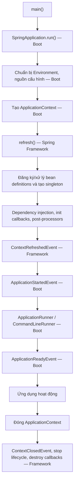

# Vai trò của Spring Boot so với vòng đời container của Spring Framework

## 1. Bức tranh tổng thể

Khi chạy một ứng dụng Spring Boot, có hai lớp trách nhiệm phối hợp với nhau:

- **Spring Framework** cung cấp IoC container (`BeanFactory`, thường được sử dụng thông qua `ApplicationContext`): đọc định nghĩa bean, tạo đối tượng, tiêm phụ thuộc, áp dụng `BeanPostProcessor`, quản lý phạm vi sống, phát sự kiện context và hủy bean khi đóng context.
- **Spring Boot** tổ chức quy trình khởi động ứng dụng xung quanh container đó: chuẩn bị cấu hình và `Environment`, chọn/tạo loại `ApplicationContext`, đăng ký nguồn cấu hình, kích hoạt auto-configuration, tích hợp web server nếu phù hợp, công bố các sự kiện cấp ứng dụng và gọi `ApplicationRunner`/`CommandLineRunner`.

Điểm cốt lõi: **Spring Boot sử dụng vòng đời container của Spring Framework; Boot không thay thế vòng đời đó bằng một IoC container khác.** Khi thấy `SpringApplication.run(...)`, hãy hình dung Boot đang điều phối quá trình tạo và làm mới một `ApplicationContext` của Framework.

Trong chủ đề này, “container” là **Spring IoC container**, không phải Docker container hoặc servlet container (Tomcat/Jetty). Servlet container có thể được Boot khởi tạo và quản lý trong ứng dụng web, nhưng là một khái niệm khác.

## 2. Ranh giới trách nhiệm: Boot làm gì, Framework làm gì?

| Công việc | Thành phần chịu trách nhiệm chính | Ý nghĩa |
| --- | --- | --- |
| Nhận lệnh khởi động từ `main()` | `SpringApplication` (Boot) | Chọn cách khởi động, chạy các bước chuẩn bị và trả về `ConfigurableApplicationContext`. |
| Tổng hợp tham số dòng lệnh, profile, file cấu hình và môi trường | Hạ tầng cấu hình của Boot dựa trên `Environment` của Framework | Bean có thể đọc cấu hình qua `@Value`, `@ConfigurationProperties`, ... |
| Chọn loại context theo kiểu ứng dụng | Boot | Có thể tạo context không có web server, context web servlet hoặc reactive tùy classpath/cấu hình. |
| Đọc `@Configuration`, `@Component`, `@Bean`, `@Import` và đăng ký bean definitions | Spring Framework | Xây dựng mô hình các bean sẽ được container quản lý. |
| Chọn các cấu hình tự động có điều kiện | Boot auto-configuration, được xử lý trong cơ chế cấu hình của Framework | Tạo cấu hình mặc định phù hợp với dependency và property; người dùng vẫn có thể tự cấu hình. |
| Khởi tạo bean, dependency injection, callback init/destroy, scope, proxy | Spring Framework | Đó là vòng đời thực tế của mỗi bean. |
| Làm mới context qua `refresh()` và phát `ContextRefreshedEvent` | Spring Framework | Thiết lập bean factory, post-processor, event multicaster, các singleton cần tạo sớm và hoàn tất refresh. |
| Phát `ApplicationStartedEvent`/`ApplicationReadyEvent`, chạy runner | Spring Boot | Đánh dấu các mốc cấp ứng dụng sau khi context được refresh. |
| Tích hợp embedded web server khi dùng ứng dụng web | Boot cùng các lớp context/integration của Spring | Kết nối vòng đời máy chủ HTTP với application context. |
| Đóng context, phát `ContextClosedEvent`, hủy singleton | Spring Framework; Boot có thể đăng ký shutdown hook | Giải phóng tài nguyên do context quản lý. |

`@SpringBootApplication` gộp ba vai trò thường gặp: `@SpringBootConfiguration`, `@EnableAutoConfiguration` và `@ComponentScan`. Nó giúp Boot cấu hình điểm vào và khám phá các thành phần ứng dụng. **Annotation này tự nó không tạo bean**; Spring Framework xử lý các định nghĩa bean và thực hiện vòng đời của chúng khi context được refresh.

Một cấu hình tự động như `DataSourceAutoConfiguration` không có nghĩa mọi dự án đều có `DataSource`. Điều kiện về classpath, property và bean hiện hữu quyết định cấu hình có hiệu lực. Dù bean được khai báo thủ công hay xuất phát từ auto-configuration, việc tạo và quản lý bean vẫn đi qua container của Framework.

## 3. Hai vòng đời lồng nhau

Có thể nhìn theo hai trục:

1. **Vòng đời ứng dụng:** chuẩn bị môi trường → tạo context → refresh context → chạy công việc sau khởi động → ứng dụng sẵn sàng → đóng ứng dụng. Boot điều phối phần lớn các bước bao quanh `refresh()`.
2. **Vòng đời bean:** đăng ký định nghĩa → khởi tạo đối tượng → tiêm phụ thuộc → callback khởi tạo/post-process → sử dụng → callback hủy. Framework điều phối bên trong context.



Sơ đồ mô tả luồng thành công thông thường. Nếu khởi động lỗi, Boot có thể phát `ApplicationFailedEvent`; ứng dụng không đi đến `ApplicationReadyEvent`. Các bean `@Lazy`, prototype hoặc được tạo theo yêu cầu có thể được khởi tạo muộn hơn vị trí “tạo singleton” trong sơ đồ.

### 3.1. Trong `ApplicationContext.refresh()` thực sự có gì?

Ở mức khái niệm, các bước quan trọng của Framework là:

- Chuẩn bị context và `BeanFactory`; thu thập định nghĩa bean từ cấu hình, component scan, import và các nguồn khác.
- Chạy `BeanFactoryPostProcessor`/`BeanDefinitionRegistryPostProcessor` để đọc hoặc điều chỉnh metadata/bean definitions **trước khi tạo phần lớn bean thông thường**. Cơ chế xử lý các class `@Configuration` cũng hoạt động ở giai đoạn này.
- Đăng ký `BeanPostProcessor` để can thiệp vào quá trình tạo bean, ví dụ xử lý annotation vòng đời hoặc tạo proxy AOP.
- Thiết lập hạ tầng sự kiện và những thành phần phụ trợ của context.
- Khởi tạo các singleton không lazy còn lại; giải quyết dependency và chạy callback khởi tạo cho từng bean.
- Hoàn tất refresh, bắt đầu những `Lifecycle`/`SmartLifecycle` bean được cấu hình tự chạy và phát `ContextRefreshedEvent`.

Đây là mô tả về trách nhiệm, không phải danh sách mọi phương thức nội bộ. `ApplicationContext` có những triển khai khác nhau; ứng dụng web còn tích hợp thêm các bước liên quan web server.

### 3.2. Vòng đời của một singleton bean

Với một singleton bình thường, không lazy, thứ tự khái quát là:

1. Framework chọn một bean definition và tạo instance (constructor hoặc factory method `@Bean`).
2. Framework giải quyết và gán dependency, property.
3. Chạy các `BeanPostProcessor` **trước** khởi tạo; `@PostConstruct` thường được kích hoạt bởi một post-processor trong nhóm này.
4. Gọi `InitializingBean.afterPropertiesSet()` (nếu có), tiếp đến custom `initMethod` nếu được khai báo.
5. Chạy các `BeanPostProcessor` **sau** khởi tạo; bean có thể được trả ra qua một proxy.
6. Bean được dùng trong ứng dụng; khi context đóng, Framework gọi callback hủy phù hợp như `@PreDestroy`, `DisposableBean.destroy()` hoặc custom destroy method.

Không nên coi thứ tự **giữa tất cả các bean** là cố định. Thứ tự được chi phối bởi dependency graph, scope, lazy initialization và cơ chế của container. Vòng đời ở trên là thứ tự khái quát **trên cùng một bean**.

`@PostConstruct` chỉ cho biết **bean đó** đã đi qua bước inject ban đầu; nó không có nghĩa cả ứng dụng đã sẵn sàng phục vụ traffic. Với prototype bean, container thường không tự gọi callback hủy khi context đóng; caller chịu trách nhiệm vòng đời sau khi lấy bean.

## 4. Các mốc Spring Boot nằm ở đâu?

Trong một lần khởi động thành công thông thường, các mốc cần phân biệt là:

| Mốc | Chủ quản | Khi nào xuất hiện và nên dùng cho việc gì? |
| --- | --- | --- |
| `ApplicationStartingEvent` | Boot | Khởi động rất sớm, trước khi có `Environment` hoàn chỉnh/context. Dành cho listener cấp bootstrap. |
| `ApplicationEnvironmentPreparedEvent` | Boot | Đã chuẩn bị `Environment`, context chưa được tạo. Dùng cho tích hợp cấu hình khởi động chuyên biệt. |
| `ApplicationContextInitializedEvent` | Boot | Context đã được tạo và các `ApplicationContextInitializer` đã chạy, chưa load đầy đủ bean definitions. |
| `ApplicationPreparedEvent` | Boot | Context đã được chuẩn bị và nguồn bean definitions được load, ngay trước refresh. |
| `ContextRefreshedEvent` | Framework | Context vừa refresh xong; **không tương đương** Boot đã hoàn thành runners. |
| `ApplicationStartedEvent` | Boot | Context đã refresh xong, **trước** `ApplicationRunner`/`CommandLineRunner`. |
| `ApplicationRunner` / `CommandLineRunner` | Boot | Chạy tác vụ khởi động sau refresh. Runner có thể nhận tham số đã parse (`ApplicationRunner`) hoặc chuỗi argument gốc (`CommandLineRunner`). |
| `ApplicationReadyEvent` | Boot | Sau khi các runner hoàn tất; là mốc phù hợp để biết quy trình startup của Boot đã kết thúc. |
| `ApplicationFailedEvent` | Boot | Nhánh lỗi khởi động; không nằm trong chuỗi thành công phía trên. |
| `ContextClosedEvent` | Framework | Khi context bắt đầu đóng; việc dừng lifecycle bean và destroy callback theo sau trong quá trình close. |

Một số sự kiện Boot đầu tiên xảy ra **trước khi có ApplicationContext để đăng ký bean listener**. Nếu cần bắt chúng, đăng ký `ApplicationListener` với `SpringApplication` hoặc cơ chế listener bootstrap; không kỳ vọng `@EventListener` trong một bean sẽ bắt mọi sự kiện xuất hiện trước khi chính bean đó tồn tại.

Với tác vụ chỉ cần chạy một lần sau khi các singleton thông thường đã được khởi tạo, runner thường rõ nghĩa hơn `@PostConstruct`. Với logic cần biết Boot đã hoàn tất các runner, dùng `ApplicationReadyEvent`. Tránh đặt tác vụ tốn thời gian hay gọi dịch vụ ngoài trong constructor hoặc callback `@PostConstruct` nếu việc đó làm khó kiểm soát startup và xử lý lỗi.

## 5. Thực hành: quan sát thứ tự các mốc

Tạo một dự án **Spring Boot 3.x hoặc mới hơn, Java 17+**, có dependency `spring-boot-starter`. Đặt file sau ở `src/main/java/com/example/runtime/RuntimeDemoApplication.java`. Ví dụ cố tình dùng `WebApplicationType.NONE` để chỉ khảo sát context, không mở cổng HTTP.

```java
package com.example.runtime;

import jakarta.annotation.PostConstruct;
import jakarta.annotation.PreDestroy;
import org.springframework.boot.ApplicationRunner;
import org.springframework.boot.Banner;
import org.springframework.boot.SpringApplication;
import org.springframework.boot.WebApplicationType;
import org.springframework.boot.autoconfigure.SpringBootApplication;
import org.springframework.boot.context.event.ApplicationReadyEvent;
import org.springframework.context.ConfigurableApplicationContext;
import org.springframework.context.annotation.Bean;
import org.springframework.context.event.EventListener;
import org.springframework.stereotype.Component;

@SpringBootApplication
public class RuntimeDemoApplication {

    public static void main(String[] args) {
        SpringApplication app = new SpringApplication(RuntimeDemoApplication.class);
        app.setWebApplicationType(WebApplicationType.NONE);
        app.setBannerMode(Banner.Mode.OFF);
        app.setLogStartupInfo(false);

        ConfigurableApplicationContext context = app.run(args);
        System.out.println("05 - run() returned");
        context.close();
    }

    @Bean
    ApplicationRunner startupRunner() {
        return args -> System.out.println("03 - ApplicationRunner");
    }

    @Component
    static class SampleBean {

        SampleBean() {
            System.out.println("01 - bean constructor");
        }

        @PostConstruct
        void init() {
            System.out.println("02 - @PostConstruct");
        }

        @EventListener(ApplicationReadyEvent.class)
        void onReady() {
            System.out.println("04 - ApplicationReadyEvent");
        }

        @PreDestroy
        void destroy() {
            System.out.println("06 - @PreDestroy");
        }
    }
}
```

Chạy từ thư mục gốc dự án bằng Maven Wrapper:

```bash
./mvnw spring-boot:run
```

Trên Windows PowerShell, dùng `.\mvnw.cmd spring-boot:run`. Với dự án Gradle Boot, có thể dùng `./gradlew bootRun` (Windows: `.\gradlew.bat bootRun`).

Trong các dòng do **chính ví dụ** in ra, thứ tự mong đợi là:

```text
01 - bean constructor
02 - @PostConstruct
03 - ApplicationRunner
04 - ApplicationReadyEvent
05 - run() returned
06 - @PreDestroy
```

Banner đã được tắt; tùy cấu hình logging, console vẫn có thể chứa log khác xen giữa. Điều cần kiểm chứng là **thứ tự tương đối sáu dòng trên**.

**Tại sao thứ tự này đúng?**

- `SampleBean` là component singleton không lazy. Framework tạo bean và gọi `@PostConstruct` trong quá trình refresh context, trước khi runner chạy.
- Sau khi refresh thành công, Boot gọi `ApplicationRunner`, rồi công bố `ApplicationReadyEvent`.
- `SpringApplication.run()` chỉ trả về context sau khi đã hoàn thành luồng startup thành công, vì vậy dòng `05` xuất hiện sau `04`.
- `context.close()` kích hoạt vòng đời đóng context của Framework, dẫn đến `@PreDestroy` cho singleton được quản lý.

Nếu bỏ `context.close()`, chương trình còn có thể dọn dẹp nhờ shutdown hook của Boot/JVM khi process kết thúc; trong ví dụ dùng `close()` tường minh để nhìn rõ ranh giới. Trong ứng dụng web thực tế, context thường sống cùng process cho đến khi ứng dụng được yêu cầu dừng.

**Thử thay đổi:** Cho `startupRunner()` ném `IllegalStateException`. Khi đó runner làm startup thất bại: không có `ApplicationReadyEvent` và không có dòng `run() returned` của luồng thành công. Boot xử lý nhánh lỗi khởi động và đóng context đã tạo khi phù hợp.

## 6. So với tự khởi tạo container bằng Spring Framework

Nếu chỉ dùng Spring Framework, ta có thể tự mở context như sau (mã minh họa độc lập trong một dự án có `spring-context`):

```java
package com.example.plain;

import org.springframework.context.annotation.AnnotationConfigApplicationContext;
import org.springframework.context.annotation.Bean;
import org.springframework.context.annotation.Configuration;

public class PlainSpringDemo {
    public static void main(String[] args) {
        try (AnnotationConfigApplicationContext context =
                     new AnnotationConfigApplicationContext(AppConfig.class)) {
            System.out.println(context.getBean(Greeting.class).message());
        }
    }

    @Configuration
    static class AppConfig {
        @Bean
        Greeting greeting() {
            return new Greeting("Xin chao Spring");
        }
    }

    record Greeting(String message) {}
}
```

Output từ `System.out` của ví dụ:

```text
Xin chao Spring
```

Ở đây, constructor `AnnotationConfigApplicationContext(AppConfig.class)` thực hiện đăng ký cấu hình và refresh context; `try` đóng context ở cuối block. Framework vẫn làm DI và quản lý bean dù không có `SpringApplication`, `@SpringBootApplication` hay sự kiện `ApplicationReadyEvent`.

Khi chuyển sang Boot, developer thường chỉ cần chỉ ra class cấu hình chính và gọi `SpringApplication.run(...)`: Boot lo nhiều bước bootstrap thường phải tự lắp ghép, đồng thời bổ sung auto-configuration và startup events. **Cả hai cách đều dựa trên cơ chế context/bean lifecycle của Spring Framework.**

## 7. Khi chạy web, web server liên quan thế nào?

Với ứng dụng có web starter phù hợp, Boot chọn loại context web thích hợp và tích hợp vòng đời embedded web server (ví dụ Tomcat cho ứng dụng servlet). Điều này **không biến servlet container thành IoC container**:

- **IoC container** quản lý các Spring bean như controller, service, repository và các bean hạ tầng web.
- **Servlet container** nhận kết nối HTTP, vận hành servlet/filter và xử lý request theo mô hình Servlet API.
- **Boot** tự động cấu hình, kết nối và điều phối hai phần, dựa trên classpath và cấu hình.

Sau khi context refresh, web server có thể đã được khởi tạo/khả dụng trong khi runner còn đang chạy. Vì thế “đã mở port” và “Boot đã công bố `ApplicationReadyEvent`” là hai mốc khác nhau. Khi thiết kế readiness/health check, cần đánh giá trạng thái khởi động thực tế của ứng dụng và các dependency liên quan, không chỉ kiểm tra port đã mở.

Khi đóng ứng dụng web, `ApplicationContext.close()` dẫn đến việc dừng các thành phần thuộc vòng đời context. Nếu bật graceful shutdown (`server.shutdown=graceful`, cùng cấu hình timeout phù hợp như `spring.lifecycle.timeout-per-shutdown-phase`), Boot phối hợp việc ngừng nhận và hoàn tất request tùy loại web server; quá trình này khác với callback hủy của từng bean. Cấu hình timeout và hành vi cụ thể còn phụ thuộc phiên bản/tích hợp web server.

## 8. Chọn đúng extension point

| Nhu cầu thực tế | Nơi phù hợp | Vì sao? |
| --- | --- | --- |
| Khởi tạo state nội bộ của một bean sau khi inject dependency | `@PostConstruct` hoặc custom init | Gắn với vòng đời **bean**, không phụ thuộc toàn bộ ứng dụng đã sẵn sàng. |
| Chạy logic sau khi context refresh, ví dụ kiểm tra dữ liệu khi startup | `ApplicationRunner` / `CommandLineRunner` | Boot gọi sau khi Framework đã refresh context. |
| Thực thi khi Boot hoàn tất các runner | Listener `ApplicationReadyEvent` | Phân biệt rõ “context đã refresh” với “ứng dụng đã ready”. |
| Tích hợp sâu vào bước chuẩn bị property/context | `ApplicationContextInitializer` hoặc listener bootstrap | Hoạt động đủ sớm; cần hiểu thứ tự khởi động. |
| Quản lý component có start/stop liên quan context | `SmartLifecycle` | Có `start()`, `stop()` và phase để phối hợp thứ tự. |
| Giải phóng tài nguyên thuộc singleton | `@PreDestroy`, `DisposableBean` hoặc custom destroy | Framework gọi khi bean/context bị hủy trong luồng đóng bình thường. |

Không nên dùng `BeanFactoryPostProcessor` để gọi nghiệp vụ cần các service thông thường; nó làm việc với bean metadata trước giai đoạn bean thông thường được tạo. Cũng không nên gọi trực tiếp `new` để tạo một đối tượng rồi kỳ vọng `@Autowired`, `@PostConstruct` và `@PreDestroy` tự chạy: những callback này gắn với instance **do Spring quản lý**.

## 9. Những hiểu nhầm dễ gặp

1. **“Boot tự làm dependency injection.”** Chính Spring Framework tạo và quản lý dependency graph. Boot chuẩn bị nguồn cấu hình và giúp khai báo/khởi động thuận tiện.
2. **“`SpringApplication.run()` chạy xong trước khi bean được tạo.”** Ngược lại, các singleton không lazy thường đã được tạo trong `refresh()` trước khi `run()` trả về. Bean lazy/scope đặc biệt là ngoại lệ.
3. **“`@PostConstruct` chứng minh ứng dụng đã ready.”** Callback này chỉ thuộc một bean; runner và các hoạt động sau refresh có thể vẫn chưa chạy.
4. **“`ContextRefreshedEvent` đồng nghĩa `ApplicationReadyEvent`.”** `ContextRefreshedEvent` là mốc của Framework; Boot còn chạy runner sau đó.
5. **“Có `@SpringBootApplication` thì mọi thứ được auto-configure.”** Auto-configuration có điều kiện; tùy dependency/property và bean do ứng dụng cung cấp.
6. **“Có embedded Tomcat tức Tomcat quản lý Spring bean.”** Tomcat là servlet container, còn `ApplicationContext` mới là Spring IoC container.
7. **“Mọi bean đều được hủy khi tắt.”** Callback destroy tự động chủ yếu áp dụng với các bean được container theo dõi vòng đời đầy đủ, như singleton. Prototype thường cần người dùng tự giải phóng; process bị kill cưỡng bức có thể bỏ qua cleanup.
8. **“Runner luôn có thứ tự như nhau.”** Khi có nhiều runner, hãy dùng `@Order` hoặc `Ordered` nếu thứ tự có ý nghĩa; không dựa vào tình cờ của thứ tự scan.
9. **“Ứng dụng mở được port tức là mọi tác vụ khởi động đã xong.”** Web server và `ApplicationReadyEvent` là hai mốc khác nhau; runner lỗi vẫn có thể khiến startup thất bại.
10. **“Tạo bean bằng `new` sẽ nhận đầy đủ lifecycle Spring.”** Instance được tự tạo ngoài container không tự được inject hay chạy callback lifecycle.

## 10. Tự kiểm tra kiến thức

**Tình huống A.** Một `@Service` cần đọc cấu hình đã inject để tạo cache nội bộ, không gọi mạng. Nên đặt ở đâu?  
**Gợi ý:** `@PostConstruct` hoặc custom init của bean thường phù hợp vì nhiệm vụ gắn với instance.

**Tình huống B.** Cần chạy bước kiểm tra dữ liệu khi ứng dụng khởi động; nếu kiểm tra thất bại thì không chấp nhận startup thành công. Nên cân nhắc gì?  
**Gợi ý:** Một `ApplicationRunner` có thể ném exception khi thất bại, khiến Boot không phát `ApplicationReadyEvent` cho luồng startup thành công. Cần xử lý lỗi và thời gian chạy có kiểm soát.

**Tình huống C.** Có log `ContextRefreshedEvent`, nhưng chưa thấy `ApplicationReadyEvent`. Đây có nhất thiết là bug của IoC container?  
**Đáp án:** Không. Context có thể refresh thành công nhưng runner còn đang thực thi hoặc đã thất bại.

**Tình huống D.** Khi có `@Lazy` trên bean, tại sao không thấy `@PostConstruct` của bean khi app vừa chạy?  
**Đáp án:** Bean có thể chưa được instantiate. Lifecycle callback chạy khi chính bean được tạo, không nhất thiết tại startup.

## 11. Ghi nhớ

Một cách phân định hữu ích là hỏi **“Ai sở hữu mốc này?”**: nếu mốc nói về **bean, dependency injection, refresh hoặc close của ApplicationContext**, đó là trách nhiệm cốt lõi của **Spring Framework**. Nếu mốc nói về **chuẩn bị ứng dụng, auto-configuration, runner, ready/failure event hoặc tích hợp embedded server**, đó là phần **Spring Boot tổ chức trên nền Framework**.

Hiểu hai tầng này giúp chọn đúng nơi đặt code khởi tạo, chẩn đoán startup chậm hoặc thất bại, tránh nhầm `@PostConstruct` với readiness và shutdown đúng tài nguyên.