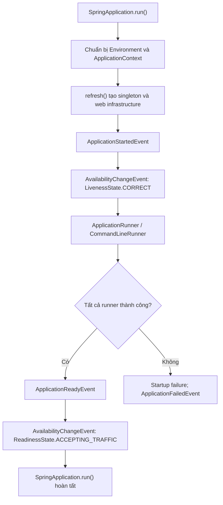

# Runner chạy lâu, thời hạn khởi động và readiness

## 1. Runner có thể giữ ứng dụng ở trạng thái chưa sẵn sàng

`ApplicationRunner` và `CommandLineRunner` là hai extension point của Spring Boot để thực thi công việc sau khi Spring Framework đã refresh `ApplicationContext` nhưng trước khi `SpringApplication.run()` hoàn tất. Chúng thường được dùng để kiểm tra dữ liệu thiết yếu, warm-up cache, kiểm tra kết nối hoặc thực hiện một bước chuẩn bị nghiệp vụ.

Nếu runner chạy lâu, Spring Boot vẫn đợi runner **trả về thành công** trước khi phát `ApplicationReadyEvent` và công bố trạng thái `ReadinessState.ACCEPTING_TRAFFIC`. Khi đó:

- Spring container có thể đã khởi tạo đầy đủ.
- Embedded web server có thể đã bind cổng HTTP.
- `ApplicationStartedEvent` đã có thể được phát.
- **Ứng dụng vẫn chưa ở trạng thái ready**, vì runner đang làm việc.

Vì vậy, “server đã mở cổng” và “ứng dụng có thể nhận traffic nghiệp vụ” là hai câu hỏi riêng. Một load balancer hoặc orchestrator nên dùng readiness probe, thay vì chỉ kiểm tra TCP port.

Bài học sử dụng **Spring Boot 3.3.x, Java 17+**, tập trung vào hành vi mặc định của `SpringApplication` và cách quản lý deadline trên Kubernetes.

## 2. Trình tự vòng đời và trạng thái availability



`ApplicationStartedEvent` được phát **trước** các runner. `ApplicationReadyEvent` được phát **sau** các runner. Trong luồng bình thường, Boot công bố `ACCEPTING_TRAFFIC` ngay sau `ApplicationReadyEvent`.

| Mốc | Ý nghĩa | Đã kết thúc runner chưa? |
| --- | --- | --- |
| `WebServerInitializedEvent` | Web server đã khởi tạo; có thể lấy cổng thật | Chưa chắc |
| `ContextRefreshedEvent` | Spring Framework hoàn thành refresh context | Chưa chắc |
| `ApplicationStartedEvent` | Context refresh xong, Boot chuẩn bị chạy runner | **Chưa** |
| Runner đang xử lý | Tác vụ khởi động của ứng dụng đang chạy | **Chưa** |
| `ApplicationReadyEvent` | Runners đã hoàn tất trong đường startup thành công | **Rồi** |
| `ReadinessState.ACCEPTING_TRAFFIC` | Ứng dụng công bố có thể nhận traffic | Thông thường **rồi** |

`LivenessState.CORRECT` có thể đã được phát ngay sau `ApplicationStartedEvent` khi readiness vẫn chưa accepting. Trạng thái **live nhưng unready** là bình thường trong quá trình startup.

Không nên phụ thuộc vào việc cả Internet hoặc database đều khỏe chỉ vì đã có `ApplicationReadyEvent`. Readiness là một tín hiệu do ứng dụng cung cấp, có thể được bổ sung bằng health contributors và thay đổi trong thời gian chạy.

## 3. Runner được gọi như thế nào?

`ApplicationRunner` nhận `ApplicationArguments` đã được parse; `CommandLineRunner` nhận tham số gốc dưới dạng `String...`. Cả hai có phương thức `run` ném được `Exception`.

Ví dụ minh họa:

```java
@Bean
ApplicationRunner loadReferenceData() {
    return args -> {
        loadRequiredCatalog();
        verifyCatalog();
    };
}
```

Hai hàm nghiệp vụ trong đoạn này cần được cài đặt; đây là minh họa cơ chế, **không phải chương trình Java chạy độc lập**.

Khi `run()` gọi `loadRequiredCatalog()`, nó đợi lời gọi trả về theo luồng bình thường. Nếu tác vụ mất 90 giây, runner giữ startup ở đó 90 giây. Những runner sau còn phải đợi nếu được sắp xếp chạy sau.

Khi có nhiều runner, dùng `Ordered` hoặc `@Order` để kiểm soát thứ tự:

```java
@Component
@Order(10)
class LoadData implements ApplicationRunner {
    @Override
    public void run(ApplicationArguments args) {
        // Nạp dữ liệu cần thiết
    }
}
```

Các kiểu import cần thiết là `org.springframework.boot.ApplicationRunner`, `org.springframework.boot.ApplicationArguments`, `org.springframework.core.annotation.Order` và `org.springframework.stereotype.Component`.

`@Order` không tự chạy các runner song song. Nếu runner đầu phụ thuộc vào runner thứ hai, hãy thiết kế thứ tự và giao ước rõ ràng. Khi runner ném exception không được xử lý, quá trình startup có thể thất bại; Boot phát `ApplicationFailedEvent` thay vì công bố mốc ready thành công.

## 4. Có một timeout chung cho mọi runner không?

**Spring Boot không cung cấp một property tổng quát kiểu `spring.runner.timeout=30s` để ngắt tất cả runner.** Giới hạn khởi động trong thực tế được tạo từ nhiều lớp:

| Nguồn thời hạn | Ví dụ | Tác động |
| --- | --- | --- |
| I/O bên trong runner | HTTP connect/read timeout, JDBC/socket timeout | Giới hạn chờ một thao tác |
| Deadline của bước nghiệp vụ | Tổng thời gian retry/warm-up | Buộc code xử lý thành công/thất bại trong ngân sách |
| Container/process manager | Kill timeout, startup deadline của nền tảng | Có thể dừng process từ bên ngoài |
| Kubernetes `startupProbe` | `periodSeconds`, `failureThreshold`, `timeoutSeconds` | Restart nếu probe không đạt trong ngân sách |
| Kubernetes `readinessProbe` | Chu kỳ kiểm tra và ngưỡng thất bại | Loại instance khỏi traffic; bản thân readiness fail không tự restart |
| Kubernetes `livenessProbe` | Kiểm tra khả năng tiếp tục hoạt động | Restart instance nếu liveness liên tục thất bại |
| Kubernetes Deployment rollout | `progressDeadlineSeconds` | Có thể báo rollout không tiến triển vì không đủ replica available |

Các property sau **không phải** timeout của runner:

- `spring.lifecycle.timeout-per-shutdown-phase`: giới hạn **shutdown** theo phase.
- `server.tomcat.connection-timeout`: giới hạn một loại kết nối HTTP.
- `spring.mvc.async.request-timeout`: giới hạn xử lý request bất đồng bộ.
- `spring.main.lazy-initialization`: thay đổi thời điểm tạo một số bean.
- `management.endpoint.health.probes.enabled`: kích hoạt các HTTP probe liên quan health, không cắt ngắn runner.

Một runner gọi API với timeout một request là 20 giây nhưng retry 10 lần có thể mất hơn 200 giây. Cần tính cả số lượt gọi, backoff và deadline **toàn bước**.

### 4.1. Khi runner gặp lỗi hoặc bị ngắt

Nếu tác vụ startup là **bắt buộc**, fail-fast đúng lúc thường tốt hơn việc nuốt exception rồi báo ready dù dữ liệu chưa có. Một exception từ runner được Boot xử lý trong nhánh startup failure, và `ApplicationReadyEvent` của lần chạy thành công không xuất hiện.

Nếu tác vụ là **tùy chọn**, bạn có thể ghi log và tiếp tục, hoặc chuyển công việc ra background với fallback phù hợp. Không làm một dependency telemetry tùy chọn kéo sập toàn bộ API trừ khi hợp đồng nghiệp vụ thực sự yêu cầu.

`Thread.interrupt()` không phải timeout phổ quát: có những thư viện I/O không phản ứng theo cách bạn mong đợi. Hãy dùng timeout/deadline được hỗ trợ ngay tại HTTP client, database driver, RPC hoặc executor; khi bắt `InterruptedException` mà không ném tiếp, thường cần khôi phục cờ interrupt.

## 5. Phân biệt readiness, liveness và startup probe

### 5.1. Readiness

`ReadinessState.REFUSING_TRAFFIC` báo instance chưa nên nhận traffic. `ReadinessState.ACCEPTING_TRAFFIC` báo instance có thể nhận traffic.

Kubernetes dùng readiness probe để quyết định có đưa Pod vào tuyến Service hay không. Nếu readiness thất bại, Pod thường không nhận traffic từ Service; điều đó **không nhất thiết** dẫn tới restart.

Readiness còn có thể trở lại `REFUSING_TRAFFIC` sau khi app từng ready, ví dụ khi instance không còn đủ khả năng phục vụ một dependency thiết yếu. Dùng `AvailabilityChangeEvent` hoặc health indicators phù hợp để phản ánh trạng thái.

### 5.2. Liveness

Liveness cho biết process còn có khả năng hoạt động đúng hoặc tự phục hồi. Nếu liveness hỏng liên tục, Kubernetes có thể restart container. **Không dùng sự cố database chung làm liveness mặc định**: các replica có thể đồng loạt restart trong lúc database vẫn đang lỗi, làm sự cố trầm trọng hơn.

### 5.3. Startup probe

`startupProbe` cho một ứng dụng khởi động chậm thêm ngân sách để hình thành. Khi startup probe chưa thành công, Kubernetes chưa thực thi liveness/readiness probes thông thường.

Nếu startup probe kiểm tra `/livez`, nó có thể thành công khi context đã refresh dù runner chưa xong; readiness sẽ tiếp tục giữ traffic. Nếu startup probe kiểm tra `/readyz`, nó đợi cho đến khi ứng dụng thực sự ready, nhưng một dependency bên ngoài không phục hồi có thể làm startup vượt deadline và container bị restart.

Chọn endpoint startup probe theo chiến lược phục hồi và nhu cầu khởi động, không giả định hai đường dẫn đồng nghĩa.

## 6. Ví dụ chạy được: quan sát runner và readiness

Tạo dự án Maven Spring Boot 3.3.x với Java 17+, `spring-boot-starter-web` và `spring-boot-starter-actuator`.

### 6.1. File `pom.xml`

```xml
<project xmlns="http://maven.apache.org/POM/4.0.0"
         xmlns:xsi="http://www.w3.org/2001/XMLSchema-instance"
         xsi:schemaLocation="http://maven.apache.org/POM/4.0.0 https://maven.apache.org/xsd/maven-4.0.0.xsd">
    <modelVersion>4.0.0</modelVersion>
    <parent>
        <groupId>org.springframework.boot</groupId>
        <artifactId>spring-boot-starter-parent</artifactId>
        <version>3.3.13</version>
        <relativePath/>
    </parent>
    <groupId>com.example</groupId>
    <artifactId>slow-runner-demo</artifactId>
    <version>0.0.1-SNAPSHOT</version>
    <properties>
        <java.version>17</java.version>
    </properties>
    <dependencies>
        <dependency>
            <groupId>org.springframework.boot</groupId>
            <artifactId>spring-boot-starter-web</artifactId>
        </dependency>
        <dependency>
            <groupId>org.springframework.boot</groupId>
            <artifactId>spring-boot-starter-actuator</artifactId>
        </dependency>
    </dependencies>
    <build>
        <plugins>
            <plugin>
                <groupId>org.springframework.boot</groupId>
                <artifactId>spring-boot-maven-plugin</artifactId>
            </plugin>
        </plugins>
    </build>
</project>
```

### 6.2. File `SlowRunnerApplication.java`

Tạo `src/main/java/com/example/slowrunner/SlowRunnerApplication.java`:

```java
package com.example.slowrunner;

import org.springframework.boot.ApplicationRunner;
import org.springframework.boot.SpringApplication;
import org.springframework.boot.autoconfigure.SpringBootApplication;
import org.springframework.boot.availability.AvailabilityChangeEvent;
import org.springframework.boot.availability.ReadinessState;
import org.springframework.boot.context.event.ApplicationReadyEvent;
import org.springframework.boot.context.event.ApplicationStartedEvent;
import org.springframework.context.annotation.Bean;
import org.springframework.context.event.EventListener;

@SpringBootApplication
public class SlowRunnerApplication {

    public static void main(String[] args) {
        SpringApplication.run(SlowRunnerApplication.class, args);
    }

    @EventListener
    public void onStarted(ApplicationStartedEvent event) {
        System.out.println("01 - application-started");
    }

    @Bean
    ApplicationRunner warmup() {
        return args -> {
            System.out.println("02 - runner-started");
            Thread.sleep(2000L);
            System.out.println("03 - runner-finished");
        };
    }

    @EventListener
    public void onReady(ApplicationReadyEvent event) {
        System.out.println("04 - application-ready-event");
    }

    @EventListener
    public void onAvailability(AvailabilityChangeEvent<?> event) {
        if (event.getState() == ReadinessState.ACCEPTING_TRAFFIC) {
            System.out.println("05 - readiness-accepting-traffic");
        }
    }
}
```

`Thread.sleep(2000L)` chỉ mô phỏng một tác vụ mất thời gian. Ví dụ dùng annotation event listener trên class `@SpringBootApplication` là một Spring bean được quản lý; listener chỉ cần chạy khi các event tương ứng xuất hiện.

### 6.3. File `application.properties`

```properties
server.port=8080
spring.main.banner-mode=off
logging.level.root=WARN
management.endpoint.health.probes.enabled=true
management.endpoint.health.probes.add-additional-paths=true
```

Boot Actuator cung cấp các health groups liên quan liveness/readiness; `add-additional-paths` giúp chúng có mặt trên cổng HTTP chính dưới `/livez` và `/readyz`. Trong môi trường có management port riêng, điều này tránh chỉ kiểm tra cổng quản trị mà bỏ qua web server chính.

### 6.4. Chạy

Từ thư mục có `pom.xml`:

```bash
mvn spring-boot:run
```

Nếu có Maven Wrapper:

```bash
./mvnw spring-boot:run
```

Windows PowerShell:

```powershell
.\mvnw.cmd spring-boot:run
```

Lệnh chạy giả định JDK/Maven và dependency đã sẵn sàng. Vì có Spring libraries, đây không phải một file Java có thể chạy bằng `javac` thuần.

### 6.5. Thứ tự output mong đợi

Các dòng do chương trình in ra thường có thứ tự:

```text
01 - application-started
02 - runner-started
03 - runner-finished
04 - application-ready-event
05 - readiness-accepting-traffic
```

Log của Spring Boot/Maven có thể xen giữa. Thời gian `sleep` xấp xỉ 2 giây; tổng startup thực tế còn bao gồm JVM, context refresh và các tác vụ khác.

Thay `Thread.sleep(2000L)` thành `Thread.sleep(10000L)`, quan sát khoảng cách giữa hai dòng runner tăng, còn `application-ready-event` chỉ xuất hiện sau runner.

### 6.6. Kiểm tra HTTP probe

Sau khi ứng dụng hoàn tất startup:

```bash
curl -i http://localhost:8080/readyz
```

Thông thường endpoint trả HTTP 200 và body có:

```json
{"status":"UP"}
```

Nếu gọi trong lúc runner chưa hoàn tất nhưng HTTP server đã có thể trả response, readiness có thể báo `OUT_OF_SERVICE` với HTTP 503. Một số thời điểm/loại server có thể chưa chấp nhận request dù cổng đã bind; đó là chi tiết runtime, không thay đổi quy tắc `ApplicationReadyEvent` đến sau runner.

So sánh:

```bash
curl -i http://localhost:8080/livez
```

Liveness có thể UP trước readiness; đây là trạng thái hợp lý của ứng dụng đang khởi động.

## 7. Ví dụ Kubernetes probes cho runner dài

Đây là một **đoạn cấu hình bên trong container spec**, không phải toàn bộ Deployment manifest:

```yaml
startupProbe:
  httpGet:
    path: /readyz
    port: 8080
  periodSeconds: 5
  timeoutSeconds: 2
  failureThreshold: 24

readinessProbe:
  httpGet:
    path: /readyz
    port: 8080
  periodSeconds: 5
  timeoutSeconds: 2
  failureThreshold: 3

livenessProbe:
  httpGet:
    path: /livez
    port: 8080
  periodSeconds: 10
  timeoutSeconds: 2
  failureThreshold: 3
```

Startup probe trong ví dụ dùng `/readyz`; `failureThreshold × periodSeconds = 24 × 5`, tức **ngân sách quan sát xấp xỉ 120 giây** sau khi probe bắt đầu. Con số này chỉ để thiết kế, không bảo đảm giới hạn đồng hồ tuyệt đối vì còn `initialDelaySeconds`, `timeoutSeconds`, thời gian thực thi và lịch kiểm tra.

Nếu warm-up là một phần bắt buộc của startup, chọn `/readyz` làm startup probe có thể phù hợp. Nếu startup probe dùng `/livez`, nó có thể thành công **trong khi runner còn chạy**, nhưng readiness probe riêng vẫn bảo vệ traffic. Đo tình trạng thực tế trước khi chọn cấu hình.

Khi readiness thất bại, Pod thường bị loại khỏi Service endpoints. Khi liveness hoặc startup probe thất bại liên tục, Kubelet có thể restart container. `progressDeadlineSeconds` của Deployment là một giới hạn rollout khác: nó không truyền timeout vào runner Java.

## 8. Nếu chuyển runner sang background thì sao?

Ví dụ runner chỉ gửi việc vào executor rồi trả về:

```java
@Bean
ApplicationRunner scheduleWork(TaskExecutor executor) {
    return args -> executor.execute(() -> performWarmup());
}
```

Đoạn trên là minh họa, yêu cầu `TaskExecutor` và `performWarmup()` tồn tại. Boot chỉ biết runner **đã trả về**, nên `ApplicationReadyEvent` và readiness accepting có thể xuất hiện **trước khi tác vụ nền xong**.

Điều đó hoàn toàn phù hợp nếu warm-up là **tùy chọn** và request có fallback. Nếu dữ liệu warm-up là điều kiện bắt buộc trước traffic, cách trên sẽ tạo cửa sổ phục vụ sai.

Có hai hướng thường dùng:

1. Giữ warm-up bắt buộc trong runner **đồng bộ**, có timeout tổng và chính sách thất bại rõ.
2. Cho phép warm-up chạy nền nhưng biểu diễn trạng thái đó trong **readiness health** được probe kiểm tra, ví dụ custom `HealthIndicator`.

### 8.1. Custom readiness health cho background warm-up

Nếu dự án có Spring Boot Actuator, tạo `WarmupHealthIndicator.java`:

```java
package com.example.slowrunner;

import java.util.concurrent.atomic.AtomicBoolean;

import org.springframework.boot.actuate.health.Health;
import org.springframework.boot.actuate.health.HealthIndicator;
import org.springframework.stereotype.Component;

@Component("warmupHealthIndicator")
public class WarmupHealthIndicator implements HealthIndicator {

    private final AtomicBoolean complete = new AtomicBoolean(false);

    public void markComplete() {
        complete.set(true);
    }

    @Override
    public Health health() {
        return complete.get()
                ? Health.up().build()
                : Health.outOfService()
                        .withDetail("warmup", "in-progress")
                        .build();
    }
}
```

File trên biên dịch trong dự án Actuator, nhưng cần một startup task thật sự gọi `markComplete()` khi công việc kết thúc. Đây là cơ chế trạng thái, **không tự tạo** background job.

Mặc định readiness group của Boot không tự chứa mọi custom indicator. Khai báo thêm:

```properties
management.endpoint.health.group.readiness.include=readinessState,warmup
```

Tên health contributor được suy ra từ bean `warmupHealthIndicator` thành `warmup`. Trong khi warm-up chưa hoàn tất, readiness group nhận `OUT_OF_SERVICE` từ contributor này, dù Boot đã công bố availability accepting cho các thành phần khác.

Khi tác vụ bắt buộc ở background lỗi, đừng gọi `markComplete`; cần ghi lại lỗi, giới hạn retry và lựa chọn fail/recovery phù hợp. Khi đóng ứng dụng, phải dừng thread/task theo lifecycle rõ ràng.

### 8.2. Công bố readiness state thủ công

Spring Boot hỗ trợ:

```java
AvailabilityChangeEvent.publish(
        applicationContext, ReadinessState.REFUSING_TRAFFIC);
```

và khi phục hồi:

```java
AvailabilityChangeEvent.publish(
        applicationContext, ReadinessState.ACCEPTING_TRAFFIC);
```

Các đoạn code giả định có `ApplicationContext` và import chính xác. Lưu ý **Boot tự phát ACCEPTING ngay sau `ApplicationReadyEvent`**: nếu runner chuyển readiness sang REFUSING rồi trả về trong khi background task chưa xong, event tự động sau đó có thể ghi đè ý định của bạn. Custom health indicator là cách dễ kiểm chứng hơn cho warm-up nền bắt buộc.

Không dùng `LivenessState.BROKEN` để chỉ biểu thị “đang warm-up”, vì orchestrator có thể restart một process hoàn toàn khỏe.

## 9. Tối ưu runner có deadline đúng nghĩa

Khi runner làm nhiều bước, đo từng pha:

```text
load-reference-data:  8s
verify-schema:        2s
warm-cache:          12s
total:               22s
```

Các con số là ví dụ minh họa, không phải số liệu đo thật. Log cần ghi thời điểm bắt đầu, hoàn tất, tên bước và nguyên nhân lỗi; tránh ghi secret/token.

Một tác vụ gọi external API cần:

- Connect timeout, read/response timeout.
- Số retry hữu hạn và backoff có giới hạn.
- Deadline toàn bước, bao gồm tất cả retry.
- Chính sách phân biệt lỗi bắt buộc và lỗi tùy chọn.
- Cleanup tài nguyên khi startup thất bại nửa chừng.

Nếu application có nhiều runner phụ thuộc lẫn nhau, dùng `@Order` hoặc một orchestrator có bước rõ ràng. Không chạy logic dài trong constructor hoặc `@PostConstruct` chỉ để tránh việc phải giải thích runner; những callback đó còn xảy ra sớm hơn trong bean lifecycle.

## 10. Lỗi phổ biến

### Server mở cổng nhưng Pod vẫn chưa Ready

Runner hoặc readiness contributor chưa hoàn tất. Kiểm tra log runner, `ApplicationReadyEvent` và `/readyz` thay vì chỉ ping port.

### Readiness probe fail khiến Pod restart?

**Readiness failure tự nó** thường ngừng route traffic. Restart thường liên quan liveness/startup probe failure hoặc một nguyên nhân khác; xem `kubectl describe pod` để đọc đúng events.

### Tăng startup probe có làm HTTP client timeout nhanh hơn?

Không. Probe thay đổi chính sách giám sát của Kubernetes, không tự áp timeout vào network call đang chạy trong Java runner.

### Một runner `@Async` là đủ để app ready đúng lúc?

Không thể giả định. Nếu công việc chạy async và runner trả về, Boot có thể ready trước khi công việc xong. Cần định nghĩa điều kiện readiness rõ ràng và kiểm tra hạ tầng executor/proxy.

### `ApplicationReadyEvent` đảm bảo mọi dependency còn hoạt động?

Không. Event cho biết luồng startup đã qua runner thành công. Health check và availability runtime vẫn có thể thay đổi.

### Bật Actuator thì readiness tự bao gồm database/cache?

Không. Readiness group mặc định dựa trên trạng thái readiness do Boot quản lý; custom/external health contributors cần được cân nhắc và thêm một cách chủ đích. Không nhét mọi dịch vụ ngoài vào readiness nếu lỗi của một dịch vụ chung sẽ làm tất cả replica mất traffic.

### Runner ném lỗi có nên `catch (Exception)` rồi im lặng?

Chỉ nếu lỗi không ảnh hưởng điều kiện phục vụ, và phải có logging/telemetry phù hợp. Với dữ liệu bắt buộc, nuốt exception sẽ khiến Boot công bố ready cho một instance sai trạng thái.

### Có timeout tự động nếu runner chạy 10 phút không?

Spring Boot không đặt một deadline tổng mặc định cho mọi runner. Process có thể bị giới hạn bởi runtime/orchestrator; code vẫn cần timeout hợp lệ và xử lý failure.

### `spring.lifecycle.timeout-per-shutdown-phase` cứu runner treo?

Không. Property này dành cho **shutdown**, không phải startup.

## 11. Tình huống tự kiểm tra

**Tình huống A.** Runner mất 90 giây, web server bind sau 10 giây. `ApplicationReadyEvent` có xuất hiện sau 10 giây không?  
**Đáp án:** Không, chỉ sau khi các runner hoàn tất thành công và Boot đi đến mốc ready.

**Tình huống B.** `LivenessState.CORRECT` nhưng `ReadinessState.REFUSING_TRAFFIC` trong lúc warm-up, có bất thường không?  
**Đáp án:** Không. Process hoạt động bình thường nhưng chưa sẵn sàng phục vụ nghiệp vụ.

**Tình huống C.** Đưa warm-up bắt buộc vào `CompletableFuture.runAsync` và runner trả về ngay thì chuyện gì xảy ra?  
**Đáp án:** Boot không tự đợi future; readiness mặc định có thể chuyển accepting khi warm-up chưa xong. Cần giữ runner đồng bộ hoặc bổ sung custom readiness check.

**Tình huống D.** Chọn `startupProbe` ở `/livez` có đảm bảo runner đã hoàn thành trước khi startup probe success?  
**Đáp án:** Không. Liveness có thể CORRECT ngay sau context refresh. Readiness vẫn phải được kiểm tra riêng.

**Tình huống E.** `failureThreshold=24`, `periodSeconds=5` nghĩa là Java runner chắc chắn bị hủy đúng sau 120 giây?  
**Đáp án:** Không. Đó là ngân sách probe xấp xỉ cho Kubelet; thời điểm thực tế và việc dừng container khác với deadline trong Java.

**Tình huống F.** Khi nào cần fail startup thay vì tiếp tục ở chế độ degraded?  
**Đáp án:** Khi dữ liệu hoặc phụ thuộc thiết yếu không đáp ứng khiến việc nhận request tạo kết quả sai/không an toàn và không có fallback được chấp nhận.

## 12. Nguồn tham khảo

- Spring Boot 3.3 — Application Events, Runners, Availability: https://docs.spring.io/spring-boot/3.3/reference/features/spring-application.html
- Spring Boot 3.3 — Actuator, Kubernetes probes và health groups: https://docs.spring.io/spring-boot/3.3/reference/actuator/endpoints.html
- Spring Boot API — `ReadinessState`: https://docs.spring.io/spring-boot/3.3/api/java/org/springframework/boot/availability/ReadinessState.html
- Kubernetes — Liveness, Readiness, Startup Probes: https://kubernetes.io/docs/concepts/workloads/pods/probes/

## 13. Ghi nhớ

**Runner đồng bộ chạy lâu sẽ kéo dài khoảng thời gian “context started” → “application ready”.** Trong khoảng đó, web server và liveness có thể đã hoạt động nhưng readiness chưa chấp nhận traffic. Không dùng cổng HTTP hoặc một thông báo “Started” để thay thế probe.

Với công việc bắt buộc, giữ runner có giới hạn thời gian và để failure làm startup thất bại minh bạch. Với công việc tùy chọn, có thể chạy nền. Nếu tác vụ nền bắt buộc phải xong mới phục vụ, dùng custom readiness health để biểu diễn tiến độ. Khi triển khai, đo startup thật rồi chọn `startupProbe`, `readinessProbe`, `livenessProbe` và rollout deadline có chủ đích.