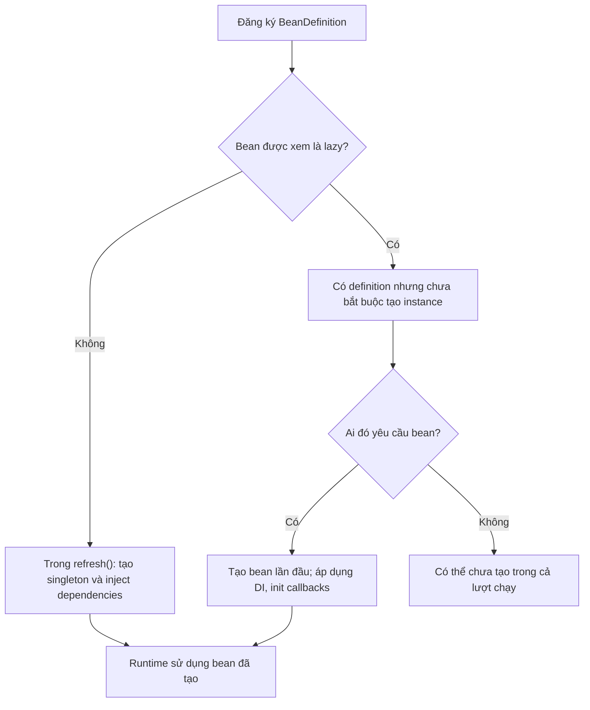
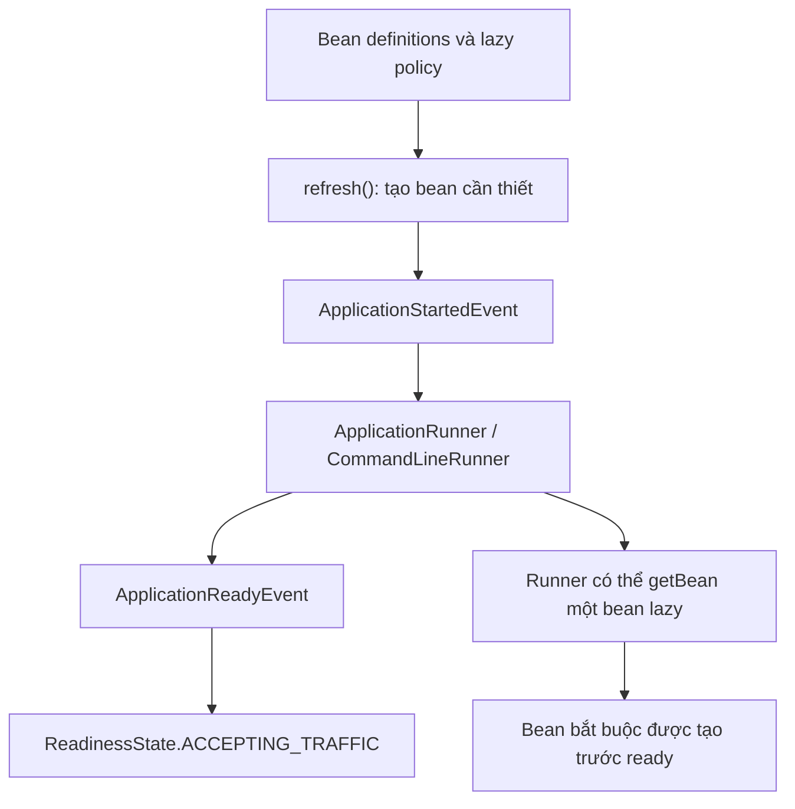

# Bật `spring.main.lazy-initialization` hoặc `SpringApplication#setLazyInitialization`

## 1. Bài toán: khởi tạo tất cả bean ngay hay chỉ khi cần?

Mặc định, trong một ứng dụng Spring Boot, phần lớn **singleton bean không khai báo lazy** sẽ được Spring Framework khởi tạo trong quá trình `ApplicationContext.refresh()`. Container tạo đối tượng, tiêm dependency, áp dụng `BeanPostProcessor`, chạy callback khởi tạo và phát hiện nhiều lỗi cấu hình trước khi ứng dụng hoàn thành startup.

Nhưng có những bean đắt tiền mà một lần chạy ứng dụng chưa chắc sử dụng ngay: một bộ máy xuất báo cáo, adapter của tính năng hiếm dùng hoặc một số thành phần hỗ trợ HTTP. **Lazy initialization** cho phép Spring trì hoãn việc tạo những bean này đến lúc thực sự cần.

Spring Boot cung cấp hai cách bật cơ chế này trên phạm vi ứng dụng:

1. **Khai báo cấu hình** `spring.main.lazy-initialization=true` trong file cấu hình hoặc nguồn cấu hình ngoài.
2. **Gọi API Java** `SpringApplication#setLazyInitialization(true)` trên đối tượng `SpringApplication` **trước** khi `run(args)`.

Trong Spring Boot 3.3, giá trị mặc định là **`false`**. Việc bật lazy không đồng nghĩa không có bean nào được tạo khi startup: vẫn có bean/hạ tầng buộc phải khởi tạo để context hoàn thành, các bean được yêu cầu bởi thành phần eager, runner được Boot gọi và những bean được chỉ định khởi tạo sớm.

Mục tiêu sau bài này: bật/tắt chính xác, quan sát thời điểm bean được tạo, hiểu giới hạn và lựa chọn cách triển khai không làm tăng lỗi của request đầu tiên.

## 2. Cơ chế lazy initialization ở tầng Spring Framework

`ApplicationContext` quản lý bean definitions và tạo instance khi cần. Với singleton không lazy, cơ chế `preInstantiateSingletons()` của bean factory thường tạo các bean tương ứng trong lúc context refresh. Với singleton lazy, định nghĩa bean vẫn tồn tại nhưng instance có thể chưa được tạo cho đến khi một thành phần gọi `getBean(...)` hoặc yêu cầu bean thông qua dependency injection.

Sơ đồ khái quát:



Với một singleton lazy, khi lần đầu tạo thành công, Spring vẫn giữ một instance trong singleton cache; việc lấy lần tiếp theo **không có nghĩa mỗi lần tạo instance mới**. Lazy chỉ thay đổi **thời điểm tạo**, không tự đổi scope từ singleton sang prototype.

Các pha chính của một bean, khi nó cuối cùng được tạo, vẫn là:

- Resolve constructor, factory method và dependency.
- Tạo object; áp dụng field/setter injection nếu có.
- Áp dụng `BeanPostProcessor`, các cơ chế proxy phù hợp.
- Thực thi `@PostConstruct` hoặc callback init tương ứng.
- Đưa instance vào vòng đời quản lý của context; callback hủy chạy khi context đóng nếu bean đã được tạo và có cơ chế destroy phù hợp.

**`@PostConstruct` của bean lazy chưa được tạo sẽ chưa chạy.** Nếu một bước `@PostConstruct` là điều kiện bắt buộc trước khi nhận traffic, việc bật global lazy có thể khiến bước đó bị hoãn ngoài ý định.

### 2.1. Sự khác nhau giữa “bean đã đăng ký” và “bean đã tạo”

Đây là khác biệt dễ kiểm chứng:

```java
boolean registered = context.containsBean("expensiveService");

boolean instantiated = context.getBeanFactory()
        .containsSingleton("expensiveService");
```

Đoạn trên giả định `context` có kiểu `ConfigurableApplicationContext` và bean có tên `expensiveService`. Khi lazy còn chưa được sử dụng, `registered` có thể là `true` nhưng `instantiated` là `false`.

Ngược lại, `context.getBean("expensiveService")` **có thể kích hoạt việc tạo bean**, khiến phép đo sau đó không còn phản ánh trạng thái trước khi sử dụng. Hãy kiểm tra bằng `containsSingleton` trước khi gọi `getBean` nếu muốn thực nghiệm.

## 3. Cách 1: bật bằng `spring.main.lazy-initialization`

### 3.1. Dùng `application.properties`

Tạo hoặc thêm vào `src/main/resources/application.properties`:

```properties
spring.main.lazy-initialization=true
```

Muốn tắt rõ ràng:

```properties
spring.main.lazy-initialization=false
```

Đây là cấu hình của **`SpringApplication`**, không phải một property nghiệp vụ tự định nghĩa. Khi cấu hình được Boot xử lý trong startup, nó điều khiển việc áp dụng chế độ lazy trên các bean definitions phù hợp.

### 3.2. Dùng `application.yml`

Cấu hình tương đương:

```yaml
spring:
  main:
    lazy-initialization: true
```

Không cần khai báo đồng thời trong cả `.properties` lẫn `.yml`. Nếu nhiều nguồn cùng khai báo property này, nguồn được ưu tiên cao hơn theo quy tắc **externalized configuration** sẽ quyết định giá trị hiệu lực.

### 3.3. Chọn lúc chạy mà không sửa artifact

Với executable JAR:

```bash
java -jar app.jar --spring.main.lazy-initialization=true
```

Muốn đối chứng:

```bash
java -jar app.jar --spring.main.lazy-initialization=false
```

Tham số `--spring.main.lazy-initialization` cho phép thay đổi chính sách giữa các môi trường từ deployment config. Trong trường hợp thông thường, command-line argument có quyền ưu tiên cao hơn giá trị cùng tên trong `application.properties`.

Với JVM system property, cần đặt `-D` **trước** `-jar`:

```bash
java -Dspring.main.lazy-initialization=true -jar app.jar
```

Khi triển khai bằng biến môi trường, hãy áp dụng đúng quy tắc relaxed binding cho environment variables của Spring Boot và kiểm chứng property thực tế thay vì đoán dấu gạch dưới; với cấu hình file hoặc CLI, dạng canonical `spring.main.lazy-initialization` rõ ràng hơn.

### 3.4. Khi nào chọn property?

Cấu hình property thường phù hợp nhất khi:

- Cùng artifact cần bật lazy ở một số môi trường và tắt ở môi trường khác.
- Đội vận hành muốn A/B test startup time, heap và latency request đầu tiên.
- Dự án ưu tiên cấu hình ngoài source thay vì hard-code startup policy.
- Ứng dụng vẫn khởi động qua cú pháp phổ biến `SpringApplication.run(MyApplication.class, args)`.

Ví dụ:

```java
@SpringBootApplication
public class MyApplication {
    public static void main(String[] args) {
        SpringApplication.run(MyApplication.class, args);
    }
}
```

Đây là đoạn mẫu cần các import Boot tương ứng; code hoàn chỉnh ở mục 6. Khi sử dụng property, không bắt buộc tạo `new SpringApplication(...)` chỉ để bật lazy.

## 4. Cách 2: gọi `setLazyInitialization(true)` trước `run()`

Khi chính mã bootstrap muốn quyết định chính sách khởi tạo, tạo một instance `SpringApplication`:

```java
SpringApplication app = new SpringApplication(MyApplication.class);
app.setLazyInitialization(true);
app.run(args);
```

Đây là đoạn minh họa, cần class cấu hình `MyApplication` và import `org.springframework.boot.SpringApplication`.

`setLazyInitialization(boolean)` tồn tại từ Spring Boot 2.2 và mặc định là `false` trong API Spring Boot 3.3. Nó điều khiển cùng chính sách lazy initialization ở phạm vi ứng dụng như property bên trên.

Một tùy chọn tương đương khi dùng builder:

```java
new SpringApplicationBuilder(MyApplication.class)
        .lazyInitialization(true)
        .run(args);
```

API `SpringApplicationBuilder` phù hợp nếu startup của dự án đã dùng fluent builder hoặc các context parent/child; không cần chuyển toàn bộ ứng dụng sang builder chỉ để bật lazy.

### 4.1. Quan trọng: gọi setter trước `run(args)`

Trật tự đúng:

```text
new SpringApplication(...)
    -> setLazyInitialization(true)
    -> run(args)
    -> chuẩn bị Environment/context/bean definitions
    -> đánh dấu các bean definitions phù hợp là lazy
    -> refresh context
```

Một đoạn gọi setter **sau khi** `run()` đã trả về không khiến các singleton đã khởi tạo quay lại trạng thái “chưa tạo”. Nó cũng không phải cơ chế reload hoặc xây lại bean graph.

### 4.2. Chọn giữa property và setter

| Tiêu chí | `spring.main.lazy-initialization=true` | `app.setLazyInitialization(true)` |
| --- | --- | --- |
| Nơi cấu hình | `application.properties`, YAML, CLI hoặc external config | Code Java trước startup |
| Cần sửa `main()`? | Không | Có, nếu đang dùng static `SpringApplication.run` |
| Khả năng chọn theo môi trường | Rất thuận tiện, không rebuild | Phải có logic/bootstrap policy trong mã |
| Phạm vi | Chính sách khởi tạo lazy của ứng dụng | Cùng mục đích, đặt trực tiếp trên `SpringApplication` |
| Thích hợp nhất | Triển khai và thử nghiệm theo môi trường | Bootstrap tùy chỉnh rõ ràng bằng code |
| Có tạo bean ngay khi gọi? | Không | Không; việc xử lý xảy ra trong quá trình startup |

Hai lựa chọn không đại diện cho “lazy mạnh” và “lazy nhẹ”. **Đừng cấu hình hai giá trị mâu thuẫn** (ví dụ setter `true` nhưng external config `false`) rồi giả định một kết quả cố định mà không đối chiếu binder của phiên bản Boot đang dùng. Hãy chọn một nơi có quyền quyết định và kiểm thử trong chính môi trường triển khai.

## 5. Những bean nào vẫn có thể được tạo sớm?

Global lazy initialization là chính sách mặc định cho những bean definitions phù hợp, **không phải lời hứa mọi class đều chỉ khởi tạo vào request đầu tiên**.

### 5.1. Phụ thuộc từ một bean eager

Giả sử `ReportService` được đánh dấu lazy nhưng `StartupVerifier` là eager và inject `ReportService` qua constructor:

```java
@Component
class StartupVerifier {

    private final ReportService reportService;

    StartupVerifier(ReportService reportService) {
        this.reportService = reportService;
    }
}
```

Đoạn minh họa này yêu cầu có class `ReportService` và import `@Component`. Nếu `StartupVerifier` được khởi tạo trong startup, dependency trực tiếp của nó thường **phải được resolve** và do đó có thể khiến `ReportService` cũng khởi tạo ngay dù `ReportService` được khai báo lazy.

Với global lazy, bản thân `StartupVerifier` thường cũng là lazy; nếu không có ai yêu cầu nó thì cả hai có thể chưa tạo. Nhưng khi một bean thiết yếu, infrastructure hoặc runner cần `StartupVerifier`, toàn bộ chuỗi dependency liên quan có thể được tạo.

### 5.2. Bean được framework hoặc runner yêu cầu

Spring Boot cần nhiều infrastructure beans để hoàn tất bootstrap. Trong giai đoạn sau context refresh, Boot còn tìm và gọi những `ApplicationRunner`/`CommandLineRunner`. Vì vậy, các bean runner vẫn có thể được tạo **trong startup** dù bạn bật global lazy. Dependency mà runner chủ động lấy bằng `getBean(...)` cũng được tạo ở thời điểm đó.

**Nếu runner yêu cầu một service để làm warm-up, service đó vẫn được khởi tạo trước `ApplicationReadyEvent`.** Đây là hành vi có ích khi service là điều kiện bắt buộc trước khi nhận traffic.

### 5.3. Chủ động giữ một bean eager với `@Lazy(false)`

Spring Boot hỗ trợ loại trừ bean cụ thể khỏi chính sách lazy toàn cục bằng `@Lazy(false)`:

```java
@Bean
@Lazy(false)
StartupValidator startupValidator() {
    return new StartupValidator();
}
```

Đoạn trên minh họa cách cấu hình; `StartupValidator` cần class triển khai. Khi bean này phải sẵn sàng ngay tại startup để phát hiện lỗi quan trọng, `@Lazy(false)` là cách trực quan hơn việc tắt lazy trên toàn ứng dụng.

Chú ý `@Lazy(false)` đặt trên bean definition hoặc class thích hợp. Nếu có một chuỗi dependency, bạn vẫn phải kiểm tra tác dụng thực tế, đặc biệt với factory method, proxy và những thành phần được yêu cầu từ nơi khác.

### 5.4. Trường hợp thư viện cần `LazyInitializationExcludeFilter`

Spring Boot có extension `LazyInitializationExcludeFilter` cho những trường hợp framework integration đặc biệt không hỗ trợ tốt lazy loading, chẳng hạn DSL tạo bean definitions động. Trong Boot 3.3, có thể đăng ký filter bằng **static `@Bean`**:

```java
@Bean
static LazyInitializationExcludeFilter criticalBeanFilter() {
    return LazyInitializationExcludeFilter.forBeanTypes(StartupValidator.class);
}
```

Đoạn này cần import `org.springframework.boot.LazyInitializationExcludeFilter`, import `@Bean` và class `StartupValidator` có thật. Nó là mẫu áp dụng trong một `@Configuration`/`@SpringBootApplication`, **không phải một chương trình độc lập**.

Filter loại những bean có kiểu chỉ định khỏi việc tự động đánh dấu `lazy-init` do Boot thực hiện; nó **không tự gọi** constructor. Spring Boot lưu ý những bean filter có thể được tạo rất sớm, nên khai báo `static` và tránh dependency nếu có thể.

Trong đa số ứng dụng, chọn `@Lazy(false)` cho bean quan trọng là đủ. Chỉ dùng exclude filter khi bạn thực sự xây dựng thư viện hoặc integration có yêu cầu đặc biệt về bean definition.

## 6. Ví dụ chạy đầy đủ với Java 17+ và Spring Boot 3.3

Ví dụ này dùng `WebApplicationType.NONE` để quan sát cơ chế bean creation mà không mở HTTP server. Nó kiểm tra một bean có definition nhưng chưa có singleton instance trước khi yêu cầu lần đầu.

### 6.1. Cấu trúc dự án

```text
lazy-boot-demo/
├── pom.xml
└── src/main/
    ├── java/com/example/lazy/LazyInitializationDemoApplication.java
    └── resources/application.properties
```

Tạo `pom.xml`:

```xml
<project xmlns="http://maven.apache.org/POM/4.0.0"
         xmlns:xsi="http://www.w3.org/2001/XMLSchema-instance"
         xsi:schemaLocation="http://maven.apache.org/POM/4.0.0 https://maven.apache.org/xsd/maven-4.0.0.xsd">
    <modelVersion>4.0.0</modelVersion>
    <parent>
        <groupId>org.springframework.boot</groupId>
        <artifactId>spring-boot-starter-parent</artifactId>
        <version>3.3.13</version>
        <relativePath/>
    </parent>

    <groupId>com.example</groupId>
    <artifactId>lazy-boot-demo</artifactId>
    <version>0.0.1-SNAPSHOT</version>

    <properties>
        <java.version>17</java.version>
    </properties>

    <dependencies>
        <dependency>
            <groupId>org.springframework.boot</groupId>
            <artifactId>spring-boot-starter</artifactId>
        </dependency>
    </dependencies>

    <build>
        <plugins>
            <plugin>
                <groupId>org.springframework.boot</groupId>
                <artifactId>spring-boot-maven-plugin</artifactId>
            </plugin>
        </plugins>
    </build>
</project>
```

### 6.2. Mã ứng dụng

Tạo `src/main/java/com/example/lazy/LazyInitializationDemoApplication.java`:

```java
package com.example.lazy;

import org.springframework.boot.ApplicationRunner;
import org.springframework.boot.Banner;
import org.springframework.boot.SpringApplication;
import org.springframework.boot.WebApplicationType;
import org.springframework.boot.autoconfigure.SpringBootApplication;
import org.springframework.context.ApplicationContext;
import org.springframework.context.ConfigurableApplicationContext;
import org.springframework.context.annotation.Bean;

@SpringBootApplication
public class LazyInitializationDemoApplication {

    public static void main(String[] args) {
        SpringApplication app =
                new SpringApplication(LazyInitializationDemoApplication.class);
        app.setWebApplicationType(WebApplicationType.NONE);
        app.setBannerMode(Banner.Mode.OFF);
        app.setLogStartupInfo(false);

        // Muốn bật bằng Java thì mở comment ở dòng sau.
        // Khi thử bằng property hoặc CLI, giữ dòng này ở trạng thái comment.
        // app.setLazyInitialization(true);

        try (ConfigurableApplicationContext context = app.run(args)) {
            // Runner được Boot gọi trước khi run(args) trả về.
        }
    }

    @Bean
    ExpensiveService expensiveService() {
        System.out.println("created=expensiveService");
        return new ExpensiveService();
    }

    @Bean
    ApplicationRunner observe(ApplicationContext applicationContext) {
        return args -> {
            ConfigurableApplicationContext context =
                    (ConfigurableApplicationContext) applicationContext;

            System.out.println("registered="
                    + context.containsBean("expensiveService"));
            System.out.println("instantiated-before="
                    + context.getBeanFactory()
                             .containsSingleton("expensiveService"));

            ExpensiveService service = context.getBean(ExpensiveService.class);
            System.out.println("value=" + service.message());

            System.out.println("instantiated-after="
                    + context.getBeanFactory()
                             .containsSingleton("expensiveService"));
        };
    }

    public static final class ExpensiveService {
        public String message() {
            return "hello";
        }
    }
}
```

Giải thích những chi tiết quan trọng:

- `@SpringBootApplication` cung cấp cấu hình Boot và component scan cho project mẫu.
- `@Bean ExpensiveService` định nghĩa singleton có tên `expensiveService`; dòng in trong factory method chỉ chạy **khi instance thực sự được tạo**.
- Runner nhận `ApplicationContext` rồi cast thành `ConfigurableApplicationContext` phù hợp với ngữ cảnh Spring Boot để lấy `getBeanFactory().containsSingleton(...)`.
- `containsBean` kiểm tra định nghĩa/sự hiện diện theo tên, **không buộc tạo service**.
- `containsSingleton` kiểm tra singleton instance hiện có.
- `context.getBean(ExpensiveService.class)` là **điểm yêu cầu lần đầu** nếu bean vẫn chưa tạo.
- `try-with-resources` đóng context sau khi runner hoàn tất; ví dụ không mở web server hoặc làm việc nền.

### 6.3. Cấu hình ban đầu

Tạo `src/main/resources/application.properties`:

```properties
spring.main.lazy-initialization=false
logging.level.root=WARN
```

Việc đặt `false` làm thử nghiệm đối chứng rõ hơn; giá trị mặc định của Boot cũng là `false` nếu bỏ dòng đầu.

### 6.4. Build

Trong thư mục chứa `pom.xml`:

```bash
mvn package
```

Chạy JAR đã đóng gói:

```bash
java -jar target/lazy-boot-demo-0.0.1-SNAPSHOT.jar
```

Các dòng do mã ứng dụng in ra theo thứ tự:

```text
created=expensiveService
registered=true
instantiated-before=true
value=hello
instantiated-after=true
```

`ExpensiveService` được tạo trong refresh vì không lazy, **trước** lúc runner in `registered`. Các log hoặc thông báo của Spring Boot, Maven có thể xen kẽ; đoạn trên chỉ là những dòng do mã bài học in.

### 6.5. Bật lazy bằng command-line property

Chạy **cùng JAR**, không thay file:

```bash
java -jar target/lazy-boot-demo-0.0.1-SNAPSHOT.jar --spring.main.lazy-initialization=true
```

Những dòng do bài demo in ra theo thứ tự:

```text
registered=true
instantiated-before=false
created=expensiveService
value=hello
instantiated-after=true
```

Phân tích:

1. Definition của service vẫn tồn tại, nên `registered=true`.
2. Trước khi runner yêu cầu service, singleton chưa được tạo, nên `instantiated-before=false`.
3. `getBean(ExpensiveService.class)` kích hoạt factory method, in `created=expensiveService`.
4. Method trả `hello`; singleton giờ đã tồn tại và `instantiated-after=true`.

Đây là quan sát có thể tái lập để phân biệt **lazy definition** và **thực sự khởi tạo instance**. Không cần benchmark hay so sánh thời gian từ log để xác định cơ chế.

### 6.6. Bật lazy bằng `setLazyInitialization(true)`

Mở comment dòng trong `main()`:

```java
app.setLazyInitialization(true);
```

Đồng thời bỏ hoặc không khai báo property mâu thuẫn để bảo đảm một nguồn quyết định cấu hình. Ví dụ xóa dòng `spring.main.lazy-initialization=false` khỏi `application.properties`, build lại và chạy **không** truyền `--spring.main.lazy-initialization`.

Khi đó, kết quả kỳ vọng của đoạn thử nghiệm về thứ tự bean giống mục 6.5: `registered=true`, `instantiated-before=false`, service tạo lúc lần đầu gọi `getBean`, rồi `instantiated-after=true`.

**Không sửa cả property lẫn setter cùng lúc** trong thí nghiệm này. Mục đích là chứng minh hai cách bật tạo cùng hành vi, chứ không phải thử giải quyết xung đột cấu hình không cần thiết.

### 6.7. Thử `@Lazy(false)` trên service

Giữ lazy mode đang bật (bằng property **hoặc** setter), thêm import:

```java
import org.springframework.context.annotation.Lazy;
```

Sửa factory method:

```java
@Bean
@Lazy(false)
ExpensiveService expensiveService() {
    System.out.println("created=expensiveService");
    return new ExpensiveService();
}
```

Sau khi build và chạy lại, trong tình huống không có cấu hình khác can thiệp, dòng `created=expensiveService` xuất hiện trong startup, **trước** runner; `instantiated-before=true` dù global lazy đang bật.

Điều này chứng minh cách chỉ định một bean thiết yếu tiếp tục khởi tạo eager khi phần lớn ứng dụng áp dụng lazy.

## 7. Sự khác biệt với `@Lazy` của Spring Framework

| Cách dùng | Mục tiêu |
| --- | --- |
| `@Lazy` trên một `@Bean` method | Làm bean đó lazy trong phạm vi cấu hình đang dùng |
| `@Lazy` trên class `@Component` | Yêu cầu component được khởi tạo lazy |
| `@Lazy(false)` | Ghi rõ bean không lazy; có thể dùng để loại trừ khỏi global lazy của Boot |
| `@Lazy` ở injection point | Có thể tạo proxy trì hoãn resolve dependency; **khác** với chỉ đánh dấu bean definition lazy |
| `spring.main.lazy-initialization=true` | Đặt chính sách lazy trên diện rộng trong Spring Boot |
| `SpringApplication#setLazyInitialization(true)` | Bật cùng chính sách qua Java bootstrap trước `run()` |

### 7.1. `@Lazy` trên bean không phải bảo đảm khởi tạo muộn

Nếu một bean eager phụ thuộc trực tiếp vào bean `@Lazy`, Spring vẫn phải thỏa mãn dependency trước khi eager bean có thể hoàn thành. Điều này có thể kéo bean lazy vào startup.

Chẳng hạn:

```java
@Service
class CheckoutService {

    private final InvoiceClient invoiceClient;

    CheckoutService(InvoiceClient invoiceClient) {
        this.invoiceClient = invoiceClient;
    }
}
```

Nếu `CheckoutService` là eager singleton và `InvoiceClient` được đánh dấu lazy, constructor injection có thể khiến `InvoiceClient` được tạo sớm. Đoạn code minh họa này cần định nghĩa `InvoiceClient` và import `@Service`.

Một injection point `@Lazy` có thể giúp inject **lazy resolution proxy**, nhưng proxy làm tăng độ phức tạp: lỗi khởi tạo có thể bị hoãn đến khi gọi method, class/final method và hành vi equals/toString cần cân nhắc. Đừng đưa proxy vào chỉ để làm đẹp số liệu startup.

### 7.2. Global lazy không có nghĩa mọi request tự khởi tạo toàn bộ ứng dụng

Một HTTP request chỉ tạo những bean thực sự được yêu cầu theo dependency graph của đường xử lý đó. Các endpoint ít dùng có thể không tạo bean cho tới khi có request đầu tiên tương ứng. Ngược lại, một endpoint phụ thuộc nhiều bean có thể kích hoạt hàng loạt instance ngay trong request đầu tiên.

Vì thế, vấn đề hiệu năng thường là **chuyển công việc từ startup sang thời điểm đầu tiên sử dụng**, không phải loại bỏ hoàn toàn chi phí khởi tạo.

## 8. Ảnh hưởng lên startup time, first-request latency và bộ nhớ

### 8.1. Startup có thể nhanh hơn nhưng không miễn phí

Khi giảm số bean phải tạo trước khi Boot báo ready, bạn có thể thấy:

- Thời gian `ApplicationContext.refresh()` ngắn hơn.
- `ApplicationReadyEvent` xuất hiện sớm hơn.
- Một số bean không cần thiết không bao giờ khởi tạo trong vòng đời instance ngắn.

Tuy nhiên, nếu runner bắt buộc gọi các bean đó, chi phí vẫn nằm trước readiness. Nếu toàn bộ bean đều cần khi ứng dụng bắt đầu nhận request, phần chi phí chỉ chuyển vị trí.

Không có công thức bảo đảm global lazy làm mọi ứng dụng nhanh hơn một tỷ lệ cụ thể. Cần đo từng workload, số bean, dependency graph và loại request.

### 8.2. Request đầu tiên có thể chậm rõ rệt

Một bean xử lý báo cáo gồm HTTP client, parser hoặc schema validator có thể tạo lần đầu trong request. Lúc đó, constructor/init callback và các dependency liên quan cộng trực tiếp vào latency của request đầu tiên.

Với API có SLO nghiêm ngặt, điều này có thể gây spike ở P99 sau deployment hoặc sau autoscaling. Các cách giảm:

- Giữ eager cho bean thuộc critical path bằng `@Lazy(false)`.
- Warm-up **có kiểm soát** trong runner đối với các service bắt buộc trước traffic.
- Chọn một số request khởi động ở môi trường staging để đo cold path, không gửi request ngoài ý muốn tới production.
- Đo first-request latency riêng khỏi steady-state latency.

### 8.3. Cần dự phòng heap cho những bean chưa được tạo

Khi kết thúc startup, heap có thể trông nhỏ vì nhiều singleton chưa được tạo. Khi traffic chạm các tính năng khác, thêm instance và cache được tạo khiến mức dùng heap tăng.

Không sizing JVM heap chỉ dựa trên ảnh chụp bộ nhớ ngay khi `ApplicationReadyEvent` vừa xuất hiện. Cần load test warm paths và cold paths, theo dõi heap used/committed, GC pauses và phản ứng với áp lực bộ nhớ.

### 8.4. Lỗi cấu hình có thể bị phát hiện muộn

Với eager bean, constructor có thể ném exception và làm startup fail. Với lazy bean, **cùng lỗi đó có thể chỉ xuất hiện lúc request đầu tiên sử dụng**, khi instance đã được đưa vào luồng traffic.

Ví dụ:

```java
@Bean
ExpensiveClient expensiveClient() {
    return new ExpensiveClient(requiredEndpoint);
}
```

Đoạn trên là minh họa, cần các kiểu `ExpensiveClient` và `requiredEndpoint` thích hợp. Nếu constructor kiểm tra endpoint không hợp lệ, global lazy có thể hoãn lỗi tới lần đầu yêu cầu bean. Đừng coi startup thành công là bằng chứng mọi integration tùy chọn đã được xác minh.

## 9. Mối quan hệ với readiness và những công việc bắt buộc

Trong Spring Boot, thứ tự thông thường là:



Nếu một service thật sự cần cho tất cả request, việc startup không tạo nó chỉ để báo ready sớm có thể làm readiness trở nên **ít có ý nghĩa về nghiệp vụ**. Bạn có thể:

1. Đánh dấu bean bắt buộc bằng `@Lazy(false)` để phát hiện lỗi khởi tạo trong refresh.
2. Hoặc để nó lazy nhưng chủ động yêu cầu trong `ApplicationRunner` trước khi Boot báo ready, với timeout và chính sách lỗi rõ ràng.
3. Với công việc phải chạy nền, thiết kế readiness health riêng phản ánh tiến độ, không chỉ tạo thread rồi cho runner trả về.

Ngược lại, một tính năng ít dùng có fallback an toàn có thể giữ lazy để tránh trả chi phí trước mọi lần startup.

**Readiness không tự bảo đảm mọi lazy bean đều đã được tạo.** Spring Boot chỉ báo hoàn thành những bước startup mà nó được giao, còn tính đúng đắn nghiệp vụ là trách nhiệm của ứng dụng và health checks phù hợp.

## 10. Các trường hợp dễ hiểu sai

### 10.1. Có global lazy nhưng `ApplicationRunner` vẫn được tạo

Bình thường. Boot cần tìm và gọi runner trong startup. Vì runner là một điểm vào bắt buộc trong luồng này, instance của runner được yêu cầu và các dependency liên quan có thể bị tạo sớm.

### 10.2. Đặt property rồi vẫn thấy một số constructor chạy

Không phải bằng chứng lazy thất bại. Hãy phân biệt hạ tầng, bean explicit eager, dependency của một bean eager, runner hoặc một `getBean` chủ động. Log tên bean và chỗ yêu cầu nó để tìm nguyên nhân.

### 10.3. Đặt `@Lazy` trên repository nhưng controller inject ngay

Nếu controller eager và inject repository trực tiếp, repository có thể được resolve sớm. Nếu cả controller cũng lazy, việc mở endpoint lần đầu có thể mới cần repository. Với ứng dụng web, nhiều thành phần MVC/WebFlux có cơ chế discovery riêng; hãy kiểm chứng thực tế thay vì đoán mọi handler đều lazy.

### 10.4. Dùng setter sau khi SpringApplication.run đã hoàn tất

Quá muộn để thay đổi cách tạo những bean đã có. `setLazyInitialization` là lựa chọn bootstrap, không phải công cụ làm context “ngủ” hay xóa singleton cache khi đang chạy.

### 10.5. Bật lazy để che lỗi datasource

Nguy hiểm. Nếu datasource là yêu cầu thiết yếu, trì hoãn lỗi cấu hình sang request đầu tiên làm hệ thống dễ nhận traffic khi thực chất chưa phục vụ đúng. Giữ eager hoặc xác minh connection trước readiness.

### 10.6. Nhầm lazy initialization với lazy loading ORM

`spring.main.lazy-initialization` ảnh hưởng **Spring beans**, không tự bật hay tắt JPA entity association lazy loading. `FetchType.LAZY`, proxy ORM và `LazyInitializationException` của Hibernate là các khái niệm riêng. Một bean service lazy không thay đổi chiến lược tải entity của Hibernate.

### 10.7. Nhầm với `@Primary`, `@ConditionalOn...` hoặc bean scope

Global lazy không quyết định bean nào được chọn khi autowire, không thay thế các điều kiện auto-configuration và không biến singleton thành prototype. Nó chỉ ảnh hưởng đến thời điểm tạo instance của những bean definitions được áp dụng.

### 10.8. Nhầm với `spring.main.lazy-initialization=false` ở môi trường khác

Khi có CLI, file theo profile hoặc system properties, một nguồn ưu tiên cao hơn có thể đổi giá trị. Kiểm tra cấu hình ở môi trường đích; tránh đồng thời có setter và property mâu thuẫn.

## 11. Checklist kiểm thử trước khi bật ở production

Trước khi rollout, xác định chính xác các số liệu cần theo dõi:

| Nhóm | Chỉ số | Tại sao cần? |
| --- | --- | --- |
| Startup | Thời gian từ process start đến `ApplicationReadyEvent` | Xác minh có cải thiện thật |
| Context | Thời gian refresh, số bean đã tạo | Tách chi phí container khỏi runner |
| Request | Latency request đầu cho endpoint quan trọng | Phát hiện chi phí bị chuyển sang traffic |
| Steady-state | P95/P99 sau khi warm-up | Đảm bảo không hồi quy |
| Memory | Peak heap/GC sau khi đi qua nhiều tính năng | Tránh sizing chỉ theo startup heap |
| Correctness | Lỗi bean creation, validation và config | Phát hiện lỗi bị hoãn |
| Availability | Readiness/health khi cold start và scale-out | Đảm bảo không route traffic quá sớm |

Một quy trình thử nghiệm hợp lý:

1. Đo baseline với `spring.main.lazy-initialization=false`.
2. Bật `true` trên cùng phiên bản artifact và lưu lượng thử nghiệm tương đương.
3. Đo cả startup, first-request latency lẫn request ở trạng thái warm.
4. Liệt kê các bean bắt buộc cần `@Lazy(false)` hoặc được runner xác minh.
5. Chạy một tập endpoint/test nghiệp vụ đủ rộng để tạo các bean ít dùng.
6. Kiểm tra lỗi startup, readiness và tình huống scale-out có nhiều replica đồng thời.
7. Chỉ rollout khi lợi ích startup đáng giá và hệ thống vẫn tuân thủ SLO.

Nếu chỉ một hoặc hai bean đắt tiền gây chậm startup, cân nhắc dùng `@Lazy` có chọn lọc thay vì global lazy. Cách này thường dễ dự đoán phạm vi ảnh hưởng hơn.

## 12. Tình huống thực hành và đáp án

### Bài tập 1 — So sánh hai cách bật

Một dự án đã dùng:

```java
SpringApplication.run(App.class, args);
```

Đội vận hành muốn bật lazy ở staging mà không sửa source. Cách nào phù hợp?

**Đáp án:** Đặt `spring.main.lazy-initialization=true` trong cấu hình staging hoặc tham số startup. Không cần đổi `main()` thành instance API.

### Bài tập 2 — Programmatic bootstrap

Một ứng dụng đã tạo `SpringApplication app = new SpringApplication(App.class)`. Muốn bật lazy từ Java, đặt câu lệnh ở đâu?

**Đáp án:** Gọi `app.setLazyInitialization(true)` **trước** `app.run(args)`, không gọi sau khi context đã được refresh.

### Bài tập 3 — `containsBean=true`, `containsSingleton=false`

Một runner nhìn thấy cả hai kết quả như vậy đối với bean `reportService`. Có phải bean chưa được đăng ký?

**Đáp án:** Không. Bean definition tồn tại nhưng singleton instance chưa được tạo, đúng với một bean lazy chưa ai yêu cầu.

### Bài tập 4 — Dùng `getBean()` để đo bean có lazy không

Một bài test gọi `context.getBean(ReportService.class)` rồi kiểm tra `containsSingleton(...)`, thấy `true`. Có chứng minh bean được tạo eager trong startup không?

**Đáp án:** Không. Chính `getBean()` có thể đã kích hoạt việc tạo instance lazy. Cần đo **trước** lần yêu cầu đầu.

### Bài tập 5 — Bean quan trọng và bean tùy chọn

`CheckoutValidator` phải kiểm tra dependency trước mọi request; `MonthlyReportExporter` chỉ dùng mỗi cuối tháng. Có nhất thiết cùng lazy policy?

**Đáp án:** Không. Validator có thể dùng `@Lazy(false)` hoặc warm-up runner có deadline; exporter có thể lazy nếu chấp nhận độ trễ và xử lý lỗi ở lần sử dụng đầu.

### Bài tập 6 — Setter và property mâu thuẫn

Trong `main()` gọi `setLazyInitialization(true)` nhưng một môi trường khai báo `spring.main.lazy-initialization=false`. Nên đoán kết quả bằng trực giác?

**Đáp án:** Không. Tránh mâu thuẫn, chỉ định một nguồn cấu hình rõ ràng và kiểm chứng hành vi trên version và deployment thực tế.

### Bài tập 7 — Thấy lỗi ở request đầu thay vì startup

Sau khi bật global lazy, một client cấu hình sai không còn làm boot fail, nhưng endpoint đầu tiên truy cập client trả lỗi. Đây có phải cải thiện độ ổn định?

**Đáp án:** Không. Lỗi chỉ bị **hoãn**. Đưa dependency thiết yếu vào validation trước readiness hoặc loại trừ client khỏi lazy.

### Bài tập 8 — Bật global lazy, startup nhanh hơn nhưng request đầu 2 giây

Có nhất thiết tắt lazy toàn cục?

**Đáp án:** Không nhất thiết. Đo endpoint nào chậm, xác định các bean đang được tạo, cân nhắc warm-up hoặc eager riêng cho critical path và tiếp tục để các bean hiếm dùng ở chế độ lazy.

## 13. Tài liệu tham khảo

Các nguồn API và tài liệu chính thức hữu ích cho Spring Boot 3.3 / Spring Framework:

- [Spring Boot 3.3 — SpringApplication / Lazy Initialization](https://docs.spring.io/spring-boot/3.3/reference/features/spring-application.html): giải thích lazy mode, cấu hình property, setter, builder và `@Lazy(false)`.
- [Spring Boot 3.3 API — `SpringApplication#setLazyInitialization`](https://docs.spring.io/spring-boot/3.3/api/java/org/springframework/boot/SpringApplication.html): chữ ký method và giá trị mặc định `false`.
- [Spring Boot 3.3 API — `LazyInitializationExcludeFilter`](https://docs.spring.io/spring-boot/3.3/api/java/org/springframework/boot/LazyInitializationExcludeFilter.html): trường hợp dùng filter ở hạ tầng và `forBeanTypes(...)`.
- [Spring Framework — Lazy-initialized Beans](https://docs.spring.io/spring-framework/reference/core/beans/dependencies/factory-lazy-init.html): quan hệ giữa singleton lazy, dependency và `@Lazy`.

## 14. Kết luận

**`spring.main.lazy-initialization=true` và `SpringApplication#setLazyInitialization(true)` là hai cách bật cùng chính sách khởi tạo bean theo nhu cầu của Spring Boot.** Property thuận tiện cho deployment; setter phù hợp khi bootstrap do Java code điều khiển. Cả hai cần có hiệu lực **trước khi context refresh**.

Lazy initialization không có nghĩa bean definition biến mất, mọi singleton đều chờ tới request đầu hoặc ứng dụng tự động dùng ít bộ nhớ trong mọi thời điểm. Bean cần cho startup và dependency của bean eager vẫn có thể được tạo sớm; bean lazy khác sẽ được tạo khi lần đầu được yêu cầu.

Hãy dùng lazy như một **công cụ cân bằng startup time với first-use latency và thời điểm phát hiện lỗi**. Bảo vệ đường nghiệp vụ quan trọng bằng `@Lazy(false)`, startup validation và readiness phù hợp; đo toàn bộ vòng đời thay vì chỉ nhìn log “Started” nhanh hơn.