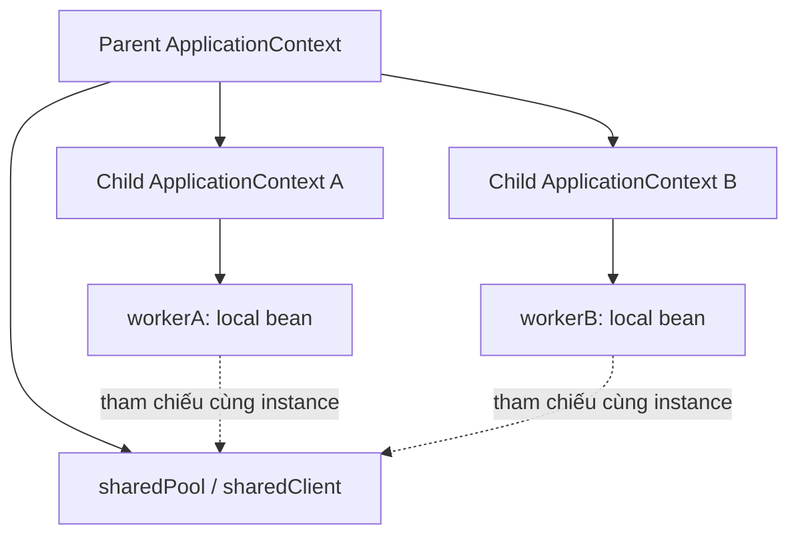

# Phân biệt tài nguyên dùng chung với tài nguyên thuộc một `ApplicationContext`

## 1. Bài toán: một ứng dụng có nhiều context thì ai sở hữu tài nguyên?

Khi lập trình Spring Boot, ta thường nghe “Spring quản lý singleton” hoặc “đóng context là Spring tự đóng tài nguyên”. Hai câu nói này đúng **khi hiểu rõ phạm vi**, nhưng rất dễ bị áp dụng sai trong ứng dụng có nhiều `ApplicationContext`, một context cha và các context con, môi trường kiểm thử khởi tạo nhiều container, hoặc nhiều instance được triển khai cùng một dịch vụ.

Ví dụ:

- Một `DataSource`/connection pool dùng chung cho hai module.
- Mỗi module có một `ExecutorService` riêng.
- Một HTTP client dùng chung cho tất cả consumer trong **một** ứng dụng.
- Hai `ApplicationContext` độc lập cùng định nghĩa `@Bean ConnectionPool`.
- Một parent context cung cấp tài nguyên nền tảng cho các child context.
- Một management web context tách khỏi application web context.
- Một `ThreadLocal` hoặc một static cache sống lâu hơn Spring context.

Nếu không định nghĩa rõ **tài nguyên nào được chia sẻ** và **ai có trách nhiệm đóng**, có thể xuất hiện hai loại lỗi đối lập:

1. **Đóng quá sớm:** một child context bị đóng nhưng lại gọi `close()` trên client/pool còn được child khác sử dụng, khiến request, job hoặc message consumer gặp lỗi.
2. **Không bao giờ đóng:** một object static hoặc executor tạo ngoài Spring không có chủ sở hữu rõ ràng, làm thread, socket, file descriptor hoặc bộ nhớ tồn tại sau khi context ứng dụng kết thúc.

Quy tắc nền tảng của bài này là: **phạm vi chia sẻ của object**, **phạm vi đăng ký bean** và **trách nhiệm quản lý vòng đời** là ba khái niệm liên quan nhưng không tự động trùng nhau.

Bài sử dụng **Java 17+, Spring Framework 6.x và Spring Boot 3.3.x**. Ví dụ thực hành dùng `spring-boot-starter` để tạo các `ApplicationContext` có quan hệ cha–con; không cần servlet container.

## 2. Định nghĩa: dùng chung không nhất thiết thuộc cùng một context

### 2.1. Tài nguyên thuộc một context

Đây là object mà **một `ApplicationContext` cụ thể sở hữu vòng đời**. Thường object được tạo bởi bean definition trong context đó:

```java
@Bean(destroyMethod = "close")
LocalClient localClient() {
    return new LocalClient();
}
```

Đoạn trên là minh họa; `LocalClient` cần được định nghĩa và có phương thức `close()`. Khi context sở hữu bị đóng bình thường, Spring gọi destroy callback trên singleton đã được tạo và quản lý.

Ví dụ: `workerExecutor` chỉ phục vụ module billing và được định nghĩa trong `BillingContext`. Khi billing context ngừng hoạt động, billing executor cũng cần dừng.

Từ “thuộc” ở đây nên hiểu là **ownership**: context hoặc component bên trong nó chịu trách nhiệm tạo, vận hành và hủy. Việc một object có thể được lấy từ `getBean(...)` chưa tự trả lời chính xác liệu context ấy có phải là owner gốc hay chỉ đang nhìn thấy bean của parent.

### 2.2. Tài nguyên dùng chung

Một tài nguyên “dùng chung” nghĩa là **nhiều consumer sử dụng cùng một instance hoặc cùng một dịch vụ bên ngoài**, ví dụ:

```text
Child Context A ─┐
                 ├──> Shared HTTP Client (1 object)
Child Context B ─┘
```

Nhưng có nhiều cách tạo sự chia sẻ:

- **Parent-owned shared bean:** một bean được định nghĩa trong parent context, các child tra cứu/inject chính object đó.
- **Externally owned instance:** một thành phần ở ngoài các context tạo object rồi chuyển reference cho nhiều consumer; owner bên ngoài chịu trách nhiệm đóng.
- **Shared external service:** hai context có hai client instance khác nhau nhưng cùng kết nối một database hoặc broker; **chúng chia sẻ dịch vụ từ xa**, không chia sẻ cùng một client/pool trong JVM.
- **Static/global state:** nhiều nơi dùng cùng object qua static field. Đây là chia sẻ cấp classloader/process, **không phải** tự động chia sẻ lifecycle của Spring.

Vì thế phải hỏi rõ “dùng chung **cái gì**”: một object Java, một pool, một kết nối TCP, một cache, một broker, hay một hệ thống database từ xa.

### 2.3. Ba trục cần đặt tên tường minh

| Trục | Câu hỏi | Ví dụ |
| --- | --- | --- |
| Identity | Nhiều consumer nhận cùng object hay object khác? | `clientA == clientB` |
| Visibility | Context nào có thể tìm thấy bean definition? | Child tra cứu bean từ parent |
| Ownership | Ai tạo, quản lý và đóng object? | Parent đóng shared client sau mọi child |

Nếu object dùng chung nhưng có **hai owner cùng gọi `close()`**, việc chia sẻ có thể dẫn đến double-close. Nếu object không còn ai chịu trách nhiệm đóng, sẽ có leak. Thiết kế tốt thường có **một owner rõ ràng, nhiều borrower**, và owner sống lâu hơn tất cả borrower đang sử dụng tài nguyên.

## 3. Singleton bean là mỗi container, không phải mỗi JVM

Trong Spring Framework, scope mặc định là `singleton`. Ý nghĩa cụ thể: **một bean definition được ánh xạ đến một instance trong một Spring IoC container**.

Ví dụ:

```java
@Configuration
class ResourceConfiguration {

    @Bean
    SharedClient sharedClient() {
        return new SharedClient();
    }
}
```

Đoạn code trên minh họa cấu hình, giả định class `SharedClient` có thật. Nếu **hai context độc lập** cùng nạp `ResourceConfiguration`, mỗi context có bean factory/cache singleton riêng và thông thường tạo **hai** `SharedClient` khác nhau.

```text
Context A                  Context B
  sharedClient bean          sharedClient bean
         │                         │
         ▼                         ▼
    SharedClient #1           SharedClient #2
```

Hai bean có thể cùng class, cùng tên và cùng cấu hình endpoint, nhưng điều đó **không làm chúng cùng identity**. Không suy ra `==` chỉ vì cả hai đều annotated `@Bean` hoặc `@Singleton`.

### 3.1. So sánh Spring singleton với global singleton

| Phạm vi | Khi nào là cùng instance? | Ai thường quản lý vòng đời? |
| --- | --- | --- |
| Spring singleton trong một context | Mỗi bean definition có một singleton cached trong container đó | Container sở hữu bean |
| Cùng bean được child lấy từ parent | Child truy xuất **bean parent đang sở hữu** | Parent |
| Hai context độc lập cùng khai báo một bean | Thường **hai instance khác nhau** | Mỗi context sở hữu bản riêng |
| Static field trong cùng classloader | Các nơi truy cập field có thể thấy một object chung | Code/app owner, không tự được Spring đóng |
| `@Scope("prototype")` | Mỗi lần yêu cầu có thể tạo instance mới | Caller chịu trách nhiệm cleanup sau khi tạo |
| HTTP request/session-scoped bean | Theo request hoặc session tương ứng | Scope/web infrastructure |
| Tài nguyên cluster bên ngoài | Nhiều process cùng dùng một service | Nhà vận hành/service; client connection vẫn có owner riêng |

Một ứng dụng Spring Boot chạy **ba replica** trên Kubernetes có ba JVM riêng. Bean singleton ở replica thứ nhất không phải cùng instance với singleton ở replica thứ hai. Đừng dùng singleton Java để thực hiện distributed lock hoặc điều phối leader trên nhiều replica.

### 3.2. Cùng một context cũng có thể có nhiều singleton cùng kiểu

“Singleton” không có nghĩa mỗi class trong context chỉ có một object. Nếu có hai bean definitions:

```java
@Bean("primaryClient")
Client primaryClient() {
    return new Client("primary");
}

@Bean("backupClient")
Client backupClient() {
    return new Client("backup");
}
```

thì có thể tồn tại **hai singleton `Client`** trong cùng context, mỗi bean name/definition có instance riêng. `@Primary` hoặc qualifier chỉ ảnh hưởng lựa chọn injection, không biến các instance thành một object.

Hai method chỉ là ví dụ, giả định `Client` có constructor phù hợp. Khi muốn dùng một client duy nhất, hãy tạo đúng một bean ở một owner và inject reference của nó cho consumer thay vì để các module tự gọi `new Client(...)`.

## 4. Parent/child context: một cách chia sẻ bean có owner rõ ràng

Spring Framework hỗ trợ quan hệ parent–child giữa `ApplicationContext`. Trong mô hình thông thường:

- **Parent** đăng ký các bean hạ tầng dùng chung.
- **Child A** đăng ký bean nghiệp vụ của module A.
- **Child B** đăng ký bean nghiệp vụ của module B.
- Child có thể tra cứu bean từ parent nếu nó không có định nghĩa tương ứng cục bộ.
- Parent **không tự tra cứu được** các bean chỉ đăng ký trong child.
- Các child có cùng parent có thể cùng truy xuất **chính instance singleton của parent**.

Sơ đồ:



Cần phân biệt mũi tên **quan hệ context** và mũi tên **tham chiếu object**: child dùng parent bean không có nghĩa child là owner của parent bean.

### 4.1. Cách diễn đạt bằng Spring

Trong Spring Framework:

```java
AnnotationConfigApplicationContext parent =
        new AnnotationConfigApplicationContext(ParentConfig.class);

AnnotationConfigApplicationContext child =
        new AnnotationConfigApplicationContext();

child.setParent(parent);
child.register(ChildConfig.class);
child.refresh();
```

Đoạn trên là snippet cần `ParentConfig` và `ChildConfig` thực tế. Khi parent đã được refresh, child có thể inject một bean của parent vào bean của nó. Không cần copy hoặc tạo lại instance trong child.

Trong Spring Boot, `SpringApplicationBuilder` có API `parent(...)`, `child(...)` để tạo hierarchy khi cần. Đây là lựa chọn kiến trúc chuyên biệt; **phần lớn ứng dụng Boot chỉ cần một application context**.

Ví dụ cú pháp builder minh họa:

```java
new SpringApplicationBuilder(ParentConfiguration.class)
        .web(WebApplicationType.NONE)
        .child(ChildConfiguration.class)
        .web(WebApplicationType.NONE)
        .run(args);
```

Các class config và imports cần tồn tại. Nếu chạy một ứng dụng Boot có hierarchy, phải chú ý nguồn cấu hình, event propagation, phạm vi web components và shutdown; không tự giả định mọi bean của parent và child được tạo cùng lúc.

### 4.2. Child có thể che khuất bean parent

Nếu parent và child đều có bean tên `sharedClient`, khi child tra cứu theo tên nó có thể thấy bean cục bộ của child, thay vì bean có cùng tên trong parent. Đây là **shadowing**, không phải chia sẻ cùng instance.

Điều này dễ xảy ra nếu package component scan của child vô tình quét cả configuration hạ tầng của parent. Kết quả là tạo hai pools, hai schedulers hoặc hai metrics registries ngoài ý định.

Trong thiết kế thực tế, tách package config rõ ràng và dùng một owner cho bean chung. Khi cần debug, không chỉ in tên bean; hãy xác minh **bean được định nghĩa ở context nào** và **reference identity**.

### 4.3. Bean lookup và context visibility không phải quyền quản lý vòng đời

Ví dụ, `child.getBean(SharedPool.class)` có thể trả về bean từ parent. Nhưng việc gọi `child.close()` không biến child thành chủ sở hữu của `SharedPool`.

Điểm quan trọng trong JavaDoc `ConfigurableApplicationContext.close()` là **đóng một context không tự đóng parent**. Parent có vòng đời độc lập.

Nếu có hai sibling children, đóng child A không nên làm shared parent resource ngừng hoạt động nếu child B còn sử dụng nó. Owner parent phải tiếp tục sống cho đến khi **tất cả borrower đã dừng**.

## 5. Quy tắc đóng: borrower trước, owner sau

Giả sử cả hai child đang sử dụng một pool do parent sở hữu:

```text
STARTUP:
  parent.create(sharedPool)
         ↓
  childA.start(consumerA)
         ↓
  childB.start(consumerB)

SHUTDOWN:
  childB.stop/close
         ↓
  childA.stop/close
         ↓
  parent.close(sharedPool)
```

Thứ tự child A và child B có thể thay đổi nếu chúng độc lập. Điều không được đảo ngược là **đóng shared pool trước khi những child còn dùng pool kết thúc**.

Một quy tắc vận hành an toàn:

1. Ngừng nhận request/job/message mới vào các borrower.
2. Đợi các công việc đang xử lý hoàn tất, hoặc gửi cancellation có kiểm soát.
3. Đóng từng child context và tài nguyên **cục bộ** của chúng.
4. Chỉ sau đó đóng parent context và shared resources.
5. Quan sát socket/thread/connection pool thật sự đã giải phóng.

Khi shutdown thất bại hoặc hết hạn, phải có chiến lược retry/idempotency, không thể bảo đảm mọi giao dịch hoàn tất chỉ bằng trình tự `close()`.

### 5.1. `close()` không phải `stop()`

`ConfigurableApplicationContext.stop()` điều phối `Lifecycle` beans ngừng hoạt động theo cơ chế lifecycle processor, nhưng **không tương đương hủy toàn bộ singleton**.

`close()` đi qua shutdown và singleton destruction, phù hợp khi context kết thúc vòng đời. Sau `close()`, không tiếp tục dùng bean cũ như thể container vẫn đang hoạt động.

Một bean có thể thực hiện:

- `SmartLifecycle.stop(Runnable callback)` để drain công việc.
- `@PreDestroy` / `DisposableBean` / `@Bean(destroyMethod="close")` để giải phóng tài nguyên.
- `ExecutorService.shutdown()` hoặc một cơ chế tự quản lý để chờ thread.
- Close của HTTP client, `DataSource`, connection pool hoặc Kafka consumer tùy API cụ thể.

Không phải mọi `Closeable` được tham chiếu qua bean của child đều do child được phép đóng. **Ownership quyết định ai đóng, không phải ai từng gọi method.**

### 5.2. Dừng theo phase và phụ thuộc chỉ giúp trong phạm vi Spring biết

Trong **một** context, `SmartLifecycle.getPhase()` cho phép start phase thấp trước và stop phase cao trước; `depends-on` có thể bắt dependent start sau và stop trước dependency.

Nhưng với **nhiều context độc lập hoặc parent/child**, không nên tưởng một annotation `@DependsOn` trong child sẽ tự điều phối mọi thao tác đóng parent context do một actor bên ngoài thực hiện. Ranh giới context cần có orchestrator đóng **các borrower trước owner**.

Mô hình bền vững là điều phối shutdown ở nơi tạo các context, ví dụ `try-with-resources` lồng nhau, thay vì để mỗi module tự gọi `sharedPool.close()`.

### 5.3. Double-close và missing-close

| Thiết kế | Lỗi có thể xảy ra |
| --- | --- |
| Parent tạo pool, child chỉ inject | Đúng khi child không tự đóng pool |
| Parent tạo pool, child cũng đăng ký alias có destroy callback | Có thể **đóng hai lần** hoặc đóng sớm nếu child đóng alias |
| Mỗi child tự tạo một pool | Không chia sẻ instance; tăng số connection/thread |
| Static pool tồn tại ngoài context nhưng không có owner | Leak khi context reload/restart/test |
| Một `AutoCloseable` được dùng chung giữa nhiều độc lập contexts | Không có owner mặc định; cần hợp đồng close duy nhất |
| Một context đóng khi child khác vẫn chạy | Dễ gây lỗi truy cập resource parent đã đóng |

`close()` của một số thư viện có thể idempotent, nhưng **không nên dựa vào điều đó như cách chữa ownership sai**. Double-close còn có thể gây lỗi thứ tự, hủy kết nối đang dùng hoặc che một vòng đời bị quản lý sai.

## 6. Ví dụ runnable: parent sở hữu một shared resource, hai child sở hữu consumer riêng

Ví dụ dùng Java 17 và Spring Boot 3.3.13; dependency duy nhất là `spring-boot-starter`. Thay vì tự chạy nhiều `SpringApplication` đầy đủ, ta tạo trực tiếp `AnnotationConfigApplicationContext` để **kiểm chứng cơ chế context của Spring Framework mà Boot sử dụng**, không mang thêm web server hay application runners.

Thiết kế:

- Parent đăng ký một `SharedChannel`, do parent sở hữu và đóng.
- Child A đăng ký `LocalConsumer("A", channel)`; child B đăng ký `LocalConsumer("B", channel)`.
- Cả hai consumer nhận cùng instance `SharedChannel` của parent.
- Mỗi child đóng **consumer của nó**, không đóng shared channel.
- Sau khi hai child đã đóng, parent mới đóng channel.

### 6.1. Cấu trúc Maven

```text
context-resource-owner-demo/
├── pom.xml
└── src/main/java/com/example/context/
    └── ContextResourceOwnerDemo.java
```

File `pom.xml`:

```xml
<project xmlns="http://maven.apache.org/POM/4.0.0"
         xmlns:xsi="http://www.w3.org/2001/XMLSchema-instance"
         xsi:schemaLocation="http://maven.apache.org/POM/4.0.0 https://maven.apache.org/xsd/maven-4.0.0.xsd">
    <modelVersion>4.0.0</modelVersion>
    <parent>
        <groupId>org.springframework.boot</groupId>
        <artifactId>spring-boot-starter-parent</artifactId>
        <version>3.3.13</version>
        <relativePath/>
    </parent>
    <groupId>com.example</groupId>
    <artifactId>context-resource-owner-demo</artifactId>
    <version>0.0.1-SNAPSHOT</version>
    <properties>
        <java.version>17</java.version>
    </properties>
    <dependencies>
        <dependency>
            <groupId>org.springframework.boot</groupId>
            <artifactId>spring-boot-starter</artifactId>
        </dependency>
    </dependencies>
    <build>
        <plugins>
            <plugin>
                <groupId>org.springframework.boot</groupId>
                <artifactId>spring-boot-maven-plugin</artifactId>
            </plugin>
        </plugins>
    </build>
</project>
```

### 6.2. Toàn bộ file Java

Tạo `src/main/java/com/example/context/ContextResourceOwnerDemo.java`:

```java
package com.example.context;

import org.springframework.context.annotation.AnnotationConfigApplicationContext;
import org.springframework.context.annotation.Bean;
import org.springframework.context.annotation.Configuration;

public final class ContextResourceOwnerDemo {

    public static void main(String[] args) {
        SharedChannel shared;

        try (AnnotationConfigApplicationContext parent =
                     new AnnotationConfigApplicationContext(ParentConfig.class)) {

            shared = parent.getBean(SharedChannel.class);

            try (AnnotationConfigApplicationContext childA =
                         openChild(parent, ChildAConfig.class)) {

                LocalConsumer a = childA.getBean(LocalConsumer.class);

                try (AnnotationConfigApplicationContext childB =
                             openChild(parent, ChildBConfig.class)) {

                    LocalConsumer b = childB.getBean(LocalConsumer.class);

                    System.out.println("shared-same="
                            + (a.channel() == b.channel()));
                    System.out.println("consumers-same=" + (a == b));
                }

                // Child B đã đóng, shared channel do parent sở hữu vẫn sống.
                System.out.println("shared-open-after-B=" + !shared.isClosed());
            }

            // Child A đã đóng, parent vẫn chưa đóng.
            System.out.println("shared-open-after-A=" + !shared.isClosed());
        }

        // Giờ parent cũng đóng, SharedChannel mới được destroy.
        System.out.println("shared-closed-after-parent=" + shared.isClosed());
    }

    private static AnnotationConfigApplicationContext openChild(
            AnnotationConfigApplicationContext parent,
            Class<?> configClass) {

        AnnotationConfigApplicationContext child =
                new AnnotationConfigApplicationContext();
        child.setParent(parent);
        child.register(configClass);
        child.refresh();
        return child;
    }

    @Configuration(proxyBeanMethods = false)
    static class ParentConfig {

        @Bean(destroyMethod = "close")
        SharedChannel sharedChannel() {
            return new SharedChannel();
        }
    }

    @Configuration(proxyBeanMethods = false)
    static class ChildAConfig {

        @Bean(destroyMethod = "close")
        LocalConsumer localConsumer(SharedChannel sharedChannel) {
            return new LocalConsumer("A", sharedChannel);
        }
    }

    @Configuration(proxyBeanMethods = false)
    static class ChildBConfig {

        @Bean(destroyMethod = "close")
        LocalConsumer localConsumer(SharedChannel sharedChannel) {
            return new LocalConsumer("B", sharedChannel);
        }
    }

    static final class SharedChannel implements AutoCloseable {

        private boolean closed;

        SharedChannel() {
            System.out.println("create:shared");
        }

        boolean isClosed() {
            return closed;
        }

        @Override
        public void close() {
            if (!closed) {
                closed = true;
                System.out.println("close:shared");
            }
        }
    }

    static final class LocalConsumer implements AutoCloseable {

        private final String name;
        private final SharedChannel channel;

        LocalConsumer(String name, SharedChannel channel) {
            this.name = name;
            this.channel = channel;
            System.out.println("create:consumer-" + name);
        }

        SharedChannel channel() {
            return channel;
        }

        @Override
        public void close() {
            System.out.println("close:consumer-" + name);
        }
    }
}
```

Chương trình giữ references trong một thread; dùng `boolean closed` thông thường đủ cho ví dụ **đơn luồng**. Trong ứng dụng có nhiều threads, trạng thái sống/chết và quyền sử dụng shared resource cần được đồng bộ hóa; không mặc định một boolean không volatile là thread-safe.

### 6.3. Build và chạy

Tại thư mục có `pom.xml`:

```bash
mvn package
```

Để chạy Java class trực tiếp qua Maven, thêm dependency-aware classpath hoặc dùng `exec:java` với plugin được cấu hình. Với cấu hình pom trên, `spring-boot-maven-plugin` có thể đóng gói executable JAR **nếu xác định được main class**, nhưng tên `ContextResourceOwnerDemo` không mang `@SpringBootApplication`. Để không phụ thuộc vào cơ chế dò main của Boot plugin, cách chắc chắn là:

```bash
mvn dependency:build-classpath -Dmdep.outputFile=classpath.txt
```

Sau khi build xong, Java class có thể được chạy với `target/classes` và dependency classpath đã lấy từ Maven. Trên Linux/macOS:

```bash
java -cp "target/classes:$(cat classpath.txt)" com.example.context.ContextResourceOwnerDemo
```

Trên Windows PowerShell:

```powershell
$classpath = Get-Content classpath.txt -Raw
java -cp ("target/classes;" + $classpath.Trim()) com.example.context.ContextResourceOwnerDemo
```

Cách trên không phụ thuộc vào JAR executable có Spring Boot main class hay không. Nếu muốn dùng `java -jar` trong một project nhỏ như vậy, có thể khai báo main class cho Boot plugin hoặc chuyển ví dụ thành ứng dụng `@SpringBootApplication` thích hợp. Các cách đều cần Java 17+ và Maven dependencies.

### 6.4. Output kỳ vọng

Khi không có config ngoài can thiệp, các dòng do chương trình **tự in** lần lượt là:

```text
create:shared
create:consumer-A
create:consumer-B
shared-same=true
consumers-same=false
close:consumer-B
shared-open-after-B=true
close:consumer-A
shared-open-after-A=true
close:shared
shared-closed-after-parent=true
```

Spring có thể in thêm logging tùy cấu hình; bảng trên chỉ mô tả những dòng demo tạo.

**Tại sao output như vậy?**

1. Parent được refresh đầu tiên, tạo một `SharedChannel` singleton.
2. Child A được tạo sau parent; injection vào `LocalConsumer("A",...)` tìm `SharedChannel` từ parent.
3. Child B cũng tìm cùng bean parent, không tạo `SharedChannel` mới.
4. Do đó, `a.channel() == b.channel()` là `true`, nhưng hai `LocalConsumer` được khai báo bởi **hai context khác nhau**, nên `a == b` là `false`.
5. `childB.close()` chạy destroy callback của consumer B; parent vẫn sống nên `shared-open-after-B=true`.
6. `childA.close()` chỉ đóng consumer A; `shared-open-after-A=true`.
7. Cuối cùng, `parent.close()` đóng chính `SharedChannel`; kết quả `shared-closed-after-parent=true`.

`@Bean(destroyMethod = "close")` làm quyền ownership hiển thị rõ trong mã. Consumer chỉ giữ reference đến channel và **không gọi `channel.close()`**. Parent là owner duy nhất.

### 6.5. Bài thử đối chứng: hai context độc lập

Thử tạo hai context riêng, **không đặt parent**:

```java
try (AnnotationConfigApplicationContext first =
             new AnnotationConfigApplicationContext(ParentConfig.class);
     AnnotationConfigApplicationContext second =
             new AnnotationConfigApplicationContext(ParentConfig.class)) {

    SharedChannel a = first.getBean(SharedChannel.class);
    SharedChannel b = second.getBean(SharedChannel.class);

    System.out.println("independent-shared-same=" + (a == b));
}
```

Đoạn code này được đặt trong cùng class demo để `ParentConfig` và `SharedChannel` hiện hữu; không phải file độc lập. Dòng then chốt:

```text
independent-shared-same=false
```

Bởi mỗi `AnnotationConfigApplicationContext` có singleton cache riêng. Khi đóng, mỗi context đóng **instance của chính nó**; không có resource object được chia sẻ giữa hai context chỉ vì cùng type, bean name hoặc configuration source.

### 6.6. Cẩn trọng về `destroyMethod` nếu tái đăng ký cùng object

Giả sử một library tạo một `AutoCloseable` bên ngoài rồi bạn cố đăng ký lại đúng instance đó làm bean có destroy callback trong hai child. Khi hai child đóng, cả hai có thể gọi `close()` trên cùng resource: đây là **sai ownership**.

Nếu vì lý do kỹ thuật cần một alias bean **không sở hữu** resource, có thể dùng `@Bean(destroyMethod = "")` để tắt việc tự suy luận public `close`/`shutdown` method. Nhưng đây chỉ xử lý **destroy method inference**; nếu instance tự triển khai `DisposableBean` hoặc có những lifecycle callback khác, vẫn phải đánh giá tất cả cơ chế hủy. Phương án **tốt hơn** là đặt bean vào parent và để child inject/truy xuất từ parent, không đăng ký alias trùng.

Đừng sửa bằng cách gọi `close()` thủ công từ nhiều nơi; hãy xác định một owner và thể hiện ownership trong cấu trúc context.

## 7. Trong Spring Boot thật, tài nguyên nào nên thuộc parent và tài nguyên nào nên thuộc child?

Không có quy tắc buộc ứng dụng nào cũng tạo hierarchy. Với nhiều ứng dụng Boot, **một context duy nhất** có thể quản lý tất cả bean bình thường. Khi thực sự cần chia module hoặc có nhiều web contexts, có thể cân nhắc:

| Tài nguyên | Có thể dùng chung khi nào? | Ai nên sở hữu? |
| --- | --- | --- |
| HTTP client có thread-safe pool | Nhiều module cùng giao tiếp một service, cấu hình tương thích | Root/parent hoặc owner riêng |
| `DataSource` | Nhiều module dùng cùng DB/pool, transaction setup tương thích | Một owner rõ, thường context chung |
| Redis client | Nhiều module dùng cùng cluster và credentials/policies | Context chung hoặc manager riêng |
| Bounded executor | Nhiều task cùng SLA và tài nguyên, không gây tranh chấp quá mức | Owner chung với shutdown policy rõ |
| Module scheduler | Chỉ phục vụ chức năng của module đó | Child/module context |
| Web server | Gắn với một web application context và port cụ thể | Web context sở hữu server |
| Tenant-specific state | Cần tách cấu hình/credentials/data giữa tenant | Đúng tenant scope/context hoặc dịch vụ quản lý chuyên biệt |
| Metrics registry | Có thể dùng chung nếu không trùng đăng ký meters | Owner ứng dụng, tránh duplicate registration |
| Cache | Dùng chung nếu dữ liệu và vòng đời nhất quán | Owner chung hoặc cache service |
| Batch job state | Thường riêng cho một instance/job | Job manager/context sở hữu job |

Chia sẻ giúp giảm số connection, thread, cache hoặc client phải tạo, nhưng cũng tạo **coupling về tài nguyên và failure**. Một executor dùng chung có thể khiến job từ child A chiếm hết workers của child B. Một DataSource chung có thể ảnh hưởng hai module khi pool hết connection.

Vì vậy chỉ chia sẻ khi các tiêu chí phù hợp: thread safety, cấu hình, timeout, quota, bảo mật, isolation và lifecycle. Không chia sẻ chỉ vì object đắt tiền.

## 8. Khi dùng management port riêng hoặc nhiều web contexts

Spring Boot Actuator có thể chạy management HTTP server trên một cổng riêng:

```properties
server.port=8080
management.server.port=9090
```

Trong những cấu hình phù hợp, Boot có thể dùng một management context/web server riêng. Đừng cho rằng mọi web context đều sở hữu **cùng một web server** hoặc có cùng lifecycle chỉ vì nằm trong một JVM.

Điều này liên quan đến:

- **Tài nguyên:** context chứa server nào thì quản lý server ấy; tài nguyên ứng dụng dùng chung phải có ownership rõ.
- **Sự kiện:** event phát từ child context có thể được chuyển lên parent; listener ở parent có thể nhận nhiều event có cùng type.
- **Cổng HTTP:** `WebServerInitializedEvent#getWebServer().getPort()` cho biết port của **server phát event**, không nhất thiết là port API chính.
- **Shutdown:** một management port được tắt hoặc một child context được đóng không nên chủ động đóng client/pool còn phục vụ ứng dụng chính.

Để phân biệt event giữa các context, kiểm tra `event.getApplicationContext()` khi event type có thông tin đó. Với event cấp context như `ContextClosedEvent`, kiểm tra `event.getApplicationContext()`/source theo đúng API. **Đừng dùng listener parent để dừng shared resource chỉ vì nhận một `ContextClosedEvent` của child.**

Cơ chế cụ thể thay đổi theo Boot version và stack Servlet/Reactive, nên phải quan sát đúng context thực tế thay vì khẳng định mọi cấu hình management port luôn tạo một topology giống nhau.

## 9. Phân biệt bean scope với Spring `Resource` abstraction

Một hiểu nhầm ngôn ngữ là từ “tài nguyên” trong Spring có ít nhất **hai nghĩa**:

1. **Runtime-managed resource:** `DataSource`, thread pool, HTTP client, message consumer, cache service... cần ownership và cleanup.
2. **`org.springframework.core.io.Resource`:** abstraction mô tả nơi lấy dữ liệu như `classpath:`, file hoặc URL.

Ví dụ:

```java
Resource resource = applicationContext.getResource("classpath:data/config.json");
try (InputStream stream = resource.getInputStream()) {
    // Đọc stream.
}
```

Đây là snippet cần `ApplicationContext`, imports `Resource`/`InputStream`, classpath file có thật và xử lý checked exception. `Resource` ở đây là **vị trí/nội dung có thể đọc**, không đồng nghĩa một pool/socket được Spring context sở hữu.

Cần **đóng `InputStream` do chính bạn mở** bằng try-with-resources. Đừng suy luận rằng gọi `applicationContext.close()` tự đóng mọi stream do code của bạn lấy trước đó.

### 9.1. `@ApplicationScope` không phải “shared giữa mọi ApplicationContext”

Trong môi trường web Servlet, Spring còn có application scope gắn với `ServletContext`. Scope này không có nghĩa một object được chia sẻ giữa mọi Spring IoC container hoặc mọi replica JVM.

Khi nói “application scope”, hãy xem cụ thể là:
- Spring singleton scope của một bean factory?
- Servlet application scope của một web app?
- Một singleton/static trong JVM?
- Một service dùng chung ở cấp cluster?

Dùng từ đúng phạm vi để tránh thiết kế sai concurrency và cleanup.

## 10. Một process có nhiều context và một process có nhiều instance là hai chuyện

### 10.1. Nhiều context trong một JVM

Tình huống này có thể xảy ra khi:

- Dùng `SpringApplicationBuilder` tạo hierarchy.
- Tạo management context riêng.
- Chạy plugin/module với context riêng.
- Integration tests tạo nhiều contexts đồng thời.
- Tự khởi tạo một `ApplicationContext` tạm để chạy tác vụ.

Một parent bean có thể được dùng bởi nhiều child, nhưng **một bean khai báo riêng trong từng child vẫn có instance riêng**.

### 10.2. Nhiều JVM/replica trong cluster

Nếu có hai Pod Boot:

```text
Pod A / JVM A         Pod B / JVM B
  ApplicationContext    ApplicationContext
  DataSource pool A     DataSource pool B
         \                /
          \              /
           Database chung
```

Tài nguyên **database server** được chia sẻ từ xa, nhưng hai `DataSource` objects là hai pools khác nhau, mỗi Pod tự sở hữu connection pool.

Một static cache Java hoặc bean singleton không trở thành distributed cache chỉ vì service có nhiều replica. Muốn trạng thái toàn cluster, dùng một hạ tầng chia sẻ phù hợp và thiết kế đồng bộ/invalidation.

### 10.3. Context reuse trong Spring Test

Spring Test có thể **cache context** giữa các test tương thích. Việc một test dùng cùng context object với test khác là một quyết định của test framework, không có nghĩa bean singleton có phạm vi toàn bộ suite mãi mãi.

Khi dùng `@DirtiesContext`, framework có thể đóng một context đã cache và tạo context mới. Nếu code tự đưa bean reference vào static field/test fixture rồi còn dùng sau khi context cũ đóng, reference có thể đã trỏ tới resource bị hủy.

Đừng dùng shared static clients trong test chỉ để tránh startup cost mà không có teardown policy. Kiểm thử việc tạo/đóng context nhiều lần giúp phát hiện leak rõ hơn.

## 11. Thiết kế owner/borrower cho tài nguyên dùng chung

### 11.1. Một owner, nhiều borrower

Mẫu nên dùng:

```text
Owner Context
    creates resource
    exposes resource
    closes resource exactly once
          ▲
          │ borrowed reference
          │
    Consumer A, Consumer B
       use but do not close
```

Để viết hợp đồng rõ, thường tốt hơn nên tách API sử dụng khỏi API đóng:

```java
public interface MessagePublisher {
    void publish(String message);
}
```

Consumer chỉ inject `MessagePublisher`. Component owner giữ implementation có `close()`/`shutdown()`. Khi consumer không thấy API đóng, khả năng vô tình `close` resource dùng chung sẽ giảm.

Đây là interface Java độc lập minh họa thiết kế quyền, không phải toàn bộ một thư viện message publisher. Trong hệ thống thực, kiểm soát transaction, thread safety, backpressure và nguồn kết nối.

### 11.2. Nếu cần reference counting

Một số resource thực sự phải dùng chung bởi các context **không có quan hệ parent–child**, hoặc context có thể tạo/hủy linh hoạt. Khi đó có thể dùng một **resource manager** với:

- `acquire()` để mượn một lease/handle.
- `release()` cho từng borrower.
- Đếm reference hoặc quản lý danh sách active leases.
- Chỉ đóng resource gốc khi không còn borrower và owner quyết định shutdown.
- Deadline, idempotency và race protection.

Không nên tự cài reference counting bằng một `int` bình thường trong môi trường nhiều threads mà không đồng bộ hóa. Một lease có thể được release hai lần hoặc có borrow mới trong lúc close, nên cần trạng thái/locking đúng.

Với phần lớn ứng dụng Boot, một parent/root context đơn giản hơn một global reference-counted manager tự xây. Chỉ dùng manager khi yêu cầu lifecycle độc lập thật sự tồn tại.

### 11.3. Bean được tạo ngoài Spring và đưa vào context

Nếu một tài nguyên được tạo ngoài container rồi dùng làm `@Bean`, phải quyết định rõ: **Spring sẽ sở hữu và đóng nó, hay chỉ mượn nó?**

```java
@Bean(destroyMethod = "")
ExternalClient externalClient(ExternalClientProvider provider) {
    return provider.get();
}
```

Đây là minh họa cần `ExternalClient`/`ExternalClientProvider` và cấu hình owner. `destroyMethod = ""` tránh auto-inference `close`/`shutdown` cho bean này, nhưng không tự ngăn mọi callback hủy khác của kiểu bean. Vì thế nếu tài nguyên mượn có các lifecycle interfaces, cần wrapper/adapter không owning thay vì đăng ký trực tiếp cùng instance như singleton ở nhiều contexts.

**Không có cơ chế tự đoán ownership hoàn hảo** từ loại Java của resource. Hợp đồng quản lý phải được thể hiện trong kiến trúc, code và test.

## 12. Lifecycle và shutdown của nhiều context

### 12.1. Context close theo độc lập, không theo suy đoán

`ConfigurableApplicationContext.close()` đóng **context được gọi**, giải phóng singleton và tài nguyên mà context đó quản lý. Nó **không gọi close cho parent context**. Parent có vòng đời độc lập.

Một orchestration đơn giản bằng Java:

```java
try (AnnotationConfigApplicationContext parent =
             new AnnotationConfigApplicationContext(ParentConfig.class)) {
    try (AnnotationConfigApplicationContext child =
                 openChild(parent, ChildConfig.class)) {
        // Sử dụng child.
    } // child.close()
}     // parent.close()
```

Đây là snippet, giả định helper `openChild`, hai config class và imports được định nghĩa. Đặt `try-with-resources` lồng nhau giúp bảo đảm **child đóng trước parent** kể cả khi phần sử dụng ném exception.

Đừng suy ra rằng đóng parent sẽ tự đóng tất cả những child được tạo tùy ý theo những đường code khác nhau; nên có một owner/orchestrator ghi rõ danh sách contexts và thứ tự dừng.

### 12.2. Bean `@PreDestroy` và `destroyMethod`

Ví dụ:

```java
@Bean(destroyMethod = "shutdown")
ExecutorService workerExecutor() {
    return Executors.newFixedThreadPool(4);
}
```

Đây là method minh họa; cần imports `ExecutorService`, `Executors` và `@Bean`. Context sở hữu bean sẽ gọi `shutdown()` trong giai đoạn bean destruction. Nhưng `shutdown()` chỉ ngừng nhận task mới và không nhất thiết chờ mọi task đã kết thúc.

Nếu worker còn dùng parent-owned HTTP client, cần phối hợp dừng/chờ worker trước khi owner đóng client. Có thể dùng `SmartLifecycle` với stop callback hoặc một lifecycle coordinator, chứ không chỉ dựa vào tên method `shutdown`.

### 12.3. Thứ tự trong một context và giữa các contexts

Trong một context:
- Bean dependency graph, destroy callbacks và `SmartLifecycle` phases hỗ trợ điều phối thứ tự.
- `@DependsOn` giúp dependent start sau, stop trước dependency.
- Có timeout chờ theo shutdown phase trong Spring Boot (`spring.lifecycle.timeout-per-shutdown-phase`).

Giữa các contexts:
- Phải bảo đảm **borrowers hoàn tất rồi mới close resource owner**.
- Lifecycle phases của context A không mặc nhiên điều khiển mọi task/context B.
- Một listener ở parent có thể nhận event của child do event propagation; **không dừng resource chỉ dựa vào event type mà không kiểm tra source context**.

### 12.4. Application restart hoặc refresh

Khi ứng dụng restart, context cũ bị đóng và context mới được tạo; singleton resources trong context mới **không phải object cũ**. Nếu code giữ reference cũ sau restart, có thể dùng một client đã closed.

Với một số Spring Framework context implementations, `refresh()` lần thứ hai không được hỗ trợ. Không gọi `context.refresh()` trên một Boot context đang hoạt động để “reload shared pool”. Khi cần đổi cấu hình kết nối/hạ tầng, thường nên xây một instance mới và rollout có kiểm soát.

## 13. Phân biệt resource local và shared khi gặp vấn đề production

| Dấu hiệu | Nguyên nhân khả dĩ | Hướng kiểm tra |
| --- | --- | --- |
| Đóng module A làm module B lỗi `Connection closed` | A đã đóng shared client của owner chung | Kiểm tra destroy callbacks, explicit close và bean location |
| Mỗi context tạo thêm nhiều connection | Mỗi context tự khai báo pool | Đếm bean definitions và số context/pools |
| Test suite leak threads khi chạy nhiều tests | Executor/static resource không được đóng | Kiểm tra owner và context cache/teardown |
| `@PreDestroy` của child chạy làm pool parent đóng | Child đăng ký alias hoặc tự gọi close | Tách owning bean khỏi borrowing adapter |
| Chạy nhiều replicas và số connection tăng | Mỗi replica có pool riêng, không phải một pool cluster | Tính tổng pool sizes theo số replicas |
| Listener ghi log sự kiện khởi động hai lần | Event child propagate lên parent | Lọc event theo source context |
| Parent đóng trước child gây lỗi khi drain | Shutdown orchestration sai | Dừng child jobs trước, close parent sau |
| Bean `getBean(...)` trỏ đến object khác dự kiến | Shadowing bean name/type trong child | Kiểm tra local definitions, parent lookup và qualifiers |
| Heap không giảm sau context close | Static cache, thread, classloader hoặc reference ngoài context giữ object | Heap dump/GC roots, executor termination, thread dump |
| Đóng context nhưng socket vẫn còn | Resource không thuộc singleton managed lifecycle, hoặc close async chưa xong | Xác định owner và đợi completion thật |

Đừng kết luận resource bị leak chỉ từ một số đo heap tức thời; JVM quản lý heap độc lập với việc release native connections. Dùng metrics cho số connections, threads, pool active/idle, resource descriptors cùng lifecycle logs.

## 14. Kiểm thử quyền sở hữu và không đóng sớm

### 14.1. Kiểm thử identity

Với parent và hai children:

```java
SharedChannel parentBean = parent.getBean(SharedChannel.class);
SharedChannel childABean = childA.getBean(SharedChannel.class);
SharedChannel childBBean = childB.getBean(SharedChannel.class);

assert parentBean == childABean;
assert parentBean == childBBean;
```

Đây là minh họa nằm trong test có các context đã tạo và được refresh. Nó kiểm chứng **cùng Java object** chứ không chỉ bằng `equals`, tên bean hay endpoint.

### 14.2. Kiểm thử owner đóng một lần

Dùng một fake `AutoCloseable` ghi `closeCount`. Quy trình:

1. Tạo parent, child A, child B.
2. Đóng child A, xác nhận `closeCount == 0`.
3. Cho child B sử dụng resource, xác nhận vẫn hoạt động.
4. Đóng child B, xác nhận `closeCount == 0`.
5. Đóng parent, xác nhận `closeCount == 1`.

Nếu `closeCount > 1` hoặc trở thành 1 khi child vẫn sống, đã có ít nhất một chỗ khai báo ownership sai. Cần test cả lỗi startup của child và shutdown giữa chừng.

### 14.3. Kiểm thử thread/concurrent borrow

Một shared resource phải thực sự thread-safe nếu nhiều children gọi đồng thời. Ví dụ một HTTP client có thread pool hỗ trợ chia sẻ không đồng nghĩa mọi object mà client trả về đều thread-safe.

Để test có giá trị, chạy nhiều consumers với giới hạn I/O thực tế, đo cancellation latency, resource exhaustion, connection pool behavior và cleanup. Nếu resource cần per-consumer transaction/session, **không** chia sẻ chính session object chỉ vì có thể chia sẻ client/pool.

### 14.4. Kiểm thử shutdown có deadline

Nếu child giữ job đang chạy trên executor, kiểm tra khi đóng context:

- Không nhận thêm job.
- Các job in-flight có cơ hội hoàn tất hoặc được cancel trong deadline.
- Shared resource còn sống cho đến khi job cuối không còn dùng nó.
- Owner close xảy ra một lần sau các borrower.
- Khi bị force-kill vẫn có chiến lược retry/idempotency.

Không đánh giá pass chỉ vì `ApplicationContext.close()` trả về nhanh nếu task nền còn giữ socket và chưa dừng.

## 15. Các lỗi thiết kế thường gặp

### Lỗi A — “Bean là singleton, vậy cả process chỉ có một instance”

Sai. Spring singleton là **per-container/per-bean**; có thể có nhiều contexts hoặc nhiều bean definitions cùng type.

### Lỗi B — “Child inject bean parent nên child có trách nhiệm close”

Sai. Injection chỉ cung cấp reference, không chuyển ownership. Nếu parent tạo singleton thì parent đóng resource; child đóng những bean cục bộ thuộc nó.

### Lỗi C — “Dùng `static` để cả hai context dùng chung cho nhanh”

Có thể tạo state global khó test, khó thay cấu hình và dễ leak qua classloader/context cache. Đặc biệt với thread pools, scheduler, connection pool hoặc non-daemon threads, ownership phải rất rõ. Ưu tiên một owner bean ở root/parent hoặc một manager độc lập có close policy.

### Lỗi D — “Hai contexts cùng kết nối Redis là dùng chung client object”

Không chắc. Hai Redis client instances có thể cùng nói chuyện với một Redis server, nhưng giữ socket và connection pools riêng. Cần phân biệt **service external chung** với **Java object chung**.

### Lỗi E — “`@ApplicationScope` nghĩa là toàn bộ JVM hoặc cluster dùng một bean”

Không. Scope đó gắn với ứng dụng web/`ServletContext` phù hợp, không biến state thành cluster singleton.

### Lỗi F — “Một bean tạo ở parent nhưng child có `@DependsOn` là đủ để đóng mọi context đúng thứ tự”

Không. `@DependsOn` hỗ trợ dependency/lifecycle trong phạm vi BeanFactory, nhưng không thay orchestration đóng nhiều context độc lập. Đóng child trước parent.

### Lỗi G — “Đóng context có nghĩa mọi `Resource`/InputStream đã được đóng”

Không. Stream do code mở từ `Resource#getInputStream()` cần được đóng trong chính code. Tương tự, object tạo ngoài Spring không được container tự tìm và đóng.

### Lỗi H — “Cùng một instance đăng ký trong hai contexts thì Spring chỉ gọi destroy một lần”

Không có bảo đảm như vậy. Nếu hai contexts đều được cấu hình sở hữu/destroy cùng object, destroy callbacks có thể chạy từ cả hai. Đừng đăng ký cùng external resource như owning bean ở nhiều context.

### Lỗi I — “Đóng parent trước sẽ tự đóng hết các child”

Không nên giả định. Hãy giữ và đóng rõ các references của children trước, rồi đóng parent. Bảo vệ cả nhánh exception khi một child khởi tạo thất bại.

### Lỗi J — “`close()` của executor trả về là mọi task đã kết thúc”

Không nhất thiết. `shutdown()` chỉ ngừng nhận việc mới; cần `awaitTermination` hoặc stop callback có deadline để chờ nếu đó là yêu cầu nghiệp vụ.

### Lỗi K — “Cùng một bean name ở parent và child là cùng một bean”

Có thể bị **shadowing**. Child có thể dùng định nghĩa cục bộ với cùng tên; kiểm tra `getBean(...)` và nơi định nghĩa bean. Khi cần shared resource, tránh đăng ký lại cùng tên/type trong child.

### Lỗi L — “Tách context là tăng độ cô lập tuyệt đối”

Không. Nhiều context trong **cùng JVM** vẫn chia sẻ heap, CPU, system properties, process signals và có thể cùng dùng resource parent. Isolation mạnh hơn đôi khi cần process/Pod riêng hoặc hệ thống quota rõ ràng.

## 16. Câu hỏi tự kiểm tra

**Câu 1.** Hai `AnnotationConfigApplicationContext` độc lập đều có bean `@Bean SharedPool`. Có một hay hai pool instances?

**Đáp án:** Thường hai, mỗi context có singleton của riêng mình. Cùng class/bean name không biến chúng thành cùng reference.

**Câu 2.** Parent có singleton `sharedPool`; hai child inject từ parent. `childA.close()` có nên đóng pool?

**Đáp án:** Không. Child A là borrower. Parent phải giữ pool hoạt động cho child B và chỉ đóng khi tất cả borrower đã dừng.

**Câu 3.** Nếu child cũng khai báo `@Bean("sharedPool")` thì điều gì đáng kiểm tra?

**Đáp án:** Bean local có thể che khuất parent bean cùng tên. Có thể tạo pool mới hoặc đăng ký alias ownership sai. Cần kiểm tra local definitions và identity.

**Câu 4.** Một Spring Boot app chạy 4 Pod, mỗi Pod có một singleton `DataSource`. Cluster có mấy Java pool objects?

**Đáp án:** Thông thường 4 pool objects, một mỗi JVM/Pod, trừ khi có kiến trúc đặc biệt. Tất cả có thể kết nối cùng DB server.

**Câu 5.** Một stream được mở từ `applicationContext.getResource(...)`. Ai đóng stream?

**Đáp án:** Đoạn code đã gọi `getInputStream()`, ví dụ bằng try-with-resources. Context close không tự đóng mọi stream tùy ý mà client code đã mở.

**Câu 6.** Vì sao child `@PreDestroy` không nên gọi `sharedChannel.close()` khi channel được parent sở hữu?

**Đáp án:** Vì child khác còn dùng channel. Owner parent mới có quyền đóng resource khi tất cả borrower đã dừng.

**Câu 7.** Điều gì khác nhau giữa `ApplicationContext.stop()` và `close()`?

**Đáp án:** `stop()` điều phối lifecycle stop cho các bean phù hợp; `close()` kết thúc container và hủy singleton resources mà nó quản lý.

**Câu 8.** Một listener parent nhận sự kiện `ContextClosedEvent` khi child đóng. Có nên kết luận parent đã đóng?

**Đáp án:** Không. Event từ child có thể propagate lên parent; phải kiểm tra context nguồn. Parent vẫn có thể đang active.

**Câu 9.** Tại sao không thể dùng singleton Java cho distributed lock giữa các replica?

**Đáp án:** Mỗi replica/JVM có bộ nhớ riêng, nên singleton không được chia sẻ qua mạng. Cần cơ chế lock phối hợp trên backend bên ngoài.

**Câu 10.** Nếu một resource bắt buộc dùng giữa nhiều contexts độc lập, có giải pháp nào ngoài parent context?

**Đáp án:** Có: externally owned resource manager với acquire/release và shutdown rõ, hoặc chuyển thành service riêng. Nhưng cần bảo đảm chính sách đồng bộ hóa, ref counting, timeout và cleanup.

## 17. Checklist trước khi thiết kế resource

- [ ] Viết rõ resource có scope **bean/context/process/tenant/cluster** nào.
- [ ] Xác định **một owner** chịu trách nhiệm tạo và destroy.
- [ ] Xác định consumers chỉ mượn reference hay có quyền đóng.
- [ ] Nếu cần dùng chung, ưu tiên parent/root-owned bean hoặc owner manager rõ ràng.
- [ ] Không tạo cùng pool ở mỗi child vô ý; rà package scan và auto-configuration.
- [ ] Đánh giá thread safety, connection quota, backpressure và isolation.
- [ ] Dừng child/consumer trước khi đóng shared parent resource.
- [ ] Thiết kế graceful stop và deadline cho tasks đang dùng resource.
- [ ] Không coi static field là giải pháp lifecycle mặc định.
- [ ] Đóng streams/files do code mở; không dựa vào context close ngoài hợp đồng.
- [ ] Kiểm tra `@Bean(destroyMethod=...)`, `@PreDestroy`, `DisposableBean`, `SmartLifecycle`.
- [ ] Test bằng nhiều contexts thật: identity, close order và close-count.
- [ ] Kiểm tra resource leaks khi context restart/test cache và khi Pod bị kill.
- [ ] Với nhiều replicas, tính tổng số connections/threads và dùng distributed coordination khi cần.

## 18. Tài liệu chính thức

- [Spring Framework — Bean Scopes](https://docs.spring.io/spring-framework/reference/core/beans/factory-scopes.html): singleton scope per-container/per-bean; prototype và web scopes.
- [Spring Framework — `ConfigurableApplicationContext.close()` JavaDoc](https://docs.spring.io/spring-framework/docs/6.1.14/javadoc-api/org/springframework/context/ConfigurableApplicationContext.html): đóng một context không đóng parent.
- [Spring Framework — Customizing the Nature of a Bean](https://docs.spring.io/spring-framework/reference/core/beans/factory-nature.html): `@PreDestroy`, destroy methods, `Lifecycle`/`SmartLifecycle` và shutdown.
- [Spring Framework — Additional Capabilities of the ApplicationContext](https://docs.spring.io/spring-framework/reference/core/beans/context-introduction.html): context hierarchy và `ResourceLoader`/`Resource` abstraction.
- [Spring Boot 3.3 — SpringApplication / Fluent Builder API](https://docs.spring.io/spring-boot/3.3/reference/features/spring-application.html): `SpringApplicationBuilder` hierarchy, event propagation và web context types.
- [Spring Boot 3.3 — Common Application Properties](https://docs.spring.io/spring-boot/3.3/appendix/application-properties/): `management.server.port` và các cấu hình liên quan.
- [Spring Boot — Build an ApplicationContext Hierarchy](https://docs.spring.io/spring-boot/how-to/application.html): mô hình parent/child và non-web context.

## 19. Ghi nhớ

**Tài nguyên dùng chung không đồng nghĩa tài nguyên được mọi context đồng sở hữu.** Spring singleton có phạm vi **mỗi bean factory/context**; hai contexts độc lập thường tạo hai singleton khác nhau. Nếu các child cần cùng một instance, một parent/root context có thể làm **owner duy nhất**, còn children chỉ mượn reference.

Khi đóng, hãy để **borrowers kết thúc trước, owner giải phóng sau**. Phân biệt object Java dùng chung với backend dùng chung qua mạng; phân biệt bean lifecycle với Spring `Resource` abstraction và luồng/stream do code tự mở.

Sự rõ ràng về **identity – visibility – ownership – close order** quan trọng hơn việc đặt tên bean là `shared` hay gắn `@Singleton`. Nó giúp tránh resource leaks, double-close và hủy tài nguyên khi vẫn còn component khác đang sử dụng.