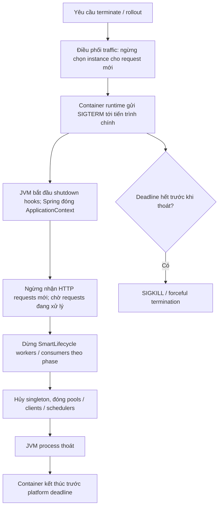

# Phối hợp thời gian dừng của Spring Boot với Docker và nền tảng triển khai

## 1. Bài toán: ứng dụng muốn dừng nhẹ nhàng nhưng container có thể bị kill

Giả sử một ứng dụng Spring Boot nhận HTTP request mất 8 giây, đồng thời đang xử lý một message hoặc background job. Khi một phiên bản mới được triển khai, nền tảng cần dừng instance cũ mà không làm rơi request, không làm hỏng transaction và không giữ tài nguyên vô thời hạn.

Nếu chỉ cấu hình:

```properties
server.shutdown=graceful
spring.lifecycle.timeout-per-shutdown-phase=30s
```

nhưng Docker chỉ đợi 10 giây trước khi gửi `SIGKILL`, ứng dụng **không được bảo đảm có đủ 30 giây**. Cấu hình của Spring Boot chỉ có hiệu lực khi tiến trình JVM còn sống và được phép hoàn tất chuỗi đóng context. Nếu container runtime cưỡng bức dừng trước đó, JVM không thể hoàn tất những callback đang chạy.

Ngược lại, tăng thời gian chờ của Docker lên 5 phút nhưng để worker chờ database vô hạn cũng không biến ứng dụng thành graceful. Cần thiết kế một **ngân sách dừng thống nhất** giữa ba tầng:

1. **Ứng dụng:** ngừng nhận việc mới, chờ request/job đang chạy, gọi lifecycle/destroy callbacks và thoát.
2. **Container runtime:** gửi tín hiệu dừng phù hợp, đợi trong một grace period, rồi cưỡng bức dừng nếu hết hạn.
3. **Nền tảng triển khai / load balancer:** loại instance khỏi đường nhận traffic mới, cho request/connection cũ kết thúc và đặt giới hạn cuối cho quá trình thay thế instance.

Mục tiêu của bài là hiểu đúng cơ chế, cấu hình thời gian ở từng tầng, và kiểm chứng bằng một ứng dụng **Spring Boot 3.3.x / Java 17+** chạy trong Docker và Kubernetes.

> **Điểm ghi nhớ:** `SIGTERM` tạo cơ hội shutdown có kiểm soát; `SIGKILL` không thể bắt hoặc trì hoãn. Thời gian graceful shutdown thực tế **không thể vượt ngân sách mà nền tảng cho phép**.

## 2. Chuỗi dừng lý tưởng của một instance

Một chuỗi dừng điển hình:



Đây là **sơ đồ khái quát**, không phải thứ tự tuyệt đối cho mọi container/web server. Trong Spring Boot, graceful shutdown của embedded web server là một phần của quá trình dừng `SmartLifecycle` trong lúc đóng context; các phase khác và destroy callbacks vẫn cần thời gian. Đồng thời Kubernetes có thể cập nhật EndpointSlice/readiness và chạy `preStop` trước hoặc song song với các bước điều phối khác.

Một lần dừng an toàn cần thỏa hai điều kiện độc lập:

- **Đường vào:** không tiếp tục đưa request mới vào instance sắp đóng.
- **Đường ra:** những request/job đang chạy đã hoàn tất, được checkpoint hoặc bị hủy theo hợp đồng đã định **trước khi** tài nguyên chúng sử dụng bị đóng.

Mở cổng HTTP thành công khi startup và có readiness xanh không nói gì về việc tài nguyên có được giải phóng đúng khi shutdown.

## 3. Ba loại thời gian không được nhầm lẫn

| Khái niệm | Cơ chế / ví dụ | Điều gì xảy ra khi hết hạn? |
| --- | --- | --- |
| **Graceful shutdown budget của Spring** | `spring.lifecycle.timeout-per-shutdown-phase=15s` | Lifecycle processor không chờ mãi callback của một phase; có thể tiếp tục đóng |
| **Docker stop timeout** | `docker stop --timeout 30 my-app` | Sau timeout, Docker dùng `SIGKILL` nếu process chưa kết thúc |
| **Docker Compose stop grace** | `stop_grace_period: 30s` | Compose đợi trước khi force-kill container |
| **Kubernetes Pod termination grace** | `terminationGracePeriodSeconds: 45` | Khi hết grace, các container chưa dừng có thể bị force-kill |
| **Thời gian preStop** | Hook của Kubernetes, ví dụ chờ propagation | **Tiêu tốn** chính ngân sách Pod grace, không được cộng thêm một cách tự động |
| **Thời gian rút traffic** | EndpointSlice, Ingress, external load balancer | Tùy nền tảng; có thể cần headroom trong lúc cập nhật routing |
| **Timeout nghiệp vụ** | HTTP client timeout, database query timeout, job deadline | Task phải tự kết thúc, retry hoặc báo lỗi |
| **Shutdown toàn JVM** | Tổng các lifecycle phases, destroy methods, kết thúc threads | Không có một property duy nhất bảo đảm toàn JVM luôn xong đúng một số giây |

`spring.lifecycle.timeout-per-shutdown-phase` có chữ **per-shutdown-phase** rất quan trọng: đây không phải “thời gian tối đa cho toàn process”. Nếu có nhiều phase cần chờ hoặc destroy callback chậm, tổng thời gian có thể vượt một lần giá trị cấu hình.

Tương tự, Docker stop timeout không ép từng database query tự hủy sau 30 giây; nó chỉ áp deadline cho **container**.

## 4. Spring Boot 3.3: bật graceful shutdown đúng cách

### 4.1. Cấu hình nền tảng

Trong `src/main/resources/application.properties`:

```properties
server.shutdown=graceful
spring.lifecycle.timeout-per-shutdown-phase=15s
```

Hoặc YAML tương đương:

```yaml
server:
  shutdown: graceful

spring:
  lifecycle:
    timeout-per-shutdown-phase: 15s
```

Trong Spring Boot **3.3.x**, `server.shutdown=graceful` là cách bật graceful shutdown cho embedded web server. Không áp giả định của những phiên bản Boot mới hơn vào Boot 3.3 mà không kiểm tra. Nếu đặt `server.shutdown=immediate` hoặc không có cấu hình tương đương trong phiên bản 3.3, không được giả định web server sẽ đợi các request đang xử lý theo cơ chế graceful của Boot.

Spring Boot 3.3 hỗ trợ graceful shutdown với embedded **Tomcat, Jetty, Undertow và Reactor Netty** trong những loại ứng dụng web tương ứng. Nó diễn ra khi context được đóng, trong phase đầu của quá trình dừng các `SmartLifecycle` beans.

### 4.2. Điều gì xảy ra với request mới?

Trong graceful shutdown, server tìm cách **không nhận request mới** và cho request hiện tại cơ hội hoàn tất trong grace period. Cách từ chối request khác nhau theo server:

- Embedded Tomcat, Jetty và Reactor Netty có cơ chế ngừng tiếp nhận kết nối mới ở tầng mạng.
- Undertow có thể tiếp nhận kết nối nhưng phản hồi HTTP **503 Service Unavailable**.
- Connection keep-alive, request multiplexing hoặc reverse proxy có thể làm hành vi của một connection hiện hữu khác với ví dụ đơn giản.

Vì vậy, không cam kết mọi client mới sau `SIGTERM` đều nhận cùng một status code. Cần kiểm thử trên **web server và networking stack thực tế**.

### 4.3. Thời gian cho các `SmartLifecycle` khác

Ngoài web server, các integration như queue listener, scheduler và executor có thể có lifecycle riêng. Spring dùng phase tăng dần lúc start và phase giảm dần lúc stop; với `depends-on`, dependent phải stop trước dependency dù phase có thể gợi ý khác.

Điều quan trọng:

- Một consumer nên **ngừng lấy message mới** trước khi connection/client của nó bị đóng.
- Một worker cần có timeout khi drain, và `stop(Runnable callback)` chỉ gọi callback **sau khi việc stop thực sự hoàn tất**.
- `spring.lifecycle.timeout-per-shutdown-phase` chỉ quy định thời gian chờ của lifecycle processor, **không cắt tự động** mọi luồng đang treo.
- Nếu background task nằm ngoài quyền quản lý Spring, phải có owner chịu trách nhiệm dừng nó.

### 4.4. Shutdown hook của JVM

Trong ứng dụng Boot thông thường, SpringApplication đăng ký JVM shutdown hook để đóng `ApplicationContext` khi JVM dừng theo cách được hỗ trợ. Khi container gửi `SIGTERM` đến tiến trình Java, JVM thường bắt đầu shutdown sequence, chạy hook và cho Boot cơ hội đóng context.

Nhưng điều này phụ thuộc đường dẫn tín hiệu và process:

- `SIGTERM` được chuyển đến JVM: có cơ hội graceful shutdown.
- `SIGKILL`/kernel OOM kill/process crash: không có bảo đảm chạy hook hoặc `@PreDestroy`.
- IDE nút Stop, shell wrapper, service manager hoặc Windows process termination có thể gửi cơ chế dừng khác; phải kiểm tra thực tế.
- Tự gọi `Runtime.halt(...)` hoặc cưỡng bức kill cũng bỏ qua vòng đời Spring.

Đừng đăng ký một shutdown hook tự tạo để đóng cùng một resource song song với Spring context một cách thiếu kiểm soát; dễ double-close hoặc phá thứ tự.

## 5. Docker: `docker stop` gửi tín hiệu và chờ bao lâu?

Theo tài liệu Docker, `docker container stop`/`docker stop` gửi tín hiệu dừng đến **main process trong container**, mặc định `SIGTERM` nếu không có stop signal được cấu hình. Docker đợi một khoảng, rồi gửi `SIGKILL` nếu process chưa thoát.

Ví dụ:

```bash
docker stop --timeout 30 graceful-app
```

Ở đây Docker dành khoảng **30 giây** cho container sau tín hiệu ban đầu; nếu Java process đã thoát sớm, Docker không nhất thiết đợi hết 30 giây.

Mặc định của Docker Engine khi không có timeout tùy chỉnh thường là:

- **10 giây** với Linux containers.
- **30 giây** với Windows containers.

Giá trị có thể được thay đổi bởi daemon hoặc cấu hình container. Vì vậy, kiểm tra cấu hình thực tế thay vì mặc định tin thời gian dừng của một môi trường giống môi trường khác.

### 5.1. Chọn timeout khi tạo container

Ví dụ:

```bash
docker run -d \
  --name graceful-app \
  --stop-timeout 30 \
  -p 8080:8080 \
  graceful-stop-demo:0.0.1
```

Đây là cú pháp shell kiểu Bash. Trên PowerShell, có thể viết một dòng:

```powershell
docker run -d --name graceful-app --stop-timeout 30 -p 8080:8080 graceful-stop-demo:0.0.1
```

`--stop-timeout 30` thiết lập stop timeout mặc định của **container này**. Có thể override lúc dừng bằng:

```bash
docker stop --timeout 40 graceful-app
```

Không sử dụng `--timeout -1` vô hạn chỉ để che một task không hợp tác; cần có giới hạn và khả năng phục hồi khi ứng dụng không thể thoát sạch.

### 5.2. `docker stop` không giống `docker kill`

```bash
docker stop graceful-app
```

Gửi stop signal và chờ grace. Trong khi đó:

```bash
docker kill graceful-app
```

thường gửi `SIGKILL` ngay nếu không chỉ định tín hiệu khác; JVM không có cơ hội đảm bảo chạy shutdown hooks.

Bạn có thể dùng:

```bash
docker kill --signal=TERM graceful-app
```

để gửi riêng tín hiệu TERM, nhưng thao tác này **không cung cấp cùng cơ chế chờ rồi force-kill** như `docker stop`. Vì vậy, khi mục tiêu là shutdown có kiểm soát, thường chọn `docker stop` thay vì `docker kill`.

### 5.3. Đảm bảo JVM nhận tín hiệu

Một Dockerfile phù hợp:

```dockerfile
FROM eclipse-temurin:17-jre

WORKDIR /app
COPY target/graceful-stop-demo-0.0.1-SNAPSHOT.jar app.jar

EXPOSE 8080
STOPSIGNAL SIGTERM

ENTRYPOINT ["java", "-jar", "/app/app.jar"]
```

Cú pháp **exec form** của `ENTRYPOINT` làm `java` trở thành process chính (PID 1 trong container đơn giản), nhận tín hiệu từ container runtime trực tiếp.

Tránh shell form như:

```dockerfile
ENTRYPOINT java -jar /app/app.jar
```

vì có thể có một shell trung gian làm PID 1 mà không chuyển `SIGTERM` đúng cách cho Java child. Nếu cần shell script để chuẩn bị biến môi trường, nên kết thúc bằng:

```sh
exec java -jar /app/app.jar
```

Khi dùng một init process như `tini`/Docker `--init`, cần bảo đảm nó chuyển tín hiệu và thu gom child processes đúng cách. Không xem việc Java có PID 1 là yêu cầu duy nhất; điểm cốt lõi là **tín hiệu đến được JVM** và process con được quản lý.

### 5.4. Dockerfile `STOPSIGNAL` không thay timeout

`STOPSIGNAL SIGTERM` chỉ chọn **tín hiệu ban đầu**, không quyết định Docker chờ bao lâu. Stop timeout nằm ở `docker stop --timeout`, `docker run --stop-timeout`, daemon default hoặc cấu hình orchestrator.

Không dùng `STOPSIGNAL SIGKILL` cho ứng dụng mong muốn graceful shutdown: `SIGKILL` bỏ qua cơ hội cleanup.

## 6. Docker Compose: dùng `stop_grace_period`

Với Docker Compose, một service có thể cấu hình:

```yaml
services:
  app:
    image: graceful-stop-demo:0.0.1
    ports:
      - "8080:8080"
    stop_signal: SIGTERM
    stop_grace_period: 30s
```

`stop_grace_period` cho Compose biết khoảng thời gian đợi sau stop signal trước khi force-kill. Compose Specification dùng duration như `30s` hoặc `1m30s`. Nếu không được cấu hình, Compose mặc định thường là **10 giây**.

Có thể dừng bằng:

```bash
docker compose stop app
```

Hoặc một lần override:

```bash
docker compose stop --timeout 40 app
```

Khi có cả `stop_grace_period` và CLI timeout, kiểm tra đúng lệnh và hiệu lực override của phiên bản Compose đang dùng. Đừng giả định Docker Compose sẽ tự suy ra `stop_grace_period` từ property `spring.lifecycle.timeout-per-shutdown-phase`.

`docker compose down` còn gỡ service containers và network theo cấu hình; đừng dùng nó trong bài kiểm tra chỉ muốn dừng một container khi không có chủ đích xóa stack. Trong bài học này, `docker compose stop app` là phép thử dừng dễ kiểm soát hơn.

## 7. Kubernetes: Pod termination grace period

Trong Kubernetes, Pod thường có `terminationGracePeriodSeconds`, mặc định **30 giây** nếu không cấu hình. Khi Pod được yêu cầu dừng:

1. API đánh dấu Pod đang terminating và xác định mốc hết grace.
2. Kubelet bắt đầu quy trình dừng ở node.
3. Nếu container có `preStop` hook và grace không bằng 0, kubelet chạy hook **trong cùng ngân sách dừng**.
4. Kubelet yêu cầu container runtime gửi `TERM` đến tiến trình chính (với chi tiết theo môi trường).
5. Nếu container chưa thoát khi hết grace, runtime có thể gửi `SIGKILL`.

EndpointSlice và hệ thống Service đồng thời phản ánh endpoint đang terminating. Với các terminating endpoint, trạng thái `ready` được đánh dấu `false` để tránh routing traffic thông thường. Tuy nhiên, propagation đến kube-proxy, ingress và external load balancer có thể mất thời gian, còn những connection cũ có thể tiếp tục tồn tại.

### 7.1. Ví dụ cấu hình Deployment

Đây là một **Deployment manifest ví dụ** có cấu trúc hợp lệ. Thay `registry.example.com/...` bằng image mà cluster thực sự kéo được.

```yaml
apiVersion: apps/v1
kind: Deployment
metadata:
  name: graceful-stop-demo
spec:
  replicas: 2
  strategy:
    type: RollingUpdate
    rollingUpdate:
      maxSurge: 1
      maxUnavailable: 0
  selector:
    matchLabels:
      app: graceful-stop-demo
  template:
    metadata:
      labels:
        app: graceful-stop-demo
    spec:
      terminationGracePeriodSeconds: 45
      containers:
        - name: app
          image: registry.example.com/graceful-stop-demo:0.0.1
          ports:
            - name: http
              containerPort: 8080
          startupProbe:
            httpGet:
              path: /livez
              port: http
            periodSeconds: 5
            timeoutSeconds: 2
            failureThreshold: 24
          readinessProbe:
            httpGet:
              path: /readyz
              port: http
            periodSeconds: 3
            timeoutSeconds: 2
            failureThreshold: 3
          livenessProbe:
            httpGet:
              path: /livez
              port: http
            periodSeconds: 10
            timeoutSeconds: 2
            failureThreshold: 3
```

Trong ứng dụng Spring Boot mẫu, Actuator và health probes được bật; `/livez` và `/readyz` được expose ở cổng ứng dụng chính.

`terminationGracePeriodSeconds: 45` là **một ngân sách tối đa của Pod**, không phải lời hứa Java được chạy nguyên 45 giây bất kể những thao tác trước đó. Giá trị cụ thể cần chọn theo số liệu đo thực tế, không sao chép mà không tính thời gian drain và shutdown của các thành phần khác.

`maxSurge: 1` và `maxUnavailable: 0` có thể giúp triển khai rolling update duy trì capacity trong điều kiện các replica mới sẵn sàng. Chúng **không thay thế** readiness probe, termination grace, readiness propagation hoặc thiết kế drain.

### 7.2. Readiness khi Pod đang dừng

Spring Boot Actuator có thể cung cấp readiness health group. Trong startup bình thường, Boot công bố readiness khi hoàn tất runners. Khi ứng dụng chuẩn bị dừng, trạng thái có thể chuyển sang không chấp nhận traffic theo lifecycle; nhưng endpoint HTTP có thể đã bắt đầu shutdown nên không phải lúc nào cũng truy vấn được `/readyz` ngay trong grace period.

Với Kubernetes, **Pod Terminating** là tín hiệu ở tầng orchestration: EndpointSlice có cờ terminating và các endpoint terminating thường có `ready=false`. Do đó, chiến lược loại traffic không được chỉ dựa vào việc app vẫn có thể trả JSON cho `/readyz` sau khi nhận TERM.

Hãy phân biệt:

- Readiness phản ánh instance có nên nhận traffic mới.
- Liveness phản ánh process có thể tiếp tục hoạt động hay không.
- Startup probe bảo vệ ứng dụng trong **khởi động chậm**, không trực tiếp cấp thêm thời gian **shutdown**.
- `terminationGracePeriodSeconds` mới là ngân sách dừng Pod, trong khi graceful shutdown của Spring là một pha bên trong ngân sách đó.

### 7.3. `preStop` có ích khi nào?

Kubernetes cho phép chạy `preStop` trước khi gửi TERM. Một vài hệ thống cũ dùng hook để chờ external load balancer cập nhật routing:

```yaml
lifecycle:
  preStop:
    exec:
      command: ["/bin/sh", "-c", "sleep 5"]
```

**Đây là một fragment** để thêm dưới `containers[].lifecycle`, không phải manifest đầy đủ. Nó chỉ chạy được nếu image có `/bin/sh` và lệnh `sleep`; **distroless image** có thể không có shell.

Điểm cực kỳ quan trọng: thời gian `preStop` **nằm trong** `terminationGracePeriodSeconds`. Nếu Pod có 45 giây và preStop mất 5 giây, khoảng thời gian còn lại cho TERM, Spring shutdown và exit là **ít hơn khoảng 40 giây**. Hook không tạo “5 giây miễn phí”.

Một preStop chỉ làm `sleep` không thực sự đóng resource; nó chỉ tạo khoảng đệm cho routing propagation. Nên đo propagation thực tế và đánh giá có cần hook hay không, tránh cộng thêm 5–20 giây tùy ý vì sẽ kéo dài rollout. Với thiết kế hiện đại, EndpointSlice terminating state và load balancer drain policy có thể hữu ích hơn một sleep cố định.

### 7.4. Vì sao chỉ đặt `terminationGracePeriodSeconds=60` vẫn có thể lỗi?

Ví dụ các tình huống:

- Shell PID 1 không forward TERM cho Java, nên process không bắt đầu graceful shutdown đúng lúc.
- `preStop` chờ gần hết 60 giây.
- Một listener/job blocking không có timeout, nên không dừng.
- Web server graceful phase cần 30 giây, tiếp theo một phase khác cần 30 giây và còn `@PreDestroy` nặng.
- External ingress vẫn gửi request mới sau khi server bắt đầu ngừng nhận.
- Container bị OOMKilled hoặc node bị mất, không có cơ hội graceful.

Giải pháp phải chẩn đoán **tầng bị nghẽn**, không chỉ tăng một con số lớn rồi hy vọng an toàn.

## 8. Công thức ngân sách dừng cho production

Một cách tính thực dụng là:

```text
T_platform_grace
    >
T_preStop
  + T_web_inflight
  + T_other_lifecycle_phases
  + T_destroy_cleanup
  + T_signal_and_exit_overhead
  + T_safety_margin
```

Trong đó:

- `T_preStop`: thời gian hook (nếu có).
- `T_web_inflight`: phần thời gian web server cần cho request đang chạy, bị chặn bởi deadline phase.
- `T_other_lifecycle_phases`: thời gian thực tế các `SmartLifecycle` bean khác phải drain/stop.
- `T_destroy_cleanup`: thời gian giải phóng pools, flush, close (có thể không nằm trong phase timeout).
- `T_signal_and_exit_overhead`: độ trễ truyền signal, JVM hooks và exit.
- `T_safety_margin`: dự phòng dao động, scheduler, network và tải cao.

Không nhất thiết cộng **đúng bằng** các giá trị cấu hình timeout: một số hoạt động chạy song song hoặc hoàn tất sớm; nhiều thao tác khác không được giới hạn bởi property timeout. Hãy dùng trace và phép đo **worst-case thực tế** để chọn budget. Công thức là **nguyên tắc thiết kế bảo thủ**, không phải một guarantee từ Framework.

### 8.1. Ví dụ ngân sách được lựa chọn có chủ đích

Giả định các số **minh họa**, không phải số đo của một hệ thống cụ thể:

| Thành phần | Dự kiến tối đa |
| --- | ---: |
| `preStop` cho propagation | 5 s |
| HTTP graceful shutdown | 15 s |
| Dừng consumer/job theo các phase khác | 10 s |
| Đóng client/pool và JVM exit | 5 s |
| Headroom | 10 s |
| **Ngân sách nền tảng** | **45 s** |

Khi đó lựa chọn:

```properties
server.shutdown=graceful
spring.lifecycle.timeout-per-shutdown-phase=15s
```

và:

```yaml
terminationGracePeriodSeconds: 45
```

có thể là một xuất phát điểm kiểm thử, **không phải bảo đảm**: nếu có nhiều lifecycle phases đều dùng gần hết 15 giây, hoặc một destroy callback không có timeout, 45 giây vẫn có thể thiếu. Cần kiểm tra thực tế log/metrics trong staging.

Với Docker thuần không có preStop và logic dừng đơn giản, một ví dụ ngân sách 30 giây:

```bash
docker stop --timeout 30 graceful-app
```

có thể đủ cho HTTP phase 15 giây cộng cleanup và margin. Tuy nhiên, tăng Docker timeout **không** tự làm các request chạy quá hạn phase được hoàn tất.

### 8.2. Trường hợp request có thể chạy lâu hơn phase shutdown

Một request cần 60 giây nhưng graceful HTTP phase chỉ đợi 15 giây. Khi TERM tới giữa request, server không có trách nhiệm chờ đủ 60 giây. Tùy implementation, request có thể bị cắt/connection đóng.

Hướng thiết kế:

- Tránh giữ HTTP request đồng bộ nhiều phút nếu có thể.
- Chuyển sang job bất đồng bộ, trả job ID và có API theo dõi kết quả.
- Nếu buộc giữ request dài, tăng phase grace **và** platform budget phù hợp SLO, capacity và rollout policy.
- Thiết kế idempotency để client retry không làm ghi trùng sau mất kết nối.
- Có timeout của upstream proxy/ingress/HTTP client nhất quán với request SLO.

Không tuyên bố “graceful = zero dropped requests”: còn race ở load balancer, connection keep-alive, node failure và deadline.

## 9. Ví dụ Spring Boot 3.3 + Java 17 chạy được

Ví dụ mở một endpoint `/work` chờ một khoảng có giới hạn để mô phỏng request đang xử lý. Mục tiêu là dừng container trong lúc request chạy và quan sát liệu request kịp hoàn thành **trước** Docker stop deadline.

### 9.1. Cấu trúc project

```text
graceful-stop-demo/
├── pom.xml
├── Dockerfile
└── src/main/
    ├── java/com/example/graceful/
    │   ├── GracefulStopApplication.java
    │   └── WorkController.java
    └── resources/application.properties
```

### 9.2. `pom.xml`

```xml
<project xmlns="http://maven.apache.org/POM/4.0.0"
         xmlns:xsi="http://www.w3.org/2001/XMLSchema-instance"
         xsi:schemaLocation="http://maven.apache.org/POM/4.0.0 https://maven.apache.org/xsd/maven-4.0.0.xsd">
    <modelVersion>4.0.0</modelVersion>
    <parent>
        <groupId>org.springframework.boot</groupId>
        <artifactId>spring-boot-starter-parent</artifactId>
        <version>3.3.13</version>
        <relativePath/>
    </parent>
    <groupId>com.example</groupId>
    <artifactId>graceful-stop-demo</artifactId>
    <version>0.0.1-SNAPSHOT</version>
    <properties>
        <java.version>17</java.version>
    </properties>
    <dependencies>
        <dependency>
            <groupId>org.springframework.boot</groupId>
            <artifactId>spring-boot-starter-web</artifactId>
        </dependency>
        <dependency>
            <groupId>org.springframework.boot</groupId>
            <artifactId>spring-boot-starter-actuator</artifactId>
        </dependency>
    </dependencies>
    <build>
        <plugins>
            <plugin>
                <groupId>org.springframework.boot</groupId>
                <artifactId>spring-boot-maven-plugin</artifactId>
            </plugin>
        </plugins>
    </build>
</project>
```

### 9.3. Main class `GracefulStopApplication.java`

```java
package com.example.graceful;

import org.springframework.boot.SpringApplication;
import org.springframework.boot.autoconfigure.SpringBootApplication;
import org.springframework.context.event.ContextClosedEvent;
import org.springframework.context.event.EventListener;

@SpringBootApplication
public class GracefulStopApplication {

    public static void main(String[] args) {
        SpringApplication.run(GracefulStopApplication.class, args);
    }

    @EventListener
    public void onContextClosed(ContextClosedEvent event) {
        System.out.println("context:closing");
    }
}
```

Method `onContextClosed` chỉ ghi log minh họa, **không** tự gọi `System.exit()` hay đóng tất cả bean. Spring Framework sẽ thực hiện shutdown lifecycle sau khi context bắt đầu đóng.

Trong một ứng dụng web có nhiều parent/child contexts, listener cũng cần phân biệt source context nếu event được propagate. Ví dụ này chỉ có một application context nên không cần lọc.

### 9.4. HTTP controller `WorkController.java`

```java
package com.example.graceful;

import java.util.concurrent.atomic.AtomicInteger;

import org.springframework.http.ResponseEntity;
import org.springframework.web.bind.annotation.GetMapping;
import org.springframework.web.bind.annotation.RequestParam;
import org.springframework.web.bind.annotation.RestController;

@RestController
public class WorkController {

    private final AtomicInteger active = new AtomicInteger();

    @GetMapping("/work")
    public ResponseEntity<String> work(
            @RequestParam(defaultValue = "8000") long millis)
            throws InterruptedException {

        if (millis < 0L || millis > 20_000L) {
            return ResponseEntity.badRequest()
                    .body("millis must be between 0 and 20000");
        }

        int now = active.incrementAndGet();
        System.out.println("work:start active=" + now);

        try {
            Thread.sleep(millis);
            return ResponseEntity.ok("completed=" + millis);
        } catch (InterruptedException e) {
            Thread.currentThread().interrupt();
            System.out.println("work:interrupted");
            throw e;
        } finally {
            int remaining = active.decrementAndGet();
            System.out.println("work:end active=" + remaining);
        }
    }
}
```

Đây là một demo, không phải cách triển khai business API production. `Thread.sleep` chỉ mô phỏng tác vụ có thể hoàn tất trong một giới hạn thời gian; request thật có thể phải chờ database, HTTP client hoặc job. Khi cần tối ưu concurrency/latency, không nên dùng `sleep` trên servlet request thread.

`AtomicInteger` đếm số request demo đang chạy trong **một JVM**. Nó không đếm request ở Pod khác, không thay metrics exporter và không làm request trở nên cancellable ngoài phản ứng của `Thread.sleep`.

### 9.5. `application.properties`

```properties
server.port=8080
server.shutdown=graceful
spring.lifecycle.timeout-per-shutdown-phase=15s

management.endpoint.health.probes.enabled=true
management.endpoint.health.probes.add-additional-paths=true
logging.level.root=INFO
```

`server.shutdown=graceful` và phase timeout là phần cốt lõi. Actuator và probes giúp test `/readyz`/`/livez`; `logging.level.root=INFO` để có thông tin startup/shutdown phục vụ chẩn đoán.

### 9.6. Dockerfile

```dockerfile
FROM eclipse-temurin:17-jre
WORKDIR /app
COPY target/graceful-stop-demo-0.0.1-SNAPSHOT.jar app.jar
EXPOSE 8080
STOPSIGNAL SIGTERM
ENTRYPOINT ["java", "-jar", "/app/app.jar"]
```

Image không copy source code hoặc Maven cache; JAR phải được build trước. Cú pháp exec form giúp JVM nhận stop signal trực tiếp. `EXPOSE 8080` chỉ là metadata; map host port vẫn cần `-p 8080:8080` khi chạy local.

### 9.7. Lệnh chạy trên Docker

Tại thư mục project:

```bash
mvn package
docker build -t graceful-stop-demo:0.0.1 .
docker run -d --name graceful-app -p 8080:8080 graceful-stop-demo:0.0.1
```

Kiểm tra khi ứng dụng đã ready:

```bash
curl -i http://localhost:8080/readyz
```

Nếu startup thành công và health group không có lỗi khác, thường thấy HTTP 200 với body JSON dạng:

```json
{"status":"UP"}
```

Trên máy chưa cài `mvn`, `docker` hoặc chưa kéo được base image, các lệnh sẽ không chạy; môi trường cần Java 17+, Maven, Docker Engine và kết nối tải dependencies khi cần.

### 9.8. Kiểm thử graceful shutdown bằng hai terminal

**Terminal A** bắt đầu một request 8 giây:

```bash
curl -i "http://localhost:8080/work?millis=8000"
```

Để terminal A chạy và xác nhận Docker logs đã xuất hiện `work:start` (nếu cần, dùng `docker logs -f graceful-app` ở terminal khác). **Terminal B** sau đó chạy:

```bash
docker stop --timeout 30 graceful-app
```

Nếu TERM đến khi request còn chạy, Java process nhận tín hiệu và Boot thực hiện graceful shutdown. Vì request chỉ cần 8 giây, nhỏ hơn phase budget 15 giây trong điều kiện bình thường, Terminal A có thể nhận:

```text
HTTP/1.1 200
...
completed=8000
```

Ví dụ **chỉ minh họa nội dung status/body**; header cụ thể, HTTP version và thời điểm in phụ thuộc client, server, connection.

Những log ứng dụng đáng quan sát gồm:

```text
work:start active=1
context:closing
work:end active=0
```

Thứ tự thực tế có thể khác trong tình huống request kết thúc gần lúc TERM, hoặc nếu sự kiện/log framework xen giữa. Điều cần xác nhận là có `work:end active=0` và kết quả HTTP thành công **trước khi process dừng**, không phải toàn stdout phải khớp từng dòng với khối trên.

Nếu request 8 giây đã kết thúc trước khi Terminal B gửi stop, phép thử không còn kiểm chứng request đang hoạt động lúc shutdown. Hãy lặp lại có quan sát `work:start` và gửi TERM sớm hơn.

### 9.9. Phép thử ngược: platform grace ngắn hơn request

Khởi động lại container:

```bash
docker start graceful-app
```

Gửi request dài hơn, ví dụ:

```bash
curl -i "http://localhost:8080/work?millis=12000"
```

Sau khi thấy log request bắt đầu, chạy:

```bash
docker stop --timeout 3 graceful-app
```

Docker có thể force-kill JVM sau 3 giây, **trước khi** request 12 giây kịp hoàn tất, dù Spring Boot đang được cấu hình phase timeout 15 giây. Client có thể nhận connection reset, empty response hoặc lỗi tùy networking stack.

Không khẳng định request sẽ fail 100% vì nếu lệnh stop đến muộn, request có thể đã xong; bản chất phép thử là so sánh deadline, không phải đoán lịch CPU/network.

Sau phép thử, có thể xem:

```bash
docker inspect graceful-app
```

Quan sát state, exit code và `OOMKilled` để phân biệt force-kill từ stop timeout với một nguyên nhân khác. Exit code **137** thường gắn với SIGKILL trên Linux và 143 thường gắn với SIGTERM theo quy ước 128+signal, nhưng **một exit code không đủ để kết luận nguyên nhân** nếu không có events/log và trạng thái container.

### 9.10. Chạy với Docker Compose

Tạo `compose.yaml`:

```yaml
services:
  app:
    build: .
    image: graceful-stop-demo:0.0.1
    ports:
      - "8080:8080"
    stop_signal: SIGTERM
    stop_grace_period: 30s
```

Chạy:

```bash
docker compose up -d --build
docker compose stop app
```

Với Compose, test theo cùng phương pháp: một terminal tạo request dài và terminal khác dừng service trong lúc request đang chạy. Điều cần đo là thời gian từ stop signal đến JVM exit và tỷ lệ request hoàn tất, không chỉ việc Compose command trả về thành công.

## 10. Các tác vụ ngoài HTTP: queue, scheduler và `@Async`

Graceful web shutdown **không tự drain** mọi background task. Nếu một `@Scheduled` job đang ghi file hoặc một consumer đang xử lý message, nó có thể vẫn cần `DataSource`, HTTP client hoặc broker connection sau khi web server đã ngừng nhận request mới.

### 10.1. Thiết kế `SmartLifecycle` cho long-running worker

Với một worker do application sở hữu, có thể tổ chức:

```text
SmartLifecycle.start()
    → mở consumer, nhận message mới

SmartLifecycle.stop(callback)
    → dừng nhận message mới
    → đợi in-flight tasks / cancel theo deadline
    → đóng consumer hoặc xác nhận worker đã stop
    → callback.run()

Bean destruction / owner shutdown
    → giải phóng pool/client còn lại
```

Đây là **pseudocode về workflow**, không phải phương thức framework tự động thực hiện đầy đủ. Code triển khai phải quản lý synchronization, exceptions, thread interruption, I/O timeouts và callback exactly-once.

Một sai lầm là:

```java
@Override
public void stop(Runnable callback) {
    future.cancel(true);
    callback.run();
}
```

Đoạn minh họa giả định `future` tồn tại. `Future.cancel(true)` chỉ gửi yêu cầu hủy; không chứng minh job đã dừng hoặc release resource. Gọi callback ngay có thể cho lifecycle processor tiếp tục destroy datasource trong lúc task còn đang sử dụng.

### 10.2. Deadline nghiệp vụ phải ngắn hơn deadline tổng

Nếu Pod có 45 giây để kết thúc, worker không nên tự retry một call tới database trong 60 giây sau khi nhận TERM. Hãy truyền cancellation/deadline tới I/O client, giới hạn số retry và ghi checkpoint nếu cần.

Ví dụ consumer MQ:

1. Ngừng poll thêm message.
2. Hoàn tất hoặc checkpoint các message đã lấy.
3. Ack chỉ sau khi dữ liệu đã được lưu bền vững.
4. Đóng consumer/connection.
5. Để broker redeliver những message chưa ack nếu process chết trước khi xử lý xong.

Đó là lý do shutdown an toàn cần **idempotency và recovery**, không chỉ hứa “không bao giờ kill process”.

### 10.3. `ExecutorService.shutdown()` chưa chắc đợi hết

Một bean:

```java
@Bean(destroyMethod = "shutdown")
ExecutorService taskExecutor() {
    return Executors.newFixedThreadPool(4);
}
```

Đoạn này cần imports và nằm trong `@Configuration`/`@SpringBootApplication`. `shutdown()` ngừng nhận task mới, nhưng không tự bảo đảm tất cả task đã kết thúc trước khi method trả về. Nếu phải drain trước khi đóng dependency, dùng cơ chế chờ termination/callback có deadline và giám sát failure.

Một executor có thể được chia sẻ giữa nhiều module; khi đó phải có **một owner** chịu trách nhiệm shutdown, không để từng consumer tự gọi `shutdownNow()` làm hỏng job của module khác.

### 10.4. Thread là non-daemon hoặc không bị quản lý

Nếu code tự `new Thread(...).start()` và quên stop/join, JVM có thể không thoát theo thời hạn mong muốn. Điều phối shutdown cần giữ handle thread và có signal để yêu cầu dừng. Không trông chờ JVM shutdown hook tự dừng mọi thread vô hạn.

Chọn managed executors của Spring, bounded queues và API cancellation nếu ứng dụng có nền việc phức tạp. Cần bảo đảm task thực sự có thể rời blocking call trong một deadline.

## 11. Traffic draining và readiness trước lúc shutdown

### 11.1. Vì sao cần tránh race với load balancer?

Giả sử:

```text
T0: Kubernetes quyết định terminate Pod A
T1: Pod A bắt đầu đóng web server
T2: External load balancer vẫn gửi một request mới đến A
T3: Service routing mới ngừng chọn A
```

Khoảng giữa T1 và T3 có thể gây lỗi cho request mới vì server đã ngừng nhận. Vì vậy cần đồng bộ giữa **rút traffic** và **dừng process**, trong phạm vi hỗ trợ của nền tảng.

Kubernetes đánh dấu terminating endpoints `ready=false`, giúp loại endpoint khỏi routing bình thường. Tuy nhiên, hệ thống ngoài cluster, ingress controller, connection pool của proxy hoặc client keep-alive có thể còn route theo trạng thái cũ trong một thời gian ngắn.

Giải pháp thường gồm:

- Readiness probe đáng tin trong suốt vòng đời.
- Endpoint draining từ orchestrator/ingress/load balancer.
- Một khoảng đệm propagation được **đo thực tế** khi cần.
- Graceful shutdown của web server và timeout của proxy/client hợp lý.
- Client retries có idempotency để xử lý lỗi mạng không tránh được.

### 11.2. Không coi preStop sleep là cơ chế duy nhất

Một `preStop` sleep có thể giúp chờ propagation nhưng cũng tiêu hao grace period. Nếu sleep 20 giây trong Pod grace 30 giây, ứng dụng chỉ còn khoảng 10 giây hoặc ít hơn cho cả shutdown. Điều này rất dễ gây SIGKILL.

Đặt `terminationGracePeriodSeconds` theo **tổng ngân sách**, không chỉ `spring.lifecycle.timeout-per-shutdown-phase`; tránh lặp lại cùng một thời gian chờ ở cả preStop và ứng dụng mà không có mục đích.

### 11.3. Connection dài và streaming

WebSocket, SSE, long polling, HTTP/2 streams và các request kéo dài có thể không hoàn tất trong vài giây. Cần chính sách cụ thể:

- Ngừng mở stream mới khi instance draining.
- Gửi thông báo đóng/reconnect ở tầng protocol nếu được hỗ trợ.
- Client có reconnect và replay/checkpoint.
- Có giới hạn thời gian stream/connection trong giai đoạn termination.
- Không hứa giữ một WebSocket sống vô hạn chỉ vì Docker stop timeout lớn.

Mỗi web server và application protocol có hành vi shutdown riêng; test bằng client thật, không chỉ `curl` tới `/health`.

## 12. Startup probes và rollout liên quan thế nào đến shutdown?

Dù nhiệm vụ chính là dừng ứng dụng, rollout an toàn còn cần instance **mới** sẵn sàng trước khi giảm số instance cũ.

Ví dụ Deployment có `maxUnavailable: 0`, `maxSurge: 1` và readiness probe giúp Kubernetes bổ sung một Pod mới rồi chờ ready trước khi giảm Pod cũ, nếu đủ tài nguyên. Nhưng:

- Readiness endpoint phải phản ánh những điều kiện nghiệp vụ cần thiết.
- `ApplicationRunner` quá lâu làm chậm time-to-ready.
- `startupProbe` bảo vệ startup chậm khỏi liveness restart, **không** gia hạn shutdown.
- Rolling update vẫn có thể bị ảnh hưởng bởi quotas, scheduling, PodDisruptionBudget, node drain hoặc lỗi dependency.
- Grace period dài hơn có thể kéo dài thời gian hoàn tất rollout và tốn thêm tài nguyên tạm thời.

Cần đo cả **time-to-ready** của Pod mới và **time-to-exit** của Pod cũ. Chỉ nhìn một trong hai sẽ bỏ sót lỗi.

## 13. Đo và chẩn đoán khi shutdown quá lâu

### 13.1. Log mốc bắt đầu và kết thúc

Dùng các mốc rõ ràng:

```text
shutdown:context-close-start
shutdown:http-drain-start
shutdown:http-drain-complete
shutdown:consumer-stop-start
shutdown:consumer-stop-complete
shutdown:resource-destroy
shutdown:jvm-exit
```

Đây là **các nhãn log khuyến nghị**, không phải log Boot mặc định luôn in. Trong ví dụ mục 9, `context:closing` và `work:start/work:end` là những nhãn đã được code thực sự in.

Để đo thời lượng, dùng `System.nanoTime()`/metrics cho từng pha; tính P95/P99/maximum quan sát được qua nhiều đợt rollout. Không suy luận thời gian dừng từ một dòng log duy nhất nếu hệ thống logging chưa flush hoặc process bị kill.

### 13.2. Docker

Các lệnh chẩn đoán:

```bash
docker logs graceful-app
docker inspect graceful-app
docker events --filter container=graceful-app
```

Kiểm tra `State.ExitCode`, `State.OOMKilled`, thời gian start/finish và events. Docker event stream có thể cung cấp thêm căn cứ stop/kill. Exit code 137 là dấu hiệu thường gặp khi bị SIGKILL, nhưng cũng có thể liên quan OOM; phải đối chiếu các bằng chứng khác.

### 13.3. Kubernetes

```bash
kubectl get pods
kubectl describe pod <pod-name>
kubectl logs <pod-name> --previous
```

Các chuỗi `<pod-name>` là tham số cần thay bằng Pod thực tế; không chạy nguyên văn cả dấu ngoặc góc. `kubectl logs --previous` hữu ích nếu container đã restart và log trước vẫn còn; không phải lúc nào cũng có dữ liệu khi Pod đã bị xóa hoặc retention đã hết.

Kiểm tra:

- Pod có đang `Terminating` không?
- Container `Last State`/exit code là gì?
- Có liveness/startup probe failure, OOMKilled hoặc force-kill không?
- Log có đủ start/finish của worker không?
- Termination grace đã cấu hình đúng cấp `spec` chưa?
- `preStop` có treo hoặc chiếm hết ngân sách không?
- Ingress/service có tiếp tục route request vào Pod đang dừng không?

### 13.4. Nếu dừng lâu mà không có CPU usage

Có thể process đang chờ:

- Một JDBC query hoặc external HTTP call thiếu timeout.
- Executor chờ `awaitTermination` vô hạn.
- `SmartLifecycle.stop(Runnable)` quên gọi callback.
- `@PreDestroy` chặn trên một lock đang giữ bởi thread khác.
- Logging/appender flush qua network.
- Non-daemon thread không còn ai quản lý.

Đọc thread dump/stack traces khi process còn tồn tại. Việc chỉ tăng `terminationGracePeriodSeconds` không giải quyết deadlock.

## 14. Những lỗi và hiểu nhầm thường gặp

### Lỗi A — “Spring Boot được cấu hình chờ 30 giây nên Docker chắc chắn cũng chờ 30 giây”

Không đúng. Docker có stop timeout riêng; trên Linux thường mặc định 10 giây nếu không cấu hình khác. Cần đặt platform grace đủ lớn.

### Lỗi B — “Kubernetes mặc định 30 giây, preStop sleep 15 giây và Spring 30 giây vẫn ổn”

Sai. PreStop nằm **trong** 30 giây; còn lại không đủ để dùng trọn 30 giây Spring, chưa tính cleanup và headroom. Tăng budget hợp lý hoặc giảm công việc dừng sau khi đo.

### Lỗi C — “`server.shutdown=graceful` bảo đảm request sẽ không bao giờ mất”

Không. Request có thể vượt graceful phase timeout, upstream proxy có thể route trễ, client có thể bị ngắt, node có thể chết. Cần retry/idempotency và test network thật.

### Lỗi D — “Dùng `ENTRYPOINT java -jar ...` và Docker sẽ tự chuyển SIGTERM”

Shell form có thể khiến shell là PID 1 và không chuyển tín hiệu như mong muốn. Ưu tiên JSON exec form hoặc `exec java ...` ở cuối entrypoint script.

### Lỗi E — “Thêm `preStop: sleep 30` sẽ cho Spring thêm 30 giây”

Sai. Hook tiêu thụ Pod termination grace; không phải phần thời gian bổ sung. Trong image không có shell, hook còn có thể fail.

### Lỗi F — “Request ngắn đã xong nghĩa là tất cả consumer cũng dừng”

Không. HTTP server và background tasks có lifecycle riêng. Cần stop callbacks, deadline và coordination cho từng integration.

### Lỗi G — “`spring.lifecycle.timeout-per-shutdown-phase=20s` là tổng thời gian process dừng tối đa”

Không. Đây là timeout **theo phase**, có thể nhiều phases và destroy callbacks riêng. Platform grace phải dựa trên **thời gian đóng tổng thể**.

### Lỗi H — “Dùng `docker kill` để test graceful shutdown”

`docker kill` mặc định dùng SIGKILL, không cho shutdown hooks một cơ hội bình thường. Dùng `docker stop` với timeout khi muốn test TERM + grace + force-kill.

### Lỗi I — “Có readiness probe thì mọi request cũ sẽ hoàn thành”

Readiness chủ yếu ảnh hưởng **routing request mới**. Những connection/request đã thiết lập vẫn cần server graceful drain và thời gian hoàn tất riêng.

### Lỗi J — “Spring JVM nhận `SIGTERM` mà không có `ContextClosedEvent`”

Có thể JVM chưa nhận tín hiệu, shutdown hook bị vô hiệu hóa, process bị kill không hỗ trợ graceful, logging đã mất hoặc một exception gây exit bất thường. Kiểm tra PID 1, command/entrypoint, events và exit code trước khi sửa ứng dụng.

### Lỗi K — “Docker Compose stop_grace_period cũng áp dụng cho Kubernetes”

Không. Compose và Kubernetes là hai orchestrator có cấu hình riêng; `stop_grace_period` không tự chuyển thành `terminationGracePeriodSeconds`. Cần khai báo đúng trong manifest của từng nền tảng.

### Lỗi L — “Một request bị 503 trong shutdown chứng tỏ graceful không hoạt động”

Không nhất thiết. Với Undertow, trả 503 cho request mới là một cách **từ chối request trong graceful shutdown**; hành vi cụ thể phụ thuộc server. Điều cần kiểm tra là request **đã nhận trước shutdown** có được xử lý theo ngân sách hay không.

### Lỗi M — “Exit code 137 chứng minh Docker stop timeout quá ngắn”

137 thường là SIGKILL, nhưng nguyên nhân có thể là OOM, admin kill hoặc timeout của orchestrator. Kiểm tra thêm `OOMKilled`, logs, Pod events và thời gian xử lý tín hiệu.

### Lỗi N — “Không thấy log `@PreDestroy` nghĩa là method chưa từng chạy”

Log có thể bị buffer/chưa flush trước SIGKILL. Cần phối hợp métrics/events và các tác động cleanup đo được, không chỉ một dòng stdout.

## 15. Quy trình triển khai và kiểm chứng an toàn

### 15.1. Trước khi rollout

1. Liệt kê những hoạt động cần ngừng: HTTP requests, scheduled jobs, MQ consumers, background executors, streaming connections.
2. Xác định **owner** của mỗi tài nguyên và thứ tự dừng các dependency.
3. Đặt deadline cho từng nhóm công việc, gồm I/O timeout và retry budget.
4. Bật Spring Boot graceful shutdown và đặt phase timeout thích hợp.
5. Đặt Docker/Compose/Kubernetes grace **dài hơn tổng thời gian cần thiết**, cộng headroom.
6. Xác nhận Java nhận TERM qua `ENTRYPOINT` hoặc signal-forwarding init.
7. Đo propagation của ingress/load balancer; quyết định có cần preStop hay không.
8. Chuẩn bị metrics/logs cho `inFlight`, shutdown duration và forced termination.

### 15.2. Trong staging

1. Chạy app và kiểm tra readiness.
2. Gửi nhiều request với thời lượng khác nhau, có request kết thúc sát deadline.
3. Gửi TERM qua chính công cụ triển khai sẽ dùng ở production.
4. Kiểm tra không còn nhận request mới sau khi instance bước vào draining, trong giới hạn topology thực tế.
5. Kiểm tra request cũ hoàn thành hoặc bị hủy theo hợp đồng.
6. Kiểm tra consumers/executors stop trước khi connection pools đóng.
7. Kiểm tra Pod/container exit **trước platform deadline** với headroom.
8. Lặp lại khi tải cao, upstream chậm, network lỗi và instance bị force-kill.
9. Nếu có message redelivery, kiểm tra idempotency và trạng thái durable.
10. Ghi lại worst-case và điều chỉnh thông số theo số liệu.

### 15.3. Trong production

- Theo dõi `shutdown_duration_seconds` phân theo service/phase.
- Theo dõi số HTTP requests bị reset/503 trong rollout, retry rate và latency.
- Ghi nhận `SIGKILL`, OOMKill, exit code và Pod termination duration.
- Theo dõi consumer lag, unacked messages và task đang drain.
- Đảm bảo số replica mới ready trước khi drain đủ capacity cũ.
- Kiểm tra timeout gateway/client để tránh một lớp ngắt request khi lớp khác vẫn đang đợi.
- Có phương án rollback rollout nếu latency/error tăng trong quá trình thay thế instance.

## 16. Câu hỏi tình huống

**Tình huống 1.** Spring Boot có HTTP shutdown phase 20 giây, Docker stop timeout 10 giây, request đang chạy cần 15 giây. Có bảo đảm request hoàn tất không?

**Đáp án:** Không. Docker có thể gửi SIGKILL ở mốc 10 giây trước khi Spring hoàn tất. Cần nâng Docker grace đủ lớn cho HTTP phase, cleanup và margin; request cũng phải phù hợp các timeout khác.

**Tình huống 2.** Pod có `terminationGracePeriodSeconds: 30`, `preStop` ngủ 12 giây. Spring cần thêm 25 giây để drain. Có đủ không?

**Đáp án:** Không. PreStop dùng chung ngân sách Pod; còn ít hơn khoảng 18 giây để Spring và JVM thoát. Cần giảm hook/giảm thời gian drain hoặc tăng Pod grace theo số liệu thực tế.

**Tình huống 3.** Dockerfile có `ENTRYPOINT ["java","-jar","/app/app.jar"]`. Lợi ích chính là gì?

**Đáp án:** Java là process chính trong container đơn giản và có thể nhận stop signal trực tiếp, không qua shell trung gian bỏ qua việc forward TERM.

**Tình huống 4.** Readiness probe fail khi Pod terminating; có chắc các request cũ đã hoàn tất không?

**Đáp án:** Không. Readiness liên quan routing mới; phải có graceful web drain và timeout cho in-flight requests.

**Tình huống 5.** `docker stop --timeout 60` nhưng Spring có `spring.lifecycle.timeout-per-shutdown-phase=5s`. Request cần 30 giây; có tự được chờ 30 giây không?

**Đáp án:** Không. Nâng platform timeout không tự tăng HTTP phase budget. Phải thiết kế Spring và platform budgets đồng bộ.

**Tình huống 6.** Consumer MQ dừng sau HTTP server nhưng datasource bị đóng trước. Cấu hình Docker stop timeout dài hơn có chữa được không?

**Đáp án:** Không hoàn toàn. Đây là lỗi **thứ tự lifecycle/ownership**. Cần dừng consumer trước datasource và chỉ gọi stop callback sau khi drain xong, ngoài việc có đủ deadline.

**Tình huống 7.** Pod mới đã ready, Pod cũ vẫn nhận request mới vài giây sau khi bắt đầu terminate. Khả năng nguyên nhân là gì?

**Đáp án:** Routing propagation ở ingress/load balancer/connection pools hoặc client đã giữ connection; cần quan sát EndpointSlice, ingress và chính sách draining, có headroom thích hợp.

**Tình huống 8.** `docker stop` trả về nhưng thấy exit 137. Có được kết luận code không bắt SIGTERM?

**Đáp án:** Chưa. Exit 137 thường cho biết SIGKILL nhưng có thể do OOM hoặc quá hạn. Cần xem Docker events, `OOMKilled`, timeout và logging context close.

**Tình huống 9.** Chuyển một request 2 phút sang background job giúp gì cho shutdown?

**Đáp án:** Tránh giữ một kết nối HTTP đang chạy nhiều phút, nhưng job nền vẫn cần cancellation/checkpoint và owner quản lý. Không làm công việc biến mất; chỉ chuyển quyền điều phối và chiến lược phục hồi.

**Tình huống 10.** Có nên luôn đặt `terminationGracePeriodSeconds: 300` để “chắc chắn” không?

**Đáp án:** Không. Grace quá dài có thể làm rollout/drain chậm và giữ tài nguyên, trong khi một deadlock vẫn không tự được giải quyết. Hãy đo thời gian cần thiết, đặt deadline thật cho task và dự phòng hợp lý.

## 17. Tài liệu chính thức

Các nguồn nền phù hợp với Spring Boot **3.3.x** và hành vi của Docker/Kubernetes:

- [Spring Boot 3.3 — Graceful Shutdown](https://docs.spring.io/spring-boot/3.3/reference/web/graceful-shutdown.html): cách bật `server.shutdown=graceful`, timeout theo phase và khác biệt giữa web servers.
- [Docker — `docker container stop`](https://docs.docker.com/reference/cli/docker/container/stop/): tín hiệu dừng, `--timeout`, mặc định Linux/Windows, cưỡng bức SIGKILL.
- [Docker — `docker container run`](https://docs.docker.com/reference/cli/docker/container/run/): `--stop-timeout`, `--stop-signal`.
- [Compose Specification — `stop_grace_period`](https://compose-spec.github.io/compose-spec/container_spec.html): thời gian Compose chờ trước SIGKILL.
- [Docker — `docker compose stop`](https://docs.docker.com/reference/cli/docker/compose/stop/): dừng một hoặc nhiều services và CLI timeout.
- [Kubernetes — Pod Lifecycle / Termination](https://kubernetes.io/docs/concepts/workloads/pods/pod-lifecycle/): `terminationGracePeriodSeconds`, `preStop`, TERM, EndpointSlice terminating và SIGKILL.
- [Kubernetes — Liveness, Readiness and Startup Probes](https://kubernetes.io/docs/concepts/configuration/liveness-readiness-startup-probes/): vai trò từng probe.
- [Spring Boot 3.3 — Actuator Endpoints](https://docs.spring.io/spring-boot/3.3/reference/actuator/endpoints.html): readiness/liveness health groups và đường dẫn bổ sung.

## 18. Ghi nhớ

**Graceful shutdown là một hợp đồng thời gian giữa ứng dụng, container runtime và nền tảng triển khai.** Spring Boot cần nhận được tín hiệu dừng, ngừng nhận việc mới, đợi những request/job được hỗ trợ trong ngân sách và đóng resources theo đúng lifecycle. Docker/Compose/Kubernetes cần cho JVM **đủ thời gian thực hiện toàn bộ chuỗi đó**, kể cả preStop, stop phases, cleanup và độ trễ routing.

Đừng nhầm timeout **theo phase** với deadline **toàn container**, hoặc readiness với việc mọi request cũ đã hoàn tất. `SIGKILL` không chạy shutdown hooks. Do đó, luôn có deadline cho I/O, khả năng retry/idempotency, cơ chế drain ở ingress và phép thử shutdown thật trên môi trường triển khai.

Cách thiết kế đúng không phải “tăng mọi timeout thật lớn”, mà là **đo thời gian dừng, định nghĩa owner/stop order, cấp ngân sách hợp lý và kiểm chứng force-kill vẫn không làm dữ liệu hỏng**.