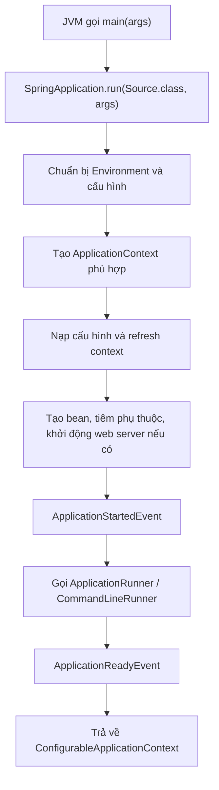

# Từ phương thức `main` đến `SpringApplication.run`

Khi khởi động một ứng dụng Spring Boot, JVM vẫn bắt đầu từ phương thức `main(String[] args)` của Java. Điểm khác biệt là `main` thường chỉ chuyển quyền điều phối quá trình khởi động cho `SpringApplication.run(...)`. Lời gọi này chuẩn bị cấu hình, tạo và làm mới Spring `ApplicationContext`, khởi tạo các bean cần thiết, khởi động máy chủ nhúng nếu ứng dụng là web và thông báo khi ứng dụng đã sẵn sàng.

Bài này tập trung vào **trình tự thực thi và trách nhiệm của từng điểm khởi động**: `main` làm gì, vì sao truyền lớp cấu hình gốc và `args` vào `run`, những gì xảy ra trong lúc `run` chạy, và điều gì xảy ra sau khi `run` trả về.

## 1. Điểm bắt đầu vẫn là `main` của Java

Một ứng dụng Spring Boot thông thường có lớp như sau:

```java
package com.example.startup;

import org.springframework.boot.SpringApplication;
import org.springframework.boot.autoconfigure.SpringBootApplication;

@SpringBootApplication
public class StartupDemoApplication {

    public static void main(String[] args) {
        SpringApplication.run(StartupDemoApplication.class, args);
    }
}
```

Khi chạy lớp này, trình khởi chạy Java tìm và gọi `public static void main(String[] args)`. Annotation `@SpringBootApplication` **không thay thế `main` và tự nó không khởi chạy ứng dụng**. Lệnh trong `main` mới tạo ra chuỗi khởi động Spring Boot.

Hai đối số quan trọng của lời gọi:

- `StartupDemoApplication.class` là **primary source**: điểm xuất phát để Spring Boot đọc cấu hình ứng dụng. Lớp này có `@SpringBootApplication` nên cung cấp cấu hình gốc, khả năng quét component và kích hoạt auto-configuration.
- `args` chuyển các đối số dòng lệnh từ Java sang Spring Boot, ví dụ `--spring.profiles.active=dev` hoặc `--server.port=8081`. Cấu hình thực tế còn chịu thứ tự ưu tiên của các property source khác.

Cách gọi tĩnh trên tương đương về ý tưởng với:

```java
SpringApplication application =
        new SpringApplication(StartupDemoApplication.class);
application.run(args);
```

Dạng tạo đối tượng `SpringApplication` hữu ích khi cần tùy chỉnh trước khi chạy. Với ứng dụng thông thường, `SpringApplication.run(...)` ngắn gọn và dễ đọc hơn.

## 2. Ví dụ kiểm chứng thứ tự thực thi

Tạo dự án **Spring Boot 3.x, Java 17 trở lên** với dependency `spring-boot-starter` (hoặc `spring-boot-starter-web` nếu muốn chạy web). Đặt toàn bộ mã dưới đây trong tệp `src/main/java/com/example/startup/StartupDemoApplication.java`:

```java
package com.example.startup;

import org.springframework.boot.CommandLineRunner;
import org.springframework.boot.SpringApplication;
import org.springframework.boot.autoconfigure.SpringBootApplication;
import org.springframework.boot.context.event.ApplicationReadyEvent;
import org.springframework.context.ConfigurableApplicationContext;
import org.springframework.context.annotation.Bean;
import org.springframework.context.event.EventListener;

@SpringBootApplication
public class StartupDemoApplication {

    public static void main(String[] args) {
        System.out.println("1. main: trước run");

        ConfigurableApplicationContext context =
                SpringApplication.run(StartupDemoApplication.class, args);

        System.out.println(
                "4. main: sau run, active=" + context.isActive());
    }

    @Bean
    CommandLineRunner printAfterRefresh() {
        return args ->
                System.out.println("2. runner: context đã refresh");
    }

    @EventListener(ApplicationReadyEvent.class)
    void whenReady() {
        System.out.println("3. ready: ứng dụng đã khởi động xong");
    }
}
```

Với dự án Gradle đã cấu hình Spring Boot plugin, chạy `./gradlew bootRun` (trên Windows có thể dùng `.\gradlew.bat bootRun`). Với Maven có thể dùng `./mvnw spring-boot:run`. Những lệnh này cần được chạy tại thư mục dự án tương ứng.

Bỏ qua banner và các dòng log khác của framework, **thứ tự tương đối của bốn dòng tự in** là:

```text
1. main: trước run
2. runner: context đã refresh
3. ready: ứng dụng đã khởi động xong
4. main: sau run, active=true
```

Giải thích:

1. Dòng **1** do JVM thực hiện trước khi gọi `SpringApplication.run`.
2. Spring Boot dựng và refresh `ApplicationContext`; sau đó gọi `CommandLineRunner`, tạo dòng **2**.
3. Sau khi các runner hoàn tất, Spring Boot phát `ApplicationReadyEvent`, tạo dòng **3**.
4. `run(...)` trả về `ConfigurableApplicationContext` đang hoạt động; `main` tiếp tục ở dòng **4**.

Điều này chứng minh hai ý dễ nhầm: `run` không trả về ngay sau khi tạo đối tượng `SpringApplication`, và `CommandLineRunner` không chạy trước khi Spring dựng xong context. Trong thực tế các thông báo log của Spring có thể xen giữa bốn dòng trên.

## 3. Bên trong `SpringApplication.run` diễn ra những gì?

Dưới đây là **luồng khái niệm** của một lần khởi động thành công. Đây là thứ tự các trách nhiệm chính, không phải bản sao từng lệnh nội bộ của Spring Boot.



### Bước 1 — Xác định cách chạy và chuẩn bị dữ liệu đầu vào

`SpringApplication` nhận các primary source và xác định loại ứng dụng qua các lớp có trên classpath cùng cấu hình được chỉ định. Các loại phổ biến là `SERVLET`, `REACTIVE` và `NONE`.

Spring Boot chuẩn bị môi trường chạy (`Environment`), xử lý command-line arguments, cấu hình profile, property sources, thông tin logging và các thiết lập khởi động liên quan. Chẳng hạn, `--spring.profiles.active=dev` giúp chọn profile `dev`; các file cấu hình áp dụng cho profile đó được xử lý trong giai đoạn chuẩn bị môi trường.

**Đừng nhầm `Environment` với hệ điều hành.** Trong Spring, `Environment` là abstraction cung cấp profiles và properties để ứng dụng truy xuất theo cấu hình hiện hành.

### Bước 2 — Tạo đúng loại `ApplicationContext`

Spring Boot chọn implementation của `ApplicationContext` phù hợp với loại ứng dụng:

- Với ứng dụng Servlet/MVC: sử dụng context dành cho servlet web, hỗ trợ tạo máy chủ HTTP nhúng khi có cấu hình tương ứng.
- Với ứng dụng Reactive/WebFlux: sử dụng reactive web context.
- Với ứng dụng không phải web: dùng context thông thường và không cần mở cổng HTTP.

Trong giai đoạn này các `ApplicationContextInitializer` đã đăng ký có thể điều chỉnh context trước khi bean definitions được nạp đầy đủ. Tạo context mới chỉ là bước chuẩn bị; nó chưa đồng nghĩa với toàn bộ bean đã hoạt động.

### Bước 3 — Xử lý lớp cấu hình gốc, quét component và auto-configuration

`@SpringBootApplication` bao gồm ba vai trò chính:

| Thành phần | Vai trò trong khởi động |
|---|---|
| `@SpringBootConfiguration` | Đánh dấu lớp là nguồn cấu hình Spring. |
| `@ComponentScan` | Phát hiện các component trong package của lớp gốc và các package con. |
| `@EnableAutoConfiguration` | Đưa các cấu hình tự động phù hợp vào context khi các điều kiện được thỏa mãn. |

Ví dụ, nếu lớp `StartupDemoApplication` nằm tại `com.example.startup` thì component scan mặc định tìm trong `com.example.startup` và các package con. Một class `@Service` nằm ở package không thuộc vùng quét có thể không được đăng ký thành bean.

Auto-configuration **có điều kiện**, dựa trên classpath, các bean đã khai báo và properties. Có `spring-boot-starter-web` thường đưa cấu hình servlet web vào ứng dụng; chỉ có `spring-boot-starter` thì không tự biến ứng dụng thành HTTP server. Annotation này cũng không có nghĩa mọi bean trong tất cả thư viện đều được tạo.

### Bước 4 — Refresh context và khởi tạo các bean cần thiết

Trong quá trình `refresh()`, Spring xử lý các cấu hình/bean definitions, đăng ký các thành phần hỗ trợ container, tạo những singleton không lazy cần khởi tạo và thực hiện dependency injection. Những callback liên quan vòng đời bean như `@PostConstruct` có thể chạy ở giai đoạn khởi tạo từng bean.

Với ứng dụng web, quá trình refresh còn thiết lập và khởi động web server nhúng, đăng ký các thành phần web cần thiết. Khi refresh thành công, các bean được khởi tạo ở startup đã sẵn sàng theo hợp đồng của Spring; nhưng các startup runner **chưa chắc đã chạy**.

Cần phân biệt:

- **Đã tạo `ApplicationContext`**: có container để cấu hình; chưa khẳng định context đã refresh.
- **Đã refresh context**: xử lý xong phần khởi tạo chính của container và web server nếu có.
- **Ứng dụng ready**: các runner khởi động đã hoàn thành, sự kiện ready được phát; đây là dấu mốc muộn hơn refresh.

Bean khai báo lazy có thể chỉ được tạo khi được dùng lần đầu, vì vậy không thể kết luận mọi bean trong hệ thống đều đã được instantiate trước khi `run` trả về.

### Bước 5 — Gọi các startup runner và phát sự kiện ready

Sau khi context refresh, Spring Boot phát `ApplicationStartedEvent`, rồi lần lượt gọi các bean triển khai `ApplicationRunner` và `CommandLineRunner`. Hai interface này đều dùng cho logic chạy một lần sau khi container khởi tạo; khác biệt là `ApplicationRunner` nhận `ApplicationArguments`, còn `CommandLineRunner` nhận `String... args`.

Nếu có nhiều runner và cần thứ tự rõ ràng, có thể dùng `@Order` hoặc `Ordered`. Không nên dựa vào thứ tự phát hiện bean mặc định. Các runner phải kết thúc thành công thì Spring Boot mới tiến đến `ApplicationReadyEvent`.

`ApplicationReadyEvent` cho biết Spring Boot đã đi hết quá trình startup bình thường. Nó không bảo đảm mọi hệ thống bên ngoài (chẳng hạn một API phụ thuộc) luôn khỏe mạnh; các phép kiểm tra readiness/health cụ thể vẫn cần thiết cho triển khai thực tế.

## 4. Các sự kiện quan trọng để quan sát vòng đời startup

Spring Boot phát các sự kiện theo các cột mốc khác nhau. Bảng sau lược bỏ một số sự kiện phụ để tập trung vào chuỗi khởi động chính:

| Sự kiện | Ý nghĩa |
|---|---|
| `ApplicationStartingEvent` | Khởi động vừa bắt đầu; context và environment chưa được chuẩn bị đầy đủ. |
| `ApplicationEnvironmentPreparedEvent` | `Environment` đã được chuẩn bị, trước khi tạo đầy đủ context. |
| `ApplicationContextInitializedEvent` | Context đã được tạo và các initializer đã áp dụng, trước khi nạp đầy đủ bean definitions. |
| `ApplicationPreparedEvent` | Context đã được chuẩn bị và primary sources đã được nạp, trước khi refresh. |
| `ApplicationStartedEvent` | Context đã refresh thành công, trước khi thực thi runner. |
| `ApplicationReadyEvent` | Runner đã hoàn thành; startup thành công và ứng dụng sẵn sàng. |
| `ApplicationFailedEvent` | Được phát khi startup thất bại. Không có sự kiện ready cho lần khởi động thất bại đó. |

**Lưu ý về listener:** bean dùng `@EventListener` chỉ có thể được sử dụng khi cơ chế quản lý bean/listener tương ứng đã sẵn sàng. Nếu cần bắt các sự kiện rất sớm như `ApplicationStartingEvent`, nên đăng ký listener với `SpringApplication` trước khi gọi `run` (hoặc dùng cơ chế đăng ký sớm của Spring Boot), thay vì kỳ vọng một bean `@EventListener` thông thường đã tồn tại từ đầu.

Với nhu cầu làm việc sau khi ứng dụng hoàn tất startup, `ApplicationReadyEvent` phù hợp hơn `ApplicationStartedEvent`; còn với một tác vụ khởi tạo chủ động, đồng bộ, có thể dùng runner. Không nên thực hiện tác vụ chặn rất lâu trong runner nếu muốn ứng dụng sớm chuyển sang trạng thái ready.

## 5. Vì sao `run` trả về mà ứng dụng web vẫn chạy?

Kiểu trả về của lời gọi là `ConfigurableApplicationContext`:

```java
ConfigurableApplicationContext context =
        SpringApplication.run(StartupDemoApplication.class, args);
```

Nghĩa là chương trình vẫn có thể thực thi tiếp phần mã phía sau lời gọi, như dòng **4** trong ví dụ. `SpringApplication.run` **không phải** một vòng lặp vô hạn giữ phương thức `main` mãi bên trong nó.

Với ứng dụng web, web server nhúng và các luồng làm việc của nó có thể tiếp tục giữ tiến trình JVM hoạt động để nhận request, dù `main` đã chạy đến cuối. Với ứng dụng không phải web, nếu không còn luồng non-daemon nào giữ JVM, tiến trình thường kết thúc sau khi `main` và các công việc liên quan hoàn tất.

Vì vậy cần tách ba khái niệm:

- **`run` trả về:** startup thành công và trả lại context cho caller.
- **`main` kết thúc:** hết mã trong phương thức `main`, không đồng nghĩa ứng dụng web dừng.
- **Tiến trình JVM kết thúc:** khi không còn điều kiện giữ tiến trình chạy hoặc khi ứng dụng bị dừng.

Khi shutdown, Spring đóng context, thực hiện các callback dọn dẹp và xử lý việc dừng server theo cấu hình. Trong mã standalone có thể chủ động gọi `context.close()` khi thực sự muốn đóng ứng dụng. Không gọi ngay `close()` sau `run` nếu mục đích là giữ một web service phục vụ request.

## 6. Tự thay đổi tham số khởi động để quan sát kết quả

Thử chạy dự án web bằng cấu hình dòng lệnh:

```bash
./gradlew bootRun --args='--server.port=8081 --spring.profiles.active=dev'
```

Trong Windows PowerShell, có thể dùng `.\gradlew.bat bootRun --args="--server.port=8081 --spring.profiles.active=dev"`. Các lệnh trên áp dụng khi dự án có Gradle wrapper và Spring Boot Gradle plugin.

- `--server.port=8081` yêu cầu web server nhúng dùng cổng 8081 thay cho mặc định nếu không bị điều kiện cấu hình khác ghi đè.
- `--spring.profiles.active=dev` kích hoạt profile `dev`, làm thay đổi cấu hình và có thể thay đổi những bean thỏa điều kiện theo profile.
- Với dự án không có web server, `server.port` không tự khiến cổng 8081 mở ra.

Có thể đặt breakpoint tại lời gọi `SpringApplication.run`, trong `printAfterRefresh()`, tại `whenReady()`, và ngay sau `run` để quan sát từng mốc. Khi bước qua lời gọi bằng debugger, bạn sẽ thấy việc startup mất thời gian do container phải chuẩn bị môi trường, nạp cấu hình và khởi tạo bean, chứ không chỉ thực thi một lệnh Java đơn giản.

## 7. Khi startup lỗi, cần đọc lỗi ở giai đoạn nào?

Nếu `SpringApplication.run` ném exception khi đang startup, luồng thực thi bình thường sẽ không đến dòng sau `run`. Spring Boot xử lý lỗi khởi động, có thể phát `ApplicationFailedEvent` và dọn dẹp context. Trong ví dụ ở mục 2, nếu một bean hoặc runner khởi động thất bại thì không nên mong đợi dòng **3** và **4** luôn xuất hiện.

Một vài tình huống phổ biến:

| Triệu chứng | Nơi cần xem xét |
|---|---|
| Không tìm thấy bean để injection | Package scan của lớp `@SpringBootApplication`, điều kiện tạo bean, qualifier và profile. |
| Bean tạo thất bại | Root cause ở cuối stack trace, constructor, factory method, property binding hoặc callback khởi tạo. |
| Web server không mở được cổng | Cổng đã được tiến trình khác sử dụng, cấu hình `server.port` hoặc lỗi cấu hình server. |
| Ứng dụng khởi tạo context rồi vẫn báo startup fail | Exception bên trong `ApplicationRunner`/`CommandLineRunner` hoặc bước startup sau refresh. |
| Auto-configuration không diễn ra như kỳ vọng | Dependency/classpath, điều kiện cấu hình, properties; bật `--debug` khi cần xem condition evaluation report. |

Luôn tìm **nguyên nhân gốc trong stack trace** trước khi sửa. Log “context refresh” hoặc “server started” không có nghĩa toàn bộ startup đã thành công, vì runner vẫn có thể ném lỗi sau những thông báo đó.

## 8. Các nhầm lẫn cần tránh

1. **“Có `@SpringBootApplication` là JVM tự chạy Spring.”** Sai: cần một entry point hoặc cơ chế khởi chạy gọi Spring Boot; trong ví dụ là `main`.
2. **“`SpringApplication.run` chỉ mở web server.”** Sai: nó quản lý toàn bộ quá trình bootstrap Spring context; ứng dụng console không có HTTP server vẫn dùng được.
3. **“`ApplicationStartedEvent` đồng nghĩa ready.”** Sai: sự kiện started xảy ra trước runner; ready xảy ra sau runner.
4. **“`run` trả về là ứng dụng đã tắt.”** Sai: web server vẫn có thể tiếp tục chạy qua các luồng của nó.
5. **“Mọi bean đã được tạo khi có context.”** Sai: cần refresh để khởi tạo phần lớn bean; bean lazy còn có thể được tạo muộn.
6. **“Chỉ cần thêm annotation `@Service` ở đâu cũng được.”** Sai: class cần nằm trong vùng scan hoặc được đăng ký bằng cấu hình khác.

**Ghi nhớ luồng chính:** JVM gọi `main` → `SpringApplication.run` chuẩn bị environment → tạo và refresh `ApplicationContext` → khởi tạo bean/server cần thiết → phát started → chạy startup runners → phát ready → trả lại context. Xác định được từng mốc này sẽ giúp bạn hiểu log startup, đặt breakpoint đúng chỗ và tìm nguyên nhân khi ứng dụng không thể khởi chạy.
