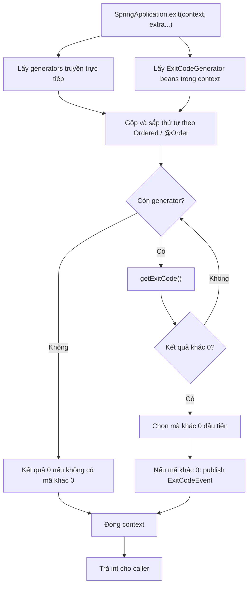
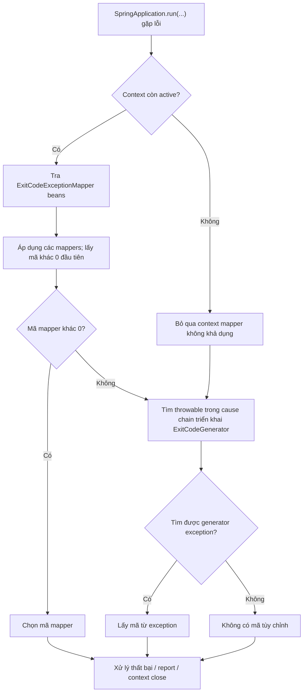

# Nhiều nguồn mã thoát và thứ tự lựa chọn trong Spring Boot

## 1. Bài toán: khi có nhiều người đề xuất mã thoát, ai thắng?

Mã thoát (*process exit code*, *exit status*) là một số nguyên mà tiến trình trả cho hệ điều hành, shell hoặc chương trình cha khi nó kết thúc. Theo quy ước thông dụng, `0` biểu thị kết thúc thành công; giá trị **khác 0** biểu thị một tình huống cần phân loại là lỗi, điều kiện không thành công hoặc kết quả đặc biệt tùy hợp đồng của CLI/batch.

Trong một ứng dụng Spring Boot, nhiều thành phần có thể cùng muốn quyết định mã thoát:

- Module kiểm tra dữ liệu muốn trả `12` khi thiếu dữ liệu.
- Module đồng bộ muốn trả `23` nếu đã phát hiện lỗi chưa xử lý.
- Bộ chạy batch muốn trả mã phản ánh kết quả job.
- Code gọi `SpringApplication.exit(...)` truyền thêm `ExitCodeGenerator` riêng.
- Một exception khi khởi động tự triển khai `ExitCodeGenerator`.
- Một hoặc nhiều `ExitCodeExceptionMapper` chuyển exception thành mã thoát.

Nếu không hiểu **thứ tự nguồn** và **thuật toán chọn**, lập trình viên có thể viết sai kiểu “lấy mã lớn nhất”, “lấy mã của bean khai báo cuối”, hoặc “mã truyền trực tiếp chắc chắn thắng mã của bean”.

Đối với **Spring Boot 3.3.x**, quy tắc trọng tâm của `SpringApplication.exit(...)` là:

> **Sắp xếp các `ExitCodeGenerator` theo thứ tự `Ordered`/`@Order`, duyệt lần lượt, bỏ qua mã `0` và chọn mã khác `0` đầu tiên.**

Quy tắc này được mô tả trong Spring Boot 3.3 API/reference. Trong luồng **lỗi khởi động**, còn có bước riêng xử lý exception mappers và những exception tự triển khai `ExitCodeGenerator`. Hai đường này liên quan nhưng **không phải một cuộc thi chung giữa tất cả loại bean**.

Bài dùng Java 17+, Spring Framework 6.x và **Spring Boot 3.3.13** để minh họa các quyết định chính xác. Nội dung dành chủ yếu cho batch/CLI, không khuyến khích gọi `System.exit` từ HTTP controller của server đang phục vụ.

## 2. Phân biệt kết quả nghiệp vụ, exit code và việc kết thúc JVM

Ba thao tác dễ bị đánh đồng:

1. **Tạo ra một mã:** `ExitCodeGenerator#getExitCode()` trả một `int`. Bản thân nó không yêu cầu JVM thoát.
2. **Tính mã và đóng Spring context:** `SpringApplication.exit(context, generators...)` thu thập/đánh giá generators, có thể công bố `ExitCodeEvent`, đóng context và trả lại `int`. Nó **không tự gọi `System.exit(int)`**.
3. **Trả mã cho hệ điều hành:** `System.exit(code)` yêu cầu JVM kết thúc với status tương ứng.

Mẫu code đúng cho một CLI sau khi công việc hoàn tất:

```java
ConfigurableApplicationContext context =
        SpringApplication.run(MyCliApplication.class, args);

int exitCode = SpringApplication.exit(context);
System.exit(exitCode);
```

Đây là **snippet minh họa**, cần class `MyCliApplication` và imports phù hợp; ví dụ đầy đủ ở mục 9.

Nếu chỉ gọi `SpringApplication.exit(context)` rồi bỏ qua số trả về, không nên suy ra shell đã nhận chính số đó. Nếu chỉ `System.exit(42)` mà không đóng context trước, bạn bỏ qua bước lựa chọn generator và có nguy cơ làm shutdown khó kiểm soát.

### 2.1. Mã `0` có ý nghĩa đặc biệt trong thuật toán

Khi generator trả `0`, nó **không chiếm quyền lựa chọn** nếu có một generator ở phía sau trả khác 0. `0` ở đây giống “không đề xuất mã lỗi, hãy xem nguồn tiếp theo”.

Ví dụ:

```text
Generator A -> 0
Generator B -> 0
Generator C -> 17
Generator D -> 99
```

Kết quả là **17**, vì đây là mã khác 0 đầu tiên trong **thứ tự đã sắp xếp**. `99` không được chọn chỉ vì lớn hơn.

Nếu tất cả generators trả `0` hoặc không có generator, kết quả thông thường là `0` trong đường thoát thành công, miễn quá trình tính mã và đóng context không phát sinh lỗi làm thay đổi kết quả.

### 2.2. Exit code không phải HTTP status

HTTP `503` biểu thị một phản hồi HTTP. Exit code `42` biểu thị kết quả của **một process**. Chúng không cùng namespace, không có phép ánh xạ mặc định từ mọi HTTP exception sang mã thoát JVM.

Một request bị lỗi 500 trong một server Spring MVC đang chạy **không có nghĩa cả JVM phải trả exit code 500**. Những ứng dụng web lâu dài nên để framework xử lý request theo HTTP semantics và chỉ dùng process exit code cho tình huống kết thúc tiến trình.

## 3. Các nguồn mã thoát và thời điểm sử dụng

| Nguồn | Cách khai báo | Khi nào Boot xem xét? | Lưu ý |
| --- | --- | --- | --- |
| `ExitCodeGenerator` bean | `@Bean`/`@Component` triển khai interface | Khi gọi `SpringApplication.exit(context, ...)` | Thuộc context; cần còn được tra cứu khi exit |
| Generator truyền trực tiếp | Tham số varargs của `SpringApplication.exit` | Khi gọi chính method đó | Được gộp với bean generators rồi sắp thứ tự |
| Exception triển khai `ExitCodeGenerator` | `class X extends RuntimeException implements ExitCodeGenerator` | Khi Boot xử lý **lỗi khởi động**, kiểm tra exception/cause | Không phải một bean generator thông thường |
| `ExitCodeExceptionMapper` bean | `@Bean` ánh xạ `Throwable -> int` | Trong đường Boot xử lý lỗi khởi động, nếu context còn active | Có thể trả `0` để nhường nguồn khác |
| `ExitCodeEvent` | Listener quan sát mã đã xác định | Sau khi mã khác 0 được tính, khi context có thể publish | **Không phải nguồn** ra quyết định |
| `System.exit(int)` | Lệnh JVM | Khi code chủ động chấm dứt process | Không tự gọi lại các generators |
| Exit mặc định của JVM/shell | Process kết thúc bình thường hoặc ném lỗi | Bên ngoài Spring | Có thể phụ thuộc launcher/platform |

`ExitCodeGenerator` là functional interface:

```java
@FunctionalInterface
public interface ExitCodeGenerator {
    int getExitCode();
}
```

Đây là chữ ký tối giản được diễn giải từ API, không phải một file phải tự tạo: interface thật nằm trong `org.springframework.boot.ExitCodeGenerator`.

`ExitCodeExceptionMapper` cũng là functional interface:

```java
@FunctionalInterface
public interface ExitCodeExceptionMapper {
    int getExitCode(Throwable exception);
}
```

Nó trả `0` khi mapper không có mã phù hợp. Hai interface có cùng chữ “ExitCode” nhưng nhận input khác nhau: generator hỏi trạng thái hiện có; mapper nhận nguyên nhân lỗi để dịch thành mã.

## 4. Thuật toán `SpringApplication.exit`: ghép nguồn rồi sắp xếp

Xét lời gọi:

```java
int code = SpringApplication.exit(context, extraA, extraB);
```

Trong Spring Boot 3.3, Boot xem xét:

- Những generator truyền trực tiếp (`extraA`, `extraB`).
- Những Spring beans của context triển khai `ExitCodeGenerator`.

Sau khi thu thập, Boot sắp xếp bằng cơ chế ordering có nhận diện `Ordered` và `@Order`, rồi dùng **mã khác 0 đầu tiên**.

Sơ đồ:



Sơ đồ là đường xử lý **thành công thông thường**, chưa mô tả chi tiết mọi nhánh exception khi generator hoặc shutdown callback thất bại. Không dùng nó để thay thế xử lý lỗi thực tế.

### 4.1. Không phải “mã lớn nhất thắng”

Giả sử:

| Generator sau khi sắp xếp | Order | Mã trả |
| --- | ---: | ---: |
| `validate` | -100 | 0 |
| `policy` | 0 | 8 |
| `cleanup` | 20 | 90 |
| `fallback` | 100 | 1 |

Kết quả là **8**, không phải 90. `cleanup` hoặc `fallback` có thể **không được gọi** vì Boot đã tìm được mã khác 0 tại `policy`.

Điều đó có một hệ quả thiết kế quan trọng: **không đặt side effect hoặc cleanup bắt buộc bên trong `getExitCode()`** của generator mà bạn kỳ vọng luôn được gọi. Generator nằm sau mã khác 0 đầu tiên có thể bị bỏ qua.

### 4.2. Không phải “bean thêm vào sau thắng”

Thứ tự khai báo `@Bean`, tên class, thứ tự component scanning, hay thứ tự phần tử của một tập hợp **không nên trở thành hợp đồng** lựa chọn exit code. Khi có nhiều generator, phải đặt thứ tự tường minh.

### 4.3. Không phải “tham số trực tiếp luôn thắng bean”

`SpringApplication.exit(context, explicit)` có nhận generator truyền trực tiếp, nhưng điều đó **không tự trao độ ưu tiên cao nhất** cho nó. Sau khi gộp, `Ordered`/`@Order` quyết định thứ tự.

Ví dụ:

```text
bean-a    order=-100 -> code 7
explicit  order=0    -> code 4
bean-b    order=100  -> code 9
```

Kết quả **7** vì bean-a được duyệt trước. Ngược lại, nếu explicit có order `-200` và trả `4`, nó có thể được chọn trước bean-a. Không lấy **vị trí trong varargs** thay cho chính sách ưu tiên.

### 4.4. Generator trả 0 không chặn nguồn sau

```text
explicit-high-priority  order=-100 -> 0
bean-middle             order=0    -> 17
explicit-low-priority   order=100  -> 5
```

Kết quả là **17**. Một generator ưu tiên cao nhưng trả `0` chỉ có nghĩa nguồn đó không cung cấp kết quả khác 0 trong lần đánh giá này.

## 5. `Ordered`, `@Order` và ý nghĩa thứ tự số học

Spring Framework dùng `org.springframework.core.Ordered` và annotation `org.springframework.core.annotation.Order` để diễn đạt ưu tiên.

**Số `order` càng nhỏ thì ưu tiên càng cao.** Số âm hoàn toàn hợp lệ.

Ví dụ:

```java
final class BillingCode implements ExitCodeGenerator, Ordered {

    @Override
    public int getOrder() {
        return -100;
    }

    @Override
    public int getExitCode() {
        return 11;
    }
}
```

Đây là class minh họa; cần imports `ExitCodeGenerator`, `Ordered`. `-100` là **thứ tự lựa chọn**, không phải exit status.

Cách khác, gắn `@Order` lên **class implementation**:

```java
@Order(10)
final class ReportingCode implements ExitCodeGenerator {

    @Override
    public int getExitCode() {
        return 13;
    }
}
```

Class minh họa cần import `@Order` và `ExitCodeGenerator`. Việc chọn giữa `Ordered` và `@Order` chủ yếu là nhu cầu order động hoặc tĩnh:

- `Ordered#getOrder()` có thể tính theo trạng thái mà object quản lý.
- `@Order` thể hiện ưu tiên cố định trên type.
- Đối với lambda implement `ExitCodeGenerator`, không có class ứng dụng rõ ràng để gắn `@Order`; khi thứ tự quan trọng, nên trả về **một implementation cụ thể của `Ordered`**.
- Không trộn giá trị `order` với giá trị mã thoát. `order=-100` có thể đi kèm `exitCode=0` hoặc `exitCode=42`.

### 5.1. Hằng số ưu tiên

`Ordered.HIGHEST_PRECEDENCE` biểu thị thứ tự ưu tiên cao nhất (giá trị số nguyên rất thấp); `Ordered.LOWEST_PRECEDENCE` là ưu tiên thấp nhất (giá trị rất cao).

Không nên gán **mọi** generator `HIGHEST_PRECEDENCE` vì khi tất cả cùng order, bạn lại không có thứ tự tương đối có chủ đích. Hãy thống nhất một bảng priority nhỏ, ví dụ:

| Order đề xuất | Vai trò |
| ---: | --- |
| -200 | Kiểm tra hỏng dữ liệu/điều kiện bắt buộc |
| -100 | Validation |
| 0 | Lỗi nghiệp vụ chính |
| 100 | Lỗi tác vụ phụ |
| 1000 | Fallback |

Các con số trong bảng chỉ là **quy ước thiết kế**, không có ý nghĩa đặc biệt do Spring Boot quy định.

### 5.2. Nếu hai generator có cùng order

Khi hai nguồn có cùng `getOrder()` và cùng trả nonzero, **đừng dựa vào nguồn nào sẽ được phát hiện trước** nếu nghiệp vụ bắt buộc một kết quả ổn định. Tên bean, insertion order hay chi tiết collection có thể khiến kết quả khó dự đoán theo môi trường.

Giải pháp: gán order phân biệt, hoặc tổng hợp quyết định trong **một generator** có chính sách rõ ràng. Nếu business rule thật sự là “mã lỗi nghiêm trọng nhất”, tự triển khai một generator tổng hợp có severity mapping; đừng tưởng thuật toán mặc định của Boot tự lấy giá trị lớn nhất.

### 5.3. So sánh với `@Order` của các thành phần khác

`@Order` còn được dùng cho `ApplicationRunner`, `CommandLineRunner`, filter, aspect... nhưng đó là các **cơ chế sắp xếp riêng**.

Order của một runner quyết định lúc **runner được gọi trong startup**, không tự quyết định ưu tiên của bean `ExitCodeGenerator` khi shutdown. Cần khai báo thứ tự trên chính đối tượng đóng vai trò generator.

## 6. Nhiều nguồn cùng đề xuất: bảng tình huống

Giả sử các nguồn có `order` khác nhau và không ném lỗi trong `getExitCode()`.

| Nguồn theo thứ tự tăng dần | Mã trả về | Kết quả cuối |
| --- | --- | --- |
| A: `0`, B: `0`, C: `0` | Toàn 0 | `0` |
| A: `0`, B: `7`, C: `30` | Nonzero đầu là B | `7` |
| A: `40`, B: `9`, C: `0` | Nonzero đầu là A | `40` |
| Explicit order `-20`: `0`, bean order `0`: `5` | Explicit nhường quyền | `5` |
| Bean order `-20`: `8`, explicit order `0`: `3` | Bean có ưu tiên trước | `8` |
| A order `-100`: `-5`, B order `0`: `9` | Nonzero đầu là `-5` | `-5` ở tầng Java; OS hiển thị có thể khác |
| Một generator được chọn sớm | Các generator sau chưa cần gọi | Không được dựa vào side effect của chúng |

Ví dụ với mã âm nhằm chỉ rõ tiêu chí là **khác 0**, không phải “dương lớn nhất”. Tuy nhiên mã process âm hoặc lớn hơn 255 **không di động** qua các hệ điều hành và shell; xem mục 12.

## 7. Hai đường xác định mã cần phân biệt: exit chủ động và startup failure

Đây là phần quan trọng khi cùng dự án có bean generator, mapper và exception tự báo mã.

### 7.1. Đường A — Ứng dụng chạy thành công rồi chủ động exit

```text
SpringApplication.run(...) thành công
              |
              v
SpringApplication.exit(context, explicit...)
              |
              v
Gộp explicit generators + ExitCodeGenerator beans
              |
              v
Sắp order → chọn mã khác 0 đầu tiên
              |
              v
ExitCodeEvent nếu mã khác 0
              |
              v
context.close() → return code
              |
              v
Caller System.exit(code) nếu muốn trả code cho OS
```

Ở đường này, `ExitCodeExceptionMapper` **không phải một `ExitCodeGenerator` bean** và không tự tham gia vào việc tính mã chỉ vì nó tồn tại trong context. Nó là một strategy dành cho **nguyên nhân exception** khi Boot đang xử lý run failure.

### 7.2. Đường B — Lỗi xảy ra trong luồng SpringApplication startup

Trong Spring Boot 3.3, khi `SpringApplication.run(...)` thất bại, Boot xử lý exception. Với một context đang active, Boot có thể tra các bean `ExitCodeExceptionMapper` và hỏi chúng để lấy mã. Nếu kết quả mapping là `0`, Boot tiếp tục tìm trong exception/cause chain một throwable triển khai `ExitCodeGenerator`.

Mô hình:



Đây là **hai tầng ưu tiên khác nhau**:

1. **Ưu tiên giữa các `ExitCodeExceptionMapper`**: mỗi mapper có thể trả 0 hoặc một mã; nếu nhiều mapper cùng được xem xét, không nên dựa vào thứ tự discovery mà không có quy ước rõ.
2. **Fallback từ mapper sang exception generator**: khi mapping không cho mã khác 0, Boot xét exception/cause chain có implement `ExitCodeGenerator` hay không.

Không viết tài liệu kiểu “exception luôn thắng mapper” hoặc “bean `ExitCodeGenerator` đang chạy luôn thắng exception” — điều đó không mô tả đúng hai đường xử lý của Boot 3.3.

### 7.3. Exception cũng có thể mang mã thoát

```java
public final class DataMissingException extends RuntimeException
        implements ExitCodeGenerator {

    public DataMissingException(String message) {
        super(message);
    }

    @Override
    public int getExitCode() {
        return 27;
    }
}
```

Đoạn trên là class Java có thể biên dịch khi import `org.springframework.boot.ExitCodeGenerator`, nhưng cần được đặt trong file `DataMissingException.java` đúng package. Khi exception này hoặc một exception có nó trong cause chain dẫn đến **lỗi startup do Boot xử lý**, mã 27 có thể được sử dụng nếu không có mapper khác đã quyết định một mã nonzero.

Không suy ra rằng **mọi** `throw new DataMissingException(...)` từ một request HTTP đang chạy sẽ tự khiến process exit 27. Request error thông thường được web layer xử lý; startup-failure handler không tự chạy cho mọi request.

### 7.4. `ExitCodeExceptionMapper` cho exception của thư viện ngoài

Nhiều exception của thư viện không triển khai `ExitCodeGenerator`. Mapper giúp dịch chúng thành mã domain:

```java
@Bean
ExitCodeExceptionMapper domainExitCodeMapper() {
    return error -> {
        for (Throwable cause = error;
             cause != null;
             cause = cause.getCause()) {
            if (cause instanceof IllegalArgumentException) {
                return 64;
            }
        }
        return 0;
    };
}
```

Đây là method minh họa bên trong class cấu hình Spring, cần import `@Bean`, `ExitCodeExceptionMapper`. Trong production, **không nên** map mọi `IllegalArgumentException` thành một mã quá chung nếu không có hợp đồng business rõ; ví dụ chỉ nhằm thể hiện cần xét cause chain.

Các runner exception có thể bị Spring Boot **wrap** bằng một exception khác khi propagate ra ngoài, nên mapper chỉ nhìn `error.getClass()` bên ngoài có thể bỏ lỡ nguyên nhân thật. Hãy duyệt cause chain một cách có kiểm soát; tránh tự lặp vô hạn nếu nguồn throwable bất thường, và dùng những exception types domain đủ cụ thể.

### 7.5. Mapper có điều kiện tồn tại

Nếu lỗi xảy ra quá sớm (chưa tạo hoặc context chưa active), các mapper bean trong context có thể **không truy cập được**. Trong tình huống đó, mã từ exception tự implement `ExitCodeGenerator` hoặc xử lý mặc định có thể là nguồn còn lại.

Do đó không dùng mapper bean như cách duy nhất để xử lý mọi lỗi bootstrap trước khi context tồn tại. Với lỗi cần mã rõ ở giai đoạn rất sớm, có thể sử dụng exception có mã riêng hoặc xử lý ở launcher/entrypoint theo hợp đồng được hỗ trợ.

## 8. `ExitCodeEvent`: nhận thông báo về mã đã chọn

Spring Boot có `org.springframework.boot.ExitCodeEvent`, chứa mã đã xác định.

Một listener thông thường:

```java
@EventListener
public void onExitCode(ExitCodeEvent event) {
    System.out.println("exit-code=" + event.getExitCode());
}
```

Đoạn này nằm trong Spring-managed bean với imports `org.springframework.context.event.EventListener` và `org.springframework.boot.ExitCodeEvent`.

Các điều kiện cần nhớ:

- Khi `SpringApplication.exit(...)` tính được **mã khác 0**, Boot phát `ExitCodeEvent` trước khi đóng context theo đường thông thường.
- Event dùng để **quan sát** (ghi metrics, audit phù hợp), không phải để “bầu lại” exit code.
- Nếu kết quả là `0`, không nên mong `ExitCodeEvent` luôn được phát.
- Khi startup thất bại quá sớm hoặc context không thể publish event, listener bean có thể không nhận được.
- `@EventListener` thông thường chạy đồng bộ nếu không cấu hình async; tránh đưa I/O nặng hoặc blocking vô hạn vào listener tại thời điểm context sắp đóng.

Nếu bạn cần ghi log exit code của CLI, cách trực tiếp và ít phụ thuộc nhất là log số `int` mà `SpringApplication.exit(...)` trả về, rồi gọi `System.exit` ở biên ngoài.

## 9. Ví dụ chạy hoàn chỉnh: nhiều generator và thứ tự lựa chọn

Bài thực hành này chứng minh bốn điều:

1. `ExitCodeGenerator` truyền vào method và generator bean được gộp thành một tập lựa chọn.
2. Thứ tự do `Ordered.getOrder()` quyết định, **không dựa vào nguồn bean/explicit**.
3. Mã `0` được bỏ qua; **mã khác 0 đầu tiên** được chọn.
4. `ExitCodeEvent` được phát và context được đóng khi gọi `SpringApplication.exit(...)`.

Dự án dùng Maven, Java 17, Spring Boot 3.3.13 và `spring-boot-starter`. Chạy `WebApplicationType.NONE`, không mở HTTP server; đây là dạng CLI minh họa phù hợp nhất để kiểm tra OS exit status.

### 9.1. Cấu trúc dự án

```text
exit-code-order-demo/
├── pom.xml
└── src/main/
    ├── java/com/example/exit/
    │   └── ExitCodeOrderApplication.java
    └── resources/
        └── application.properties
```

### 9.2. `pom.xml`

```xml
<project xmlns="http://maven.apache.org/POM/4.0.0"
         xmlns:xsi="http://www.w3.org/2001/XMLSchema-instance"
         xsi:schemaLocation="http://maven.apache.org/POM/4.0.0 https://maven.apache.org/xsd/maven-4.0.0.xsd">
    <modelVersion>4.0.0</modelVersion>
    <parent>
        <groupId>org.springframework.boot</groupId>
        <artifactId>spring-boot-starter-parent</artifactId>
        <version>3.3.13</version>
        <relativePath/>
    </parent>
    <groupId>com.example</groupId>
    <artifactId>exit-code-order-demo</artifactId>
    <version>0.0.1-SNAPSHOT</version>
    <properties>
        <java.version>17</java.version>
    </properties>
    <dependencies>
        <dependency>
            <groupId>org.springframework.boot</groupId>
            <artifactId>spring-boot-starter</artifactId>
        </dependency>
    </dependencies>
    <build>
        <plugins>
            <plugin>
                <groupId>org.springframework.boot</groupId>
                <artifactId>spring-boot-maven-plugin</artifactId>
            </plugin>
        </plugins>
    </build>
</project>
```

### 9.3. `application.properties`

Tạo `src/main/resources/application.properties`:

```properties
spring.main.web-application-type=none
spring.main.banner-mode=off
logging.level.root=ERROR

# Mã của bean nghiệp vụ; có thể đổi qua CLI.
demo.business-code=42

# Bật mapper cho startup failure; xem mục 10.
demo.map-failure=true
```

`spring.main.web-application-type=none` cho phép project chạy như một CLI. Khi sử dụng direct executable JAR, bạn không cần kéo Spring MVC/web server vào dự án.

### 9.4. Toàn bộ Java source

Tạo `src/main/java/com/example/exit/ExitCodeOrderApplication.java`:

```java
package com.example.exit;

import org.springframework.boot.ApplicationRunner;
import org.springframework.boot.ExitCodeEvent;
import org.springframework.boot.ExitCodeExceptionMapper;
import org.springframework.boot.ExitCodeGenerator;
import org.springframework.boot.SpringApplication;
import org.springframework.boot.autoconfigure.SpringBootApplication;
import org.springframework.context.ConfigurableApplicationContext;
import org.springframework.context.annotation.Bean;
import org.springframework.context.event.EventListener;
import org.springframework.core.Ordered;
import org.springframework.core.env.Environment;

@SpringBootApplication
public class ExitCodeOrderApplication {

    public static void main(String[] args) {
        ConfigurableApplicationContext context =
                SpringApplication.run(ExitCodeOrderApplication.class, args);

        // Các generator explicit được gộp và sắp order với bean generators.
        int code = SpringApplication.exit(
                context,
                new NamedGenerator("explicit-zero", -50, 0),
                new NamedGenerator("explicit-fallback", 50, 7));

        System.out.println("selected=" + code);
        System.exit(code);
    }

    @Bean
    ExitCodeGenerator zeroGenerator() {
        return new NamedGenerator("bean-zero", -100, 0);
    }

    @Bean
    ExitCodeGenerator businessGenerator(Environment environment) {
        int businessCode = environment.getProperty(
                "demo.business-code", Integer.class, 42);
        return new NamedGenerator("bean-business", 0, businessCode);
    }

    @Bean
    ExitCodeGenerator lateGenerator() {
        return new NamedGenerator("bean-late", 100, 99);
    }

    @Bean
    ApplicationRunner optionalFailure() {
        return args -> {
            if (args.containsOption("demo.fail")) {
                throw new DemoFailureException("Simulated startup failure");
            }
        };
    }

    @Bean
    ExitCodeExceptionMapper demoFailureMapper(Environment environment) {
        return error -> {
            boolean enabled = environment.getProperty(
                    "demo.map-failure", Boolean.class, true);
            if (!enabled) {
                return 0;
            }
            for (Throwable cause = error;
                 cause != null;
                 cause = cause.getCause()) {
                if (cause instanceof DemoFailureException) {
                    return 64;
                }
            }
            return 0;
        };
    }

    @EventListener
    public void onExitCode(ExitCodeEvent event) {
        System.out.println("event=" + event.getExitCode());
    }

    static final class NamedGenerator
            implements ExitCodeGenerator, Ordered {

        private final String name;
        private final int order;
        private final int code;

        NamedGenerator(String name, int order, int code) {
            this.name = name;
            this.order = order;
            this.code = code;
        }

        @Override
        public int getOrder() {
            return order;
        }

        @Override
        public int getExitCode() {
            System.out.println("generator:" + name + "=" + code);
            return code;
        }
    }

    static final class DemoFailureException extends RuntimeException
            implements ExitCodeGenerator {

        DemoFailureException(String message) {
            super(message);
        }

        @Override
        public int getExitCode() {
            return 27;
        }
    }
}
```

Giải thích theo đúng vai trò:

- `NamedGenerator` implement cả `ExitCodeGenerator` và `Ordered`, nên order là thuộc tính của **chính object generator**.
- Ba bean `bean-zero`, `bean-business`, `bean-late` thuộc Spring context, có order `-100`, `0`, `100`.
- Hai explicit generators được truyền trong `main()`, có order `-50` và `50`.
- Sau khi gộp rồi sắp, thứ tự trở thành `-100 → -50 → 0 → 50 → 100`.
- `bean-zero` và `explicit-zero` trả `0`, nên chưa quyết định mã.
- `bean-business` trả `42` theo property mặc định, là nonzero đầu tiên. `explicit-fallback` và `bean-late` **không cần được gọi**.
- `onExitCode` chỉ ghi log event đã được Boot phát; nó không chọn mã.
- `demoFailureMapper` và `DemoFailureException` chủ yếu dùng cho nhánh **startup failure**, không tham gia như generator thường trong lần exit thành công.

### 9.5. Lệnh build và chạy

Từ thư mục có `pom.xml`:

```bash
mvn package
java -jar target/exit-code-order-demo-0.0.1-SNAPSHOT.jar
```

Nếu project có Maven Wrapper:

```bash
./mvnw package
```

Trên Windows PowerShell:

```powershell
.\mvnw.cmd package
```

Cần JDK 17+, Maven và dependencies đã được tải về. Đây không phải Java file thuần dùng `javac` mà không có Spring trên classpath.

### 9.6. Output kỳ vọng cho đường exit chủ động

Những dòng do **mã demo** tự in, theo thứ tự:

```text
generator:bean-zero=0
generator:explicit-zero=0
generator:bean-business=42
event=42
selected=42
```

Không có dòng `generator:explicit-fallback=7` hoặc `generator:bean-late=99`, vì lần đánh giá dừng ở nonzero đầu tiên.

Shell có thể nhận **exit status 42** khi chạy trực tiếp executable JAR:

```bash
echo $?
```

Trên Bash/zsh, chạy `echo $?` **ngay sau lệnh `java -jar`** mới đọc đúng exit code của chương trình. Nếu bạn chạy lệnh khác xen giữa, `$?` sẽ biểu thị status của lệnh gần nhất đó.

PowerShell:

```powershell
$LASTEXITCODE
```

Với `cmd.exe`:

```bat
echo %ERRORLEVEL%
```

Những lệnh trên đọc status của **tiến trình Java trực tiếp**, không phải Java source logging. Khi chạy qua `mvn spring-boot:run`, status ở shell có thể phản ánh Maven/plugin wrapper, nên để kiểm chứng OS exit code nên chạy `java -jar`.

### 9.7. Biến thể: bean nghiệp vụ trả 0

Giữ nguyên source, chạy:

```bash
java -jar target/exit-code-order-demo-0.0.1-SNAPSHOT.jar --demo.business-code=0
```

Các dòng do demo in:

```text
generator:bean-zero=0
generator:explicit-zero=0
generator:bean-business=0
generator:explicit-fallback=7
event=7
selected=7
```

Giải thích: `bean-business` không còn đề xuất mã nonzero, nên vòng duyệt tiếp tục đến explicit fallback có order 50 và mã 7. `bean-late` có order 100 chưa cần xét.

Điều này trực tiếp bác bỏ hai giả định sai:

- Explicit generator không tự được chọn trước bean chỉ vì truyền qua varargs.
- Mã lớn hơn (`bean-late=99`) không thắng nếu generator trước đã trả nonzero.

### 9.8. Tại sao không cần `System.exit` trong mỗi bean?

Chỉ **main/launcher** mới nên quyết định lúc nào kết thúc JVM. Một generator chỉ mô tả kết quả thông qua `int getExitCode()`; nếu một generator tự gọi `System.exit(...)` trong method, nó có thể ngăn những nguồn khác được xét, phá logic lựa chọn và bỏ qua cleanup theo đường SpringApplication.

Trong service web đang chạy lâu dài, tránh cho controller hoặc bean thông thường gọi `System.exit` để phản hồi một lỗi request. Với CLI chạy xong một job, gọi exit ở boundary `main` là hợp lý hơn.

## 10. Nhánh startup failure: mapper hay exception tự trả mã?

Ví dụ Java ở mục 9 cũng mô phỏng lỗi khởi động thông qua `ApplicationRunner optionalFailure()` khi truyền option `--demo.fail`.

`ApplicationRunner` được Boot gọi **sau context refresh nhưng trước lúc `SpringApplication.run()` hoàn tất**. Trong demo, context đã có thể tra bean `ExitCodeExceptionMapper` khi runner ném exception.

### 10.1. Mapper được bật: chọn 64 thay vì 27

Chạy:

```bash
java -jar target/exit-code-order-demo-0.0.1-SNAPSHOT.jar --demo.fail
```

Trong đường xử lý lỗi khởi động, Boot chuyển exception (có thể được wrap bởi runner handling) đến các mapper hiện có. Mapper của ví dụ tìm `DemoFailureException` trong cause chain và trả `64`.

Do mapper đã trả nonzero, nó có thể **quyết định mã 64 trước** khi Boot fallback sang `DemoFailureException#getExitCode()`, vốn trả 27.

Kết quả cốt lõi kỳ vọng khi chạy trực tiếp executable JAR trên môi trường Boot 3.3.13 là **exit code 64**, kèm log startup failure từ Boot. Đường lỗi **không đến** phần `SpringApplication.exit(context, explicit...)` trong `main()` vì `SpringApplication.run(...)` đã thất bại.

Không nên mô tả stdout của nhánh lỗi bằng một danh sách ngắn tuyệt đối: exception log, stack trace, logger settings và launcher có thể làm output dài và khác nhau. Điều quan trọng để kiểm tra là mã ở shell và những thông tin `DemoFailureException` trong failure log.

### 10.2. Mapper nhường quyền: exception trả 27

Chạy:

```bash
java -jar target/exit-code-order-demo-0.0.1-SNAPSHOT.jar --demo.fail --demo.map-failure=false
```

Lúc này mapper trả `0`, nên Boot xét tiếp cause chain. Vì `DemoFailureException` triển khai `ExitCodeGenerator`, Boot có thể chọn **27**.

Mục đích đối chiếu:

| Đường chạy | Mapper | Exception | Mã được chọn |
| --- | --- | --- | ---: |
| Startup thành công; chủ động exit | Không được dùng để chọn mã bình thường | Không có startup exception | 42 |
| Startup thành công; `--demo.business-code=0` | Không dùng | Không có | 7 |
| Startup fail; mapper bật | 64 | 27 | 64 |
| Startup fail; mapper trả 0 | 0 | 27 | 27 |

**Lưu ý về điều kiện:** bảng là kỳ vọng cho ứng dụng demo nơi context đã được tạo và active, chạy bằng direct JAR trên Java 17 với Boot 3.3.13. Nếu lỗi xảy ra trước khi context active, mapper bean có thể không khả dụng, khiến đường quyết định khác.

### 10.3. Vì sao demo không truyền các bean generator thông thường vào đường lỗi?

Khi `SpringApplication.run(...)` ném exception, code **chưa nhận được một context chạy thành công** để gọi `SpringApplication.exit(context, explicit...)`. Spring Boot xử lý failure bằng logic riêng cho `ExitCodeExceptionMapper` và exception chain.

Đừng viết một bảng “global priority” trộn các bean bình thường, explicit generators, exception mappers và exception generator như thể tất cả đều được gọi trong một lần bất kể startup thành công hay thất bại.

### 10.4. Mappers nhận throwable nào?

Trong thực tế, `ApplicationRunner` failure có thể bị wrap trong exception của Boot, nên mapper chỉ kiểm tra:

```java
if (error instanceof DemoFailureException) { ... }
```

có thể không match dù nguyên nhân sâu hơn là `DemoFailureException`. Bởi vậy code demo duyệt `getCause()` có giới hạn bởi việc kết thúc chain và kiểm tra type domain. Đây là thiết kế thường cần có khi mapper ánh xạ lỗi từ framework/libraries.

## 11. Nếu nhiều `ExitCodeExceptionMapper` cùng tồn tại

Một ứng dụng lớn có thể nhận mapper từ nhiều module:

```text
Mapper A: validation -> 0 hoặc 64
Mapper B: network    -> 0 hoặc 69
Mapper C: batch      -> 0 hoặc 70
```

Các mapper khác nhau nên **trả 0 khi exception không thuộc trách nhiệm của chúng**. Nếu một mapper trả nonzero cho mọi lỗi, nó có thể che mã chuyên biệt từ mapper khác hoặc từ exception generator.

Khuyến nghị:

- Chia mapper theo **exception type/domain rõ ràng**, không bắt chung mọi `RuntimeException` một cách mù quáng.
- Đảm bảo mã không xung đột về nghĩa; tài liệu hóa phạm vi mã cho CLI.
- Nếu hai mapper có thể cùng nhận một exception, định nghĩa **quyền ưu tiên** hoặc hợp nhất vào một mapper điều phối.
- Đừng mặc định mapper đăng ký cuối là kết quả cuối.
- Kiểm thử nhánh mapper trả 0 và đường exception fallback.
- Với lỗi bootstrap trước khi context active, test riêng thay vì mong mapper bean luôn có mặt.

Đặc biệt, một mapper chỉ có quyền **diễn giải failure đang được Boot xử lý**; nó không làm cho một lỗi business đã được catch và xử lý thành công tự trở thành process failure.

## 12. Mã thoát và tính di động giữa hệ điều hành

### 12.1. Tránh chọn mã quá lớn hoặc âm cho CLI dùng nhiều nền tảng

Trong Java, `System.exit(int)` nhận số nguyên 32 bit. Nhưng shell/runtime có thể hiển thị hoặc chuẩn hóa exit status khác nhau; trên nhiều môi trường POSIX, phần mã process được truyền qua các trạng thái có giới hạn số bit. Mã âm hoặc lớn hơn 255 vì thế có thể không xuất hiện nguyên dạng như bạn kỳ vọng khi kiểm tra từ shell.

Ví dụ, đừng thiết kế CLI cần phân biệt chính xác `System.exit(300)` với `System.exit(44)` trên mọi hệ điều hành. Cũng đừng dùng `-1` làm contract portable mặc dù một `ExitCodeGenerator` có thể trả số âm.

Trong hệ thống cross-platform, một dải mã **nhỏ, không âm, khác 0 cho các lỗi có ý nghĩa** sẽ dễ vận hành hơn. Thông thường nên tránh vô tình đụng các mã mà shell hoặc container runtime quy ước cho lỗi command/signal; phối hợp với team vận hành để chọn dải dùng riêng.

### 12.2. `System.exit(0)` không phải marker thành công của mọi workflow

Một ứng dụng batch xử lý một số bản ghi lỗi nhưng vẫn trả 0 có thể khiến job scheduler tin rằng toàn bộ run thành công. Cần định nghĩa đúng business status và ánh xạ lỗi thành nonzero khi chính sách yêu cầu.

Ngược lại, demo ở mục 9 trả 42 dù không ném exception, chỉ để chứng minh thuật toán lựa chọn. Đừng sao chép mã 42 như status thành công cho production.

### 12.3. Docker và Kubernetes đọc exit code của process

Docker thường ghi nhận exit code của tiến trình chính trong container. Kubernetes có thể hiển thị exit code ở container status; restart policy và job controller sử dụng trạng thái để quyết định retry hoặc đánh giá hoàn thành.

Điều cần chú ý:

- Đảm bảo shell entrypoint không làm mất mã Java bằng một lệnh `echo` chạy sau `java`.
- Nếu dùng shell script wrapper, hãy dùng `exec java ...` khi phù hợp để giữ signal/status semantics; hoặc chủ động propagate status.
- Kubernetes Job thường xem exit code 0 là thành công; nonzero thường là thất bại theo policy (có thể có quy tắc xử lý cụ thể hơn trong cấu hình Job).
- Exit code do `SIGKILL`, OOMKill hoặc stop timeout **không nhất thiết là mã được `ExitCodeGenerator` tạo ra**; phải đối chiếu Pod/container events.
- Trong một HTTP server sống lâu, không có process exit code mới cho mỗi HTTP request.

### 12.4. Graceful shutdown và mã thoát là hai mục tiêu riêng

Có thể đóng mọi resource đúng nhưng vẫn trả exit code nonzero vì nghiệp vụ thất bại. Ngược lại, có thể trả 0 nhưng cleanup/flush thất bại nếu không kiểm soát exception và trạng thái.

`SpringApplication.exit(context)` vừa hỗ trợ tính code vừa đóng context. Tuy nhiên, nếu `getExitCode()` hoặc close callback ném lỗi, đường code có thể thay đổi hoặc rơi vào fallback xử lý lỗi. Đừng giả định mọi exception trong shutdown đều bị chuyển thành một mã domain hoàn hảo.

## 13. Những lỗi phổ biến cần tránh

### Lỗi 1 — Cho rằng Spring Boot lấy mã lớn nhất

Sai với Boot 3.3. Kết quả là **mã khác 0 đầu tiên sau sắp xếp**, không phải `max(code)`.

### Lỗi 2 — Cho rằng thứ tự `@Bean` trong file quyết định

Sai khi code cần hợp đồng ổn định. Gán `Ordered` hoặc `@Order` trên generator và tránh tie không được kiểm soát.

### Lỗi 3 — Nhầm `getOrder()` với `getExitCode()`

`getOrder()` quyết định **được xét trước hay sau**; `getExitCode()` trả **mã cho hệ điều hành**. `order=-100` không có nghĩa process trả -100.

### Lỗi 4 — Đặt một generator ưu tiên cao luôn trả 0 rồi mong nó chặn nguồn sau

Không. Mã `0` được bỏ qua để tiếp tục tìm mã nonzero. Khi muốn xác nhận toàn bộ workflow thành công, thiết kế rõ các nguồn trạng thái, không dùng generator 0 để phủ định lỗi đã được các generator khác báo.

### Lỗi 5 — Đưa logging/cleanup bắt buộc vào mọi `getExitCode()`

Không phải mọi generator đều được gọi. Sau mã nonzero đầu tiên, việc duyệt có thể dừng. Cleanup thuộc lifecycle/destroy callback, không thuộc side effect của generator chưa chắc được hỏi.

### Lỗi 6 — Dùng lambda generator nhưng mong annotation order trên một method bất kỳ chắc chắn được áp dụng

Khi thứ tự rất quan trọng, sử dụng implementation `Ordered` hoặc class `@Order` rõ ràng. Không suy đoán cách một lambda/proxy được Spring order comparator nhận diện trong mọi cấu hình.

### Lỗi 7 — `SpringApplication.exit(context)` xong nhưng shell vẫn nhận 0

Có thể vì caller **không gọi `System.exit(returnedCode)`**, hoặc entrypoint wrapper che status. Kiểm tra method `main`, câu lệnh thực thi và mã trả về của process trực tiếp.

### Lỗi 8 — Gọi `System.exit(42)` ngay giữa Spring context

Điều này bỏ qua quy trình lựa chọn nhiều nguồn và có thể khiến resource cleanup khó kiểm soát. Đối với CLI, hãy tính mã, đóng context, sau đó trả status ở `main`.

### Lỗi 9 — Dùng exception mapper để xử lý HTTP 500

`ExitCodeExceptionMapper` dành cho **application exit do failure**, không phải thay `@ControllerAdvice` hoặc `ErrorController` để ánh xạ HTTP status.

### Lỗi 10 — Mapper chỉ nhìn exception ngoài cùng

Boot có thể wrap lỗi runner/bean creation. Duyệt cause chain có kiểm soát để nhận diện exception nghiệp vụ cần ánh xạ.

### Lỗi 11 — Mapper bean cần dùng khi context chưa tạo xong

Khi failure quá sớm, context có thể null/inactive, nên mapper không được hỏi. Nếu một lỗi bắt buộc có mã riêng, cân nhắc exception có `ExitCodeGenerator` và kiểm tra đường bootstrap.

### Lỗi 12 — Một startup exception đã được catch thì vẫn nghĩ Boot tự tạo exit code

Nếu code catch rồi không propagate, Boot có thể tiếp tục startup thành công; đường failure exit code không tự chạy. Quyết định có fail startup phải do ứng dụng thực hiện có chủ đích.

### Lỗi 13 — Dùng `@Order(1)` trên `ApplicationRunner` để ưu tiên exit generator

Runner order và generator order là hai cơ chế riêng. Một runner chạy trước không làm generator do module đó khai báo tự được xét trước ở lúc exit.

### Lỗi 14 — Có ba bean cùng order và mong thứ tự ổn định mãi

Một thứ tự bằng nhau không diễn đạt business priority. Gán order khác nhau hoặc viết một generator tổng hợp để không phụ thuộc vào thứ tự phát hiện bean.

### Lỗi 15 — Cố dùng mã âm hoặc rất lớn trong shell script

Hệ điều hành có thể chuẩn hóa exit status; chọn dải mã portable và test trên môi trường deployment thật.

### Lỗi 16 — Mặc định một Spring Batch job chỉ có một nguồn mã

Nếu dùng Spring Batch, có thể có `JobExecutionExitCodeGenerator` cùng những generator khác. Phải kiểm tra bean thực sự được đăng ký, order và chính sách first-nonzero, không suy luận từ tên starter. Batch `ExitStatus` là một khái niệm khác; cách chuyển sang process code phụ thuộc integration.

## 14. Kiểm thử thứ tự lựa chọn

### 14.1. Unit test thuật toán quyết định ở cấp ứng dụng

Nếu dự án có business policy riêng, hãy tách nguồn trạng thái thành các class đơn giản và kiểm tra:

- Khi tất cả trả 0, không có mã lỗi được chọn.
- Khi generator ưu tiên cao trả 0, generator kế tiếp được xét.
- Khi có nonzero đầu tiên, generator phía sau không quyết định kết quả.
- Khi hai module cùng đề xuất mã, rule ưu tiên được ghi trong test.
- Khi business priority thay đổi, thứ tự và kết quả cập nhật theo hợp đồng.

Một bảng kiểm thử tối giản:

| Input sau sort | Expected |
| --- | ---: |
| `0, 0, 0` | 0 |
| `0, 8, 31` | 8 |
| `2, 8, 0` | 2 |
| `0, -5, 19` | -5 trong tầng Java |
| Explicit order thấp trả 0, bean trả 17 | 17 |

Các test này giúp bắt lỗi “lấy maximum” ngay cả khi integration code phức tạp.

### 14.2. Integration test `SpringApplication.exit`

Dùng `SpringApplication` tạo một context thử nghiệm có generators thật, gọi `SpringApplication.exit(context, ...)` rồi assert **số `int` trả về**. Không gọi `System.exit` trong cùng JVM test runner, vì nó sẽ kết thúc cả test process.

Khi cần kiểm tra `ExitCodeEvent`, đăng ký listener trong context thử nghiệm và assert event nhận đúng mã nonzero. Đối với trường hợp `0`, assert listener không ghi nhận event từ đường explicit exit thông thường.

Cần bảo đảm mỗi test dùng một context mới vì `SpringApplication.exit` đóng context. Không reuse một context đã closed.

### 14.3. Integration test ở tầng process

Để kiểm tra OS status thật, chạy executable JAR bằng `ProcessBuilder` hoặc script CI, chờ process kết thúc với timeout và đọc `Process.exitValue()`.

Ví dụ **Java SE minh họa** cho test harness, giả định đã có JAR đúng đường dẫn:

```java
Process process = new ProcessBuilder(
        "java", "-jar",
        "target/exit-code-order-demo-0.0.1-SNAPSHOT.jar")
        .inheritIO()
        .start();

if (!process.waitFor(20, TimeUnit.SECONDS)) {
    process.destroyForcibly();
    throw new IllegalStateException("CLI did not exit");
}

int exitStatus = process.exitValue();
if (exitStatus != 42) {
    throw new AssertionError("Expected 42, got " + exitStatus);
}
```

Đoạn trên cần imports `Process`, `ProcessBuilder`, `TimeUnit` và method chứa nó khai báo/giải quyết `IOException`, `InterruptedException`. Java `Process`/`ProcessBuilder` nằm trong `java.lang`, không cần import riêng; `TimeUnit` nằm trong `java.util.concurrent`. `20` giây là timeout ví dụ cho môi trường thử nghiệm.

Cách test ở **process riêng** tránh `System.exit(...)` trong JVM JUnit. Với CI chậm, hãy đo startup thật để chọn timeout thay vì dùng số cố định một cách tùy tiện.

### 14.4. Test startup failure tách khỏi success exit

Chạy riêng hai kịch bản:

```bash
java -jar target/exit-code-order-demo-0.0.1-SNAPSHOT.jar --demo.fail
```

và:

```bash
java -jar target/exit-code-order-demo-0.0.1-SNAPSHOT.jar --demo.fail --demo.map-failure=false
```

Kiểm tra:

- `ApplicationRunner` thật sự đã ném `DemoFailureException`.
- Khi mapper bật và context active, mã kỳ vọng 64.
- Khi mapper trả 0, mã từ exception là 27.
- Đường startup failure không in `selected=42` vì method `main` không nhận được context thành công để đi tiếp.
- Runner exception có thể được wrap; matcher trong mapper vẫn thấy root cause.

Cũng nên test một failure rất sớm khi context chưa active để biết mapper bean có thực sự khả dụng không.

## 15. Quan sát khi triển khai trong shell, Docker và Kubernetes

### 15.1. Linux/macOS shell

Thực thi trực tiếp:

```bash
java -jar target/exit-code-order-demo-0.0.1-SNAPSHOT.jar
echo "status=$?"
```

Với output demo mặc định, status mong đợi là `42`. Đừng chạy `echo $?` sau một loạt lệnh khác rồi nghĩ đó là exit code của Java.

### 15.2. PowerShell

```powershell
java -jar target/exit-code-order-demo-0.0.1-SNAPSHOT.jar
Write-Output "status=$LASTEXITCODE"
```

### 15.3. Docker

Với image có `ENTRYPOINT` exec form:

```dockerfile
ENTRYPOINT ["java", "-jar", "/app/app.jar"]
```

mã do JVM trả được container runtime quan sát ở mức process chính. Nếu entrypoint shell gọi thêm lệnh sau Java và exit theo kết quả của lệnh đó, status có thể bị che.

Có thể kiểm tra container:

```bash
docker inspect --format '{{.State.ExitCode}}' my-cli-container
```

Đoạn này giả định container tên `my-cli-container` đã tồn tại và kết thúc; không phải lệnh tự tạo container. Muốn test, build image từ project rồi chạy container theo công cụ/CI đã cấu hình.

### 15.4. Kubernetes Job

Một Job dùng CLI Boot có thể xem status 0 là hoàn thành và nonzero là thất bại theo chính sách restart/backoff. Đừng dùng mã 42 trong production chỉ vì ví dụ; thay bằng các mã domain đã được pipeline đồng ý.

Một Pod container bị OOMKilled hoặc bị force-stop do SIGKILL có thể trả status ngoài logic `ExitCodeGenerator`, nên khi kiểm tra thất bại phải đọc cả **termination reason**, log, exit code và Pod events.

## 16. Thiết kế chính sách mã thoát cho hệ thống thật

Một ví dụ mapping nhỏ, rõ ràng:

| Mã | Ý nghĩa được team quy ước | Có nên retry? |
| ---: | --- | --- |
| 0 | Xử lý thành công | Không cần |
| 2 | Lỗi tham số CLI | Thường sửa input trước |
| 10 | Dữ liệu bắt buộc không hợp lệ | Tùy nguồn dữ liệu |
| 20 | Dependency tạm không khả dụng | Có thể retry với backoff |
| 30 | Một batch có kết quả không đạt hợp đồng | Phụ thuộc business rule |
| 70 | Internal processing error | Cần chẩn đoán |

Các số là **quy ước minh họa của ứng dụng**, không phải mã mặc định do Boot phát ra. Hãy tránh một mã được dùng cho nhiều nghĩa mâu thuẫn và tránh “cứ lỗi thì 1” nếu scheduler cần hành vi retry khác nhau.

Một kiến trúc dễ test:

```text
BusinessJobResult
   │
   ├── SUCCESS
   ├── INVALID_INPUT
   ├── RETRYABLE_DEPENDENCY
   └── PERMANENT_FAILURE
           │
           ▼
Một policy / ExitCodeGenerator điều phối kết quả
           │
           ▼
SpringApplication.exit()
           │
           ▼
System.exit(code) ở main
```

Khi business rule phức tạp, một **generator tổng hợp duy nhất** có thể phù hợp hơn mười generator tự cạnh tranh. Khi hệ thống chia module và mỗi module có ownership rõ, nhiều generator với `Ordered` phân biệt cũng hợp lệ.

Nếu kết quả CLI chỉ được tạo sau khi job hoàn tất, đảm bảo generator đọc một **snapshot cuối cùng**, không đọc state đang được cập nhật bởi background threads. Đóng/hủy job trước khi tính status, hoặc có cơ chế đồng bộ hóa để tránh race khi xác định mã.

## 17. Bài tập và đáp án

**Bài 1.** Có A order `-100` trả 0, B order `0` trả 7, C order `100` trả 99. Mã cuối?

**Đáp án:** `7`. Boot bỏ qua 0 của A và chọn nonzero đầu ở B.

**Bài 2.** Explicit generator order `20` trả 3; một bean generator order `-10` trả 4. Nguồn nào thắng?

**Đáp án:** Bean trả `4`, vì order `-10` được xét trước. Explicit source không mặc nhiên có ưu tiên cao hơn.

**Bài 3.** Hai generator đều trả nonzero; một có order 0/mã 100, cái kia order 10/mã 1. Boot chọn mã lớn nhất?

**Đáp án:** Không. Chọn `100` vì order 0 đi trước. Nếu đổi mã thành 2 và 99 thì vẫn chọn 2 ở order 0.

**Bài 4.** Hai generator đều order 0, một trả 12, một trả 24. Có nên dự đoán dựa vào thứ tự `@Bean` trong source?

**Đáp án:** Không. Đặt priority khác nhau hoặc dùng một policy generator có điều kiện rõ.

**Bài 5.** `SpringApplication.exit(context)` trả 13 nhưng code không gọi `System.exit(13)`. Có bảo đảm shell nhận 13?

**Đáp án:** Không. Method trả số và đóng context; caller cần truyền status ra boundary của process khi muốn OS nhận mã đó.

**Bài 6.** Startup exception triển khai `ExitCodeGenerator` trả 27, mapper trong context active trả 64 cho exception ấy. Theo đường xử lý lỗi Spring Boot 3.3, mã nào được ưu tiên?

**Đáp án:** Mã mapper `64`, vì Boot xem xét mapped exception trước và chỉ fallback tới exception generator nếu mapping trả 0.

**Bài 7.** Mapper trả 0 cho exception, exception trong cause chain triển khai `ExitCodeGenerator` trả 27. Mã tùy chỉnh nào có thể được dùng?

**Đáp án:** `27`, qua cơ chế fallback từ mappers sang exception/cause.

**Bài 8.** Một bean `ExitCodeExceptionMapper` có được tự động gọi khi main gọi `SpringApplication.exit(context)` sau startup thành công?

**Đáp án:** Không chỉ vì nó tồn tại; normal exit dùng các `ExitCodeGenerator` truyền vào và beans tương ứng. Mapper phục vụ startup failure handling.

**Bài 9.** Vì sao không đặt `auditService.flush()` trong `getExitCode()` của generator order 1000?

**Đáp án:** Khi một generator trước đã trả nonzero, generator order 1000 có thể không được gọi. Flush nên nằm ở lifecycle/cleanup được quản lý riêng.

**Bài 10.** Một Spring MVC endpoint ném lỗi HTTP 500. Có tự làm exit code JVM chuyển thành 500?

**Đáp án:** Không. Process vẫn đang chạy và lỗi HTTP được xử lý ở request layer; exception-to-exit mapping không thay thế HTTP error handling.

**Bài 11.** Shell Linux có thể không hiển thị nguyên giá trị Java `System.exit(-1)` vì sao?

**Đáp án:** Process exit status có quy tắc biểu diễn theo nền tảng/shell; mã âm hoặc quá lớn không portable. Nên dùng dải mã nhỏ, không âm theo hợp đồng vận hành.

**Bài 12.** Với `--demo.business-code=0`, vì sao mã của ví dụ chuyển từ 42 sang 7 dù còn bean trả 99?

**Đáp án:** Hai generator đầu và business trả 0, explicit fallback order 50 trả 7 trước bean-late order 100; thuật toán dừng ngay ở mã nonzero đó.

## 18. Checklist trước khi triển khai

- [ ] Phân biệt rõ đường `SpringApplication.exit()` **sau startup thành công** với xử lý **startup exception**.
- [ ] Liệt kê các `ExitCodeGenerator` beans và explicit generators của từng lệnh CLI.
- [ ] Gán thứ tự bằng `Ordered`/`@Order`; order thấp hơn có ưu tiên cao hơn.
- [ ] Không dựa vào tên bean, thứ tự khai báo class, varargs hay cùng order.
- [ ] Hiểu `0` nhường quyền cho nguồn sau, nonzero đầu tiên thắng, không phải max.
- [ ] Đảm bảo `getExitCode()` đơn giản, ít side effect và không cần được gọi để cleanup.
- [ ] Xây dựng mapping exit code cho các loại kết quả nghiệp vụ quan trọng.
- [ ] Với startup failure, mapper trả 0 khi exception không liên quan, xét cause chain.
- [ ] Chấp nhận mappers có thể không sẵn sàng nếu lỗi xảy ra trước khi context active.
- [ ] Ghi nhận `ExitCodeEvent` nếu cần audit nhưng không dựa vào event này để đổi mã.
- [ ] Ở `main` của CLI, dùng `SpringApplication.exit(...)` rồi `System.exit(code)` khi cần trả mã cho OS.
- [ ] Không gọi `System.exit` bên trong request handler hoặc một generator chỉ để ghi HTTP error.
- [ ] Dùng dải exit code portable và thống nhất với batch scheduler/CI.
- [ ] Kiểm thử `java -jar` trong process riêng, kiểm tra exit status ở shell thật.
- [ ] Đảm bảo entrypoint Docker/CI không nuốt mã của Java process.
- [ ] Có test cho nhiều nguồn, zero-skip, first-nonzero, tie, exception mapper và fallback.

## 19. Tài liệu chính thức

Nguồn tham khảo theo **Spring Boot 3.3.13** và Java 17:

- [Spring Boot 3.3 — SpringApplication / Application Exit](https://docs.spring.io/spring-boot/3.3/reference/features/spring-application.html): `ExitCodeGenerator`, exit code từ exception, first-nonzero và ordering.
- [Spring Boot 3.3.13 API — `SpringApplication`](https://docs.spring.io/spring-boot/3.3/api/java/org/springframework/boot/SpringApplication.html): `exit(ApplicationContext, ExitCodeGenerator...)`, nguồn bean + explicit và chính sách sắp xếp.
- [Spring Boot 3.3 API — `ExitCodeGenerator`](https://docs.spring.io/spring-boot/3.3/api/java/org/springframework/boot/ExitCodeGenerator.html): contract `int getExitCode()`.
- [Spring Boot 3.3 API — `ExitCodeExceptionMapper`](https://docs.spring.io/spring-boot/3.3/api/java/org/springframework/boot/ExitCodeExceptionMapper.html): ánh xạ `Throwable` thành status và quy ước trả 0.
- [Spring Boot 3.3 API — `ExitCodeEvent`](https://docs.spring.io/spring-boot/3.3/api/java/org/springframework/boot/ExitCodeEvent.html): notification khi exit code đã được quyết định.
- [Spring Framework 6.1 — `Ordered`](https://docs.spring.io/spring-framework/docs/6.1.x/javadoc-api/org/springframework/core/Ordered.html): thứ tự ưu tiên theo số nguyên.
- [Spring Framework — `@Order`](https://docs.spring.io/spring-framework/reference/core/beans/annotation-config.html): annotation điều khiển thứ tự trong những cơ chế tương ứng.
- [Java 17 — `System.exit`](https://docs.oracle.com/en/java/javase/17/docs/api/java.base/java/lang/System.html#exit(int)): yêu cầu JVM kết thúc với status.
- [Java 17 — `Process`](https://docs.oracle.com/en/java/javase/17/docs/api/java.base/java/lang/Process.html): quan sát exit status của tiến trình con.

## 20. Kết luận

Khi có nhiều nguồn mã thoát, Spring Boot 3.3 không chọn mã lớn nhất và cũng không cho một nhóm nguồn ưu tiên chỉ vì chúng được khai báo trước. Với `SpringApplication.exit(context, ...)`, Boot **gộp các generator truyền trực tiếp và generator beans, sắp theo `Ordered`/`@Order`, bỏ qua 0 và lấy mã khác 0 đầu tiên**.

Khi `SpringApplication.run(...)` thất bại, nguồn mã đến từ **exception mappers** (nếu context còn active và mapper có mã nonzero), rồi mới fallback sang **exception/cause implements `ExitCodeGenerator`** khi mapping không quyết định được. Đây là một đường xử lý khác so với exit chủ động sau startup.

Cuối cùng, `SpringApplication.exit()` **tính mã và đóng context**; `System.exit(code)` mới truyền mã tới process boundary. Một thiết kế tốt có bảng mã rõ ràng, priority tường minh, test trực tiếp với executable JAR và không dùng generator như nơi thực hiện cleanup bắt buộc.