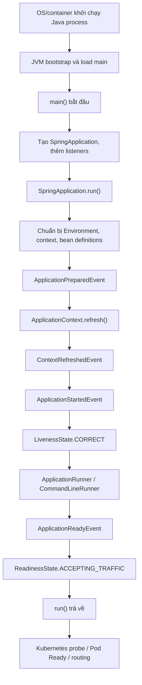

# Phân biệt thời gian dựng, thời gian JVM, `refresh()` và thời gian đến ready của Spring Boot

## 1. Bốn câu hỏi phải tách riêng

Khi một ứng dụng Spring Boot ghi:

```text
Started DemoApplication in 3.2 seconds (process running for 4.1)
```

nhưng Kubernetes chỉ đánh dấu Pod `Ready` sau 10 giây, chưa thể kết luận số liệu nào sai. Chúng đo những khoảng khác nhau. Câu hỏi “ứng dụng khởi động mất bao lâu?” phải đi kèm **điểm bắt đầu, điểm kết thúc và phạm vi**.

Trong nhóm **Đo khởi động** của Spring Boot Application Runtime, ta cần phân biệt:

1. **Thời gian dựng:** thời gian tạo đối tượng `SpringApplication` hoặc tạo và chuẩn bị `ApplicationContext` trước refresh, tùy định nghĩa được chỉ rõ.
2. **Thời gian JVM/process:** tuổi đời của JVM, bao gồm thời gian trước khi chạy code trong `main()`.
3. **Thời gian refresh:** thời gian Spring Framework xử lý `ApplicationContext.refresh()` cùng bean factory, singleton eager và hạ tầng.
4. **Thời gian đến ready:** khoảng từ mốc xuất phát đã chọn đến lúc Spring Boot hoàn tất các runners, phát `ApplicationReadyEvent` và công bố readiness; ở tầng Kubernetes còn có probe và propagation.

Một khoảng không được tùy tiện dùng thay khoảng kia. Ví dụ: **`ApplicationStartedEvent` ở sau refresh nhưng trước runners; `ApplicationReadyEvent` ở sau runners**. Vì thế log “Started” không đủ để kết luận ứng dụng đã sẵn sàng nhận traffic.

Bài này dựa trên **Spring Boot 3.3.x, Spring Framework 6.x và Java 17+**, kèm một dự án Maven có thể chạy để ghi lại các mốc.

## 2. “Dựng” là gì? Đừng nhầm với build JAR

Từ “dựng” thường được dùng cho ba hoạt động khác nhau:

| Tên hoạt động | Phạm vi đo | Có thuộc startup runtime? |
| --- | --- | --- |
| Build/package | Maven biên dịch, chạy test và đóng gói JAR hoặc container image | Không; xảy ra trước khi process Java chạy |
| Construction của `SpringApplication` | `new SpringApplication(...)` bắt đầu đến khi constructor trả về | Có, trong `main()` |
| Dựng và chuẩn bị context | Spring Boot tạo context, gắn Environment, chạy initializer, nạp bean definitions trước refresh | Có, trong `run()` |

Ví dụ:

```java
long begin = System.nanoTime();
SpringApplication application = new SpringApplication(DemoApplication.class);
long end = System.nanoTime();

System.out.println("construction-ns=" + (end - begin));
```

Đoạn này là snippet; cần class `DemoApplication` và import `SpringApplication`. Nó chỉ đo đoạn constructor, **chưa đo tạo context và cũng chưa gọi `refresh()`**.

Một báo cáo muốn nói “thời gian dựng context” nên chỉ rõ mốc, ví dụ **`ApplicationContextInitializedEvent → ApplicationPreparedEvent`** (cửa sổ chuẩn bị gần đúng). Không được gọi thời gian constructor của `SpringApplication` là toàn bộ thời gian dựng application.

`new AnnotationConfigApplicationContext()` cũng không tự tương đương toàn bộ logic Boot: Boot còn xử lý Environment, configuration sources, startup listeners và bean definitions theo đường đi của mình.

## 3. Dòng thời gian chuẩn từ JVM đến ready



Trình tự trên diễn tả một **startup thành công**. Spring Boot còn có những mốc trước refresh, bao gồm `ApplicationStartingEvent`, `ApplicationEnvironmentPreparedEvent` và `ApplicationContextInitializedEvent`. Nếu startup bị lỗi, `ApplicationFailedEvent` xuất hiện theo nhánh lỗi; không phải mọi lần khởi động đều có mốc ready.

| Mốc | Ý nghĩa | Điều chưa được bảo đảm |
| --- | --- | --- |
| JVM start | JVM process đã bắt đầu sống | Java `main()` đã chạy |
| Main entry | Ứng dụng bắt đầu tự ghi timestamp | JVM chưa chạy trước đó |
| `SpringApplication` constructed | Đối tượng bootstrap được tạo | Context đã refresh |
| `ApplicationContextInitializedEvent` | Context đã được tạo và initialized sơ bộ | Bean definitions đã load hết |
| `ApplicationPreparedEvent` | Đã chuẩn bị và sắp refresh | Context refresh hoàn tất |
| `ContextRefreshedEvent` | Context hoàn thành refresh | Runners đã hoàn tất |
| `ApplicationStartedEvent` | Boot đã qua refresh | Boot ready |
| `ApplicationReadyEvent` | Các application/command-line runners đã được gọi | Kubelet đã quan sát readiness |
| `ACCEPTING_TRAFFIC` | Boot công bố trạng thái ready | Tất cả backend ngoài luôn healthy |
| Pod Ready | Nền tảng đánh giá condition ready | Mọi external load balancer đã cập nhật |

Câu đơn giản cần thuộc: **JVM đã chạy ≠ context đã refresh ≠ Boot started ≠ Boot ready ≠ Pod được route traffic**.

## 4. Thời gian JVM: có trước `main()` và trước Boot

Java Management API cho biết JVM start time và uptime:

```java
import java.lang.management.ManagementFactory;
import java.lang.management.RuntimeMXBean;

RuntimeMXBean runtime = ManagementFactory.getRuntimeMXBean();
long jvmStartEpochMs = runtime.getStartTime();
long jvmUptimeMs = runtime.getUptime();
```

Đoạn này cần nằm trong một class/method Java hợp lệ. `getStartTime()` là timestamp theo Unix epoch milliseconds; `getUptime()` là thời gian JVM đã chạy.

Ngay tại đầu `main()`, `getUptime()` thường đã là một số dương vì JVM đã khởi động runtime, load class và chuẩn bị gọi main. Vì vậy:

```java
long mainEnteredAt = System.nanoTime();
```

**Không** đánh dấu “JVM start” mà chỉ đánh dấu “bắt đầu đo tại dòng code này”. Muốn biết tuổi đời JVM đến mốc ready, có thể lấy `getUptime()` tại `ApplicationReadyEvent`, nhưng điều đó **không bao gồm** các công đoạn trước JVM như tải container image.

### 4.1. Phân tích một dòng log thật

Ví dụ giả định:

```text
Started DemoApplication in 3.200 seconds (process running for 4.100)
```

- `in 3.200 seconds`: thời gian theo cơ chế `SpringApplication` đến **mốc started**; bao gồm việc chuẩn bị context và refresh.
- `process running for 4.100`: JVM/process đã chạy đến lúc tạo log.
- Hiệu `0.900` giây **không nhất thiết** chỉ là thời gian JVM bootstrap, vì còn code thực thi trước `run()`, class initialization và các thời điểm ghi log.

Đặc biệt, dòng log này xuất hiện trước những `ApplicationRunner`/`CommandLineRunner` chạy theo đường thông thường. Nếu runner mất 5 giây thì **mốc ready có thể muộn hơn log Started 5 giây**.

### 4.2. Thời gian từ Pod được tạo khác thời gian từ JVM start

Trong Kubernetes:

```text
Pod được tạo
→ scheduling
→ image pull, volume mount, init containers
→ container khởi chạy process
→ JVM start
→ main()
→ Spring Boot run
→ readiness accepted
→ kubelet probe thành công
→ Pod Ready
```

Nhiều bước không thuộc trách nhiệm Spring Framework. Đo `Pod.creationTimestamp → Ready` rồi ghi “Spring Boot cần 12 giây” có thể đổ lỗi sai nếu riêng image pull đã mất 7 giây.

## 5. `refresh()` làm gì và tại sao có thể chậm?

`ApplicationContext.refresh()` là một chuỗi công việc của Spring Framework, không chỉ gọi constructor của một bean. Nó có thể bao gồm:

- Chuẩn bị bean factory và context state.
- Chạy `BeanFactoryPostProcessor`, hoàn tất đăng ký/điều chỉnh bean definitions.
- Đăng ký `BeanPostProcessor`.
- Cài message source, event multicaster và hạ tầng context.
- Khởi tạo web infrastructure tùy loại context.
- Tạo các singleton **eager** và giải quyết dependency injection.
- Chạy `@PostConstruct`, init callbacks và bean lifecycle cần thiết.
- Auto-start các `SmartLifecycle` phù hợp, phát `ContextRefreshedEvent`.

Thời gian này có thể tăng bởi ORM/JPA setup, quá nhiều bean definitions, reflection/proxy, network I/O trong init callbacks, validation, connection pools hoặc embedded web server. Không nên kết luận rằng mọi mili giây của refresh là “thời gian scan annotation”.

### 5.1. Dấu mốc trước và sau refresh

Spring Boot 3.3 phát:

```text
ApplicationPreparedEvent
    ↓
refresh(...)
    ↓
ContextRefreshedEvent
    ↓
ApplicationStartedEvent
```

`ApplicationPreparedEvent` xảy ra khi bean definitions đã load nhưng refresh chưa bắt đầu; `ContextRefreshedEvent` xảy ra khi context đã refresh. `ApplicationStartedEvent` xảy ra sau đó, trước runners.

Nếu lấy:

```text
approx_refresh_window =
    timestamp(ApplicationStartedEvent)
  - timestamp(ApplicationPreparedEvent)
```

thì đây là **một khoảng gần refresh**, không phải thời gian chính xác của **chính method `refresh()`**. Nó có thể chứa dispatch listeners, logging, lifecycle bookkeeping và đoạn code nằm giữa các điểm đo.

Muốn tìm chi tiết **bên trong refresh**, dùng `ApplicationStartup`/`StartupStep`, Java Flight Recorder hoặc profiler instrument ở mức method. Không dùng timestamp của một event duy nhất rồi khẳng định “refresh mất đúng 800 ms”.

### 5.2. Lazy initialization làm giảm refresh nhưng tăng first-use latency

```properties
spring.main.lazy-initialization=true
```

có thể hoãn tạo bean ít dùng, làm refresh ngắn hơn. Nhưng khi request đầu tiên cần bean đó, chi phí chuyển sang **thời điểm request đầu**. Vì vậy, một cải tiến `application.started.time` không tự bảo đảm cải thiện first-request latency hoặc P99 khi autoscaling.

Nếu một bean là điều kiện bắt buộc để phục vụ traffic, cân nhắc `@Lazy(false)` hoặc chủ động kiểm chứng trong runner/readiness trước khi route request.

## 6. `ApplicationStartedEvent` và `ApplicationReadyEvent`

### 6.1. Started là sau refresh, trước runner

`ApplicationStartedEvent` xuất hiện khi context đã refresh, nhưng `ApplicationRunner` và `CommandLineRunner` **chưa** được gọi.

Các thành phần web hạ tầng có thể đã bind port trong refresh. Port đang mở **không** có nghĩa readiness đã chấp nhận traffic. Đây là lý do không nên dùng TCP port check thay cho readiness probe có ý nghĩa nghiệp vụ.

### 6.2. Ready là sau runner

Một runner:

```java
@Bean
ApplicationRunner preloadReferenceData() {
    return args -> Thread.sleep(5_000L);
}
```

Đây là phương thức minh họa đặt trong class cấu hình Spring, cần imports tương ứng. Boot đợi runner đồng bộ trả về; `ApplicationReadyEvent` xuất hiện **sau** nó. `ApplicationStartedEvent` không vì thế bị lùi về sau runner.

Sau `ApplicationReadyEvent`, Boot công bố `ReadinessState.ACCEPTING_TRAFFIC`. Nhưng ở tầng Kubernetes, probe và routing còn có lịch đánh giá riêng. Nếu custom health indicator chưa UP, Pod vẫn có thể NotReady dù Boot đã phát Ready event.

### 6.3. Dùng `getTimeTaken()` đúng sự kiện

Spring Boot 3.3 có:

```java
Duration startedDuration = startedEvent.getTimeTaken();
Duration readyDuration = readyEvent.getTimeTaken();
```

Đây là snippet cần biến là instance tương ứng của `ApplicationStartedEvent` và `ApplicationReadyEvent`; API có thể trả `null` nếu duration không biết.

- `startedDuration` thể hiện thời gian Boot đến **started**.
- `readyDuration` thể hiện thời gian Boot đến **ready**.
- `readyDuration - startedDuration` thường liên hệ runner và event overhead.
- Không cộng thêm `refresh()` vào `startedDuration`: **started đã bao gồm refresh**.
- Đừng gọi hiệu này là tổng CPU time của runner; event callbacks và các bước xử lý khác cũng có thể nằm trong khoảng.

### 6.4. Actuator có hai metrics riêng

Spring Boot 3.3 Actuator tự cấu hình:

| Metric | Định nghĩa |
| --- | --- |
| `application.started.time` | Thời gian đến mốc started |
| `application.ready.time` | Thời gian đến mốc ready |

Tên metric được công bố trong tài liệu chính thức. Metrics không đo thời gian image pull, Pod scheduling, probe routing hoặc một người dùng gửi request đầu tiên.

Ví dụ số đo **minh họa**:

```text
application.started.time = 2.2 s
application.ready.time   = 6.0 s
```

Khoảng chênh khoảng 3.8 giây **không thuộc riêng refresh**, mà xảy ra giữa started và ready. Điều đầu tiên nên kiểm tra là runners và synchronous listeners.

## 7. Định nghĩa mốc bằng công thức

Chọn một process và gọi:

- `t0`: JVM bắt đầu chạy.
- `t1`: Java `main()` bắt đầu.
- `t2`: `SpringApplication.run()` bắt đầu.
- `t3`: `ApplicationPreparedEvent`.
- `t4`: `ContextRefreshedEvent`.
- `t5`: `ApplicationStartedEvent`.
- `t6`: `ApplicationReadyEvent`.
- `t7`: `ReadinessState.ACCEPTING_TRAFFIC`.
- `t8`: Kubernetes/observer lần đầu xác nhận Ready.

Khi cùng clock và xác định rõ phương pháp đo:

```text
T_JVM_before_main      = t1 - t0
T_main_setup           = t2 - t1
T_prepared_to_started  = t5 - t3     (xấp xỉ cửa sổ refresh)
T_boot_started         ≈ t5 - t2
T_started_to_ready     = t6 - t5
T_boot_ready           ≈ t6 - t2
T_JVM_to_ready         = t6 - t0
T_platform_after_ready = t8 - t7     (phụ thuộc hạ tầng)
```

Dấu `≈` quan trọng: timestamp của listener và duration mà Boot nội bộ đo có thể lấy ở những vị trí hơi khác nhau. Đây là mô hình suy luận và tính duration; không được suy ra Spring Boot dùng chính các biến `t0...t8`.

### 7.1. Ví dụ tổng hợp

Các số liệu **giả định**:

| Phần | Thời gian |
| --- | ---: |
| JVM trước main | 0,4 s |
| Main setup | 0,2 s |
| Boot chuẩn bị context trước refresh | 0,6 s |
| Refresh và overhead ngay sau refresh | 1,8 s |
| Runners và overhead giữa started/ready | 2,0 s |
| Probe và routing sau Boot ready | 1,0 s |
| Scheduling/image pull trước JVM | 3,0 s |

Suy ra:

```text
Boot started      ≈ 0,6 + 1,8 = 2,4 s
Boot ready        ≈ 2,4 + 2,0 = 4,4 s
JVM-to-Boot-ready ≈ 0,4 + 0,2 + 4,4 = 5,0 s
Pod-created-ready ≈ 3,0 + 5,0 + 1,0 = 9,0 s
```

Bốn giá trị 2,4 / 4,4 / 5,0 / 9,0 đều có thể đúng vì đo **bốn ranh giới khác nhau**. Muốn so sánh hai release phải dùng cùng loại giá trị.

## 8. Ví dụ runnable: Java 17 + Spring Boot 3.3.13

Dự án dưới đây ghi lại các mốc tương ứng, có runner mô phỏng warm-up 1,5 giây để thể hiện khoảng started→ready. Dùng `spring-boot-starter-web` và Actuator để có `/readyz`, `/actuator/metrics/...` và `/actuator/startup`.

### 8.1. Cấu trúc

```text
startup-clock-demo/
├── pom.xml
└── src/main/
    ├── java/com/example/startup/StartupClockApplication.java
    └── resources/application.properties
```

### 8.2. `pom.xml`

```xml
<project xmlns="http://maven.apache.org/POM/4.0.0"
         xmlns:xsi="http://www.w3.org/2001/XMLSchema-instance"
         xsi:schemaLocation="http://maven.apache.org/POM/4.0.0 https://maven.apache.org/xsd/maven-4.0.0.xsd">
    <modelVersion>4.0.0</modelVersion>
    <parent>
        <groupId>org.springframework.boot</groupId>
        <artifactId>spring-boot-starter-parent</artifactId>
        <version>3.3.13</version>
        <relativePath/>
    </parent>
    <groupId>com.example</groupId>
    <artifactId>startup-clock-demo</artifactId>
    <version>0.0.1-SNAPSHOT</version>
    <properties>
        <java.version>17</java.version>
    </properties>
    <dependencies>
        <dependency>
            <groupId>org.springframework.boot</groupId>
            <artifactId>spring-boot-starter-web</artifactId>
        </dependency>
        <dependency>
            <groupId>org.springframework.boot</groupId>
            <artifactId>spring-boot-starter-actuator</artifactId>
        </dependency>
    </dependencies>
    <build>
        <plugins>
            <plugin>
                <groupId>org.springframework.boot</groupId>
                <artifactId>spring-boot-maven-plugin</artifactId>
            </plugin>
        </plugins>
    </build>
</project>
```

### 8.3. `StartupClockApplication.java`

Tạo file `src/main/java/com/example/startup/StartupClockApplication.java`:

```java
package com.example.startup;

import java.lang.management.ManagementFactory;
import java.time.Duration;
import java.util.concurrent.TimeUnit;
import java.util.concurrent.atomic.AtomicLong;

import org.springframework.boot.ApplicationRunner;
import org.springframework.boot.SpringApplication;
import org.springframework.boot.autoconfigure.SpringBootApplication;
import org.springframework.boot.availability.AvailabilityChangeEvent;
import org.springframework.boot.availability.ReadinessState;
import org.springframework.boot.context.event.ApplicationContextInitializedEvent;
import org.springframework.boot.context.event.ApplicationEnvironmentPreparedEvent;
import org.springframework.boot.context.event.ApplicationPreparedEvent;
import org.springframework.boot.context.event.ApplicationReadyEvent;
import org.springframework.boot.context.event.ApplicationStartedEvent;
import org.springframework.boot.context.event.ApplicationStartingEvent;
import org.springframework.boot.context.metrics.buffering.BufferingApplicationStartup;
import org.springframework.context.ApplicationListener;
import org.springframework.context.annotation.Bean;
import org.springframework.context.event.ContextRefreshedEvent;
import org.springframework.context.event.EventListener;
import org.springframework.core.env.Environment;

@SpringBootApplication
public class StartupClockApplication {

    private static final AtomicLong PREPARED = new AtomicLong(-1L);
    private static final AtomicLong STARTED = new AtomicLong(-1L);

    public static void main(String[] args) {
        System.out.println("milestone=main");
        System.out.println("jvm-uptime-at-main-ms="
                + ManagementFactory.getRuntimeMXBean().getUptime());

        long startConstruct = System.nanoTime();
        SpringApplication app = new SpringApplication(StartupClockApplication.class);
        long endConstruct = System.nanoTime();

        System.out.println("springapplication-construction-ms="
                + elapsedMs(startConstruct, endConstruct));

        app.addListeners(
                (ApplicationListener<ApplicationStartingEvent>)
                        event -> System.out.println("milestone=starting"),
                (ApplicationListener<ApplicationEnvironmentPreparedEvent>)
                        event -> System.out.println("milestone=environment-prepared"),
                (ApplicationListener<ApplicationContextInitializedEvent>)
                        event -> System.out.println("milestone=context-initialized"),
                (ApplicationListener<ApplicationPreparedEvent>)
                        event -> {
                            PREPARED.set(System.nanoTime());
                            System.out.println("milestone=prepared");
                        },
                (ApplicationListener<ApplicationStartedEvent>)
                        event -> {
                            long now = System.nanoTime();
                            STARTED.set(now);
                            System.out.println("milestone=started");
                            System.out.println("boot-started-ms="
                                    + durationMs(event.getTimeTaken()));
                            System.out.println("approx-prepared-to-started-ms="
                                    + elapsedMs(PREPARED.get(), now));
                        },
                (ApplicationListener<ApplicationReadyEvent>)
                        event -> {
                            long now = System.nanoTime();
                            System.out.println("milestone=ready");
                            System.out.println("boot-ready-ms="
                                    + durationMs(event.getTimeTaken()));
                            System.out.println("approx-started-to-ready-ms="
                                    + elapsedMs(STARTED.get(), now));
                            System.out.println("jvm-uptime-at-ready-ms="
                                    + ManagementFactory.getRuntimeMXBean()
                                                       .getUptime());
                        }
        );

        app.setApplicationStartup(new BufferingApplicationStartup(2048));
        app.run(args);
        System.out.println("milestone=run-returned");
    }

    @EventListener
    public void contextRefreshed(ContextRefreshedEvent event) {
        System.out.println("milestone=context-refreshed");
    }

    @EventListener
    public void readiness(AvailabilityChangeEvent<ReadinessState> event) {
        if (event.getState() == ReadinessState.ACCEPTING_TRAFFIC) {
            System.out.println("milestone=readiness-accepting");
        }
    }

    @Bean
    ApplicationRunner demonstration(Environment environment) {
        return args -> {
            long delay = environment.getProperty(
                    "demo.warmup-ms", Long.class, 1_500L);
            if (delay < 0L || delay > 30_000L) {
                throw new IllegalArgumentException(
                        "warmup must be between 0 and 30000 milliseconds");
            }
            System.out.println("milestone=runner-begin");
            Thread.sleep(delay);
            System.out.println("milestone=runner-end");
        };
    }

    private static long elapsedMs(long from, long to) {
        return TimeUnit.NANOSECONDS.toMillis(to - from);
    }

    private static String durationMs(Duration duration) {
        return duration == null
                ? "unknown" : Long.toString(duration.toMillis());
    }
}
```

#### Tại sao dùng những API này?

- `ManagementFactory.getRuntimeMXBean().getUptime()` đo tuổi đời JVM ở main và ready.
- `System.nanoTime()` tính **duration cục bộ** theo monotonic clock; không phải timestamp Unix.
- `new SpringApplication` được đo riêng, không đánh tráo với `refresh()`.
- Các early listeners đăng ký **trước** `run(args)` nên nhận events xảy ra trước khi context có bean listeners.
- `ApplicationPreparedEvent` lấy mẫu ngay trước khu vực refresh; `ApplicationStartedEvent` nằm sau refresh.
- `ApplicationStartedEvent.getTimeTaken()` và `ApplicationReadyEvent.getTimeTaken()` lấy duration nội bộ Boot.
- `ApplicationRunner` chờ 1,5 giây **sau started** và trước ready.
- `ReadinessState.ACCEPTING_TRAFFIC` được công bố sau ready event.
- `BufferingApplicationStartup` ghi startup steps cho endpoint `/actuator/startup`.

Các giá trị duration bằng ms được in ra từ code sẽ thay đổi theo môi trường; không có bộ số milliseconds bất biến cho mọi máy.

### 8.4. `application.properties`

Tạo `src/main/resources/application.properties`:

```properties
spring.main.banner-mode=off
server.port=8080
demo.warmup-ms=1500

management.endpoints.web.exposure.include=health,info,metrics,startup
management.endpoint.health.probes.enabled=true
management.endpoint.health.probes.add-additional-paths=true
```

Trong production, đừng expose `/actuator/startup` công khai vì có thể tiết lộ tên beans/class và chi tiết cấu hình. Ví dụ trên nhằm kiểm thử local hoặc môi trường đã bảo vệ actuator endpoints.

### 8.5. Chạy

Trong thư mục chứa `pom.xml`:

```bash
mvn package
java -jar target/startup-clock-demo-0.0.1-SNAPSHOT.jar
```

Nếu có Maven Wrapper:

```bash
./mvnw package
```

Windows PowerShell nếu có wrapper:

```powershell
.\mvnw.cmd package
```

Dự án cần JDK 17+, Maven và dependencies Spring Boot trên classpath. Nó không phải file Java thuần có thể biên dịch với `javac` mà không có thư viện Spring.

### 8.6. Output kỳ vọng

**Chỉ lọc những dòng bắt đầu bằng `milestone=`**, thứ tự trong một lần khởi động thành công thông thường là:

```text
milestone=main
milestone=starting
milestone=environment-prepared
milestone=context-initialized
milestone=prepared
milestone=context-refreshed
milestone=started
milestone=runner-begin
milestone=runner-end
milestone=ready
milestone=readiness-accepting
milestone=run-returned
```

Dòng duration và logging framework sẽ xen giữa; chúng chứa những **giá trị thực tế**, không nên hard-code expected time. Ví dụ `boot-ready-ms` có thể tăng nếu warm-up tăng, trong khi `boot-started-ms` ít bị ảnh hưởng bởi riêng runner đó.

### 8.7. Thử nghiệm đối chứng để thấy rõ hai khoảng

Thử chạy:

```bash
java -jar target/startup-clock-demo-0.0.1-SNAPSHOT.jar --demo.warmup-ms=5000
```

Giá trị warm-up chuyển từ 1500 ms sang 5000 ms. Kỳ vọng:

- Thời gian `runner-begin → runner-end` tăng khoảng 3,5 giây.
- `approx-started-to-ready-ms` và `boot-ready-ms` thường tăng gần tương ứng.
- `boot-started-ms` không trực tiếp bao gồm runner nên không nên tăng **do chính Thread.sleep trong runner**.
- `approx-prepared-to-started-ms` không bị kéo dài trực tiếp bởi runner.
- JVM uptime tại ready cũng tăng.

Đây là xu hướng cần kiểm chứng bằng nhiều lần chạy; GC, CPU, cache, class loading và môi trường I/O tạo nhiễu. Không lấy một lượt đo để kết luận chính xác từng mili giây.

## 9. Truy vấn Actuator metrics và readiness

Khi chạy xong startup:

```bash
curl -s http://localhost:8080/actuator/metrics/application.started.time
curl -s http://localhost:8080/actuator/metrics/application.ready.time
```

Actuator phản hồi JSON gồm metric name, measurements, tags và có thể có base unit. Đọc unit thực tế trong response; không tự giả định đó luôn là milliseconds.

Đối chiếu với endpoint:

```bash
curl -i http://localhost:8080/readyz
curl -i http://localhost:8080/livez
```

Vì ví dụ đã bật `management.endpoint.health.probes.add-additional-paths=true`, các đường `/readyz` và `/livez` nằm trên cổng HTTP chính. Khi runner đã xong và không có health contributor thất bại, readiness thường trả HTTP 200. Trong lúc runner chưa hoàn thành, nếu web server đã có thể trả HTTP response, readiness có thể trả 503.

### 9.1. Actuator metric chưa phải Pod Ready time

`application.ready.time` đo mốc Boot, không bao gồm Kubernetes scheduling, image pull hoặc chu kỳ readiness probe. Nếu metric 4 giây mà Pod Ready 12 giây, hãy tìm thành phần chênh trong lifecycle của Pod và các health contributors trước khi nói “refresh chậm”.

### 9.2. Phân biệt ready và first request

Một API có global lazy hoặc cache chưa warm có thể đạt ready rất sớm nhưng request đầu chậm. Vì thế, khi báo cáo hiệu năng runtime, nên có cả **cold first-request latency** và **steady-state latency**, không chỉ một chỉ số startup.

## 10. StartupStep: đi sâu hơn một cặp event

`ApplicationStartup` và `StartupStep` của Spring cho phép phân rã các bước startup. Spring Boot 3.3 hỗ trợ `BufferingApplicationStartup` để lưu events trong bộ đệm và xem qua Actuator:

```java
app.setApplicationStartup(new BufferingApplicationStartup(2048));
```

Dòng này **phải nằm trước** `app.run(args)`; nó đã được đưa vào ví dụ. Khi service đã chạy:

```bash
curl -s http://localhost:8080/actuator/startup
```

Endpoint trả timeline có các trường như `startTime`, `endTime`, `duration`, `startupStep.name`, `startupStep.id`, `startupStep.parentId` và tags. Một số bước có thể liên quan `spring.beans.instantiate`, context refresh hoặc Boot application starting, tùy phiên bản và thành phần.

### 10.1. Đừng cộng bừa `duration`

Các startup steps có thể **lồng nhau**. Nếu step A bao trùm step B, cộng duration A+B sẽ đếm B hai lần. Phải xem `parentId` và khoảng start/end thực tế, hoặc dùng flame graph/timeline tương ứng.

### 10.2. GET và POST khác nhau

- `GET /actuator/startup`: lấy snapshot của những steps đang được giữ.
- `POST /actuator/startup`: lấy và **drain** buffer theo contract endpoint.

Một lần POST có thể khiến lần lấy sau không còn cùng tập steps. Hãy chọn đúng cách thu thập cho benchmark và tránh expose endpoint công khai.

### 10.3. Bộ đệm hữu hạn

`BufferingApplicationStartup(2048)` có giới hạn số bước lưu. Một ứng dụng có rất nhiều beans có thể tạo số bước lớn hơn dung lượng. Nếu cần điều tra sâu, tăng dung lượng có kiểm soát hoặc dùng JFR. Đừng suy luận những steps không có trong buffer chắc chắn chưa từng chạy.

## 11. JFR: khi cần tách chi phí Spring khỏi JVM

Nếu câu hỏi là “startup chậm do bean lifecycle hay GC/class loading?”, chỉ hai event Boot không đủ. Spring Framework có `FlightRecorderApplicationStartup`:

```java
import org.springframework.core.metrics.jfr.FlightRecorderApplicationStartup;

app.setApplicationStartup(new FlightRecorderApplicationStartup());
```

Đây là snippet thay cho việc sử dụng `BufferingApplicationStartup`, không bật cả hai bằng hai lần `setApplicationStartup` rồi kỳ vọng dữ liệu được gom chung.

Chạy JFR:

```bash
java -XX:StartFlightRecording=filename=startup.jfr,duration=30s -jar target/startup-clock-demo-0.0.1-SNAPSHOT.jar
```

Phân tích file `startup.jfr` bằng JDK Mission Control hoặc công cụ JFR phù hợp. JFR có thể tương quan Spring startup steps với GC, class loading, JIT, CPU và allocation events.

`duration=30s` là **thời gian ghi recording**, không phải timeout của Boot startup hay readiness. Profiling có overhead; khi so sánh performance phải ghi rõ điều kiện đo.

## 12. Mốc ready của Spring khác mốc ready của nền tảng

| Chỉ số | Ai quyết định? | Điều được đo |
| --- | --- | --- |
| Boot started | Spring Boot | Sau refresh, trước runners |
| Boot ready | Spring Boot | Sau runners |
| Readiness accepting | Spring Availability | Boot chấp nhận traffic theo trạng thái |
| HTTP readiness probe success | App + network + health group | Endpoint trả kết quả thành công ở thời điểm probe |
| Pod `Ready=True` | Kubelet/Kubernetes | Pod condition được cập nhật |
| Deployment available | Deployment controller | Replica availability policy |
| First useful response | API client & business checks | Request nghiệp vụ đầu thực sự thành công |
| End-to-end traffic ready | Load balancer/ingress/client | Traffic có thể route theo điều kiện thực |

Có thể rơi vào trạng thái **JVM live, Boot ready nhưng Pod NotReady** nếu custom readiness health group đang OUT_OF_SERVICE. Ngược lại, một TCP port có thể mở trước runner xong, khi Boot vẫn đang refusing traffic.

Một `ApplicationRunner` chỉ submit task chạy nền rồi trả về sẽ **không làm Boot đợi task đó**. Nếu background warm-up là bắt buộc, giữ runner đồng bộ có deadline hoặc biểu diễn điều kiện qua custom readiness health indicator.

## 13. Đo thời gian quan sát từ bên ngoài

### 13.1. Poll `/readyz` không phải đo chính xác refresh

Một script có thể đo từ **lúc lệnh spawn process được gọi** đến **lần đầu nhận response readiness 200**. Kết quả chứa thời gian OS scheduling, JVM startup, Boot startup, HTTP/network và **độ trễ chu kỳ polling**.

Nếu poll mỗi 500 ms, thời điểm ready thực sự có thể nằm ở bất kỳ điểm nào giữa hai lần poll. Vì vậy độ chính xác quan sát bị giới hạn bởi cả polling cadence và HTTP delay. Không lấy kết quả đó trừ trực tiếp `ApplicationStartedEvent` rồi khẳng định chính xác runner mất từng mili giây.

### 13.2. `time java -jar` với web server

`time java -jar app.jar` cho web server chạy lâu thường đo **thời gian toàn process tồn tại**, không phải startup. Nếu server chạy 30 phút rồi mới Ctrl+C, kết quả lệnh `time` không cho biết server đã ready ở giây thứ 4.

Đo bên ngoài bằng observer/probe có ranh giới rõ, và bên trong bằng event/metrics của Boot để đối chiếu.

### 13.3. Monotonic clock và wall clock

`System.nanoTime()` dùng cho **elapsed duration** trong một JVM, không phải Unix timestamp để so giữa nhiều JVM. `Instant.now()` hữu ích cho log timestamp/correlation nhưng wall clock có thể chịu NTP adjustments.

Nếu trừ timestamp giữa node A và node B, phải tính sai lệch clock và overhead truyền dữ liệu. Trong hệ thống phân tán, dùng tracing/observer có thiết kế clock và error bounds phù hợp.

## 14. Những hiểu nhầm thường gặp

### 14.1. “`Started` nghĩa là ready”

Sai: started xuất hiện trước runner. Trong giai đoạn runner, web port có thể mở và liveness có thể đã CORRECT trong khi readiness vẫn refusing.

### 14.2. “`process running for` chính là thời gian refresh”

Sai: đó là tuổi đời JVM tại mốc log, bao gồm nhiều phần ngoài refresh.

### 14.3. “Đo `new SpringApplication()` là đo toàn bộ startup”

Sai: đó chỉ là constructor của đối tượng bootstrap, không phải mọi công đoạn của `run()`.

### 14.4. “Lấy thời gian giữa Prepared và Started là exact refresh”

Không chính xác. Khoảng đó có thể gồm event dispatch/logging và overhead trước/sau refresh. Dùng StartupStep/JFR nếu cần phân rã chi tiết.

### 14.5. “Ready đã tới thì mọi backend đều hoạt động”

Không được bảo đảm. Boot availability không tự kiểm tra mọi external service; custom health indicators và các chính sách nghiệp vụ vẫn cần thiết.

### 14.6. “Ready sớm hơn nghĩa là request đầu nhanh hơn”

Không chắc. Lazy initialization có thể chuyển công việc sang request đầu, làm cold latency tăng.

### 14.7. “StartupStep duration cộng lại là tổng Boot startup”

Không. Steps lồng nhau, cộng thẳng có thể double-count.

### 14.8. “Mọi ContextRefreshedEvent đều thuộc context chính”

Không. Có thể có management/child contexts và event propagation. Cần kiểm tra source context.

### 14.9. “Tắt log startup thì sự kiện Spring biến mất”

`spring.main.log-startup-info=false` ảnh hưởng startup INFO logging, không đồng nghĩa `ApplicationStartedEvent`, `ApplicationReadyEvent` hoặc metrics tự động biến mất.

### 14.10. “Pod Ready trễ chắc do Spring chậm”

Chưa chắc: image pull, init container, startup/readiness probe, CPU throttling hoặc load balancer propagation đều có thể tạo khoảng chênh. Đọc đúng layer.

### 14.11. “Runner ở background vẫn giữ readiness”

Không nếu runner chỉ gửi task rồi trả về. Boot không tự đợi mọi background future. Cần custom readiness nếu nghiệp vụ đòi hỏi.

### 14.12. “Một lần đo 2,1 giây chứng minh bản mới nhanh hơn 2,3 giây”

Chưa đủ. Nhiễu từ JDK, GC, warm filesystem cache, JVM JIT, network, CPU quota và tracing overhead cần được kiểm soát bằng nhiều lần chạy.

## 15. Checklist benchmark và cách chọn phương pháp đo

| Mục đích | Thước đo nên dùng | Ghi chú |
| --- | --- | --- |
| Kiểm tra JVM chậm trước `main()` | `RuntimeMXBean.getUptime()` tại main | Không đo image pull |
| Đo constructor `SpringApplication` | `System.nanoTime()` kẹp constructor | Không đo context startup |
| Định vị preparation trước refresh | Early Spring events | Khoảng giữa events là đo gián tiếp |
| Ước lượng refresh window | Prepared → Started | **Approx**, có overhead |
| Đo Boot started | `ApplicationStartedEvent.getTimeTaken()` | Sau refresh, trước runners |
| Đo Boot ready | `ApplicationReadyEvent.getTimeTaken()` | Sau runners |
| Quan sát metrics chính thức | `application.started.time` / `application.ready.time` | Cần Actuator/meter registry |
| Đào sâu bean startup | `ApplicationStartup`/`StartupStep`, JFR | Xem nested steps |
| Đo Pod Ready | Kubernetes Pod condition / probes | Bao gồm platform scheduling |
| Đo first-request cold latency | Synthetic business request | Gồm lazy và external I/O |

Một quy trình hợp lý:

1. Ghi chính xác môi trường: Boot/JDK version, profiles, classpath, JVM flags, CPU/memory limits, hạ tầng, startup logging.
2. Quy định **mục tiêu**: giảm Boot started, Boot ready, Pod Ready hay first useful response.
3. Chạy baseline ít nhất một tập mẫu đủ để thấy phân tán.
4. Thu Boot started/ready metrics và JVM uptime; nếu started/ready chênh lớn, đo runner.
5. Nếu refresh window lớn, bật StartupStep hoặc JFR để tìm phần tốn thời gian.
6. Nếu chỉ Pod Ready lớn, kiểm tra scheduling, image pull, init containers, probes và routing.
7. Nếu lazy init, kiểm tra cold request và warm request, không chỉ startup.
8. Chạy lại điều kiện tương đương, báo median và tail/variance chứ không chọn một con số đẹp nhất.
9. Không để instrumentation/logging nặng làm sai đáng kể phép đo.
10. Chỉ kết luận tối ưu thành công khi đúng SLO và readiness/correctness nghiệp vụ.

## 16. Tình huống luyện tập

**Câu 1.** Boot log `Started ... in 2.5s`, runner mất 4s. Boot ready có xảy ra ở giây 2.5 không?

**Đáp án:** Không. Started trước runner, ready sau runner; Boot ready có thể khoảng 6.5s tính từ mốc Boot bắt đầu, tùy overhead.

**Câu 2.** JVM uptime tại `main()` là 300 ms. Có phải lệnh đo sai?

**Đáp án:** Không. JVM đã thực hiện bootstrap và load class trước `main()`.

**Câu 3.** Constructor `SpringApplication` mất 5ms. Có thể báo startup 5ms?

**Đáp án:** Không. Đó là thời gian dựng đối tượng bootstrap; context preparation, refresh và runners chưa được tính.

**Câu 4.** Prepared→Started mất 1.8s. Có được gọi exact `refresh()` 1.8s?

**Đáp án:** Không. Đó là cửa sổ gần refresh, gồm overhead; cần profiler/StartupStep để đo chi tiết.

**Câu 5.** Pod Ready mất 12s, application.ready.time là 4s. Phần 8s có chắc thuộc Spring?

**Đáp án:** Không. Có thể trước JVM hoặc thuộc probes/platform.

**Câu 6.** Chuyển runner đồng bộ sang `CompletableFuture.runAsync` khiến ready giảm. Work cần cho mọi request vẫn chưa xong, vậy đã cải thiện thực sự chưa?

**Đáp án:** Chưa chắc. Nếu công việc bắt buộc, có nguy cơ traffic vào app chưa đủ điều kiện. Cần readiness gate hoặc giữ task đồng bộ.

**Câu 7.** ContextRefreshedEvent xuất hiện rồi mà `/readyz` vẫn trả 503. Có bất thường không?

**Đáp án:** Không. Runner chưa xong hoặc readiness contributor còn OUT_OF_SERVICE.

**Câu 8.** `application.started.time=2s`, `application.ready.time=6s`; có nên tối ưu bean factory đầu tiên?

**Đáp án:** Chưa. Hãy kiểm tra khoảng started→ready 4s, thường có runner hoặc listeners sau refresh.

**Câu 9.** Một số StartupStep nằm trong step cha; tổng tất cả durations là 15s, Boot ready là 6s. Sai ở đâu?

**Đáp án:** Khả năng double-count do nested steps; không cộng thẳng những duration chồng nhau.

**Câu 10.** Bật lazy làm Boot started nhanh hơn 30%, nhưng request đầu chậm hơn 1s. Có mâu thuẫn không?

**Đáp án:** Không. Chi phí khởi tạo bị chuyển sang khi bean lần đầu được dùng.

**Câu 11.** `time java -jar` in 40 phút vì tắt server sau 40 phút. Con số này có đo startup không?

**Đáp án:** Không, đó là lifetime của process đến exit.

**Câu 12.** Vì sao không dùng `System.nanoTime()` giữa các Pod để đo Pod Ready?

**Đáp án:** `nanoTime` có mốc tương đối riêng, không phải đồng hồ epoch đồng nhất giữa nhiều process.

## 17. Nguồn chính thức

- [Spring Boot 3.3 — SpringApplication, Application Events và Startup Tracking](https://docs.spring.io/spring-boot/3.3/reference/features/spring-application.html): các mốc lifecycle, runners, readiness, `BufferingApplicationStartup` và JFR.
- [Spring Boot 3.3 — Actuator Metrics](https://docs.spring.io/spring-boot/3.3/reference/actuator/metrics.html): `application.started.time` và `application.ready.time`.
- [Spring Boot 3.3 — Startup Actuator API](https://docs.spring.io/spring-boot/3.3/api/rest/actuator/startup.html): GET snapshot, POST drain và schema startup steps.
- [Spring Boot 3.3 — Endpoints](https://docs.spring.io/spring-boot/3.3/reference/actuator/endpoints.html): exposure và bảo mật các endpoints.
- [Spring Boot 3.3 — `ApplicationStartedEvent`](https://docs.spring.io/spring-boot/3.3/api/java/org/springframework/boot/context/event/ApplicationStartedEvent.html): mốc sau refresh và `getTimeTaken()`.
- [Spring Boot 3.3 — `ApplicationReadyEvent`](https://docs.spring.io/spring-boot/3.3/api/java/org/springframework/boot/context/event/ApplicationReadyEvent.html): mốc sau runners và `getTimeTaken()`.
- [Spring Boot 3.3 — `SpringApplicationRunListener`](https://docs.spring.io/spring-boot/3.3/api/java/org/springframework/boot/SpringApplicationRunListener.html): callback `started` và `ready`.
- [Java 17 — `RuntimeMXBean`](https://docs.oracle.com/en/java/javase/17/docs/api/java.management/java/lang/management/RuntimeMXBean.html): JVM start time và uptime.
- [Java 17 — `System.nanoTime()`](https://docs.oracle.com/en/java/javase/17/docs/api/java.base/java/lang/System.html#nanoTime()): đồng hồ đo thời lượng.

## 18. Kết luận

Không có duy nhất một con số “thời gian khởi động Spring Boot”. **Dựng** là tạo/bootstrap object hoặc context preparation; **JVM time** gồm thời gian trước `main`; **refresh** là công việc Spring Framework trên container; **started** xuất hiện sau refresh nhưng trước runners; **ready** xuất hiện sau runners và trước availability accepting. Ở ngoài JVM, Pod Ready còn chịu ảnh hưởng của hạ tầng và probe.

Khi cần số liệu có giá trị, luôn ghi **tên mốc và điểm xuất phát**: `jvm_uptime_at_main`, `springapplication_construction`, `prepared_to_started_approx`, `application.started.time`, `application.ready.time`, `pod_ready`, `first_request_latency`. Dùng `ApplicationStartup`/JFR để giải thích refresh, đo lặp lại trong cùng điều kiện và tối ưu đúng giai đoạn kéo dài thay vì so sánh những con số không đồng nhất.