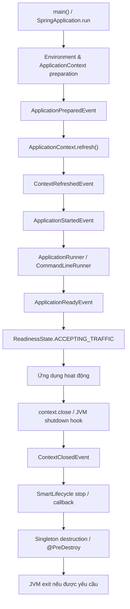

# Chọn kiểm thử thành phần, `ApplicationContext` hay tiến trình thực khi kiểm thử vòng đời Spring Boot

## 1. Câu hỏi chính: muốn chứng minh hành vi ở ranh giới nào?

“Kiểm thử vòng đời” của Spring Boot không phải một loại test duy nhất. Tùy yêu cầu, chúng ta có thể cần chứng minh:

- Một component có phản ứng đúng với `start()`, `stop()` và callback khi được gọi riêng lẻ hay không.
- Spring có tạo bean, inject dependency, gọi init/destroy callback và **điều phối thứ tự** start/stop chính xác hay không.
- `SpringApplication.run(...)` có phát đúng lifecycle events, gọi runners và đạt readiness hay không.
- Khi **một JVM thật** khởi chạy bằng `java -jar`, nó có trả exit code đúng cho hệ điều hành, chạy shutdown hooks và thoát trong thời gian cho phép hay không.
- Khi container thực nhận `SIGTERM`, ingress/Kubernetes có ngừng gửi request mới, cho request cũ drain và không phải dùng `SIGKILL` hay không.

Đáp án không thể luôn là “cứ viết `@SpringBootTest`”. Một unit test chạy trong cùng JVM của JUnit không thể chứng minh mã thoát do `System.exit(...)` trả cho OS. Ngược lại, mỗi lần cần kiểm tra một `AtomicBoolean` mà khởi chạy Docker sẽ làm test chậm, khó định vị lỗi và dễ flaky.

Hãy chọn **cấp kiểm thử nhỏ nhất chứng minh được hợp đồng cần kiểm tra**, rồi thêm test ở cấp cao hơn cho những thuộc tính mà cấp nhỏ không thể quan sát. Đây là nguyên tắc “component → context → process”, không phải bắt buộc mọi feature đều phải có đủ ba cấp.

Bài áp dụng cho **Java 17+, Spring Framework 6.x, Spring Boot 3.3.x**. Ví dụ đầy đủ dùng JUnit Jupiter, AssertJ, Maven Surefire và Maven Failsafe.

## 2. Ba ranh giới kiểm thử

### 2.1. Kiểm thử thành phần (*component/unit test*)

Kiểm thử một class Java được tạo trực tiếp bằng `new`, dùng mock, fake, stub hoặc các cộng tác viên thực đơn giản. Nó không yêu cầu tạo Spring `ApplicationContext`.

Những khẳng định phù hợp:

- `start()` chuyển `isRunning()` từ `false` sang `true`.
- Gọi `start()` hai lần không tạo hai worker hoặc hai kết nối nếu hợp đồng idempotent.
- `stop(Runnable callback)` chỉ gọi callback sau cleanup, đúng một lần.
- Cancellation token được quan sát; `InterruptedException` được propagate hoặc cờ ngắt được khôi phục.
- Lệnh stop không chạy cleanup hai lần.
- Khi dependency giả ném exception, component release tài nguyên ở `finally`.

**Giới hạn:** test trực tiếp `component.start()` không chứng minh **Spring tự gọi start khi refresh**, không chứng minh phase/dependency của `DefaultLifecycleProcessor`, cũng không chứng minh JVM shutdown hook hay process exit code.

### 2.2. Kiểm thử context (*Spring integration/context test*)

Khởi tạo **một container Spring thật** — ví dụ `AnnotationConfigApplicationContext`, `ApplicationContextRunner` hoặc `@SpringBootTest` — để kiểm tra việc Framework quản lý vòng đời bean.

Những khẳng định phù hợp:

- Bean definition được đăng ký, dependency injection thành công.
- Singleton được tạo/lazy đúng dự kiến; init callback xuất hiện đúng thời điểm.
- `SmartLifecycle` auto-start trong refresh theo phase và quan hệ `depends-on`.
- `ConfigurableApplicationContext.close()` kích hoạt `ContextClosedEvent`, stop callbacks và singleton destruction.
- `@PreDestroy`, `DisposableBean`, `@Bean(destroyMethod=...)` được gọi đúng trong context được quản lý.
- Cấu hình auto-configuration hoặc profiles chọn đúng bean.
- Startup failure xảy ra khi thiếu bean/property bắt buộc.
- Readiness/event của Boot được quan sát khi khởi chạy qua đường `SpringApplication` thích hợp.

**Giới hạn:** `context.close()` không phải `SIGTERM` của OS. Một test context chạy trong cùng JVM JUnit **không** chứng minh exit status của tiến trình, PID 1 signal forwarding, hoặc hành vi thực của reverse proxy/Kubernetes.

### 2.3. Kiểm thử tiến trình thực (*process/end-to-end lifecycle test*)

Khởi chạy một JVM mới, thường thông qua `ProcessBuilder` hoặc `java -jar`, rồi quan sát:

- Startup thật qua `main()`, executable JAR và configuration/environment.
- `ApplicationReadyEvent` / readiness của ứng dụng thực.
- OS exit code khi `main` gọi `System.exit(...)`.
- Tài nguyên/threads có ngăn JVM kết thúc không.
- Log do child process in ra, exit duration và đường failure.
- Hành vi graceful shutdown khi nhận tín hiệu phù hợp trong môi trường hỗ trợ.

Nếu yêu cầu còn liên quan Docker/Kubernetes, cần chạy ở **container/orchestrator thật**, vì một JVM mới được spawn bằng `ProcessBuilder` vẫn **không** tự mô phỏng ingress routing, `terminationGracePeriodSeconds` hoặc `docker stop`.

**Đổi lại:** process test thường chậm hơn, phụ thuộc JDK/JAR/port/env và cần thiết kế timeout, dọn child process và thu log cẩn thận.

## 3. Bảng chọn nhanh theo yêu cầu

| Muốn chứng minh điều gì? | Cấp tối thiểu phù hợp | Có cần nâng cấp? |
| --- | --- | --- |
| `stop()` gọi cleanup đúng một lần | Component | Context nếu cleanup được Spring gọi |
| `isRunning()` thay đổi chính xác | Component | Context nếu phụ thuộc auto-start |
| `stop(Runnable)` callback sau khi drain | Component với fake/latch | Context để kiểm tra processor thực sự đợi |
| `getPhase()` trả đúng số | Component | Context để kiểm tra thứ tự thực tế |
| Phase thấp start trước, phase cao stop trước | Context | Process nếu phụ thuộc shutdown hook |
| `@DependsOn` thắng thứ tự phase | Context | Không cần process nếu chỉ xét BeanFactory |
| Bean chỉ bị destroy khi context owner đóng | Context | Nhiều contexts nếu parent/child ownership |
| `ApplicationRunner` chạy trước ready | Boot context / `@SpringBootTest` | Process nếu kiểm tra entrypoint/OS |
| Log `ApplicationReadyEvent` | Boot context | Process nếu cần stdout từ JAR |
| `System.exit(23)` trả status 23 | Process riêng | Docker/K8s nếu launcher có wrapper |
| JVM nhận `SIGTERM` khi `docker stop` | Container thật | K8s nếu phải đo Pod termination |
| Pod không còn nhận traffic mới trong rollout | Kubernetes + ingress/probes | Quan sát client end-to-end |
| Một HTTP request đang xử lý được graceful drain | Web context với server thật | Container/platform để kiểm tra timeout |
| `@PostConstruct` ném lỗi làm context fail | Context | Process nếu cần exit code failure |
| `ApplicationContextRunner` chọn đúng auto-config | Context nhỏ | Boot full nếu có tương tác starters |
| Dữ liệu không ghi trùng sau force-kill | Process + storage/broker thật | Chaotic/kill test và idempotency |

Đừng dùng nhãn “integration test” một cách mơ hồ. Hãy ghi **context integration** hoặc **real-process integration** nếu nó ảnh hưởng đến bằng chứng mà test có thể cung cấp.

## 4. Những mốc vòng đời quan trọng cần đặt assertion

Trong đường `SpringApplication.run(...)` thành công điển hình:



Đây là **mô hình khái quát** để chọn test. `SpringApplication.run()` trong Boot còn phát nhiều sự kiện sớm hơn; khi startup fail có `ApplicationFailedEvent`, và khi chạy container có thể có tín hiệu OS và thời hạn dừng riêng.

Các điểm dễ nhầm:

- `ContextRefreshedEvent` **không đồng nghĩa** Boot ready: runner có thể còn đang chạy.
- `ApplicationStartedEvent` trước runner; `ApplicationReadyEvent` sau runner.
- `ConfigurableApplicationContext.stop()` không thay `close()`: stop điều phối lifecycle, còn close kết thúc context và hủy managed singleton.
- `@PreDestroy`/destroy callbacks khác `SmartLifecycle.stop(Runnable)`; một test chỉ chứng minh stop mà không đóng context sẽ không kiểm tra toàn bộ cleanup.
- `ApplicationContext.close()` trong test không bảo đảm JVM hoặc OS process cũng kết thúc.
- Gọi `System.exit()` trong JUnit cùng JVM có thể giết cả test runner: muốn xác nhận mã thoát phải dùng **process riêng**.

## 5. Chọn component test khi logic không cần container

### 5.1. Điều kiện phù hợp

Nên bắt đầu bằng component test khi input/output có thể diễn đạt bằng Java thuần:

- Một state machine `NEW → RUNNING → STOPPED`.
- Idempotency của `start` và `stop`.
- Cleanup khi `start` thất bại giữa chừng.
- Callback stop hoàn thành sau task.
- Cancellation qua `Future`, `Thread.interrupt()` hoặc token.
- Đếm số lần resource được close.

Điểm mạnh là test nhanh và nhất quán. Bạn có thể kiểm soát thời gian bằng fake clock và concurrency bằng `CountDownLatch` thay vì `Thread.sleep(1000)`.

### 5.2. Test bất đồng bộ phải có tín hiệu hoàn tất

Nếu một worker dừng không đồng bộ:

```java
@Override
public void stop(Runnable callback) {
    requestStop();
    callback.run();
}
```

đây là **mẫu sai** khi `requestStop()` chỉ phát tín hiệu, task vẫn còn chạy. Nó khiến Spring lifecycle processor tưởng đã stop xong.

Unit test đúng phải xác nhận callback **chưa** được gọi trong lúc task còn trong critical section, sau đó **được gọi đúng một lần** khi task thực sự dừng, với deadline hữu hạn.

Dùng fake task/latch có thể chủ động chặn và giải phóng, tránh đoán thread đã đến bước nào bằng `Thread.sleep`.

### 5.3. Component test không chứng minh annotation được đọc

Việc bạn gọi trực tiếp:

```java
new MyWorker().start();
```

không chứng minh `@DependsOn`, `@Order`, `@Lazy`, `@PreDestroy`, `@EventListener` hoặc `@Bean(destroyMethod=...)` được Spring xử lý. Annotation có ý nghĩa khi có cơ chế framework/processor tương ứng.

Nếu test case phụ thuộc annotation, phải nâng lên một context test có đúng configuration/bean graph.

## 6. Chọn context test khi điều phối bởi Spring mới là đối tượng kiểm thử

### 6.1. `AnnotationConfigApplicationContext`: container nhỏ, ranh giới rõ

Đây là công cụ phù hợp khi chỉ cần Spring Framework:

```java
try (AnnotationConfigApplicationContext context =
             new AnnotationConfigApplicationContext(TestConfig.class)) {
    MyWorker worker = context.getBean(MyWorker.class);
    assert worker.isRunning();
}
```

Đây là snippet cần `TestConfig`, `MyWorker` và import đúng. `try-with-resources` gọi `close()` khi rời block, cho phép test `@PreDestroy`, `SmartLifecycle.stop()` và destroy callback.

**Lợi ích:** không cần khởi tạo toàn bộ Boot auto-configuration và web server. **Giới hạn:** một context Framework tạo trực tiếp không tự mang mọi tính năng của `SpringApplication` (environment defaults, Boot events, runners, availability state).

Vì vậy, hãy dùng `AnnotationConfigApplicationContext` để kiểm tra **bean lifecycle**, không dùng nó như bằng chứng cho `ApplicationReadyEvent` của Boot.

### 6.2. `ApplicationContextRunner`: cấu hình Boot nhỏ và fail-fast

`org.springframework.boot.test.context.runner.ApplicationContextRunner` giúp dựng context thử nghiệm với các configurations/properties tùy chọn:

```java
new ApplicationContextRunner()
        .withUserConfiguration(MyConfiguration.class)
        .withPropertyValues("demo.feature.enabled=true")
        .run(context -> {
            assertThat(context).hasSingleBean(MyService.class);
        });
```

Đây là snippet minh họa cần `MyConfiguration`, `MyService` và AssertJ. `ApplicationContextRunner` phù hợp để kiểm tra điều kiện auto-configuration, missing beans và binding property. Nó tự quản lý việc close context của callback.

Nó **không phải** một process JVM riêng, và không nên coi mọi event/runner của một Boot application đầy đủ đều được chạy đúng như khi gọi executable JAR. Nếu mục tiêu là **Spring Boot startup events, Actuator readiness hoặc HTTP server**, có thể cần `@SpringBootTest` hay process test.

Một ưu điểm cho failure path: `ApplicationContextRunner` hỗ trợ kiểm tra startup failure của context thay vì yêu cầu một JVM bên ngoài crash. Chỉ nâng cấp lên process khi failure cần exit status hoặc tín hiệu OS thật.

### 6.3. `@SpringBootTest`: cấu hình ứng dụng đầy đủ hơn

`@SpringBootTest` dùng Spring Boot test infrastructure để khởi tạo `ApplicationContext` thông qua `SpringApplication`. Nó phù hợp khi muốn kiểm tra:

- Auto-configuration tương tác thực tế.
- `ApplicationRunner` và custom startup beans.
- Profiles và externalized configuration.
- Lifecycle beans được toàn app đăng ký.
- Actuator/HTTP behavior khi dùng web environment phù hợp.

Các lựa chọn phổ biến:

| `webEnvironment` | Dùng khi |
| --- | --- |
| `MOCK` (mặc định) | Test web layer với mock servlet environment; không cần bound real port |
| `RANDOM_PORT` | Cần embedded server thật trên cổng ngẫu nhiên để gọi HTTP |
| `DEFINED_PORT` | Cần cổng định sẵn; có nguy cơ xung đột khi chạy song song |
| `NONE` | Cần Boot context nhưng không cần web server |

`@SpringBootTest` **không** tự biến JUnit JVM thành process riêng. Nếu code main gọi `System.exit`, đừng chạy main trong JUnit để lấy exit status. Dùng `ProcessBuilder` hoặc plugin test process được cô lập.

### 6.4. Spring TestContext cache: bẫy khi test shutdown

Spring TestContext **cache ApplicationContext** giữa những test có cấu hình tương thích. Một context có thể được dùng lại nhiều phương thức và nhiều test classes.

Hệ quả:

- `@BeforeEach` của một test không đồng nghĩa Spring tạo context mới trước mỗi test.
- `@AfterEach` không đồng nghĩa context tự đóng sau mỗi test.
- Assertion rằng `@PreDestroy` luôn chạy khi một test method kết thúc có thể sai vì cache vẫn giữ context.
- Tự `context.close()` trên context do TestContext cache quản lý có thể ảnh hưởng các tests khác.

Nếu cần quan sát **một lần context close đúng thời điểm**, ưu tiên tự tạo context trong `try-with-resources`, hoặc dùng `@DirtiesContext` có chủ đích. Không lạm dụng `@DirtiesContext` cho mọi test vì khiến suite chậm và có thể tạo resource contention.

### 6.5. Parent/child contexts

Khi test context hierarchy, phải kiểm tra ownership rõ:

- Parent tạo shared resource; child chỉ inject và sử dụng.
- Đóng child không làm shared parent resource bị close.
- Đóng parent sau khi các child đã dừng.
- ContextRefreshed/Closed events có thể propagate; listener cần lọc source context khi test đòi phân biệt.

Một unit test của bean không thể chứng minh toàn bộ thứ tự đóng nhiều contexts; cần ít nhất integration context test.

## 7. Chọn process test khi hợp đồng chạm ranh giới JVM/OS

### 7.1. Những điều context test không chứng minh

- Shell nhận exit code `23` của Java process.
- Executable JAR có đúng main class và đóng gói classpath đầy đủ.
- Một non-daemon thread làm JVM không thoát sau `System.exit` hay application shutdown tự nhiên.
- Tham số CLI thực sự được parse khi chạy `java -jar`.
- Standard output/error của một process độc lập.
- Shutdown hook chạy khi JVM nhận tín hiệu termination thông thường.
- Docker entrypoint có forward TERM đến Java.
- Kubernetes `preStop` và termination grace đủ dài cho in-flight requests.

Process test tối thiểu dùng `ProcessBuilder` để launch **chính artifact mà người dùng triển khai**. Khi kiểm tra Docker/Kubernetes, dùng đúng image/manifest trên môi trường staging, không dùng giả lập bằng một method call.

### 7.2. `System.exit()` phải tách khỏi test JVM

Sai khi làm trong JUnit:

```java
@Test
void exitsWithCode() {
    MyApplication.main(new String[]{"--demo.exit-code=23"});
}
```

Nếu `main()` gọi `System.exit(23)`, cả JVM của JUnit/Surefire có thể bị kết thúc. Đó không phải kiểm thử độc lập; nó có thể làm CI báo crash hoặc bỏ qua test results.

Đúng hơn:

```text
JUnit JVM
   |
   | ProcessBuilder("java", "-jar", "app.jar", "--demo.exit-code=23")
   v
Java child JVM
   |
   | System.exit(23)
   v
JUnit JVM nhận Process.exitValue() == 23
```

Test phải có timeout, thu stdout/stderr, dọn process khi quá hạn và dùng đúng Java executable.

### 7.3. Process test không tự bằng Docker/Kubernetes test

`Process.destroy()` trên các hệ điều hành khác nhau không nhất thiết tương đương chính xác `SIGTERM` vào PID 1 của container. `Process.destroyForcibly()` cũng không chứng minh nền tảng đã cấp graceful timeout phù hợp.

Nếu hợp đồng là **Docker stop**, kiểm thử bằng `docker stop --timeout ...`; nếu hợp đồng là **Pod termination**, kiểm thử thông qua API Kubernetes và xem container status, EndpointSlice, readiness/ingress. Không gắn nhãn “Kubernetes graceful shutdown verified” cho một test Java chỉ gọi `context.close()`.

## 8. Ví dụ runnable: cùng một ứng dụng được kiểm tra ở cả ba cấp

Ta xây một CLI Spring Boot nhỏ, không cần web server, để tập trung vào lifecycle và exit code.

Các hợp đồng cần kiểm chứng:

1. `ProbeLifecycle` chỉ log start/stop một lần, callback stop được gọi đúng một lần.
2. Trong Spring context, bean `consumer` phụ thuộc bean `transport`. Cố tình gán phase **ngược trực giác**: transport có phase `100`, consumer có phase `-100`; `@DependsOn("transport")` phải được ưu tiên để start transport trước, stop consumer trước.
3. Khi JAR chạy trong JVM riêng, application phát `ApplicationReadyEvent`, đóng context, gọi lifecycle stop theo đúng thứ tự và trả exit code `23`.

### 8.1. Cấu trúc project

```text
lifecycle-testing-demo/
├── pom.xml
└── src/
    ├── main/java/com/example/lifecycle/
    │   ├── LifecycleTestingApplication.java
    │   ├── EventJournal.java
    │   ├── ProbeLifecycle.java
    │   └── LifecycleConfig.java
    └── test/java/com/example/lifecycle/
        ├── ProbeLifecycleTest.java
        ├── SpringContextLifecycleTest.java
        └── ProcessExitIT.java
```

### 8.2. Maven `pom.xml`

```xml
<project xmlns="http://maven.apache.org/POM/4.0.0"
         xmlns:xsi="http://www.w3.org/2001/XMLSchema-instance"
         xsi:schemaLocation="http://maven.apache.org/POM/4.0.0 https://maven.apache.org/xsd/maven-4.0.0.xsd">
    <modelVersion>4.0.0</modelVersion>

    <parent>
        <groupId>org.springframework.boot</groupId>
        <artifactId>spring-boot-starter-parent</artifactId>
        <version>3.3.13</version>
        <relativePath/>
    </parent>

    <groupId>com.example</groupId>
    <artifactId>lifecycle-testing-demo</artifactId>
    <version>0.0.1-SNAPSHOT</version>

    <properties>
        <java.version>17</java.version>
    </properties>

    <dependencies>
        <dependency>
            <groupId>org.springframework.boot</groupId>
            <artifactId>spring-boot-starter</artifactId>
        </dependency>
        <dependency>
            <groupId>org.springframework.boot</groupId>
            <artifactId>spring-boot-starter-test</artifactId>
            <scope>test</scope>
        </dependency>
    </dependencies>

    <build>
        <plugins>
            <plugin>
                <groupId>org.springframework.boot</groupId>
                <artifactId>spring-boot-maven-plugin</artifactId>
            </plugin>
            <plugin>
                <groupId>org.apache.maven.plugins</groupId>
                <artifactId>maven-failsafe-plugin</artifactId>
                <executions>
                    <execution>
                        <goals>
                            <goal>integration-test</goal>
                            <goal>verify</goal>
                        </goals>
                    </execution>
                </executions>
            </plugin>
        </plugins>
    </build>
</project>
```

Với Maven parent của Boot, Surefire thường chạy các class `*Test` ở phase test. Failsafe được cấu hình ở đây chạy integration test `*IT` sau khi JAR đã được package, rồi xác minh kết quả ở phase `verify`.

**Lệnh chuẩn cho toàn bộ bộ kiểm thử này là `mvn verify`**, không chỉ `mvn test`; nếu chỉ chạy test phase, `ProcessExitIT` chưa được Failsafe thực thi và executable JAR chưa được dùng trong phép thử process.

### 8.3. `EventJournal.java`

```java
package com.example.lifecycle;

import java.util.List;
import java.util.concurrent.CopyOnWriteArrayList;

public final class EventJournal {

    private final List<String> events = new CopyOnWriteArrayList<>();

    public void record(String value) {
        events.add(value);
        System.out.println(value);
    }

    public List<String> snapshot() {
        return List.copyOf(events);
    }
}
```

`CopyOnWriteArrayList` giúp các test/worker có thể đọc những event đã ghi mà không sửa trực tiếp collection. Đây là recorder nhỏ cho demo, **không** phải hệ thống logging/metrics production.

### 8.4. `ProbeLifecycle.java`

```java
package com.example.lifecycle;

import org.springframework.context.SmartLifecycle;

public final class ProbeLifecycle implements SmartLifecycle {

    private final EventJournal journal;
    private final String name;
    private final int phase;
    private volatile boolean running;

    public ProbeLifecycle(EventJournal journal, String name, int phase) {
        this.journal = journal;
        this.name = name;
        this.phase = phase;
    }

    @Override
    public int getPhase() {
        return phase;
    }

    @Override
    public boolean isAutoStartup() {
        return true;
    }

    @Override
    public boolean isRunning() {
        return running;
    }

    @Override
    public void start() {
        if (!running) {
            running = true;
            journal.record("start:" + name);
        }
    }

    @Override
    public void stop() {
        if (running) {
            running = false;
            journal.record("stop:" + name);
        }
    }

    @Override
    public void stop(Runnable callback) {
        try {
            stop();
        } finally {
            callback.run();
        }
    }
}
```

Đây là implementation `SmartLifecycle` đơn giản để kiểm tra hành vi **đồng bộ**. `volatile boolean` dùng để quan sát trạng thái giữa các thread trong demo; kiểm tra-ghi `if (!running)` **không tạo thao tác atomic hoàn toàn** nếu nhiều threads gọi `start()`/`stop()` cùng lúc. Trong production, nếu có yêu cầu concurrent start/stop, phải bổ sung synchronization hoặc state machine an toàn.

Callback ở đây được gọi ngay **sau khi `stop()` đồng bộ đã hoàn tất**. Không được sao chép chính cách callback đó nếu worker thật chỉ gửi tín hiệu hủy nhưng tác vụ còn chạy nền; khi đó phải chờ completion trước khi callback.

### 8.5. `LifecycleConfig.java`

```java
package com.example.lifecycle;

import org.springframework.context.annotation.Bean;
import org.springframework.context.annotation.Configuration;
import org.springframework.context.annotation.DependsOn;

@Configuration(proxyBeanMethods = false)
public class LifecycleConfig {

    @Bean
    EventJournal eventJournal() {
        return new EventJournal();
    }

    @Bean("transport")
    ProbeLifecycle transport(EventJournal journal) {
        return new ProbeLifecycle(journal, "transport", 100);
    }

    @Bean("consumer")
    @DependsOn("transport")
    ProbeLifecycle consumer(EventJournal journal) {
        return new ProbeLifecycle(journal, "consumer", -100);
    }
}
```

Ta cố tình chọn `consumer=-100`, `transport=100`: nếu chỉ nhìn phase, consumer có xu hướng start trước. Nhưng `consumer` khai báo phụ thuộc transport, nên Spring phải **start transport trước consumer và stop consumer trước transport**, bất kể thứ tự phase mâu thuẫn.

Dùng `@DependsOn` trên **consumer**, không đặt ngược trên transport. Quan hệ cần được BeanFactory biết để bảo vệ dependency trong lifecycle.

### 8.6. `LifecycleTestingApplication.java`

```java
package com.example.lifecycle;

import org.springframework.boot.ApplicationRunner;
import org.springframework.boot.Banner;
import org.springframework.boot.ExitCodeGenerator;
import org.springframework.boot.SpringApplication;
import org.springframework.boot.WebApplicationType;
import org.springframework.boot.autoconfigure.SpringBootApplication;
import org.springframework.boot.context.event.ApplicationReadyEvent;
import org.springframework.context.ConfigurableApplicationContext;
import org.springframework.context.event.ContextClosedEvent;
import org.springframework.context.event.EventListener;
import org.springframework.context.annotation.Bean;
import org.springframework.core.env.Environment;

@SpringBootApplication
public class LifecycleTestingApplication {

    public static void main(String[] args) {
        SpringApplication application =
                new SpringApplication(LifecycleTestingApplication.class);
        application.setWebApplicationType(WebApplicationType.NONE);
        application.setBannerMode(Banner.Mode.OFF);
        application.setLogStartupInfo(false);

        ConfigurableApplicationContext context = application.run(args);
        int exitCode = SpringApplication.exit(context);
        System.out.println("process:exit-code=" + exitCode);
        System.exit(exitCode);
    }

    @Bean
    ApplicationRunner runner() {
        return args -> System.out.println("app:runner");
    }

    @Bean
    ExitCodeGenerator exitCodeGenerator(Environment environment) {
        return () -> environment.getProperty(
                "demo.exit-code", Integer.class, 0);
    }

    @EventListener
    public void ready(ApplicationReadyEvent event) {
        System.out.println("app:ready");
    }

    @EventListener
    public void closing(ContextClosedEvent event) {
        System.out.println("app:closing");
    }
}
```

`@SpringBootApplication` trên class cùng package giúp tìm thấy `LifecycleConfig`. `SpringApplication.run()` tạo context, refresh và gọi runner. Sau `ApplicationReadyEvent`, `run()` trả về; `SpringApplication.exit(context)` tính mã từ bean `ExitCodeGenerator` và **đóng context**, rồi main mới gọi `System.exit(code)` để trả mã cho OS.

Đây là **CLI cố ý kết thúc**. Đối với ứng dụng HTTP chạy lâu dài, **không** gọi `System.exit` ngay sau startup; chỉ sử dụng pattern này ở CLI/batch có hợp đồng rõ về thời điểm thoát.

### 8.7. `ProbeLifecycleTest.java` — component test, không tạo context

```java
package com.example.lifecycle;

import static org.assertj.core.api.Assertions.assertThat;

import java.util.concurrent.atomic.AtomicInteger;

import org.junit.jupiter.api.Test;

class ProbeLifecycleTest {

    @Test
    void startAndStopAreIdempotentForSequentialCalls() {
        EventJournal journal = new EventJournal();
        ProbeLifecycle worker =
                new ProbeLifecycle(journal, "unit", 7);

        assertThat(worker.isRunning()).isFalse();
        assertThat(worker.getPhase()).isEqualTo(7);

        worker.start();
        worker.start();

        assertThat(worker.isRunning()).isTrue();

        AtomicInteger callbacks = new AtomicInteger();
        worker.stop(callbacks::incrementAndGet);
        worker.stop();

        assertThat(worker.isRunning()).isFalse();
        assertThat(callbacks.get()).isEqualTo(1);
        assertThat(journal.snapshot())
                .containsExactly("start:unit", "stop:unit");
    }
}
```

Test này **chỉ** chứng minh class tự xử lý trạng thái, record sự kiện và callback đúng trong lời gọi tuần tự. Nó không chứng minh Spring đã thực hiện bất kỳ lifecycle operation nào. Việc test `getPhase()==7` cũng không chứng minh processor sẽ sort đúng; đó là nhiệm vụ của context test.

Nếu implementation thực có thread, phải thêm test concurrent, hủy tác vụ và thời hạn chờ; demo cố ý không đưa một worker thật vào chương trình.

### 8.8. `SpringContextLifecycleTest.java` — context integration test

```java
package com.example.lifecycle;

import static org.assertj.core.api.Assertions.assertThat;

import org.junit.jupiter.api.Test;
import org.springframework.context.annotation.AnnotationConfigApplicationContext;

class SpringContextLifecycleTest {

    @Test
    void dependencyControlsStartAndStopAcrossPhases() {
        AnnotationConfigApplicationContext context =
                new AnnotationConfigApplicationContext(LifecycleConfig.class);

        EventJournal journal = context.getBean(EventJournal.class);

        try (context) {
            assertThat(journal.snapshot()).containsExactly(
                    "start:transport",
                    "start:consumer");

            assertThat(context.getBean("transport", ProbeLifecycle.class)
                              .isRunning()).isTrue();
            assertThat(context.getBean("consumer", ProbeLifecycle.class)
                              .isRunning()).isTrue();
        }

        assertThat(journal.snapshot()).containsExactly(
                "start:transport",
                "start:consumer",
                "stop:consumer",
                "stop:transport");
    }
}
```

Giải thích:

1. Tạo **Spring container thật** với `LifecycleConfig`.
2. `refresh()` diễn ra trong constructor tiện ích `AnnotationConfigApplicationContext(LifecycleConfig.class)`.
3. `DefaultLifecycleProcessor` gọi `start()` cho bean auto-start.
4. `@DependsOn` bảo đảm thứ tự dù phase `-100` và `100` có vẻ mâu thuẫn.
5. `try (context)` làm context `close()` ở cuối block.
6. Sau close, kiểm tra stop order do **Spring** điều phối.

Không cần web server hay Boot autoconfiguration để kiểm tra hợp đồng này. Đây là trường hợp context test nhỏ **đủ mạnh và có chi phí thấp**.

### 8.9. `ProcessExitIT.java` — integration test chạy JVM riêng

```java
package com.example.lifecycle;

import static org.assertj.core.api.Assertions.assertThat;

import java.io.IOException;
import java.nio.charset.StandardCharsets;
import java.nio.file.Files;
import java.nio.file.Path;
import java.util.List;
import java.util.concurrent.TimeUnit;

import org.junit.jupiter.api.Test;

class ProcessExitIT {

    @Test
    void executableJarRunsLifecycleAndReturnsExitStatus()
            throws IOException, InterruptedException {

        Path jar = Path.of(
                "target",
                "lifecycle-testing-demo-0.0.1-SNAPSHOT.jar")
                .toAbsolutePath();

        assertThat(Files.isRegularFile(jar)).isTrue();

        Path output = Files.createTempFile(
                "lifecycle-process-", ".log");

        try {
            String javaBinary = Path.of(
                    System.getProperty("java.home"),
                    "bin",
                    isWindows() ? "java.exe" : "java")
                    .toString();

            Process child = new ProcessBuilder(
                    javaBinary,
                    "-jar",
                    jar.toString(),
                    "--demo.exit-code=23")
                    .redirectErrorStream(true)
                    .redirectOutput(output.toFile())
                    .start();

            boolean exited = child.waitFor(25, TimeUnit.SECONDS);

            if (!exited) {
                child.destroyForcibly();
                child.waitFor(5, TimeUnit.SECONDS);
            }

            String log = Files.readString(
                    output, StandardCharsets.UTF_8);

            assertThat(exited)
                    .as("Child Java process did not finish: %s", log)
                    .isTrue();
            assertThat(child.exitValue()).isEqualTo(23);

            List<String> expectedOrder = List.of(
                    "start:transport",
                    "start:consumer",
                    "app:runner",
                    "app:ready",
                    "app:closing",
                    "stop:consumer",
                    "stop:transport",
                    "process:exit-code=23");

            int previousPosition = -1;
            for (String marker : expectedOrder) {
                int position = log.indexOf(marker);

                assertThat(position)
                        .as("Missing marker %s in process output: %s",
                                marker, log)
                        .isGreaterThan(previousPosition);

                previousPosition = position;
            }
        } finally {
            Files.deleteIfExists(output);
        }
    }

    private static boolean isWindows() {
        return System.getProperty("os.name")
                .toLowerCase(java.util.Locale.ROOT)
                .contains("win");
    }
}
```

Test này chạy bằng Failsafe **sau khi Maven đã tạo executable JAR**. Nó thu stdout/stderr vào một file tạm để tránh deadlock do pipe buffer của child process bị đầy, có deadline 25 giây, force-kill khi cần, assert `exitValue()==23` và thứ tự những marker do app tự in.

`ProcessBuilder` ở đây không cần mở shell; điều này giúp đường dẫn và tham số ít phụ thuộc cách escape của Bash/PowerShell. Việc chọn `java` từ `java.home` giúp ưu tiên JDK đang chạy bộ test. Nếu môi trường CI dùng custom runtime image không có `bin/java`, phải cấu hình test toolchain/JDK tương ứng.

Lệnh `Files.deleteIfExists(output)` chỉ xóa **file log tạm do test tự tạo**, không đụng đến project artifacts. Trong test suite thực tế, có thể giữ log khi fail và gắn làm CI artifact để debug; nếu làm vậy, phải có chính sách dọn dẹp.

### 8.10. Build, chạy và kiểm tra kết quả

Tại thư mục có `pom.xml`:

```bash
mvn verify
```

Với cấu hình này, Maven thực hiện:

```text
test phase:
    ProbeLifecycleTest
    SpringContextLifecycleTest

package phase:
    spring-boot-maven-plugin repackage executable JAR

integration-test / verify phases:
    ProcessExitIT chạy java -jar với JVM mới
    Failsafe kiểm tra integration test result
```

Mỗi test được framework phát hiện theo naming conventions (`*Test` và `*IT`). Nếu suite đã đổi Surefire/Failsafe includes hoặc tắt tests bằng Maven flags, hành vi sẽ khác; bài giả định đúng `pom.xml` được cung cấp.

Chạy ứng dụng trực tiếp sau khi package:

```bash
java -jar target/lifecycle-testing-demo-0.0.1-SNAPSHOT.jar --demo.exit-code=23
```

Những **dòng do ứng dụng demo tự in** theo thứ tự là:

```text
start:transport
start:consumer
app:runner
app:ready
app:closing
stop:consumer
stop:transport
process:exit-code=23
```

Log Spring Boot có thể xen giữa; test dựa vào các marker của app thay vì so nguyên vẹn tất cả log.

Nếu dùng Bash/zsh, kiểm tra OS exit code ngay sau `java -jar`:

```bash
echo $?
```

Kỳ vọng là `23`, trừ khi bị launcher/OS environment thay đổi. Trong PowerShell:

```powershell
$LASTEXITCODE
```

Trong `cmd.exe`:

```bat
echo %ERRORLEVEL%
```

Do chương trình có `System.exit(23)`, lệnh `java -jar` trả nonzero **có chủ đích**; điều đó không làm ví dụ lỗi, mà là trường hợp được `ProcessExitIT` xác minh. Lệnh `mvn verify` vẫn nên kết thúc thành công vì Failsafe chấp nhận exit code 23 là **expected result của child**, không phải exit code của Maven build.

### 8.11. Điều gì bài thực hành đã chứng minh và chưa chứng minh?

| Test | Đã chứng minh | Chưa chứng minh |
| --- | --- | --- |
| `ProbeLifecycleTest` | Logic state/stop callback của một object | Annotation/context |
| `SpringContextLifecycleTest` | Spring start/stop bean theo `@DependsOn` dù phase mâu thuẫn | Boot events / OS exit |
| `ProcessExitIT` | Boot main, runner, ready event, context close, process exit code và thứ tự marker | Docker TERM, graceful web drain, Kubernetes routing |
| Docker/Kubernetes staging test (chưa nằm trong ví dụ) | Signal forwarding, timeout và networking thực | Không tự chứng minh mọi failure path/dữ liệu đều safe |

**Không tự nhận** đã kiểm thử graceful shutdown qua SIGTERM bằng `ProcessExitIT`: nó kết thúc chủ động bằng `System.exit(code)` sau `SpringApplication.exit(context)`.

## 9. Khi nào dùng `@SpringBootTest` thay context Framework?

Ví dụ trên dùng context tối thiểu vì hợp đồng cần kiểm tra là `SmartLifecycle` và dependency. Nhưng nếu behavior phụ thuộc vào **Spring Boot**:

- `ApplicationRunner`, readiness availability states.
- Auto-configured data source, JPA hoặc HTTP client.
- Configuration properties binding.
- `ApplicationStartedEvent` và `ApplicationReadyEvent`.
- Actuator health hoặc web server lifecycle.

thì `@SpringBootTest` có giá trị. Ví dụ snippet:

```java
@SpringBootTest(
        classes = LifecycleTestingApplication.class,
        webEnvironment = SpringBootTest.WebEnvironment.NONE)
class BootContextSmokeTest {

    @Autowired
    ApplicationContext context;

    @Test
    void loadsWithExpectedBeans() {
        assertThat(context.getBean("consumer"))
                .isInstanceOf(ProbeLifecycle.class);
    }
}
```

Snippet trên cần imports `@SpringBootTest`, `@Autowired`, `ApplicationContext`, `@Test`, AssertJ và các lớp của dự án. Nó **không phải file thứ tám bắt buộc** của bộ runnable ở mục 8; đây là hướng mở rộng khi bạn cần Boot application context.

Một `@SpringBootTest` context có thể được cache giữa test methods. Đừng cố gắng quan sát đóng context ngay ở cuối mỗi method nếu chưa kiểm soát cache và `@DirtiesContext`.

### 9.1. `MOCK` khác `RANDOM_PORT`

`@SpringBootTest(webEnvironment=MOCK)` không yêu cầu mở real HTTP port; phù hợp khi test MVC qua MockMvc với cấu hình tương ứng.

`@SpringBootTest(webEnvironment=RANDOM_PORT)` dùng embedded server trên một cổng ngẫu nhiên. Nó giúp gửi HTTP request thật, kiểm tra port bind và network stack ở mức process test JVM của JUnit; nhưng **vẫn không phải một JVM độc lập** và không có OS signal orchestration.

Khi kiểm tra graceful web server shutdown, nên có test với real port và một test ở container/staging theo đúng hạ tầng deploy nếu yêu cầu SLO liên quan Termination.

## 10. Kiểm thử các failure path quan trọng

### 10.1. Lỗi khi tạo bean

Ví dụ startup có `@PostConstruct` ném exception hoặc thiếu dependency bắt buộc:

- Component test: chứng minh method init phản ứng với lỗi giả như thế nào.
- Context test: tạo context và assert startup failure, bean cleanup phù hợp, `BeanCreationException` hoặc cause cụ thể.
- Process test: nếu cần, xác nhận Java process không tuyên bố `ApplicationReadyEvent` và exit status nonzero.

Không nên viết test chỉ assert `assertThrows(Exception.class)` quá rộng mà bỏ qua nguyên nhân: nó có thể pass vì typo cấu hình, lỗi port hoặc test runner chứ không phải failure path muốn kiểm tra.

### 10.2. `SmartLifecycle.start()` lỗi

Một bean `SmartLifecycle` thất bại trong `start()` có thể khiến refresh/startup fail. Cần xác nhận những tài nguyên đã được tạo trước đó được cleanup theo hợp đồng, và ứng dụng không báo ready. Nếu cần exit code domain cụ thể, phải dùng cơ chế `ExitCodeExceptionMapper`/`ExitCodeGenerator` đúng đường lỗi của Spring Boot và xác nhận ở process riêng.

### 10.3. `stop(Runnable)` không phát callback

Lifecycle processor có thể chờ callback theo timeout phase. Một component test có thể phát hiện callback không đến, nhưng **chỉ context test** mới chứng minh Spring processor đã xử lý timeout và tiếp tục/đóng theo hợp đồng.

Không viết một test treo vô hạn: dùng latch và deadline ngắn, có thể giảm `spring.lifecycle.timeout-per-shutdown-phase` hoặc cấu hình lifecycle processor phù hợp trong test có kiểm soát. Test phải dọn những threads/locks nó tạo ra.

### 10.4. Force-kill / crash

`SIGKILL`, OOMKill hoặc crash native không bảo đảm chạy JVM shutdown hooks. Kiểm thử một transaction hoặc message consumer ở tình huống này đòi hỏi **process riêng cùng storage/broker thực hoặc test doubles bền vững**.

Điều cần assert không phải “`@PreDestroy` chắc vẫn chạy khi SIGKILL”, mà là công việc chưa hoàn tất có thể retry/idempotent và dữ liệu không bị commit trùng/hỏng.

### 10.5. Context đóng và context mới

Không reuse một `ApplicationContext` đã closed để test “restart Boot” bằng cách gọi lại `refresh()` tùy tiện. Với `GenericApplicationContext` hoặc Boot contexts, việc refresh lần nữa có thể bị từ chối. Muốn test restart, hãy tạo **instance context mới** hoặc process mới, kiểm tra resource owner và stale references.

## 11. Kiểm thử thời gian: duration phải đo tại đúng cấp

| Mục tiêu thời gian | Phép đo phù hợp |
| --- | --- |
| Độ trễ `start()` hoặc `stop()` của component | Timer/fake clock quanh method |
| Timeout callback trong context | Đồng hồ xung quanh `context.close()` và lifecycle processor |
| Boot started/ready | `ApplicationStartedEvent.getTimeTaken()`, `ApplicationReadyEvent.getTimeTaken()` |
| JVM startup đến exit | `ProcessBuilder` đo từ spawn đến `waitFor` |
| HTTP request drain | Real web server + request đang chạy |
| Container termination | Docker stop timeout / metrics của container runtime |
| Pod Ready hoặc Pod termination | Kubernetes Pod conditions/events và EndpointSlice |

Một số bẫy:

- `System.nanoTime()` đo duration trong một process, không phải timestamp chung giữa nhiều JVM.
- `Process.waitFor(timeout)` có thể trả `false` khi child còn sống; không được suy ra đã dừng.
- Kiểm tra `Future.isCancelled()` không đủ để chứng minh task body đã dừng.
- Thời gian phase shutdown của Spring không tự bằng Docker stop grace hoặc Pod termination grace.
- `@SpringBootTest` load context một lần rồi cache; một “benchmark startup” viết trong `@BeforeEach` có thể không đo startup nữa.

Muốn đo startup thật, dùng `ApplicationStartedEvent`/`ApplicationReadyEvent` hoặc process test với nhiều JVM fresh, không tính median từ các method cùng reuse một cached context.

## 12. Nguyên tắc chống flaky test

### 12.1. Dùng tín hiệu, tránh đoán lịch thread

Một test viết:

```java
Thread.sleep(100);
assertThat(worker.isRunning()).isTrue();
```

dễ flaky dưới tải cao: worker có thể chưa được scheduler chạy. Với async lifecycle, dùng `CountDownLatch`/`CompletableFuture` và deadline. Đợi event **có nghĩa** hơn đợi cố định 100 ms.

### 12.2. Mọi wait phải có deadline

- Latch `await(timeout, unit)`.
- `Process.waitFor(timeout, unit)`.
- HTTP client timeout.
- Executor termination timeout.
- Thời gian dừng Pod/container trong môi trường integration.

Nếu hết hạn, test phải ghi thông tin chẩn đoán và dọn child resources; không để CI treo vĩnh viễn.

### 12.3. Thu cả stdout và stderr

Process con có thể block khi output pipe đầy nếu test không đọc. Dùng `redirectErrorStream(true)` và `redirectOutput(file)` hoặc một reader tiêu thụ đồng thời. Sau khi process thoát, đọc log, assert có marker cụ thể chứ không so cả log chứa timestamps, PID hoặc text phụ thuộc phiên bản.

### 12.4. Không phụ thuộc port cố định khi không cần

`RANDOM_PORT` hoặc `server.port=0` giúp giảm xung đột trong CI. Nếu test buộc dùng port cố định, đảm bảo isolate, cleanup và khả năng chạy song song.

### 12.5. Context caching là chi phí lẫn trạng thái

Một cached context có thể tiết kiệm startup nhưng khiến test vô tình chia sẻ singleton state. Nếu một test sửa state của global bean, reset nó bằng test fixture hoặc tách context hợp lý. Không lạm dụng `@DirtiesContext` chỉ để chữa dữ liệu test bị rò.

### 12.6. Không suy luận chỉ từ log mất dòng

Một shutdown bị kill có thể mất log do buffering. Kiểm tra exit code, OS/container events, resource counters và trạng thái dữ liệu. `ContextClosedEvent` xuất hiện không tự chứng minh tất cả `SmartLifecycle.stop(Runnable)` callbacks đã hoàn tất.

## 13. Kế hoạch test theo một yêu cầu thực tế

Giả sử ứng dụng có `messageConsumer` phụ thuộc `transport`, được vận hành trong Kubernetes. Hợp đồng là “khi rolling update, không đóng transport trước khi consumer drain xong, và không xử lý một message hai lần theo cách gây side effect trùng”.

Một bộ kiểm thử cân đối:

| Lớp | Test tiêu biểu | Bằng chứng |
| --- | --- | --- |
| Component | `consumer.stop()` ngừng poll và drain với fake transport | Logic drain và callback hợp đồng |
| Context | Consumer `@DependsOn("transport")`, stop trước transport | Spring thực thi lifecycle graph đúng |
| Process | Java process nhận yêu cầu exit, flush resource, trả status | JVM exit và resource cleanup |
| Container | `docker stop` gửi TERM; Java PID 1 nhận tín hiệu | Entrypoint/signal-forwarding thực |
| Orchestrator | Pod terminating, endpoints draining, request/message in-flight | Tương tác Kubernetes + ingress + broker |
| Recovery | Force-kill trước ack rồi khởi chạy replica mới | Idempotency/retry không làm hỏng dữ liệu |

Không phải unit test nào cũng cần full Docker, nhưng mọi hợp đồng **liên quan OS signal và Pod routing** phải có bằng chứng ở cấp tương ứng.

## 14. Các lỗi thiết kế bài test thường gặp

### Lỗi 1 — Dùng `new Bean()` rồi assert `@PreDestroy` đã chạy

Không. Không có Spring container quản lý thì annotation không tự được gọi. Gọi method trực tiếp chỉ kiểm tra code, không kiểm tra Spring lifecycle.

### Lỗi 2 — Dùng context test rồi báo đã kiểm thử shutdown hook

Không. `context.close()` là một lệnh Java; JVM shutdown hook khi OS signal đến là đường khác. Cần process/container test.

### Lỗi 3 — Gọi `System.exit` trong JUnit để đọc exit status

Sai. Bạn có thể giết chính JVM của test runner. Chạy JAR trong child process và kiểm tra `exitValue()`.

### Lỗi 4 — Cùng một cached `@SpringBootTest` context nhưng kỳ vọng `@PreDestroy` sau mọi method

Không. TestContext cache context giữa tests; cần kiểm soát close bằng context tự tạo hoặc `@DirtiesContext` theo mục đích.

### Lỗi 5 — Unit test gọi `start`/`stop` đúng thứ tự rồi kết luận `getPhase` đúng

Bạn mới chứng minh **test code gọi đúng thứ tự**, không chứng minh `DefaultLifecycleProcessor` xử lý phase. Cần context test.

### Lỗi 6 — Test process bằng `mvn spring-boot:run` rồi tin đó là exit status của Java

Maven/plugin là lớp wrapper; exit code được shell quan sát có thể mang semantics của Maven, không phản ánh trực tiếp status JAR trong mọi trường hợp. Để test process exit code, chạy `java -jar` trong child process.

### Lỗi 7 — Chỉ assert `waitFor` trả `true` mà không kiểm tra exit code và log

Process có thể thoát vì lỗi classpath, startup failure hoặc crash. Kiểm tra cả code, marker và trạng thái dữ liệu/endpoint theo hợp đồng.

### Lỗi 8 — Gọi `destroyForcibly()` rồi cho rằng `@PreDestroy` đã chạy

Force-kill không bảo đảm shutdown hooks. Bài test force-kill là phép kiểm tra **recovery**, không phải graceful cleanup.

### Lỗi 9 — Assert toàn bộ stdout nguyên văn

Boot log có timestamps, PID, thread names và phiên bản phụ thuộc môi trường. Nên in marker ổn định của app và assert **thứ tự tương đối**.

### Lỗi 10 — Port collision làm test lifecycle fail nhưng thông báo khó hiểu

Nếu kiểm tra web context, dùng random port và timeout; phân biệt bind failure với lifecycle invariant cần test.

### Lỗi 11 — Context test che lỗi launcher

Một context có thể chạy thành công nhưng executable JAR bị thiếu main class/manifest hoặc sai arguments. Chỉ process test trên artifact đã package phát hiện được lớp lỗi này.

### Lỗi 12 — Mặc định local `ProcessBuilder.destroy()` mô phỏng mọi Linux signal

Không. JVM/process implementation và OS khác nhau; kiểm thử TERM/KILL thực trên nền tảng mục tiêu.

### Lỗi 13 — Test timeout quá ngắn trong CI

Một process cold start phải download deps trước đó, load class/JIT và tạo context; chọn deadline dựa vào SLO/môi trường CI, không dùng 1 giây vì laptop developer nhanh. Tuy nhiên không đặt timeout vô hạn để né lỗi.

### Lỗi 14 — Dùng `@DirtiesContext` để “reset mọi thứ” mà không hiểu side effects

Nó làm context cache mất hiệu lực và có thể tăng thời gian chạy nhiều lần. State nằm ngoài Spring (static cache, external DB, broker) vẫn có thể không được reset.

### Lỗi 15 — Test chỉ phủ happy path

Một ứng dụng cần kiểm thử startup failure, stop callback timeout, cancellation, resource leak và force-kill recovery theo rủi ro thực tế. Happy-path ready/close không chứng minh durability khi crash.

## 15. Câu hỏi tự kiểm tra

**Câu 1.** Muốn biết `stop(Runnable)` có gọi callback đúng một lần sau cleanup, có cần `@SpringBootTest`?

**Đáp án:** Không nhất thiết. Component test với fake/latch thường đủ. Nâng lên context test nếu cần biết lifecycle processor đã đợi callback.

**Câu 2.** Muốn biết `@DependsOn` khiến consumer stop trước transport dù phase khác nhau, chọn test nào?

**Đáp án:** Context test với `AnnotationConfigApplicationContext`, `ApplicationContextRunner` hoặc một Boot context phù hợp.

**Câu 3.** Muốn chắc shell nhận exit code 23 từ executable JAR, test nào?

**Đáp án:** Process test chạy JVM riêng, kiểm tra `Process.exitValue()`; không gọi `System.exit` trong JUnit JVM.

**Câu 4.** Đã gọi `context.close()` trong test thì chắc chắn Docker entrypoint forward TERM tốt?

**Đáp án:** Không. Cần test bằng Docker container thật nhận stop signal.

**Câu 5.** `@SpringBootTest` có tự đóng context sau mỗi test method không?

**Đáp án:** Không mặc định. TestContext cache context; có thể dùng lại giữa các tests có configuration tương thích.

**Câu 6.** Một async worker đang chạy, test ngủ 200 ms rồi assert callback đã gọi. Đây có đáng tin không?

**Đáp án:** Không. Dùng latch/completion signal với timeout để tránh phụ thuộc scheduler.

**Câu 7.** Một test child process thoát code 1 nhưng test chỉ assert “đã thoát”. Có pass đúng không?

**Đáp án:** Chưa đủ. Cần assert exit code hợp đồng, log mốc và trạng thái quan trọng.

**Câu 8.** `ApplicationReadyEvent` đã phát, vậy Kubernetes đã route traffic đến Pod chưa?

**Đáp án:** Không chắc. Pod condition/probe/ingress còn có thời gian riêng.

**Câu 9.** Vì sao không nên cộng mọi `StartupStep.duration` để suy ra startup total trong context test?

**Đáp án:** Các steps có thể lồng nhau, cộng sẽ double-count; cần timeline/parentId.

**Câu 10.** Nếu feature dùng `@Lazy`, context test không thấy bean được tạo trước ready; có nên báo lỗi?

**Đáp án:** Phụ thuộc hợp đồng. Nếu lazy là cố ý, kiểm tra khởi tạo khi lần đầu được yêu cầu; nếu bắt buộc phải ready trước traffic, thêm readiness condition hoặc buộc bean eager.

**Câu 11.** Kiểm thử force-kill có nên assert `@PreDestroy` chắc chắn chạy?

**Đáp án:** Không. Force-kill có thể bỏ qua cleanup; phải kiểm tra recovery/idempotency.

**Câu 12.** Một hành vi chỉ là ánh xạ trạng thái Java nhỏ, vì sao không nên bắt buộc process test?

**Đáp án:** Test sẽ tốn kém, khó chẩn đoán và không bổ sung bằng chứng tương xứng. Component test là ranh giới đủ nếu không có framework/OS semantics.

## 16. Checklist trước khi quyết định cấp test

- [ ] Viết một câu **invariant** cần bảo đảm: điều kiện nào đúng sau start/stop/close/exit?
- [ ] Chọn cấp nhỏ nhất có thể quan sát invariant đó.
- [ ] Nếu assertion phụ thuộc annotation, bean factory, phase hoặc auto-config, dùng context thật.
- [ ] Nếu assertion phụ thuộc JVM exit/entrypoint hoặc shell status, dùng process thật.
- [ ] Nếu assertion phụ thuộc signal/container/orchestrator, test trên đúng hạ tầng đó.
- [ ] Phân biệt `stop()` với `close()`/destroy; kiểm thử cả hai nếu hợp đồng yêu cầu.
- [ ] Kiểm tra startup failure và shutdown failure, không chỉ happy path.
- [ ] Không gọi `System.exit` trong JVM JUnit; dùng child process.
- [ ] Có timeouts/cancellation và dọn process/threads sau mỗi test.
- [ ] Không dùng sleep cố định để suy ra task đã đến một trạng thái.
- [ ] Kiểm soát TestContext caching, `@DirtiesContext`, static state và external fixtures.
- [ ] Nếu web, dùng random port khi phù hợp; phân biệt MOCK với real server.
- [ ] Thu stdout/stderr không gây deadlock; dùng marker và assert thứ tự.
- [ ] Kiểm tra đúng artifact `java -jar` sau `mvn verify`, không chỉ chạy một main class trong IDE.
- [ ] Với deployment, kiểm tra TERM, grace period, routing drain và force-kill recovery.
- [ ] Báo cáo **đã chứng minh điều gì và chưa chứng minh điều gì** để tránh overclaim.

## 17. Tài liệu tham khảo chính thức

- [Spring Boot 3.3 — Testing Spring Boot Applications](https://docs.spring.io/spring-boot/3.3/reference/testing/spring-boot-applications.html): `@SpringBootTest`, webEnvironment và test context caching.
- [Spring Boot 3.3 — Testing Auto-configuration](https://docs.spring.io/spring-boot/3.3/reference/features/developing-auto-configuration.html#features.developing-auto-configuration.testing): `ApplicationContextRunner` và cách tạo context cấu hình nhỏ.
- [Spring Framework — TestContext Caching](https://docs.spring.io/spring-framework/reference/testing/testcontext-framework/ctx-management/caching.html): cách tái sử dụng ApplicationContext giữa tests.
- [Spring Framework — `SmartLifecycle`](https://docs.spring.io/spring-framework/docs/6.1.8/javadoc-api/org/springframework/context/SmartLifecycle.html): `isAutoStartup`, `getPhase`, `stop(Runnable)`, dependency ordering.
- [Spring Framework — `@DependsOn`](https://docs.spring.io/spring-framework/docs/6.1.8/javadoc-api/org/springframework/context/annotation/DependsOn.html): initialization/destruction dependencies.
- [Spring Boot 3.3 — SpringApplication](https://docs.spring.io/spring-boot/3.3/reference/features/spring-application.html): events, runners, exit và lifecycle.
- [Maven Failsafe Plugin](https://maven.apache.org/surefire/maven-failsafe-plugin/index.html): integration-test/verify sau package, lifecycle và reports.
- [Maven Surefire Plugin](https://maven.apache.org/surefire/maven-surefire-plugin/): chạy unit tests và cách đặt tên class test.
- [Java 17 — `Process` và `ProcessBuilder`](https://docs.oracle.com/en/java/javase/17/docs/api/java.base/java/lang/ProcessBuilder.html): spawn JVM khác, `waitFor`, `exitValue`, redirect streams.
- [Java 17 — `System.exit`](https://docs.oracle.com/en/java/javase/17/docs/api/java.base/java/lang/System.html#exit(int)): trả process status khi JVM kết thúc.
- [Spring Boot 3.3 — Graceful Shutdown](https://docs.spring.io/spring-boot/3.3/reference/web/graceful-shutdown.html): lifecycle shutdown timeout của embedded server.
- [Kubernetes — Pod Termination](https://kubernetes.io/docs/concepts/workloads/pods/pod-lifecycle/): TERM, grace period, readiness và forceful stop.

## 18. Kết luận

Chọn cấp kiểm thử theo **ranh giới của hợp đồng**:

- **Component** để chứng minh một object thực thi start/stop/cancel/cleanup đúng.
- **Context** để chứng minh Spring thực hiện dependency injection, refresh, phase, `@DependsOn`, callbacks và hủy singleton đúng.
- **Process** để chứng minh executable JAR khởi động và kết thúc ở ranh giới JVM/OS, trả exit code thật.
- **Container/orchestrator** khi hợp đồng còn phụ thuộc `SIGTERM`, readiness, traffic draining hoặc termination grace.

Không dùng test process cho mọi logic nhỏ, nhưng cũng không dùng context test để tuyên bố đã kiểm chứng OS signal. Một bộ test tốt **đúng phạm vi, có failure paths, bounded timeouts và khẳng định rõ những gì nó đã chứng minh**.