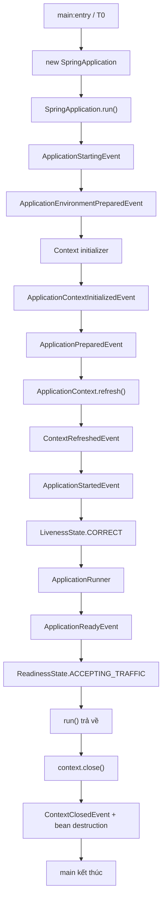

# Xây ứng dụng Spring Boot `NONE` ghi lại các mốc khởi động bằng thời gian tương đối

## 1. Mục tiêu bài thực hành

Ta sẽ xây dựng một ứng dụng **Spring Boot Application Runtime** ở chế độ `WebApplicationType.NONE` và quan sát trực tiếp những mốc quan trọng từ lúc Java vào `main()` cho tới khi context được đóng.

Ứng dụng **không mở HTTP port**, không có embedded Tomcat/Jetty/Netty; nó là một ứng dụng CLI được Boot quản lý. Tuy vậy, nó vẫn thực hiện đầy đủ những bước liên quan đến `SpringApplication`, `Environment`, `ApplicationContext`, `refresh()`, singleton beans, `ApplicationRunner`, application events và lifecycle shutdown.

Những yêu cầu của bài:

1. Dùng **cùng một gốc thời gian**, ngay tại đầu `main()`, để in mốc tương đối `T+... ms`.
2. In cả **độ lệch so với mốc trước** (`step+... ms`) để nhận ra đoạn nào tốn thời gian.
3. Bắt các event **trước khi `ApplicationContext` tồn tại** bằng `SpringApplication.addListeners(...)`, không dựa vào `@EventListener` bean cho những event sớm.
4. Phân biệt `ApplicationPreparedEvent` (trước refresh), `ContextRefreshedEvent` (sau refresh), `ApplicationStartedEvent` (trước runner), `ApplicationReadyEvent` (sau runner).
5. Quan sát `LivenessState.CORRECT` và `ReadinessState.ACCEPTING_TRAFFIC` nhưng hiểu đúng rằng **`NONE` không có web server để nhận HTTP traffic**.
6. Thêm `ApplicationRunner` chờ một khoảng cấu hình được để thực nghiệm xem *started* khác *ready* như thế nào.
7. Có tài nguyên do context sở hữu, in mốc tạo và đóng để đối chiếu các mốc `ContextClosedEvent` và bean destruction.
8. Đối chiếu thời gian tương đối từ `System.nanoTime()` với `ApplicationStartedEvent.getTimeTaken()`, `ApplicationReadyEvent.getTimeTaken()` và JVM uptime.
9. Có lệnh Maven/JDK 17+ chạy được, output minh họa trung thực, biến thể chạy nhanh/chậm và kịch bản startup failure.
10. Biết giới hạn của phép đo và không nhầm thời gian từ `main` với thời gian **từ JVM start, container start hoặc Pod creation**.

Bài dùng **Java 17**, **Spring Boot 3.3.13** và Maven. Không cần cấu hình cơ sở dữ liệu, mạng, Actuator, Docker hay Kubernetes.

## 2. Vì sao chọn `WebApplicationType.NONE`?

Spring Boot thường được biết đến như framework xây API server. Nhưng `SpringApplication` cũng có thể dựng một container để chạy:

- Batch job hoặc tác vụ migration.
- CLI có dependency injection.
- Công cụ nhập/xuất dữ liệu.
- Worker nhận và xử lý một tập công việc.
- Chương trình kiểm tra cấu hình runtime.
- Bài thực hành quan sát startup events không bị nhiễu bởi thời gian mở HTTP server.

Để Boot không tự tạo embedded web server, ta đặt:

```java
application.setWebApplicationType(WebApplicationType.NONE);
```

Tương đương có thể cấu hình qua properties:

```properties
spring.main.web-application-type=none
```

Trong ví dụ hoàn chỉnh, ta dùng **lời gọi Java tường minh** để người học thấy ngay quyết định không khởi chạy web server. `spring-boot-starter` đủ cho phần core: không thêm `spring-boot-starter-web` hoặc `spring-boot-starter-webflux`.

`NONE` **không có nghĩa bỏ qua Spring**:

- Spring vẫn tạo `ApplicationContext`.
- Spring vẫn `refresh()` context và tạo singleton beans không lazy.
- `ApplicationRunner` và `CommandLineRunner` vẫn được Boot gọi.
- Boot vẫn phát các sự kiện startup và availability phù hợp.
- Context vẫn có init/destroy lifecycle.
- `SpringApplication.run()` vẫn có thể thất bại vì configuration/bean/runner errors.

Một chương trình `NONE` có thể kết thúc ngay sau khi runner xong nếu không còn non-daemon thread giữ JVM sống, hoặc có thể tồn tại lâu nếu chính ứng dụng mở những background workers. Bài thực hành cố ý **đóng context sau `run()`** để đường shutdown rõ và không có worker không được quản lý.

## 3. Đồng hồ đo: lấy gốc `T0` ở đầu `main()`

Giải pháp trung tâm là sử dụng:

```java
long t0 = System.nanoTime();
```

Mỗi mốc tiếp theo lấy:

```java
long now = System.nanoTime();
long elapsedNanos = now - t0;
long elapsedMs = TimeUnit.NANOSECONDS.toMillis(elapsedNanos);
```

Để biết chi phí **giữa hai mốc liên tiếp**:

```java
long stepMs = TimeUnit.NANOSECONDS.toMillis(now - previous);
previous = now;
```

Ở đây `previous` là thời điểm mốc trước đã ghi. Đây là đoạn minh họa; trong ví dụ đầy đủ sẽ có class `Timeline` quản lý các biến đó.

### 3.1. `System.nanoTime()` phù hợp cho duration

`System.nanoTime()` cung cấp đồng hồ đơn điệu phục vụ tính *elapsed time* trong cùng JVM. Nó **không phải** số nanosecond từ Unix epoch; không lấy nó làm timestamp thực, không so trực tiếp giá trị tuyệt đối giữa hai JVM và không chuyển nó thành thời gian trong ngày.

Vì `Timeline` chỉ lấy mẫu một lần mỗi mốc, kết quả là **wall elapsed duration** theo đồng hồ đơn điệu, không phải CPU time. Nó bao gồm thời gian thread bị scheduler tạm dừng, I/O blocking, `Thread.sleep`, GC pauses và phần in log.

### 3.2. Tại sao không lấy `System.currentTimeMillis()` làm đồng hồ chính?

`System.currentTimeMillis()` hữu ích để ghi log thời điểm tuyệt đối, nhưng đồng hồ wall-clock có thể bị điều chỉnh bởi hệ điều hành hoặc đồng bộ thời gian. Khi mục tiêu là đo duration ngắn giữa những mốc trong cùng process, `nanoTime()` phù hợp hơn.

Ta vẫn có thể ghi `Instant.now()` ở đầu chạy để tương quan với log ngoài JVM, nhưng **duration** nên được tính từ một clock nhất quán.

### 3.3. Gốc ở `main()` không phải gốc JVM

Trước khi Java vào `main()`, JVM đã phải bootstrap, load/initialize class và chuẩn bị runtime. Nếu cần biết tuổi đời JVM khi bắt đầu `main`, Java cung cấp:

```java
long uptimeMs = ManagementFactory.getRuntimeMXBean().getUptime();
```

Dòng này cần import `java.lang.management.ManagementFactory`. Nó **không thay thế** `T0`; nó cho biết một loại thời gian khác.

| Mốc gốc | Câu hỏi trả lời |
| --- | --- |
| `System.nanoTime()` tại đầu `main()` | Từ code đầu tiên ta ghi đến mốc X mất bao lâu? |
| JVM start qua `RuntimeMXBean` | JVM đã tồn tại bao lâu đến mốc X? |
| Thời điểm OS spawn Java process | Quá trình khởi tạo process → X mất bao lâu? |
| Container started timestamp | Container started → X mất bao lâu? |
| Kubernetes Pod creation timestamp | Từ lúc Pod được tạo đến X mất bao lâu? |

Không gộp các định nghĩa trên thành một số “startup time” không có chú thích.

## 4. Các mốc Spring Boot 3.3 trong startup thành công

Một luồng đơn giản:



Sơ đồ minh họa một lần `run()` thành công, có context đơn, listeners đồng bộ mặc định. Việc tạo singleton bean diễn ra trong quá trình refresh. Với context hierarchy, custom event multicaster hoặc listener khác, có thể có thêm events và công việc xen giữa.

### 4.1. Ý nghĩa từng event

| Mốc | Khi nào xảy ra | Được phép kết luận |
| --- | --- | --- |
| `ApplicationStartingEvent` | Ngay đầu `SpringApplication.run()` | Boot đã bước vào quá trình run |
| `ApplicationEnvironmentPreparedEvent` | Environment đã chuẩn bị, context chưa tạo | Có thể đọc/chỉnh Environment theo contract |
| `ApplicationContextInitializedEvent` | Context đã tạo và initializers chạy, chưa load bean definitions đầy đủ | Đã có context object |
| `ApplicationPreparedEvent` | Đã nạp bean definitions, ngay trước refresh | Chuẩn bị bước refresh |
| `ContextRefreshedEvent` | Spring Framework hoàn thành refresh | Container đã refresh |
| `ApplicationStartedEvent` | Sau refresh, **trước** runners | Mốc started của Boot |
| `AvailabilityChangeEvent(LivenessState.CORRECT)` | Sau started | Boot xem app là live |
| `ApplicationRunner` | Sau started, trước ready | Công việc startup của app |
| `ApplicationReadyEvent` | Sau runners | Boot đạt mốc ready |
| `AvailabilityChangeEvent(ReadinessState.ACCEPTING_TRAFFIC)` | Sau ready | Boot công bố readiness accepting |
| `ContextClosedEvent` | Khi đóng context | Chuỗi đóng context đã bắt đầu |
| `@Bean(destroyMethod="close")` | Khi Spring hủy singleton owned bean | Resource được đóng theo cơ chế bean destruction |

**Lưu ý:** `ContextRefreshedEvent` là event của Spring Framework, không chỉ riêng Boot; `ApplicationStartedEvent` và `ApplicationReadyEvent` là events của Boot.

### 4.2. Event nào không nên đăng ký bằng `@EventListener` bean?

Những event sớm như `ApplicationStartingEvent` và `ApplicationEnvironmentPreparedEvent` được phát **trước khi Spring có thể tạo application beans**. Một `@Component`/`@Bean` listener được phát hiện trong context thông thường không thể nhận được các event đã phát trước khi nó tồn tại.

Vì vậy ví dụ dùng:

```java
application.addListeners(
        (ApplicationListener<ApplicationStartingEvent>)
                event -> timeline.mark("boot:starting"));
```

Đây là snippet; cần `timeline` và imports. Chỗ quan trọng là **đăng ký trước `application.run(args)`**.

Tương tự, ta dùng `application.addInitializers(...)` để ghi dấu lúc application context đang được khởi tạo. Initializer không thay thế listener, và không chứng minh `refresh()` đã kết thúc.

## 5. Cấu trúc dự án hoàn chỉnh

Tạo các file sau:

```text
none-startup-timeline/
├── pom.xml
└── src/main/
    ├── java/com/example/timeline/
    │   └── NoneStartupTimelineApplication.java
    └── resources/
        └── application.properties
```

Chỉ có **một file Java** để đơn giản hóa việc sao chép. Class `Timeline` và `ManagedResource` được định nghĩa là nested static classes bên trong class chính.

Ứng dụng không dùng database, controller, HTTP endpoint hay starter Actuator. Vì vậy, nếu thấy request `http://localhost:8080` bị từ chối trong khi chương trình chạy, đây là **hành vi dự kiến**, không phải lỗi startup.

## 6. `pom.xml` — Spring Boot 3.3.13 và Java 17

```xml
<project xmlns="http://maven.apache.org/POM/4.0.0"
         xmlns:xsi="http://www.w3.org/2001/XMLSchema-instance"
         xsi:schemaLocation="http://maven.apache.org/POM/4.0.0 https://maven.apache.org/xsd/maven-4.0.0.xsd">
    <modelVersion>4.0.0</modelVersion>

    <parent>
        <groupId>org.springframework.boot</groupId>
        <artifactId>spring-boot-starter-parent</artifactId>
        <version>3.3.13</version>
        <relativePath/>
    </parent>

    <groupId>com.example</groupId>
    <artifactId>none-startup-timeline</artifactId>
    <version>0.0.1-SNAPSHOT</version>

    <properties>
        <java.version>17</java.version>
    </properties>

    <dependencies>
        <dependency>
            <groupId>org.springframework.boot</groupId>
            <artifactId>spring-boot-starter</artifactId>
        </dependency>
    </dependencies>

    <build>
        <plugins>
            <plugin>
                <groupId>org.springframework.boot</groupId>
                <artifactId>spring-boot-maven-plugin</artifactId>
            </plugin>
        </plugins>
    </build>
</project>
```

`spring-boot-starter-parent` quản lý versions tương thích của Spring Boot dependencies và Maven plugins theo hệ sinh thái Boot 3.3.13.

`spring-boot-starter` bao gồm đủ nền tảng để chạy DI, configuration và startup events; không cần `spring-boot-starter-web` cho `NONE`.

`spring-boot-maven-plugin` giúp đóng gói executable JAR. Khi chạy `java -jar`, Java entrypoint thực tế là `main` của ứng dụng thông qua Boot launcher. Không nên đo startup của IDE và JAR rồi mặc định chúng giống hệt nhau.

## 7. Java source hoàn chỉnh

Tạo file `src/main/java/com/example/timeline/NoneStartupTimelineApplication.java`:

```java
package com.example.timeline;

import java.lang.management.ManagementFactory;
import java.time.Duration;
import java.util.Locale;
import java.util.concurrent.TimeUnit;

import org.springframework.boot.ApplicationRunner;
import org.springframework.boot.Banner;
import org.springframework.boot.SpringApplication;
import org.springframework.boot.WebApplicationType;
import org.springframework.boot.autoconfigure.SpringBootApplication;
import org.springframework.boot.availability.ApplicationAvailability;
import org.springframework.boot.availability.AvailabilityChangeEvent;
import org.springframework.boot.availability.LivenessState;
import org.springframework.boot.availability.ReadinessState;
import org.springframework.boot.context.event.ApplicationContextInitializedEvent;
import org.springframework.boot.context.event.ApplicationEnvironmentPreparedEvent;
import org.springframework.boot.context.event.ApplicationFailedEvent;
import org.springframework.boot.context.event.ApplicationPreparedEvent;
import org.springframework.boot.context.event.ApplicationReadyEvent;
import org.springframework.boot.context.event.ApplicationStartedEvent;
import org.springframework.boot.context.event.ApplicationStartingEvent;
import org.springframework.context.ApplicationListener;
import org.springframework.context.ConfigurableApplicationContext;
import org.springframework.context.annotation.Bean;
import org.springframework.context.event.ContextClosedEvent;
import org.springframework.context.event.ContextRefreshedEvent;
import org.springframework.core.env.Environment;

@SpringBootApplication(proxyBeanMethods = false)
public class NoneStartupTimelineApplication {

    // Chỉ phục vụ demo một lần chạy; không dùng làm state global
    // cho hệ thống nhiều ApplicationContext.
    private static final Timeline TIMELINE = new Timeline();

    public static void main(String[] args) {
        TIMELINE.startAtMain();

        TIMELINE.mark("main:jvm-uptime-ms="
                + ManagementFactory.getRuntimeMXBean().getUptime());

        SpringApplication application =
                new SpringApplication(NoneStartupTimelineApplication.class);

        TIMELINE.mark("springapplication:constructed");

        application.setWebApplicationType(WebApplicationType.NONE);
        application.setBannerMode(Banner.Mode.OFF);
        application.setLogStartupInfo(false);

        registerTimelineListeners(application);

        application.addInitializers(context ->
                TIMELINE.mark("context:initializer"));

        TIMELINE.mark("run:invoke");

        try (ConfigurableApplicationContext context =
                     application.run(args)) {

            TIMELINE.mark("run:returned");

            ApplicationAvailability availability =
                    context.getBean(ApplicationAvailability.class);

            TIMELINE.mark("main:readiness="
                    + availability.getReadinessState());
        }

        TIMELINE.mark("main:done");
    }

    private static void registerTimelineListeners(
            SpringApplication application) {

        application.addListeners(
                (ApplicationListener<ApplicationStartingEvent>)
                        event -> TIMELINE.mark("boot:starting"),

                (ApplicationListener<ApplicationEnvironmentPreparedEvent>)
                        event -> TIMELINE.mark("boot:environment-prepared"),

                (ApplicationListener<ApplicationContextInitializedEvent>)
                        event -> TIMELINE.mark("boot:context-initialized"),

                (ApplicationListener<ApplicationPreparedEvent>)
                        event -> TIMELINE.mark("boot:prepared"),

                (ApplicationListener<ContextRefreshedEvent>)
                        event -> TIMELINE.mark("context:refreshed"),

                (ApplicationListener<ApplicationStartedEvent>)
                        event -> TIMELINE.mark(
                                "boot:started boot-duration="
                                + durationText(event.getTimeTaken())),

                (ApplicationListener<ApplicationReadyEvent>)
                        event -> TIMELINE.mark(
                                "boot:ready boot-duration="
                                + durationText(event.getTimeTaken())),

                (ApplicationListener<AvailabilityChangeEvent<?>>)
                        event -> {
                            if (LivenessState.CORRECT.equals(event.getState())) {
                                TIMELINE.mark("liveness:correct");
                            }

                            if (ReadinessState.ACCEPTING_TRAFFIC
                                    .equals(event.getState())) {
                                TIMELINE.mark("readiness:accepting");
                            }
                        },

                (ApplicationListener<ContextClosedEvent>)
                        event -> TIMELINE.mark("context:closing"),

                (ApplicationListener<ApplicationFailedEvent>)
                        event -> TIMELINE.mark(
                                "boot:failed cause="
                                + event.getException()
                                       .getClass()
                                       .getSimpleName())
        );
    }

    @Bean(destroyMethod = "close")
    ManagedResource managedResource() {
        return new ManagedResource(TIMELINE);
    }

    @Bean
    ApplicationRunner warmupRunner(
            ManagedResource resource,
            Environment environment) {

        return args -> {
            long sleepMs = environment.getProperty(
                    "demo.warmup-ms", Long.class, 600L);

            if (sleepMs < 0L || sleepMs > 30_000L) {
                throw new IllegalArgumentException(
                        "demo.warmup-ms must be in [0, 30000]");
            }

            TIMELINE.mark("runner:begin");

            Thread.sleep(sleepMs);

            TIMELINE.mark("runner:end");
        };
    }

    private static String durationText(Duration value) {
        return value == null
                ? "unknown" : value.toMillis() + "ms";
    }

    static final class ManagedResource implements AutoCloseable {

        private final Timeline timeline;

        ManagedResource(Timeline timeline) {
            this.timeline = timeline;
            timeline.mark("resource:created");
        }

        @Override
        public void close() {
            timeline.mark("resource:closed");
        }
    }

    static final class Timeline {

        private long origin;
        private long previous;

        synchronized void startAtMain() {
            origin = System.nanoTime();
            previous = origin;
            mark("main:entry");
        }

        synchronized void mark(String name) {
            long now = System.nanoTime();

            long fromStartMs =
                    TimeUnit.NANOSECONDS.toMillis(now - origin);

            long fromPreviousMs =
                    TimeUnit.NANOSECONDS.toMillis(now - previous);

            previous = now;

            System.out.printf(
                    Locale.ROOT,
                    "T+%6d ms  step+%5d ms  %s%n",
                    fromStartMs,
                    fromPreviousMs,
                    name);
        }
    }
}
```

### 7.1. Vì sao source này là một chương trình hoàn chỉnh?

Tất cả types của chương trình đã được định nghĩa hoặc import:

- `SpringApplication`, `WebApplicationType`, `ApplicationRunner`.
- Events và `ApplicationAvailability` từ `spring-boot`.
- `ApplicationListener`, `ConfigurableApplicationContext`, `@Bean` từ Spring Framework.
- `ManagedResource` và `Timeline` là nested types nằm trong cùng source file.
- `Duration`, `TimeUnit`, `Locale` và `ManagementFactory` thuộc JDK 17.

Không có method nghiệp vụ giả định chưa khai báo. Không cần thêm một configuration class khác. Project có `@SpringBootApplication` nên Boot launcher có một main class rõ ràng để đóng gói.

### 7.2. Tại sao không dùng `SpringApplication.run(Class, args)`?

Shortcut sau chạy được nhưng không tiện cho đề bài:

```java
SpringApplication.run(NoneStartupTimelineApplication.class, args);
```

Nó tạo `SpringApplication` bên trong lời gọi static. Ta sẽ khó đăng ký **những early listeners của riêng bài thực hành trước khi Boot gửi `ApplicationStartingEvent`**.

Vì vậy, bài dùng:

```java
SpringApplication application =
        new SpringApplication(NoneStartupTimelineApplication.class);

application.addListeners(...);
application.run(args);
```

Trong chương trình thật, `...` là các listeners ở method `registerTimelineListeners`. Cách này cho phép ghi mốc từ sớm mà không cần viết file `spring.factories`.

### 7.3. Tại sao `Timeline` có `synchronized`?

Các listeners mặc định thường chạy đồng bộ, nhưng code có thể được mở rộng để ghi từ thread khác. `synchronized` bảo đảm cập nhật `previous` và in cả dòng log như một thao tác được bảo vệ khỏi hai lời gọi `mark()` đồng thời trên cùng instance.

Tuy nhiên, `synchronized` **không biến các hoạt động application khác thành tuần tự**. Nếu sau này thêm background jobs, một event có thể được ghi chen giữa những event khác. Kết luận thứ tự phải gắn với lifecycle contract và context cụ thể, không chỉ dựa vào chữ “thread-safe”.

### 7.4. Ghi gì ở mỗi mốc?

Ví dụ format:

```text
T+     0 ms  step+    0 ms  main:entry
T+   185 ms  step+   29 ms  boot:starting
T+   922 ms  step+  604 ms  context:refreshed
```

Hai cột thời gian có **đơn vị ms**:

- `T+`: tổng duration kể từ `startAtMain()`.
- `step+`: duration kể từ **lần gọi `mark()` trước đó**.

Các con số trên là **minh họa**, không phải output cố định. `step+` không phải duration của một method: nó có thể chứa nhiều method/callbacks giữa hai mốc, thời gian logging, scheduling và GC. Nếu muốn đo riêng một method, cần đặt điểm đo ở **chính ranh giới method đó**.

### 7.5. Vì sao bean `ManagedResource` được tạo trong refresh?

`managedResource()` là một singleton bean không khai báo lazy. Trong đường startup thông thường, Spring tạo singleton eager khi context refresh. Constructor `ManagedResource` gọi:

```java
timeline.mark("resource:created");
```

nên mốc `resource:created` xuất hiện sau `boot:prepared` nhưng trước `context:refreshed`.

Khi context được đóng, Spring gọi `close()` trên bean này theo:

```java
@Bean(destroyMethod = "close")
```

Vì vậy, `resource:closed` xuất hiện sau `context:closing` trong đường close thông thường. `ManagedResource` trong ví dụ không mở socket thật; nó chỉ ghi nhận lifecycle để người học tập trung vào các mốc.

`ApplicationRunner` nhận `ManagedResource` qua dependency injection để thể hiện rằng runner sử dụng tài nguyên của context, không tự tạo/đóng tài nguyên đó.

### 7.6. Vì sao `try-with-resources` ở `main()`?

`ConfigurableApplicationContext` triển khai hợp đồng đóng context. Code:

```java
try (ConfigurableApplicationContext context = application.run(args)) {
    TIMELINE.mark("run:returned");
}
```

khi hoàn tất block sẽ gọi `context.close()`.

Ta cố tình đóng context sau khi `run()` trả về để nhìn thấy:

```text
boot:ready
readiness:accepting
run:returned
context:closing
resource:closed
main:done
```

Đây là **bài demo CLI**, không phải mẫu để áp dụng y nguyên cho một web server cần chạy liên tục. Với server Boot, nếu close context ngay sau `run()`, server cũng sẽ dừng ngay.

Chương trình `NONE` không cần `System.exit(0)` ở happy path; khi không còn non-daemon worker, JVM thường kết thúc bình thường với status 0.

## 8. `application.properties`

Tạo `src/main/resources/application.properties`:

```properties
demo.warmup-ms=600
logging.level.root=ERROR
```

`demo.warmup-ms` là property **do ví dụ tự định nghĩa**. Nó không phải property chuẩn của Boot. `Environment#getProperty("demo.warmup-ms", Long.class, 600L)` đọc giá trị với fallback 600 ms.

`logging.level.root=ERROR` giúp log của ví dụ dễ quan sát, tránh nhiều dòng INFO của framework. Không nên xem mức log ERROR là chính sách production bắt buộc: ở production cần logging phù hợp cho điều tra lỗi.

Trong source đã có:

```java
application.setBannerMode(Banner.Mode.OFF);
application.setLogStartupInfo(false);
```

nên các dòng startup INFO không xuất hiện theo đường logging mặc định. Hai thiết lập này chỉ làm output gọn, **không tắt lifecycle events**.

Không thêm `server.port=8080` vì ứng dụng không có web server; thay đổi port không có ý nghĩa trong mode NONE.

## 9. Build và chạy đúng entrypoint

Mở terminal tại thư mục chứa `pom.xml`.

Kiểm tra JDK/Maven:

```bash
java -version
mvn -version
```

Build executable JAR:

```bash
mvn package
```

Chạy:

```bash
java -jar target/none-startup-timeline-0.0.1-SNAPSHOT.jar
```

Nếu project được tạo kèm Maven Wrapper, có thể build bằng:

```bash
./mvnw package
```

Windows PowerShell nếu có wrapper:

```powershell
.\mvnw.cmd package
```

Cần **JDK 17+**, Maven và dependencies Spring Boot đã tải hoặc có kết nối đến Maven repository. Nếu `mvn package` bị chặn do network hoặc dependency không có trong local cache, đó là vấn đề build environment, không phải startup event trong Java code.

### 9.1. Vì sao chạy `java -jar` thay vì chỉ `mvn spring-boot:run`?

Cả hai có thể phục vụ phát triển, nhưng khi cần so sánh chính xác startup và process behavior, `java -jar` giúp thử trực tiếp artifact đóng gói sẽ được triển khai.

`mvn spring-boot:run` đi qua Maven/plugin wrapper và có thể có thêm overhead trước khi Java application chạy. Không lấy thời gian từ lúc gõ lệnh `mvn` đến lúc thấy ready làm tương đương duration nội bộ của Boot.

### 9.2. PowerShell

Lệnh chạy trong PowerShell cũng là:

```powershell
java -jar .\target\none-startup-timeline-0.0.1-SNAPSHOT.jar
```

Sau khi CLI kết thúc, status có thể xem bằng:

```powershell
$LASTEXITCODE
```

Trong Bash/zsh, xem bằng:

```bash
echo $?
```

Trường hợp happy path bình thường trả `0`; không đặt mã thoát khác 0 chỉ để minh họa thời gian tương đối.

## 10. Output kỳ vọng: thứ tự ổn định, con số không cố định

Những **tên mốc do code demo in** theo thứ tự điển hình của một lần thành công với context đơn:

```text
main:entry
main:jvm-uptime-ms=<số thay đổi>
springapplication:constructed
run:invoke
boot:starting
boot:environment-prepared
context:initializer
boot:context-initialized
boot:prepared
resource:created
context:refreshed
boot:started boot-duration=<số thay đổi>ms
liveness:correct
runner:begin
runner:end
boot:ready boot-duration=<số thay đổi>ms
readiness:accepting
run:returned
main:readiness=ACCEPTING_TRAFFIC
context:closing
resource:closed
main:done
```

Đây là **danh sách giá trị cuối mỗi dòng**, đã bỏ tiền tố `T+... ms step+... ms` cho dễ đọc. Các chuỗi `<số thay đổi>` biểu diễn giá trị động; không phải text được in nguyên văn bởi Java. Trong trường hợp `getTimeTaken()` trả `null`, ví dụ sẽ in `unknown` thay cho số.

Để hình dung **format dòng đầy đủ**, một lần chạy giả định có thể trông như:

```text
T+     0 ms  step+    0 ms  main:entry
T+    11 ms  step+   11 ms  main:jvm-uptime-ms=95
T+   137 ms  step+  126 ms  springapplication:constructed
T+   143 ms  step+    6 ms  run:invoke
T+   168 ms  step+   25 ms  boot:starting
T+   359 ms  step+  191 ms  boot:environment-prepared
T+   402 ms  step+   43 ms  context:initializer
T+   410 ms  step+    8 ms  boot:context-initialized
T+   532 ms  step+  122 ms  boot:prepared
T+   824 ms  step+  292 ms  resource:created
T+  1001 ms  step+  177 ms  context:refreshed
T+  1040 ms  step+   39 ms  boot:started boot-duration=897ms
T+  1043 ms  step+    3 ms  liveness:correct
T+  1045 ms  step+    2 ms  runner:begin
T+  1645 ms  step+  600 ms  runner:end
T+  1648 ms  step+    3 ms  boot:ready boot-duration=1504ms
T+  1650 ms  step+    2 ms  readiness:accepting
T+  1653 ms  step+    3 ms  run:returned
T+  1654 ms  step+    1 ms  main:readiness=ACCEPTING_TRAFFIC
T+  1656 ms  step+    2 ms  context:closing
T+  1662 ms  step+    6 ms  resource:closed
T+  1663 ms  step+    1 ms  main:done
```

**Tất cả con số là ví dụ giả định**, không phải lời hứa output khi chạy trên một máy cụ thể. Thời gian thực tế phụ thuộc JVM, máy, warm/cold classpath, GC, scheduler, cấu hình logging và phiên bản. Chỉ **chuỗi mốc và quan hệ lifecycle** được dùng làm kỳ vọng chính.

Trong môi trường có listener/framework extension khác, có thể có thêm công việc trước/sau các event; ví dụ này minh họa trình tự mặc định trên Boot 3.3.13 với một context và không mở web server.

### 10.1. Đọc cột `T+`

Từ dòng:

```text
T+  1040 ms  step+   39 ms  boot:started boot-duration=897ms
```

suy ra:

- Thời điểm listener ghi `ApplicationStartedEvent` cách gốc đầu `main()` khoảng 1040 ms.
- Khoảng cách từ **mốc được ghi ngay trước đó** đến đây khoảng 39 ms.
- Thời gian Boot tự đo đến started là khoảng 897 ms.

Không được đặt dấu bằng giữa `T+1040 ms` và `boot-duration=897ms`. Bộ đo Boot bắt đầu gần thời điểm `SpringApplication.run` và lấy mẫu tại vị trí do Boot quyết định, khác gốc `main()` của Timeline.

### 10.2. Đọc cột `step+`

Nếu có:

```text
runner:begin
runner:end
```

và chênh lệch `T+` giữa chúng gần 600 ms, đó là do `Thread.sleep(600)` theo property mặc định, cộng overhead. `step+` tại `runner:end` đo khoảng kể từ lần `mark` trước, nên ở ví dụ ngắn này thường phản ánh gần đúng runner sleep.

Nhưng trong ứng dụng thật, một listener/task khác có thể ghi mốc giữa runner begin/end. Lúc đó `step+` không còn đo toàn bộ runner, mà chỉ phần từ **mốc gần nhất**. Muốn đo runner đúng phạm vi, lưu `long runnerStart=System.nanoTime()` ngay trong runner rồi tính khi nó kết thúc.

### 10.3. Tại sao `resource:created` nằm trước `context:refreshed`?

Vì `ManagedResource` là bean singleton eager và được tạo trong refresh. `ApplicationPreparedEvent` xảy ra trước refresh, còn `ContextRefreshedEvent` sau khi quá trình refresh đã hoàn tất. Vị trí `resource:created` giúp thấy ít nhất một công việc **nằm trong khu vực refresh**.

Điều đó **không** chứng minh mọi singleton của ứng dụng được tạo đúng thời điểm này: bean lazy, prototype hoặc bean tạo bởi background task có thể xuất hiện ở thời điểm khác.

### 10.4. Tại sao `main:readiness=ACCEPTING_TRAFFIC` dù không có web server?

`ReadinessState` mô tả **trạng thái availability nội bộ của Spring Boot**, không phải bằng chứng có HTTP listener. Trong `NONE`, Boot vẫn có thể công bố `ACCEPTING_TRAFFIC` khi startup và runners đã hoàn tất. Nó có nghĩa ứng dụng đã đến mốc logic *ready*, **không** có nghĩa socket 8080 mở hay Kubernetes đã route traffic.

`ApplicationAvailability` là bean Spring Boot quản lý; sau `run()` thành công, ví dụ lấy bean để quan sát readiness state. Sau khi context bị đóng, không tiếp tục dùng bean cũ để xử lý công việc mới.

## 11. Bài thực nghiệm A: đổi thời gian warm-up

Mặc định `demo.warmup-ms=600`. Chạy ba lần:

```bash
java -jar target/none-startup-timeline-0.0.1-SNAPSHOT.jar --demo.warmup-ms=0
```

```bash
java -jar target/none-startup-timeline-0.0.1-SNAPSHOT.jar --demo.warmup-ms=1200
```

```bash
java -jar target/none-startup-timeline-0.0.1-SNAPSHOT.jar --demo.warmup-ms=3000
```

Với điều kiện runtime tương tự, dự đoán:

- `springapplication:constructed`: hầu như không chịu ảnh hưởng **trực tiếp** từ thời gian sleep của runner.
- `boot:starting → boot:prepared`: không được thay đổi trực tiếp do runner sleep.
- `boot:prepared → context:refreshed`: không thay đổi trực tiếp do runner sleep.
- `boot:started`: xảy ra trước runner; duration của Boot đến started thường không tăng theo property sleep.
- `runner:begin → runner:end`: tăng gần bằng giá trị `demo.warmup-ms`.
- `boot:ready` và `readiness:accepting`: bị lùi lại tương ứng với thời gian runner.
- `main:done`: cũng bị lùi lại vì context chỉ đóng sau khi `run()` trả về.

**Dự đoán là xu hướng**, không phải cam kết số ms giữa từng lần chạy bằng nhau. GC, scheduling, JIT, filesystem cache và startup beans khác có thể thay đổi duration ngoài ý muốn.

### 11.1. Bảng ghi chép kết quả

Người học có thể tự điền bảng sau bằng số đo thực, không cần thay source:

| Warm-up | `boot:started` T+ | `runner:end - runner:begin` | `boot:ready` T+ | Boot ready duration |
| ---: | ---: | ---: | ---: | ---: |
| 0 ms | Đo được | Đo được | Đo được | Đo được |
| 600 ms | Đo được | Đo được | Đo được | Đo được |
| 1200 ms | Đo được | Đo được | Đo được | Đo được |
| 3000 ms | Đo được | Đo được | Đo được | Đo được |

Sau vài lần chạy, xem **khoảng started→ready** thay đổi bao nhiêu. Nếu property sleep tăng 2400 ms nhưng khoảng khác tăng nhiều hơn, có thể có nhiễu đo hoặc công việc khác phát sinh. Dùng thêm profiling nếu cần định lượng chi tiết.

### 11.2. Điều kiện `0` không đồng nghĩa các mốc có cùng timestamp

Ngay cả khi `Thread.sleep(0)`, giữa runner begin và end vẫn có chi phí gọi method và in log. Do output quy về **milliseconds nguyên**, nhiều dòng có thể cùng `T+` hoặc `step+0`, nhưng thứ tự sự kiện vẫn có ý nghĩa.

Không nên assert mọi khoảng thời gian khác 0 hoặc mọi mốc `T+` phải tăng ít nhất 1 ms.

## 12. Bài thực nghiệm B: chạy lỗi để quan sát nhánh thất bại

Ví dụ có validation ngay đầu runner:

```java
if (sleepMs < 0L || sleepMs > 30_000L) {
    throw new IllegalArgumentException(
            "demo.warmup-ms must be in [0, 30000]");
}
```

Chạy:

```bash
java -jar target/none-startup-timeline-0.0.1-SNAPSHOT.jar --demo.warmup-ms=-1
```

Tùy đường Boot xử lý exception, phần output quan trọng sẽ có:

```text
boot:started ...
liveness:correct
boot:failed cause=...
context:closing
resource:closed
```

**Không kỳ vọng**:

```text
runner:begin
runner:end
boot:ready
readiness:accepting
run:returned
main:done
```

Bởi runner ném exception **trước** khi ghi `runner:begin`; `SpringApplication.run()` không trả về thành công nên block `try-with-resources` chưa được vào theo đường success. Boot đi vào failure handling và cố đóng context đã tạo.

Tên exception ngoài cùng ở `boot:failed cause=...` có thể là exception do framework wrap, nên **không ép literal** `IllegalArgumentException` trong mọi môi trường. Xem stack trace/cause chain để nhận diện business validation thật sự.

Trong một CLI chạy bằng `java -jar`, startup failure không được xử lý sẽ dẫn tới process exit không thành công; exit code cụ thể có thể bị ảnh hưởng bởi đường failure, launcher và hệ điều hành. Đừng hard-code một status 1 chỉ từ việc thấy `ApplicationFailedEvent`.

### 12.1. Bài học về tính đầy đủ của timeline

Một timeline chỉ ghi mốc **trên đường thành công** sẽ thiếu dữ liệu khi khởi động lỗi. Vì thế ví dụ đăng ký `ApplicationFailedEvent` từ sớm bằng `addListeners(...)`.

Nhưng nếu lỗi rất sớm trước khi listener kịp được đăng ký hoặc JVM không khởi động được, Java application không thể tự in những mốc chưa từng xảy ra. Đó là giới hạn tự nhiên của observer được tạo bên trong process.

Nếu muốn quan sát lỗi như `ClassNotFoundException` của launcher trước khi Java main chạy, cần log/monitor ở cấp **process/launcher**, không chỉ listener trong Spring.

## 13. Bài thực nghiệm C: đổi cách đo để tránh hiểu sai

### 13.1. So `T+` với `getTimeTaken()`

Trong code:

```java
event.getTimeTaken()
```

ở `ApplicationStartedEvent` và `ApplicationReadyEvent` trả `Duration` do Boot ghi nhận. Không tự lấy đó làm “thời gian từ `main()`”:

- `T+` tính từ `Timeline.startAtMain()` trước khi dựng `SpringApplication`.
- `getTimeTaken()` dùng đồng hồ và mốc được SpringApplication quản lý.
- Code ghi log trong listener có thêm chút overhead.
- Boot duration có thể `null` khi không xác định; demo chuyển thành `"unknown"`.

Chênh lệch giữa hai con số là dữ liệu hữu ích về vùng trước `SpringApplication.run`, **không phải phép đo chính xác duy nhất của JVM bootstrap**.

### 13.2. Phân biệt khoảng gần refresh với exact `refresh()`

Những mốc:

```text
boot:prepared
resource:created
context:refreshed
boot:started
```

giúp suy luận:

- `boot:prepared → context:refreshed`: cửa sổ xấp xỉ khối refresh.
- `resource:created`: một hoạt động bên trong container refresh.
- `context:refreshed → boot:started`: phần việc/event sau refresh và trước mốc started.

**Không gọi `boot:prepared → boot:started` là thời gian chính xác của method `refresh()`**. Trong khoảng đó có thể có event dispatch, logging, bookkeeping và callbacks khác.

Muốn đo chi tiết từng `StartupStep` của refresh, dùng `ApplicationStartup` hoặc Java Flight Recorder; không suy diễn toàn bộ chi phí từ hai event timestamps.

### 13.3. `ContextRefreshedEvent` cũng có thể bị lặp trong hệ thống khác

Ứng dụng mẫu có một context `NONE`, nên các ví dụ output chỉ ghi một `context:refreshed`. Với ứng dụng có hierarchy parent/child hoặc management context, một listener có thể thấy event từ nhiều contexts.

Khi tái sử dụng code để profiling ứng dụng lớn, hãy bổ sung context identity:

```java
String id = event.getApplicationContext().getId();
```

Đoạn này áp dụng cho các event có `getApplicationContext()` như `ContextRefreshedEvent`. Không gom nhiều context refresh events vào một dòng tổng và tưởng một context đã refresh nhiều lần.

## 14. Mở rộng: thêm đồng hồ JVM vào một mốc ready

Ví dụ đã in:

```java
ManagementFactory.getRuntimeMXBean().getUptime()
```

ở đầu main. Để so tuổi đời JVM khi Boot ready, có thể sửa riêng listener:

```java
(ApplicationListener<ApplicationReadyEvent>)
        event -> {
            TIMELINE.mark("boot:ready boot-duration="
                    + durationText(event.getTimeTaken()));
            TIMELINE.mark("jvm:uptime-at-ready-ms="
                    + ManagementFactory.getRuntimeMXBean().getUptime());
        }
```

Đây là **đoạn thay thế trong `registerTimelineListeners`**, không phải method Java độc lập. Thời gian JVM đến ready sẽ thường lớn hơn Boot duration vì gồm các bước trước khi Boot bắt đầu đo.

Không trừ tùy tiện hai số từ hai clocks khác nhau để suy ra một method duration chính xác. `RuntimeMXBean.getUptime()` phù hợp đo tuổi đời JVM; `System.nanoTime()` phù hợp đo các khoảng **trong cùng process** từ gốc đã chọn.

## 15. Mở rộng: cần timeline chi tiết bên trong refresh thì làm gì?

Spring Framework hỗ trợ `ApplicationStartup`/`StartupStep` để thu thập các bước như instantiation của beans hoặc context refresh. Spring Boot có thể dùng `BufferingApplicationStartup`:

```java
import org.springframework.boot.context.metrics.buffering.BufferingApplicationStartup;

application.setApplicationStartup(
        new BufferingApplicationStartup(2048));
```

Đây là đoạn **tùy chọn** trong main, phải thêm trước `application.run(args)`. Không cần cho bài cơ bản. Nếu dùng Actuator và cấu hình endpoint startup phù hợp, có thể lấy timeline bằng `/actuator/startup` trong một ứng dụng có HTTP management interface.

Nhưng trong ứng dụng `NONE` của bài này **không có HTTP server**, nên chỉ thêm `BufferingApplicationStartup` và dependency Actuator không làm `/actuator/startup` tự xuất hiện ở localhost. Muốn đọc buffer trong NONE, phải truy xuất buffer bằng Java API phù hợp hoặc xuất qua một kênh khác; không thêm `curl localhost:8080/actuator/startup` như thể đang chạy web app.

### 15.1. Java Flight Recorder

Một lựa chọn dành cho profiling sâu:

```java
import org.springframework.core.metrics.jfr.FlightRecorderApplicationStartup;

application.setApplicationStartup(
        new FlightRecorderApplicationStartup());
```

Ví dụ chạy với JFR ở JDK hỗ trợ:

```bash
java -XX:StartFlightRecording=filename=none-startup.jfr,duration=30s -jar target/none-startup-timeline-0.0.1-SNAPSHOT.jar
```

Với một CLI ngắn, JFR recording dùng `duration=30s` có thể vẫn còn lịch ghi sau khi CLI đã kết thúc; cần xác minh file và cách dump recording thực tế của JDK/tool bạn dùng. Nếu cần bảo đảm recording hoàn tất trước khi process exit, dùng cấu hình recording phù hợp với CLI, chẳng hạn `dumponexit=true` và kiểm tra thông báo JFR trong môi trường.

JFR giúp tương quan Spring startup steps với GC, class loading, allocation, JIT và scheduling. Nó có overhead; không so một lần chạy có JFR với một lần không JFR như hai phép đo hoàn toàn tương đương.

### 15.2. Không cộng trùng các StartupStep

`StartupStep` có thể có cấu trúc lồng nhau: bước refresh cha chứa nhiều bước khởi tạo bean con. Nếu cộng tất cả `duration`, bạn có thể đếm cùng một khoảng thời gian **nhiều lần**.

Dùng timeline, parent step IDs và phạm vi của từng step thay vì cộng mù quáng mọi số ms.

## 16. Thiết kế log khi muốn tái sử dụng cho ứng dụng thật

### 16.1. Không đặt logic nghiệp vụ nặng trong listener

`ApplicationListener` trong demo chỉ lấy timestamp và in một dòng. Trong ứng dụng production, đừng gọi API mạng, ghi database hoặc sleep dài trong startup listener chỉ để ghi metrics.

Theo mặc định, event listeners thường chạy đồng bộ. Một listener chậm có thể **tự làm chậm chính startup mà nó đang đo**, khiến số liệu bị nhiễu. Nếu cần telemetry nặng, tách khâu ghi nhận dữ liệu nhẹ khỏi khâu flush/export, và cần bảo đảm cleanup.

### 16.2. Giữ marker ổn định

Các marker như:

```text
boot:starting
boot:prepared
context:refreshed
boot:started
runner:begin
runner:end
boot:ready
readiness:accepting
```

dễ dùng cho việc lọc log và tự động kiểm chứng. Tránh assert nguyên văn tất cả dòng stdout có số ms/PID/timestamp khác nhau mỗi lần.

Nếu cần JSON hoặc OpenTelemetry spans ở production, vẫn giữ **ý nghĩa mốc** tương đương và một clock rõ ràng. Đừng gửi `System.nanoTime()` raw làm timestamp epoch qua network.

### 16.3. Điều chỉnh nguồn log

`System.out.printf(...)` thích hợp cho demo vì thấy thứ tự rõ. Trong production, dùng logging framework/metrics/tracing, ghi cùng service ID, version và correlation keys. Khi so hiệu năng, nên giữ mức logging và appender giống nhau giữa các lượt chạy.

Ghi mốc không làm mọi bước startup xảy ra tuần tự: một số integrations khởi chạy threads background; timeline chỉ ghi thứ tự *observer nhận được event*, không phải toàn bộ thứ tự hoạt động của mọi threads.

### 16.4. Đừng dùng static `Timeline` cho nhiều context trong một JVM

Trong source demo, `private static final Timeline TIMELINE` giúp các listeners và beans cùng sử dụng một observer trong **một lần chạy CLI**. Đây là quyết định đơn giản cho bài thực hành.

Với nhiều independent `ApplicationContext`, tests chạy song song hoặc application reload, static instance có thể trộn mốc của các lần chạy. Khi mở rộng, nên tạo timeline theo **mỗi run/context**, truyền qua constructor/initializer hoặc bean do owner context quản lý, kèm context ID trong markers.

## 17. Kịch bản không còn là NONE: thay đổi điều gì?

Nếu đổi sang:

```java
application.setWebApplicationType(WebApplicationType.SERVLET);
```

thì phải bổ sung các dependency web thích hợp, ví dụ `spring-boot-starter-web`. Không chỉ đổi enum rồi kỳ vọng web server có đầy đủ classes.

Các khác biệt:

- Embedded server có thể khởi tạo trong refresh.
- Có thể có thêm `WebServerInitializedEvent`.
- Web port có thể mở **trước** runner hoàn tất, trong khi readiness chưa accepting.
- Ứng dụng web thường giữ process sống sau `run()`; nếu giữ `try-with-resources` đóng context ngay sau đó, server sẽ dừng luôn.
- Có thể sử dụng Actuator `/readyz`, `/livez` và `/actuator/startup` khi đã thêm dependency/cấu hình web thích hợp.

Tuy nhiên, đề bài này cố tình giữ `NONE` để người học quan sát **vòng đời ứng dụng**, không bị phân tâm bởi networking, servlet container và request lifecycle.

## 18. Các lỗi thường gặp khi làm bài

### Lỗi 1 — Đặt timestamp gốc sau `application.run()`

Nếu chỉ lấy `T0` sau khi `run()` trả về, startup đã xong; không thể đo trước refresh, started và runners. Gốc phải nằm **trước `run()`**, ở đầu main nếu mục tiêu là main-to-ready.

### Lỗi 2 — Đặt `@EventListener` bean để nghe `ApplicationStartingEvent`

Bean listener chưa được tạo ở thời điểm event sớm phát. Dùng `SpringApplication.addListeners(...)` trước `run()` hoặc cơ chế listener registration từ ngoài context.

### Lỗi 3 — Dùng `currentTimeMillis()` như đồng hồ monotonic

Wall clock có thể đổi, gây duration âm/bất thường. Dùng `nanoTime()` cho các khoảng nội bộ cùng process.

### Lỗi 4 — Xem `T+` là thời gian JVM start-to-ready

`T0` của bài nằm ở đầu main. JVM bootstrap xảy ra trước đó. Dùng RuntimeMXBean hoặc process-level observer cho thời gian JVM trước main.

### Lỗi 5 — Đồng nhất `ContextRefreshedEvent` và `ApplicationReadyEvent`

Refresh xong chưa chắc runner đã xong. Đề bài dùng runner sleep để bạn nhìn thấy chính khoảng chênh này.

### Lỗi 6 — Nghĩ `NONE` không có readiness events

Mode NONE không mở web server nhưng Boot vẫn có application availability lifecycle. `ACCEPTING_TRAFFIC` ở đây là trạng thái logic của Boot, không phải có HTTP port.

### Lỗi 7 — Gọi `run()` xong đóng context rồi báo startup failure

Đây là **CLI cố ý đóng context sau thành công**, không phải lỗi. `context:closing` và `resource:closed` nằm sau readiness trong output bình thường.

### Lỗi 8 — Dùng `Thread.sleep(600)` trong callback tạo bean rồi quy toàn bộ thời gian vào runner

Nếu sleep trong `@Bean` constructor, delay xảy ra trong refresh; nếu sleep trong `ApplicationRunner`, delay xảy ra **sau started**. Vị trí đặt chi phí ảnh hưởng ý nghĩa mốc, không chỉ số mili giây.

### Lỗi 9 — Nhận thấy hai dòng có `step+0` rồi cho rằng lỗi đo

Duration được làm tròn xuống milliseconds; hai event gần nhau có thể nằm trong cùng millisecond. Muốn phân giải cao hơn, giữ nanoseconds hoặc microseconds trong dữ liệu thô, nhưng vẫn phải kiểm soát overhead.

### Lỗi 10 — Dùng `System.nanoTime()` ở JVM A trừ `System.nanoTime()` ở JVM B

Hai giá trị không có epoch chung. Không được trừ chúng như timestamps phân tán.

### Lỗi 11 — `getTimeTaken()` bằng `null` gây `NullPointerException`

Spring Boot API cho phép duration chưa xác định. Ví dụ có `durationText(Duration)` chuyển null thành `"unknown"` để log không crash vì phép đo.

### Lỗi 12 — In quá nhiều trong mỗi event rồi xem measurement là không xâm lấn

`printf` có thể tốn thời gian, đồng bộ hóa và flush. Demo ưu tiên dễ đọc, không phải microbenchmark của core Boot. Khi so sánh nanoseconds phải giảm instrumentation overhead.

### Lỗi 13 — Dùng `@Bean(destroyMethod="close")` rồi tự đóng cùng resource trong runner

Có thể double-close, khiến thứ tự resource lifecycle khó hiểu. Resource do context sở hữu nên được đóng bởi context trong ví dụ, runner chỉ sử dụng nó.

### Lỗi 14 — Đợi HTTP request tới port 8080 để xem startup

Ứng dụng `NONE` không mở port. Quan sát console output, không `curl`. Muốn HTTP endpoint phải thay đổi loại application và dependencies có chủ đích.

### Lỗi 15 — Chạy `mvn spring-boot:run` rồi tính từ lúc Maven bắt đầu là duration Boot

Maven có overhead; không nhầm wall duration của command với `SpringApplication` event duration.

### Lỗi 16 — Bỏ `ApplicationFailedEvent` trong phép đo startup

Khi runner/configuration lỗi, mốc ready có thể không xuất hiện. Không được báo rằng ready=0 chỉ vì chưa đo được. Phải phân loại run là failed và kiểm tra nguyên nhân.

### Lỗi 17 — Xóa hoặc cắt số liệu khi mốc thiếu

Nếu event không được phát do lỗi startup, timeline **thiếu mốc** là thông tin quan trọng. Không tự điền timestamp giả để biểu đồ “đẹp”.

### Lỗi 18 — Chỉ đo một lần rồi so sánh hai phiên bản Boot

Class loading/JIT, file caches, GC, heap, CPU quota và môi trường có thể làm các lần chạy khác nhau. Cần tập mẫu tương đương và phân biệt cold start với warm start.

## 19. Bài tập mở rộng

### Bài 1 — Ước lượng khoảng startup trước refresh

Ghi `T+` của:

```text
run:invoke
boot:prepared
```

Chênh lệch biểu diễn cửa sổ chuẩn bị Environment, context và bean definitions trước refresh cùng overhead listener. Giải thích vì sao không nên gọi đó là “thời gian constructor của `ApplicationContext`”.

### Bài 2 — Đổi vị trí sleep để quan sát sự khác biệt

Ở project thực hành riêng, có thể thêm một component có init callback chờ 600 ms **trong refresh** rồi so sánh với runner sleep 600 ms **sau started**.

Dự đoán: sleep trong bean initialization thường tăng thời gian đến started; sleep trong runner chủ yếu tăng khoảng started→ready. Không đưa cả hai sleep vào cùng một test mà không ghi rõ vị trí.

### Bài 3 — Bổ sung `CommandLineRunner`

Tạo một bean `CommandLineRunner` ghi:

```text
command-line-runner:begin
command-line-runner:end
```

Nếu ứng dụng có nhiều runners, dùng `@Order` hoặc `Ordered` khi cần thứ tự có chủ đích. Không giả định Spring chạy chúng theo tên method trong source file.

### Bài 4 — Tính một bảng duration từ stdout

Lấy các mốc `main:entry`, `boot:prepared`, `context:refreshed`, `boot:started`, `runner:begin`, `runner:end`, `boot:ready`, `main:done` và tính:

- Main → Prepared.
- Prepared → ContextRefreshed (ước lượng refresh window).
- Started → Ready.
- Runner begin → Runner end.
- Main → Ready.
- Ready → Main done.

Chú thích rõ các khoảng chỉ là **window giữa mốc log**, không tất cả là exact duration của một framework method.

### Bài 5 — So `getTimeTaken()` với Timeline

Dùng hai giá trị tại started/ready và phân tích vì sao `T+` không giống `boot-duration`. Kiểm tra code đã đánh dấu T0 ở đâu và Boot bắt đầu `run()` lúc nào.

### Bài 6 — Quan sát failure path

Chạy với `--demo.warmup-ms=-1`, xem mốc failed và các mốc thiếu. Giải thích vì sao không có `ApplicationReadyEvent` và vì sao không được coi elapsed từ main đến failed là ready duration.

### Bài 7 — Giảm log overhead

Thay `System.out.printf` bằng recorder lưu các `{name, elapsedNanos}` vào memory rồi dump ở cuối. Phân tích tradeoff: ít I/O hơn trong startup nhưng nếu process thất bại trước khi dump, có thể mất dấu mốc.

### Bài 8 — Chạy với resource quota

Chạy nhiều lần dưới CPU quota thấp trong container và so median/tail startup. Không dùng con số từ máy dev nhanh làm baseline cho serverless/container nhỏ.

## 20. Bộ tiêu chí tự kiểm tra bài thực hành

| Tiêu chí | Cách xác nhận |
| --- | --- |
| JDK và Maven hợp lệ | `java -version`, `mvn -version` |
| Build thành công | `mvn package` tạo executable JAR |
| Chạy chế độ NONE | Không mở embedded web server/HTTP port |
| Có gốc timeline | `main:entry` là mốc đầu |
| Có hai cột thời gian | Mỗi marker có `T+` và `step+` |
| Có early listeners | Thấy `boot:starting`, `boot:environment-prepared` |
| Có mốc trước refresh | `boot:prepared` |
| Có mốc sau refresh | `context:refreshed` |
| Có lifecycle ready | `boot:started` trước runner, `boot:ready` sau runner |
| Có liveness/readiness | `liveness:correct`, `readiness:accepting` |
| Có Boot durations | `boot-duration=...ms` hoặc `unknown` |
| Có quan sát JVM uptime | `main:jvm-uptime-ms=...` |
| Có runner config | Đổi `--demo.warmup-ms` làm thay đổi runner gap |
| Có resource ownership | `resource:created` và `resource:closed` |
| Có close flow | `context:closing` trước `resource:closed` |
| Có failure path | Invalid warm-up dẫn đến `boot:failed`, không có ready |
| Có phân biệt đồng hồ | Không coi T0 ở main là JVM/Pod start |
| Không suy đoán output tuyệt đối | Chỉ assert markers/order, không hard-code ms |

### 20.1. Cách lọc marker trong Bash

Ghi stdout/stderr vào file log nếu muốn phân tích:

```bash
java -jar target/none-startup-timeline-0.0.1-SNAPSHOT.jar > timeline.log 2>&1
```

Xem những dòng timeline:

```bash
grep '^T+' timeline.log
```

Lọc riêng started/ready:

```bash
grep -E 'boot:started|boot:ready|runner:begin|runner:end' timeline.log
```

`grep` cần môi trường POSIX/Linux/macOS hoặc shell cung cấp công cụ tương đương. Các lệnh chỉ lọc log đã sinh, không sửa artifact.

### 20.2. PowerShell

```powershell
java -jar .\target\none-startup-timeline-0.0.1-SNAPSHOT.jar *> timeline.log
Get-Content .\timeline.log | Select-String '^T\+'
```

Trong PowerShell 5.1, encoding của redirection và `Get-Content` có thể phụ thuộc code page/phiên bản. Các marker viết bằng ASCII nên vẫn dễ tìm; nếu mở rộng marker có tiếng Việt và cần lưu chuẩn UTF-8, hãy cấu hình encoding đúng môi trường.

### 20.3. Assert thứ tự, không assert con số

Một kiểm tra thủ công hợp lệ là tìm vị trí từng marker và xác nhận:

```text
boot:prepared
    BEFORE
context:refreshed
    BEFORE
boot:started
    BEFORE
runner:begin
    BEFORE
runner:end
    BEFORE
boot:ready
    BEFORE
readiness:accepting
```

Không assert `boot:ready` luôn đúng 1400 ms hoặc runner sleep 600 ms chính xác đến mili giây. Scheduler và `Thread.sleep` có sai số; test chắc chắn nên kiểm tra **quan hệ** và giới hạn thời gian có headroom, không kiểm tra một số tuyệt đối không được framework bảo đảm.

## 21. Khi áp dụng sang hệ thống production

### 21.1. Ghi đầy đủ các giai đoạn không có nghĩa đã tìm được bottleneck

Timeline ở mức event cho biết **khoảng nào đáng điều tra**:

- Main → Run: constructor/configuration trong code main.
- Run → Prepared: Environment/context preparation, bean definitions.
- Prepared → Started: refresh window và overhead.
- Started → Ready: runners và event callbacks.
- Ready → external ready: readiness probes, routing, platform.
- Close → process exit: resource cleanup, non-daemon threads và shutdown sequence.

Nếu muốn biết bean nào chiếm 300 ms, cần sâu hơn: `StartupStep`, JFR, profiling hoặc custom timers quanh initialization method. Đừng quy lỗi cho một bean khi dữ liệu chỉ có hai mốc tổng.

### 21.2. Đừng tối ưu “ready” bằng cách bỏ một công việc bắt buộc

Đẩy cache warming sang background có thể làm `ApplicationReadyEvent` đến sớm hơn nhưng request đầu có thể chưa phục vụ được. Nếu warm-up là điều kiện bắt buộc, đặt nó trong runner với deadline hợp lý hoặc công bố custom readiness state/health gate để không nhận traffic sớm.

Trong ứng dụng NONE dạng batch, “ready” có thể chỉ là “startup hooks hoàn tất”, không nhất thiết mang ý nghĩa nhận HTTP request.

### 21.3. Đo nhiều lần dưới cùng điều kiện

JVM class loading, GC, container CPU throttling, logging và filesystem cache đều làm các con số biến thiên. Nếu lập báo cáo:

- Ghi Java version, Boot version, JVM flags và profile.
- Ghi số lần chạy, cold/warm conditions, CPU/memory limits.
- Báo median và biến thiên, không chỉ lấy lần nhanh nhất.
- So cùng mốc T0 và cùng runner configuration.
- Tách thời gian trước JVM chạy ra khỏi thời gian Boot run.
- Giữ sample logs có marker và configuration để tái hiện kết quả.

### 21.4. Tách thành phần quan sát khỏi dữ liệu cần được bảo vệ

Timeline demo được in ra stdout, không có thông tin bí mật. Trong production, tránh ghi password, token, connection string, user IDs hoặc nội dung exception nhạy cảm chỉ để đo startup. Ghi tên mốc, duration, context ID và mã trạng thái đã được chuẩn hóa là đủ cho nhiều nhu cầu quan sát.

## 22. Câu hỏi ôn tập và đáp án

**Câu 1.** Tại sao cần `WebApplicationType.NONE` cho bài thực hành?

**Đáp án:** Để chạy Boot core lifecycle và runners mà không mở web server, giúp quan sát startup đơn giản hơn. NONE không bỏ refresh hay application events.

**Câu 2.** Vì sao `ApplicationStartingEvent` được đăng ký qua `addListeners` trước `run`?

**Đáp án:** Vì nó phát trước khi context và bean listeners tồn tại. Listener khai báo trong một bean thông thường không thể nhận event đã phát trước đó.

**Câu 3.** `T+1200ms` có nghĩa JVM bắt đầu cách đây 1200 ms?

**Đáp án:** Không; với ví dụ này, đó là 1200 ms từ đầu `main()` khi `Timeline.startAtMain` lấy T0.

**Câu 4.** `step+50ms` đo điều gì?

**Đáp án:** Khoảng từ lần `mark` trước đến lần `mark` hiện tại, không tự là duration của một Spring internal method.

**Câu 5.** Vì sao `boot:started` xuất hiện trước `runner:begin`?

**Đáp án:** Boot phát `ApplicationStartedEvent` sau context refresh nhưng trước khi gọi `ApplicationRunner`/`CommandLineRunner`.

**Câu 6.** Tăng warm-up từ 600 ms lên 3000 ms tác động chính lên đoạn nào?

**Đáp án:** Khoảng runner begin→end và started→ready; không trực tiếp làm refresh chậm tương ứng.

**Câu 7.** NONE không có HTTP server, vậy `readiness:accepting` có vô lý không?

**Đáp án:** Không. Nó là application availability state của Boot, không phải bằng chứng có port để nhận HTTP.

**Câu 8.** Tại sao `resource:created` xuất hiện trước `context:refreshed`?

**Đáp án:** Vì đây là singleton eager được tạo trong lúc refresh context.

**Câu 9.** Ai gọi `ManagedResource.close()` trong demo?

**Đáp án:** Spring khi context bị đóng theo `@Bean(destroyMethod="close")`; runner chỉ giữ reference.

**Câu 10.** Vì sao `boot-duration` và `T+` có thể khác nhau cùng tại mốc ready?

**Đáp án:** Vì gốc đo của Boot và T0 tại đầu main khác nhau, cộng thêm vị trí lấy mẫu/overhead listener.

**Câu 11.** Lỗi warm-up property làm mốc ready biến mất có được coi là ready=0 không?

**Đáp án:** Không. Startup đã thất bại, phải báo trạng thái FAILED và giữ những mốc có thật, không tự điền giá trị ready giả.

**Câu 12.** Muốn biết chính xác chi phí của một bean cụ thể, timeline cấp event đủ không?

**Đáp án:** Không. Cần instrumentation/phân tích `ApplicationStartup`/JFR hoặc timers đặt quanh bean method cần đo.

**Câu 13.** Khi process chạy trong Kubernetes, `T+` bắt đầu từ lúc Pod được tạo phải không?

**Đáp án:** Không. T0 nằm trong `main()`; Pod scheduling, image pull, init container và JVM bootstrap xảy ra trước đó.

**Câu 14.** Vì sao benchmark một lượt có thể sai lệch?

**Đáp án:** Bởi GC, CPU quota, JIT, filesystem cache, background load, network và logging tạo nhiễu; cần lặp lại cùng điều kiện.

## 23. Nguồn tham khảo chính thức

- [Spring Boot 3.3 — SpringApplication và Application Events](https://docs.spring.io/spring-boot/3.3/reference/features/spring-application.html): thứ tự events, các runners, ApplicationAvailability và thời điểm ready.
- [Spring Boot — Tạo ứng dụng không có web server](https://docs.spring.io/spring-boot/3.3/how-to/application.html): cấu hình `WebApplicationType.NONE` và logic ứng dụng trong runners.
- [Spring Boot 3.3 — Tắt embedded web server](https://docs.spring.io/spring-boot/3.3/how-to/webserver.html): `spring.main.web-application-type=none`.
- [Spring Boot 3.3.13 API — `SpringApplication`](https://docs.spring.io/spring-boot/3.3/api/java/org/springframework/boot/SpringApplication.html): constructor, `addListeners`, `addInitializers`, `run` và cài đặt mode.
- [Spring Boot 3.3 API — `ApplicationStartedEvent`](https://docs.spring.io/spring-boot/3.3/api/java/org/springframework/boot/context/event/ApplicationStartedEvent.html): sau refresh, trước runner, `getTimeTaken()`.
- [Spring Boot 3.3 API — `ApplicationReadyEvent`](https://docs.spring.io/spring-boot/3.3/api/java/org/springframework/boot/context/event/ApplicationReadyEvent.html): sau runner, `getTimeTaken()`.
- [Spring Boot 3.3 API — `ApplicationAvailability`](https://docs.spring.io/spring-boot/3.3/api/java/org/springframework/boot/availability/ApplicationAvailability.html): đọc readiness/liveness state.
- [Java 17 — `System.nanoTime()`](https://docs.oracle.com/en/java/javase/17/docs/api/java.base/java/lang/System.html#nanoTime()): đồng hồ cho elapsed time.
- [Java 17 — `RuntimeMXBean`](https://docs.oracle.com/en/java/javase/17/docs/api/java.management/java/lang/management/RuntimeMXBean.html): JVM start time và uptime.
- [Spring Framework — `ApplicationContext.refresh()`](https://docs.spring.io/spring-framework/docs/6.1.x/javadoc-api/org/springframework/context/ConfigurableApplicationContext.html): contract refresh/close.
- [Spring Framework — ApplicationStartup/StartupStep](https://docs.spring.io/spring-framework/reference/core/beans/context-introduction.html): quan sát những bước khởi tạo container.

## 24. Tổng kết

Ứng dụng Spring Boot `NONE` vẫn có vòng đời đầy đủ; chỉ không tạo embedded web server. Việc ghi mốc **thời gian tương đối** từ đầu `main()` giúp thấy sự khác nhau giữa bước chuẩn bị context, refresh, started, runner, ready và đóng context. `System.nanoTime()` trả elapsed duration trong cùng JVM; `ApplicationStartedEvent.getTimeTaken()` và `ApplicationReadyEvent.getTimeTaken()` có gốc đo của Boot riêng.

Bài thực hành chứng minh trực tiếp rằng **`ApplicationStartedEvent` xảy ra trước `ApplicationRunner`, còn `ApplicationReadyEvent` xảy ra sau runner**. Khi tăng `demo.warmup-ms`, khoảng started→ready tăng, trong khi khoảng trước runner không bị tăng trực tiếp bởi thao tác sleep đó.

Để kết luận đáng tin, phải ghi rõ **gốc T0**, hiểu `step+` chỉ là hiệu hai mốc được quan sát, không đoán duration của method chưa instrument, kiểm tra failure path và so sánh nhiều lần chạy trong điều kiện tương đương. Đây là nền tảng để chuyển từ timeline đơn giản sang `ApplicationStartup`, JFR và các phép đo startup ở Docker/Kubernetes mà không nhầm lẫn các đồng hồ và ranh giới.