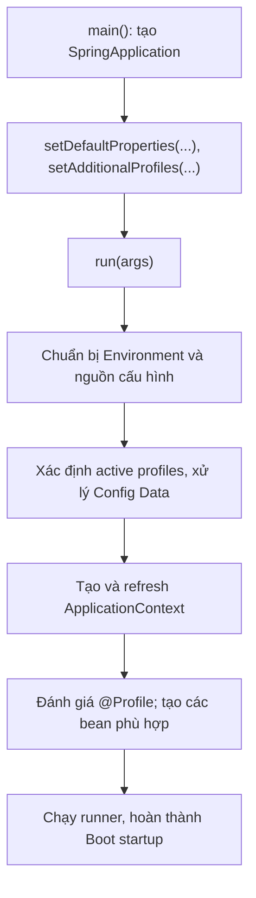

# Thiết lập mặc định và profile bổ sung qua `SpringApplication`

## 1. Mục tiêu và bối cảnh

Trong một ứng dụng Spring Boot, cùng một mã Java có thể chạy ở máy lập trình, môi trường kiểm thử hay production. Thay vì thay đổi mã nguồn mỗi lần triển khai, ứng dụng lấy giá trị cấu hình từ `Environment` và lựa chọn bean theo các **profile** đang hoạt động.

Khi cần điều khiển hành vi khởi động ngay từ `main()`, `SpringApplication` cung cấp hai API rất gần nhau về chỗ gọi nhưng khác nhau về tác dụng:

- `setDefaultProperties(...)` thiết lập các **giá trị thuộc tính dự phòng** có mức ưu tiên thấp; nguồn cấu hình có độ ưu tiên cao hơn có thể ghi đè chúng.
- `setAdditionalProfiles(...)` đăng ký thêm một hoặc nhiều **profile hoạt động** cho lần chạy ứng dụng; các profile này tham gia việc chọn cấu hình và bean.

Bài này tập trung vào việc thiết lập hai API đó qua một đối tượng `SpringApplication`, hiểu thứ tự ưu tiên, lựa chọn cách dùng phù hợp và tự kiểm chứng bằng một ứng dụng Java chạy được.

> “Default properties” và “default profile” là **hai khái niệm khác nhau**. Default properties là cặp khóa–giá trị dự phòng; default profile là profile Spring sử dụng khi không có active profile nào.

## 2. `SpringApplication` nằm ở đâu trong cơ chế cấu hình?

`SpringApplication` của Spring Boot điều phối bootstrap, trong đó có chuẩn bị `Environment` và các bước xử lý cấu hình. `Environment`/`PropertySource` là các abstraction của Spring Framework. Spring Boot bổ sung cơ chế nạp **Config Data** (ví dụ `application.properties`, `application.yml`, các file `application-{profile}.properties`) và các lựa chọn khởi động thuận tiện.

Luồng khái quát:



Hai API phải được gọi **trước** `run(args)` để tác động đến quá trình tải cấu hình và đăng ký bean. Việc thay đổi `Environment` sau khi context đã refresh không tự động tải lại tất cả file `application-*` hoặc tạo lại các bean đã bị loại bởi `@Profile`.

Bảng đối chiếu nhanh:

| Nhu cầu | API/cấu hình | Tác dụng |
| --- | --- | --- |
| Cung cấp giá trị fallback từ Java | `app.setDefaultProperties(Map)` | Thêm các property có ưu tiên thấp. |
| Bật thêm profile bằng Java khi startup | `app.setAdditionalProfiles("audit")` | Bổ sung `audit` vào nhóm active profiles. |
| Chọn profile khi triển khai | `--spring.profiles.active=prod` hoặc biến môi trường thích hợp | Cấu hình profile hoạt động từ bên ngoài ứng dụng. |
| Chọn profile nếu không có profile hoạt động | `spring.profiles.default=local` | Định nghĩa **default profile**; không phải giá trị fallback tùy ý. |
| Dùng file cấu hình theo profile | `application-audit.properties` | File được xét khi `audit` là active profile. |
| Tạo bean có điều kiện | `@Profile("audit")` | Spring Framework đăng ký bean theo profile đang hoạt động. |

## 3. `setDefaultProperties(...)`: đặt giá trị dự phòng

### 3.1. Ý nghĩa và cách sử dụng

`SpringApplication#setDefaultProperties` nhận một `Map<String, Object>` hoặc `Properties` chứa các giá trị dự phòng. Ví dụ:

```java
SpringApplication application = new SpringApplication(MyApplication.class);

application.setDefaultProperties(Map.of(
    "demo.feature-enabled", "false",
    "demo.timeout-seconds", "10",
    "demo.region", "unknown"
));

application.run(args);
```

*Đoạn trên minh họa lời gọi API; để chạy riêng cần có class ứng dụng, imports và dependency Spring Boot. Ví dụ đầy đủ nằm ở mục 6.*

Sau khi `run()` chuẩn bị `Environment`, ứng dụng có thể lấy các giá trị đó qua `Environment#getProperty`, `@Value` hoặc binding `@ConfigurationProperties`. Nếu có nguồn cấu hình ưu tiên cao hơn khai báo cùng khóa, giá trị dự phòng bị thay thế.

Ví dụ ý nghĩa của một property:

- Java default: `demo.timeout-seconds=10`.
- `application.properties`: `demo.timeout-seconds=20`.
- Dòng lệnh: `--demo.timeout-seconds=30`.

Với cách chạy mặc định của Spring Boot, khi cả ba đều hiện diện, giá trị hiệu lực là `30`. Nếu không có tham số dòng lệnh thì `20`; nếu không có cả cấu hình trong file thì `10`.

Đó là **cơ chế fallback**, không phải thao tác ghi dữ liệu vào `application.properties`. `setDefaultProperties` không tạo hoặc sửa file nào trong `src/main/resources`.

### 3.2. Thứ tự ưu tiên cần nắm

Spring Boot kết hợp nhiều `PropertySource`. Với các nguồn thường gặp trong ví dụ này, thứ tự tương đối từ cao xuống thấp là:

1. Tham số dòng lệnh dạng `--demo.timeout-seconds=...` (khi command-line properties được bật, đây là mặc định).
2. Java system properties (`-D...`) và biến môi trường hệ điều hành, với thứ tự chi tiết theo quy tắc ưu tiên của Boot.
3. Config Data được nạp từ `application.properties` và các biến thể theo profile.
4. Default properties do `setDefaultProperties` cung cấp.

Đây là bản rút gọn của hệ thống property-source; Boot còn hỗ trợ nhiều nguồn khác như JSON ứng dụng, test properties, servlet context và nguồn cấu hình tùy chỉnh. Không nên dùng bảng rút gọn này để suy luận thứ tự của **mọi** nguồn trong mọi môi trường.

Hai hệ quả thiết kế:

- Giá trị cần người triển khai tùy chỉnh nên đặt ở `application.properties` hoặc hệ thống cấu hình triển khai; Java defaults chỉ đặt mức **fallback an toàn**.
- Khi truy tìm một giá trị khác dự kiến, hãy kiểm tra **nguồn nào có quyền ưu tiên cao hơn** trước khi nghi ngờ `setDefaultProperties` không hoạt động.

### 3.3. Chọn tên khóa và giá trị

Dùng tên có ý nghĩa như `demo.timeout-seconds`, `feature.audit-enabled`, `client.retry-limit` thay vì `timeout` chung chung. Đối với cấu hình nhiều trường có validation, `@ConfigurationProperties` thường phù hợp hơn việc đọc từng chuỗi bằng `@Value`.

Trong `Map`, có thể cung cấp số hoặc boolean dưới dạng object; với các giá trị cấu hình thông thường, Spring có cơ chế chuyển kiểu khi đọc/bind. Trong ví dụ dưới đây, dùng chuỗi `"7"` để dễ so sánh với file `.properties` và đọc thành `Integer` bằng `Environment#getProperty(key, Integer.class)`.

Không đưa mật khẩu, khóa bí mật hoặc token vào `setDefaultProperties` trong mã nguồn. API này hợp với các giá trị không nhạy cảm và có thể công khai trong repository.

## 4. `setAdditionalProfiles(...)`: kích hoạt thêm profile

### 4.1. Profile ảnh hưởng đến những gì?

Profile là nhãn logic của môi trường/chức năng, ví dụ `local`, `test`, `prod`, `audit`, `metrics`. Khi một profile được kích hoạt, Spring Boot có thể nạp cấu hình tương ứng và Spring Framework có thể đăng ký các bean khai báo điều kiện `@Profile`.

Ví dụ:

```java
SpringApplication application = new SpringApplication(MyApplication.class);
application.setAdditionalProfiles("audit", "metrics");
application.run(args);
```

Trong lần khởi động này, `audit` và `metrics` là những profile **được bổ sung**. Nếu nơi triển khai còn đặt `spring.profiles.active=prod`, cấu hình sẽ có cả profile được yêu cầu từ bên ngoài và các additional profiles, thay vì coi `setAdditionalProfiles` là lệnh thay thế hoàn toàn giá trị `spring.profiles.active`.

**Điểm quan trọng:** `setAdditionalProfiles` khai báo profile cần tham gia khởi động; nó không gán trực tiếp một giá trị cho mỗi property, cũng không bảo đảm sẽ có file `application-audit.properties`. Nếu file không tồn tại, profile vẫn có thể dùng cho `@Profile("audit")`.

### 4.2. Profile tác động đến bean như thế nào?

```java
@Configuration
class AuditConfiguration {

    @Bean
    @Profile("audit")
    AuditService auditService() {
        return new AuditService();
    }
}
```

Đây là đoạn minh họa yêu cầu dự án phải có `AuditService`. Khi `audit` hoạt động, bean definition này được đăng ký. Nếu `audit` không hoạt động, bean bị loại khỏi lần đăng ký thông thường; các thành phần bắt buộc inject `AuditService` cần được thiết kế xử lý sự hiện diện có điều kiện.

`@Profile` là một cơ chế của Spring Framework. Boot giúp xác định profile trước thời điểm container xử lý điều kiện đó.

Có thể viết biểu thức profile như `@Profile("!prod")` để loại bean khỏi profile `prod`, nhưng cần thận trọng khi kết hợp nhiều profile và điều kiện. Ví dụ `@Profile({"audit", "metrics"})` trên một component có ngữ nghĩa **OR** (chỉ cần một profile phù hợp), không phải bắt buộc đồng thời hai profile.

### 4.3. Active profile và default profile

- **Active profiles** là những profile đang thực sự được kích hoạt, như `audit` hoặc `prod`, được quan sát bằng `Environment#getActiveProfiles()`.
- **Default profiles** là fallback của Spring khi không có active profile nào; mặc định Spring sử dụng profile có tên `default`. Có thể điều chỉnh qua `spring.profiles.default`.
- Nếu gọi `setAdditionalProfiles("audit")`, ứng dụng đã có ít nhất một active profile. Vì thế việc chỉ dựa vào default profile để chọn `@Profile("local")` có thể không còn đúng như trước.

Cần phân biệt rõ:

```properties
# Giá trị cấu hình dự phòng cho một thuộc tính tùy ý
demo.timeout-seconds=7

# Tên profile mặc định khi không có active profile
spring.profiles.default=local
```

Hai dòng này có nhiệm vụ khác nhau. Cũng không nên nhầm `setDefaultProperties(Map.of("spring.profiles.active", "local"))` với `setAdditionalProfiles("local")`: cách đầu đặt **một property fallback** có thể bị ghi đè; cách sau **bổ sung profile theo API**.

## 5. Cơ chế chọn file `application-{profile}.properties`

Giả sử resource của ứng dụng gồm:

```text
src/main/resources/
├── application.properties
├── application-audit.properties
└── application-prod.properties
```

`application.properties` chứa cấu hình cơ sở. Khi `audit` là active profile, Boot nạp cấu hình dành cho `audit`; khi `prod` là active profile, Boot xem xét cấu hình dành cho `prod`. Quy tắc ưu tiên trong Config Data phụ thuộc vị trí file, nhóm vị trí, thứ tự tài liệu và thứ tự profile; vì thế không nên đoán kết quả xung đột nếu nhiều profile cùng khai báo một khóa mà chưa xác định rõ thứ tự áp dụng.

Một quy ước dễ duy trì là:

- `application.properties`: cấu hình chung và giá trị hợp lý cho đa số môi trường.
- `application-prod.properties`: những khác biệt thực sự thuộc production.
- `application-audit.properties`: cấu hình chỉ cần khi bật chức năng audit.
- Biến môi trường/secret manager: các giá trị do hệ thống triển khai sở hữu.

Với YAML, có thể dùng `application-audit.yml` hoặc tài liệu YAML kích hoạt bằng `spring.config.activate.on-profile`; không cần cả hai kiểu cho cùng một cấu hình.

Lưu ý quan trọng của cơ chế Config Data (Boot 2.4+): không đặt `spring.profiles.active` hoặc `spring.profiles.default` bên trong **tài liệu cấu hình chỉ được kích hoạt theo profile** hay các file `application-{profile}.properties`. Hãy xác định profile hoạt động từ nguồn không phụ thuộc chính profile đó, chẳng hạn tham số khởi động, biến môi trường hoặc tài liệu cấu hình cơ sở phù hợp. Nếu muốn khai báo profile bổ sung bằng cấu hình, hãy tìm hiểu `spring.profiles.include` và profile groups ở vị trí hợp lệ.

## 6. Ví dụ hoàn chỉnh: defaults + additional profile + override từ CLI

Ví dụ dưới đây dùng Java 17+ và Spring Boot 3.x, chỉ cần dependency `spring-boot-starter`. Ứng dụng không mở web server, giúp quan sát việc cấu hình profile độc lập với HTTP.

### 6.1. Mã Java

Tạo file `src/main/java/com/example/runtime/ProfileDefaultsApplication.java`:

```java
package com.example.runtime;

import java.util.Map;

import org.springframework.boot.Banner;
import org.springframework.boot.SpringApplication;
import org.springframework.boot.WebApplicationType;
import org.springframework.boot.autoconfigure.SpringBootApplication;
import org.springframework.context.ConfigurableApplicationContext;
import org.springframework.context.annotation.Bean;
import org.springframework.context.annotation.Profile;
import org.springframework.core.env.Environment;

@SpringBootApplication
public class ProfileDefaultsApplication {

    public static void main(String[] args) {
        SpringApplication application =
                new SpringApplication(ProfileDefaultsApplication.class);

        application.setWebApplicationType(WebApplicationType.NONE);
        application.setBannerMode(Banner.Mode.OFF);
        application.setLogStartupInfo(false);

        // Fallback: chỉ có hiệu lực nếu nguồn ưu tiên cao hơn không khai báo khóa.
        application.setDefaultProperties(Map.of(
                "demo.message", "from-java-default",
                "demo.timeout-seconds", "7"
        ));

        // Bật audit, kể cả khi người triển khai cũng chọn profile khác.
        application.setAdditionalProfiles("audit");

        try (ConfigurableApplicationContext context = application.run(args)) {
            Environment environment = context.getEnvironment();

            System.out.println("activeProfiles="
                    + String.join(",", environment.getActiveProfiles()));
            System.out.println("demo.message="
                    + environment.getProperty("demo.message"));
            System.out.println("demo.timeout-seconds="
                    + environment.getProperty("demo.timeout-seconds", Integer.class));
            System.out.println("auditMarker="
                    + context.containsBean("auditMarker"));
        }
    }

    @Bean("auditMarker")
    @Profile("audit")
    public String auditMarker() {
        return "enabled";
    }
}
```

Mã sử dụng `Map.of` (Java 9+) và try-with-resources để đóng `ApplicationContext` khi in xong. Bean `auditMarker` là ví dụ nhỏ minh họa điều kiện `@Profile`: `context.containsBean(...)` xác nhận bean có được đăng ký với context hay không.

`setWebApplicationType(WebApplicationType.NONE)` chỉ phục vụ demo để không cần mở cổng web. Với ứng dụng server thật, không cần ép `NONE` nếu muốn chạy web server.

### 6.2. Hai file cấu hình

Tạo `src/main/resources/application.properties`:

```properties
demo.message=from-application
```

Tạo `src/main/resources/application-audit.properties`:

```properties
demo.message=from-audit-profile
```

Không khai báo `demo.timeout-seconds` ở hai file trên. Nhờ vậy bài chạy thể hiện rõ một giá trị được profile ghi đè và một giá trị vẫn lấy từ Java defaults.

Nếu dùng Spring Initializr, hãy chọn Java 17+ và dependency **Spring Boot Starter**; dự án có sẵn Maven Wrapper hoặc Gradle Wrapper sẽ chạy các lệnh tương ứng dưới đây.

### 6.3. Chạy và đọc kết quả

Từ thư mục gốc của dự án Maven:

```bash
./mvnw spring-boot:run
```

Nếu dùng Gradle:

```bash
./gradlew bootRun
```

Trên Windows, dùng `.\mvnw.cmd spring-boot:run` hoặc `.\gradlew.bat bootRun`.

Trong môi trường sạch, không có profile hay thuộc tính `demo.*` được gán từ bên ngoài, **các dòng do `System.out` trong ví dụ tạo ra** sẽ là:

```text
activeProfiles=audit
demo.message=from-audit-profile
demo.timeout-seconds=7
auditMarker=true
```

Tùy cấu hình logging và build tool, console có thể có thêm log. Giải thích từng dòng:

1. `audit` là active profile do `setAdditionalProfiles("audit")`.
2. File `application-audit.properties` quy định `demo.message`, có ưu tiên hơn Java default và cấu hình cơ sở của cùng khóa trong trường hợp đơn giản này.
3. Không file nào và không tham số ngoài nào khai báo `demo.timeout-seconds`, nên chương trình đọc được fallback `7`.
4. Bean có `@Profile("audit")` được đăng ký, nên `containsBean` trả `true`.

### 6.4. Ghi đè bằng tham số dòng lệnh

Nếu dùng Gradle, chạy:

```bash
./gradlew bootRun --args='--demo.message=from-command-line'
```

Nếu dùng Maven, chạy:

```bash
./mvnw spring-boot:run -Dspring-boot.run.arguments=--demo.message=from-command-line
```

Trong PowerShell, có thể đặt đối số tương ứng trong dấu nháy kép theo cách gọi wrapper của bạn.

Bốn dòng do chương trình in ra khi không có nguồn bên ngoài khác can thiệp:

```text
activeProfiles=audit
demo.message=from-command-line
demo.timeout-seconds=7
auditMarker=true
```

Điều này kiểm chứng rằng tham số dòng lệnh ưu tiên hơn cả giá trị trong file theo profile và Java default. Nếu muốn thấy Java default của `demo.message` được sử dụng, hãy tạm bỏ khai báo cùng khóa khỏi **cả hai** file properties và chạy không có tham số ghi đè.

### 6.5. Kết hợp profile từ triển khai và additional profile

Chạy thêm:

```bash
./gradlew bootRun --args='--spring.profiles.active=prod'
```

Trong cùng ứng dụng, `prod` được yêu cầu qua cấu hình triển khai và `audit` vẫn được thêm qua `setAdditionalProfiles`. `Environment#getActiveProfiles()` sẽ chứa cả `prod` và `audit` (không cần dựa vào thứ tự chuỗi được in). Bean `auditMarker` vẫn được đăng ký.

Nếu bổ sung `application-prod.properties` và cả file `application-prod.properties` lẫn `application-audit.properties` định nghĩa `demo.message`, kết quả cuối phụ thuộc cách Boot sắp thứ tự/ưu tiên Config Data trong lần chạy đó. Hãy kiểm tra nguồn thắng thực tế khi bài toán có nhiều profile, hoặc thiết kế property tránh ghi đè mơ hồ giữa các profile độc lập.

## 7. `setAdditionalProfiles` khác gì `spring.profiles.active` và các cơ chế khác?

| Cách kích hoạt | Ai cấu hình? | Đặc điểm |
| --- | --- | --- |
| `application.setAdditionalProfiles("audit")` | Mã bootstrap | Bổ sung profile vào lần chạy; phù hợp profile cần kích hoạt nhất quán từ Java. |
| `--spring.profiles.active=prod` | Người vận hành | Chọn active profile lúc chạy mà không sửa source. |
| `SPRING_PROFILES_ACTIVE=prod` | Môi trường hệ điều hành | Một cách phổ biến để chọn profile trong deployment/container. |
| `spring.profiles.active=prod` trong tài liệu cơ sở hợp lệ | File cấu hình | Có thể bị thay thế bởi nguồn `spring.profiles.active` có độ ưu tiên cao hơn. |
| `spring.profiles.default=local` | Cấu hình fallback cho profile | Chỉ có ý nghĩa khi không có active profile. |
| `spring.profiles.include=audit` | Cấu hình bổ sung profile | Thêm profile được include theo cơ chế Config Data và quy tắc vị trí khai báo của Boot. |
| `spring.profiles.group.production=prod,metrics` | Cấu hình nhóm | Kích hoạt nhóm profile khi profile đại diện (`production`) được bật. |

Nếu chính người triển khai cần quyết định chạy `local`, `test` hay `prod`, nên ưu tiên cấu hình ngoài như `SPRING_PROFILES_ACTIVE`. Việc viết cứng `setAdditionalProfiles("prod")` trong `main()` khiến production profile được kích hoạt cả lúc chạy local và thường không phải chủ đích.

Ngược lại, profile như `audit` đôi khi là một khả năng mà ứng dụng luôn muốn bổ sung khi chạy trong một chế độ do bootstrap quyết định. Khi đó `setAdditionalProfiles(...)` có thể diễn đạt rõ chủ đích. Đừng dùng profile chỉ để đổi một con số đơn giản khi một property là đủ.

Nếu mục tiêu là cung cấp **fallback cho giá trị `spring.profiles.active`**, có thể đặt property đó qua `setDefaultProperties`. Tuy nhiên đây vẫn là một giá trị có thể bị ghi đè, và không mang cùng ngữ nghĩa với việc bổ sung một profile bằng `setAdditionalProfiles`.

## 8. Thiết kế theo cấu hình để dễ kiểm thử và vận hành

### 8.1. Tách “môi trường” và “tính năng”

Các profile như `local`, `test`, `prod` thường mang ý nghĩa **môi trường**. Các profile như `audit`, `metrics` có thể mang ý nghĩa **tính năng hoặc nhóm bean**. Phân biệt hai nhóm giúp tránh vô tình bật hai cấu hình môi trường mâu thuẫn nhau.

Một ứng dụng có thể chạy `prod` + `audit`, nhưng nên kiểm tra các file profile có đè chồng những khóa quan trọng như endpoint hoặc timeout không. Nếu một cấu hình chỉ là cờ bật/tắt đơn giản, property (`feature.audit-enabled`) và `@ConditionalOnProperty` thường phù hợp hơn một profile chuyên biệt.

### 8.2. Đặt giá trị ở đúng nguồn sở hữu

Ví dụ:

```text
Java default properties:
    demo.timeout-seconds=7

application.properties:
    demo.message=from-application

application-prod.properties:
    demo.timeout-seconds=20

Deployment environment:
    DEMO_TIMEOUTSECONDS=30  (cần tuân thủ quy tắc tên biến môi trường của Boot)
```

Khi sử dụng biến môi trường để bind vào `@ConfigurationProperties`, tên biến thường được biến đổi từ dạng canonical property: dấu chấm thành dấu gạch dưới, dấu gạch nối bị loại và chữ được viết hoa. Để tránh nhầm lẫn, hãy kiểm tra kết quả bind trong môi trường đích; tên canonical của ví dụ là `demo.timeout-seconds`.

Với secret, hãy dùng cơ chế secret management thích hợp. Trong môi trường thật, có thể ghi **tên** profile và tên các property không nhạy cảm phục vụ chẩn đoán; tránh in mật khẩu hoặc thông tin nhạy cảm vào log.

### 8.3. Khi nào nên dùng `SpringApplicationBuilder`?

Spring Boot còn có `SpringApplicationBuilder`, có thể cấu hình properties/profiles theo phong cách builder, hữu ích khi xây dựng context phức tạp. Nếu đang chỉ khởi tạo một ứng dụng đơn, việc tạo trực tiếp `SpringApplication`, đặt `setDefaultProperties`, `setAdditionalProfiles`, rồi gọi `run(args)` giúp thứ tự khởi động dễ đọc và dễ kiểm tra.

Lời gọi tĩnh quen thuộc:

```java
SpringApplication.run(MyApplication.class, args);
```

thích hợp cho trường hợp không cần tùy chỉnh instance. Khi muốn gọi các setter vừa học, hãy tạo **instance** `new SpringApplication(...)` trước khi chạy, như ví dụ hoàn chỉnh.

## 9. Lỗi phổ biến và cách chẩn đoán

### Lỗi 1: “Đã set default nhưng ứng dụng không lấy giá trị đó”

`setDefaultProperties` ở đáy thứ tự ưu tiên. Hãy tìm cấu hình cùng khóa trong command-line args, system properties, environment variables, file `application.properties` và file theo profile. Một giá trị nằm ở nguồn cao hơn sẽ thắng hợp lệ.

### Lỗi 2: “`setAdditionalProfiles("audit")` không khiến chương trình chạy audit logic”

Có thể chương trình đang kiểm tra một **property** mà không hề có `@Profile`/cấu hình dành cho `audit`, hoặc file tên sai (`application-audit.properties` phải nằm trên classpath ở vị trí được nạp). Profile chỉ kích hoạt những cơ chế đã được khai báo cho profile đó; nó không tự sinh nghiệp vụ audit.

### Lỗi 3: “Profile đúng nhưng không thấy bean”

Kiểm tra `@Profile` trên chính bean hoặc `@Configuration`, điều kiện auto-configuration khác, `@ComponentScan` và việc bean có thực sự được đăng ký trong context hiện tại. Một bean bị loại vì `@Profile("!audit")` không xuất hiện khi `audit` hoạt động.

### Lỗi 4: “Đổi active profile sau khi app chạy mà bean không thay đổi”

Các điều kiện profile và Config Data được xử lý trong bootstrap/refresh. Sửa mảng active profile tại runtime không phải cơ chế hot reload. Muốn đổi cấu hình môi trường thường cần khởi động lại context hoặc dùng giải pháp refresh được thiết kế riêng, kèm phân tích tính nhất quán.

### Lỗi 5: “Dùng `spring.profiles.default` mà thấy profile default không chạy”

Nếu có ít nhất một active profile (chẳng hạn do `setAdditionalProfiles`), default profile không được dùng như profile fallback. Kiểm tra `Environment#getActiveProfiles()` và `getDefaultProfiles()` để hiểu tình trạng thực tế.

### Lỗi 6: “Cấu hình profile gặp lỗi khi startup”

Không khai báo `spring.profiles.active`, `spring.profiles.default` hoặc `spring.profiles.include` ở vị trí profile-specific không hợp lệ với quy tắc Config Data. Chuyển chỉ dẫn kích hoạt profile sang nguồn thích hợp, ví dụ biến môi trường, tham số dòng lệnh hoặc tài liệu cấu hình cơ sở được phép.

### Lỗi 7: “Có nhiều profile, không rõ file nào thắng”

Xem thứ tự profile và thứ tự nguồn cấu hình. Có thể bật log chi tiết cho phần xử lý Config Data trong môi trường phát triển để kiểm tra nguồn đã được nạp, ví dụ cấu hình logging cho `org.springframework.boot.context.config`. Chú ý mức log cao có thể làm lộ thông tin cấu hình, nên chỉ bật khi cần và quản lý log phù hợp.

### Lỗi 8: “Test chạy khác ứng dụng”

Test framework có thể thêm property sources hoặc profile qua `@ActiveProfiles`, `@TestPropertySource`, `@SpringBootTest(properties = ...)`. Những nguồn test này có cơ chế ưu tiên riêng. Khi kiểm thử, hãy xác định context của test đã khởi tạo SpringApplication theo cách nào và profile nào được bật; không giả định test luôn lặp lại đúng `main()`.

## 10. Thực hành đối chiếu tình huống

Giả sử mã Java có:

```java
application.setDefaultProperties(Map.of(
        "demo.message", "fallback",
        "demo.retry-count", "2"
));
application.setAdditionalProfiles("audit");
```

Và resource có:

```properties
# application.properties
demo.message=base
```

```properties
# application-audit.properties
demo.message=audit
```

| Tình huống | `demo.message` | `demo.retry-count` | Profile `audit`? |
| --- | --- | --- | --- |
| Chạy không tham số bổ sung | `audit` | `2` | Có |
| Chạy với `--demo.message=cli` | `cli` | `2` | Có |
| Chạy với `--demo.retry-count=5` | `audit` | `5` | Có |
| Chạy với `--spring.profiles.active=prod`, không có nguồn xung đột khác cho `demo.message` | `audit` | `2` | Có |

Bảng này giả định một môi trường sạch, không có system property hoặc biến môi trường khác ghi đè cùng khóa; `prod` cũng không có file property bổ sung xung đột với `audit`.

### Bài tập tự kiểm tra

1. **Nếu bỏ `setAdditionalProfiles("audit")` và không khai báo active profile nào**, file `application-audit.properties` có tự động được nạp không?  
   Không. Trừ khi một cơ chế cấu hình khác bật `audit`, file theo profile đó không được chọn.

2. **Nếu thêm `demo.timeout-seconds=12` vào `application.properties` trong ví dụ mục 6**, chương trình in bao nhiêu?  
   `12`, trừ khi có nguồn ưu tiên cao hơn định nghĩa cùng khóa.

3. **Nếu chuyển `setAdditionalProfiles("audit")` xuống sau `application.run(args)`**, profile có quyết định `@Profile("audit")` của lần refresh vừa qua không?  
   Không. Profile phải được bổ sung trước các bước xử lý cấu hình/bean definitions.

4. **Nếu dùng `spring.profiles.default=local` và luôn gọi `setAdditionalProfiles("audit")`**, profile `local` có được kích hoạt theo cơ chế fallback không?  
   Không. Vì đã có active profile `audit`, default profile không thay thế nó.

5. **Nếu production cần đổi endpoint mà không rebuild ứng dụng**, dùng hard-coded `setDefaultProperties` hay cấu hình triển khai?  
   Nên dùng nguồn cấu hình ngoài phù hợp với hệ thống triển khai. `setDefaultProperties` chỉ nên cung cấp fallback.

## 11. Checklist vận dụng

Trước khi phát hành ứng dụng:

- Khai báo fallback không nhạy cảm và có ý nghĩa bằng `setDefaultProperties` nếu thật sự cần Java-owned default.
- Bổ sung profile bằng `setAdditionalProfiles` chỉ khi có lý do rõ ràng cho logic bootstrap; để môi trường triển khai chọn `local`/`test`/`prod`.
- Gọi các setter **trước** `run(args)`.
- Kiểm tra file `application-{profile}.properties` thực sự thuộc classpath và profile tương ứng đang hoạt động.
- Không trộn lẫn “default property” với “default profile”; không tạo xung đột tùy tiện giữa các file profile.
- Kiểm thử ít nhất ba đường đi: chỉ fallback, cấu hình từ file, override từ dòng lệnh.
- Khi một giá trị bất ngờ, truy theo **nguồn property hiệu lực** và điều kiện bean thay vì sửa ngẫu nhiên từng file.

`SpringApplication` cho phép thiết lập **giá trị dự phòng** và **profile bổ sung** trước khi Spring Framework tạo context. `setDefaultProperties` quyết định nơi bắt đầu tìm một giá trị khi chưa có cấu hình ưu tiên hơn; `setAdditionalProfiles` quyết định thêm những lớp cấu hình và điều kiện bean nào tham gia lần khởi động. Phân biệt hai cơ chế này giúp cấu hình ứng dụng vừa nhất quán vừa linh hoạt khi triển khai.