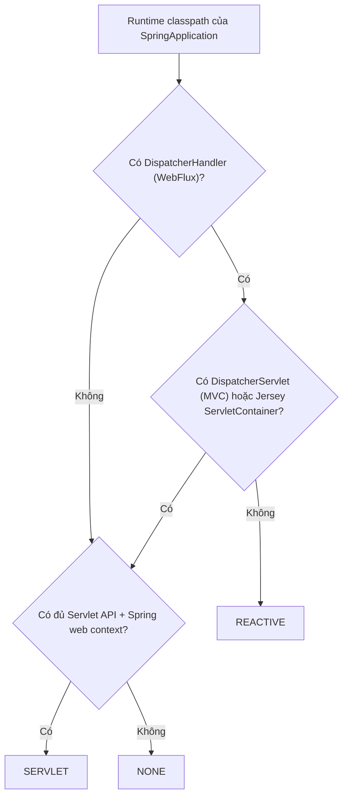

# Cách Spring Boot suy luận kiểu ứng dụng từ classpath

## 1. Vấn đề cần hiểu

Một ứng dụng Spring Boot không nhất thiết là web server. Cùng một class `main` gọi `SpringApplication.run(...)` nhưng Spring Boot có thể khởi tạo **ứng dụng không có web server**, **ứng dụng web dựa trên Servlet**, hoặc **ứng dụng web reactive**. Ở cấu hình mặc định, quyết định ban đầu được **suy luận từ những class thực sự có trên runtime classpath**.

Ví dụ, thêm `spring-boot-starter-web` thường làm ứng dụng trở thành Servlet web application; chỉ thêm `spring-boot-starter-webflux` thường làm ứng dụng trở thành reactive web application; nếu không có những hạ tầng web nhận diện được, ứng dụng thường thuộc loại `NONE`. Khi cả Spring MVC và WebFlux đều có mặt, **MVC/Servlet được ưu tiên trong tình huống starter thông dụng**.

Bài này mô tả cơ chế của **Spring Boot 3.x (đặc biệt 3.3.x), chạy với Java 17+**. Spring Boot 4.x có một số thay đổi nội bộ về cách tổ chức bộ nhận diện; khi nâng major version, hãy đối chiếu mã nguồn/tài liệu đúng phiên bản thay vì áp dụng máy móc tên method nội bộ từ 3.x.

### 1.1. Runtime classpath là gì?

*Classpath* là tập các class và thư viện mà class loader có thể tải khi chương trình thực sự chạy. Nó bao gồm class của ứng dụng và các dependency trực tiếp hoặc bắc cầu có mặt trong runtime. Trong Spring Boot executable JAR, các JAR thư viện đóng gói theo cơ chế Boot launcher cũng tham gia classpath logic của ứng dụng.

Phân biệt:

- **Khai báo dependency** trong `build.gradle`/`pom.xml`: mô tả ý định.
- **Runtime classpath đã được resolve**: chứa các class mà ứng dụng thực sự nhìn thấy sau khi xét dependency, exclusion, profile/cấu hình build, packaging.
- **ApplicationContext và web server đã khởi động**: kết quả của bước bootstrap sau khi lựa chọn kiểu ứng dụng.

Spring Boot không quyết định chỉ bằng tên artifact `starter-web` hay tên module. Nó nhận diện **sự có mặt của các class hạ tầng đặc trưng**. Vì vậy dependency bắc cầu cũng có thể thay đổi kết quả.

## 2. Ba giá trị WebApplicationType

Spring Boot 3.x dùng enum `org.springframework.boot.WebApplicationType`:

| Giá trị | Ý nghĩa | Loại context Boot thường tạo theo mặc định | Embedded HTTP server |
| --- | --- | --- | --- |
| `NONE` | Ứng dụng Java/Spring không chạy ở chế độ web | `AnnotationConfigApplicationContext` | Không tự khởi động |
| `SERVLET` | Ứng dụng web theo Servlet API, thường dùng Spring MVC | `AnnotationConfigServletWebServerApplicationContext` | Thông thường có, ví dụ Tomcat |
| `REACTIVE` | Ứng dụng web reactive, thường dùng Spring WebFlux | `AnnotationConfigReactiveWebServerApplicationContext` | Thông thường có, ví dụ Reactor Netty |

**Lưu ý:** Các tên context trong bảng là kết quả thông thường với `ApplicationContextFactory` mặc định của Spring Boot 3.x. Ứng dụng có thể cấu hình factory/context riêng. Kiểu được suy luận cũng **không bảo đảm startup thành công**: một ứng dụng có thể được nhận diện `SERVLET` hoặc `REACTIVE` nhưng thiếu web server factory, cấu hình sai hoặc xung đột dependency.

Điểm khác nhau ở đây là **kiểu hạ tầng ứng dụng**; cả ba đều chạy trong JVM, đều có thể dùng dependency injection, `@Configuration`, `@Bean`, service/repository và Spring lifecycle.

## 3. Spring Boot thực hiện suy luận khi nào?

Khi tạo một `SpringApplication` với cấu hình mặc định, Spring Boot 3.x chọn `WebApplicationType` ban đầu dựa trên các class có thể tải. Sau đó trong `run(...)`, Boot chuẩn bị môi trường và ràng buộc các cấu hình `spring.main.*`; giá trị do người phát triển thiết lập rõ ràng có thể thay thế lựa chọn ban đầu.

Luồng đơn giản hóa:

```text
java -jar / bootRun
        |
        v
Runtime classpath đã được resolve
        |
        v
new SpringApplication(...)
        |
        v
Kiểm tra các indicator class của WebFlux / MVC / Jersey / Servlet
        |
        +--> REACTIVE, SERVLET hoặc NONE (giá trị suy luận ban đầu)
        |
        v
Đọc và áp dụng cấu hình SpringApplication liên quan
        |    ví dụ spring.main.web-application-type
        v
Chọn loại ApplicationContext phù hợp
        |
        v
Refresh context, auto-configuration, khởi tạo embedded server nếu cần
        |
        v
ApplicationReadyEvent khi startup thành công
```

**Suy luận kiểu ứng dụng khác với auto-configuration.** Suy luận trả lời câu hỏi “SpringApplication nên tổ chức runtime theo mô hình nào?”. Auto-configuration sau đó dùng điều kiện về classpath, bean và properties để chọn bean hạ tầng thích hợp. Ví dụ suy luận `SERVLET` không đồng nghĩa “đã có Tomcat khởi động thành công”.

## 4. Thuật toán suy luận của Spring Boot 3.x

### 4.1. Các class đóng vai trò dấu hiệu

Trong cơ chế nội bộ của Spring Boot 3.x, các tên class quan trọng gồm:

| Dấu hiệu | Tên class đầy đủ | Dùng để nhận biết |
| --- | --- | --- |
| WebFlux handler | `org.springframework.web.reactive.DispatcherHandler` | Hạ tầng xử lý request của Spring WebFlux |
| Spring MVC dispatcher | `org.springframework.web.servlet.DispatcherServlet` | Hạ tầng xử lý request của Spring MVC |
| Jersey servlet | `org.glassfish.jersey.servlet.ServletContainer` | Hạ tầng Jersey Servlet, tránh nhầm một số classpath thành reactive |
| Servlet API | `jakarta.servlet.Servlet` | Hạ tầng Servlet API của Spring Boot 3.x |
| Spring servlet context | `org.springframework.web.context.ConfigurableWebApplicationContext` | Hạ tầng web context của Spring |

Trong **Spring Boot 2.x**, class Servlet API thuộc namespace `javax.servlet.*`; **Spring Boot 3.x** dùng `jakarta.servlet.*`. Sao chép thuật toán với tên `javax.servlet.Servlet` từ bài cũ rồi áp dụng cho Boot 3.x sẽ dẫn đến kết luận sai.

Spring sử dụng cơ chế kiểm tra khả năng hiện diện của class (ví dụ `ClassUtils.isPresent`), không phải quét package của source code để tìm `@Controller` hay đọc tên một starter.

### 4.2. Các bước và thứ tự ưu tiên

Diễn giải tương đương về mặt quyết định trong **Spring Boot 3.x** (pseudocode dùng tên dễ hiểu; đây không phải API công khai để người dùng gọi trực tiếp):

```text
if classpath có WebFlux DispatcherHandler
   và KHÔNG có Spring MVC DispatcherServlet
   và KHÔNG có Jersey ServletContainer:
       WebApplicationType = REACTIVE
else if classpath có CẢ jakarta.servlet.Servlet
        và ConfigurableWebApplicationContext:
       WebApplicationType = SERVLET
else:
       WebApplicationType = NONE
```

Quan sát ba điều quan trọng:

1. **REACTIVE có nhánh nhận diện riêng**, cần có dấu hiệu WebFlux và không có dấu hiệu MVC hoặc Jersey.
2. Nếu không vào nhánh REACTIVE, Boot kiểm tra **đủ cả hai** class dấu hiệu Servlet để chọn `SERVLET`.
3. Nếu không thỏa cả hai nhánh, kết quả là `NONE`. Vì vậy không nên suy diễn “cứ thấy một class có chữ web thì chắc chắn là web application”.

Trong các project dùng starter chuẩn, thuật toán trên thường được nói ngắn gọn là **MVC có trước, WebFlux có sau, còn lại NONE**. Cách nói ngắn này hữu ích để nhớ, nhưng kiểm tra class thực tế có thêm các điều kiện Servlet/Jersey như ở trên.

### 4.3. Minh họa bằng sơ đồ quyết định



Sơ đồ được giới hạn cho quy tắc suy luận mặc định của **Spring Boot 3.x**. Nó chưa tính tới trường hợp ứng dụng **ghi đè kiểu web** bằng cấu hình hoặc tùy biến cơ chế tạo context.

## 5. Các tình huống classpath điển hình

Bảng sau giả định dependency được resolve theo starter Spring Boot 3.3.x thông dụng, không loại bỏ class quan trọng và không có `spring.main.web-application-type` ghi đè:

| Runtime dependency chính | Dấu hiệu thường có | Kết quả mặc định | Lý do |
| --- | --- | --- | --- |
| `spring-boot-starter`, không có stack web | Thiếu MVC/WebFlux và thiếu đủ dấu hiệu Servlet | `NONE` | Dự án có Spring context nhưng không có web runtime |
| `spring-boot-starter-web` | `DispatcherServlet` cùng Servlet API và Spring web context | `SERVLET` | Spring MVC/Servlet được nhận diện |
| `spring-boot-starter-webflux`, không có MVC/Jersey | `DispatcherHandler` | `REACTIVE` | WebFlux được nhận diện, không bị MVC/Jersey chặn |
| Cả `spring-boot-starter-web` và `spring-boot-starter-webflux` | Cả MVC và WebFlux indicator | `SERVLET` | MVC hiện diện nên không chọn nhánh reactive; đủ điều kiện Servlet |
| Chỉ có một thư viện sử dụng Reactor, không có WebFlux dispatcher | Không có `DispatcherHandler` | Thường `NONE` | Reactor Core không đồng nghĩa WebFlux web runtime |
| Có `spring-webflux` để dùng `WebClient` trong ứng dụng MVC | MVC và WebFlux thường cùng xuất hiện | `SERVLET` | Thêm WebClient không tự biến server MVC thành WebFlux |

**Ví dụ phổ biến:** Một API MVC sử dụng `WebClient` để gọi service bên ngoài vẫn có thể dùng Tomcat + `DispatcherServlet`. Thư viện client reactive **khác với** mô hình HTTP server của chính ứng dụng.

**Tình huống Jersey:** Việc có class `org.glassfish.jersey.servlet.ServletContainer` làm nhánh ưu tiên REACTIVE không được chọn trong cơ chế 3.x. Tuy nhiên kết quả `SERVLET` vẫn đòi hỏi đủ các dấu hiệu Servlet; không nên nói riêng sự hiện diện của một class Jersey là bằng chứng chắc chắn có servlet server hoạt động.

## 6. Bài thực hành: chạy cùng một main với ba classpath khác nhau

Ví dụ dùng **Java 17+ và Spring Boot 3.3.x**. Bạn có thể tạo một dự án Spring Boot Gradle Groovy qua Spring Initializr, chọn Java 17 và thay dependency như bên dưới. Phần chính của thí nghiệm là **giữ nguyên Java source, chỉ thay runtime dependency**.

### 6.1. File build.gradle

Ví dụ cấu hình hoàn chỉnh cho Gradle Java (được thiết kế cho Spring Boot 3.3.13):

```groovy
plugins {
    id 'java'
    id 'org.springframework.boot' version '3.3.13'
    id 'io.spring.dependency-management' version '1.1.7'
}

group = 'com.example'
version = '0.0.1-SNAPSHOT'

java {
    toolchain {
        languageVersion = JavaLanguageVersion.of(17)
    }
}

repositories {
    mavenCentral()
}

dependencies {
    implementation 'org.springframework.boot:spring-boot-starter'
}
```

Ở lượt đầu, chỉ có `spring-boot-starter` (không kèm web starter). Trong lượt tiếp theo, **thay duy nhất phần `dependencies`** bằng một trong hai block dưới đây:

**Lượt Servlet:**

```groovy
dependencies {
    implementation 'org.springframework.boot:spring-boot-starter-web'
}
```

**Lượt Reactive:**

```groovy
dependencies {
    implementation 'org.springframework.boot:spring-boot-starter-webflux'
}
```

**Lượt hỗn hợp MVC + WebFlux:**

```groovy
dependencies {
    implementation 'org.springframework.boot:spring-boot-starter-web'
    implementation 'org.springframework.boot:spring-boot-starter-webflux'
}
```

Mỗi lượt chỉ dùng một block dependency tại một thời điểm rồi chạy lại ứng dụng. Các starter web thường đã kéo theo hạ tầng Spring cơ bản, nên ví dụ không cần thêm `spring-boot-starter` riêng khi đã dùng web/webflux starter.

### 6.2. File Java đo kiểu ứng dụng và context

Tạo file **`src/main/java/com/example/webtype/WebTypeLabApplication.java`**:

```java
package com.example.webtype;

import java.util.Map;

import org.springframework.boot.SpringApplication;
import org.springframework.boot.autoconfigure.SpringBootApplication;
import org.springframework.boot.web.context.WebServerApplicationContext;
import org.springframework.context.ConfigurableApplicationContext;

@SpringBootApplication
public class WebTypeLabApplication {

    public static void main(String[] args) {
        SpringApplication application =
                new SpringApplication(WebTypeLabApplication.class);

        // Chọn port ngẫu nhiên cho thử nghiệm có web server.
        // Các giá trị default có thể bị ghi đè bởi tham số dòng lệnh.
        application.setDefaultProperties(Map.of(
                "server.port", "0",
                "spring.main.banner-mode", "off",
                "logging.level.root", "ERROR"
        ));

        try (ConfigurableApplicationContext context = application.run(args)) {
            System.out.println("Type: " + application.getWebApplicationType());
            System.out.println("Context: " + context.getClass().getSimpleName());
            System.out.println("WebServerContext: "
                    + (context instanceof WebServerApplicationContext));
        }
    }
}
```

**Tại sao code này đo đúng thứ cần học?**

- `new SpringApplication(...)` tạo đối tượng bootstrap và thực hiện lựa chọn kiểu mặc định.
- `application.run(args)` khởi tạo context thực, đồng thời áp dụng những thuộc tính được cấu hình trong quá trình startup.
- `getWebApplicationType()` cho biết kiểu mà `SpringApplication` đang sử dụng sau bootstrap. Không gọi method nội bộ `deduceFromClasspath()` vì đó không phải API ứng dụng công khai của Boot 3.x.
- `context.getClass().getSimpleName()` cho biết loại context thực tế được tạo.
- `instanceof WebServerApplicationContext` phân biệt context web server với context thường trong tình huống mặc định.
- `server.port=0` để hệ điều hành chọn cổng trống cho lượt thử web, tránh tranh chấp cổng 8080; `try` đóng context sau khi in nên ứng dụng không phục vụ HTTP lâu dài.

### 6.3. Lệnh chạy

**Windows PowerShell:**

```powershell
.\gradlew.bat bootRun
```

**macOS/Linux:**

```bash
./gradlew bootRun
```

Ví dụ giả định dự án có Gradle Wrapper và đã tải được dependency. Gradle có thể in thông tin tác vụ build trước/sau stdout của ứng dụng.

### 6.4. Kết quả dự kiến

**Chỉ `spring-boot-starter`:**

```text
Type: NONE
Context: AnnotationConfigApplicationContext
WebServerContext: false
```

**Chỉ `spring-boot-starter-web`:**

```text
Type: SERVLET
Context: AnnotationConfigServletWebServerApplicationContext
WebServerContext: true
```

**Chỉ `spring-boot-starter-webflux`:**

```text
Type: REACTIVE
Context: AnnotationConfigReactiveWebServerApplicationContext
WebServerContext: true
```

**Cả hai starter web:**

```text
Type: SERVLET
Context: AnnotationConfigServletWebServerApplicationContext
WebServerContext: true
```

Đây là ba dòng do **mã ví dụ tự in** cho mỗi trường hợp với `ApplicationContextFactory` mặc định của Boot 3.3.x; log thực tế có thể khác tùy công cụ build, cấu hình và dependency. Nếu đã thay custom context factory hoặc cấu hình override thì cần suy luận theo cấu hình thực tế.

## 7. Ghi đè WebApplicationType khi không muốn dùng kết quả suy luận

### 7.1. Qua application.properties

Cấu hình này cho biết Spring Boot không khởi động ứng dụng ở chế độ web dù classpath có MVC/WebFlux:

```properties
spring.main.web-application-type=none
```

YAML tương đương:

```yaml
spring:
  main:
    web-application-type: none
```

Dùng cho batch job, CLI, worker hoặc tác vụ khởi động rồi kết thúc, khi dự án vẫn có các thư viện web phục vụ mục đích khác. Đặt cấu hình này trong môi trường phù hợp; nếu ứng dụng thực sự cần nhận HTTP request, `NONE` sẽ không tạo web server cho bạn.

**Phân biệt các properties thường dễ nhầm:**

| Cấu hình | Tác động chính |
| --- | --- |
| `spring.main.web-application-type=none` | Chọn non-web application context, không tự khởi động embedded web server |
| `server.port=0` | Vẫn là web application; web server lắng nghe trên cổng khả dụng do OS chọn |
| `server.port=-1` | Với cấu hình web server hỗ trợ, tắt HTTP listener nhưng vẫn giữ web application context; không tương đương `NONE` |
| `server.port=8081` | Thay cổng HTTP; không đổi `SERVLET` thành `REACTIVE` hoặc ngược lại |

**Chuyển sang `REACTIVE` bằng cấu hình** chỉ hợp lý khi classpath có **đủ hạ tầng WebFlux và reactive web server factory tương thích**. Nếu chỉ có Servlet starter nhưng ép `REACTIVE`, ứng dụng có thể thất bại trong lúc tạo/refresh context. Ghi đè enum **không tự tải thêm thư viện**.

### 7.2. Qua code Java

Với `SpringApplication`:

```java
SpringApplication application = new SpringApplication(WebTypeLabApplication.class);
application.setWebApplicationType(WebApplicationType.NONE);
application.run(args);
```

Imports cần thiết:

```java
import org.springframework.boot.SpringApplication;
import org.springframework.boot.WebApplicationType;
```

Đây là **đoạn minh họa rời**, đặt trong `main` thay logic chạy tương ứng ở ví dụ trước; không phải một file Java độc lập thứ hai.

Hoặc dùng `SpringApplicationBuilder`:

```java
new SpringApplicationBuilder(WebTypeLabApplication.class)
        .web(WebApplicationType.NONE)
        .run(args);
```

Import bổ sung là `org.springframework.boot.builder.SpringApplicationBuilder`.

Khi có cả cấu hình file, command line và thao tác thiết lập bằng code, cần kiểm tra **giá trị cuối cùng SpringApplication sử dụng** và cách Boot bind `spring.main.*` ở phiên bản tương ứng; không suy ra thứ tự ưu tiên từ vị trí câu lệnh trong source.

### 7.3. Thử override ngay trên dòng lệnh

Trong ví dụ Gradle đã tạo, thử:

```powershell
.\gradlew.bat bootRun --args="--spring.main.web-application-type=none"
```

```bash
./gradlew bootRun --args='--spring.main.web-application-type=none'
```

Khi project có `starter-web` nhưng không có cấu hình tùy biến khác, kết quả sẽ chuyển thành:

```text
Type: NONE
Context: AnnotationConfigApplicationContext
WebServerContext: false
```

**Không sửa dependency** trong thử nghiệm này: chính cấu hình `spring.main.web-application-type` làm thay đổi runtime type, chứng minh classpath chỉ quyết định **mặc định**.

## 8. Thêm dependency hoặc sửa cấu hình: điều gì thực sự đổi?

Giả sử dự án ban đầu là một HTTP API chạy Spring MVC:

```groovy
dependencies {
    implementation 'org.springframework.boot:spring-boot-starter-web'
}
```

Sau đó đội phát triển muốn gọi hệ thống bên ngoài bằng `WebClient` và thêm:

```groovy
dependencies {
    implementation 'org.springframework.boot:spring-boot-starter-web'
    implementation 'org.springframework.boot:spring-boot-starter-webflux'
}
```

Kết quả thông thường vẫn là `SERVLET`. `WebClient` có thể hoạt động như HTTP client trong ứng dụng Servlet; **client API mà controller gọi ra ngoài không quyết định web server xử lý request vào**.

Ngược lại, muốn dùng reactive web server thật sự cho request vào, hãy thiết kế dependency sao cho không có MVC indicator chen vào; dùng WebFlux starter, controller/handler phù hợp và kiểm chứng kiểu `REACTIVE`. Nếu cả hai stack cùng có mặt vì nhu cầu đặc thù, cân nhắc override có chủ đích, đồng thời kiểm tra các bean/web server factory cần thiết. Chọn `REACTIVE` chỉ vì muốn non-blocking HTTP client là nhầm lẫn giữa client và server model.

## 9. Kiểm tra classpath và chẩn đoán sai kiểu ứng dụng

### 9.1. Quan sát dependency runtime, không dựa vào tên dự án

Trong Gradle:

```powershell
.\gradlew.bat dependencies --configuration runtimeClasspath
```

Hoặc trên macOS/Linux:

```bash
./gradlew dependencies --configuration runtimeClasspath
```

Với Maven:

```bash
./mvnw dependency:tree
```

Tìm `spring-webmvc`, `spring-webflux`, `jakarta.servlet-api`, web server starter và các dependency bắc cầu. Nếu bất ngờ nhận `SERVLET`, xem liệu dependency nào đã kéo `spring-webmvc`/`DispatcherServlet` vào runtime. Nếu bất ngờ nhận `NONE`, xem có thiếu class Servlet/WebFlux indicator hay không. **Sự tồn tại của dependency trên compile classpath không đảm bảo nó có mặt khi chạy JAR triển khai**.

Khi đánh giá một executable JAR, cần chắc chắn đó là đúng artifact và đúng runtime environment. Local IDE, `bootRun` và `java -jar` có thể chạy với tập dependency hoặc property khác nhau nếu cấu hình build/deployment không đồng nhất.

### 9.2. Đọc context thực tế sau khi chạy

Một app đã khởi động thành công có thể in:

```java
System.out.println(context.getClass().getName());
```

Các loại context thuộc package Spring Boot hoặc Spring Context sẽ giúp biết cách app đã được bootstrap. Kết hợp đọc `application.getWebApplicationType()`, các dòng cấu hình `spring.main.web-application-type` và dependency tree để tìm nguyên nhân. **Đừng dùng “có HTTP endpoint” làm tín hiệu duy nhất**, vì có ứng dụng web context chưa mở port hoặc endpoint bị giới hạn bởi routing/security.

### 9.3. Những lỗi thường gặp

| Triệu chứng | Nguyên nhân có thể | Hướng xử lý |
| --- | --- | --- |
| Dự kiến WebFlux nhưng log/context là Servlet | `spring-webmvc`/`DispatcherServlet` được đưa vào classpath | Xem dependency tree; loại dependency MVC không cần thiết hoặc chọn override có kiểm chứng |
| Dự kiến web server nhưng nhận `NONE` | Thiếu các class indicator; dependency bị exclude hoặc runtime khác compile time | Kiểm tra runtime classpath, packaging và cấu hình `spring.main.web-application-type` |
| Chọn `SERVLET` nhưng fail lúc startup | Thiếu `ServletWebServerFactory`/embedded server hoặc cấu hình server sai | Khôi phục web server starter phù hợp; xem nguyên nhân gốc trong exception |
| Ép `REACTIVE` rồi gặp missing reactive web server factory | Có giá trị enum `REACTIVE` nhưng thiếu hạ tầng web reactive thực tế | Bổ sung WebFlux/reactive server tương thích hoặc bỏ override |
| App vẫn dùng context web nhưng không có cổng HTTP mở | Đặt `server.port=-1` hoặc cấu hình khác vô hiệu listener | Kiểm tra ý định: cần context web hay cần `NONE` |
| Thêm `WebClient` và nghĩ app tự chuyển sang reactive | Nhầm client HTTP với reactive server model | Kiểm tra `WebApplicationType`; MVC thường vẫn thắng khi cả hai cùng có mặt |
| Tưởng loại context phụ thuộc vào annotation `@RestController` | Suy luận dựa trên class có trong runtime classpath, không phải số lượng controller | Kiểm tra dependency và class indicator thay vì đếm annotation |

Không có `@Controller` vẫn có thể tạo web server nếu classpath và cấu hình cho biết app thuộc web type. Ngược lại, đặt annotation controller vào source không làm runtime có Servlet/WebFlux đầy đủ khi thư viện cần thiết bị thiếu.

## 10. Các ngộ nhận cần tránh

1. **“Có `@SpringBootApplication` là web application.”** Sai. Annotation này cũng dùng cho CLI, batch và service không mở HTTP.
2. **“Boot nhìn tên `spring-boot-starter-web` để chọn enum.”** Không chính xác. Nó nhận diện class indicator trên runtime classpath; starter là cách phổ biến đưa những class đó vào.
3. **“`WebClient` đồng nghĩa app chạy WebFlux server.”** Sai. Client gọi ra ngoài và server nhận request là hai vai trò khác nhau.
4. **“Hai starter Web MVC + WebFlux làm Boot chọn REACTIVE.”** Mặc định ở Boot 3.x thông dụng là `SERVLET` vì MVC được ưu tiên.
5. **“Có một class WebFlux bất kỳ là REACTIVE.”** Sai. Thuật toán 3.x xét `DispatcherHandler` và sự vắng mặt của MVC/Jersey indicator.
6. **“Chỉ cần một class Servlet API là SERVLET.”** Sai. Boot 3.x còn xét Spring Servlet web context, đồng thời có nhánh REACTIVE ở trước.
7. **“Suy luận SERVLET nghĩa là server đã chạy.”** Sai. Chọn runtime type xảy ra trước refresh/startup; thiếu server factory vẫn làm quá trình fail.
8. **“Đặt `server.port=0` sẽ biến app thành NONE.”** Sai. Port 0 yêu cầu chọn cổng ngẫu nhiên; `spring.main.web-application-type=none` mới chủ động chọn non-web.
9. **“Một lần suy luận classpath áp dụng cho mọi triển khai.”** Sai. Dependency và properties của từng artifact, profile, môi trường có thể khác.
10. **“Luôn lấy thuật toán Boot 2.x hoặc 4.x áp dụng nguyên vẹn cho 3.x.”** Sai. Namespace Servlet và cơ chế nhận diện có thể đổi giữa các major version.

## 11. Câu hỏi tự kiểm tra

**Câu 1.** Project chỉ có `spring-boot-starter`, không có WebFlux/MVC indicator, không override. Kiểu gì?

> `NONE`. Ứng dụng vẫn có Spring container và bean nhưng không tự chạy HTTP server.

**Câu 2.** Thêm `spring-boot-starter-web` vào project và không cấu hình gì khác?

> Thông thường `SERVLET`, tạo Servlet web server context; Tomcat được starter mang theo theo mặc định của Boot 3.3.x.

**Câu 3.** Thêm cả `spring-boot-starter-web` và `spring-boot-starter-webflux`?

> Thông thường `SERVLET` vì có `DispatcherServlet` cùng hạ tầng Servlet. Có thể vẫn dùng `WebClient`.

**Câu 4.** Có WebFlux `DispatcherHandler`, không có MVC/Jersey indicator?

> `REACTIVE` theo nhánh suy luận của Boot 3.x. Sau đó startup vẫn cần đầy đủ hạ tầng reactive tương thích.

**Câu 5.** Classpath có Servlet nhưng cấu hình `spring.main.web-application-type=none`?

> Kiểu thực tế theo cấu hình là `NONE` khi cấu hình được áp dụng. Classpath chỉ mang lại lựa chọn mặc định.

**Câu 6.** Nhìn thấy `MissingWebServerFactoryBeanException` có nghĩa thuật toán suy luận bị lỗi?

> Không nhất thiết. Nó có thể cho biết Boot đã chọn một web type nhưng không có web server factory cần thiết để khởi động; cần xem dependency và stack trace.

**Câu 7.** Vì sao chỉ nhìn `server.port` không thể xác định mô hình MVC hay WebFlux?

> `server.port` điều khiển listener của web server, không cho biết HTTP request đi qua Servlet MVC hay reactive WebFlux stack.

## 12. Ghi nhớ và tài liệu đối chiếu

- **Classpath quyết định kiểu mặc định.** Với starter chuẩn của Boot 3.x: MVC → `SERVLET`; nếu không có MVC mà có WebFlux → `REACTIVE`; không có hạ tầng web phù hợp → `NONE`.
- **Thuật toán cụ thể có điều kiện indicator**, gồm Spring MVC, WebFlux, Jersey và hai dấu hiệu Servlet. Dependency bắc cầu và exclusions có thể tác động.
- **Cấu hình có thể ghi đè.** `spring.main.web-application-type` hoặc API `SpringApplication.setWebApplicationType` cho phép lựa chọn có chủ đích; phải đảm bảo dependency phù hợp.
- **Luôn kiểm chứng hai tầng:** giá trị `WebApplicationType` mà `SpringApplication` đang dùng và class context/server thực sự tạo sau startup. Phân biệt suy luận, cấu hình, auto-configuration và server startup.

Tài liệu chính thức phù hợp với Spring Boot 3.x:

- [Spring Boot 3.3 — SpringApplication / Web Environment](https://docs.spring.io/spring-boot/docs/3.3.0-M2/reference/html/features.html) — mô tả cách Boot chọn context cho MVC/WebFlux/non-web.
- [Spring Boot 3.3 — Embedded Web Servers](https://docs.spring.io/spring-boot/3.3/how-to/webserver.html) — cách cấu hình `spring.main.web-application-type=none`, `server.port` và embedded server.
- [Spring Boot 3.4 API — `WebApplicationType`](https://docs.spring.io/spring-boot/3.4/api/java/org/springframework/boot/WebApplicationType.html) — các giá trị enum và API liên quan gần cùng thế hệ Boot 3.x.

Với ứng dụng cần quyết định chính xác cho một minor/patch version cụ thể, đọc mã `org.springframework.boot.WebApplicationType` và `SpringApplication` tương ứng của version đang dùng, đồng thời kiểm tra dependency runtime thực tế.
