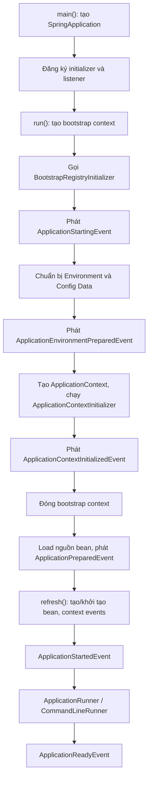

# Chuẩn bị bootstrap context và thông báo bắt đầu trong Spring Boot

## 1. Bài toán: trước khi có `ApplicationContext`, Spring Boot làm gì?

Một ứng dụng Spring Boot thường bắt đầu bằng:

```java
SpringApplication.run(MyApplication.class, args);
```

Lời gọi ngắn gọn này che đi một giai đoạn quan trọng: Boot phải tổ chức một số công việc **trước khi `Environment` hoàn chỉnh và trước khi `ApplicationContext` được tạo**. Một thành phần hỗ trợ giai đoạn sớm này là **bootstrap context**. Sau khi đăng ký các thành phần khởi động cần thiết, Boot phát **`ApplicationStartingEvent`**, sự kiện thông báo một lượt chạy của `SpringApplication` vừa bắt đầu.

Hai khái niệm trong đề bài có liên hệ chặt chẽ nhưng trách nhiệm khác nhau:

- **Bootstrap context:** kho đăng ký đối tượng tạm thời dùng trong bootstrap, đặc biệt khi một đối tượng cần được tạo/truy cập trước khi IoC container chính sẵn sàng.
- **Thông báo bắt đầu (`ApplicationStartingEvent`):** tín hiệu vòng đời cấp ứng dụng, được gửi rất sớm để các `ApplicationListener` đã đăng ký có thể thực hiện hoạt động khởi động thích hợp.

Chúng không phải hai tên cho cùng một đối tượng. Bootstrap context giữ hoặc cung cấp đối tượng; sự kiện thông báo rằng quá trình chạy đã vào mốc bắt đầu. Cả hai đều được `SpringApplication` điều phối.

Bài học sử dụng tên API và package của **Spring Boot 3.3.x, Java 17+**. Spring Boot 4 có thay đổi tổ chức package cho một số API bootstrap; khi làm việc với dự án 3.x, hãy sử dụng đúng import theo phiên bản dự án.

## 2. Vì sao cần một bootstrap context riêng?

Spring Framework quản lý bean thông qua `ApplicationContext` và `BeanFactory`. Nhưng muốn tạo `ApplicationContext`, Boot phải chuẩn bị môi trường, tính toán các nguồn cấu hình và chạy một số hook rất sớm. Những hook đó có thể cần chia sẻ một đối tượng đắt tiền hoặc cần tái sử dụng cho nhiều bước bootstrap.

Ví dụ: một thành phần tích hợp cấu hình bên ngoài cần một client để đọc metadata ban đầu. Client đó có thể cần được tạo trước khi Spring container quản lý các bean thông thường. Bootstrap context cho phép đăng ký **nhà cung cấp instance theo kiểu dữ liệu**, và tạo instance khi thành phần bootstrap thực sự yêu cầu.

Đặc điểm chính:

| Thuộc tính | Bootstrap context | `ApplicationContext` của Spring |
| --- | --- | --- |
| Mục đích | Hỗ trợ giai đoạn chuẩn bị rất sớm, nhất là xử lý `Environment` và tài nguyên bootstrap | IoC container chính quản lý bean ứng dụng và hạ tầng |
| Thời điểm tồn tại | Từ đầu `SpringApplication.run()` đến khi context chính được chuẩn bị | Được tạo sau khi `Environment` đã được chuẩn bị, sau đó được refresh |
| Truy cập | Đăng ký/truy xuất bằng `Class<T>` qua `BootstrapRegistry` / `BootstrapContext` | Tra cứu bean, dependency injection, bean scopes, events |
| Tạo đối tượng | Thường là singleton được cung cấp lazily qua `InstanceSupplier` | Theo bean definitions, scope, dependency graph, post-processors |
| Đóng | Có sự kiện `BootstrapContextClosedEvent` riêng trong giai đoạn chuẩn bị context | Đóng bằng `ApplicationContext.close()`, gắn với lifecycle bean |
| Tự động biến thành bean? | **Không** | Các bean được đăng ký/khám phá theo cơ chế container |

Một điểm dễ nhầm là **bootstrap context ở đây không phải Spring Cloud bootstrap application context** từng dùng với `bootstrap.yml` trong một số mô hình Spring Cloud. Đây là cơ chế `BootstrapContext` / `BootstrapRegistry` thuộc **Spring Boot** để chuẩn bị ứng dụng rất sớm. Nó cũng không phải servlet container, Tomcat hay Docker container.

## 3. Các API và vai trò của chúng

Trong Spring Boot 3.3, những kiểu quan trọng thuộc package `org.springframework.boot`:

- `BootstrapContext`: giao diện để truy xuất instance đã đăng ký, ví dụ `get(MyClient.class)` hoặc `isRegistered(MyClient.class)`.
- `BootstrapRegistry`: giao diện đăng ký nhà cung cấp instance bằng `register(...)` hoặc `registerIfAbsent(...)`, và hỗ trợ `addCloseListener(...)`.
- `ConfigurableBootstrapContext`: kết hợp khả năng truy xuất của `BootstrapContext` và khả năng đăng ký của `BootstrapRegistry`.
- `DefaultBootstrapContext`: hiện thực thông dụng do Boot tạo trong giai đoạn bootstrap.
- `BootstrapRegistryInitializer`: callback để đăng ký thành phần vào `BootstrapRegistry` trước khi registry được sử dụng.
- `BootstrapContextClosedEvent`: sự kiện khi bootstrap context đóng và `ApplicationContext` đã được chuẩn bị.

API tương ứng trên `SpringApplication` là:

```java
SpringApplication app = new SpringApplication(MyApplication.class);

app.addBootstrapRegistryInitializer(registry -> {
    registry.register(MyBootstrapClient.class,
            bootstrapContext -> new MyBootstrapClient());
});

app.run(args);
```

**Đây là đoạn minh họa**, yêu cầu class `MyApplication` và `MyBootstrapClient` được định nghĩa. Ví dụ đầy đủ có thể chạy ở mục 7.

Điểm đáng nhớ: gọi `addBootstrapRegistryInitializer(...)` **trước** `run(args)`. Boot gọi các initializer khi tạo bootstrap context, rồi mới thông báo sự kiện bắt đầu. Việc đăng ký một `InstanceSupplier` thường **chưa** tạo đối tượng ngay; đối tượng được lấy lần đầu bằng `get(...)` khi cần.

### 3.1. `register`, `registerIfAbsent` và `get`

Giả sử có kiểu `BootstrapClient`:

```java
registry.register(BootstrapClient.class,
        bootstrapContext -> new BootstrapClient());

BootstrapClient client = bootstrapContext.get(BootstrapClient.class);
```

Trong thực tế, `registry` thường nhận từ callback `BootstrapRegistryInitializer`, còn `bootstrapContext` nhận từ một hook/sự kiện ở giai đoạn tương ứng. Đoạn code trên **minh họa hai phía của API**, không phải hai biến đều có sẵn trong cùng scope.

- `register(Type.class, supplier)`: đăng ký supplier cho một kiểu; có thể thay thế đăng ký trước đó theo hợp đồng API.
- `registerIfAbsent(Type.class, supplier)`: chỉ đăng ký nếu chưa có supplier cho kiểu đó.
- `isRegistered(Type.class)`: kiểm tra kiểu có trong registry hay không; không cần tạo đối tượng.
- `get(Type.class)`: lấy instance của kiểu đã đăng ký, tạo lazily nếu chưa được tạo; nếu chưa đăng ký có thể phát sinh `IllegalStateException`.

Registry lưu theo **class key**, nên không giống một bean factory có nhiều bean cùng interface được phân biệt bằng tên hoặc qualifier. Đừng dùng registry như một IoC container đầy đủ.

### 3.2. Khi bootstrap context đóng

`BootstrapRegistry#addCloseListener(...)` đăng ký một listener nhận `BootstrapContextClosedEvent` khi giai đoạn bootstrap kết thúc. Ở thời điểm đó `ApplicationContext` chính đã được **chuẩn bị**, nhưng việc **refresh** và khởi tạo các singleton thông thường còn có thể chưa xảy ra.

Đây là mốc để làm công việc bàn giao tài nguyên đã khởi tạo sớm sang context chính **nếu việc bàn giao thật sự cần thiết và được thiết kế rõ**. Chỉ vì một instance nằm trong bootstrap registry không có nghĩa nó tự động được đưa vào Spring bean registry hay nhận mọi callback vòng đời bean.

Việc “đóng bootstrap context” **không đồng nghĩa** với “tắt ứng dụng”. Nó xảy ra ngay trong chuỗi khởi động, trước thời điểm ứng dụng sẵn sàng phục vụ.

## 4. `ApplicationStartingEvent`: thông báo bắt đầu sớm nhất

`ApplicationStartingEvent` được Boot phát rất sớm khi một lượt `SpringApplication.run()` bắt đầu. Nó xuất hiện **trước khi `Environment` và `ApplicationContext` khả dụng**. Những việc chuẩn bị listener và initializer ban đầu đã được thực hiện để Boot có thể phát và xử lý sự kiện này.

Trong Spring Boot 3.3, sự kiện cung cấp:

| Phương thức | Ý nghĩa |
| --- | --- |
| `getSpringApplication()` | Đối tượng `SpringApplication` của lượt chạy |
| `getArgs()` | Các tham số đầu vào của lượt chạy |
| `getBootstrapContext()` | Bootstrap context sớm của lượt chạy |
| `getTimestamp()` | Timestamp từ cơ chế `ApplicationEvent` |

Không gọi `event.getApplicationContext()` ở mốc này: `ApplicationStartingEvent` không đại diện cho một context chính đã được tạo. Nếu bạn cần đọc property đã được cấu hình hoặc truy cập bean ứng dụng, hãy chọn mốc khác muộn hơn.

Ví dụ dùng `SpringApplication` instance:

```java
SpringApplication app = new SpringApplication(MyApplication.class);

app.addListeners(
    (ApplicationListener<ApplicationStartingEvent>) event -> {
        System.out.println("Spring Boot run is starting");
    }
);

app.run(args);
```

Các import tương ứng là `org.springframework.context.ApplicationListener` và `org.springframework.boot.context.event.ApplicationStartingEvent`. Đoạn minh họa này cần class cấu hình `MyApplication`; ví dụ hoàn chỉnh nằm ở mục 7.

### 4.1. Vì sao `@EventListener` trong bean có thể bỏ lỡ sự kiện?

Ví dụ dưới đây **không phải cách đáng tin để bắt `ApplicationStartingEvent`**:

```java
@Component
class TooLateListener {
    @EventListener
    void whenStarting(ApplicationStartingEvent event) {
        System.out.println("starting");
    }
}
```

Lý do: bean listener chỉ được tạo khi context đã xử lý bean definitions; trong khi `ApplicationStartingEvent` đã phát từ trước. Nếu listener cần nhận sự kiện sớm, hãy đăng ký với `SpringApplication.addListeners(...)` trước `run(args)`, dùng `SpringApplicationBuilder.listeners(...)`, hoặc đăng ký `ApplicationListener` theo cơ chế `META-INF/spring.factories` của Boot.

Một listener dạng `@Bean` hay `@EventListener` là lựa chọn tốt cho **những sự kiện sau khi bean đã được đăng ký**, nhưng không phải công cụ mặc định cho bootstrap events xảy ra trước khi container tồn tại.

### 4.2. `ApplicationStartingEvent` khác `ApplicationStartedEvent`

Hai tên dễ gây nhầm:

- **`ApplicationStartingEvent`**: bắt đầu chuỗi bootstrap, rất sớm, **chưa có** `Environment` hoặc `ApplicationContext` hoàn chỉnh.
- **`ApplicationStartedEvent`**: `ApplicationContext` đã được **refresh** xong, nhưng `ApplicationRunner` và `CommandLineRunner` **chưa** được gọi.
- **`ApplicationReadyEvent`**: Boot đã gọi các runner và tiến tới hoàn thành quy trình startup thông thường.

`ApplicationStartingEvent` là tín hiệu *đang bắt đầu*, không phải bằng chứng server đã sẵn sàng. Nếu một runner ném lỗi sau refresh, `ApplicationStartedEvent` có thể đã xuất hiện nhưng `ApplicationReadyEvent` của luồng thành công sẽ không được phát.

## 5. Trình tự thực hiện trong `SpringApplication.run()`

Mô hình khái niệm của Spring Boot 3.3 khi startup thành công:



Sơ đồ tập trung vào các mốc quan trọng cho bài học, không thể hiện mọi hook nội bộ. Trong thực tế, `ApplicationEnvironmentPreparedEvent` cũng là một phần của quá trình các listener/processor đóng góp vào việc xử lý `Environment`; không nên suy ra rằng **mọi nguồn cấu hình** đều đã xử lý xong trong listener tùy ý chỉ vì tên sự kiện chứa chữ “Prepared”.

Đặc biệt trong Spring Boot 3.3, bootstrap context được đóng trong khi chuẩn bị application context, **trước khi** sự kiện `ApplicationPreparedEvent` được phát sau khi tải nguồn bean. Điều đó cho thấy vòng đời bootstrap registry hoàn tất trước khi toàn bộ Spring IoC context được refresh.

### Các mốc cần phân biệt

| Mốc | Điều đã sẵn sàng | Điều chưa nên giả định |
| --- | --- | --- |
| Sau `BootstrapRegistryInitializer` | Có registry và các supplier đã đăng ký | Có `Environment` hoàn chỉnh, bean ứng dụng |
| `ApplicationStartingEvent` | Có `SpringApplication`, args, bootstrap context | Có `ApplicationContext` |
| `ApplicationEnvironmentPreparedEvent` | Có đối tượng `Environment` để hệ thống chuẩn bị/điều chỉnh | Có Spring bean factory đã refresh |
| `ApplicationContextInitializedEvent` | Có context chính và đã áp dụng `ApplicationContextInitializer` | Bean definitions đã nạp đầy đủ hoặc singleton đã tạo |
| `BootstrapContextClosedEvent` | Context chính đã được chuẩn bị; bootstrap registry kết thúc vai trò | `ApplicationContext` đã refresh xong |
| `ApplicationPreparedEvent` | Nguồn bean đã được load; context chuẩn bị refresh | Các bean singleton đã khởi tạo xong |
| `ApplicationStartedEvent` | Context đã refresh | Các runner đã chạy xong |
| `ApplicationReadyEvent` | Runner đã chạy xong trong nhánh thành công | Hệ thống ngoài chắc chắn khỏe mạnh mãi về sau |

Nếu lỗi xảy ra trên đường khởi động, chuỗi thành công có thể dừng sớm và Boot phát `ApplicationFailedEvent` theo cơ chế xử lý lỗi. Không nên viết logic nghiệp vụ dựa trên giả định mọi sự kiện trong bảng luôn đến đầy đủ.

## 6. Tại sao phải có cả registry và event?

Hai cơ chế giải quyết hai yêu cầu khác nhau.

**Yêu cầu 1: chia sẻ tài nguyên bootstrap.** Một `EnvironmentPostProcessor` hoặc thành phần tích hợp sớm có thể cần client lấy cấu hình. `BootstrapRegistry` cho phép nhiều thành phần cùng lấy một instance đã đăng ký thay vì mỗi nơi tự tạo. Trong trường hợp phức tạp, registry còn giúp tổ chức bàn giao khi `ApplicationContext` đã được tạo.

**Yêu cầu 2: thông báo cột mốc.** Logging hoặc hệ thống đo đạc khởi động có thể cần biết một lượt chạy vừa bắt đầu. `ApplicationStartingEvent` cung cấp tín hiệu này cho listener đã đăng ký sớm, kể cả khi chưa có bean application.

| Câu hỏi | Dùng gì? |
| --- | --- |
| “Tôi cần chia sẻ instance dùng ở các bước xử lý environment trước khi có bean.” | `BootstrapRegistry` và `BootstrapRegistryInitializer` |
| “Tôi cần thực hiện logic cực sớm khi Boot bắt đầu chạy.” | `ApplicationListener<ApplicationStartingEvent>` |
| “Tôi cần chỉnh một cấu hình trước khi load bean definitions.” | Chọn extension point chuẩn cho `Environment`/Config Data như `EnvironmentPostProcessor`, hoặc listener thích hợp với thứ tự xử lý rõ ràng |
| “Tôi cần khởi tạo trạng thái cho một singleton đã inject.” | `@PostConstruct` / custom init, không cần bootstrap registry |
| “Tôi cần kiểm tra dữ liệu sau refresh và có thể làm startup fail.” | `ApplicationRunner` hoặc `CommandLineRunner` |
| “Tôi cần biết runner đã kết thúc.” | `ApplicationReadyEvent` |

Trong ứng dụng thông thường, không cần tự tạo bootstrap registry. Spring Boot dùng cơ chế đó ở tầng hạ tầng và cung cấp API mở rộng cho những trường hợp bootstrap chuyên sâu.

## 7. Ví dụ chạy được: quan sát bootstrap context và sự kiện bắt đầu

Ví dụ này chạy với **Java 17+ và Spring Boot 3.3.x**. Tạo một dự án Spring Boot có dependency `spring-boot-starter`; không cần starter web. Chương trình sẽ đăng ký một token vào bootstrap registry, lấy token trong listener bắt sự kiện bắt đầu, theo dõi các mốc kế tiếp và đóng application context sau khi `run()` trả về.

Đặt file tại `src/main/java/com/example/bootstrap/BootstrapSequenceDemo.java`:

```java
package com.example.bootstrap;

import org.springframework.boot.Banner;
import org.springframework.boot.CommandLineRunner;
import org.springframework.boot.SpringApplication;
import org.springframework.boot.WebApplicationType;
import org.springframework.boot.autoconfigure.SpringBootApplication;
import org.springframework.boot.context.event.ApplicationContextInitializedEvent;
import org.springframework.boot.context.event.ApplicationEnvironmentPreparedEvent;
import org.springframework.boot.context.event.ApplicationPreparedEvent;
import org.springframework.boot.context.event.ApplicationReadyEvent;
import org.springframework.boot.context.event.ApplicationStartedEvent;
import org.springframework.boot.context.event.ApplicationStartingEvent;
import org.springframework.context.ApplicationListener;
import org.springframework.context.annotation.Bean;

@SpringBootApplication
public class BootstrapSequenceDemo {

    public static void main(String[] args) {
        SpringApplication app = new SpringApplication(BootstrapSequenceDemo.class);
        app.setWebApplicationType(WebApplicationType.NONE);
        app.setBannerMode(Banner.Mode.OFF);
        app.setLogStartupInfo(false);

        // Giai đoạn rất sớm: đăng ký supplier và callback đóng bootstrap context.
        app.addBootstrapRegistryInitializer(registry -> {
            System.out.println("01 - BootstrapRegistryInitializer");
            registry.register(StartupToken.class,
                    context -> new StartupToken("registered"));
            registry.addCloseListener(event ->
                    System.out.println("05 - BootstrapContextClosedEvent"));
        });

        // Listener sớm: phải đăng ký trực tiếp trước run().
        app.addListeners((ApplicationListener<ApplicationStartingEvent>) event -> {
            System.out.println("02 - ApplicationStartingEvent");
            StartupToken token =
                    event.getBootstrapContext().get(StartupToken.class);
            System.out.println("token=" + token.value());
        });

        app.addListeners(
                (ApplicationListener<ApplicationEnvironmentPreparedEvent>)
                        event -> System.out.println(
                                "03 - ApplicationEnvironmentPreparedEvent"));

        app.addListeners(
                (ApplicationListener<ApplicationContextInitializedEvent>)
                        event -> System.out.println(
                                "04 - ApplicationContextInitializedEvent"));

        app.addListeners(
                (ApplicationListener<ApplicationPreparedEvent>)
                        event -> System.out.println(
                                "06 - ApplicationPreparedEvent"));

        app.addListeners(
                (ApplicationListener<ApplicationStartedEvent>)
                        event -> System.out.println(
                                "07 - ApplicationStartedEvent"));

        app.addListeners(
                (ApplicationListener<ApplicationReadyEvent>)
                        event -> System.out.println(
                                "09 - ApplicationReadyEvent"));

        try (var context = app.run(args)) {
            System.out.println("10 - SpringApplication.run returned");
        }
    }

    @Bean
    CommandLineRunner startupRunner() {
        return args -> System.out.println("08 - CommandLineRunner");
    }

    record StartupToken(String value) {
    }
}
```

### 7.1. Chạy dự án

Với Maven Wrapper tại thư mục dự án:

```bash
./mvnw spring-boot:run
```

Với Gradle Wrapper và Spring Boot plugin:

```bash
./gradlew bootRun
```

Trên Windows PowerShell, thay bằng `.\mvnw.cmd spring-boot:run` hoặc `.\gradlew.bat bootRun`. Các lệnh này chạy một dự án Spring Boot đã có dependency và cấu hình build, không phải lệnh `javac` thuần cho một file không có các thư viện Spring trên classpath.

### 7.2. Kết quả kỳ vọng

Khi khởi động bình thường, các dòng do **chương trình ví dụ** tạo ra xuất hiện theo thứ tự:

```text
01 - BootstrapRegistryInitializer
02 - ApplicationStartingEvent
token=registered
03 - ApplicationEnvironmentPreparedEvent
04 - ApplicationContextInitializedEvent
05 - BootstrapContextClosedEvent
06 - ApplicationPreparedEvent
07 - ApplicationStartedEvent
08 - CommandLineRunner
09 - ApplicationReadyEvent
10 - SpringApplication.run returned
```

Console vẫn có thể hiển thị log của Spring Boot hoặc build tool xen giữa các dòng, tùy cấu hình. Chương trình không mở HTTP port vì đã chọn `WebApplicationType.NONE`.

### 7.3. Giải thích kết quả

1. `app.run(args)` tạo bootstrap context và gọi `BootstrapRegistryInitializer`; lúc này mới có đăng ký supplier cho `StartupToken`.
2. Boot phát `ApplicationStartingEvent`. Listener sớm dùng `event.getBootstrapContext().get(StartupToken.class)` để **tạo/lấy token lần đầu**. Dòng `token=registered` chứng minh registry đã sử dụng được khi context chính chưa tồn tại.
3. Boot đi tiếp qua bước chuẩn bị `Environment`, rồi tạo và khởi tạo context chính.
4. Bootstrap context đóng, phát `BootstrapContextClosedEvent` tới listener đã được đăng ký bằng `addCloseListener`.
5. Sau đó Boot hoàn thành phần chuẩn bị context, nạp nguồn bean, thông báo `ApplicationPreparedEvent` và refresh.
6. Khi refresh xong, Boot phát `ApplicationStartedEvent`, gọi `CommandLineRunner` rồi phát `ApplicationReadyEvent`.
7. `SpringApplication.run(args)` trả về context cho mã `main()`; try-with-resources đóng context ở cuối block.

Thử bỏ lời gọi `get(StartupToken.class)` khỏi listener: **supplier có thể không cần chạy**, vì đăng ký một supplier khác với yêu cầu tạo instance. Muốn kiểm chứng điều đó trực quan, thêm log bên trong supplier và so sánh hai lượt chạy.

### 7.4. Tại sao dùng `record` trong ví dụ?

`record StartupToken(String value)` chỉ là một Java value object minh họa, yêu cầu Java 16+; dự án Java 17+ đã đáp ứng. Nó **không phải** Spring bean và không cần `@Component`. Bootstrap registry giữ instance theo class key; đó chính là đặc điểm đang được quan sát.

### 7.5. Điều gì xảy ra khi lỗi khởi động?

Nếu một initializer hoặc listener rất sớm ném exception, quá trình startup có thể dừng trước khi context chính được tạo. Nếu exception xảy ra sau refresh nhưng trong runner, `ApplicationStartedEvent` có thể đã được phát mà `ApplicationReadyEvent` không được phát.

Đừng thiết kế callback bootstrap để giả định sẽ luôn có một Spring bean xử lý cleanup. Một tài nguyên được tạo ngoài IoC container cần có **quy trình sở hữu và đóng tài nguyên riêng**, đặc biệt khi khởi động thất bại giữa chừng.

## 8. Cách tích hợp bằng `META-INF/spring.factories` khi làm thư viện

Trong ứng dụng đơn lẻ, `app.addListeners(...)` và `app.addBootstrapRegistryInitializer(...)` rất dễ thấy và kiểm soát. Nhưng một thư viện có thể không sở hữu class `main()` của ứng dụng sử dụng nó. Khi đó Spring Boot 3.3 có cơ chế khai báo một số thành phần khởi động từ `META-INF/spring.factories`.

Ví dụ minh họa dạng cấu hình:

```properties
org.springframework.boot.BootstrapRegistryInitializer=\
com.example.library.LibraryBootstrapInitializer

org.springframework.context.ApplicationListener=\
com.example.library.EarlyStartupListener
```

Đây là **metadata để Boot phát hiện các class do thư viện cung cấp**, không phải hai dòng code Java có thể chạy độc lập. Các class phải thực sự tồn tại, triển khai đúng interface và có constructor thích hợp. SpringFactoriesLoader có quy tắc riêng về classpath, constructor và thứ tự; khi viết thư viện sản phẩm cần thử nghiệm với đúng phiên bản Boot.

Mẫu triển khai initializer:

```java
package com.example.library;

import org.springframework.boot.BootstrapRegistry;
import org.springframework.boot.BootstrapRegistryInitializer;

public final class LibraryBootstrapInitializer
        implements BootstrapRegistryInitializer {

    @Override
    public void initialize(BootstrapRegistry registry) {
        registry.registerIfAbsent(LibraryClient.class,
                context -> new LibraryClient());
    }
}
```

Đây là **đoạn minh họa tích hợp**, giả định có class `LibraryClient` phù hợp. Thư viện có thể đăng ký `ApplicationListener<ApplicationStartingEvent>` riêng để bắt sự kiện sớm. Với use case đơn giản, hãy ưu tiên ví dụ hoàn chỉnh ở mục 7 trước khi dùng cơ chế thư viện.

**Không nhầm `BootstrapRegistryInitializer` với `ApplicationContextInitializer`.**

- `BootstrapRegistryInitializer` làm việc với **registry của bootstrap context** rất sớm.
- `ApplicationContextInitializer<ConfigurableApplicationContext>` tùy biến **application context chính** sau khi nó được tạo nhưng trước khi nạp các bean definitions thông thường.
- `BeanFactoryPostProcessor` can thiệp vào metadata của bean sau khi bean factory đã có; nó là một pha khác.
- `@PostConstruct` chạy trên một bean đã được Spring tạo/inject; muộn hơn nhiều so với `ApplicationStartingEvent`.

## 9. Kết nối bootstrap context với `EnvironmentPostProcessor`

Các thành phần cần chuẩn bị cấu hình từ xa hoặc nguồn cấu hình đặc biệt thường hoạt động gần pha tạo `Environment`. Trong Spring Boot 3.x, `EnvironmentPostProcessor` là một extension point dành cho việc chỉnh `ConfigurableEnvironment` trước khi ứng dụng hoàn tất bootstrap context chính. Các API hỗ trợ lấy tài nguyên từ bootstrap context, nhờ vậy những post-processor hoạt động sớm có thể chia sẻ client hoặc trạng thái bootstrap.

Tuy nhiên, việc tự cài `EnvironmentPostProcessor` không phải lựa chọn mặc định chỉ để sửa một property. Phần lớn ứng dụng nên sử dụng `application.properties`/YAML, biến môi trường, command-line arguments và các lựa chọn Config Data được hỗ trợ.

Nếu xây dựng cơ chế lấy cấu hình bên ngoài, cần thiết kế rõ:

- Khi nào đăng ký client, khi nào thực sự mở kết nối.
- Thứ tự giữa các processor và nguồn cấu hình khác.
- Cách timeout, retry và xử lý lỗi nếu nguồn ngoài không sẵn sàng.
- Cách bàn giao/đóng client sau khi context chính được chuẩn bị.
- Làm sao tránh ghi thông tin nhạy cảm khi quan sát sự kiện sớm.

Không gọi các service bean nghiệp vụ hoặc yêu cầu autowire một repository từ `ApplicationStartingEvent`, bởi container chính chưa được tạo.

## 10. Lỗi phổ biến và cách khắc phục

### “Tôi khai báo `@EventListener(ApplicationStartingEvent.class)` nhưng không thấy log”

Bean listener được tạo quá muộn. Đăng ký một `ApplicationListener<ApplicationStartingEvent>` qua `SpringApplication.addListeners(...)` **trước** `run(args)` hoặc dùng đăng ký sớm qua `spring.factories`.

### “Tôi đã đăng ký supplier mà constructor không chạy”

Đó có thể là hành vi đúng: registry cung cấp instance **lazily**. `register` không bắt buộc khởi tạo object ngay. Hãy kiểm tra có hook nào thực sự gọi `get(Type.class)` chưa.

### “Tôi gọi `bootstrapContext.get(...)` và bị `IllegalStateException`”

Kiểu truy xuất có thể chưa được đăng ký hoặc đăng ký sai class key. Kiểm tra `isRegistered(...)`, class key chính xác và nơi cấu hình initializer. Dùng `registerIfAbsent` nếu thư viện muốn tránh thay thế một đăng ký từ nơi khác.

### “Tôi muốn đọc bean trong `ApplicationStartingEvent`”

Mốc này chưa có `ApplicationContext`. Chuyển logic đến mốc thích hợp sau khi context sẵn sàng, ví dụ runner hoặc một bean lifecycle callback. Không ép khởi tạo container thủ công bên trong listener rất sớm.

### “`BootstrapContextClosedEvent` xuất hiện trước `ApplicationPreparedEvent`”

Trong chuỗi chuẩn của Spring Boot 3.3, việc đóng bootstrap context diễn ra trong quá trình chuẩn bị context chính, trước khi nạp xong các nguồn bean và phát `ApplicationPreparedEvent`. Đây là thứ tự hợp lý: bootstrap context hỗ trợ giai đoạn chuẩn bị sớm rồi nhường vai trò cho context chính.

### “Đóng bootstrap context là ứng dụng đã dừng?”

Không. Đó là việc kết thúc **giai đoạn bootstrap**, không phải shutdown. Để ứng dụng dừng, context chính phải được đóng hoặc quá trình JVM kết thúc theo vòng đời ứng dụng.

### “Tại sao listener in nhiều lần?”

Ở ứng dụng có nhiều context hoặc nhiều lượt `SpringApplication.run()`, một listener có thể nhận nhiều sự kiện. Spring Framework cũng có cơ chế chuyển tiếp event giữa các context có quan hệ cha–con. Đừng giả định mỗi process chỉ có duy nhất một sự kiện ở mọi topology.

### “Tôi nhìn thấy `ApplicationStartingEvent`, vậy ứng dụng đã ready?”

Không. Đó là một trong các sự kiện sớm nhất; nhiều bước bootstrap, refresh và runner còn chưa xảy ra. Chỉ nên dùng `ApplicationReadyEvent` hoặc trạng thái readiness phù hợp để đánh giá quy trình khởi động đã kết thúc; ngay cả readiness cũng có thể đổi trạng thái trong thời gian chạy.

### “Tôi đưa kết nối network vào listener bắt đầu và startup bị chậm”

Listener được gọi đồng bộ theo mặc định; tác vụ mạng kéo dài có thể trì hoãn hoặc chặn bootstrap. Chỉ đặt những việc cần thiết ở giai đoạn rất sớm. Với việc kiểm tra nghiệp vụ có thể chạy sau refresh, cân nhắc `ApplicationRunner`, xử lý timeout và thất bại rõ ràng.

## 11. Bài tập tư duy và kiểm chứng

**Bài tập 1 — phân biệt ba context.** Với một ứng dụng Spring Boot có embedded Tomcat, hãy giải thích:
- Bootstrap context cung cấp gì trước khi context chính sẵn sàng?
- `ApplicationContext` tạo và quản lý những loại bean nào?
- Tomcat đảm nhiệm vai trò gì đối với request HTTP?

*Gợi ý:* Ba đối tượng có ba nhiệm vụ khác nhau: tài nguyên bootstrap sớm, IoC/bean lifecycle và xử lý Servlet HTTP.

**Bài tập 2 — thứ tự sự kiện.** Xếp đúng thứ tự trong trường hợp thành công:

```text
ApplicationPreparedEvent
ApplicationStartingEvent
ApplicationReadyEvent
ApplicationEnvironmentPreparedEvent
ApplicationStartedEvent
```

*Đáp án:* `ApplicationStartingEvent` → `ApplicationEnvironmentPreparedEvent` → `ApplicationPreparedEvent` → `ApplicationStartedEvent` → `ApplicationReadyEvent`. Giữa các mốc còn nhiều bước khác.

**Bài tập 3 — kiểm chứng lazy supplier.** Trong ví dụ mục 7, sửa supplier thành:

```java
registry.register(StartupToken.class, context -> {
    System.out.println("creating StartupToken");
    return new StartupToken("registered");
});
```

Chạy một lượt có `get(StartupToken.class)` và một lượt không gọi `get`. Dự đoán khi nào dòng `creating StartupToken` xuất hiện. Đáp án: chỉ ở lượt mà instance thực sự được yêu cầu lần đầu (hoặc một thành phần khác truy xuất cùng kiểu).

**Bài tập 4 — chọn extension point.** Bạn muốn đọc một property từ `Environment` sau khi việc nạp cấu hình cần thiết hoàn tất, nhưng **không** muốn tự xử lý cơ chế Config Data. Có nên làm trong `ApplicationStartingEvent` không?  
*Đáp án:* Không, vì lúc này `Environment` chưa sẵn sàng. Dùng một mốc sau khi cấu hình đã được xử lý phù hợp hoặc cơ chế binding của bean.

**Bài tập 5 — tài nguyên đắt tiền.** Một thư viện khởi động cần một client để đọc metadata từ xa trước khi có IoC container. Hãy thiết kế vị trí đăng ký supplier, nơi sử dụng, timeout và thời điểm cleanup/bàn giao.  
*Gợi ý:* `BootstrapRegistryInitializer` → đăng ký `InstanceSupplier` → thành phần bootstrap truy xuất qua `BootstrapContext` → có kế hoạch xử lý tại close event và trên nhánh lỗi.

## 12. Tổng kết kiến thức

Trong Spring Boot, giai đoạn khởi động **bắt đầu trước khi Spring Framework refresh bất kỳ `ApplicationContext` chính nào**. Boot tạo bootstrap context, gọi `BootstrapRegistryInitializer` và thông báo `ApplicationStartingEvent` để các listener sớm có thể thực thi. Sau đó Boot mới tiếp tục chuẩn bị `Environment`, tạo/chuẩn bị context chính, nạp nguồn bean và refresh.

Hãy nhớ ba quy tắc vận dụng:

1. **Dùng bootstrap registry để lưu và chia sẻ tài nguyên cho giai đoạn chuẩn bị cực sớm**, với nhận thức rõ về lazy creation và đóng/bàn giao tài nguyên.
2. **Dùng listener được đăng ký trước `run()` để bắt `ApplicationStartingEvent`**; bean `@EventListener` thường ra đời quá muộn.
3. **Không đánh đồng “starting”, “started” và “ready”**; chọn callback theo đúng mức độ sẵn sàng của `Environment`, container, bean và runner.

Khi hiểu ranh giới đó, bạn có thể theo dõi và mở rộng cơ chế bootstrap một cách có kiểm soát mà không đưa logic nghiệp vụ vào pha trước khi IoC container tồn tại.