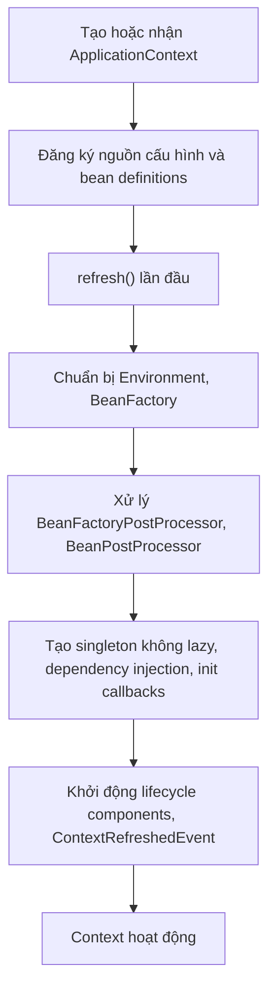
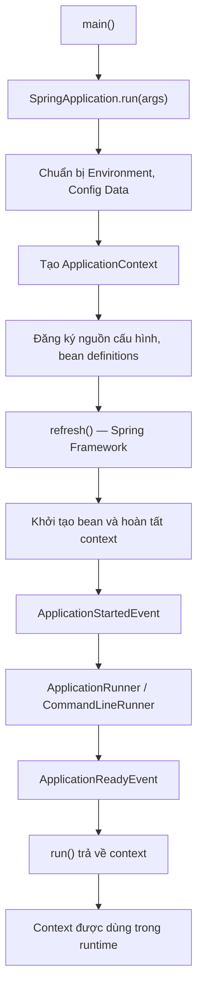
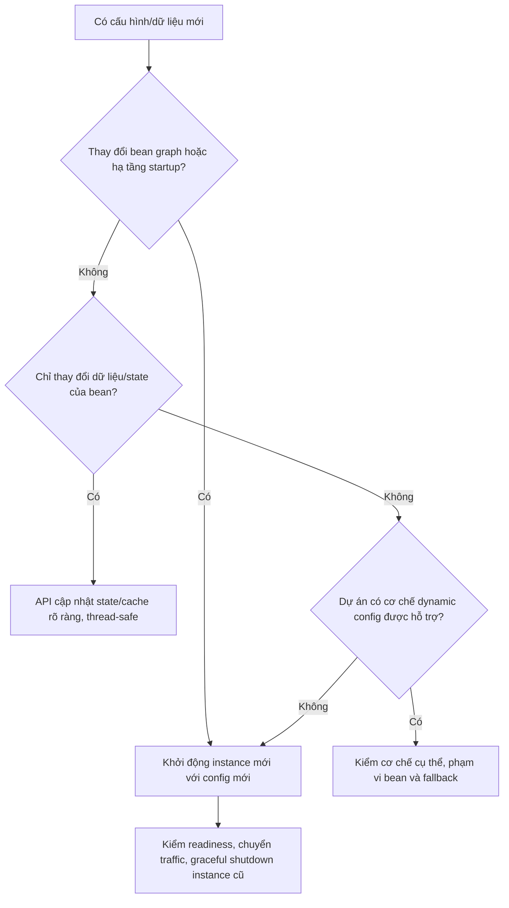

# Giới hạn refresh lại một `ApplicationContext` đã sử dụng

## 1. Vì sao gọi `refresh()` lần hai là một vấn đề?

Trong Spring Framework, `ApplicationContext` là container quản lý định nghĩa bean, dependency injection, singleton, callback vòng đời, event listener và nhiều thành phần hạ tầng. `ConfigurableApplicationContext` có phương thức `refresh()` để **khởi tạo hoặc làm mới trạng thái cấu hình của context**.

Tên gọi `refresh()` dễ dẫn đến suy luận: “Nếu đã chạy ứng dụng rồi, khi thay đổi cấu hình chỉ cần gọi `context.refresh()` thêm lần nữa”. Suy luận này **không đúng với nhiều loại context đang được Spring Boot sử dụng**.

Đặc biệt, `GenericApplicationContext` và các lớp kế thừa nó, trong đó có `AnnotationConfigApplicationContext`, dùng một `BeanFactory` nội bộ được tạo cho vòng đời context. Theo hợp đồng của lớp này, `refresh()` **chỉ được gọi một lần**. Cố gọi lần thứ hai sẽ dẫn đến `IllegalStateException`.

Một số loại context khác được thiết kế để tạo `BeanFactory` mới khi refresh và **có hỗ trợ nhiều lần refresh**, nhưng điều đó không biến refresh trở thành thao tác cập nhật cấu hình không gây gián đoạn. Các bean cũ có thể bị hủy, bean mới được tạo và các tài nguyên bên ngoài phải được xử lý cẩn thận.

Bài học tập trung vào ba câu hỏi:

1. Vì sao giới hạn phụ thuộc vào **loại `ApplicationContext`**, thay vì chỉ nhìn phương thức `refresh()` trên interface?
2. Điều gì xảy ra nếu cố refresh một context đã chạy, nhất là context của ứng dụng Spring Boot?
3. Khi cần nhận cấu hình mới hoặc cập nhật một thành phần đang chạy, nên chọn giải pháp nào?

## 2. `refresh()` thực sự làm gì ở lần khởi động đầu?

`refresh()` không đơn giản là “đọc lại file properties”. Trong `AbstractApplicationContext`, đây là **quá trình chuẩn bị và khởi tạo container**, gồm nhiều bước có ảnh hưởng đến toàn bộ bean graph.

Ở mức khái quát:



Quá trình cụ thể tùy implementation, nhưng các cơ chế quan trọng thường gồm:

- Chuẩn bị context và property sources.
- Xây dựng hoặc sử dụng `BeanFactory` nội bộ.
- Xử lý bean definitions qua các processor.
- Đăng ký các `BeanPostProcessor`, tạo proxy và thực thi các callback khởi tạo.
- Khởi tạo những singleton chưa lazy, giải quyết dependency graph.
- Khởi động các bean quản lý bởi `Lifecycle`/`SmartLifecycle` nếu cấu hình cho phép.
- Phát `ContextRefreshedEvent` ở cuối lần refresh thành công.

Trong ứng dụng Spring Boot thông thường, **`SpringApplication.run(...)` đã thực hiện bước refresh cần thiết**. Khi phương thức này trả về một `ConfigurableApplicationContext` trong nhánh startup thành công, context đã trải qua giai đoạn khởi tạo container; bạn không cần gọi `refresh()` thủ công thêm một lần.

**Phân biệt:** “Refresh một context đã có” khác với “Khởi động lần đầu một context mới”. Việc một implementation có phương thức `refresh()` không có nghĩa nó cho phép nhiều lần gọi trên cùng instance.

## 3. Tại sao `GenericApplicationContext` chỉ refresh được một lần?

`GenericApplicationContext` là một triển khai phổ biến của Spring Framework. Nó tạo và giữ **một instance `DefaultListableBeanFactory`** từ đầu để chương trình có thể đăng ký bean definitions trực tiếp trước khi gọi `refresh()`.

Cách sử dụng điển hình:

```java
GenericApplicationContext context = new GenericApplicationContext();
context.registerBean(GreetingService.class);
context.refresh(); // Lần đầu: hợp lệ
```

Đoạn trên là **mã minh họa**, yêu cầu class `GreetingService` và import. Ví dụ chạy độc lập nằm ở mục 6.

Sau khi refresh thành công, `BeanFactory` đó đã xử lý các bean definitions và tạo các singleton cần thiết. Thực hiện toàn bộ quy trình refresh lần nữa trên chính `BeanFactory` này không phải hợp đồng mà `GenericApplicationContext` cung cấp. Vì thế, việc gọi `refresh()` lần hai sẽ bị từ chối.

### 3.1. Giới hạn đến từ implementation, không đến từ tên interface

`ConfigurableApplicationContext` khai báo:

```java
void refresh() throws BeansException, IllegalStateException;
```

Nó cho phép implementation ném `IllegalStateException` khi context đã khởi tạo và **không hỗ trợ nhiều lần refresh**. Đây là một phần của API contract, không phải lỗi tình cờ của Spring Boot.

So sánh:

| Loại context | Cơ chế BeanFactory | Refresh lại cùng instance? |
| --- | --- | --- |
| `GenericApplicationContext` | Giữ một `DefaultListableBeanFactory` nội bộ | **Không.** `refresh()` được hỗ trợ một lần. |
| `AnnotationConfigApplicationContext` | Kế thừa `GenericApplicationContext`, dùng cấu hình annotation | **Không.** Không tạo BeanFactory mới cho lần refresh tiếp theo. |
| `AnnotationConfigServletWebServerApplicationContext` trong ứng dụng Boot servlet điển hình | Dựa trên các lớp context generic/web của Spring Boot | **Không nên gọi** `refresh()` lần hai; loại context generic không hỗ trợ khởi tạo lại theo cách này. |
| Các implementation dựa trên `AbstractRefreshableApplicationContext` | Có thể bỏ BeanFactory cũ và tạo BeanFactory mới | **Có chủ đích hỗ trợ** nhiều lần refresh ở tầng framework, nhưng phải chấp nhận thay thế bean graph. |
| `ClassPathXmlApplicationContext`/`FileSystemXmlApplicationContext` | Thuộc dòng context có khả năng nạp lại definitions từ XML | Có thể hỗ trợ refresh lại, với ràng buộc vòng đời và tài nguyên. |

Các tên implementation có thể khác theo kiểu ứng dụng, phiên bản Spring Boot và cơ chế cấu hình. Khi xử lý sự cố thực tế, dùng `context.getClass().getName()` để xem loại context, rồi tham chiếu JavaDoc tương ứng. Không suy luận rằng mọi `ApplicationContext` đều refresh được hoặc đều bị cấm.

### 3.2. Những context hỗ trợ nhiều lần refresh vẫn có chi phí

`AbstractRefreshableApplicationContext` được thiết kế để tạo **BeanFactory mới trong mỗi lượt refresh**. Nếu có BeanFactory cũ, framework cần xử lý tài nguyên và singleton trước khi thay nó.

Ví dụ hệ quả:

- Một singleton cũ không tự “biến thành” instance mới; các thành phần nắm tham chiếu cũ có thể trở nên lỗi thời.
- Các `@PostConstruct`, factory method và callback khởi tạo có thể được thực thi lại với instance mới.
- Các callback hủy/lifecycle của bean cũ có thể chạy; connection pool, scheduler hoặc client HTTP có thể đóng rồi được tạo lại.
- Các request đang xử lý, công việc bất đồng bộ, subscription hoặc listener nằm ngoài quản lý của context có thể bị ảnh hưởng.
- Refresh thất bại giữa chừng có thể khiến context không còn hoạt động đúng; không có bảo đảm rollback toàn bộ side effects của ứng dụng.

Vì vậy, khả năng “refresh lại được” của một implementation là **hỗ trợ kỹ thuật có giới hạn**, không phải cam kết zero-downtime hay cập nhật cấu hình nóng cho tất cả thành phần.

## 4. Spring Boot đã refresh context khi nào?

Một lần chạy Spring Boot thành công có luồng cơ bản:



Điều cần nhớ:

- Boot **tạo và refresh** context trong lúc `run()`.
- Sau `run()`, context được thiết kế để dùng cho hoạt động của ứng dụng.
- `ContextRefreshedEvent` là event của Framework khi quá trình refresh hoàn tất; nó không phải lệnh yêu cầu refresh lại.
- `ApplicationReadyEvent` đánh dấu Boot đã hoàn thành bước gọi runner trong startup bình thường; nó cũng không phải lệnh refresh.
- Thay đổi property source, profile hoặc file config sau thời điểm trên không khiến Boot tự chạy toàn bộ chuỗi bootstrap một lần nữa.

Ví dụ cần **tránh**:

```java
ConfigurableApplicationContext context =
        SpringApplication.run(MyApplication.class, args);

context.refresh(); // Sai trong ứng dụng Boot thông thường:
                   // context đã được refresh bởi SpringApplication.run().
```

Đây là đoạn cảnh báo, không phải ví dụ chạy độc lập. Tùy loại context, lần gọi thứ hai có thể ném `IllegalStateException` và làm trạng thái context không còn an toàn. Không nên bắt exception rồi tiếp tục phục vụ request bằng cùng context như thể không có chuyện gì xảy ra.

## 5. Hệ quả khi cố refresh một context đã sử dụng

### 5.1. Lần refresh thứ hai có thể làm hỏng trạng thái đang hoạt động

Trong `AbstractApplicationContext`, khi một lượt refresh bị lỗi, Framework thực hiện xử lý hủy những singleton đã tạo và hủy trạng thái refresh để tránh để lại tài nguyên nửa khởi tạo. Vì vậy, **một phép thử refresh thất bại không có nghĩa context đang chạy vẫn nguyên vẹn**.

Với `GenericApplicationContext`, lỗi nhiều lần refresh là lỗi sử dụng API (`IllegalStateException`). Không nên gọi thử trên một context production đang phục vụ request chỉ để kiểm tra xem nó có chấp nhận hay không.

### 5.2. Vấn đề tham chiếu cũ

Giả sử:

```java
PaymentService savedReference =
        context.getBean(PaymentService.class);
```

Đây là đoạn minh họa, cần có kiểu `PaymentService`. Nếu một implementation cho phép làm mới BeanFactory và tạo lại `PaymentService`, biến `savedReference` vẫn có thể trỏ tới object **cũ**. Java không tự cập nhật mọi tham chiếu sau khi bean được thay thế.

Điều này đặc biệt nguy hiểm với:

- Controller hoặc service nằm trong singleton ở một context khác.
- Runnable/task chạy nền đã giữ tham chiếu.
- Scheduler, executor, connection pool hoặc client mở tài nguyên.
- Callback và event listener đã đăng ký với hệ thống bên ngoài.

Một proxy có cơ chế đổi target được thiết kế riêng có thể giải quyết một số trường hợp, nhưng **không phải mọi Spring bean đều là proxy refreshable**.

### 5.3. Vấn đề vòng đời và tài nguyên

Một refresh có thay thế bean graph có thể gây các hiệu ứng:

```text
Context cũ:
  DataSource / Executor / HTTP client / Listener
                |
                | refresh tạo BeanFactory mới
                v
Context mới:
  DataSource' / Executor' / HTTP client' / Listener'
```

Nếu xử lý thiếu đồng bộ, có thể xuất hiện khoảng thời gian không nhận request, kết nối bị đóng khi còn tác vụ, đăng ký listener trùng hoặc job chạy hai lần. Việc refresh thành công ở cấp Framework cũng không bảo đảm các dependency bên ngoài đã an toàn.

### 5.4. Rủi ro khi cấu hình có điều kiện

Nhiều bean phụ thuộc vào `@Profile`, `@ConditionalOnProperty`, `@ConditionalOnClass`, classpath hoặc các condition khác. Thay một giá trị cấu hình ở runtime **không tự đánh giá lại** mọi điều kiện để dựng một graph mới trên context generic.

Nếu thay đổi có ảnh hưởng đến **cấu trúc bean graph**, như bật thêm security filter, thay datasource, đổi web server hoặc chuyển profile, khởi động một context mới trong một process mới thường là phương án dễ kiểm soát hơn việc cố sửa graph đang tồn tại.

## 6. Ví dụ chạy được: phân biệt refresh lần đầu và lần hai

Ví dụ dưới đây dùng **Java 17+ và Spring Boot 3.3.x**, dependency `spring-boot-starter`. Nó gồm hai phần:

1. Chạy một ứng dụng Spring Boot không có web server và sử dụng context do `SpringApplication` đã refresh.
2. Tạo **một context thử nghiệm riêng**, chỉ có một bean, để kiểm chứng `GenericApplicationContext` từ chối `refresh()` lần hai.

Việc thử lỗi trên context riêng giúp tránh đụng đến context chính của ứng dụng.

Tạo file `src/main/java/com/example/refresh/RefreshBoundaryApplication.java`:

```java
package com.example.refresh;

import org.springframework.boot.Banner;
import org.springframework.boot.SpringApplication;
import org.springframework.boot.WebApplicationType;
import org.springframework.boot.autoconfigure.SpringBootApplication;
import org.springframework.context.ConfigurableApplicationContext;
import org.springframework.context.annotation.Bean;
import org.springframework.context.support.GenericApplicationContext;
import org.springframework.core.env.Environment;

@SpringBootApplication
public class RefreshBoundaryApplication {

    public static void main(String[] args) {
        SpringApplication app =
                new SpringApplication(RefreshBoundaryApplication.class);
        app.setWebApplicationType(WebApplicationType.NONE);
        app.setBannerMode(Banner.Mode.OFF);
        app.setLogStartupInfo(false);

        // Boot tự refresh ApplicationContext trong run().
        try (ConfigurableApplicationContext bootContext = app.run(args)) {
            MessageService service = bootContext.getBean(MessageService.class);
            System.out.println("boot.active=" + bootContext.isActive());
            System.out.println("boot.message=" + service.message());
            // Không gọi bootContext.refresh() lần nữa.
        }

        // Một context dùng một lần, không phục vụ nghiệp vụ.
        try (GenericApplicationContext probe = new GenericApplicationContext()) {
            probe.registerBean(ProbeService.class);
            probe.refresh();
            System.out.println("probe.first=OK");
            System.out.println("probe.value="
                    + probe.getBean(ProbeService.class).value());

            try {
                probe.refresh();
                System.out.println("probe.second=UNEXPECTED");
            } catch (IllegalStateException expected) {
                System.out.println("probe.second=REJECTED");
            }

            // Không tiếp tục tra cứu/sử dụng bean từ probe sau thất bại.
        }
    }

    @Bean
    MessageService messageService(Environment environment) {
        return new MessageService(
                environment.getProperty("demo.message", "xin-chao"));
    }

    record MessageService(String message) {
    }

    public static final class ProbeService {
        public String value() {
            return "sample";
        }
    }
}
```

### 6.1. Chạy chương trình

Với Maven Wrapper của một dự án Spring Boot đã khai báo dependency:

```bash
./mvnw spring-boot:run
```

Với Gradle Wrapper và plugin Boot:

```bash
./gradlew bootRun
```

Trên Windows PowerShell:

```powershell
.\mvnw.cmd spring-boot:run
```

Hoặc:

```powershell
.\gradlew.bat bootRun
```

Có thể dùng Java 17 trở lên; `record` trong ví dụ đã được Java 17 hỗ trợ đầy đủ. Đây là chương trình Spring Boot cần dependency trên classpath, nên không chạy trực tiếp bằng `javac`/`java` trần khi chưa cấu hình classpath.

### 6.2. Output kỳ vọng

Khi không có cấu hình bên ngoài cho `demo.message`, các dòng **do chương trình tự in** xuất hiện theo thứ tự:

```text
boot.active=true
boot.message=xin-chao
probe.first=OK
probe.value=sample
probe.second=REJECTED
```

Spring Boot/Framework hoặc build tool có thể in thêm log xen giữa. Điều đáng kiểm tra là các dòng có tiền tố `boot.` và `probe.` ở trên.

**Giải thích:**

- `app.run(args)` tạo và refresh context ứng dụng, nên `boot.active=true`.
- `@Bean` nhận `Environment`, lấy `demo.message`; khi property chưa khai báo, `getProperty` trả fallback `xin-chao`.
- Với `GenericApplicationContext`, lần `probe.refresh()` đầu tiên hợp lệ, nên bean được tra cứu và trả `sample`.
- Lần gọi `probe.refresh()` thứ hai ném `IllegalStateException`. Chương trình chỉ in `REJECTED`, không phụ thuộc vào chính xác câu chữ của thông báo exception.
- Sau khi thử thất bại, ví dụ không cố dùng lại `probe` và kết thúc scope của nó.

Một số phiên bản Spring Framework có thể log thêm thông báo hủy lượt refresh lỗi; đó là lý do chương trình chỉ kiểm chứng **các dòng riêng của ví dụ**, không khẳng định toàn bộ stdout của process trùng khít với bảng trên.

### 6.3. Kiểm chứng property thay đổi đúng cách

Chạy lại **process từ đầu** với cấu hình khác.

Gradle:

```bash
./gradlew bootRun --args='--demo.message=cap-nhat'
```

Maven:

```bash
./mvnw spring-boot:run -Dspring-boot.run.arguments=--demo.message=cap-nhat
```

Các dòng chính lúc này là:

```text
boot.active=true
boot.message=cap-nhat
probe.first=OK
probe.value=sample
probe.second=REJECTED
```

Dữ liệu mới được nạp khi **lượt chạy mới khởi tạo context mới**. Đây là kết quả của startup với cấu hình khác, không phải việc gọi `refresh()` hai lần trên một context cũ.

### 6.4. Tại sao không thử trực tiếp trên Boot context?

Mục tiêu bài này là quan sát giới hạn API một cách an toàn. `probe` chỉ có một bean đơn giản, không kết nối database hay mở server. Nếu gọi `bootContext.refresh()` lần hai rồi tiếp tục chạy chương trình, bạn có thể biến một ứng dụng đang hoạt động thành trạng thái thất bại mà không có cơ chế phục hồi phù hợp.

Trong production, hãy thử các kịch bản thay đổi cấu hình trong môi trường test/staging, hoặc khởi động instance mới để kiểm tra readiness trước khi chuyển traffic.

## 7. Khi nào context được phép `refresh()` nhiều lần?

`AbstractRefreshableApplicationContext` là một base class của Spring Framework được thiết kế cho các context **đọc lại bean definitions và tạo `BeanFactory` mới mỗi lần refresh**.

Đối với một implementation dựa trên lớp này, lần refresh tiếp theo có thể:

1. Dừng/hủy các singleton của BeanFactory cũ.
2. Tạo một BeanFactory mới.
3. Nạp lại bean definitions từ nguồn cấu hình mà implementation sử dụng.
4. Chạy các processor, tạo lại bean và khởi động lifecycle.
5. Hoàn thành context mới hoặc thất bại nếu cấu hình/tài nguyên không hợp lệ.

Ví dụ trong hệ thống truyền thống dùng XML, một số context hỗ trợ cơ chế này. Dù vậy, không thể từ đó suy ra việc chỉnh sửa `application.yml` của Spring Boot rồi gọi `refresh()` trên context bất kỳ là hợp lệ.

| Câu hỏi kiểm tra | Ý nghĩa |
| --- | --- |
| Implementation có kế thừa `GenericApplicationContext` không? | Nếu có, kỳ vọng refresh một lần; không gọi lại. |
| Implementation có được tài liệu hóa hỗ trợ nhiều lần refresh không? | Nếu không rõ, tránh suy đoán; kiểm tra JavaDoc và source của version đang dùng. |
| Có external reference đang giữ bean cũ không? | Nếu có, thay BeanFactory có thể làm tham chiếu lỗi thời. |
| Có singleton phụ trách tài nguyên bên ngoài không? | Cần quy trình dừng/đóng/mở lại chính xác. |
| Có request/job đang xử lý không? | Cần chiến lược draining/coordination, không thể xem refresh là atomic đối với cả hệ thống. |
| Refresh thất bại thì làm gì? | Cần phục hồi bằng một instance/process mới; không nên tiếp tục dùng context ở trạng thái bất định. |

**Ranh giới chính:** API cho phép là một chuyện; việc **an toàn để dùng trên ứng dụng đang hoạt động** là bài toán vận hành lớn hơn.

## 8. “Tôi chỉ muốn reload cấu hình” — các lựa chọn phù hợp

Tùy nhu cầu, có nhiều giải pháp khác nhau. Đừng gọi chúng chung là “refresh Spring context” vì mỗi giải pháp thay đổi một phạm vi khác nhau.

| Nhu cầu | Hướng giải quyết thường phù hợp | Context có bị `refresh()` toàn bộ không? |
| --- | --- | --- |
| Đổi config khi triển khai phiên bản mới | Restart/rolling deployment, cấu hình bằng environment/Config Data | Instance context mới được startup trong process/instance mới. |
| Đọc giá trị từ nguồn động theo từng request | Một service truy cập nguồn cấu hình có kiểm soát, có cache/timeout | Không cần. |
| Cập nhật một phần bean/config theo cơ chế có chủ đích | Spring Cloud Context `@RefreshScope` nếu dùng Spring Cloud tương thích | Không giống gọi `ConfigurableApplicationContext.refresh()` lần hai. |
| Đổi level logging trong runtime | Cơ chế logging/Actuator được hỗ trợ và kiểm soát quyền | Thường không cần. |
| Thay đổi feature flag | Nguồn feature flag động và cơ chế cache/đồng bộ phù hợp | Không cần dựng lại bean graph. |
| Test cần context mới với cấu hình khác | `@DirtiesContext` hoặc tạo test context mới | Tạo context khác, không cố refresh lại cùng generic instance. |
| Thay đổi quan hệ DI, auto-configuration, profile, datasource | Khởi động lại ứng dụng/instance với cấu hình mới | Có context mới cùng bootstrap chính xác. |

### 8.1. Khởi động lại là lựa chọn rõ ràng khi đổi cấu trúc ứng dụng

Nếu đổi profile, các điều kiện `@Conditional...`, datasource, security filter, bean wiring hoặc web server configuration, những thay đổi đó có thể đòi hỏi **đánh giá lại toàn bộ bean definitions**.

Với triển khai có nhiều instance, một quá trình an toàn thường là:

1. Chuẩn bị cấu hình mới và khởi động instance mới.
2. Chờ startup/readiness kiểm tra các dependency thiết yếu.
3. Chuyển dần traffic sang instance mới.
4. Ngừng nhận request mới và graceful shutdown instance cũ theo chính sách deployment.
5. Quan sát lỗi, latency và tài nguyên sau khi chuyển đổi.

Cách này tách rõ vòng đời của context cũ và mới, cho phép rollback ở tầng deployment khi cần. Nó đặc biệt có giá trị với ứng dụng Spring Boot web đang xử lý request liên tục.

### 8.2. `@RefreshScope` của Spring Cloud là cơ chế khác

Khi dự án có Spring Cloud Context tương thích, `@RefreshScope` có thể đặt một số bean vào scope cho phép **hủy target hiện tại và tạo target mới khi truy cập tiếp**, sau khi cơ chế refresh của Spring Cloud cập nhật điều kiện thích hợp.

Ví dụ **minh họa**, không phải đoạn chạy độc lập chỉ với `spring-boot-starter`:

```java
@RefreshScope
@Component
class GreetingService {

    @Value("${greeting.message:hello}")
    private String message;

    String greeting() {
        return message;
    }
}
```

Để đoạn này biên dịch cần dependency Spring Cloud Context và các import của `@RefreshScope`, `@Component`, `@Value`. Một ví dụ thực tế còn cần cấu hình nguồn dữ liệu mới, cách kích hoạt refresh và kiểm soát truy cập. **Chỉ gắn annotation không làm cho file YAML tự động được theo dõi hoặc nạp lại.**

Cần phân biệt:

- `@RefreshScope` không tái tạo **mọi** singleton.
- Bean trong scope sử dụng proxy/cached target theo cơ chế của Spring Cloud; target mới xuất hiện khi truy cập sau khi cache bị invalidate.
- Một `@Configuration` mang `@RefreshScope` không có nghĩa mọi bean được khai báo bởi `@Bean` trong class đó cũng tự động ở refresh scope.
- Thay đổi property đã được inject vào singleton bình thường không tự cập nhật trường của instance đã tạo.
- Khả năng refresh và những bean được hỗ trợ còn phụ thuộc phiên bản Spring Cloud, nguồn cấu hình, AOT/native image và cơ chế triển khai.

Nếu cần endpoint refresh của Spring Cloud, phải hiểu rõ dependency, cấu hình exposure, quyền truy cập và phạm vi tác động. Đây không phải endpoint mặc định của Spring Boot Actuator cho mọi ứng dụng.

### 8.3. `Environment` và `@ConfigurationProperties` cũng có giới hạn

`Environment#getProperty()` đọc giá trị từ các property source hiện có; nếu giá trị trong property source thay đổi và bản thân source là mutable/dynamic, lần đọc sau **có thể** trả giá trị mới. Nhưng điều này **không đồng nghĩa** file `application.yml` trên đĩa tự được nạp lại khi sửa.

`@ConfigurationProperties` thường bind cấu hình thành state trên một bean lúc khởi tạo/binding. Việc đổi file ngoài disk không tự buộc tất cả bean phải bind lại. Tùy integration, có thể có cơ chế rebind có chủ đích; hãy kiểm tra chính xác framework nào cung cấp cơ chế đó.

Một lưu ý quan trọng: nếu ứng dụng định nghĩa `@Bean` chỉ khi `@ConditionalOnProperty` đúng, việc đổi property runtime không làm bean bị loại/được thêm tự động. Condition thường được đánh giá trong quá trình đăng ký bean definitions.

## 9. “Làm mới” dữ liệu khác với “làm mới” context

Nhiều trường hợp chỉ cần cập nhật dữ liệu hoặc cache bên trong bean, không cần dựng lại bean graph.

Ví dụ một service cache danh mục:

```java
public final class CatalogCache {

    private volatile java.util.Map<String, String> items = java.util.Map.of();

    public void replace(java.util.Map<String, String> nextItems) {
        items = java.util.Map.copyOf(nextItems);
    }

    public String find(String id) {
        return items.get(id);
    }
}
```

Đây là Java 17 thuần và có thể biên dịch khi đặt trong file `CatalogCache.java`. Nó cho thấy một cách đơn giản để **thay snapshot bất biến** của dữ liệu bằng tham chiếu `volatile`. Không cần gọi `ApplicationContext.refresh()` vì bean `CatalogCache` vẫn là cùng một object; chỉ dữ liệu do nó quản lý đổi.

Lưu ý: ví dụ là minh họa về tính nhìn thấy thay đổi giữa các luồng, chưa có validation, persistence, security hay synchronization cho nhiều tác vụ ghi. Với dữ liệu phân tán, cần thêm versioning, cache invalidation hoặc cơ chế nhất quán thích hợp.

Nếu cần thay đổi một config runtime, có thể áp dụng mẫu tương tự trong một component có API cập nhật rõ ràng và kiểm tra giá trị trước khi publish. Điều này dễ kiểm soát hơn việc refresh toàn bộ bean container.

## 10. Phân biệt những thao tác có chữ “refresh”

| Tên/cơ chế | Phạm vi thực tế |
| --- | --- |
| `ConfigurableApplicationContext.refresh()` | Khởi tạo/làm mới toàn bộ context theo hợp đồng implementation; **có thể không gọi được lần hai**. |
| `ContextRefreshedEvent` | Sự kiện thông báo context vừa refresh xong; không phải yêu cầu refresh. |
| `SpringApplication.run()` | Boot điều phối tạo context và startup, bao gồm một lần refresh chính. |
| Spring Cloud `RefreshScope.refresh(...)` / `refreshAll()` | Invalidate target cache của những bean thuộc refresh scope, không khởi tạo lại toàn bộ IoC container. |
| Cơ chế Spring Cloud `/refresh` | Phụ thuộc Spring Cloud và cấu hình; liên quan environment/refresh-scope beans. |
| Đọc lại `Environment#getProperty()` | Truy vấn property sources hiện tại, không bảo đảm file disk được tải lại. |
| `@DirtiesContext` trong Spring Test | Đánh dấu context test không còn dùng lại từ cache; test framework quản lý context mới. |
| Restart process/application instance | Khởi tạo một context mới theo toàn bộ startup logic và config mới. |
| “Refresh” trình duyệt HTTP | Tạo request mới, không liên quan lời gọi `ApplicationContext.refresh()`. |

Các tên tương tự là nguồn gây lỗi phổ biến khi đọc tài liệu hoặc chẩn đoán: hỏi rõ **đối tượng nào được refresh**, **có tạo context mới không**, **những bean nào được tái tạo** và **ai chịu trách nhiệm cleanup**.

## 11. Các lỗi thường gặp và cách giải quyết

### Lỗi A — `GenericApplicationContext does not support multiple refresh attempts`

**Nguyên nhân:** Gọi `refresh()` lần hai trên cùng `GenericApplicationContext` hoặc một subclass không hỗ trợ nhiều lần refresh.

**Cách xử lý:** Tìm đường gọi dư thừa. Với ứng dụng Boot, bỏ lời gọi `context.refresh()` sau `SpringApplication.run()`. Nếu cần nạp cấu hình khác, thiết kế restart/context mới hoặc cơ chế refresh riêng đúng phạm vi. **Không tiếp tục sử dụng context lỗi như thể nó vẫn khỏe.**

### Lỗi B — “Sửa `application.properties` rồi gọi refresh nhưng ứng dụng vẫn dùng config cũ”

**Nguyên nhân:** Boot Config Data được xử lý trong bootstrap; context không tự động theo dõi và load lại toàn bộ tài nguyên khi file bị sửa.

**Cách xử lý:** Khởi động lại ứng dụng để nạp lại Config Data, hoặc sử dụng hạ tầng cấu hình động có hỗ trợ cụ thể. Kiểm tra source ưu tiên (CLI, environment variables, profile files) nếu giá trị mới không hiệu lực.

### Lỗi C — “Gọi refresh xong nhưng `@Profile` của bean không đổi”

**Nguyên nhân:** Điều kiện `@Profile` thường được đánh giá ở giai đoạn đăng ký bean definitions. Đổi mảng active profile sau khi context đã hoạt động không tự dựng lại bean graph.

**Cách xử lý:** Chọn profile trước khi bootstrap context mới. Nếu thay đổi deployment environment, dùng cấu hình bên ngoài và restart theo kế hoạch.

### Lỗi D — “Refresh một context hỗ trợ nhưng có bean/service giữ tham chiếu cũ”

**Nguyên nhân:** Một instance Java đã được gán vào biến bên ngoài không tự bị thay thế khi container tạo instance mới.

**Cách xử lý:** Thiết kế ranh giới sở hữu và lifecycle rõ ràng, tránh giữ tham chiếu trực tiếp qua các lần thay BeanFactory; với runtime service production, cân nhắc chuyển sang instance mới rồi chuyển traffic.

### Lỗi E — “Cập nhật value trong `Environment` nhưng `@Value` không đổi”

**Nguyên nhân:** `@Value` thường inject một giá trị vào instance khi bean khởi tạo. Cập nhật property source không tự chạy lại quá trình inject trên toàn bộ singleton.

**Cách xử lý:** Chọn cơ chế cấu hình động thích hợp, tự quản state có khả năng thay thế hoặc khởi động lại; tránh ép dùng `ApplicationContext.refresh()`.

### Lỗi F — “Dùng `@RefreshScope` mà bean khác vẫn giữ giá trị cũ”

**Nguyên nhân:** Một bean phụ thuộc đã tính toán/cache kết quả lúc khởi tạo, hoặc không được proxy/scope theo cách dự kiến. Refresh target của bean này không tự reinitialize mọi dependency bên ngoài scope.

**Cách xử lý:** Xác định rõ bean nào cần refresh, cách các dependency sử dụng nó và thời điểm refresh event đi qua. Test luồng request cụ thể trước khi coi cơ chế này là áp dụng toàn ứng dụng.

### Lỗi G — “Restart app ngay trong một HTTP request rồi bị timeout”

**Nguyên nhân:** Request đang sử dụng web server/context mà thao tác shutdown/restart có thể đóng ngay trong lúc request xử lý.

**Cách xử lý:** Điều phối restart ở tầng deployment hoặc một bộ quản lý vòng đời bên ngoài request. Cho instance mới ready trước khi chuyển traffic; dùng graceful shutdown.

### Lỗi H — “Test thay đổi property nhưng các test khác bị ảnh hưởng”

**Nguyên nhân:** Spring Test có cơ chế cache context. Nếu test sửa state hoặc cấu hình một context dùng chung, các test kế tiếp có thể quan sát trạng thái ngoài ý muốn.

**Cách xử lý:** Tách test context theo cấu hình hoặc dùng `@DirtiesContext` khi hợp lý để test framework loại context cũ khỏi cache. Không tự gọi `refresh()` lần hai trên context cache.

## 12. Bài tập tình huống

### Tình huống 1 — `SpringApplication.run()` đã trả về

Ứng dụng lấy:

```java
ConfigurableApplicationContext ctx =
        SpringApplication.run(App.class, args);
```

Một đoạn sau đó gọi `ctx.refresh()` để “chắc chắn bean đã khởi tạo”. Việc này đúng không?

**Đáp án:** Không. `run()` đã hoàn thành refresh trong luồng startup thành công. Với context dựa trên `GenericApplicationContext`, việc gọi thêm bị từ chối. Nếu cần kiểm tra startup, hãy dùng health/readiness hoặc kiểm tra bean/lifecycle bằng API phù hợp.

### Tình huống 2 — Chỉ đổi mức timeout trong một API client

Mục tiêu là điều chỉnh thời gian chờ mà không muốn mất kết nối hoặc khởi tạo lại toàn bộ application. Có nhất thiết refresh `ApplicationContext` không?

**Đáp án:** Không. Nếu client hoặc cấu hình của nó hỗ trợ cập nhật runtime, dùng API cập nhật có kiểm tra đồng bộ và đảm bảo thread safety. Nếu client chỉ nhận timeout ở constructor, tạo client mới và hoán đổi tham chiếu theo thiết kế trước khi đóng client cũ, hoặc restart instance.

### Tình huống 3 — Đổi bean theo `@Profile("prod")`

Đang ở `dev` và muốn chuyển sang `prod` mà không restart. Chỉ thêm `prod` vào `Environment.setActiveProfiles(...)` có đủ không?

**Đáp án:** Không. Những condition gắn với `@Profile` đã được đánh giá khi đăng ký bean. Chuyển profile đúng cách thường xảy ra trước khi tạo context mới.

### Tình huống 4 — `ClassPathXmlApplicationContext` có thể refresh lại

Có thể suy ra mọi context trong Spring Framework và Spring Boot đều refresh lại được không?

**Đáp án:** Không. Hợp đồng của `AbstractRefreshableApplicationContext` khác `GenericApplicationContext`. Việc có implementation hỗ trợ nhiều lần refresh không thay đổi giới hạn của implementation khác.

### Tình huống 5 — Phát `ContextRefreshedEvent`

Một listener nhận `ContextRefreshedEvent` có nên gọi `context.refresh()` để “cập nhật tiếp” không?

**Đáp án:** Không. Event này được phát **sau** khi context refresh thành công; gọi refresh lại từ callback có thể gây lỗi, vòng gọi khó kiểm soát hoặc trạng thái hỏng. Listener nên phản ứng với mốc hoàn tất, không khởi động thêm một lượt refresh để xử lý cùng mốc.

### Tình huống 6 — Spring Cloud `@RefreshScope`

Một bean `@RefreshScope` được làm mới nhưng `@Component` khác vẫn giữ bản sao của một chuỗi đã đọc ở constructor. Có phải `@RefreshScope` lỗi?

**Đáp án:** Chưa thể kết luận. `@RefreshScope` quản lý target bean thuộc scope; nó không tự cập nhật các bản sao dữ liệu đã tính toán và lưu bên ngoài. Cần xác định luồng phụ thuộc và cơ chế truy vấn dữ liệu theo thời điểm.

## 13. Quy trình quyết định thực tế

Khi nghe yêu cầu “refresh ứng dụng mà không downtime”, hãy xác định **đúng loại thay đổi** trước khi chọn công cụ:



Hãy ghi nhận khi thay đổi áp dụng, có thể rollback không, ai giữ resource và liệu request đang chạy có bị tác động. Không chọn phương án `refresh()` lần hai trên cùng context generic như một lối tắt thay thế cho thiết kế lifecycle.

## 14. Nguồn tham khảo và câu hỏi tự kiểm tra

Các tài liệu chính thức hữu ích cho Spring Framework 6.1 / Spring Boot 3.x:

- [Javadoc `GenericApplicationContext` 6.1.2](https://docs.spring.io/spring-framework/docs/6.1.2/javadoc-api/org/springframework/context/support/GenericApplicationContext.html): nêu rõ context giữ một BeanFactory và `refresh()` chỉ gọi một lần.
- [Javadoc `AbstractRefreshableApplicationContext` 6.1](https://docs.spring.io/spring-framework/docs/6.1.0-M5/javadoc-api/org/springframework/context/support/AbstractRefreshableApplicationContext.html): mô tả kiểu context tạo lại BeanFactory khi refresh.
- [Javadoc `ConfigurableApplicationContext.refresh()` 6.1](https://docs.spring.io/spring-framework/docs/6.1.0/javadoc-api/org/springframework/context/ConfigurableApplicationContext.html): định nghĩa contract và `IllegalStateException` nếu implementation không hỗ trợ nhiều lần refresh.
- [Tài liệu Spring Cloud Context — Refresh Scope](https://docs.spring.io/spring-cloud/docs/current/reference/htmlsingle/spring-cloud.html): làm rõ phạm vi các bean refreshable và cơ chế `@RefreshScope`.

Hãy tự trả lời:

1. Vì sao `AnnotationConfigApplicationContext` chịu giới hạn refresh một lần?
2. Một implementation hỗ trợ multiple refresh có bảo đảm các tham chiếu tới bean cũ được cập nhật không?
3. Tại sao không nên thử gọi `refresh()` trên một Boot context đang phục vụ request?
4. Khác nhau giữa `@RefreshScope`, cập nhật một property source, `ContextRefreshedEvent` và restart process là gì?
5. Nếu thay đổi ảnh hưởng đến `@Profile` và auto-configuration, cách rollout cấu hình mới nào an toàn hơn?

### Điểm cần ghi nhớ

**`refresh()` là thao tác khởi tạo/làm mới container theo hợp đồng của một implementation cụ thể.** Nhiều context generic của Spring, đặc biệt các loại thường gặp trong Spring Boot, chỉ chấp nhận một lượt. Context khác có thể hỗ trợ tạo lại BeanFactory nhưng đi kèm rủi ro vòng đời và tham chiếu cũ.

Nếu nhu cầu là đọc config mới, cập nhật cache hoặc bật tính năng, hãy chọn cơ chế đúng phạm vi. Nếu thay đổi bean graph hoặc hạ tầng nền tảng, hãy khởi động một context/instance mới với cấu hình đã xác minh. Đó là cách giữ ranh giới vòng đời rõ ràng và tránh làm hỏng context đã sử dụng.