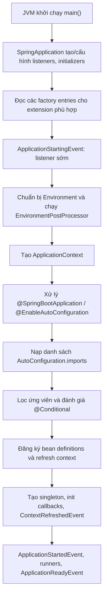

# Phân biệt đăng ký điểm mở rộng qua `spring.factories` với khai báo auto-configuration

## 1. Hai cơ chế xuất hiện cạnh nhau nhưng giải quyết hai bài toán khác nhau

Khi xây dựng ứng dụng hoặc thư viện dùng **Spring Boot 3.3.x**, có hai kiểu “tự được phát hiện trên classpath” rất dễ bị nhầm:

1. **Đăng ký extension point qua `META-INF/spring.factories`:** thư viện khai báo một implementation cho **một loại hook** mà Spring Boot biết cách nạp, chẳng hạn `ApplicationListener`, `ApplicationContextInitializer` hoặc `EnvironmentPostProcessor`. Hook được gọi ở **giai đoạn thích hợp của quá trình khởi động**.
2. **Đăng ký auto-configuration qua `META-INF/spring/org.springframework.boot.autoconfigure.AutoConfiguration.imports`:** thư viện khai báo các **class cấu hình ứng viên**. Khi ứng dụng bật auto-configuration (thông thường qua `@SpringBootApplication`), Boot cân nhắc các class đó, đánh giá điều kiện rồi đăng ký bean definitions phù hợp.

Hai file đều nằm trong `META-INF`, đều có thể được đóng gói vào một JAR và đều giúp một thư viện tích hợp với ứng dụng mà không phải sửa `main()`. Nhưng **chúng không hoán đổi cho nhau**: một `ApplicationListener` không trở thành auto-configuration chỉ vì được ghi vào imports file; ngược lại, một `@AutoConfiguration` của Boot 3.x không được đăng ký đúng chỉ bằng khóa `EnableAutoConfiguration` kiểu cũ trong `spring.factories`.

> Phạm vi phiên bản: bài tập dùng **Java 17+ và Spring Boot 3.3.x**. Với ứng dụng Boot 2.x, một phần quy tắc đăng ký auto-configuration khác nhau theo phiên bản; phần migration ở mục 5 giải thích cụ thể.

## 2. So sánh theo nhiệm vụ, thời điểm và kiểu đăng ký

| Tiêu chí | Hook từ `spring.factories` | Auto-configuration từ `AutoConfiguration.imports` |
| --- | --- | --- |
| Mục tiêu | Mở rộng một giai đoạn/hành vi của Boot: listener, xử lý môi trường, initializer, phân tích lỗi... | Cung cấp cấu hình bean mặc định có điều kiện cho ứng dụng |
| File đăng ký | `META-INF/spring.factories` | `META-INF/spring/org.springframework.boot.autoconfigure.AutoConfiguration.imports` |
| Cú pháp | File Java properties: **tên interface/extension key** `=` danh sách implementation | Mỗi dòng là **tên đầy đủ của một class auto-configuration**, không có `key=` |
| Ví dụ class | `ApplicationListener<ApplicationStartingEvent>` | Class `@AutoConfiguration` với các `@Bean` |
| Bộ phận nạp | Cơ chế SpringFactoriesLoader và các thành phần Boot chuyên nạp từng loại extension | Cơ chế lựa chọn auto-configuration được kích hoạt bởi `@EnableAutoConfiguration` |
| Mốc hoạt động | Tùy loại hook; listener bắt đầu có thể chạy trước khi tạo `ApplicationContext` | Trong quá trình xử lý configuration/bean definitions, trước khi các bean phù hợp được khởi tạo |
| Có bắt buộc tạo Spring bean? | Không. Listener bootstrap có thể được tạo rất sớm, độc lập với bean factory | Class cấu hình tham gia quá trình đăng ký bean; `@Bean` được quản lý bởi IoC container |
| Điều kiện bật/tắt | Chủ yếu theo hợp đồng của hook; code của hook có thể tự kiểm tra điều kiện | Hỗ trợ `@ConditionalOnClass`, `@ConditionalOnProperty`, `@ConditionalOnMissingBean`, v.v. |
| Tự nhường cho bean của người dùng? | Không phải hành vi chung của mọi hook | Có thể thiết kế **back off** bằng `@ConditionalOnMissingBean` |
| Bị ảnh hưởng bởi component scan? | Không cần component scan để phát hiện factory entry | Auto-configuration nên nằm ngoài component scan và được import qua imports file |
| Dùng khi nào? | Cần can thiệp vào một mốc startup hoặc một dịch vụ mở rộng cụ thể | Cần cung cấp bean/hạ tầng mặc định cho thư viện/starter |

**Câu hỏi quyết định:** “Tôi muốn Boot **gọi một callback ở thời điểm nào đó**?” → thường nghĩ đến extension point. “Tôi muốn ứng dụng **tự có một bean nếu điều kiện thỏa**?” → nghĩ đến auto-configuration.

Không phải mọi lớp được khai báo trong `spring.factories` đều chạy trước context. Ví dụ `FailureAnalyzer` được dùng trên nhánh lỗi, còn `ApplicationContextInitializer` chạy sau khi context đã được tạo nhưng trước refresh. **Loại key quyết định vòng đời**, không phải bản thân tên file.

## 3. `spring.factories`: đăng ký extension theo khóa interface

### 3.1. File đăng ký trông như thế nào?

Một thư viện có thể đóng gói file:

```text
src/main/resources/META-INF/spring.factories
```

Nội dung ví dụ:

```properties
org.springframework.context.ApplicationListener=\
com.example.lib.bootstrap.EarlyStartupListener

org.springframework.boot.env.EnvironmentPostProcessor=\
com.example.lib.bootstrap.DemoEnvironmentPostProcessor
```

Đây là cú pháp Java properties: bên trái là **extension key**, bên phải là class implementation. Dấu `\` ở cuối dòng cho phép nối dòng theo định dạng `.properties`. Nếu chỉ có một implementation, có thể viết ngay sau dấu `=` mà không cần dấu `\`.

Khi ứng dụng khởi động, các thành phần Boot tương ứng đọc factory entries từ classpath. Điều này cho phép extension nằm trong một thư viện dependency/JAR, không cần controller hoặc service của ứng dụng trực tiếp import class đó.

Điều quan trọng là **không có một “lệnh chạy tất cả factories” duy nhất**. Mỗi subsystem dùng các factory entries phù hợp:

- `org.springframework.context.ApplicationListener`: các listener nhận application events, trong đó có event rất sớm.
- `org.springframework.context.ApplicationContextInitializer`: callback tùy biến context đã tạo nhưng chưa refresh.
- `org.springframework.boot.env.EnvironmentPostProcessor`: callback có thể bổ sung/chỉnh `PropertySource` trong quá trình chuẩn bị môi trường.
- `org.springframework.boot.BootstrapRegistryInitializer`: có thể đăng ký tài nguyên cho bootstrap registry rất sớm.
- `org.springframework.boot.diagnostics.FailureAnalyzer`: phân tích những exception startup được hỗ trợ để tạo thông báo có ích.

Cơ chế `spring.factories` còn được sử dụng cho những extension nội bộ khác của Boot. Không tự đoán key bằng tên class: phải đối chiếu API/tài liệu của **đúng phiên bản Spring Boot**, vì mỗi loại có hợp đồng constructor, thứ tự gọi và yêu cầu dữ liệu riêng.

### 3.2. Vì sao listener bắt đầu cần được đăng ký sớm?

`ApplicationStartingEvent` là một trong những sự kiện đầu tiên của `SpringApplication.run()`. Nó xuất hiện **trước khi `Environment` và `ApplicationContext` được chuẩn bị đầy đủ**. Listener cần nhận sự kiện này phải được đăng ký trước khi các bean ứng dụng được tạo.

Do đó, một class kiểu:

```java
package com.example.lib.bootstrap;

import org.springframework.boot.context.event.ApplicationStartingEvent;
import org.springframework.context.ApplicationListener;

public final class EarlyStartupListener
        implements ApplicationListener<ApplicationStartingEvent> {

    @Override
    public void onApplicationEvent(ApplicationStartingEvent event) {
        System.out.println("factory-listener=starting");
    }
}
```

có thể được khai báo bằng key `org.springframework.context.ApplicationListener` trong `spring.factories`. Boot biết để tạo/register listener theo cơ chế bootstrap. Chương trình không cần đánh dấu class bằng `@Component`.

Ngược lại, một bean có `@EventListener(ApplicationStartingEvent.class)` thường **ra đời quá muộn** để nhận sự kiện này. Auto-configuration có đăng ký `@Bean ApplicationListener<...>` cũng chỉ tạo bean khi context đang được xử lý, nên **không phải** giải pháp thích hợp để bắt event xảy ra trước lúc context tồn tại.

### 3.3. Ví dụ `EnvironmentPostProcessor`

`EnvironmentPostProcessor` dùng khi thư viện cần đóng góp cấu hình vào `ConfigurableEnvironment` trước khi bean graph được xây dựng. Ví dụ một property fallback không nhạy cảm:

```java
package com.example.lib.bootstrap;

import java.util.Map;

import org.springframework.boot.SpringApplication;
import org.springframework.boot.env.EnvironmentPostProcessor;
import org.springframework.core.env.ConfigurableEnvironment;
import org.springframework.core.env.MapPropertySource;

public final class DemoEnvironmentPostProcessor
        implements EnvironmentPostProcessor {

    @Override
    public void postProcessEnvironment(
            ConfigurableEnvironment environment,
            SpringApplication application) {

        environment.getPropertySources().addLast(
                new MapPropertySource(
                        "demoExtensionDefaults",
                        Map.of("demo.origin", "from-spring-factories")
                )
        );
    }
}
```

Ở đây `addLast` cố ý đặt một property source làm fallback thấp trong danh sách hiện có. Nếu nguồn ưu tiên cao hơn cũng khai báo `demo.origin`, giá trị của nguồn cao hơn được ưu tiên. Phần ví dụ này không liên quan tới việc khai báo bean `GreetingService`; nó chỉ cho thấy một extension khác có thể được đăng ký cùng file.

Đối với ứng dụng thường, hãy ưu tiên `application.properties`/YAML, biến môi trường và cơ chế Config Data trước khi tự viết `EnvironmentPostProcessor`. Hook này phù hợp hơn với thư viện hạ tầng phải bổ sung nguồn cấu hình mà người dùng không tự khai báo bằng cơ chế tiêu chuẩn.

## 4. Auto-configuration: khai báo class ứng viên để Boot chọn bean phù hợp

### 4.1. File imports mới trong Spring Boot 3.x

File cần có **đúng đường dẫn**:

```text
src/main/resources/META-INF/spring/org.springframework.boot.autoconfigure.AutoConfiguration.imports
```

Nội dung:

```text
com.example.lib.autoconfigure.GreetingAutoConfiguration
```

Mỗi dòng là một fully qualified class name; có thể có nhiều dòng và comment bắt đầu bằng `#`. **Không viết**:

```properties
org.springframework.boot.autoconfigure.EnableAutoConfiguration=\
com.example.lib.autoconfigure.GreetingAutoConfiguration
```

vào `spring.factories` rồi chờ Spring Boot 3.x dùng dòng đó để kích hoạt auto-configuration. Dạng key trên thuộc cơ chế registration cũ đã bị loại bỏ cho **riêng auto-configuration** ở Spring Boot 3.0.

`AutoConfiguration.imports` chỉ là **danh sách ứng viên**. Từ đó Boot mới thực hiện quá trình chọn auto-configuration và đánh giá điều kiện. Class có annotation `@AutoConfiguration` nhưng **không có mặt trong imports file hoặc không được import rõ ràng theo cơ chế khác** sẽ không tự nhiên được phát hiện chỉ nhờ annotation.

Trong một thư viện/starter, hãy dùng imports file làm nguồn đăng ký chính thức và giữ class auto-configuration ở package riêng, ngoài phạm vi component scan của ứng dụng tiêu thụ.

### 4.2. Ví dụ `@AutoConfiguration` có điều kiện và back off

```java
package com.example.lib.autoconfigure;

import com.example.lib.core.GreetingService;

import org.springframework.boot.autoconfigure.AutoConfiguration;
import org.springframework.boot.autoconfigure.condition.ConditionalOnMissingBean;
import org.springframework.boot.autoconfigure.condition.ConditionalOnProperty;
import org.springframework.context.annotation.Bean;

@AutoConfiguration
@ConditionalOnProperty(
        prefix = "demo.greeting",
        name = "enabled",
        havingValue = "true",
        matchIfMissing = true)
public class GreetingAutoConfiguration {

    @Bean
    @ConditionalOnMissingBean(GreetingService.class)
    GreetingService defaultGreetingService() {
        return () -> "auto";
    }
}
```

Giả sử `GreetingService` là interface có `String message()`:

- Nếu không khai báo `demo.greeting.enabled`, `matchIfMissing = true` cho phép điều kiện property khớp.
- Nếu `demo.greeting.enabled=false`, điều kiện trên class không khớp; Boot không đăng ký cấu hình này theo luồng chuẩn.
- Nếu người dùng đã định nghĩa một bean `GreetingService` phù hợp, `@ConditionalOnMissingBean` giúp bean mặc định **nhường chỗ**.
- Nếu không có bean của người dùng và điều kiện property khớp, bean mặc định được đăng ký.

Đây là behavior phổ biến của auto-configuration: tạo cấu hình tốt cho trường hợp mặc định mà vẫn cho ứng dụng quyền tự điều chỉnh.

`@ConditionalOnClass` thường được dùng nếu thư viện chỉ muốn cấu hình khi một dependency tùy chọn tồn tại. Khi kiểu dữ liệu có thể vắng mặt trên classpath, cần tách điều kiện đúng chỗ (thường ở class cấu hình lồng tách biệt) để JVM không phải resolve return type của một `@Bean` method trước khi điều kiện được xét.

### 4.3. `@AutoConfiguration` không phải một “listener sớm”

Một class `@AutoConfiguration` là một dạng `@Configuration` với khả năng được Boot chọn thông qua imports/conditions. Nó tham gia quá trình xử lý bean definitions trong lúc context được refresh. Nó **không chạy trước `ApplicationStartingEvent`** và cũng không thay thế `EnvironmentPostProcessor`.

Nếu cần hai việc riêng biệt, thư viện hoàn toàn có thể dùng **cả hai file**:
- `spring.factories` để đăng ký một extension chạy ở mốc bootstrap thích hợp.
- `AutoConfiguration.imports` để đăng ký cấu hình bean mặc định của thư viện.

Cách kết hợp này là kiến trúc hợp lệ; không có yêu cầu chọn một trong hai cho mọi use case.

## 5. Lịch sử phiên bản: vì sao nhiều bài cũ vẫn nhắc `EnableAutoConfiguration` trong `spring.factories`?

| Phiên bản Spring Boot | Cách khai báo auto-configuration | Trạng thái của các factory keys khác |
| --- | --- | --- |
| Boot 2.6 và cũ hơn | Thường dùng `org.springframework.boot.autoconfigure.EnableAutoConfiguration` trong `META-INF/spring.factories` | `spring.factories` cũng chứa listener, initializer, post-processor... |
| Boot 2.7 | Giới thiệu `AutoConfiguration.imports`; vẫn giữ tương thích với registration kiểu cũ, có cơ chế loại trùng | Các extension khác trong `spring.factories` tiếp tục dùng |
| Boot 3.0–3.3 | **Chỉ `AutoConfiguration.imports` để đăng ký auto-configuration theo cơ chế chuẩn**; khóa `EnableAutoConfiguration` trong `spring.factories` không còn được dùng để nhận diện auto-config | Những entries dưới **các key khác** trong `spring.factories` không bị loại bỏ vì thay đổi này |

Một đoạn hướng dẫn cho Boot 2.5 có thể hoàn toàn đúng ở thời điểm phát hành nhưng **không còn đúng cho Boot 3.3**. Khi migrate thư viện, hãy kiểm tra file JAR thực tế; không chỉ xem annotation hoặc tin rằng “có `spring.factories` thì Boot sẽ phát hiện auto-configuration”.

Spring Boot 3.0 Migration Guide nêu rõ thay đổi: Boot 2.7 đã giới thiệu imports file với tương thích ngược; Boot 3.0 loại bỏ hỗ trợ đăng ký auto-configuration dưới key `EnableAutoConfiguration` trong `spring.factories`, đồng thời giữ nguyên các key factory khác.

Nếu thư viện cần tương thích Boot 2.7 và Boot 3.x, có thể duy trì khai báo phù hợp cho từng thế hệ, nhưng phải kiểm thử dependency và API tương thích. Việc đăng ký cả hai file không tự đảm bảo bytecode/dependency của một thư viện xây cho Boot 3.x hoạt động trên Boot 2.x.

## 6. Thực hành hoàn chỉnh: cùng một ứng dụng dùng cả `spring.factories` và auto-configuration

Ví dụ dưới đây được thiết kế cho **Spring Boot 3.3.13, Java 17+**, chỉ dùng Maven và dependency `spring-boot-starter`. Chương trình không mở web server để kết quả quan sát gọn.

Điểm quan trọng trong cấu trúc: class ứng dụng nằm ở `com.example.app`, còn extension và auto-configuration nằm ở `com.example.lib`. Vì vậy, `@SpringBootApplication` ở package ứng dụng **không tự scan `com.example.lib`**. Nếu các thành phần đó được phát hiện, đó là do các file đăng ký `META-INF` tương ứng.

### 6.1. Cấu trúc thư mục

```text
extension-registration-demo/
├── pom.xml
└── src/main/
    ├── java/
    │   └── com/example/
    │       ├── app/
    │       │   └── DemoApplication.java
    │       └── lib/
    │           ├── core/
    │           │   └── GreetingService.java
    │           ├── bootstrap/
    │           │   ├── EarlyStartupListener.java
    │           │   └── DemoEnvironmentPostProcessor.java
    │           └── autoconfigure/
    │               └── GreetingAutoConfiguration.java
    └── resources/
        └── META-INF/
            ├── spring.factories
            └── spring/
                └── org.springframework.boot.autoconfigure.AutoConfiguration.imports
```

Để biên dịch dễ dàng và độc lập, ví dụ này để các package trong cùng một project. Trong một thư viện sản phẩm, `com.example.lib.*` và hai file `META-INF` thường được đóng gói thành **JAR thư viện** riêng, rồi thêm JAR đó vào classpath của ứng dụng.

### 6.2. `pom.xml`

```xml
<project xmlns="http://maven.apache.org/POM/4.0.0"
         xmlns:xsi="http://www.w3.org/2001/XMLSchema-instance"
         xsi:schemaLocation="http://maven.apache.org/POM/4.0.0 https://maven.apache.org/xsd/maven-4.0.0.xsd">
    <modelVersion>4.0.0</modelVersion>

    <parent>
        <groupId>org.springframework.boot</groupId>
        <artifactId>spring-boot-starter-parent</artifactId>
        <version>3.3.13</version>
        <relativePath/>
    </parent>

    <groupId>com.example</groupId>
    <artifactId>extension-registration-demo</artifactId>
    <version>0.0.1-SNAPSHOT</version>

    <properties>
        <java.version>17</java.version>
    </properties>

    <dependencies>
        <dependency>
            <groupId>org.springframework.boot</groupId>
            <artifactId>spring-boot-starter</artifactId>
        </dependency>
    </dependencies>

    <build>
        <plugins>
            <plugin>
                <groupId>org.springframework.boot</groupId>
                <artifactId>spring-boot-maven-plugin</artifactId>
            </plugin>
        </plugins>
    </build>
</project>
```

`spring-boot-starter` đưa các thành phần core Spring Boot, Spring Framework và auto-configuration cần cho ví dụ vào classpath. Chương trình không cần starter web hoặc database.

### 6.3. Interface `GreetingService.java`

```java
package com.example.lib.core;

@FunctionalInterface
public interface GreetingService {
    String message();
}
```

Tạo interface riêng để bean của ứng dụng có thể thay thế bean mặc định của auto-configuration bằng cùng kiểu.

### 6.4. Listener do `spring.factories` đăng ký

File `src/main/java/com/example/lib/bootstrap/EarlyStartupListener.java`:

```java
package com.example.lib.bootstrap;

import org.springframework.boot.context.event.ApplicationStartingEvent;
import org.springframework.context.ApplicationListener;

public final class EarlyStartupListener
        implements ApplicationListener<ApplicationStartingEvent> {

    @Override
    public void onApplicationEvent(ApplicationStartingEvent event) {
        System.out.println("factory-listener=starting");
    }
}
```

Khi `SpringApplication` phát `ApplicationStartingEvent`, listener được đăng ký sớm có cơ hội nhận event. Không có `@Component`, `@Bean` hay component scan ở đây.

### 6.5. Environment post-processor cũng do `spring.factories` đăng ký

File `src/main/java/com/example/lib/bootstrap/DemoEnvironmentPostProcessor.java`:

```java
package com.example.lib.bootstrap;

import java.util.Map;

import org.springframework.boot.SpringApplication;
import org.springframework.boot.env.EnvironmentPostProcessor;
import org.springframework.core.env.ConfigurableEnvironment;
import org.springframework.core.env.MapPropertySource;

public final class DemoEnvironmentPostProcessor
        implements EnvironmentPostProcessor {

    @Override
    public void postProcessEnvironment(
            ConfigurableEnvironment environment,
            SpringApplication application) {

        environment.getPropertySources().addLast(
                new MapPropertySource(
                        "demoExtensionDefaults",
                        Map.of("demo.origin", "from-spring-factories")
                )
        );
    }
}
```

Post-processor này đóng góp property `demo.origin`. Không có `@Configuration` và không tạo bean nghiệp vụ.

### 6.6. Auto-configuration có điều kiện

File `src/main/java/com/example/lib/autoconfigure/GreetingAutoConfiguration.java`:

```java
package com.example.lib.autoconfigure;

import com.example.lib.core.GreetingService;

import org.springframework.boot.autoconfigure.AutoConfiguration;
import org.springframework.boot.autoconfigure.condition.ConditionalOnMissingBean;
import org.springframework.boot.autoconfigure.condition.ConditionalOnProperty;
import org.springframework.context.annotation.Bean;

@AutoConfiguration
@ConditionalOnProperty(
        prefix = "demo.greeting",
        name = "enabled",
        havingValue = "true",
        matchIfMissing = true)
public class GreetingAutoConfiguration {

    @Bean
    @ConditionalOnMissingBean(GreetingService.class)
    GreetingService defaultGreetingService() {
        return () -> "auto";
    }
}
```

Class này thuộc nhóm `com.example.lib.autoconfigure`, không được component-scan bởi `com.example.app`. Việc Boot nhìn thấy nó phải đến từ **imports file**.

### 6.7. Ứng dụng chính và bean tùy chỉnh

File `src/main/java/com/example/app/DemoApplication.java`:

```java
package com.example.app;

import java.util.Map;

import com.example.lib.core.GreetingService;

import org.springframework.boot.Banner;
import org.springframework.boot.SpringApplication;
import org.springframework.boot.WebApplicationType;
import org.springframework.boot.autoconfigure.SpringBootApplication;
import org.springframework.context.ConfigurableApplicationContext;
import org.springframework.context.annotation.Bean;
import org.springframework.context.annotation.Profile;

@SpringBootApplication
public class DemoApplication {

    @Bean
    @Profile("manual")
    GreetingService customGreetingService() {
        return () -> "manual";
    }

    public static void main(String[] args) {
        SpringApplication app = new SpringApplication(DemoApplication.class);
        app.setWebApplicationType(WebApplicationType.NONE);
        app.setBannerMode(Banner.Mode.OFF);
        app.setLogStartupInfo(false);

        try (ConfigurableApplicationContext context = app.run(args)) {
            Map<String, GreetingService> services =
                    context.getBeansOfType(GreetingService.class);

            System.out.println("origin="
                    + context.getEnvironment()
                             .getProperty("demo.origin", "absent"));
            System.out.println("greeting-bean-count=" + services.size());
            System.out.println("greeting="
                    + services.values().stream()
                              .findFirst()
                              .map(GreetingService::message)
                              .orElse("none"));
        }
    }
}
```

`@Profile("manual")` tạo bean riêng khi profile `manual` hoạt động. Mục tiêu là chứng minh `@ConditionalOnMissingBean` cho auto-config **nhường chỗ cho bean do ứng dụng khai báo**.

### 6.8. Hai file đăng ký bắt buộc

File **thứ nhất** là `src/main/resources/META-INF/spring.factories`:

```properties
org.springframework.context.ApplicationListener=\
com.example.lib.bootstrap.EarlyStartupListener

org.springframework.boot.env.EnvironmentPostProcessor=\
com.example.lib.bootstrap.DemoEnvironmentPostProcessor
```

File **thứ hai** là `src/main/resources/META-INF/spring/org.springframework.boot.autoconfigure.AutoConfiguration.imports`:

```text
com.example.lib.autoconfigure.GreetingAutoConfiguration
```

Chú ý khác biệt về cú pháp: `spring.factories` là file properties có `key=value`; imports file là một danh sách tên class. Dù đều là resource text, **không thể thay đổi tên/đường dẫn tùy ý** rồi hy vọng Boot tự dò.

### 6.9. Build và chạy

Đứng tại thư mục chứa `pom.xml`:

```bash
mvn package
java -jar target/extension-registration-demo-0.0.1-SNAPSHOT.jar
```

Nếu dự án đã có Maven Wrapper thì cũng có thể dùng `./mvnw package` (Windows: `.\mvnw.cmd package`). Maven Wrapper không tự xuất hiện chỉ vì ta tạo `pom.xml`; cần tạo wrapper riêng nếu muốn dùng.

Trong môi trường không có property/profile khác ghi đè, **các dòng do code ví dụ in** có thứ tự kỳ vọng:

```text
factory-listener=starting
origin=from-spring-factories
greeting-bean-count=1
greeting=auto
```

Dòng `factory-listener=starting` cho thấy extension `ApplicationListener` từ `spring.factories` nhận một event rất sớm. Dòng `origin=from-spring-factories` cho thấy `EnvironmentPostProcessor` đóng góp property. `greeting=auto` cho thấy class từ imports file được xét, điều kiện khớp và bean mặc định được tạo.

Log của Spring Boot/Maven có thể xuất hiện xen kẽ; ví dụ xác định **thứ tự tương đối những dòng do chương trình in**, không khẳng định toàn bộ stdout chỉ có bốn dòng.

### 6.10. Thử tắt auto-configuration bằng property

```bash
java -jar target/extension-registration-demo-0.0.1-SNAPSHOT.jar --demo.greeting.enabled=false
```

Những dòng do code tạo:

```text
factory-listener=starting
origin=from-spring-factories
greeting-bean-count=0
greeting=none
```

`spring.factories` vẫn nạp listener và environment processor. Tuy nhiên `@ConditionalOnProperty` không khớp nên bean mặc định của auto-config không xuất hiện.

**Kết luận của thử nghiệm:** điều kiện auto-configuration có thể tắt bean được cấu hình mà không vô hiệu hóa các extension khác đã đăng ký qua `spring.factories`.

### 6.11. Thử tự khai báo bean để auto-configuration nhường chỗ

```bash
java -jar target/extension-registration-demo-0.0.1-SNAPSHOT.jar --spring.profiles.active=manual
```

Dòng kết quả chính:

```text
factory-listener=starting
origin=from-spring-factories
greeting-bean-count=1
greeting=manual
```

Bean `customGreetingService()` của ứng dụng được đăng ký do profile `manual` hoạt động. Auto-configuration có `@ConditionalOnMissingBean(GreetingService.class)` kiểm tra các bean definitions phù hợp đã có, vì vậy không tạo bean mặc định. Đây là cách **back off** đúng ý đồ.

Thử kết hợp cả hai tham số:

```bash
java -jar target/extension-registration-demo-0.0.1-SNAPSHOT.jar --spring.profiles.active=manual --demo.greeting.enabled=false
```

`greeting=manual` vẫn có thể xuất hiện: property `demo.greeting.enabled` điều khiển **bean mặc định của auto-configuration**, không tự vô hiệu hóa bean ứng dụng do người dùng tự khai báo.

### 6.12. Tự kiểm chứng khi bỏ một file đăng ký

**Thử nghiệm A:** bỏ riêng `META-INF/spring.factories` khỏi build và đóng gói lại. Khi đó listener và environment processor trong ví dụ không còn được khám phá qua file đó. Bạn sẽ không thấy dòng `factory-listener=starting`; `origin` sẽ là `absent` nếu không có nguồn khác gán `demo.origin`. Bean auto-config vẫn có thể xuất hiện nhờ imports file.

**Thử nghiệm B:** giữ `spring.factories` nhưng bỏ riêng `AutoConfiguration.imports` rồi build lại. Listener và environment processor vẫn làm việc; nhưng `GreetingAutoConfiguration` không được chọn qua cơ chế auto-configuration. Trong điều kiện không có bean do ứng dụng khai báo, `greeting-bean-count=0` và `greeting=none`.

Lưu ý hai thử nghiệm là **hai build riêng**. Đừng xóa từng file trong JAR đang chạy và kỳ vọng instance hiện tại cập nhật ngay; Spring Boot thực hiện cơ chế discovery khi khởi động.

## 7. Cách Boot xử lý hai loại đăng ký trong vòng đời startup

Sơ đồ minh họa các mốc chính của một lượt khởi động thành công:



Sơ đồ chỉ mô tả quan hệ và thứ tự khái quát. Thực tế có nhiều callback đan xen, và các extension khác trong `spring.factories` có thể chạy ở các mốc khác nhau.

Điểm cần quan sát:

- Listener `ApplicationStartingEvent` phải sẵn sàng **trước** khi tạo context.
- `EnvironmentPostProcessor` xử lý `Environment` trước khi hoàn tất refresh, nên có thể ảnh hưởng đến điều kiện dựa trên property.
- Auto-configuration được chọn theo nguồn imports và điều kiện trong quá trình xử lý cấu hình ứng dụng, rồi tham gia đăng ký bean definitions.
- `@Bean` của auto-configuration **không phải callback thay thế cho bootstrap listener**, dù cả hai đều được tìm thấy từ classpath.

Một `ApplicationListener` có thể nhận các event muộn hơn nếu nó được đăng ký cho loại event tương ứng; “factory listener” không mặc định có nghĩa lúc nào cũng chạy sớm. Mốc cụ thể do **event type và thứ tự listener** quyết định.

## 8. Điều kiện auto-configuration: không phải “cứ có imports là có bean”

### 8.1. Điều kiện classpath

`@ConditionalOnClass` phù hợp khi tính năng chỉ nên tồn tại lúc dependency tùy chọn có mặt. Với thư viện dùng một API của bên thứ ba, có thể đặt `@ConditionalOnClass(name = "com.vendor.SomeClient")` ở mức class cấu hình.

Nếu một `@Bean` method khai báo return type là class vắng mặt khỏi classpath, JVM có thể cần resolve method signature trước khi điều kiện trên method được xét. Cách thường dùng là tách thành một static nested `@Configuration(proxyBeanMethods = false)` có `@ConditionalOnClass`, giữ phương thức bean ở bên trong lớp được bảo vệ.

Đừng dùng `try/catch ClassNotFoundException` ở nơi tạo bean để thay cho thiết kế classpath condition chuẩn.

### 8.2. Điều kiện property

`@ConditionalOnProperty` xét trạng thái property trong `Environment`. Khi `havingValue="true"`, bean chỉ được cấu hình nếu giá trị tương ứng `"true"` theo quy tắc matcher; `matchIfMissing=true` cho phép trường hợp không có property.

Điều kiện này không phải cơ chế theo dõi file liên tục. Đổi `application.yml` sau khi context đã refresh **không tự đăng ký/hủy bean** theo `@ConditionalOnProperty` trong instance đang chạy.

### 8.3. Điều kiện bean và thứ tự

`@ConditionalOnMissingBean` được đánh giá dựa trên những bean definitions đã được xử lý tới thời điểm đó. Để người dùng có cơ hội override mặc định, các điều kiện loại này nên được đặt trong auto-configuration, bởi auto-configuration thường được xử lý **sau cấu hình do ứng dụng khai báo**.

Nếu nhiều auto-configurations cùng đề xuất bean của cùng một kiểu, thứ tự đánh giá có thể ảnh hưởng kết quả. Spring Boot có công cụ:

- `@AutoConfiguration(before = ..., after = ...)`;
- `@AutoConfiguration(beforeName = ..., afterName = ...)` khi tránh liên kết type trực tiếp;
- `@AutoConfigureBefore`, `@AutoConfigureAfter`;
- `@AutoConfigureOrder`.

Những annotation này chủ yếu kiểm soát **thứ tự xử lý/đăng ký bean definitions của các auto-configurations**, không mặc định xác định thứ tự gọi constructor cho mọi bean. Thứ tự khởi tạo còn tùy dependency graph, `@DependsOn`, eager/lazy và lifecycle.

### 8.4. Không đưa auto-configuration vào component scan

Một lỗi thiết kế là đặt `GreetingAutoConfiguration` trong package bị quét bởi `@SpringBootApplication` **và** đồng thời liệt kê trong imports file. Điều đó tạo đường đăng ký ngoài ý đồ, khiến việc áp dụng exclusions/điều kiện hoặc chẩn đoán trở nên khó hiểu.

Hãy đặt auto-config trong package độc lập như `com.example.lib.autoconfigure`, không gắn `@Component` cho class đó, không tự bật `@ComponentScan` trong auto-config để tìm bean nội bộ tùy tiện. Nếu cần tập hợp cấu hình con, dùng `@Import` tường minh có kiểm soát.

## 9. Phân biệt file registration với file metadata khác

Trong JAR của Spring Boot có thể thấy nhiều file bắt đầu bằng `META-INF/spring...`, nhưng mục tiêu rất khác nhau.

| File | Ý nghĩa |
| --- | --- |
| `META-INF/spring.factories` | Khai báo các loại extension được Boot/Framework chủ động nạp theo key |
| `META-INF/spring/org.springframework.boot.autoconfigure.AutoConfiguration.imports` | **Danh sách ứng viên auto-configuration** cho Boot 3.x |
| `META-INF/spring-autoconfigure-metadata.properties` | Metadata điều kiện do annotation processor có thể sinh ra để tối ưu lọc ứng viên; **không thay thế imports file** |
| `META-INF/spring-configuration-metadata.json` | Metadata property phục vụ IDE/hướng dẫn cấu hình; **không tự đăng ký bean** |
| `META-INF/services/...` | Cơ chế Java `ServiceLoader` cho một số SPI; không đồng nghĩa với các file đăng ký trên |

Một thư viện có `spring-configuration-metadata.json` đẹp và các property được IDE gợi ý vẫn có thể **không có auto-configuration nào được kích hoạt** nếu thiếu imports file. Ngược lại, thiếu metadata tối ưu không nhất thiết ngăn một auto-config class hợp lệ được phát hiện.

Nếu viết starter nhiều tính năng, annotation processor `spring-boot-autoconfigure-processor` có thể tạo metadata tối ưu; đây là bước cải thiện hiệu năng/IDE chứ không làm thay đổi nguyên tắc registration.

## 10. Đóng gói thư viện/starter và quản lý tương thích

### 10.1. Cấu trúc một thư viện dùng chung

Một thư viện hạ tầng có thể tách thành:

```text
greeting-core
    API / implementation độc lập

greeting-autoconfigure
    @AutoConfiguration
    META-INF/spring/...AutoConfiguration.imports
    các extension boot thực sự cần trong META-INF/spring.factories

greeting-spring-boot-starter
    dependencies thuận tiện để ứng dụng thêm một lần
```

Không phải thư viện nào cũng cần tách đủ ba module. Với tính năng nhỏ, một JAR chứa code core, auto-config và metadata có thể đủ. Điều quan trọng là giữ **rõ ràng vai trò** của từng file registration và loại phụ thuộc.

### 10.2. Cần đăng ký vào `spring.factories` khi nào?

Một vài tình huống phù hợp:

- Thư viện cần bắt `ApplicationStartingEvent` để phát hiện một lần khởi động ngay từ đầu.
- Thư viện cần thêm nguồn cấu hình ở giai đoạn chuẩn bị environment thông qua `EnvironmentPostProcessor`.
- Thư viện cần tùy biến context chính trước khi refresh bằng `ApplicationContextInitializer`.
- Thư viện cung cấp `FailureAnalyzer` giúp giải thích một exception startup chuyên biệt.

Từng loại hook có contract riêng về constructor, thứ tự và lỗi. Chọn hook theo **mốc cần can thiệp**; tránh đặt logic nghiệp vụ/HTTP/database ở giai đoạn sớm chỉ vì hook có sẵn.

### 10.3. Cần auto-configuration khi nào?

Auto-configuration hợp với:

- Cung cấp HTTP client, cache adapter, `DataSource` support hoặc metrics bridge mặc định khi các dependency tương ứng có mặt.
- Đăng ký một service mặc định nhưng cho người dùng override bean.
- Bật/tắt một integration bằng property.
- Cấu hình một tính năng khác nhau cho servlet/reactive/non-web thông qua condition.
- Kết hợp các bean thuộc một integration, với cấu hình tập trung.

Một class `@Configuration` bình thường được import từ code ứng dụng có thể phù hợp nếu tính năng chỉ dùng ở một project và không cần auto-discovery; không cần đóng gói imports file cho mọi class cấu hình nội bộ.

### 10.4. Đừng trộn namespace của ứng dụng và thư viện

Thư viện nên dùng prefix property riêng, ví dụ `acme.greeting.*`, không tự chiếm các namespace chuẩn như `spring.*`, `server.*` hay `management.*` cho tính năng riêng. Điều này giảm xung đột khi ứng dụng thêm nhiều starter hoặc nâng Spring Boot.

Nếu class auto-config đổi package, cần rà lại nội dung imports và các tham chiếu ordering/exclusions đang dùng. Không giữ lại class cũ trong danh sách chỉ để “chắc ăn” khi đã có cơ chế thay thế được phiên bản hiện hành hỗ trợ. Với Boot 3.3, hãy ưu tiên giữ tên class ổn định hoặc có kế hoạch chuyển phiên bản và tài liệu migration rõ ràng.

## 11. Kiểm thử đúng từng cơ chế

### 11.1. Kiểm thử auto-configuration bằng `ApplicationContextRunner`

Spring Boot cung cấp `ApplicationContextRunner` để dựng context nhỏ với các tình huống property/bean khác nhau. Thư viện thường kiểm tra ít nhất ba nhánh:

1. Không có user bean → có bean mặc định.
2. `demo.greeting.enabled=false` → không có bean mặc định.
3. Người dùng đã định nghĩa `GreetingService` → auto-config nhường chỗ.

Ví dụ JUnit 5, dùng thêm dependency test `spring-boot-starter-test` trong build:

```java
package com.example.app;

import com.example.lib.autoconfigure.GreetingAutoConfiguration;
import com.example.lib.core.GreetingService;

import org.junit.jupiter.api.Test;
import org.springframework.boot.autoconfigure.AutoConfigurations;
import org.springframework.boot.test.context.runner.ApplicationContextRunner;
import org.springframework.context.annotation.Bean;
import org.springframework.context.annotation.Configuration;

import static org.assertj.core.api.Assertions.assertThat;

class GreetingAutoConfigurationTest {

    private final ApplicationContextRunner runner =
            new ApplicationContextRunner()
                    .withConfiguration(
                            AutoConfigurations.of(GreetingAutoConfiguration.class));

    @Test
    void createsDefaultBean() {
        runner.run(context -> {
            assertThat(context).hasSingleBean(GreetingService.class);
            assertThat(context.getBean(GreetingService.class).message())
                    .isEqualTo("auto");
        });
    }

    @Test
    void isDisabledByProperty() {
        runner.withPropertyValues("demo.greeting.enabled=false")
                .run(context -> assertThat(context)
                        .doesNotHaveBean(GreetingService.class));
    }

    @Test
    void backsOffForUserBean() {
        runner.withUserConfiguration(UserConfiguration.class)
                .run(context -> {
                    assertThat(context).hasSingleBean(GreetingService.class);
                    assertThat(context.getBean(GreetingService.class).message())
                            .isEqualTo("manual");
                });
    }

    @Configuration(proxyBeanMethods = false)
    static class UserConfiguration {

        @Bean
        GreetingService customGreetingService() {
            return () -> "manual";
        }
    }
}
```

Đoạn test này biên dịch khi test classpath có JUnit Jupiter, AssertJ và `spring-boot-test`, chẳng hạn qua `spring-boot-starter-test`. Nó **tập trung test auto-configuration**, không chạy toàn bộ `SpringApplication` bootstrap.

### 11.2. Vì sao test `ApplicationContextRunner` chưa đủ cho `spring.factories`?

`ApplicationContextRunner` được thiết kế để dựng một context gọn và kiểm tra conditions; không phải lúc nào nó cũng thực hiện đầy đủ vòng đời `SpringApplication.run()` và các listener/processor khởi động như một ứng dụng thật.

Vì thế, nếu cần chứng minh `ApplicationStartingEvent` listener từ `spring.factories` chạy, phải có **integration test khởi động một `SpringApplication` thật** hoặc chạy ví dụ mục 6. Nếu cần test `EnvironmentPostProcessor` riêng, có thể gọi phương thức `postProcessEnvironment` của nó với `MockEnvironment`/môi trường kiểm thử hoặc khởi động một `SpringApplication` thực tế.

Không kết luận “`spring.factories` sai” chỉ vì một test `ApplicationContextRunner` không thấy event/processor chạy. Có thể test chưa đi qua pha bootstrap mà extension phụ thuộc.

### 11.3. Kiểm tra startup với `--debug`

Để chẩn đoán auto-configuration, chạy:

```bash
java -jar target/extension-registration-demo-0.0.1-SNAPSHOT.jar --debug
```

Spring Boot có thể xuất **conditions evaluation report** trong log, giúp nhận biết lý do một auto-config class được áp dụng hoặc bị loại.

`--debug` không phải cơ chế liệt kê tất cả implementation trong `spring.factories` theo cách giống conditions report. Với extension registration, hãy kiểm tra classpath/resource file đúng chỗ, key đúng interface, class public/constructor hợp lệ và event/hook có thực sự được phát/gọi.

### 11.4. Kiểm tra các resource đã được đóng gói

Các file ở `src/main/resources/META-INF` phải thực sự có mặt trong artifact chạy. Với executable JAR do Boot Maven plugin tạo, chúng thường nằm dưới `BOOT-INF/classes/META-INF/...`.

Bạn có thể xem cấu trúc:

```bash
jar tf target/extension-registration-demo-0.0.1-SNAPSHOT.jar
```

Tìm hai đường dẫn tương ứng dưới `BOOT-INF/classes`. Với JAR thư viện thông thường, chúng có thể nằm trực tiếp dưới `META-INF`. Phân biệt JAR nguồn, JAR đã repackage và dependency JAR khi kiểm chứng classpath.

Nếu nhiều JAR cùng chứa `META-INF/spring.factories` hoặc imports file, cơ chế khám phá sẽ thu thập các resource phù hợp từ classpath. Đừng giải quyết sự cố bằng cách gom tất cả metadata vào duy nhất file của ứng dụng rồi xóa metadata của các dependency.

## 12. Các lỗi và hiểu nhầm thường gặp

### Lỗi 1 — Copy cấu hình auto-configuration của Boot 2.x sang Boot 3.x

```properties
# META-INF/spring.factories (cách đăng ký auto-config kiểu cũ)
org.springframework.boot.autoconfigure.EnableAutoConfiguration=\
com.example.lib.autoconfigure.GreetingAutoConfiguration
```

Trên Spring Boot 3.x, cách đăng ký auto-config chính thức là `AutoConfiguration.imports`. Chuyển FQCN sang file imports đúng đường dẫn và kiểm tra runtime; **đừng xóa các factory entries khác** như `ApplicationListener` và `EnvironmentPostProcessor` nếu thư viện vẫn cần chúng.

### Lỗi 2 — Đưa `ApplicationListener` vào imports file

```text
com.example.lib.bootstrap.EarlyStartupListener
```

Nếu file imports chứa một listener thường thay vì auto-configuration, Boot không hiểu đây là một hook cần được đăng ký sớm. Hãy dùng `spring.factories` với key `org.springframework.context.ApplicationListener` hoặc `SpringApplication.addListeners(...)`.

### Lỗi 3 — Có `@AutoConfiguration` nhưng bean không xuất hiện

Có nhiều nguyên nhân có thể xảy ra:

- Chưa có tên class trong imports file.
- Sai package/class name hoặc file chưa được đóng gói vào JAR.
- Ứng dụng không bật auto-configuration.
- `@ConditionalOnClass`, `@ConditionalOnProperty`, `@ConditionalOnMissingBean` hoặc điều kiện khác không khớp.
- Class đã bị loại trừ qua `@SpringBootApplication(exclude = ...)` hoặc `spring.autoconfigure.exclude`.
- Một auto-config khác chiếm vị trí bean trước và điều kiện back off hoạt động đúng như thiết kế.

Hãy xem **conditions report** trước khi thêm các annotation hoặc sửa configuration một cách phỏng đoán.

### Lỗi 4 — Có listener nhưng không nhận `ApplicationStartingEvent`

Một bean listener được đăng ký sau khi context bắt đầu xử lý bean definitions có thể bỏ lỡ event rất sớm. Đặt listener vào `spring.factories` hoặc đăng ký trực tiếp với `SpringApplication` trước `run()`.

### Lỗi 5 — `spring.factories` dùng sai key

Ví dụ `org.springframework.boot.autoconfigure.AutoConfiguration` không phải key thay thế cho imports file. Với factories, tên key phải đúng extension type được Boot hỗ trợ; với imports, chỉ ghi tên auto-configuration classes, mỗi dòng một class.

### Lỗi 6 — Dùng `@ComponentScan` để “chữa” imports bị thiếu

Làm thế có thể khiến class auto-config được đưa vào context bằng đường đi khác và phá vỡ hợp đồng auto-configuration. Sửa đúng imports file hoặc cách đóng gói JAR. Với thư viện phát hành, auto-config phải có ranh giới package rõ ràng và không phụ thuộc việc người dùng scan trúng package của thư viện.

### Lỗi 7 — Giả định factory entry luôn tạo Spring bean

Một `ApplicationListener<ApplicationStartingEvent>` được Boot tạo sớm để nhận event không mặc nhiên là bean của `ApplicationContext`. Nếu nghiệp vụ cần một bean để các service khác inject, định nghĩa nó bằng cấu hình/bean registration phù hợp thay vì ép listener bootstrap làm service.

### Lỗi 8 — Giả định `@ConditionalOnMissingBean` luôn chạy sau mọi cấu hình

Conditions được xét dựa trên những definitions đã biết **đến thời điểm xét**. Với user configuration bình thường và auto-configuration, Spring Boot thiết kế để user beans có cơ hội xuất hiện trước. Nhưng giữa nhiều auto-config class, thứ tự vẫn cần thiết kế rõ nếu có phụ thuộc. Không dùng condition này một cách mù quáng ở mọi `@Configuration` được component-scan.

### Lỗi 9 — Đổi property runtime rồi đòi auto-config tự dựng lại bean

Conditions được xét khi context đăng ký bean definitions. Việc thay file hoặc environment property sau startup không mặc nhiên tái tạo bean graph. Cần dùng cấu hình runtime động có cơ chế riêng hoặc restart instance nếu thay đổi tác động đến wiring của bean.

### Lỗi 10 — Khai báo một extension hai lần

Nếu cùng listener vừa đăng ký trong `spring.factories` vừa `addListeners(new EarlyStartupListener())` theo cách thủ công, ứng dụng có thể tạo/đăng ký nhiều instance và xử lý event lặp tùy cơ chế. Tránh trùng nguồn đăng ký; nếu thư viện cần tùy biến, đưa ra hợp đồng rõ cho người dùng.

## 13. Quy tắc lựa chọn trong dự án thực tế

Dùng checklist sau trước khi thêm resource metadata mới:

1. **Xác định yêu cầu là callback hay bean definition.** Nếu cần bắt sự kiện sớm/đóng góp môi trường → chọn extension thích hợp. Nếu cần một service mặc định có điều kiện → chọn auto-configuration.
2. **Kiểm tra phiên bản Boot.** Với 3.3, auto-config registration dùng `AutoConfiguration.imports`. Đừng sao chép các ví dụ Boot 2.6 chỉ dùng `EnableAutoConfiguration` trong `spring.factories`.
3. **Đặt class ở package độc lập và đóng gói đúng resource.** Một class có annotation mà không được discover có thể không chạy; một resource sai đường dẫn coi như không có.
4. **Thiết kế điều kiện và fallback.** Dùng `@ConditionalOnClass`, `@ConditionalOnProperty`, `@ConditionalOnMissingBean` theo yêu cầu; cho user bean override nếu đó là hợp đồng mong muốn.
5. **Giữ hook sớm gọn, tránh side effects nặng.** Không gọi repository bean khi context chưa tồn tại; tránh mạng chậm, tạo thread vô hạn hoặc in dữ liệu nhạy cảm ở startup listener.
6. **Kiểm thử cả discovery và behavior.** Unit tests với `ApplicationContextRunner` cho auto-config; startup/integration test cho listener, environment processor và đóng gói metadata.
7. **Tạo chứng cứ chẩn đoán.** Kiểm tra actual classpath, `jar tf` và conditions report; khi thay đổi file registration phải build và chạy lại artifact.

### Bảng quyết định một dòng

| Tình huống | Nơi đặt code | Nơi đăng ký |
| --- | --- | --- |
| Log mốc `ApplicationStartingEvent` trước khi có context | `ApplicationListener<ApplicationStartingEvent>` | `spring.factories` / `SpringApplication.addListeners` |
| Bổ sung nguồn property khi chuẩn bị môi trường | `EnvironmentPostProcessor` | `spring.factories` |
| Tùy biến context trước refresh | `ApplicationContextInitializer` | `spring.factories` hoặc cấu hình `SpringApplication` |
| Tạo `GreetingService` mặc định nếu thiếu bean | `@AutoConfiguration` + `@ConditionalOnMissingBean` | `AutoConfiguration.imports` |
| Bật/tắt bean theo property | `@ConditionalOnProperty` bên trong auto-config | `AutoConfiguration.imports` |
| Cấu hình bean tường minh trong một ứng dụng | `@Configuration`, `@Bean` | Component scan / `@Import` từ ứng dụng, không cần auto-config discovery |

## 14. Bài tập tình huống

**Tình huống A.** Một thư viện muốn in dòng log ngay khi `SpringApplication.run()` bắt đầu, trước cả khi có `Environment`. Đăng ký `@Bean ApplicationListener<ApplicationStartingEvent>` trong auto-config có đáng tin cậy không?

**Đáp án:** Không. Bean được tạo sau thời điểm event đã phát. Dùng `ApplicationListener` đăng ký sớm qua `spring.factories` hoặc `SpringApplication.addListeners` trước `run()`.

**Tình huống B.** Một starter muốn tạo `Client` khi thư viện vendor có mặt nhưng cho người dùng override `Client` bằng bean của họ. Nên dùng gì?

**Đáp án:** Class `@AutoConfiguration`, đăng ký trong `AutoConfiguration.imports`, điều kiện classpath và `@ConditionalOnMissingBean(Client.class)` ở vị trí phù hợp. Đây là bài toán bean definition, không phải bootstrap listener.

**Tình huống C.** Nâng thư viện Boot 2.6 lên Boot 3.3, `EnvironmentPostProcessor` vẫn chạy nhưng các bean mặc định của thư viện biến mất. Vì sao?

**Đáp án:** Rất có thể `spring.factories` vẫn đăng ký `EnvironmentPostProcessor`, nhưng auto-configuration mới chỉ đăng ký bằng key `EnableAutoConfiguration` kiểu cũ. Chuyển class auto-config sang `AutoConfiguration.imports`.

**Tình huống D.** Có file imports và class `@AutoConfiguration`, nhưng `@ConditionalOnProperty` đặt `havingValue="true"`; người dùng đặt property `false`. Class có được chọn làm bean mặc định không?

**Đáp án:** Không trong điều kiện đó. Imports file cung cấp ứng viên, condition quyết định có áp dụng; `--debug` cho thấy lý do khớp/không khớp.

**Tình huống E.** Một test `ApplicationContextRunner` chứng minh bean mặc định được tạo. Điều đó có chứng minh `ApplicationStartingEvent` listener đã nhận event không?

**Đáp án:** Không. Test auto-configuration tập trung vào context/bean conditions; để kiểm chứng listener bootstrap, hãy kiểm tra luồng `SpringApplication.run()` thật.

**Tình huống F.** Trong JAR thư viện có cả `AutoConfiguration.imports` và `spring.factories`. Có phải duplicate sai không?

**Đáp án:** Không, nếu mỗi file đăng ký **những loại chức năng khác nhau**: imports cho auto-config class, factories cho extension tương ứng. Trùng lặp không chủ ý xảy ra khi cùng hook/bean bị đưa vào nhiều đường đăng ký với tác dụng giống nhau.

## 15. Tài liệu chính thức để tra cứu

- [Spring Boot 3.3.13 — Creating Your Own Auto-configuration](https://docs.spring.io/spring-boot/3.3/reference/features/developing-auto-configuration.html): `AutoConfiguration.imports`, `@Conditional`, thiết kế starter và `ApplicationContextRunner`.
- [Spring Boot — SpringApplication Events and Listeners](https://docs.spring.io/spring-boot/reference/features/spring-application.html): lý do phải đăng ký listener sớm và ví dụ `META-INF/spring.factories`.
- [Spring Boot 3.3.13 API — EnvironmentPostProcessorApplicationListener](https://docs.spring.io/spring-boot/3.3/api/java/org/springframework/boot/env/EnvironmentPostProcessorApplicationListener.html): cơ chế chạy `EnvironmentPostProcessor` từ `spring.factories`.
- [Spring Boot 3.0 Migration Guide — Auto-configuration Files](https://github.com/spring-projects/spring-boot/wiki/Spring-Boot-3.0-Migration-Guide): thay đổi từ `EnableAutoConfiguration` key trong `spring.factories` sang `AutoConfiguration.imports` ở Boot 3.0.

## 16. Ghi nhớ

**`spring.factories` là registry theo key cho các extension point cụ thể; `AutoConfiguration.imports` là danh sách class cấu hình ứng viên cho cơ chế auto-configuration.** Spring Boot 3.x vẫn sử dụng `spring.factories` cho những extension được hỗ trợ, nhưng không còn dùng key `EnableAutoConfiguration` trong file đó để đăng ký auto-config.

Khi viết thư viện, hãy chọn đường đăng ký theo trách nhiệm thực tế: **bootstrap listener và environment processor** đi qua extension factories; **bean mặc định, điều kiện classpath/property và khả năng back off cho user bean** đi qua auto-configuration. Hai cơ chế có thể bổ trợ nhau trong cùng một starter, miễn mỗi cơ chế được khai báo và kiểm chứng đúng giai đoạn.