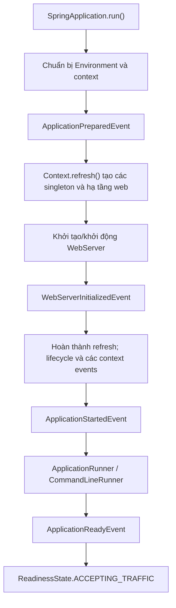

# `WebServerInitializedEvent` và các biến thể Servlet hoặc Reactive

## 1. Vì sao cần sự kiện khi web server đã khởi tạo?

Khi chạy một ứng dụng Spring Boot có web server nhúng, `SpringApplication.run(...)` phải dựng `ApplicationContext`, cấu hình hạ tầng HTTP và khởi động server. Có những lúc ứng dụng cần biết **server nào đã được khởi tạo và thực tế đang lắng nghe cổng nào**: ví dụ chọn `server.port=0` để hệ điều hành cấp cổng ngẫu nhiên, ghi thông tin chẩn đoán hoặc kết nối các thành phần kiểm thử.

Spring Boot phát `WebServerInitializedEvent` khi `WebServer` do một web application context quản lý đã sẵn sàng. Hai biến thể cụ thể là:

- `ServletWebServerInitializedEvent`: cho stack **Servlet**, thường là Spring MVC trên Tomcat/Jetty/Undertow được hỗ trợ.
- `ReactiveWebServerInitializedEvent`: cho stack **Reactive**, thường là Spring WebFlux trên Reactor Netty hoặc một server reactive tương thích.

Điều quan trọng: **web server khởi động xong không đồng nghĩa cả ứng dụng đã ready**. Spring Boot còn có thể phải chạy `ApplicationRunner` hoặc `CommandLineRunner`, kiểm tra dữ liệu và hoàn tất luồng khởi động trước khi công bố trạng thái readiness phù hợp.

Bài học dựa trên API Spring Boot **3.3.x / Java 17+** và các loại context do Boot tạo. Không nhầm sự kiện này với `ApplicationStartedEvent`, `ApplicationReadyEvent` hoặc `ContextRefreshedEvent`.

## 2. Phân biệt `WebServer`, `ApplicationContext` và sự kiện

Trong một ứng dụng web có ba thành phần cần tách biệt:

| Thành phần | Trách nhiệm | Ví dụ |
| --- | --- | --- |
| Spring `ApplicationContext` | IoC container quản lý bean, dependency, lifecycle và event publishing | `ServletWebServerApplicationContext`, `ReactiveWebServerApplicationContext` |
| `WebServer` | Hạ tầng runtime tiếp nhận và xử lý các kết nối/request HTTP | Tomcat, Jetty hoặc Reactor Netty thông qua abstraction Boot |
| `WebServerInitializedEvent` | Thông báo server đã được khởi tạo/sẵn sàng, kèm đối tượng server và context sở hữu | Một listener đọc cổng HTTP thực tế |

`WebServerInitializedEvent` thuộc package `org.springframework.boot.web.context`. Đây là **abstract class** kế thừa `ApplicationEvent`; code ứng dụng thường nhận **một trong hai subclass** ở runtime.

API cốt lõi:

```java
WebServerInitializedEvent event = ...; // Nhận từ listener, không tự khởi tạo
int boundPort = event.getWebServer().getPort();
WebServerApplicationContext sourceContext = event.getApplicationContext();
```

Đoạn trên chỉ minh họa các lời gọi; `event` thực tế phải đến từ cơ chế phát event của Spring, và `WebServerApplicationContext` nằm trong `org.springframework.boot.web.context`.

- `getWebServer()` trả về đối tượng `WebServer`; `getPort()` cung cấp cổng thực tế mà server sử dụng.
- `getApplicationContext()` trả về **web context sở hữu server**, rất hữu ích khi có nhiều context.
- `getSource()` cũng trả về `WebServer`.
- `getTimestamp()` là timestamp theo cơ chế `ApplicationEvent`, không phải phép đo thời gian startup hay độ trễ kết nối.

Một listener có thể xử lý chung cả hai loại bằng tham số `WebServerInitializedEvent`, hoặc chỉ xử lý một stack bằng tham số subclass cụ thể.

## 3. Các biến thể Servlet và Reactive

### 3.1. Servlet variant

Fully qualified class:

```text
org.springframework.boot.web.servlet.context.ServletWebServerInitializedEvent
```

Đối tượng này kế thừa `WebServerInitializedEvent`, có `getApplicationContext()` trả về `ServletWebServerApplicationContext`. Trong cấu hình Spring Boot MVC thông thường, embedded server thường là Tomcat do `spring-boot-starter-web` kéo vào.

Những điểm cần nhớ:

- Event nói rằng **web server** đã được chuẩn bị; không nói rằng mọi runner đã chạy xong.
- Có thể lấy port **được gán thực tế**, đặc biệt nếu đặt `server.port=0`.
- Khi ứng dụng triển khai dưới dạng WAR vào một servlet container bên ngoài thay vì sử dụng web server do Boot quản lý, cơ chế lifecycle và cách nhận event có thể khác; không được giả định luôn có embedded-server event.

### 3.2. Reactive variant

Fully qualified class:

```text
org.springframework.boot.web.reactive.context.ReactiveWebServerInitializedEvent
```

Subclass này liên kết với `ReactiveWebServerApplicationContext`. Nếu chọn `spring-boot-starter-webflux` mà không có Spring MVC, Boot thường cấu hình ứng dụng reactive với Reactor Netty.

Điều quan trọng là **reactive không làm thay đổi ý nghĩa của event**: vẫn là tín hiệu server đã sẵn sàng, vẫn có `getWebServer().getPort()` và context sở hữu; sự khác biệt là loại context và hạ tầng web.

Nếu đưa cả Spring MVC và WebFlux lên classpath, Boot thường chọn **Servlet stack** theo mặc định. Muốn tạo demo reactive rõ ràng, dùng dự án riêng chỉ có webflux starter hoặc chọn `WebApplicationType.REACTIVE` khi có lý do kiểm soát rõ dependency.

### 3.3. Bảng đối chiếu

| Câu hỏi | Servlet | Reactive |
| --- | --- | --- |
| Class event | `ServletWebServerInitializedEvent` | `ReactiveWebServerInitializedEvent` |
| Context | `ServletWebServerApplicationContext` | `ReactiveWebServerApplicationContext` |
| Starter thường dùng | `spring-boot-starter-web` | `spring-boot-starter-webflux` |
| Server mặc định thường gặp | Embedded Tomcat | Reactor Netty |
| Nhận sự kiện tổng quát | `@EventListener(WebServerInitializedEvent)` | Chính listener đó cũng nhận được |
| Đọc cổng bound thực tế | `event.getWebServer().getPort()` | Tương tự |
| Event biểu thị Boot `ApplicationReadyEvent` đã phát? | **Không** | **Không** |
| Có event nếu `WebApplicationType.NONE`? | Không có embedded web server để phát | Không có embedded web server để phát |

Cùng một interface `WebServer` cho phép code chẩn đoán chung, không cần viết hai nhánh chỉ để lấy cổng.

## 4. Vị trí của event trong chuỗi khởi động

Trong một lượt khởi động web thông thường:



Sơ đồ nhấn mạnh vị trí của server event tương đối với các mốc Boot. Các chi tiết thứ tự bên trong `refresh()` phụ thuộc triển khai context, web server và phiên bản; không sử dụng sơ đồ như hợp đồng cố định về mọi callback nội bộ. Tài liệu Boot xác định `WebServerInitializedEvent` và `ContextRefreshedEvent` đều xuất hiện giữa `ApplicationPreparedEvent` và `ApplicationStartedEvent` của chuỗi thành công.

Phân biệt chính xác:

- **`ApplicationPreparedEvent`**: nguồn bean đã nạp vào context, chuẩn bị bắt đầu refresh.
- **`WebServerInitializedEvent`**: server thuộc web context đã sẵn sàng, có thể lấy cổng.
- **`ContextRefreshedEvent`**: Spring Framework cho biết context đã refresh xong.
- **`ApplicationStartedEvent`**: Boot đã refresh context, **chưa chạy runners**.
- **`ApplicationReadyEvent`**: Boot đã gọi xong runners và đạt mốc ready của startup bình thường.
- **`AvailabilityChangeEvent<ReadinessState>`**: biểu thị trạng thái có sẵn sàng nhận traffic về mặt ứng dụng hay không.

Tùy tiến trình startup, cổng HTTP có thể đã được bind khi readiness vẫn là `REFUSING_TRAFFIC`. Hạ tầng như Kubernetes nên sử dụng **readiness probe**, không dùng “port mở được” làm bằng chứng ứng dụng đã hoàn tất tác vụ khởi động.

## 5. Cách nhận event: lắng nghe trực tiếp hay qua bean?

### 5.1. `@EventListener` trong một Spring bean

Đây là cách đơn giản khi context tạo các listener trước khi server phát sự kiện.

```java
@Component
public class ServerPortObserver {

    @EventListener
    public void onInitialized(WebServerInitializedEvent event) {
        int actualPort = event.getWebServer().getPort();
        System.out.println("httpPort=" + actualPort);
    }
}
```

Đoạn trên cần các imports từ Spring Boot và Spring Framework; xem ví dụ chạy hoàn chỉnh ở mục 7.

Dùng base class `WebServerInitializedEvent` giúp một listener xử lý cả stack Servlet lẫn Reactive. Nếu chỉ muốn Servlet, nhận `ServletWebServerInitializedEvent` trong method; nếu chỉ muốn Reactive, nhận `ReactiveWebServerInitializedEvent`.

### 5.2. `ApplicationListener` bằng `@Bean`

Khi cần listener đơn giản, có thể khai báo một bean `ApplicationListener<ServletWebServerInitializedEvent>` trong config và nhận server từ event. Boot cũng tài liệu hóa cách này để phát hiện cổng HTTP thực tế, đặc biệt với `server.port=0`.

Không nên suy luận từ một listener bean rằng nó sẽ nhận **mọi** event rất sớm của Boot. Chẳng hạn `ApplicationStartingEvent` được phát trước khi bean context tồn tại, nên listener cho event đó phải đăng ký trực tiếp vào `SpringApplication` hoặc qua cơ chế bootstrap được hỗ trợ. `WebServerInitializedEvent` là event phát trong giai đoạn context đã tạo bean/listener thông thường.

### 5.3. Listener với generic event type

Ví dụ minh họa lọc hai biến thể bằng class:

```java
@EventListener
public void onServlet(ServletWebServerInitializedEvent event) {
    System.out.println("servletPort=" + event.getWebServer().getPort());
}

@EventListener
public void onReactive(ReactiveWebServerInitializedEvent event) {
    System.out.println("reactivePort=" + event.getWebServer().getPort());
}
```

Hai method cần đặt trong Spring bean với imports tương ứng. Trong một ứng dụng chỉ chạy stack Servlet hoặc chỉ chạy Reactive, thông thường chỉ một method được gọi. Có cả hai method không làm ứng dụng chạy đồng thời hai web stack.

**Không tự `new ServletWebServerInitializedEvent(...)` để kiểm tra cổng.** Event thực tế do cơ chế lifecycle của Boot phát. Khi viết unit test listener, có thể tạo mock theo nhu cầu, nhưng đừng phát event giả ở production để đánh dấu server ready.

## 6. Port được cấu hình và port thực tế

Khi đặt:

```properties
server.port=8080
```

Boot cố bind HTTP server vào port 8080. Nếu thành công và chỉ có một web server chính, `event.getWebServer().getPort()` thông thường trả `8080`.

Khi đặt:

```properties
server.port=0
```

Boot yêu cầu hệ điều hành chọn một cổng trống. Lúc này:

- Đọc trực tiếp `Environment#getProperty("server.port")` có thể vẫn thấy cấu hình **`"0"`**.
- `event.getWebServer().getPort()` trả **cổng thực tế** sau khi server đã bind.
- Boot có thể công bố `local.server.port` sau khi server được khởi tạo; tại những mốc quá sớm, property đó chưa chắc có.
- Trong test web với random port, `@LocalServerPort` là API thuận tiện của Spring Boot Test để nhận cổng được gán.

Ví dụ không nên làm:

```java
@Value("${server.port}")
int configuredPort;
```

rồi dùng `configuredPort` để tự kết nối đến server khi `server.port=0`. Khi đó giá trị cấu hình là `0`, không phải cổng random đã bind.

Đối với ứng dụng có management web server chạy cổng riêng, còn có `local.management.port` và một web context riêng. Tránh lấy “event xuất hiện đầu tiên” rồi mặc định đó là cổng của API chính.

## 7. Ví dụ Spring Boot 3.x chạy được cho Servlet và Reactive

Ví dụ dùng Java 17+ và Spring Boot 3.3.x. Code Java giữ nguyên giữa hai lượt chạy; ta thay **web starter** để Boot chọn stack phù hợp.

### 7.1. Tạo dự án Maven

Tạo file `pom.xml` tối giản sau:

```xml
<project xmlns="http://maven.apache.org/POM/4.0.0"
         xmlns:xsi="http://www.w3.org/2001/XMLSchema-instance"
         xsi:schemaLocation="http://maven.apache.org/POM/4.0.0 https://maven.apache.org/xsd/maven-4.0.0.xsd">
    <modelVersion>4.0.0</modelVersion>

    <parent>
        <groupId>org.springframework.boot</groupId>
        <artifactId>spring-boot-starter-parent</artifactId>
        <version>3.3.13</version>
        <relativePath/>
    </parent>

    <groupId>com.example</groupId>
    <artifactId>web-event-demo</artifactId>
    <version>0.0.1-SNAPSHOT</version>

    <properties>
        <java.version>17</java.version>
    </properties>

    <dependencies>
        <dependency>
            <groupId>org.springframework.boot</groupId>
            <artifactId>spring-boot-starter-web</artifactId>
        </dependency>
    </dependencies>

    <build>
        <plugins>
            <plugin>
                <groupId>org.springframework.boot</groupId>
                <artifactId>spring-boot-maven-plugin</artifactId>
            </plugin>
        </plugins>
    </build>
</project>
```

Ở lần đầu, đây là một ứng dụng **Servlet** vì `spring-boot-starter-web` mang Spring MVC và embedded Tomcat vào classpath.

### 7.2. Main class

Tạo file `src/main/java/com/example/webevent/WebEventDemoApplication.java`:

```java
package com.example.webevent;

import org.springframework.boot.ApplicationRunner;
import org.springframework.boot.SpringApplication;
import org.springframework.boot.autoconfigure.SpringBootApplication;
import org.springframework.context.annotation.Bean;

@SpringBootApplication
public class WebEventDemoApplication {

    public static void main(String[] args) {
        SpringApplication.run(WebEventDemoApplication.class, args);
    }

    @Bean
    ApplicationRunner afterRefresh() {
        return args -> System.out.println("02 - runner-finished");
    }
}
```

### 7.3. Listener

Tạo `src/main/java/com/example/webevent/WebEvents.java`:

```java
package com.example.webevent;

import org.springframework.boot.context.event.ApplicationReadyEvent;
import org.springframework.boot.web.context.WebServerInitializedEvent;
import org.springframework.context.event.EventListener;
import org.springframework.stereotype.Component;

@Component
public class WebEvents {

    @EventListener
    public void onWebServerInitialized(WebServerInitializedEvent event) {
        System.out.println("01 - eventType="
                + event.getClass().getSimpleName());
        System.out.println("portAssigned="
                + (event.getWebServer().getPort() > 0));
    }

    @EventListener
    public void onApplicationReady(ApplicationReadyEvent event) {
        System.out.println("03 - application-ready");
    }
}
```

`getClass().getSimpleName()` cho thấy **subclass cụ thể** mà Boot phát. Dòng `portAssigned=true` thể hiện phép kiểm tra trên cổng thực tế, không ép output chứa số port random không đoán trước được.

### 7.4. Properties

Tạo `src/main/resources/application.properties`:

```properties
server.port=0
spring.main.banner-mode=off
logging.level.root=WARN
```

`server.port=0` để hệ điều hành cấp cổng trống. Banner và mức log chỉ để bản demo dễ quan sát; có thể thấy log khác tùy cấu hình runtime.

### 7.5. Chạy Servlet

Từ thư mục gốc Maven:

```bash
mvn spring-boot:run
```

Hoặc nếu dự án đã có Maven Wrapper:

```bash
./mvnw spring-boot:run
```

Trên Windows PowerShell có thể dùng `.\mvnw.cmd spring-boot:run`.

Bốn dòng **do mã ví dụ tự in** thường có thứ tự:

```text
01 - eventType=ServletWebServerInitializedEvent
portAssigned=true
02 - runner-finished
03 - application-ready
```

Cổng thực tế là một số nguyên dương do hệ điều hành chọn. Chương trình giữ server hoạt động cho đến khi dừng process, vì `SpringApplication.run(...)` không đóng context trong ví dụ web.

### 7.6. Chạy Reactive

Để kiểm chứng biến thể Reactive, trong `pom.xml` **thay duy nhất dependency web starter**:

```xml
<dependency>
    <groupId>org.springframework.boot</groupId>
    <artifactId>spring-boot-starter-webflux</artifactId>
</dependency>
```

Build lại từ đầu, bảo đảm không còn `spring-boot-starter-web` được kéo vào qua dependency khác. Với một dự án chỉ dùng WebFlux starter, Boot chọn reactive web context phù hợp.

Chạy lại `mvn spring-boot:run`. Những dòng do code in:

```text
01 - eventType=ReactiveWebServerInitializedEvent
portAssigned=true
02 - runner-finished
03 - application-ready
```

**Một code listener, hai subclass event:** đó là lợi ích khi nhận `WebServerInitializedEvent` thay vì cố gắn logic chẩn đoán cổng vào một web stack cụ thể.

Các lệnh Maven trên đòi hỏi project đã có `pom.xml` như hướng dẫn, Maven/JDK được cài và dependency đã tải về; không phải chương trình Java thuần chạy bằng một lệnh `javac` mà không có classpath.

## 8. Khi một ứng dụng có hơn một web server/context

Không phải lúc nào một process Spring Boot cũng chỉ có một event.

Ví dụ sử dụng Spring Boot Actuator và cấu hình:

```properties
server.port=8080
management.server.port=9090
```

Khi management server được cấu hình chạy **cổng riêng**, Boot có thể tạo một management context riêng, với web server riêng. Event từ child context có thể được chuyển lên parent context thông qua cơ chế application event của Spring Framework.

Hệ quả:

- Một listener ở context cha có thể quan sát nhiều `WebServerInitializedEvent` khác nhau.
- Các event có thể có port và `ApplicationContext` sở hữu khác nhau.
- `event.getApplicationContext()` là thông tin đáng tin cậy để phân biệt context nguồn.
- Không lưu một biến `int port` toàn cục được ghi đè bởi mỗi event nếu bạn chỉ cần cổng HTTP chính.

Ví dụ lọc event trong một bean ở context chính:

```java
@Component
public class PrimaryPortListener {

    private final ApplicationContext current;

    public PrimaryPortListener(ApplicationContext current) {
        this.current = current;
    }

    @EventListener
    public void onWebServer(WebServerInitializedEvent event) {
        if (event.getApplicationContext() != current) {
            return; // Event thuộc context khác, ví dụ management child
        }
        System.out.println("mainPort="
                + event.getWebServer().getPort());
    }
}
```

Đoạn minh họa cần imports cho `ApplicationContext`, `Component`, `EventListener` và `WebServerInitializedEvent`. So sánh **identity của context** là cách phù hợp khi muốn chắc chắn event thuộc instance đang quan sát. Trong hệ thống nhiều context, có thể dùng thêm context ID/name do chính ứng dụng đặt để logging hoặc chẩn đoán.

Với `@SpringBootTest(webEnvironment = RANDOM_PORT)`, `@LocalServerPort` phù hợp khi mục đích là gửi request đến server chính của **test context**. Khi quản lý nhiều cổng, phân biệt `local.server.port` với `local.management.port`.

## 9. Event không phải readiness hay health check

### 9.1. Những mốc dễ bị đánh đồng

| Tín hiệu | Thực chất | Có bảo đảm app sẵn sàng nhận traffic? |
| --- | --- | --- |
| Bind thành công cổng 8080 | HTTP listener đã mở socket | Không |
| `WebServerInitializedEvent` | Web server do Boot quản lý đã sẵn sàng | Không |
| `ContextRefreshedEvent` | Container hoàn thành refresh | Không bảo đảm runners đã xong |
| `ApplicationStartedEvent` | Context refresh thành công; runner chưa chạy | Không |
| `ApplicationReadyEvent` | Runners hoàn tất trong luồng startup bình thường | Là mốc hoàn thành startup của Boot, nhưng readiness vẫn có thể được điều chỉnh bởi ứng dụng |
| `ReadinessState.ACCEPTING_TRAFFIC` | Ứng dụng báo sẵn sàng tiếp nhận traffic | Tín hiệu điều phối thích hợp nếu được tích hợp probe đúng cách |

Với Actuator, Spring Boot cung cấp các health groups `/actuator/health/liveness` và `/actuator/health/readiness` trong cấu hình hỗ trợ. Các endpoint có sẵn và được expose thế nào phụ thuộc dependency Actuator, cấu hình, môi trường và cách ánh xạ port.

### 9.2. Khi server đã mở nhưng runner còn chạy

Giả sử `ApplicationRunner` nạp dữ liệu tham chiếu trong 30 giây. Web server có thể đã được khởi tạo và đã phát event, nhưng Boot vẫn chưa phát `ApplicationReadyEvent`. Readiness mặc định vẫn thể hiện ứng dụng chưa sẵn sàng cho đến giai đoạn hoàn thành runner.

Đối với deployment, hãy kiểm tra **readiness endpoint** thay vì chỉ dùng TCP connect hoặc HTTP endpoint tình cờ trả 200. Một readiness probe thất bại thường làm orchestrator tạm thời **không định tuyến traffic**, khác với liveness probe thất bại thường khiến container bị restart.

### 9.3. Không làm tác vụ nặng ngay trong listener

`@EventListener` mặc định chạy đồng bộ trong cơ chế publishing thông thường. Một listener nhận `WebServerInitializedEvent` rồi thực hiện request mạng lâu hoặc migration database có thể kéo dài quá trình startup, thậm chí gây lỗi toàn bộ startup.

Sử dụng event này chủ yếu cho nhiệm vụ **ngắn và gắn trực tiếp với web server**: đọc port, ghi một số thông tin chẩn đoán, cấu hình thành phần cần port thực tế. Những công việc cần chạy sau refresh nên đặt vào runner hoặc một cơ chế điều phối startup rõ ràng, và phải xem xét timeout, lỗi cùng readiness.

## 10. Lỗi thường gặp và cách kiểm tra

### Lỗi A — Không thấy event dù ứng dụng đã khởi động

Kiểm tra ứng dụng có thực sự là **web application với WebServer do Boot quản lý** hay không. Nếu đặt `spring.main.web-application-type=none`, sẽ không có embedded web server để phát event. Nếu bean listener nằm ngoài component scan, `@EventListener` cũng không được đăng ký.

### Lỗi B — Đọc `server.port` ra 0 và tưởng web server lỗi

`0` là **port cấu hình** yêu cầu hệ điều hành cấp cổng ngẫu nhiên. Sau khi server bind, lấy cổng thực tế từ `event.getWebServer().getPort()` hoặc cơ chế `@LocalServerPort` trong integration test.

### Lỗi C — Gặp event Reactive trong khi tưởng dùng Spring MVC

Kiểm tra dependencies và web application type. Dùng `spring-boot-starter-webflux` thuần tạo reactive stack; dùng `spring-boot-starter-web` tạo servlet stack. Nếu trộn hai starter, classpath và lựa chọn `WebApplicationType` có thể khiến stack thực tế khác ý định.

### Lỗi D — Gặp hai event với hai cổng

Kiểm tra Actuator management server trên cổng riêng và cấu trúc parent/child contexts. Dùng `event.getApplicationContext()` thay vì lấy event cuối cùng hoặc event đầu tiên tùy tình cờ.

### Lỗi E — Listener nhận nhầm event của management server

Trong context hierarchy, event có thể được chuyển lên context cha. Lọc bằng identity hoặc ID của `event.getApplicationContext()`, chỉ xử lý context ứng dụng chính.

### Lỗi F — Nhận event và lập tức gọi API nhưng gặp lỗi nghiệp vụ

Server đã sẵn sàng ở cấp HTTP không có nghĩa runner đã hoàn tất nạp dữ liệu, cache hoặc thiết lập dependency. Chỉ gửi traffic sau khi readiness đã đạt trạng thái cho phép.

### Lỗi G — Dùng `ApplicationStartedEvent` để đo port mà báo không rõ server nào

`ApplicationStartedEvent` là mốc cấp ứng dụng. Nếu cần biết **chính xác web server/context cụ thể**, `WebServerInitializedEvent` mang thông tin đặc thù hơn. Với ứng dụng có nhiều web context, việc dựa trên event cấp application để suy ra server chính sẽ thiếu dữ liệu.

### Lỗi H — Thử trong unit test chỉ tạo `AnnotationConfigApplicationContext`

Một context không phải web server context sẽ không tự tạo embedded web server hoặc phát `WebServerInitializedEvent`. Muốn kiểm chứng event được Boot phát thật, dùng test web khởi động server, ví dụ `@SpringBootTest(webEnvironment = SpringBootTest.WebEnvironment.RANDOM_PORT)` với đúng starter và `spring-boot-starter-test`.

### Lỗi I — Lắng nghe event quá sớm bằng `ApplicationListener` đăng ký ngoài context

Với sự kiện server, listener `@EventListener` trong bean thường đã đủ. Cơ chế `SpringApplication.addListeners(...)` hữu ích cho các event bootstrap rất sớm, nhưng không bắt buộc để xử lý `WebServerInitializedEvent`.

### Lỗi J — Lấy cổng từ log startup rồi parse chuỗi

Thông báo log có thể thay đổi theo logger, server, profile hoặc phiên bản. Đọc port bằng API event là đáng tin cậy hơn việc regex log. Ngoài ra, **port đang lắng nghe** khác địa chỉ public URL của service khi đặt sau gateway/load balancer.

## 11. Kịch bản thực hành

**Bài tập 1.** Đặt `server.port=0` nhưng log `server.port` trong một bean vẫn hiện `0`. Dựa vào mốc nào để lấy cổng HTTP thật?

*Đáp án:* Dùng `WebServerInitializedEvent#getWebServer().getPort()` sau khi server được khởi tạo, hoặc `@LocalServerPort` khi chạy integration test.

**Bài tập 2.** Chỉ có `spring-boot-starter-webflux` và không có MVC. Listener nhận base `WebServerInitializedEvent`. Runtime class mong đợi là gì?

*Đáp án:* `ReactiveWebServerInitializedEvent`.

**Bài tập 3.** Một ứng dụng có API chính cổng 8080 và Actuator management cổng 9090. Listener có thể nhận bao nhiêu sự kiện server?

*Đáp án:* Có thể nhận hơn một, tùy cấu trúc context và propagation. Dùng `getApplicationContext()` phân biệt server nguồn; không dựa vào thứ tự event.

**Bài tập 4.** `WebServerInitializedEvent` đã được ghi log nhưng một runner vẫn nạp dữ liệu. Có nên bật readiness xanh chỉ vì port đã mở?

*Đáp án:* Không. Đợi mốc hoàn tất startup/runner hoặc readiness state do ứng dụng công bố phù hợp với điều kiện phục vụ.

**Bài tập 5.** Đang dùng `WebApplicationType.NONE` và listener không bao giờ chạy. Đó có nhất thiết là lỗi listener?

*Đáp án:* Không. Không có embedded web server do Boot quản lý thì không có event tương ứng.

**Bài tập 6.** Cần tìm API chính bên ngoài gateway với hostname và HTTPS public. `getWebServer().getPort()` đã đủ chưa?

*Đáp án:* Chưa. API này cho biết **local port** của server đang chạy, không suy ra scheme/hostname/route public phía reverse proxy.

## 12. Nguồn tham khảo chính thức

- Spring Boot 3.3 API — `ServletWebServerInitializedEvent`: https://docs.spring.io/spring-boot/3.3/api/java/org/springframework/boot/web/servlet/context/ServletWebServerInitializedEvent.html
- Spring Boot API — `WebServerInitializedEvent`: https://docs.spring.io/spring-boot/3.3/api/java/org/springframework/boot/web/context/WebServerInitializedEvent.html
- Spring Boot API — `ReactiveWebServerInitializedEvent`: https://docs.spring.io/spring-boot/3.3/api/java/org/springframework/boot/web/reactive/context/ReactiveWebServerInitializedEvent.html
- Spring Boot reference — Application Events and Listeners: https://docs.spring.io/spring-boot/3.3/reference/features/spring-application.html
- Spring Boot reference — Kubernetes Probes: https://docs.spring.io/spring-boot/3.3/reference/actuator/endpoints.html

## 13. Ghi nhớ

**`WebServerInitializedEvent` là mốc của web server, không phải mốc hoàn thành toàn bộ ứng dụng.** Nó cho biết một server do web context của Spring Boot quản lý đã sẵn sàng, đồng thời cho phép lấy **port thực tế** và **context sở hữu**. `ServletWebServerInitializedEvent` và `ReactiveWebServerInitializedEvent` mang cùng ý nghĩa trên hai mô hình web.

Khi cần xử lý chung, lắng nghe base event; khi cần logic riêng cho web stack, lắng nghe subclass. Khi có nhiều web context, kiểm tra context nguồn. Khi quyết định đưa traffic vào hệ thống, dựa trên **readiness**, không dựa riêng vào sự kiện web server.** sau mốc readiness hoặc từ cơ chế service discovery/health có sẵn. Nếu đăng ký có thao tác network, không chặn thread publish event quá lâu; cần timeout, retry và quy trình hủy đăng ký khi shutdown.

### 10.3. Health và readiness

Ba thông tin cần phân biệt:

- **Server đã bind vào port:** `WebServerInitializedEvent` là một tín hiệu.
- **Boot đã hoàn thành runners:** `ApplicationReadyEvent` là mốc startup.
- **Instance đang đủ điều kiện nhận lưu lượng nghiệp vụ:** readiness probe/health indicator cần phản ánh state và dependency của ứng dụng trong suốt thời gian hoạt động.

Một ứng dụng có thể khởi động server thành công rồi mất kết nối database sau đó; sự kiện startup trong quá khứ không tự biến thành giám sát sức khỏe liên tục.

### 10.4. Không tự quản `WebServer.start()`/`stop()` tùy tiện

`WebServer` có `start()`, `stop()` và các API lifecycle khác. `ServletWebServerInitializedEvent` có thể cho phép listener kiểm tra server và về kỹ thuật server có thể được stop/start, nhưng việc tự dừng web server ngay trong event listener có thể phá vỡ lifecycle của `ApplicationContext`.

Chỉ can thiệp khi có thiết kế hạ tầng chủ động và đã kiểm thử. Với yêu cầu ứng dụng nghiệp vụ thông thường, listener chỉ nên **đọc** server và lưu những metadata cần thiết.

## 11. Những hiểu nhầm thường gặp

### Hiểu nhầm 1 — “`WebServerInitializedEvent` giống `ApplicationReadyEvent`”

Không. Server được khởi tạo trước khi các runner của Boot hoàn tất. Một runner có thể lỗi sau khi web server event đã phát; sự kiện “ready” của startup thành công khi đó không được công bố.

### Hiểu nhầm 2 — “Ứng dụng nào dùng Spring Boot cũng có web server event”

Không. `WebApplicationType.NONE`, các worker/batch process thuần và nhiều test context không-web không tạo embedded web server, vì vậy không có event tương ứng. Event không phải tín hiệu chung cho mọi Spring context.

### Hiểu nhầm 3 — “Thấy `Mono` hoặc Reactor thì nhận Reactive event”

Không. Biến thể do **loại web application context/server được bootstrapped** quyết định, không phải kiểu return của một hàm tùy ý. Khi có MVC và WebFlux cùng lúc, Spring Boot thường ưu tiên Servlet theo mặc định.

### Hiểu nhầm 4 — “Cổng cấu hình `server.port` luôn bằng cổng HTTP đang lắng nghe”

Khi `server.port=0`, giá trị cấu hình là `0` trong khi port runtime được OS cấp một số lớn hơn 0. Cần đọc từ `event.getWebServer().getPort()` hoặc nguồn runtime phù hợp.

### Hiểu nhầm 5 — “Có thể inject `local.server.port` vào bất kỳ singleton nào”

Property này thường chỉ được bổ sung sau khi server đã khởi tạo. Một bean được tạo sớm có thể không lấy được giá trị. Dùng event hoặc test `@LocalServerPort` tại thời điểm đúng.

### Hiểu nhầm 6 — “`getWebServer().getPort()` là cổng public của hệ thống”

Không chắc. Cổng listener nội bộ có thể nằm sau Docker port mapping, reverse proxy hoặc ingress. Public URL có thể dùng HTTPS/cổng 443 dù local server lắng nghe 8080 hoặc một port ngẫu nhiên.

### Hiểu nhầm 7 — “Cứ thêm `spring-boot-starter-webflux` là dùng Reactive event”

Nếu Spring MVC vẫn có mặt trên classpath, Boot thường chọn Servlet web type. Hãy xác định web application type thực tế và các starter đang có, đừng suy đoán từ tên một dependency.

### Hiểu nhầm 8 — “Chỉ có thể bắt event bằng listener đăng ký trước `run()`”

`ApplicationStartingEvent` là event cực sớm, nhưng `WebServerInitializedEvent` được phát muộn hơn, trong quá trình refresh. Một bean `ApplicationListener` hoặc `@EventListener` được đăng ký trước mốc đó có thể nhận sự kiện. Không áp dụng cùng một quy tắc cho mọi event.

### Hiểu nhầm 9 — “Một JVM chỉ nhận một web server event”

Khi có management context/server riêng hoặc hierarchy nhiều context, có thể có nhiều event. Dùng `getApplicationContext()`/namespace/context ID để xác định server thực sự liên quan.

### Hiểu nhầm 10 — “Listener chạy nhanh hay chậm không quan trọng”

Listener mặc định chạy đồng bộ, và startup đang chờ chuỗi sự kiện tiếp tục. Công việc network lâu hoặc exception chưa xử lý trong callback có thể trì hoãn hoặc làm startup thất bại.

### Hiểu nhầm 11 — “`WebServerInitializedEvent` luôn xuất hiện khi triển khai WAR vào external servlet container”

Cơ chế này hướng tới **web server do Spring Boot web application context khởi tạo/quản lý**. Nếu ứng dụng chạy trong một external servlet container đã được hệ thống triển khai khởi tạo trước, không nên mặc định mong đợi cùng lifecycle và event như một embedded server chạy từ `SpringApplication.run()`.

### Hiểu nhầm 12 — “`ContextRefreshedEvent` có thể thay hoàn toàn web server event”

`ContextRefreshedEvent` biểu thị refresh context theo Spring Framework, có thể xuất hiện ở context không web. Nó không trực tiếp mang server/cổng runtime. Khi cần port hoặc server identity, `WebServerInitializedEvent` truyền đạt đúng thông tin hơn.

## 12. Gỡ lỗi khi không thấy hoặc thấy quá nhiều event

Khi listener không được gọi, nên kiểm tra theo thứ tự:

1. **Ứng dụng có chạy web server không?** Nếu `spring.main.web-application-type=none` hoặc context test không mở server, việc thiếu event là bình thường.
2. **Đúng starter/web type?** `spring-boot-starter-web` thường phát biến thể Servlet; `spring-boot-starter-webflux` thuần thường phát biến thể Reactive.
3. **Listener có được Spring đăng ký không?** `@Bean` phải ở class cấu hình được nạp; `@Component`/`@EventListener` phải được scan; listener đăng ký qua `SpringApplication.addListeners(...)` phải trước `run()`.
4. **Listener có lọc sai context không?** Điều kiện `event.getApplicationContext() == ownContext` chỉ đúng khi listener quan tâm server của chính context đó.
5. **Server có khởi động thành công không?** Lỗi bind port, lỗi bean hoặc lỗi startup quá sớm có thể khiến server event chưa từng xuất hiện.
6. **Có nhiều context?** In context ID, namespace, event subtype và actual port để phân biệt main/management server.

Ví dụ listener quan sát ngắn:

```java
@EventListener
void trace(WebServerInitializedEvent event) {
    System.out.printf(
            "type=%s context=%s namespace=%s port=%d%n",
            event.getClass().getSimpleName(),
            event.getApplicationContext().getId(),
            event.getApplicationContext().getServerNamespace(),
            event.getWebServer().getPort()
    );
}
```

Đây là đoạn **minh họa đặt trong bean Spring**, cần import `@EventListener` và class event. Nó giúp xác định sự kiện đến từ Servlet/Reactive, context nào và cổng thực tế, nhưng không nên đưa log nhạy cảm hoặc thông tin nội bộ không cần thiết ra public.

Nếu thấy cả event chính và management event, hãy tách theo context/namespace. Nếu chưa có event nào, hãy xem lỗi startup và loại application context trước khi kết luận listener code sai.

## 13. Bài tập kiểm chứng

### Bài tập A — lấy cổng với `server.port=0`

Đổi ứng dụng ví dụ sang dùng cổng ngẫu nhiên. Hỏi: có nên đọc `server.port` hay `event.getWebServer().getPort()` để tạo URL test?

**Đáp án:** Đọc `event.getWebServer().getPort()` trong listener khi server đã khởi tạo; với integration test có thể dùng `@LocalServerPort`. Property `server.port=0` chỉ là yêu cầu chọn cổng.

### Bài tập B — xác định loại event

Chạy code mục 6 với starter Web. Sau đó thay bằng starter WebFlux và chạy lại. Hỏi: vì sao `variant` đổi dù Java listener không thay đổi?

**Đáp án:** Boot tạo loại web application context tương ứng với classpath/web application type. Mỗi loại phát subtype event riêng, nhưng cùng kế thừa `WebServerInitializedEvent`.

### Bài tập C — thêm một runner thất bại

Trong ví dụ, thay runner bằng:

```java
@Bean
ApplicationRunner startupRunner() {
    return args -> {
        System.out.println("runner=failed");
        throw new IllegalStateException("Initialization failed");
    };
}
```

Hỏi: có thể thấy server event trước khi startup thất bại không? Có thấy `application=ready` của lần chạy thất bại không?

**Đáp án:** Có thể đã thấy server event nếu web server khởi tạo thành công trước runner. Nhưng runner ném exception nên luồng startup thành công không đến `ApplicationReadyEvent`; Boot xử lý nhánh lỗi. Lưu ý không thử điều này trên ứng dụng production đang phục vụ traffic.

### Bài tập D — listener một context nhận event management

Có hai server: ứng dụng cổng 8080 và management cổng 9090. Listener cần chỉ xử lý server chính. Hỏi nên dựa vào điều gì?

**Đáp án:** `event.getApplicationContext()` và so sánh với context ứng dụng cần xử lý, hoặc kiểm tra server namespace/context identity theo kiến trúc. Đừng chỉ giữ “event đầu tiên” hoặc so sánh cổng cứng vì cấu hình có thể thay đổi.

### Bài tập E — phân biệt mốc

Sắp xếp thứ tự khái quát của các mốc trong ứng dụng web khởi động thành công:

```text
ApplicationReadyEvent
WebServerInitializedEvent
ApplicationStartedEvent
ApplicationRunner
```

**Đáp án:** `WebServerInitializedEvent` → `ApplicationStartedEvent` → `ApplicationRunner` → `ApplicationReadyEvent`. Giữa các mốc còn những bước của Spring Framework, nhưng thứ tự này làm rõ rằng “server đã có” chưa phải “Boot đã ready”.

### Bài tập F — ứng dụng không web

Một ứng dụng Spring Boot dùng `WebApplicationType.NONE` để chạy job định kỳ không có HTTP server. Có phải framework bị lỗi khi không publish `WebServerInitializedEvent`?

**Đáp án:** Không. Event chỉ liên quan vòng đời web server do web application context quản lý. Ứng dụng non-web vẫn có các sự kiện cấp `SpringApplication` và container phù hợp.

### Bài tập G — readiness và reverse proxy

Ứng dụng chạy bên trong container lắng nghe port 8080; ingress public truy cập qua HTTPS cổng 443. Event trả `8080`. Có nên đăng ký public URL là `https://host:8080`?

**Đáp án:** Không. Event cho cổng bind nội bộ. Public host/protocol/port phụ thuộc hạ tầng routing và các header/proxy settings được quản lý riêng.

## 14. Tài liệu tham khảo Spring Boot 3.3

- [Spring Boot 3.3 — SpringApplication: Events and Listeners](https://docs.spring.io/spring-boot/3.3/reference/features/spring-application.html): phân biệt event của `SpringApplication`, `WebServerInitializedEvent` và `ContextRefreshedEvent`.
- [Spring Boot 3.3 — Embedded Web Servers](https://docs.spring.io/spring-boot/3.3/how-to/webserver.html): `server.port=0`, cách lấy cổng runtime bằng `WebServerInitializedEvent`, lưu ý `@LocalServerPort`.
- [Spring Boot 3.3.13 — `ServletWebServerInitializedEvent` API](https://docs.spring.io/spring-boot/3.3/api/java/org/springframework/boot/web/servlet/context/ServletWebServerInitializedEvent.html): class Servlet, constructor và `getApplicationContext()`.
- [Spring Boot 3.3 — `ReactiveWebServerInitializedEvent` API](https://docs.spring.io/spring-boot/3.3/api/java/org/springframework/boot/web/reactive/context/ReactiveWebServerInitializedEvent.html): class Reactive và kiểu context.
- [Spring Boot 3.3.13 — `WebServerApplicationContext` API](https://docs.spring.io/spring-boot/3.3/api/java/org/springframework/boot/web/context/WebServerApplicationContext.html): `getWebServer()`, `getServerNamespace()` và xử lý nhiều server.
- [Spring Boot 3.3.13 — `WebServer` API](https://docs.spring.io/spring-boot/3.3/api/java/org/springframework/boot/web/server/WebServer.html): `getPort()` và lifecycle server.

## 15. Ghi nhớ

**`WebServerInitializedEvent` cho biết một web server của Spring Boot đã khởi tạo thành công, mang theo `WebServer` và context sở hữu server đó.** `ServletWebServerInitializedEvent` và `ReactiveWebServerInitializedEvent` là hai biến thể theo mô hình web application context, có thể xử lý chung bằng listener cho class cha.

Khi cần biết cổng thật, đọc `event.getWebServer().getPort()` sau khi server sẵn sàng; khi cần biết **ứng dụng đã hoàn tất startup**, dùng `ApplicationReadyEvent` và cơ chế readiness phù hợp. Với nhiều server, luôn xác định đúng context/namespace để không nhầm cổng ứng dụng và management. Đây là ranh giới giúp bạn quan sát và mở rộng startup một cách chính xác.