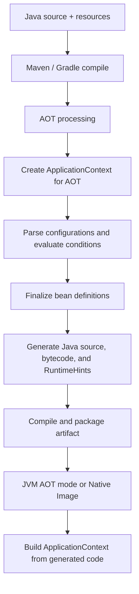

# Ahead-of-Time Processing (AOT) and Build-Time Determined Bean Graphs

## 1. What Is AOT and What Problem Does It Solve?

AOT stands for **Ahead-of-Time**. With Spring, AOT processing analyzes the application during build time, performs part of the work Spring normally does at startup in advance, and generates additional code and resources to construct the `ApplicationContext` more efficiently at runtime.

When running in the traditional way, Spring must perform many steps during startup:

- Read the classpath and locate configurations.
- Parse `@Configuration` classes, `@Import`, and component scans.
- Evaluate `@Profile` and `@Conditional` annotations.
- Discover bean types, factory methods, dependencies, and proxies to create.
- Process reflection-based metadata.
- Register bean definitions, then instantiate beans and inject dependencies.

With AOT, Spring shifts a substantial portion of discovery and structural decisions to **build time**. Those decisions are used to generate context initialization code. When the application runs in AOT mode, Spring can use the generated code instead of re-discovering the entire structure in the normal runtime manner.

AOT is especially critical for GraalVM Native Image. Native Image needs to know ahead of time which classes, methods, resources, serialization types, and proxies will be used. Spring AOT helps collect that information and generate the necessary runtime hints.

AOT can also be used on the JVM to test and run the optimized initialization path. Enabling AOT processing at build time alone is not enough: when running on the JVM, you must enable AOT mode via the system property `spring.aot.enabled=true`. Native images use AOT artifacts automatically.

## 2. What Does a Build-Time Determined Bean Graph Mean?

Consider a simple configuration:

```java
@Bean
@ConditionalOnProperty(
        prefix = "acme.feature",
        name = "enabled",
        havingValue = "true")
FeatureService featureService() {
    return new FeatureService();
}
```

In a normally running application, the condition can be evaluated at startup. If run with:

```bash
java -jar app.jar --acme.feature.enabled=true
```

the `featureService` bean is registered. If changed to `false`, the bean is not registered.

When AOT processing runs, Spring needs to construct a representative context for the application to know which bean definitions will exist. Conditions are evaluated using the classpath and Environment **of the AOT build process**. If the property is true, AOT code is generated with the `featureService` bean. When running in AOT mode, that bean belongs to the generated structure.

Therefore, if you run that same AOT artifact with:

```bash
java -Dspring.aot.enabled=true -jar app.jar --acme.feature.enabled=false
```

the runtime property value may be false, yet the bean is still present because the bean registration decision was finalized during the AOT build.

That is the meaning of "a bean graph determined at build time": **the bean structure Spring needs to construct is decided from the build environment**, not freely altered by every runtime property or profile like a normally starting application.

### 2.1. Do Not Confuse Bean Definitions with Bean Instances

AOT processing does not instantiate all bean instances at build time.

During the AOT refresh, Spring parses configurations, scans the classpath, and registers the required bean definitions. This allows the AOT engine to inspect which beans will be created, without performing a full application startup that instantiates every object like a normal runtime refresh.

Afterward, the AOT engine generates code that restores BeanFactory state and related artifacts. Bean instances are still created when the application actually runs.

There is an intentional exception for certain AOT infrastructure processors: if a bean implements `BeanFactoryInitializationAotProcessor` or `BeanRegistrationAotProcessor`, Spring may instantiate the processor and its dependencies during AOT to gather contributions. That does not mean all application beans are instantiated at build time.

### 2.2. Which Inputs Are Fixed?

| Input | Impact in AOT |
| --- | --- |
| Runtime classpath | Must be fully determined at build time; adding arbitrary JARs at runtime cannot update the AOT graph |
| `@Profile` | Profiles affecting bean registration must be selected at build time; profiles enabled during the AOT build apply when running AOT |
| Properties used in `@Conditional` | Values used to decide whether to register a bean are evaluated at build time |
| `@ConditionalOnClass` | Outcome depends on the classpath present at build time |
| Properties that only configure behavior of an existing bean | Can still be read from the Environment at runtime if they do not alter the bean graph |
| Business data, requests, database records | Remain runtime data; AOT does not freeze application data |

The key distinction is between **properties that decide whether a bean exists** and **properties that configure how an existing bean behaves**.

For example, `acme.feature.enabled` used in `@ConditionalOnProperty` decides whether the bean is registered, so it needs the right value during the AOT build.

Conversely, a `@ConfigurationProperties` class used to set timeouts, endpoints, or retry limits for an already-registered bean can continue to be bound from runtime configuration, provided those values do not drive bean structure through conditions.

## 3. AOT Flow from Source Code to Runtime



The AOT engine in Spring Framework uses `ApplicationContextAotGenerator`. At a high level, it:

1. Creates and refreshes a context in AOT mode.
2. Runs the bean factory processing steps needed to form the bean registry.
3. Evaluates conditions and discards bean definitions that do not match the build Environment.
4. Collects contributions from AOT processors.
5. Generates code, classes, and resources required for runtime.
6. Generates runtime hints for operations the deployment environment must know in advance.

Typical generated artifacts include:

- **Generated Java source:** code reconstructing bean definitions and context.
- **Generated bytecode:** for example, bytecode for certain required proxies.
- **RuntimeHints:** metadata for reflection, resource loading, serialization, and JDK proxies.
- **ApplicationContextInitializer:** entry point to initialize the context using AOT artifacts.

Generated code is a build implementation detail. When debugging, you can inspect generated sources to see which beans Spring decided to register and how it constructs them.

## 4. How Do AOT, JVM, and Native Image Differ?

| Execution Mode | AOT Processing? | Runtime |
| --- | --- | --- |
| Standard JVM | Not required | Spring parses configurations and evaluates conditions at startup |
| JVM with AOT | Yes | Uses generated context; requires `-Dspring.aot.enabled=true` |
| GraalVM Native Image | Mandatory | Runs native executable; AOT is used automatically |

AOT is not synonymous with Native Image.

- AOT is the ahead-of-runtime analysis and artifact generation step.
- Native Image is a way to compile the application into a native executable using GraalVM.
- AOT artifacts can be used on the JVM to verify AOT mode without needing a native compiler.

AOT can reduce configuration discovery and reflection work during startup. Native Image also changes how the program is compiled and loaded. Improvements in startup, memory, and artifact size depend on the application, dependencies, and workload; benchmark on the target environment rather than assuming every application gets faster.

## 5. Runnable Example: Condition Decided During AOT Build

The example uses Spring Boot 3.3.5 and Java 17+. The application has a feature bean registered only when the property `acme.feature.enabled=true`.

We will:

1. Build AOT with the property true.
2. Run normally with the property false.
3. Run in AOT mode with the property false.
4. Compare the bean present across both runs.

### 5.1. Project Structure

```text
aot-bean-graph/
├── pom.xml
└── src/
    └── main/
        ├── java/demo/aot/
        │   ├── AotBeanGraphApplication.java
        │   └── StartupReport.java
        └── resources/
            └── application.properties
```

### 5.2. `pom.xml`

```xml
<project xmlns="http://maven.apache.org/POM/4.0.0"
         xmlns:xsi="http://www.w3.org/2001/XMLSchema-instance"
         xsi:schemaLocation="http://maven.apache.org/POM/4.0.0 https://maven.apache.org/xsd/maven-4.0.0.xsd">
    <modelVersion>4.0.0</modelVersion>

    <parent>
        <groupId>org.springframework.boot</groupId>
        <artifactId>spring-boot-starter-parent</artifactId>
        <version>3.3.5</version>
        <relativePath/>
    </parent>

    <groupId>demo</groupId>
    <artifactId>aot-bean-graph</artifactId>
    <version>0.0.1-SNAPSHOT</version>

    <properties>
        <java.version>17</java.version>
    </properties>

    <dependencies>
        <dependency>
            <groupId>org.springframework.boot</groupId>
            <artifactId>spring-boot-starter</artifactId>
        </dependency>
    </dependencies>

    <build>
        <plugins>
            <plugin>
                <groupId>org.springframework.boot</groupId>
                <artifactId>spring-boot-maven-plugin</artifactId>
                <executions>
                    <execution>
                        <id>process-aot</id>
                        <goals>
                            <goal>process-aot</goal>
                        </goals>
                        <configuration>
                            <arguments>
                                <argument>--acme.feature.enabled=true</argument>
                            </arguments>
                        </configuration>
                    </execution>
                </executions>
            </plugin>
        </plugins>
    </build>
</project>
```

The `process-aot` execution instructs the Maven plugin to run AOT processing. The `arguments` attribute passes application arguments to the context initialization used for AOT. In the example, the feature is enabled at build time so the feature bean will be included in the AOT bean graph.

### 5.3. `src/main/resources/application.properties`

```properties
spring.main.web-application-type=none
```

The application runs in non-web mode to focus on observing the bean graph.

### 5.4. `AotBeanGraphApplication.java`

```java
package demo.aot;

import org.springframework.boot.SpringApplication;
import org.springframework.boot.autoconfigure.SpringBootApplication;
import org.springframework.boot.autoconfigure.condition.ConditionalOnProperty;
import org.springframework.context.annotation.Bean;

@SpringBootApplication
public class AotBeanGraphApplication {

    public static void main(String[] args) {
        SpringApplication.run(AotBeanGraphApplication.class, args);
    }

    @Bean
    @ConditionalOnProperty(
            prefix = "acme.feature",
            name = "enabled",
            havingValue = "true")
    public FeatureService featureService() {
        return new FeatureService("AOT feature");
    }

    public record FeatureService(String name) {
    }
}
```

### 5.5. `StartupReport.java`

```java
package demo.aot;

import org.springframework.boot.ApplicationArguments;
import org.springframework.boot.ApplicationRunner;
import org.springframework.context.ApplicationContext;
import org.springframework.core.env.Environment;
import org.springframework.stereotype.Component;

@Component
public class StartupReport implements ApplicationRunner {

    private final ApplicationContext context;
    private final Environment environment;

    public StartupReport(
            ApplicationContext context,
            Environment environment) {
        this.context = context;
        this.environment = environment;
    }

    @Override
    public void run(ApplicationArguments args) {
        String property = environment.getProperty(
                "acme.feature.enabled", "false");

        System.out.println("runtime-property=" + property);
        System.out.println("feature-bean-present="
                + context.containsBean("featureService"));
    }
}
```

The runner prints two pieces of information: the property value seen by the Environment at runtime and whether the bean actually exists in the ApplicationContext. These two values can differ in AOT mode because the condition was already evaluated at build time.

### 5.6. Build AOT

From the project root directory:

```bash
mvn clean package
```

During the build, Maven invokes `process-aot` with the argument:

```text
--acme.feature.enabled=true
```

The Spring Boot 3.3 Maven plugin places the application's generated sources, classes, and resources in directories under `target/spring-aot/main`, for example:

```text
target/
└── spring-aot/
    └── main/
        ├── classes/
        ├── resources/
        └── sources/
```

You can inspect generated sources to find the bean definition classes generated by Spring. Specific class names depend on configuration and version, so do not hard-code generated class names in build scripts.

### 5.7. Run the Same JAR on Standard JVM

Without enabling AOT mode:

```bash
java -jar target/aot-bean-graph-0.0.1-SNAPSHOT.jar --acme.feature.enabled=false
```

Two lines printed by `StartupReport` (omitting Spring Boot startup logs):

```text
runtime-property=false
feature-bean-present=false
```

Spring starts along the normal runtime path, evaluates `@ConditionalOnProperty` with value false, and does not register the bean.

### 5.8. Run the Same JAR in AOT Mode

Enable AOT mode and pass runtime value false:

```bash
java -Dspring.aot.enabled=true -jar target/aot-bean-graph-0.0.1-SNAPSHOT.jar --acme.feature.enabled=false
```

Two lines printed by `StartupReport`:

```text
runtime-property=false
feature-bean-present=true
```

The Environment still sees property false, yet the feature bean is still present. When `process-aot` ran at build time, property true caused the condition to match and placed the bean definition into the generated context.

This is direct proof that a runtime property cannot remove a bean already included in the AOT graph.

### 5.9. Rebuild with Feature Disabled

Change the argument in the POM to:

```xml
<arguments>
    <argument>--acme.feature.enabled=false</argument>
</arguments>
```

Rebuild from scratch:

```bash
mvn clean package
```

Then run in AOT mode with runtime property true:

```bash
java -Dspring.aot.enabled=true -jar target/aot-bean-graph-0.0.1-SNAPSHOT.jar --acme.feature.enabled=true
```

Two lines printed by `StartupReport`:

```text
runtime-property=true
feature-bean-present=false
```

This time the bean is absent because the AOT build excluded it from the generated structure. To change the feature set of an AOT artifact, rebuild with the appropriate Environment.

## 6. Which Profiles and Properties Need to Be Configured at Build Time?

### 6.1. Profiles Affecting the Bean Graph

Suppose the application has:

```java
@Configuration
@Profile("production")
class ProductionConfiguration {

    @Bean
    ProductionClient productionClient() {
        return new ProductionClient();
    }
}
```

If AOT processing is performed with the `production` profile, beans in this configuration are included in the AOT graph. When running in AOT mode, that build-time profile is applied to the context.

With the Maven plugin, you can configure profiles for AOT using the `profiles` attribute:

```xml
<execution>
    <id>process-aot</id>
    <goals>
        <goal>process-aot</goal>
    </goals>
    <configuration>
        <profiles>
            <profile>production</profile>
        </profiles>
    </configuration>
</execution>
```

With Gradle, configure the `ProcessAot` task to pass active profiles into AOT processing. Check the exact task/API for the Spring Boot Gradle Plugin version in use.

Do not build AOT with the dev profile and expect to switch to production solely via `--spring.profiles.active=production` at runtime. Beans selected by profiles are already part of the build-time graph.

### 6.2. Properties Used in Conditions

The following affect the bean graph:

- `@ConditionalOnProperty`.
- `@ConditionalOnExpression`.
- `@Profile`.
- Custom conditions reading `Environment`.
- Conditions based on the classpath or bean existence.

Pass appropriate values to AOT processing via Maven plugin arguments, profiles, or system properties. The Spring Boot Maven plugin supports `arguments`, `profiles`, and `systemPropertyVariables` parameters for AOT processing.

For example, if a condition uses:

```java
@ConditionalOnProperty(
        prefix = "acme.messaging",
        name = "provider",
        havingValue = "kafka")
```

then the AOT build must run with `acme.messaging.provider=kafka` if you want Kafka beans included in the graph.

### 6.3. Properties That Only Configure Existing Beans

Not every property is frozen.

For example, the bean is always registered, while timeout is bound at runtime:

```java
import java.time.Duration;
import org.springframework.boot.context.properties.ConfigurationProperties;

@ConfigurationProperties(prefix = "acme.http")
public record HttpClientProperties(Duration timeout) {
}
```

If `timeout` only configures behavior of an already-existing bean and is not used to decide whether the bean is registered, the configuration value can continue to be fetched from the Environment when the application runs. The configuration type must be registered via `@ConfigurationPropertiesScan` or `@EnableConfigurationProperties`.

Ask the right question: does this property change **bean presence/absence**, or does it only change **how a bean operates**?

## 7. RuntimeHints: Supporting Reflection, Resources, and Proxies

Native Image cannot freely discover everything via reflection or the classpath like a standard JVM. Parts of an application needing reflection, serialization, JDK proxies, or resource loading may require runtime hints.

Spring AOT infers many hints automatically from standard Spring structures, yet cannot know every dynamic behavior in application or library code.

Common hint categories:

| Category | Example |
| --- | --- |
| Reflection | Invoking constructors/methods or accessing fields via reflection |
| Resources | Reading configuration files, dictionaries, or templates from the classpath |
| Serialization | Serializing/deserializing types not inferable from Spring models |
| JDK proxies | Creating interface-based proxies |

### 7.1. Registering Resource Hints with @ImportRuntimeHints

Example of a service reading dictionaries from the classpath:

```java
package demo.aot;

import org.springframework.aot.hint.RuntimeHints;
import org.springframework.aot.hint.RuntimeHintsRegistrar;
import org.springframework.context.annotation.ImportRuntimeHints;
import org.springframework.stereotype.Component;

@Component
@ImportRuntimeHints(DictionaryService.DictionaryHints.class)
public class DictionaryService {

    public static class DictionaryHints implements RuntimeHintsRegistrar {

        @Override
        public void registerHints(
                RuntimeHints hints,
                ClassLoader classLoader) {
            hints.resources().registerPattern("dictionaries/*.txt");
        }
    }
}
```

`RuntimeHintsRegistrar` is invoked during AOT to contribute metadata for runtime. `@ImportRuntimeHints` sits close to the component needing the hints, keeping the relationship between code and metadata maintainable.

If the core container already infers the hint from standard contracts, do not declare duplicates. Only add hints for behaviors Spring cannot automatically detect.

### 7.2. AOT Extension Points

When building libraries or starters that need to participate in AOT, notable extension points include:

- `BeanFactoryInitializationAotProcessor`: contributes code once the BeanFactory is prepared.
- `BeanRegistrationAotProcessor`: customizes how a bean definition is turned into an AOT contribution.
- `RuntimeHintsRegistrar`: registers reflection/resource/serialization/proxy hints.
- `ImportBeanDefinitionRegistrar`: registers bean definitions during configuration parsing so AOT can observe them.

Processors can be registered via `META-INF/spring/aot.factories` according to their respective contracts. Implement a processor only when the library genuinely has logic needing translation into generated code; do not add extensions merely to replace a standard `@Bean`.

## 8. Patterns Prone to Issues in AOT

### 8.1. Direct Singleton Registration

Runtime code like:

```java
beanFactory.registerSingleton("dynamicClient", client);
```

registers an already-existing instance rather than a bean definition that AOT can analyze and convert into code. Singletons registered this way are not AOT-transformed like standard bean definitions.

If conditional bean registration is needed during parsing, prefer `BeanDefinitionRegistry` or `ImportBeanDefinitionRegistrar`.

### 8.2. Using Callbacks to Register Beans After AOT Analysis

If custom code only adds beans via a dynamic callback at runtime, the AOT engine may not see those beans and will not generate corresponding code/hints.

Register beans using the standard Spring configuration model, or use `ImportBeanDefinitionRegistrar` to register bean definitions when configurations are parsed. If infrastructure needs custom AOT contributions, implement the appropriate processor.

### 8.3. Declaring Overly Generic Return Types

Example:

```java
@Bean
MyService myService() {
    return new MyServiceImpl();
}
```

If AOT sees only the declared type `MyService`, it may not infer annotations, callbacks, or specific traits present on `MyServiceImpl`.

When consistent with the contract, declare a specific return type:

```java
@Bean
MyServiceImpl myService() {
    return new MyServiceImpl();
}
```

This is important for beans with lifecycle methods, annotation injection, proxies, or metadata attached to the implementation.

### 8.4. Creating Beans with Custom Arguments

Creating prototype beans by passing arbitrary dynamic arguments to the container can require runtime constructor/factory method introspection. AOT cannot always infer the required types and hints.

If each creation needs different inputs, consider writing an explicit factory/service that accepts inputs and constructs the object itself, rather than asking the container to resolve constructors by dynamic argument lists.

### 8.5. Circular Dependencies

Some setter/field injection cycles can run on a standard JVM yet fail in an AOT-optimized context. Design bean graphs free of circular dependencies; if deferred access is needed, consider `@Lazy` or `ObjectProvider`.

### 8.6. FactoryBean and Generic Types

When using `FactoryBean<T>`, declare a sufficiently specific product type so AOT knows which object is created. When registering definitions programmatically, use `RootBeanDefinition` and supply a resolved generic `ResolvableType` when needed.

### 8.7. Runtime Classpath Scanning

Native images do not have a runtime classpath in the traditional JVM sense for applications to scan arbitrary new classes. Required scanning steps must happen during the AOT build and generate corresponding metadata.

## 9. Testing AOT in the Pipeline

Do not run tests only on a standard JVM and conclude the application is AOT-ready. Verify both the generated structure and how the context behaves in AOT mode.

A practical pipeline can include:

1. **Standard build:** compile and run standard unit/integration tests.
2. **AOT processing:** run `mvn clean package` with process-aot configured.
3. **Inspect generated output:** verify generated sources/classes/resources are produced.
4. **AOT JVM smoke test:** run the artifact with `-Dspring.aot.enabled=true`.
5. **Verify bean graph:** assert beans present/absent according to build-time profiles/properties.
6. **Native build:** if deploying Native Image, run native compile/buildpacks in an environment with the GraalVM toolchain.
7. **Native smoke test:** run the native executable and verify startup, resources, reflection/proxies, and critical business flows.

### 9.1. Processing Test Contexts with AOT

The Spring Boot Maven plugin has the `process-test-aot` goal for JUnit 5 tests using the Spring TestContext Framework. Test AOT generates optimized `ApplicationContextInitializer` implementations for test contexts.

When using `spring-boot-starter-parent`, the `nativeTest` profile can configure this execution. Test AOT can uncover issues different from standard JVM tests, especially when tests rely on profiles, dynamic bean registration, or context customization.

### 9.2. Testing Runtime Hints

For custom hints, write tests using `RuntimeHintsPredicates` to confirm resources/reflection/proxies are registered.

Example testing a resource:

```java
RuntimeHints hints = new RuntimeHints();

new DictionaryService.DictionaryHints()
        .registerHints(hints, getClass().getClassLoader());

assertThat(RuntimeHintsPredicates.resource()
        .forResource("dictionaries/en.txt"))
        .accepts(hints);
```

The snippet above illustrates testing a registrar; add the corresponding imports and Spring test dependencies in a real project.

## 10. Common Mistakes When Using AOT

1. **Thinking AOT is Native Image.** AOT is an analysis and artifact-generation step; native image is a different compilation/runtime target.
2. **Adding only process-aot while running the JVM as before.** To use the AOT-optimized context on the JVM, enable `spring.aot.enabled=true`.
3. **Building with the wrong profile.** Beans selected by `@Profile` may not exist in the AOT graph if the profile was not enabled during build.
4. **Changing condition properties at runtime.** A property may change in the Environment without adding/removing beans from the generated graph.
5. **Building on a classpath missing dependencies.** AOT can only analyze the classpath provided at build time; adding libraries at runtime does not update generated code.
6. **Assuming every property is frozen.** Properties not affecting bean presence can still configure beans at runtime.
7. **Using registerSingleton for beans needing AOT.** Directly registered instances are not equivalent to bean definitions analyzed by AOT.
8. **Using reflection or dynamic resource loading without hints.** Native Image may miss methods or resources even when a standard JVM runs fine.
9. **Declaring overly generic bean types.** AOT may fail to detect metadata on the actual implementation.
10. **Not testing circular dependencies.** An AOT-optimized context may reject dependency cycles that a standard JVM still starts with.
11. **Not rebuilding when the feature set changes.** Changing properties/profiles deciding the bean graph requires re-running AOT processing.
12. **Measuring performance from a single run.** Startup depends on JIT, caches, filesystem, containers, and environment; measure multiple times under consistent conditions.

## 11. How to Design Features to Remain Flexible at Runtime

If a feature must toggle dynamically after the application is running, do not use conditions to exclude the bean entirely from the AOT graph.

Instead, register a stable bean and have it read runtime configuration:

```java
@Component
public class FeatureFacade {

    private final FeatureProperties properties;

    public FeatureFacade(FeatureProperties properties) {
        this.properties = properties;
    }

    public String execute() {
        if (!properties.enabled()) {
            return "feature-disabled";
        }
        return "feature-executed";
    }
}
```

`FeatureFacade` always stays in the bean graph. The `enabled` value is bound from runtime configuration and decides behavior when the method is called. Register `FeatureProperties` via `@ConfigurationPropertiesScan` or `@EnableConfigurationProperties`.

Conversely, if a feature must be omitted entirely from an artifact (e.g., not packaging a production adapter or specialized integration), create a separate AOT build variant/profile and build an artifact for each feature set.

| Requirement | Appropriate Design |
| --- | --- |
| Enable/disable behavior while the application is running | Stable bean + runtime configuration |
| Select fixed integration for an artifact | `@Conditional` + build-time Environment |
| Produce distinct dev and production artifacts | Two AOT profiles/build variants |
| Change dependencies/classpath | Rebuild artifact with the corresponding classpath |
| Allow users to replace default implementation | Pre-existing bean graph + `@ConditionalOnMissingBean` during AOT build |

## 12. Checklist Before Enabling AOT for an Application or Starter

- [ ] Runtime classpath is complete and stable at build time.
- [ ] Identified which profiles affect the bean graph and passed them into AOT processing.
- [ ] Set properties used in `@Conditional` to match the target build variant.
- [ ] Distinguished runtime bean-configuration properties from bean-presence-deciding properties.
- [ ] Ran the artifact on standard JVM for a baseline.
- [ ] Ran the artifact with `-Dspring.aot.enabled=true`.
- [ ] Verified bean presence via context/Actuator/tests, not solely from build logs.
- [ ] Bean definitions are registered via mechanisms AOT can analyze.
- [ ] `@Bean` return types are sufficiently specific.
- [ ] No reliance on singleton registration or dynamic callbacks unsupported by AOT.
- [ ] Required reflection, resources, serialization, and proxies have RuntimeHints.
- [ ] Checked circular dependencies and FactoryBean generic types.
- [ ] Ran AOT tests and native smoke tests if deploying Native Image.
- [ ] Benchmarked startup/memory on a representative environment.

## Official References

- [Spring Boot 3.3 — Ahead-of-Time Processing (Maven Plugin)](https://docs.spring.io/spring-boot/3.3/maven-plugin/aot.html): configuring `process-aot`, `process-test-aot`, arguments, profiles, and system properties.
- [Spring Framework — Ahead of Time Optimizations](https://docs.spring.io/spring-framework/reference/core/aot.html): AOT engine, build-time condition evaluation, generated code, RuntimeHints, and best practices.
- [Spring Framework 6.1 — RuntimeHints API](https://docs.spring.io/spring-framework/docs/6.1.x/javadoc-api/org/springframework/aot/hint/RuntimeHints.html): API for registering reflection, resources, serialization, and proxy hints.
- [Spring Framework 6.1 — RuntimeHintsRegistrar API](https://docs.spring.io/spring-framework/docs/6.1.15/javadoc-api/org/springframework/aot/hint/RuntimeHintsRegistrar.html): contract for libraries to contribute runtime hints.
- [Spring Boot 3.3 — Introducing GraalVM Native Images](https://docs.spring.io/spring-boot/3.3/reference/packaging/native-image/introducing-graalvm-native-images.html): closed-world limitations, fixed classpath, and AOT assets needed for native executables.
