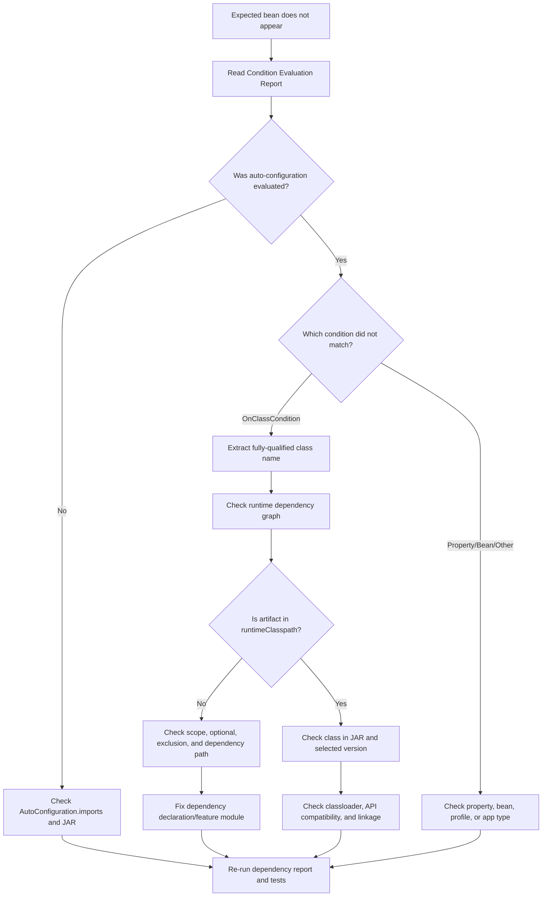

# Configuration Mismatch Due to Missing Dependency or Transitively Excluded Library

## 1. Identifying the Right Cause

An auto-configuration may fail to create a bean because a classpath condition does not match. Common cases include:

- An optional library is absent from the consumer application's dependency graph.
- The dependency exists only on the compile/test classpath, not on the runtime classpath.
- A transitive dependency was excluded using Maven `<exclusions>` or Gradle `exclude`.
- A starter declares the library as optional, so consumers do not receive that library automatically.
- The consumer uses a different profile, source set, or module from where the dependency was declared.
- The dependency is present, but the resolved version is incompatible with the auto-configuration code.

For example, a library providing integration with Apache Commons Lang:

```java
@AutoConfiguration
@ConditionalOnClass(name = "org.apache.commons.lang3.StringUtils")
public class TextAutoConfiguration {

    @Bean
    TextNormalizer textNormalizer() {
        return new TextNormalizer();
    }
}
```

If `commons-lang3` is not on the runtime classpath, `@ConditionalOnClass` does not match and the bean is not registered. This is intentional: Spring Boot allows a starter to support multiple optional integrations while applications that do not use a given integration can still start up.

Before modifying code, determine which condition did not match and why the target class is absent. A message saying "bean was not created" is not enough to conclude a dependency is missing; the bean might be blocked by a property, bean condition, profile, web application type, or because the auto-configuration was never imported.

## 2. Understanding the Classpath Spring Actually Sees

### 2.1. Compile Classpath vs. Runtime Classpath

A dependency can be visible to the compiler yet absent when the application runs.

| Where the dependency appears | Usable by compiler? | Can Spring runtime find the class? |
| --- | --- | --- |
| Compile classpath | Yes | Usually yes if the scope also includes it at runtime |
| Test classpath | Yes in tests | Only inside the test process |
| Runtime classpath | Not necessarily | Yes |
| IDE classpath | Depends on IDE configuration | Not guaranteed to match the packaged artifact |

Classpath conditions are evaluated in the running context. Therefore, the dependency must be present on the **runtime classpath of the right application**, not just in the IDE or during test execution.

### 2.2. Maven Scopes That Commonly Cause Confusion

| Scope | Module compile | Module runtime | Propagated to consumer |
| --- | --- | --- | --- |
| `compile` (default) | Yes | Yes | Yes |
| `runtime` | No | Yes | Yes at runtime |
| `provided` | Yes | No | No |
| `test` | Yes in tests | Yes in tests | No |
| `optional=true` | Per declared scope | Per declared scope | Does not propagate that dependency automatically |

`optional=true` is not a scope. It is metadata on a dependency. The library is still used to compile and test the declaring module itself, but consumers do not receive that dependency transitively. If a consumer needs the optional feature, the consumer must declare the corresponding dependency directly.

`provided` and `test` can also prevent conditions from matching at runtime. Do not blindly switch to `runtime`: runtime scope is still propagated to the consumer's runtime; use it only when the library genuinely needs the dependency at runtime but not for compilation.

### 2.3. Gradle Configurations

With the Java Library Plugin, common configurations have distinct meanings:

| Configuration | Module compile | Module runtime | Consumer runtime |
| --- | --- | --- | --- |
| `api` | Yes | Yes | Yes |
| `implementation` | Yes | Yes | Yes |
| `compileOnly` | Yes | No | No |
| `runtimeOnly` | No | Yes | Yes |
| `testImplementation` | Test only | Test only | No |

`implementation` does not mean the dependency disappears from the consumer's runtime. It does not expose the dependency on the consumer's compile API, yet it still participates in the runtime graph. If a condition fails due to a missing dependency, inspect `runtimeClasspath` instead of looking only at `compileClasspath`.

Gradle has no direct universal equivalent to Maven's `optional=true` for all cases. If a feature has its own runtime dependency, the clearest approach is usually to split the feature into a separate module/starter. If you still use a single shared artifact, design outgoing variants and configurations intentionally; do not assume `compileOnly` is an optional runtime dependency, because it never enters the consumer's own runtime classpath.

## 3. How Spring Boot's Classpath Conditions Work

### 3.1. `@ConditionalOnClass`

`@ConditionalOnClass` matches only when the specified class can be found on the classpath where the condition is being evaluated.

Form using the class name:

```java
@ConditionalOnClass(
        name = "org.apache.commons.lang3.StringUtils")
@Configuration(proxyBeanMethods = false)
static class CommonsTextConfiguration {
}
```

Form using a class literal:

```java
@ConditionalOnClass(StringUtils.class)
@Configuration(proxyBeanMethods = false)
static class CommonsTextConfiguration {
}
```

On configuration classes, Spring Boot reads annotation metadata using ASM. Therefore, a class literal can be safely declared in the annotation on a configuration class even when the target class is absent from the runtime classpath. Using the `name` attribute is convenient when you want to avoid importing an optional dependency in the configuration file.

### 3.2. `@ConditionalOnMissingClass`

`@ConditionalOnMissingClass` is the inverse: the configuration matches only when the target class is absent.

Example fallback when an advanced client library is not packaged:

```java
@AutoConfiguration
@ConditionalOnMissingClass(
        "com.vendor.fastclient.FastClient")
public class BasicClientAutoConfiguration {

    @Bean
    BasicClient basicClient() {
        return new BasicClient();
    }
}
```

Use this condition for intentional fallbacks. If the application requires `FastClient` to operate, a missing class should be caught through dependency validation or appropriate fail-fast checks, rather than silently running another implementation with non-equivalent semantics.

### 3.3. Why a Nested Configuration Is Needed for Optional Classes

A common mistake is placing the condition directly on a `@Bean` method whose return type or parameter belongs to an optional library:

```java
@AutoConfiguration
public class UnsafeTextAutoConfiguration {

    @Bean
    @ConditionalOnClass(StringUtils.class)
    TextNormalizer textNormalizer() {
        return new TextNormalizer();
    }
}
```

Before the condition on the method is applied, the JVM may have to load the configuration class and process method signatures. If the signature or type directly references a missing class, the application may encounter a class-loading error before the condition can exclude the method.

A safer approach is to isolate all types depending on the optional library inside a nested configuration:

```java
@AutoConfiguration
public class SafeTextAutoConfiguration {

    @Configuration(proxyBeanMethods = false)
    @ConditionalOnClass(
            name = "org.apache.commons.lang3.StringUtils")
    static class CommonsTextConfiguration {

        @Bean
        @ConditionalOnMissingBean
        TextNormalizer textNormalizer() {
            return new TextNormalizer();
        }
    }
}
```

The outer configuration does not reference the optional type. Spring evaluates the class condition on the nested configuration first; when the class is absent, the nested configuration is skipped and the library-dependent methods do not need to be loaded.

If `@ConditionalOnClass` or `@ConditionalOnMissingClass` is used as part of a custom meta-annotation, Spring Boot requires using the `name` attribute to reference the class. This is a specific caveat when composing annotations.

### 3.4. The Condition Only Checks Class Presence

`@ConditionalOnClass` does not verify:

- Whether the library version is compatible with the calling code.
- Whether the method or field needed by the code exists.
- Whether two classes with the same name come from compatible classloaders.
- Whether the class's static initializer completes successfully.
- Whether other dependencies required by that library are also present.

Therefore, a matching classpath condition can still be accompanied by `NoSuchMethodError`, `NoSuchFieldError`, or `NoClassDefFoundError` when code actually invokes an incompatible API. Check version alignment and the dependency tree if the class is present but integration still fails.

## 4. Maven: Tracing a Missing or Excluded Dependency

### 4.1. Inspecting the Dependency Tree of the Exact Consumer

Run from the application module, not just from the library module:

```bash
mvn -pl app dependency:tree
mvn -pl app dependency:tree -Dscope=runtime
mvn -pl app dependency:tree -Dincludes=org.apache.commons:commons-lang3
```

If the Maven project is not multi-module, omit `-pl app` and run in the directory containing the application's POM.

When you need to see dependencies omitted by Maven due to conflict mediation, use:

```bash
mvn -pl app dependency:tree -Dverbose
```

Read the tree from the consumer downward:

```text
app
+- com.acme:acme-text-autoconfigure
|  \- org.apache.commons:commons-lang3 (optional)
\- com.vendor:vendor-bundle
   \- org.apache.commons:commons-lang3
```

This is an illustrative example. If a dependency appears only under an optional branch of the auto-configuration, the consumer does not receive it automatically from that branch. If another dependency pulls Commons Lang in through a vendor branch, the class can still appear on the runtime classpath.

### 4.2. Declaring Optional Dependencies in the Library

If the auto-configuration module can operate without the Commons Lang integration, that module's POM can declare:

```xml
<dependency>
    <groupId>org.apache.commons</groupId>
    <artifactId>commons-lang3</artifactId>
    <version>3.14.0</version>
    <optional>true</optional>
</dependency>
```

The dependency remains on the auto-configuration module's classpath so integration code and tests can compile. When another application depends on this module, Maven does not automatically propagate Commons Lang to the consumer application.

Consumers that only use core features can keep their POM lean. Consumers that want the Commons Lang feature need to add the dependency directly:

```xml
<dependency>
    <groupId>com.acme</groupId>
    <artifactId>acme-text-autoconfigure</artifactId>
    <version>1.0.0</version>
</dependency>

<dependency>
    <groupId>org.apache.commons</groupId>
    <artifactId>commons-lang3</artifactId>
    <version>3.14.0</version>
</dependency>
```

Choose a version compatible with the version the library was tested against. When using Spring Boot dependency management or a Maven BOM, prefer letting the BOM manage versions rather than scattering separate versions across modules.

### 4.3. Exclusions Remove a Dependency Along One Branch

Suppose `vendor-bundle` pulls in Commons Lang, but the application does not use that integration part:

```xml
<dependency>
    <groupId>com.vendor</groupId>
    <artifactId>vendor-bundle</artifactId>
    <version>2.4.0</version>
    <exclusions>
        <exclusion>
            <groupId>org.apache.commons</groupId>
            <artifactId>commons-lang3</artifactId>
        </exclusion>
    </exclusions>
</dependency>
```

An exclusion attaches to the dependency where you declare it. It removes the artifact from that dependency branch and its sub-branches. If another dependency also brings the same artifact into the graph, the artifact can still be present.

Therefore, after adding an exclusion, re-run `dependency:tree`. Do not assume an exclusion removed the library from the entire application just because one branch no longer has it.

### 4.4. Distinguishing Optional from Exclusion

| Mechanism | Who declares it? | Meaning |
| --- | --- | --- |
| `optional=true` | Library author | Consumer does not automatically inherit optional dependency from the library |
| `exclusions` | Consumer or dependent module | Removes a dependency along a specific branch |
| Split feature module | Library author | Consumer picks the artifact for the needed feature |
| `dependencyManagement` | Application/BOM | Controls resolved version; does not add a dependency by itself |

If you own the library, splitting an integration into a separate module usually expresses the contract more clearly than marking many dependencies optional. If you are consuming a third-party library and cannot edit its POM, exclusion is the consumer-side tool; carefully verify which vendor features will be affected.

## 5. Gradle: Checking runtimeClasspath and dependencyInsight

### 5.1. Viewing the Entire Runtime Graph

```bash
./gradlew :app:dependencies --configuration runtimeClasspath
```

For a single project:

```bash
./gradlew dependencies --configuration runtimeClasspath
```

Find the target artifact and check whether it is in the runtime graph. If you inspect only `compileClasspath`, you may miss that a dependency was declared as `compileOnly` and is not packaged to run.

### 5.2. Finding Why a Dependency Was Selected

```bash
./gradlew :app:dependencyInsight --dependency commons-lang3 --configuration runtimeClasspath
```

`dependencyInsight` shows where the dependency was requested from, which version was selected, and why. This is a fast way to spot:

- A dependency requested only by an intermediate module.
- A version conflict causing Gradle to select another version.
- A resolution rule or constraint forcing a version.
- A dependency missing from the queried runtime configuration.

### 5.3. Excluding on a Specific Dependency

With Groovy DSL:

```groovy
dependencies {
    implementation("com.vendor:vendor-bundle:2.4.0") {
        exclude group: "org.apache.commons", module: "commons-lang3"
    }
}
```

With Kotlin DSL:

```kotlin
dependencies {
    implementation("com.vendor:vendor-bundle:2.4.0") {
        exclude(
            group = "org.apache.commons",
            module = "commons-lang3"
        )
    }
}
```

As in Maven, an exclusion on one dependency edge does not guarantee the artifact disappears if another edge still requests it. Re-run `dependencyInsight` after fixing to confirm the result.

## 6. Complete Example: Auto-Configuration with an Optional Library

This example uses Java 17 and Spring Boot 3.3.5. The auto-configuration module has Commons Lang as an optional dependency. The `TextNormalizer` bean is created only when `StringUtils` is on the runtime classpath.

### 6.1. Project Structure

```text
acme-text-autoconfigure/
├── pom.xml
└── src/
    ├── main/
    │   ├── java/demo/autoconfigure/
    │   │   └── OptionalTextAutoConfiguration.java
    │   ├── java/demo/text/
    │   │   └── TextNormalizer.java
    │   └── resources/META-INF/spring/
    │       └── org.springframework.boot.autoconfigure.AutoConfiguration.imports
    └── test/java/demo/autoconfigure/
        └── OptionalTextAutoConfigurationTests.java
```

### 6.2. POM

File `pom.xml`:

```xml
<project xmlns="http://maven.apache.org/POM/4.0.0"
         xmlns:xsi="http://www.w3.org/2001/XMLSchema-instance"
         xsi:schemaLocation="http://maven.apache.org/POM/4.0.0 https://maven.apache.org/xsd/maven-4.0.0.xsd">
    <modelVersion>4.0.0</modelVersion>

    <parent>
        <groupId>org.springframework.boot</groupId>
        <artifactId>spring-boot-starter-parent</artifactId>
        <version>3.3.5</version>
        <relativePath/>
    </parent>

    <groupId>com.acme</groupId>
    <artifactId>acme-text-autoconfigure</artifactId>
    <version>1.0.0</version>

    <properties>
        <java.version>17</java.version>
    </properties>

    <dependencies>
        <dependency>
            <groupId>org.springframework.boot</groupId>
            <artifactId>spring-boot-autoconfigure</artifactId>
        </dependency>

        <dependency>
            <groupId>org.apache.commons</groupId>
            <artifactId>commons-lang3</artifactId>
            <version>3.14.0</version>
            <optional>true</optional>
        </dependency>

        <dependency>
            <groupId>org.springframework.boot</groupId>
            <artifactId>spring-boot-starter-test</artifactId>
            <scope>test</scope>
        </dependency>
    </dependencies>
</project>
```

Commons Lang is on this module's own compile/runtime classpath so code and integration tests can compile. Because the dependency is optional, an application depending only on `acme-text-autoconfigure` will not automatically receive Commons Lang.

### 6.3. Class Using the Optional Library

File `src/main/java/demo/text/TextNormalizer.java`:

```java
package demo.text;

import org.apache.commons.lang3.StringUtils;

public class TextNormalizer {

    public String normalize(String value) {
        return StringUtils.normalizeSpace(value);
    }
}
```

This class calls the Commons Lang API when the method executes. Therefore, the bean is provided only when the library is present. If a consumer instantiates or calls `TextNormalizer` directly without declaring Commons Lang, that code can still hit a linkage error at runtime; the condition only guards the bean registered by auto-configuration.

### 6.4. Auto-Configuration with Nested Class Condition

File `src/main/java/demo/autoconfigure/OptionalTextAutoConfiguration.java`:

```java
package demo.autoconfigure;

import demo.text.TextNormalizer;
import org.springframework.boot.autoconfigure.AutoConfiguration;
import org.springframework.boot.autoconfigure.condition.ConditionalOnClass;
import org.springframework.boot.autoconfigure.condition.ConditionalOnMissingBean;
import org.springframework.context.annotation.Bean;
import org.springframework.context.annotation.Configuration;

@AutoConfiguration
public class OptionalTextAutoConfiguration {

    @Configuration(proxyBeanMethods = false)
    @ConditionalOnClass(
            name = "org.apache.commons.lang3.StringUtils")
    static class CommonsTextConfiguration {

        @Bean
        @ConditionalOnMissingBean
        TextNormalizer textNormalizer() {
            return new TextNormalizer();
        }
    }
}
```

The condition is on the nested configuration. The outer class has no method signature depending on Commons Lang. When the optional class is absent, Spring skips the nested configuration before processing bean methods.

`@ConditionalOnMissingBean` lets consumers provide an alternative implementation. This is a separate condition for bean replacement; it does not replace the classpath condition.

### 6.5. Registering the Auto-Configuration

Create `src/main/resources/META-INF/spring/org.springframework.boot.autoconfigure.AutoConfiguration.imports` with content:

```text
demo.autoconfigure.OptionalTextAutoConfiguration
```

Spring Boot only auto-discovers auto-configurations listed in the JAR's imports file. If the file is not packaged or is missing the class name, the condition may never be evaluated because the configuration class never became a candidate.

### 6.6. Testing Both Classpath States

File `src/test/java/demo/autoconfigure/OptionalTextAutoConfigurationTests.java`:

```java
package demo.autoconfigure;

import demo.text.TextNormalizer;
import org.apache.commons.lang3.StringUtils;
import org.junit.jupiter.api.Test;
import org.springframework.boot.autoconfigure.AutoConfigurations;
import org.springframework.boot.test.context.FilteredClassLoader;
import org.springframework.boot.test.context.runner.ApplicationContextRunner;

import static org.assertj.core.api.Assertions.assertThat;

class OptionalTextAutoConfigurationTests {

    private final ApplicationContextRunner runner =
            new ApplicationContextRunner()
                    .withConfiguration(AutoConfigurations.of(
                            OptionalTextAutoConfiguration.class));

    @Test
    void createsNormalizerWhenCommonsLangIsPresent() {
        this.runner.run(context -> {
            assertThat(context).hasNotFailed();
            assertThat(context).hasSingleBean(TextNormalizer.class);
            assertThat(context.getBean(TextNormalizer.class)
                    .normalize("  Spring   Boot  "))
                    .isEqualTo("Spring Boot");
        });
    }

    @Test
    void skipsNormalizerWhenCommonsLangIsMissing() {
        this.runner
                .withClassLoader(new FilteredClassLoader(StringUtils.class))
                .run(context -> {
                    assertThat(context).hasNotFailed();
                    assertThat(context).doesNotHaveBean(TextNormalizer.class);
                });
    }

    @Test
    void userBeanReplacesTheDefaultNormalizer() {
        TextNormalizer custom = new TextNormalizer();

        this.runner
                .withBean(TextNormalizer.class, () -> custom)
                .run(context -> {
                    assertThat(context).hasNotFailed();
                    assertThat(context).hasSingleBean(TextNormalizer.class);
                    assertThat(context.getBean(TextNormalizer.class))
                            .isSameAs(custom);
                });
    }
}
```

`FilteredClassLoader` makes the target class unresolvable in the context under test, even though the dependency is still on the test process classpath. This tests the exact "class absent" branch without uninstalling JARs from the machine.

The three tests prove:

1. With Commons Lang present: auto-configuration registers `TextNormalizer` and the method works.
2. Without Commons Lang: the nested configuration is skipped, the context still starts, and no bean is registered.
3. With a custom bean: the default bean backs off.

Run:

```bash
mvn test
```

### 6.7. Consumer Declares the Optional Library When the Feature Is Needed

POM of a consumer application using only the auto-configuration:

```xml
<dependency>
    <groupId>com.acme</groupId>
    <artifactId>acme-text-autoconfigure</artifactId>
    <version>1.0.0</version>
</dependency>
```

Because Commons Lang is marked optional in the library's POM, the consumer does not receive it automatically. When the application wants the `TextNormalizer` bean, add the dependency directly:

```xml
<dependency>
    <groupId>org.apache.commons</groupId>
    <artifactId>commons-lang3</artifactId>
    <version>3.14.0</version>
</dependency>
```

Then re-check the runtime dependency tree. If the application already receives Commons Lang through another path, there is no need to declare a duplicate, though the resolved version must still be checked.

## 7. Diagnosing with the Condition Evaluation Report

### 7.1. Enabling the Debug Report

Launch the application:

```bash
java -jar app.jar --debug
```

Spring Boot prints the `CONDITIONS EVALUATION REPORT`. Find `OptionalTextAutoConfiguration` and related nested configurations. When a class is missing, the `OnClassCondition` report will explain that the target class is not on the classpath.

The report helps distinguish two situations:

- **Auto-configuration was not discovered:** inspect the imports file and packaged artifact.
- **Auto-configuration was discovered, but condition did not match:** inspect the corresponding classpath, property, or bean condition.

If the application includes Actuator, the `/actuator/conditions` endpoint can be exposed to read a structured report. This endpoint is generally not exposed by default; enable it only when needed for diagnostics and protect access because the report can reveal internal application structure.

### 7.2. Reading the Report in Order

When an expected bean does not appear:

1. Find the outer auto-configuration in the report.
2. Verify whether that class was evaluated.
3. Find the nested configuration or `@Bean` method with conditions.
4. Read the condition name and message.
5. If it is `OnClassCondition`, extract the exact fully-qualified class name from the message.
6. Verify whether the artifact containing that class is in the consumer's runtime graph.
7. If the class is present, continue checking bean conditions, property conditions, and version compatibility.

Do not hard-code full report messages into tests because wording can change across Spring Boot versions. Testing bean presence/absence and checking the dependency graph is more durable.

### 7.3. Checking the Packaged JAR

For a Spring Boot executable JAR, dependencies normally live under `BOOT-INF/lib`:

```bash
jar tf target/app.jar | findstr /I "BOOT-INF/lib/commons-lang3"
```

If there is no output, the JAR did not package Commons Lang. If present, verify the nested JAR inside contains the expected class:

```bash
jar tf commons-lang3-3.14.0.jar | findstr "org/apache/commons/lang3/StringUtils.class"
```

On Linux/macOS environments, replace `findstr` with `grep`. Inspecting the final artifact is more valuable than looking only at the POM or IDE state, because packaging plugins, profiles, and exclusions can alter what gets packaged.

### 7.4. Quick Runtime Classloader Check

During temporary diagnostics, you can use:

```java
import org.springframework.util.ClassUtils;

String className = "org.apache.commons.lang3.StringUtils";
ClassLoader classLoader =
        Thread.currentThread().getContextClassLoader();

System.out.println(
        "commons-lang-present="
                + ClassUtils.isPresent(className, classLoader));
```

If it prints `false`, the active classloader cannot find the class. This is a presence check; it does not verify API version or whether the class can be initialized successfully.

## 8. Distinguishing Missing-Class Errors from Version or Linkage Errors

Not every error with the word "class" has the same root cause.

| Error | Common meaning | What to check |
| --- | --- | --- |
| `ClassNotFoundException` | Code explicitly looked up a class by name and could not find it | Runtime classpath, classloader, dependency scope |
| `NoClassDefFoundError` | JVM needed a class during linking/execution but could not load it | Missing JAR, excluded transitive dependency, classloader, or earlier initialization failure |
| `NoSuchMethodError` | Class is present, but loaded version lacks the method code compiled against | Dependency version conflict, BOM, duplicate JARs |
| `NoSuchFieldError` | Class is present, but expected field does not exist in loaded version | Version alignment |
| `AbstractMethodError` | Loaded implementation does not fulfill the method contract expected by caller | Version incompatibility or interface mismatch |
| `ExceptionInInitializerError` | Static initializer of the class threw an exception | Inspect root exception in cause chain |
| `ClassCastException` between two identically named classes | Possibly same name but defined by different classloaders | DevTools/restart classloader, plugin/container isolation |

If `@ConditionalOnClass` reports a match yet the bean still fails during creation, the condition did its part: the class could be found. The fault then typically lies in dependency versions, another related class, configuration, or static initialization.

Do not use a condition to mask a version conflict. Align dependencies using the Spring Boot BOM or dependency constraints, remove duplicate versions, and re-verify the runtime graph.

## 9. Troubleshooting Workflow from Symptom to Root Cause

Use the following workflow for a bean not created due to a potentially missing dependency:



### Concrete Sequence of Steps

1. Identify the bean name/type and the auto-configuration expected to create it.
2. Enable `--debug` or read `/actuator/conditions`.
3. Identify the non-matching condition; do not start by adding random dependencies.
4. If it is a class condition, copy the fully-qualified class name from code/report.
5. Identify the Maven/Gradle artifact containing that class.
6. Inspect the right consumer module and `runtimeClasspath`.
7. Trace the dependency path for optional flags, scopes, or exclusions.
8. Check for version conflicts if the artifact is already present.
9. Fix the dependency declaration or nested class condition according to the actual cause.
10. Run tests for both states: dependency present and dependency absent.
11. Repackage the application and inspect the final JAR.

## 10. Common Design Mistakes

1. **Adding the dependency only in the IDE.** IDE builds can differ from Maven/Gradle and the deployed JAR. Check the runtime graph and actual artifact.
2. **Marking a dependency optional while forgetting consumers must declare it.** Optional does not propagate the dependency to consumers.
3. **Placing optional classes in method signatures of the outer configuration.** The JVM may load the type before the method condition runs. Isolate it in a nested configuration with a class condition.
4. **Putting a condition on a method whose return type belongs to a missing library.** Prefer a condition on a dedicated configuration class to guard all dependent signatures.
5. **Checking only compileClasspath.** Conditions evaluate in the runtime context; inspect runtimeClasspath.
6. **Using `provided` or `compileOnly` for a dependency needed at runtime.** These configurations do not guarantee the library exists in the consumer's runtime.
7. **Excluding a dependency without tracing every propagation path.** Exclusions apply to the declared branch; the dependency may still arrive via another branch.
8. **Assuming an exclusion removed the entire artifact.** Re-run dependency tree or dependencyInsight to confirm.
9. **Using `@ConditionalOnClass` as a version check.** The annotation checks only class presence; incompatible APIs can still cause linkage errors.
10. **Using `@ConditionalOnMissingBean` to handle missing classes.** Bean conditions do not replace classpath conditions.
11. **Skipping the `AutoConfiguration.imports` file.** If the auto-configuration is not discovered, conditions inside never get a chance to run.
12. **Putting classpath conditions on scattered individual methods.** If multiple beans need the same library, a nested configuration groups and guards the whole set.
13. **Exposing optional dependency types in the core public API.** Consumers might be forced to load that class even without using the feature. Consider separate API/integration modules.
14. **Not testing with a filtered classloader.** Happy-path tests with full dependencies do not prove the starter is safe when dependencies are missing.
15. **Masking missing-dependency errors with non-equivalent fallbacks.** Fall back only when the alternative behavior is truly supported and documented.

## 11. Pre-Release Starter Review Checklist

- [ ] Identified which classes are mandatory dependencies and which belong to optional features.
- [ ] Optional dependencies have proper semantics in the POM or Gradle variants.
- [ ] Consumers have clear instructions on declaring direct dependencies when enabling a feature.
- [ ] Auto-configuration uses `@ConditionalOnClass`/`@ConditionalOnMissingClass` appropriately.
- [ ] Types depending on optional libraries are isolated in nested configurations.
- [ ] No method signatures on the outer configuration force the JVM to load optional classes.
- [ ] `AutoConfiguration.imports` contains the fully qualified auto-configuration name.
- [ ] Default beans carry `@ConditionalOnMissingBean` when overriding should be allowed.
- [ ] Tested with dependency present, dependency absent, and user bean override.
- [ ] Absent test uses `FilteredClassLoader` or a consumer fixture genuinely lacking the JAR.
- [ ] Checked consumer's Maven dependency tree or Gradle runtimeClasspath.
- [ ] Verified exclusions do not drop a dependency needed along another path.
- [ ] Checked selected version and API compatibility.
- [ ] Inspected the executable JAR after packaging.
- [ ] Read the Condition Evaluation Report to confirm match/no-match reasons.
- [ ] Documented which features require additional dependencies in the starter docs.

## Official References

- [Spring Boot 3.3 — Creating Your Own Auto-configuration](https://docs.spring.io/spring-boot/3.3/reference/features/developing-auto-configuration.html): class conditions, isolating optional classes in nested configurations, bean conditions, and imports registration.
- [Spring Boot 3.3 — Conditions Evaluation Report](https://docs.spring.io/spring-boot/3.3/api/rest/actuator/conditions.html): reading positive/negative matches and condition explanation messages.
- [Maven — Optional and Excluded Dependencies](https://maven.apache.org/guides/introduction/introduction-to-optional-and-excludes-dependencies): optional dependencies and exclusions by dependency path.
- [Maven — Dependency Mechanism](https://maven.apache.org/guides/introduction/introduction-to-dependency-mechanism.html): dependency scopes and classpaths.
- [Gradle — Viewing and Debugging Dependencies](https://docs.gradle.org/current/userguide/viewing_debugging_dependencies.html): runtime dependency graph and `dependencyInsight`.
