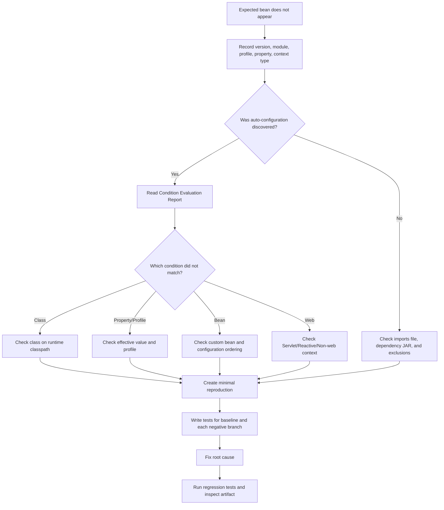

# Diagnostic Workflow from Minimal Reproduction to Condition Report and Regression Testing

## 1. Goal: Pinpoint the Exact Condition Preventing Bean Registration

When a bean provided by Spring Boot auto-configuration fails to appear, do not start by adding dependencies or changing annotations randomly. Gather evidence showing **which candidate was considered, which condition did not match, and which input caused that condition to fail**.

A solid diagnostic workflow must answer five questions:

1. Which module, profile, version, and runtime classpath is the application actually running with?
2. Was the expected auto-configuration discovered by Spring Boot?
3. If discovered, which condition decided not to register the bean?
4. Can that outcome be reproduced in a minimal context without a database or external services?
5. Are there regression tests proving the enabled state, disabled state, and edge cases?

This lesson uses a running example: the `TextNormalizer` bean is provided only when Apache Commons Lang is on the classpath, the property `acme.text.enabled=true` is set, and the application has not declared a replacement bean of its own.

The expected rule can be written as an expression:

```text
textNormalizerPresent =
    commonsLangPresent
    AND acmeTextEnabled
    AND noUserDefinedTextNormalizer
```

If the bean is missing, a single false term suffices to explain the result. Diagnostic work consists of pinpointing the exact term that is false.

## 2. Record the Current State Before Making Changes

Before reproducing, record a small yet complete set of facts so anyone can re-run the exact scenario:

| Information | What to record |
| --- | --- |
| Java | Output of `java -version` and the JDK used by Maven/Gradle |
| Spring Boot | Actual version after dependency management |
| Build tool | Maven/Gradle version and exact command run |
| Consumer module | The module that actually launches the application |
| Dependencies | Runtime graph and resolved versions |
| Profiles | Active profiles at startup |
| Properties | Relevant values, configuration sources, and command-line arguments |
| Context type | Non-web, Servlet, or Reactive |
| Symptom | Expected bean name/type, actual beans, first exception, and when it occurs |

Do not record only the POM or properties file. Effective values may come from environment variables, command-line arguments, profile-specific files, Config Server, or test customizers. Record the values the running process actually sees.

### Distinguishing "Bean Does Not Exist" from "Bean Creation Failed"

These two symptoms require different investigation paths:

- **Bean was never registered:** typically relates to auto-configuration candidates, conditions, profiles, dependencies, or configuration processing order.
- **Bean was registered, yet initialization failed:** typically throws an exception while resolving dependencies, invoking the factory method, creating proxies, or running initializers.
- **Application starts up, yet the bean is absent:** inspect the condition report and bean registry.
- **Application fails to start:** read the first root exception in the cause chain; do not stop at the final line such as `ApplicationContextException`.

If the bean is missing only in tests, record test annotations, test slices, property overrides, and loaded nested configurations. Test contexts can differ from the production application.

## 3. Creating a Meaningful Minimal Reproduction

A good minimal reproduction preserves the exact factors capable of altering the outcome while stripping away unrelated parts.

### 3.1. Keep Everything That Has an Effect

Keep:

- The suspected auto-configuration class.
- The bean method or nested configuration carrying conditions.
- Dependencies relevant to classpath conditions.
- Properties/profiles affecting conditions.
- User-defined beans if the condition uses `@ConditionalOnMissingBean` or `@ConditionalOnBean`.
- The ApplicationContext type if conditions depend on a web application.

You can omit in the first reproduction:

- Real databases and business data.
- HTTP calls, message brokers, and cloud services.
- Unrelated controllers/repositories.
- Scheduled jobs, background workers, and UI layers.
- Other integrations that do not affect the condition under investigation.

Never drop a suspected dependency or property. Accidentally removing the offending input prevents the reproducer from reproducing the symptom.

### 3.2. Change Only One Variable Per Run

For example, start from a baseline state:

```text
Commons Lang present = true
acme.text.enabled = true
Custom TextNormalizer = absent
Expected bean = present
```

Then vary one factor at a time:

1. Keep the classpath, flip the property to false.
2. Keep the property true, hide Commons Lang.
3. Keep classpath/property, add a custom bean.
4. Restore the baseline and confirm the bean reappears.

If you change dependencies, properties, and profiles simultaneously, you cannot tell which change altered the condition's result.

### 3.3. Reproducing with `ApplicationContextRunner`

For auto-configuration, `ApplicationContextRunner` is usually better than booting the entire application. It constructs a lightweight context with controlled auto-configurations, properties, user configurations, and classloaders.

If the bug occurs only with component scanning, `EnvironmentPostProcessor`, a web context, or the application's main configuration, add a `@SpringBootTest` integration test once the condition has been isolated to verify full-application interaction.

Spring Boot provides `WebApplicationContextRunner` and `ReactiveWebApplicationContextRunner` for auto-configurations depending on Servlet or Reactive contexts. `ApplicationContextRunner` does not run inside Native Image; run these tests on the JVM and maintain a separate native smoke test if the project ships a Native Image.

## 4. Ordered Diagnostic Workflow



This sequence prevents two common mistakes: investigating conditions of a class that was never imported, and modifying dependencies when the condition was actually disabled by a property.

### Step 1 — Confirm Whether Auto-Configuration Is a Candidate

Inspect the file inside the JAR:

```text
META-INF/spring/org.springframework.boot.autoconfigure.AutoConfiguration.imports
```

The file must list the auto-configuration's fully-qualified class name, one class per line. Inspect the packaged artifact as well, because a valid file in the source tree is not guaranteed to be included in the JAR.

At the same time, check:

- Was the auto-configuration excluded via `spring.autoconfigure.exclude`?
- Did the application pass `exclude` or `excludeName` on `@SpringBootApplication` / `@EnableAutoConfiguration`?
- Is the dependency containing the auto-configuration actually in the runtime graph?
- Does the class name in imports match the built package and class?
- Was the auto-configuration accidentally component-scanned instead of registered via imports?

If the candidate is not discovered, conditions inside it never get a chance to decide on beans.

### Step 2 — Identify the Specific Condition That Failed to Match

Enable the condition report with `--debug`:

```bash
java -jar app.jar --debug
```

Find the auto-configuration name, nested configurations, and relevant bean methods. The report tells which conditions matched, which did not match, and an explanation message.

Common condition groups:

| Condition | Question to answer |
| --- | --- |
| `OnClassCondition` | Is the required class on the runtime classpath? |
| `OnPropertyCondition` | Does the property exist and match `havingValue`? |
| `OnBeanCondition` | Does the required bean exist, or did a custom bean cause the default to back off? |
| `OnWebApplicationCondition` | Is the current context Servlet, Reactive, or non-web? |
| `OnResourceCondition` | Does the required resource exist on the classpath/filesystem? |
| `OnExpressionCondition` | What did the SpEL expression evaluate to? |

If the report shows multiple non-matching conditions, address each one in turn. Do not assume the first condition you spot is the sole cause.

## 5. Reading the Condition Evaluation Report Properly

### 5.1. What Does the Report Contain?

The Condition Evaluation Report records condition evaluation outcomes for configurations and auto-configurations.

In the Actuator `/actuator/conditions` endpoint, key fields include:

- `contexts`: reported `ApplicationContext` entries.
- `positiveMatches`: configurations/bean methods whose conditions matched.
- `negativeMatches`: configurations/bean methods whose conditions did not match.
- `condition`: name of the evaluated condition.
- `message`: reason the condition matched or failed to match.
- `unconditionalClasses`: classes without matching conditions attached.

Abbreviated example solely to illustrate how to read it:

```json
{
  "contexts": {
    "application": {
      "negativeMatches": {
        "TextAutoConfiguration.CommonsTextConfiguration": {
          "notMatched": [
            {
              "condition": "OnClassCondition",
              "message": "Required class was not found"
            }
          ],
          "matched": []
        }
      }
    }
  }
}
```

Actual messages are generated by Spring Boot and vary by version, annotation, class name, and Environment state. Use the report to find the root cause; avoid writing tests coupled to exact message wording.

### 5.2. Enable the Conditions Endpoint When Needed

If the application has the Actuator dependency, you can expose the endpoint:

```properties
management.endpoints.web.exposure.include=health,conditions
```

Then read:

```bash
curl http://localhost:8080/actuator/conditions
```

The conditions endpoint is not exposed over HTTP merely because the Actuator dependency is present; exposure must be configured explicitly. Expose the endpoint only in controlled diagnostic environments and apply proper access controls, as the report can reveal class names, beans, and internal structure.

For applications without a web server, or when exposing an endpoint is undesirable, use `--debug` or the test listener.

### 5.3. Print the Report Directly in Tests

Spring Boot provides `ConditionEvaluationReportLoggingListener`. Add it to a runner:

```java
import org.springframework.boot.autoconfigure.logging.ConditionEvaluationReportLoggingListener;
import org.springframework.boot.logging.LogLevel;

private final ApplicationContextRunner contextRunner =
        new ApplicationContextRunner()
                .withConfiguration(AutoConfigurations.of(
                        TextAutoConfiguration.class))
                .withInitializer(
                        ConditionEvaluationReportLoggingListener
                                .forLogLevel(LogLevel.INFO));
```

When tests run, the report is logged at the chosen log level. Use this when an assertion reports a missing bean yet it is unclear which condition blocked it.

### 5.4. Distinguish Undiscovered Candidates from Condition-Excluded Candidates

| Observation | Interpretation | Next action |
| --- | --- | --- |
| Auto-configuration absent from the report | Likely not imported or excluded | Check imports file, JAR, `spring.autoconfigure.exclude` |
| Auto-configuration in report, nested class negative | Configuration-level condition failed | Read `OnClassCondition`, `OnPropertyCondition`, or other condition |
| Configuration matched, bean method negative | Bean-method condition failed | Check `@ConditionalOnMissingBean`, properties, and bean types |
| Bean exists in context, yet calling methods fails | No longer a bean-registration bug | Inspect exception, dependency versions, initialization, and runtime behavior |
| Bean exists in tests, yet missing in real app | Both contexts receive different inputs | Compare profiles, classpath, property sources, web type, and user config |

Do not conclude "Spring is not running auto-configuration" merely because a bean is missing. Verify whether the configuration class was discovered and whether conditions ran.

## 6. Verifying the Classpath and Dependency Graph of the Exact Consumer

When the report indicates a missing class, inspect the runtime graph of **the running application**, not only the auto-configuration module.

### 6.1. Maven

Run in the consumer module:

```bash
mvn -pl consumer dependency:tree -Dscope=runtime
mvn -pl consumer dependency:tree -Dverbose -Dincludes=org.apache.commons:commons-lang3
```

The first command shows the runtime dependency tree; the second filters the investigated artifact and displays extra mediation details. In a single-module Maven project, run in the POM directory and omit `-pl consumer`.

Check for these causes:

- Dependency marked `optional=true` in an intermediate library.
- Scope is `provided` or `test`, so absent from consumer runtime.
- A transitive dependency excluded with `<exclusions>`.
- Dependency present along multiple paths, yet Maven picked another version due to nearest-definition mediation.
- Looking at the library module's POM instead of the module actually running.

`dependencyManagement` controls the version once an artifact enters the graph; it does not add a dependency to the graph by itself.

### 6.2. Gradle

Use the runtime configuration:

```bash
./gradlew :consumer:dependencies --configuration runtimeClasspath
./gradlew :consumer:dependencyInsight --dependency commons-lang3 --configuration runtimeClasspath
```

`dependencies` shows the configuration's full graph. `dependencyInsight` reveals where the dependency was requested from, which version was selected, and why.

Do not read only `compileClasspath` when startup fails. A dependency can be visible at compile time yet absent at runtime.

### 6.3. Inspecting the Final Artifact

For a Spring Boot executable JAR, libraries normally reside under `BOOT-INF/lib`:

```bash
jar tf target/app.jar | grep "BOOT-INF/lib/commons-lang3"
```

On Windows PowerShell, replace `grep` with `findstr`. If the artifact lacks the needed JAR, trace back through the dependency graph and packaging configuration.

This is a critical step when IDE and command line behave differently, or when the containerized app differs from local runs.

### 6.4. Optional and Exclusion Have Different Meanings

- Maven `optional=true` declared by the library author: consumers do not automatically receive that dependency along the library's dependency edge.
- Maven `exclusions` declared by the consumer: drops a dependency along a specific branch.
- Gradle exclusions also attach to a dependency path/configuration; another path can still bring the artifact into the graph.

After fixing dependencies, re-run the report and tests. Never use `@ConditionalOnClass` to hide a version conflict; class presence does not guarantee the methods or fields your code calls exist.

## 7. Minimal Example: A Bean Appearing Only When All Three Conditions Hold

This example uses Java 17 and Spring Boot 3.3.5. The auto-configuration module declares Commons Lang as an optional dependency. The `TextNormalizer` bean requires both the Commons Lang class and `acme.text.enabled=true`; if the application provides a bean of the same type, the default must back off.

### 7.1. Project Structure

```text
acme-text-autoconfigure/
├── pom.xml
└── src/
    ├── main/
    │   ├── java/demo/text/
    │   │   └── TextNormalizer.java
    │   ├── java/demo/autoconfigure/
    │   │   └── TextAutoConfiguration.java
    │   └── resources/META-INF/spring/
    │       └── org.springframework.boot.autoconfigure.AutoConfiguration.imports
    └── test/java/demo/autoconfigure/
        └── TextAutoConfigurationTests.java
```

### 7.2. `pom.xml`

```xml
<project xmlns="http://maven.apache.org/POM/4.0.0"
         xmlns:xsi="http://www.w3.org/2001/XMLSchema-instance"
         xsi:schemaLocation="http://maven.apache.org/POM/4.0.0 https://maven.apache.org/xsd/maven-4.0.0.xsd">
    <modelVersion>4.0.0</modelVersion>

    <parent>
        <groupId>org.springframework.boot</groupId>
        <artifactId>spring-boot-starter-parent</artifactId>
        <version>3.3.5</version>
        <relativePath/>
    </parent>

    <groupId>com.acme</groupId>
    <artifactId>acme-text-autoconfigure</artifactId>
    <version>1.0.0</version>

    <properties>
        <java.version>17</java.version>
    </properties>

    <dependencies>
        <dependency>
            <groupId>org.springframework.boot</groupId>
            <artifactId>spring-boot-autoconfigure</artifactId>
        </dependency>

        <dependency>
            <groupId>org.apache.commons</groupId>
            <artifactId>commons-lang3</artifactId>
            <version>3.14.0</version>
            <optional>true</optional>
        </dependency>

        <dependency>
            <groupId>org.springframework.boot</groupId>
            <artifactId>spring-boot-starter-test</artifactId>
            <scope>test</scope>
        </dependency>
    </dependencies>
</project>
```

Commons Lang is on this module's compile/runtime classpath so code and integration tests compile. Because the dependency is optional, consumers depending solely on the auto-configuration artifact will not receive Commons Lang automatically.

### 7.3. Bean Requiring the Optional Library

File `src/main/java/demo/text/TextNormalizer.java`:

```java
package demo.text;

import org.apache.commons.lang3.StringUtils;

public class TextNormalizer {

    public String normalize(String value) {
        return StringUtils.normalizeSpace(value);
    }
}
```

Input `"  Spring   Boot  "` normalizes to `"Spring Boot"`.

### 7.4. Auto-Configuration

File `src/main/java/demo/autoconfigure/TextAutoConfiguration.java`:

```java
package demo.autoconfigure;

import demo.text.TextNormalizer;
import org.springframework.boot.autoconfigure.AutoConfiguration;
import org.springframework.boot.autoconfigure.condition.ConditionalOnClass;
import org.springframework.boot.autoconfigure.condition.ConditionalOnMissingBean;
import org.springframework.boot.autoconfigure.condition.ConditionalOnProperty;
import org.springframework.context.annotation.Bean;
import org.springframework.context.annotation.Configuration;

@AutoConfiguration
public class TextAutoConfiguration {

    @Configuration(proxyBeanMethods = false)
    @ConditionalOnClass(
            name = "org.apache.commons.lang3.StringUtils")
    @ConditionalOnProperty(
            prefix = "acme.text",
            name = "enabled",
            havingValue = "true")
    static class CommonsTextConfiguration {

        @Bean
        @ConditionalOnMissingBean(TextNormalizer.class)
        TextNormalizer textNormalizer() {
            return new TextNormalizer();
        }
    }
}
```

The nested configuration shields code depending on the optional library. The outer auto-configuration avoids placing optional classes in `@Bean` signatures. `@ConditionalOnMissingBean` lets applications replace the default with their own bean.

### 7.5. Registering the Candidate

File `src/main/resources/META-INF/spring/org.springframework.boot.autoconfigure.AutoConfiguration.imports` contains:

```text
demo.autoconfigure.TextAutoConfiguration
```

When packaging, verify this file is present inside the JAR. The tests below call `AutoConfigurations.of(...)` directly to focus on conditions; verifying the imports file is a separate packaging step.

## 8. Writing Regression Tests for Every Condition Branch

A test verifying only that the bean exists in the happy path is insufficient. The test suite must prove the enabling conditions, each exclusion reason, and application override capability.

### 8.1. Complete Test Class

File `src/test/java/demo/autoconfigure/TextAutoConfigurationTests.java`:

```java
package demo.autoconfigure;

import demo.text.TextNormalizer;
import org.apache.commons.lang3.StringUtils;
import org.junit.jupiter.api.Test;
import org.springframework.boot.autoconfigure.AutoConfigurations;
import org.springframework.boot.autoconfigure.logging.ConditionEvaluationReportLoggingListener;
import org.springframework.boot.logging.LogLevel;
import org.springframework.boot.test.context.FilteredClassLoader;
import org.springframework.boot.test.context.runner.ApplicationContextRunner;
import org.springframework.context.annotation.Bean;
import org.springframework.context.annotation.Configuration;

import static org.assertj.core.api.Assertions.assertThat;

class TextAutoConfigurationTests {

    private final ApplicationContextRunner runner =
            new ApplicationContextRunner()
                    .withConfiguration(AutoConfigurations.of(
                            TextAutoConfiguration.class))
                    .withInitializer(
                            ConditionEvaluationReportLoggingListener
                                    .forLogLevel(LogLevel.INFO));

    @Test
    void createsNormalizerWhenAllConditionsMatch() {
        this.runner
                .withPropertyValues("acme.text.enabled=true")
                .run(context -> {
                    assertThat(context).hasNotFailed();
                    assertThat(context).hasSingleBean(TextNormalizer.class);
                    assertThat(context.getBean(TextNormalizer.class)
                            .normalize("  Spring   Boot  "))
                            .isEqualTo("Spring Boot");
                });
    }

    @Test
    void skipsNormalizerWhenPropertyIsMissing() {
        this.runner.run(context -> {
            assertThat(context).hasNotFailed();
            assertThat(context).doesNotHaveBean(TextNormalizer.class);
        });
    }

    @Test
    void skipsNormalizerWhenPropertyIsFalse() {
        this.runner
                .withPropertyValues("acme.text.enabled=false")
                .run(context -> {
                    assertThat(context).hasNotFailed();
                    assertThat(context).doesNotHaveBean(TextNormalizer.class);
                });
    }

    @Test
    void skipsNormalizerWhenOptionalLibraryIsMissing() {
        this.runner
                .withPropertyValues("acme.text.enabled=true")
                .withClassLoader(new FilteredClassLoader(StringUtils.class))
                .run(context -> {
                    assertThat(context).hasNotFailed();
                    assertThat(context).doesNotHaveBean(TextNormalizer.class);
                });
    }

    @Test
    void userDefinedNormalizerReplacesTheDefault() {
        this.runner
                .withPropertyValues("acme.text.enabled=true")
                .withUserConfiguration(UserTextConfiguration.class)
                .run(context -> {
                    assertThat(context).hasNotFailed();
                    assertThat(context).hasSingleBean(TextNormalizer.class);
                    assertThat(context).getBean("customTextNormalizer")
                            .isSameAs(context.getBean(TextNormalizer.class));
                    assertThat(context).doesNotHaveBean("textNormalizer");
                });
    }

    @Configuration(proxyBeanMethods = false)
    static class UserTextConfiguration {

        @Bean
        TextNormalizer customTextNormalizer() {
            return new TextNormalizer();
        }
    }
}
```

### 8.2. Meaning of Each Test

| Test | Varied input | Key assertions |
| --- | --- | --- |
| `createsNormalizerWhenAllConditionsMatch` | Class present, property true, no custom bean | Exactly one bean exists and its method works |
| `skipsNormalizerWhenPropertyIsMissing` | Property omitted | Context succeeds, bean absent |
| `skipsNormalizerWhenPropertyIsFalse` | Property false | Context succeeds, bean absent |
| `skipsNormalizerWhenOptionalLibraryIsMissing` | Filter Commons Lang class | Context succeeds, bean absent |
| `userDefinedNormalizerReplacesTheDefault` | Add user configuration | Custom bean retained, default not registered |

`FilteredClassLoader` simulates an unresolvable class/package inside the test context. This tests the classpath branch without deleting JARs from the machine or building a separate module per test.

`ConditionEvaluationReportLoggingListener` prints the report during test execution. When an assertion fails, logs reveal which conditions matched or did not match.

### 8.3. Running the Tests

In the project directory:

```bash
mvn test
```

When tests pass, Maven exits with code 0. Do not rely on a fixed stdout snippet since logging depends on Surefire, Maven version, and logging config; inspect the test report produced by Surefire.

### 8.4. Checking Dependencies in a Separate Consumer

In a consumer declaring only the auto-configuration library:

```xml
<dependency>
    <groupId>com.acme</groupId>
    <artifactId>acme-text-autoconfigure</artifactId>
    <version>1.0.0</version>
</dependency>
```

Commons Lang is optional and does not propagate automatically to the consumer. When the consumer wants the feature, add the dependency directly:

```xml
<dependency>
    <groupId>org.apache.commons</groupId>
    <artifactId>commons-lang3</artifactId>
    <version>3.14.0</version>
</dependency>
```

Then inspect the consumer's dependency tree. The `FilteredClassLoader` test proves the class-absent branch at the condition level; the consumer fixture proves build dependency metadata actually propagates as intended.

## 9. Choosing the Right Test Tool: Runner or Full Application?

| Tool | Use when | Scope |
| --- | --- | --- |
| `ApplicationContextRunner` | Testing one or a few auto-configurations | Small, fast, controls properties/classpath/user beans |
| `WebApplicationContextRunner` | Conditions require a Servlet context | Servlet web context |
| `ReactiveWebApplicationContextRunner` | Conditions require a Reactive context | Reactive web context |
| `@SpringBootTest` | Bugs appear only when the full application boots | Component scan, Environment, imports, and real integrations |
| Consumer fixture test | Need to verify dependency transitivity/packaging | POM or Gradle graph of an app consuming the starter |
| Native smoke test | Product runs as a GraalVM Native Image | Runtime hints, reflection, resources, and native executable |

Do not use `@SpringBootTest` for every condition combination when runners already cover them. Conversely, runners cannot replace an integration test when the cause involves main configuration, `EnvironmentPostProcessor`, component scanning, or multi-starter interactions.

A balanced strategy:

1. Use runners to test each condition branch.
2. Use a consumer test to verify the dependency graph and auto-configuration imports.
3. Use a `@SpringBootTest` for the main startup path when complex integrations exist.
4. If deploying a Native Image, add a dedicated native smoke test.

## 10. Fix the Root Cause and Prove It with the Same Reproducer

Once you identify the failing condition, fix the right input source:

| Proven root cause | Fix direction |
| --- | --- |
| Optional dependency not propagated to consumer | Consumer declares dependency directly or a feature starter supplies it |
| Dependency removed by exclusion | Remove/adjust the exclusion on that edge, then inspect graph |
| Wrong scope | Move runtime-needed library into the runtime graph |
| Missing or wrong property | Fix key, value, profile, or property source precedence |
| User bean causes default to back off | Confirm intentional; otherwise fix bean type/name or condition |
| Auto-configuration not discovered | Fix `AutoConfiguration.imports`, packaging, or exclusions |
| Wrong web context | Use matching Servlet/Reactive context or fix web condition |
| Auto-configuration processed too early | Declare `after`/`before` when real definition dependency exists |
| Class present yet API incompatible | Align versions via BOM/constraints and resolve version conflicts |

After fixing:

1. Re-run the exact minimal reproducer that previously failed.
2. Run the entire regression test suite.
3. Run the consumer dependency report.
4. Repackage the JAR and verify imports/dependencies.
5. Run the real application smoke test.
6. Compare before and after reports to confirm the condition changed due to the intended input.

Never delete negative tests after fixing. Negative tests prove the starter stays safe when dependencies or properties are absent.

## 11. Common Diagnostic Mistakes

1. **Adding dependencies before reading the report.** Can mask a property or bean condition that was the real cause. Read conditions first, then verify the classpath.
2. **Checking only the library's POM.** Conditions run in the consumer; inspect the runtime graph of the module starting the application.
3. **Checking `compileClasspath` instead of `runtimeClasspath`.** A dependency can compile cleanly yet be absent at runtime.
4. **Failing to distinguish candidates from beans.** An unimported auto-configuration has no inner conditions evaluated.
5. **Reading the report without reading the message.** Condition names show only the category; messages usually name the specific class/property/bean.
6. **Hard-coding verbatim report strings in tests.** Messages can change across versions; assert bean presence/absence and behavior instead.
7. **Building an oversized reproducer.** Databases, web servers, and cloud services slow down condition isolation. Keep only influencing dependencies.
8. **Building an undersized reproducer.** Dropping the profile, user bean, or context type flipping the condition makes the test unrepresentative.
9. **Changing multiple variables at once.** You will not know which change made the issue vanish. Vary one input at a time and record results.
10. **Testing only the happy path.** A starter may work with all dependencies present yet crash another consumer app when a library is missing.
11. **Using `FilteredClassLoader` without checking the consumer graph.** Classloader tests verify conditions; dependency reports verify build metadata.
12. **Using runners to conclude the entire application is right.** Runners omit the full app's component scanning, environment customization, and external integrations.
13. **Confusing non-matching conditions with bean-creation exceptions.** If a bean method ran and threw an exception, investigate the root exception rather than stopping at the report.
14. **Changing conditions to hide version conflicts.** Class presence does not guarantee compatible method APIs; inspect selected versions.
15. **Failing to save reproducers and regression tests.** Bugs return when starters, Boot versions, or dependency graphs change.

## 12. Incident Report Template Reproducible by Others

A useful report contains complete inputs, evidence, and verification steps. Example:

```text
Title:
TextNormalizer bean is missing in consumer-app

Expected:
Bean TextNormalizer exists when:
- commons-lang3 is on runtime classpath
- acme.text.enabled=true
- no user-defined TextNormalizer exists

Observed:
Application starts, but TextNormalizer is absent.

Environment:
- Java: 17
- Spring Boot: 3.3.5
- Build: Maven
- Module: consumer-app
- Active profiles: local
- Context: non-web

Condition report:
- Candidate: TextAutoConfiguration
- Nested configuration: CommonsTextConfiguration
- Failed condition: OnClassCondition
- Message: required Commons Lang class was not found

Dependency evidence:
- Runtime dependency tree does not contain commons-lang3
- acme-text-autoconfigure marks commons-lang3 optional

Minimal reproduction:
- Reproduced with ApplicationContextRunner
- FilteredClassLoader test passes for the missing-class branch

Fix:
- Consumer declares commons-lang3 directly

Regression tests:
- class present + property true -> default bean exists
- class missing -> context starts and bean is absent
- property false/missing -> bean absent
- user bean present -> default backs off

Validation:
- mvn test: PASS
- consumer dependency:tree: commons-lang3 present
- packaged JAR: dependency and AutoConfiguration.imports present
```

In a real report, replace illustrative messages with real report messages and record exact resolved versions. If the root cause is not yet found, record eliminated hypotheses and missing evidence; never present guesses as conclusions.

## 13. Pre-Closure Checklist

- [ ] Recorded Java, Spring Boot, build tool, module, profile, and context type.
- [ ] Confirmed the bean truly does not exist rather than failing initialization.
- [ ] Confirmed auto-configuration was discovered from the imports file.
- [ ] Read the Condition Evaluation Report and identified non-matching conditions.
- [ ] Verified classes/dependencies in the consumer's runtime graph.
- [ ] Checked effective properties and configuration sources.
- [ ] Checked user-defined beans, bean types, and configuration ordering.
- [ ] Created a minimal reproducer keeping all relevant inputs.
- [ ] Changed one variable at a time to isolate the cause.
- [ ] Wrote regression tests for baseline and every negative branch.
- [ ] Tested missing dependencies using `FilteredClassLoader` where appropriate.
- [ ] Tested bean overrides with user configuration.
- [ ] Checked the dependency tree and packaged artifact.
- [ ] Ran an integration smoke test when the issue depends on the full application.
- [ ] Archived the report and reproducer so others can repeat it.

## Official References

- [Spring Boot 3.3 — Creating Your Own Auto-configuration](https://docs.spring.io/spring-boot/3.3/reference/features/developing-auto-configuration.html): auto-configuration imports, condition annotations, `ApplicationContextRunner`, report listener, and `FilteredClassLoader`.
- [Spring Boot 3.3 — Conditions Evaluation Report](https://docs.spring.io/spring-boot/3.3/api/rest/actuator/conditions.html): structure of `positiveMatches`, `negativeMatches`, conditions, and messages.
- [Spring Boot 3.3 — Testing Spring Boot Applications](https://docs.spring.io/spring-boot/3.3/reference/testing/spring-boot-applications.html): `@SpringBootTest`, test contexts, and test slices.
- [Maven — Introduction to the Dependency Mechanism](https://maven.apache.org/guides/introduction/introduction-to-dependency-mechanism.html): transitive dependencies, mediation, scopes, optional, and exclusions.
- [Gradle — Viewing and Debugging Dependencies](https://docs.gradle.org/current/userguide/viewing_debugging_dependencies.html): dependency graphs and `dependencyInsight`.
