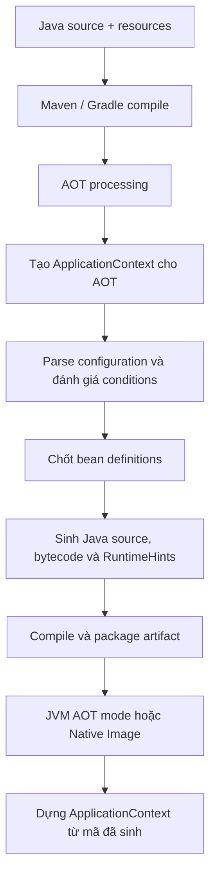

# Xử lý trước thời điểm chạy (AOT) và đồ thị bean được xác định khi xây dựng

## 1. AOT là gì và giải quyết vấn đề nào?

AOT là viết tắt của **Ahead-of-Time**. Với Spring, AOT processing phân tích ứng dụng trong lúc build, thực hiện trước một phần công việc mà Spring thường làm khi khởi động, rồi sinh thêm mã và tài nguyên để dựng `ApplicationContext` hiệu quả hơn lúc runtime.

Khi chạy theo cách thông thường, Spring cần thực hiện nhiều bước trong startup:

- Đọc classpath và tìm cấu hình.
- Parse các lớp `@Configuration`, `@Import` và component scan.
- Đánh giá `@Profile` và các annotation `@Conditional`.
- Phát hiện bean type, factory method, dependency và proxy cần tạo.
- Xử lý metadata dựa trên reflection.
- Đăng ký bean definitions, sau đó tạo bean instance và inject dependency.

Với AOT, Spring chuyển một phần đáng kể của quá trình khám phá và quyết định cấu trúc sang **build time**. Các quyết định được dùng để sinh mã khởi tạo context. Khi ứng dụng chạy ở AOT mode, Spring có thể dùng mã đã sinh thay vì phải khám phá lại toàn bộ cấu trúc theo cách runtime thông thường.

AOT đặc biệt quan trọng với GraalVM Native Image. Native Image cần biết trước những class, method, resource, serialization type và proxy nào sẽ được sử dụng. Spring AOT giúp thu thập thông tin đó và sinh các runtime hints cần thiết.

AOT cũng có thể được dùng trên JVM để kiểm tra và chạy đường khởi tạo đã tối ưu. Chỉ bật AOT processing lúc build chưa đủ: khi chạy JVM, cần bật AOT mode bằng system property `spring.aot.enabled=true`. Native image tự sử dụng AOT artifacts.

## 2. Đồ thị bean được xác định khi build nghĩa là gì?

Hãy xem một cấu hình đơn giản:

```java
@Bean
@ConditionalOnProperty(
        prefix = "acme.feature",
        name = "enabled",
        havingValue = "true")
FeatureService featureService() {
    return new FeatureService();
}
```

Trong ứng dụng chạy bình thường, condition có thể được đánh giá lúc startup. Nếu chạy với:

```bash
java -jar app.jar --acme.feature.enabled=true
```

bean `featureService` được đăng ký. Nếu đổi thành `false`, bean không được đăng ký.

Khi AOT processing chạy, Spring cần tạo một context đại diện cho ứng dụng để biết bean definitions nào sẽ tồn tại. Các condition được đánh giá bằng classpath và Environment **của quá trình build AOT**. Nếu property đang là true, mã AOT được sinh ra với bean `featureService`. Khi chạy AOT mode, bean đó thuộc cấu trúc đã được tạo.

Vì vậy, nếu chạy cùng artifact AOT với:

```bash
java -Dspring.aot.enabled=true -jar app.jar --acme.feature.enabled=false
```

giá trị property runtime có thể là false, nhưng bean vẫn có mặt vì quyết định đăng ký bean đã được chốt trong build AOT.

Đây là ý nghĩa của câu “đồ thị bean được xác định khi xây dựng”: **cấu trúc bean mà Spring cần dựng được quyết định từ môi trường build**, không được tự do thay đổi theo mọi property/profile runtime như ứng dụng khởi động thông thường.

### 2.1. Không nhầm bean definition với bean instance

AOT processing không khởi tạo toàn bộ bean instance lúc build.

Trong AOT refresh, Spring parse configuration, scan classpath và đăng ký các bean definitions cần thiết. Quá trình này cho phép AOT engine xem xét bean sẽ được tạo, nhưng không thực hiện một lần khởi động ứng dụng đầy đủ để tạo tất cả object như runtime refresh thông thường.

Sau đó AOT engine sinh mã khôi phục trạng thái BeanFactory và các artifact liên quan. Bean instance vẫn được tạo khi ứng dụng thực sự chạy.

Có ngoại lệ có chủ ý cho một số infrastructure AOT processor: nếu một bean triển khai `BeanFactoryInitializationAotProcessor` hoặc `BeanRegistrationAotProcessor`, Spring có thể khởi tạo processor và dependency của nó trong quá trình AOT để lấy đóng góp. Điều đó không có nghĩa toàn bộ application bean được khởi tạo lúc build.

### 2.2. Những đầu vào nào được cố định?

| Đầu vào | Ảnh hưởng trong AOT |
| --- | --- |
| Runtime classpath | Phải được xác định đầy đủ lúc build; thêm JAR tùy ý lúc chạy không thể làm AOT graph tự cập nhật |
| `@Profile` | Profile ảnh hưởng bean registration phải được chọn lúc build; profile đã bật trong build AOT được áp dụng khi chạy AOT |
| Property dùng trong `@Conditional` | Giá trị dùng để quyết định có đăng ký bean hay không được xét lúc build |
| `@ConditionalOnClass` | Kết quả phụ thuộc classpath có tại build |
| Property chỉ cấu hình hành vi của bean đã tồn tại | Có thể vẫn đọc từ Environment lúc runtime nếu nó không làm thay đổi bean graph |
| Dữ liệu nghiệp vụ, request, database record | Vẫn là dữ liệu runtime; AOT không đóng băng dữ liệu ứng dụng |

Điểm cần phân biệt là **property quyết định bean có tồn tại** và **property cấu hình cách một bean đang tồn tại hoạt động**.

Ví dụ, `acme.feature.enabled` dùng trong `@ConditionalOnProperty` quyết định bean có được đăng ký hay không, nên cần có giá trị đúng khi build AOT.

Ngược lại, một `@ConfigurationProperties` dùng để đặt timeout, endpoint hoặc giới hạn retry cho bean đã được đăng ký có thể tiếp tục được bind từ cấu hình runtime, miễn là những giá trị đó không điều khiển cấu trúc bean qua condition.

## 3. Luồng AOT từ source code đến runtime



AOT engine trong Spring Framework sử dụng `ApplicationContextAotGenerator`. Ở mức khái quát, nó:

1. Tạo và refresh một context theo chế độ AOT.
2. Chạy các bước xử lý bean factory cần thiết để hình thành bean registry.
3. Đánh giá condition và loại những bean definition không phù hợp với Environment build.
4. Thu thập đóng góp từ các AOT processor.
5. Sinh code, class và resource cần cho runtime.
6. Tạo runtime hints cho những thao tác mà môi trường triển khai cần biết trước.

Các artifact thường được tạo gồm:

- **Generated Java source:** mã dựng lại bean definitions và context.
- **Generated bytecode:** ví dụ bytecode cho một số proxy cần thiết.
- **RuntimeHints:** metadata cho reflection, resource loading, serialization và JDK proxy.
- **ApplicationContextInitializer:** entry point để khởi tạo context bằng AOT artifacts.

Mã được sinh ra là implementation detail của build. Khi debug, có thể xem generated source để hiểu Spring đã quyết định đăng ký bean nào và dựng chúng ra sao.

## 4. AOT, JVM và Native Image khác nhau thế nào?

| Cách chạy | Có AOT processing? | Runtime |
| --- | --- | --- |
| JVM thông thường | Không bắt buộc | Spring tự parse cấu hình và đánh giá condition lúc startup |
| JVM với AOT | Có | Dùng generated context; cần `-Dspring.aot.enabled=true` |
| GraalVM Native Image | Bắt buộc | Chạy executable native; AOT được sử dụng tự động |

AOT không đồng nghĩa với Native Image.

- AOT là bước phân tích và sinh artifact trước runtime.
- Native Image là cách biên dịch ứng dụng thành executable native bằng GraalVM.
- AOT artifacts có thể được dùng trên JVM để xác minh AOT mode mà không cần native compiler.

AOT có thể giảm công việc khám phá cấu hình và reflection trong startup. Native Image còn thay đổi cách chương trình được biên dịch và nạp. Mức cải thiện startup, memory và kích thước artifact phụ thuộc ứng dụng, dependency và workload; cần benchmark trên môi trường mục tiêu thay vì mặc định rằng mọi ứng dụng đều nhanh hơn.

## 5. Ví dụ chạy được: condition được quyết định khi build AOT

Ví dụ dùng Spring Boot 3.3.5 và Java 17+. Ứng dụng có một bean feature chỉ được đăng ký khi property `acme.feature.enabled=true`.

Ta sẽ:

1. Build AOT với property true.
2. Chạy bình thường với property false.
3. Chạy AOT mode với property false.
4. So sánh bean có mặt trong hai cách chạy.

### 5.1. Cấu trúc project

```text
aot-bean-graph/
├── pom.xml
└── src/
    └── main/
        ├── java/demo/aot/
        │   ├── AotBeanGraphApplication.java
        │   └── StartupReport.java
        └── resources/
            └── application.properties
```

### 5.2. `pom.xml`

```xml
<project xmlns="http://maven.apache.org/POM/4.0.0"
         xmlns:xsi="http://www.w3.org/2001/XMLSchema-instance"
         xsi:schemaLocation="http://maven.apache.org/POM/4.0.0 https://maven.apache.org/xsd/maven-4.0.0.xsd">
    <modelVersion>4.0.0</modelVersion>

    <parent>
        <groupId>org.springframework.boot</groupId>
        <artifactId>spring-boot-starter-parent</artifactId>
        <version>3.3.5</version>
        <relativePath/>
    </parent>

    <groupId>demo</groupId>
    <artifactId>aot-bean-graph</artifactId>
    <version>0.0.1-SNAPSHOT</version>

    <properties>
        <java.version>17</java.version>
    </properties>

    <dependencies>
        <dependency>
            <groupId>org.springframework.boot</groupId>
            <artifactId>spring-boot-starter</artifactId>
        </dependency>
    </dependencies>

    <build>
        <plugins>
            <plugin>
                <groupId>org.springframework.boot</groupId>
                <artifactId>spring-boot-maven-plugin</artifactId>
                <executions>
                    <execution>
                        <id>process-aot</id>
                        <goals>
                            <goal>process-aot</goal>
                        </goals>
                        <configuration>
                            <arguments>
                                <argument>--acme.feature.enabled=true</argument>
                            </arguments>
                        </configuration>
                    </execution>
                </executions>
            </plugin>
        </plugins>
    </build>
</project>
```

Execution `process-aot` yêu cầu Maven plugin chạy AOT processing. Thuộc tính `arguments` truyền application arguments cho lần khởi tạo context phục vụ AOT. Trong ví dụ, feature được bật ở build time nên bean feature sẽ nằm trong AOT bean graph.

### 5.3. `src/main/resources/application.properties`

```properties
spring.main.web-application-type=none
```

Ứng dụng chạy ở non-web mode để tập trung quan sát bean graph.

### 5.4. `AotBeanGraphApplication.java`

```java
package demo.aot;

import org.springframework.boot.SpringApplication;
import org.springframework.boot.autoconfigure.SpringBootApplication;
import org.springframework.boot.autoconfigure.condition.ConditionalOnProperty;
import org.springframework.context.annotation.Bean;

@SpringBootApplication
public class AotBeanGraphApplication {

    public static void main(String[] args) {
        SpringApplication.run(AotBeanGraphApplication.class, args);
    }

    @Bean
    @ConditionalOnProperty(
            prefix = "acme.feature",
            name = "enabled",
            havingValue = "true")
    public FeatureService featureService() {
        return new FeatureService("AOT feature");
    }

    public record FeatureService(String name) {
    }
}
```

### 5.5. `StartupReport.java`

```java
package demo.aot;

import org.springframework.boot.ApplicationArguments;
import org.springframework.boot.ApplicationRunner;
import org.springframework.context.ApplicationContext;
import org.springframework.core.env.Environment;
import org.springframework.stereotype.Component;

@Component
public class StartupReport implements ApplicationRunner {

    private final ApplicationContext context;
    private final Environment environment;

    public StartupReport(
            ApplicationContext context,
            Environment environment) {
        this.context = context;
        this.environment = environment;
    }

    @Override
    public void run(ApplicationArguments args) {
        String property = environment.getProperty(
                "acme.feature.enabled", "false");

        System.out.println("runtime-property=" + property);
        System.out.println("feature-bean-present="
                + context.containsBean("featureService"));
    }
}
```

Runner in ra hai thông tin: giá trị property mà Environment nhìn thấy lúc runtime và bean có thật sự tồn tại trong ApplicationContext hay không. Hai giá trị này có thể khác nhau trong AOT mode, vì condition đã được đánh giá khi build.

### 5.6. Build AOT

Từ thư mục gốc project:

```bash
mvn clean package
```

Trong quá trình build, Maven gọi `process-aot` với argument:

```text
--acme.feature.enabled=true
```

Maven plugin Spring Boot 3.3 đặt generated source, class và resource của ứng dụng ở các thư mục dưới `target/spring-aot/main`, ví dụ:

```text
target/
└── spring-aot/
    └── main/
        ├── classes/
        ├── resources/
        └── sources/
```

Có thể xem generated source để tìm các class bean definition do Spring tạo. Tên class cụ thể phụ thuộc cấu hình và phiên bản, vì vậy không nên hard-code tên generated class vào script build.

### 5.7. Chạy cùng JAR theo JVM thông thường

Không bật AOT mode:

```bash
java -jar target/aot-bean-graph-0.0.1-SNAPSHOT.jar --acme.feature.enabled=false
```

Hai dòng do `StartupReport` in ra (bỏ qua log startup của Spring Boot):

```text
runtime-property=false
feature-bean-present=false
```

Spring khởi động theo runtime path thông thường, đánh giá `@ConditionalOnProperty` với giá trị false và không đăng ký bean.

### 5.8. Chạy cùng JAR theo AOT mode

Bật AOT mode và truyền giá trị runtime false:

```bash
java -Dspring.aot.enabled=true -jar target/aot-bean-graph-0.0.1-SNAPSHOT.jar --acme.feature.enabled=false
```

Hai dòng do `StartupReport` in ra:

```text
runtime-property=false
feature-bean-present=true
```

Environment vẫn nhìn thấy property false, nhưng bean feature vẫn có mặt. Khi `process-aot` chạy lúc build, property true đã khiến condition match và bean definition được đưa vào generated context.

Đây là bằng chứng trực tiếp rằng property runtime không thể xóa một bean đã được đưa vào AOT graph.

### 5.9. Build lại với feature tắt

Đổi argument trong POM thành:

```xml
<arguments>
    <argument>--acme.feature.enabled=false</argument>
</arguments>
```

Build lại từ đầu:

```bash
mvn clean package
```

Sau đó chạy AOT mode với property runtime true:

```bash
java -Dspring.aot.enabled=true -jar target/aot-bean-graph-0.0.1-SNAPSHOT.jar --acme.feature.enabled=true
```

Hai dòng do `StartupReport` in ra:

```text
runtime-property=true
feature-bean-present=false
```

Lần này bean vắng mặt vì build AOT đã loại nó khỏi cấu trúc được sinh. Muốn thay đổi feature set của AOT artifact, cần build lại với Environment phù hợp.

## 6. Profile và property nào cần cấu hình ở build time?

### 6.1. Profile ảnh hưởng bean graph

Giả sử ứng dụng có:

```java
@Configuration
@Profile("production")
class ProductionConfiguration {

    @Bean
    ProductionClient productionClient() {
        return new ProductionClient();
    }
}
```

Nếu AOT processing được thực hiện với profile `production`, bean thuộc cấu hình này sẽ được đưa vào AOT graph. Khi chạy AOT mode, profile build time đó được áp dụng cho context.

Với Maven plugin, có thể cấu hình profile dành cho AOT bằng thuộc tính `profiles`:

```xml
<execution>
    <id>process-aot</id>
    <goals>
        <goal>process-aot</goal>
    </goals>
    <configuration>
        <profiles>
            <profile>production</profile>
        </profiles>
    </configuration>
</execution>
```

Với Gradle, cấu hình task `ProcessAot` để truyền active profiles vào quá trình AOT. Hãy đọc đúng task/API theo phiên bản Spring Boot Gradle Plugin đang dùng.

Không build AOT với profile dev rồi kỳ vọng có thể chuyển sang production chỉ bằng `--spring.profiles.active=production` khi chạy. Những bean được chọn bởi profile đã là một phần của build-time graph.

### 6.2. Property dùng trong condition

Các property sau có ảnh hưởng đến bean graph:

- `@ConditionalOnProperty`.
- `@ConditionalOnExpression`.
- `@Profile`.
- Các condition custom đọc `Environment`.
- Những condition dựa trên classpath hoặc sự tồn tại của bean.

Hãy truyền giá trị phù hợp cho process AOT qua Maven plugin arguments, profiles hoặc system properties. Plugin Spring Boot Maven hỗ trợ các tham số `arguments`, `profiles` và `systemPropertyVariables` cho process AOT.

Ví dụ, nếu điều kiện dùng:

```java
@ConditionalOnProperty(
        prefix = "acme.messaging",
        name = "provider",
        havingValue = "kafka")
```

thì build AOT phải chạy với `acme.messaging.provider=kafka` nếu muốn bean Kafka có trong graph.

### 6.3. Property chỉ cấu hình bean đã tồn tại

Không phải mọi property đều bị đóng băng.

Ví dụ bean luôn được đăng ký, nhưng timeout được bind lúc runtime:

```java
import java.time.Duration;
import org.springframework.boot.context.properties.ConfigurationProperties;

@ConfigurationProperties(prefix = "acme.http")
public record HttpClientProperties(Duration timeout) {
}
```

Nếu `timeout` chỉ cấu hình hành vi của bean đã tồn tại và không được dùng để quyết định bean có được đăng ký hay không, giá trị cấu hình có thể tiếp tục được lấy từ Environment khi ứng dụng chạy. Type cấu hình phải được đăng ký bằng `@ConfigurationPropertiesScan` hoặc `@EnableConfigurationProperties`.

Cần hỏi đúng câu: property này có làm thay đổi **có/không có bean** hay chỉ thay đổi **cách bean hoạt động**?

## 7. RuntimeHints: hỗ trợ reflection, resource và proxy

Native Image không thể tự do khám phá mọi thứ bằng reflection hoặc classpath như JVM thông thường. Những phần ứng dụng cần reflection, serialization, JDK proxy hoặc resource loading có thể cần runtime hints.

Spring AOT tự suy ra được nhiều hint từ cấu trúc Spring tiêu chuẩn, nhưng không thể biết mọi hành vi động trong code ứng dụng hoặc thư viện.

Các nhóm hint phổ biến:

| Nhóm | Ví dụ |
| --- | --- |
| Reflection | Gọi constructor/method hoặc truy cập field qua reflection |
| Resources | Đọc file cấu hình, dictionary hoặc template từ classpath |
| Serialization | Serialize/deserialize type không thể suy ra từ model Spring |
| JDK proxies | Tạo proxy dựa trên interface |

### 7.1. Đăng ký resource hint bằng @ImportRuntimeHints

Ví dụ một service đọc dictionary từ classpath:

```java
package demo.aot;

import org.springframework.aot.hint.RuntimeHints;
import org.springframework.aot.hint.RuntimeHintsRegistrar;
import org.springframework.context.annotation.ImportRuntimeHints;
import org.springframework.stereotype.Component;

@Component
@ImportRuntimeHints(DictionaryService.DictionaryHints.class)
public class DictionaryService {

    public static class DictionaryHints implements RuntimeHintsRegistrar {

        @Override
        public void registerHints(
                RuntimeHints hints,
                ClassLoader classLoader) {
            hints.resources().registerPattern("dictionaries/*.txt");
        }
    }
}
```

`RuntimeHintsRegistrar` được gọi trong quá trình AOT để đóng góp metadata cho runtime. `@ImportRuntimeHints` đặt gần component cần hint, giúp quan hệ giữa code và metadata dễ bảo trì.

Nếu core container đã suy ra được hint từ contract chuẩn, không cần khai báo trùng lặp. Chỉ bổ sung hint cho những hành vi mà Spring không thể tự phát hiện.

### 7.2. AOT extension points

Khi xây thư viện hoặc starter cần tham gia AOT, các extension point đáng biết gồm:

- `BeanFactoryInitializationAotProcessor`: đóng góp code khi BeanFactory đã được chuẩn bị.
- `BeanRegistrationAotProcessor`: tùy biến cách một bean definition được chuyển thành AOT contribution.
- `RuntimeHintsRegistrar`: đăng ký reflection/resource/serialization/proxy hints.
- `ImportBeanDefinitionRegistrar`: đăng ký bean definitions trong lúc parse configuration để AOT có thể quan sát.

Các processor có thể được đăng ký qua `META-INF/spring/aot.factories` theo contract tương ứng. Chỉ triển khai processor khi thư viện thật sự có logic cần được chuyển thành generated code; không nên thêm extension chỉ để thay thế một `@Bean` thông thường.

## 8. Những pattern dễ gặp vấn đề trong AOT

### 8.1. Đăng ký singleton trực tiếp

Đoạn code runtime kiểu:

```java
beanFactory.registerSingleton("dynamicClient", client);
```

đăng ký một instance đã tồn tại thay vì bean definition mà AOT có thể phân tích và chuyển thành code. Những singleton đăng ký theo cách này không được AOT transform như bean definition tiêu chuẩn.

Nếu cần đăng ký bean có điều kiện trong quá trình parse, ưu tiên `BeanDefinitionRegistry` hoặc `ImportBeanDefinitionRegistrar`.

### 8.2. Dùng callback đăng ký bean sau khi AOT đã phân tích

Nếu custom code chỉ thêm bean bằng một callback động ở runtime, AOT engine có thể không thấy bean đó và không sinh code/hints tương ứng.

Đăng ký bean theo mô hình cấu hình Spring tiêu chuẩn, hoặc dùng `ImportBeanDefinitionRegistrar` để đăng ký bean definitions khi configuration được parse. Nếu infrastructure cần đóng góp AOT riêng, triển khai processor phù hợp.

### 8.3. Khai báo return type quá chung

Ví dụ:

```java
@Bean
MyService myService() {
    return new MyServiceImpl();
}
```

Nếu AOT chỉ thấy kiểu khai báo `MyService`, nó có thể không suy ra những annotation, callback hoặc đặc điểm riêng của `MyServiceImpl`.

Khi phù hợp với contract, khai báo return type cụ thể:

```java
@Bean
MyServiceImpl myService() {
    return new MyServiceImpl();
}
```

Đây là lưu ý quan trọng với các bean có lifecycle method, annotation injection, proxy hoặc metadata gắn trên implementation.

### 8.4. Tạo bean bằng custom arguments

Tạo prototype bean bằng cách truyền argument động tùy ý vào container có thể yêu cầu introspection constructor/factory method lúc runtime. AOT không phải lúc nào cũng suy ra được kiểu và hint cần thiết.

Nếu mỗi lần tạo cần input khác nhau, cân nhắc viết một factory/service tường minh nhận input rồi tự tạo object, thay vì yêu cầu container tìm constructor theo bộ argument động.

### 8.5. Circular dependencies

Một số vòng phụ thuộc setter/field injection có thể chạy trong JVM thông thường nhưng thất bại trong AOT-optimized context. Thiết kế bean graph không có circular dependency; nếu cần trì hoãn truy cập, cân nhắc `@Lazy` hoặc `ObjectProvider`.

### 8.6. FactoryBean và generic type

Nếu dùng `FactoryBean<T>`, hãy khai báo kiểu product đủ cụ thể để AOT biết object nào được tạo. Khi đăng ký definition bằng code, dùng `RootBeanDefinition` và cung cấp `ResolvableType` đã resolve generic khi cần.

### 8.7. Runtime classpath scanning

Native image không có classpath runtime theo nghĩa JVM truyền thống để ứng dụng tùy ý quét class mới. Các bước scan cần thiết phải diễn ra trong quá trình build AOT và tạo ra metadata tương ứng.

## 9. Kiểm thử AOT trong pipeline

Không nên chỉ chạy test ở JVM thường rồi kết luận ứng dụng đã sẵn sàng AOT. Hãy kiểm tra cả cấu trúc được sinh và cách context chạy ở AOT mode.

Một pipeline thực tế có thể gồm:

1. **Build thường:** compile và chạy unit/integration tests tiêu chuẩn.
2. **AOT processing:** chạy `mvn clean package` với process-aot đã cấu hình.
3. **Kiểm tra generated output:** xác nhận generated sources/classes/resources được tạo.
4. **AOT JVM smoke test:** chạy artifact với `-Dspring.aot.enabled=true`.
5. **Kiểm tra bean graph:** assertion các bean có/không có theo build-time profile/property.
6. **Native build:** nếu triển khai Native Image, chạy native compile/buildpack trên môi trường có GraalVM toolchain.
7. **Native smoke test:** chạy executable native và xác minh startup, resource, reflection/proxy và luồng nghiệp vụ quan trọng.

### 9.1. Xử lý test context bằng AOT

Spring Boot Maven plugin có goal `process-test-aot` cho các test JUnit 5 sử dụng Spring TestContext Framework. Test AOT tạo các `ApplicationContextInitializer` tối ưu cho test context.

Khi dùng `spring-boot-starter-parent`, profile `nativeTest` có thể cấu hình execution này. Test AOT có thể phát hiện vấn đề khác với test JVM thông thường, đặc biệt khi test dựa trên profile, dynamic bean registration hoặc context customization.

### 9.2. Kiểm tra runtime hints

Với custom hints, viết test bằng `RuntimeHintsPredicates` để xác nhận resource/reflection/proxy đã được đăng ký.

Ví dụ kiểm tra resource:

```java
RuntimeHints hints = new RuntimeHints();

new DictionaryService.DictionaryHints()
        .registerHints(hints, getClass().getClassLoader());

assertThat(RuntimeHintsPredicates.resource()
        .forResource("dictionaries/en.txt"))
        .accepts(hints);
```

Đoạn trên là test minh họa cho registrar; cần thêm các import và dependency test Spring tương ứng trong project thật.

## 10. Lỗi thường gặp khi dùng AOT

1. **Nghĩ AOT là Native Image.** AOT là bước phân tích và sinh artifact; native image là cách biên dịch/chạy khác.
2. **Chỉ thêm process-aot nhưng chạy JVM như cũ.** Muốn dùng AOT optimized context trên JVM, bật `spring.aot.enabled=true`.
3. **Build với profile sai.** Bean được chọn bởi `@Profile` có thể không tồn tại trong AOT graph nếu profile không bật lúc build.
4. **Đổi property condition lúc runtime.** Property có thể đổi trong Environment nhưng không tự thêm/xóa bean khỏi generated graph.
5. **Build trên classpath thiếu dependency.** AOT chỉ có thể phân tích classpath được cung cấp lúc build; thêm thư viện ở runtime không làm generated code được cập nhật.
6. **Cho rằng mọi property đều bị đóng băng.** Property không ảnh hưởng bean presence vẫn có thể cấu hình bean lúc runtime.
7. **Dùng registerSingleton cho bean cần AOT.** Instance đăng ký trực tiếp không tương đương bean definition được AOT phân tích.
8. **Dùng reflection hoặc đọc resource động mà không có hint.** Native Image có thể thiếu method hoặc resource dù JVM thường chạy được.
9. **Khai báo bean type quá chung.** AOT có thể không phát hiện metadata trên implementation thực tế.
10. **Không test circular dependencies.** AOT-optimized context có thể từ chối một số vòng phụ thuộc mà JVM thường vẫn khởi động.
11. **Không build lại khi feature set thay đổi.** Thay đổi property/profile quyết định bean graph đòi hỏi chạy lại AOT processing.
12. **Đo performance bằng một lần chạy.** Startup phụ thuộc JIT, cache, filesystem, container và môi trường; cần đo nhiều lần với điều kiện nhất quán.

## 11. Cách thiết kế feature để vẫn linh hoạt lúc runtime

Nếu feature phải bật/tắt động sau khi ứng dụng đã chạy, đừng dùng condition để loại hẳn bean khỏi AOT graph.

Thay vào đó, đăng ký bean ổn định và để nó đọc cấu hình runtime:

```java
@Component
public class FeatureFacade {

    private final FeatureProperties properties;

    public FeatureFacade(FeatureProperties properties) {
        this.properties = properties;
    }

    public String execute() {
        if (!properties.enabled()) {
            return "feature-disabled";
        }
        return "feature-executed";
    }
}
```

`FeatureFacade` luôn nằm trong bean graph. Giá trị `enabled` được bind từ cấu hình runtime và quyết định hành vi khi gọi method. Đăng ký `FeatureProperties` bằng `@ConfigurationPropertiesScan` hoặc `@EnableConfigurationProperties`.

Ngược lại, nếu feature cần loại bỏ hẳn khỏi artifact (ví dụ không đóng gói adapter production hoặc integration đặc thù), hãy tạo build variant/profile AOT riêng và build artifact cho từng feature set.

| Yêu cầu | Thiết kế phù hợp |
| --- | --- |
| Bật/tắt hành vi trong lúc ứng dụng chạy | Bean ổn định + runtime configuration |
| Chọn integration cố định cho một artifact | `@Conditional` + build-time Environment |
| Tạo artifact dev và production khác nhau | Hai profile/build variant AOT |
| Thay dependency/classpath | Build lại artifact với classpath tương ứng |
| Cho phép người dùng thay implementation mặc định | Bean graph có sẵn + `@ConditionalOnMissingBean` lúc AOT build |

## 12. Checklist trước khi bật AOT cho ứng dụng hoặc starter

- [ ] Runtime classpath đầy đủ và ổn định tại thời điểm build.
- [ ] Đã xác định profile nào ảnh hưởng bean graph và truyền profile đó vào process AOT.
- [ ] Đã đặt các property dùng trong `@Conditional` cho đúng build variant.
- [ ] Đã phân biệt property cấu hình bean runtime với property quyết định bean presence.
- [ ] Đã chạy artifact ở JVM thông thường để có baseline.
- [ ] Đã chạy artifact với `-Dspring.aot.enabled=true`.
- [ ] Đã kiểm tra bean presence bằng context/Actuator/test, không chỉ dựa vào log build.
- [ ] Bean definitions được đăng ký theo cơ chế AOT có thể phân tích.
- [ ] Các return type của `@Bean` đủ cụ thể.
- [ ] Không phụ thuộc vào singleton registration hoặc callback động không được AOT hỗ trợ.
- [ ] Reflection, resource, serialization và proxy cần thiết có RuntimeHints.
- [ ] Đã kiểm tra circular dependencies và FactoryBean generic type.
- [ ] Đã chạy test AOT và native smoke test nếu mục tiêu triển khai là Native Image.
- [ ] Đã benchmark startup/memory trên môi trường đại diện.

## Tài liệu chính thức

- [Spring Boot 3.3 — Ahead-of-Time Processing (Maven Plugin)](https://docs.spring.io/spring-boot/3.3/maven-plugin/aot.html): cấu hình `process-aot`, `process-test-aot`, arguments, profiles và system properties.
- [Spring Framework — Ahead of Time Optimizations](https://docs.spring.io/spring-framework/reference/core/aot.html): AOT engine, build-time condition evaluation, generated code, RuntimeHints và best practices.
- [Spring Framework 6.1 — RuntimeHints API](https://docs.spring.io/spring-framework/docs/6.1.x/javadoc-api/org/springframework/aot/hint/RuntimeHints.html): API đăng ký reflection, resources, serialization và proxy hints.
- [Spring Framework 6.1 — RuntimeHintsRegistrar API](https://docs.spring.io/spring-framework/docs/6.1.15/javadoc-api/org/springframework/aot/hint/RuntimeHintsRegistrar.html): contract để thư viện đóng góp runtime hints.
- [Spring Boot 3.3 — Introducing GraalVM Native Images](https://docs.spring.io/spring-boot/3.3/reference/packaging/native-image/introducing-graalvm-native-images.html): giới hạn closed-world, classpath cố định và AOT assets cần cho native executable.
