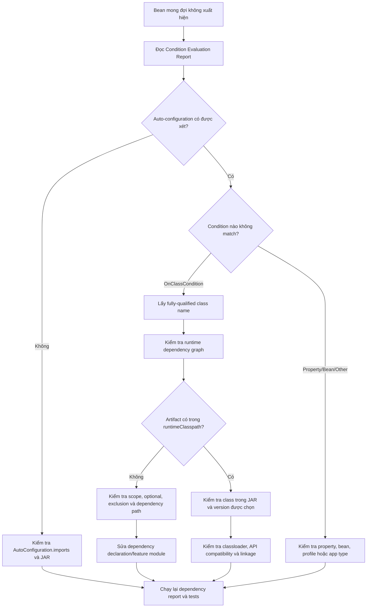

# Cấu hình không khớp do dependency vắng mặt hoặc thư viện bị loại bắc cầu

## 1. Nhận diện đúng nguyên nhân

Một auto-configuration có thể không tạo bean vì điều kiện classpath không match. Trường hợp thường gặp là:

- Thư viện tùy chọn không có trong dependency graph của ứng dụng consumer.
- Dependency chỉ có ở compile/test classpath, không có trên runtime classpath.
- Một dependency bắc cầu bị loại bằng Maven `<exclusions>` hoặc Gradle `exclude`.
- Một starter khai báo thư viện là optional nên consumer không nhận thư viện đó tự động.
- Consumer đang dùng profile, source set hoặc module khác với nơi dependency được khai báo.
- Dependency có mặt nhưng version được chọn không tương thích với code auto-configuration.

Ví dụ một thư viện cung cấp integration với Apache Commons Lang:

```java
@AutoConfiguration
@ConditionalOnClass(name = "org.apache.commons.lang3.StringUtils")
public class TextAutoConfiguration {

    @Bean
    TextNormalizer textNormalizer() {
        return new TextNormalizer();
    }
}
```

Nếu `commons-lang3` không có trên runtime classpath, `@ConditionalOnClass` không match và bean không được đăng ký. Đây là hành vi có chủ đích: Spring Boot cho phép một starter hỗ trợ nhiều integration tùy chọn mà ứng dụng không dùng integration nào vẫn có thể khởi động.

Trước khi sửa code, cần xác định condition nào không match và vì sao class mục tiêu vắng mặt. Một thông báo “bean không được tạo” chưa đủ để kết luận dependency bị thiếu; bean có thể bị chặn bởi property, bean condition, profile, web application type hoặc do auto-configuration chưa được import.

## 2. Hiểu classpath mà Spring thực sự nhìn thấy

### 2.1. Compile classpath và runtime classpath

Một dependency có thể được compiler nhìn thấy nhưng không có khi ứng dụng chạy.

| Nơi dependency xuất hiện | Compiler có thể dùng? | Spring runtime có thể tìm class? |
| --- | --- | --- |
| Compile classpath | Có | Thường có nếu scope cũng đưa nó vào runtime |
| Test classpath | Có trong test | Chỉ trong tiến trình test |
| Runtime classpath | Không nhất thiết | Có |
| IDE classpath | Phụ thuộc cấu hình IDE | Không bảo đảm giống artifact đã đóng gói |

Condition classpath được đánh giá trong context đang chạy. Vì vậy, điều quan trọng là dependency phải có trong **runtime classpath của đúng ứng dụng**, không chỉ có trong IDE hoặc khi chạy test.

### 2.2. Các Maven scope dễ gây nhầm

| Scope | Compile của module | Runtime của module | Truyền tới consumer |
| --- | --- | --- | --- |
| `compile` (mặc định) | Có | Có | Có |
| `runtime` | Không | Có | Có ở runtime |
| `provided` | Có | Không | Không |
| `test` | Có trong test | Có trong test | Không |
| `optional=true` | Theo scope đã khai báo | Theo scope đã khai báo | Không tự truyền dependency đó |

`optional=true` không phải một scope. Nó là metadata trên dependency. Thư viện vẫn được dùng để compile và test chính module khai báo nó, nhưng consumer không nhận dependency đó một cách bắc cầu. Nếu consumer cần feature tùy chọn, consumer phải khai báo dependency tương ứng trực tiếp.

`provided` và `test` cũng có thể làm condition không match ở runtime. Đừng đổi sang `runtime` một cách máy móc: runtime scope vẫn được truyền tới runtime của consumer; chỉ dùng khi thư viện thực sự cần dependency lúc chạy nhưng không cần nó để compile.

### 2.3. Gradle configurations

Với Java Library Plugin, các configuration phổ biến có ý nghĩa khác nhau:

| Configuration | Module compile | Module runtime | Consumer runtime |
| --- | --- | --- | --- |
| `api` | Có | Có | Có |
| `implementation` | Có | Có | Có |
| `compileOnly` | Có | Không | Không |
| `runtimeOnly` | Không | Có | Có |
| `testImplementation` | Chỉ test | Chỉ test | Không |

`implementation` không có nghĩa dependency biến mất khỏi runtime của consumer. Nó không xuất dependency vào compile API của consumer, nhưng vẫn tham gia runtime graph. Nếu condition không match vì dependency bị thiếu, hãy xem `runtimeClasspath` thay vì chỉ xem `compileClasspath`.

Gradle không có một cờ `optional=true` tương đương trực tiếp với Maven cho mọi trường hợp. Nếu feature có dependency runtime riêng, cách dễ hiểu nhất thường là tách feature thành module/starter riêng. Nếu vẫn dùng một artifact chung, hãy thiết kế outgoing variants và configurations có chủ đích; đừng giả định `compileOnly` là optional runtime dependency, vì nó không đi vào runtime classpath của chính consumer.

## 3. Condition classpath của Spring Boot hoạt động thế nào?

### 3.1. `@ConditionalOnClass`

`@ConditionalOnClass` chỉ match khi class được chỉ định có thể được tìm thấy trên classpath mà condition đang đánh giá.

Dạng dùng tên class:

```java
@ConditionalOnClass(
        name = "org.apache.commons.lang3.StringUtils")
@Configuration(proxyBeanMethods = false)
static class CommonsTextConfiguration {
}
```

Dạng dùng class literal:

```java
@ConditionalOnClass(StringUtils.class)
@Configuration(proxyBeanMethods = false)
static class CommonsTextConfiguration {
}
```

Trên configuration class, Spring Boot đọc annotation metadata bằng ASM. Vì vậy, class literal có thể được khai báo an toàn trong annotation trên configuration class ngay cả khi class mục tiêu không có trên runtime classpath. Dùng thuộc tính `name` là cách thuận tiện khi muốn tránh import dependency tùy chọn trong file cấu hình.

### 3.2. `@ConditionalOnMissingClass`

`@ConditionalOnMissingClass` là chiều ngược lại: cấu hình chỉ match khi class mục tiêu không có mặt.

Ví dụ fallback khi thư viện client nâng cao không được đóng gói:

```java
@AutoConfiguration
@ConditionalOnMissingClass(
        "com.vendor.fastclient.FastClient")
public class BasicClientAutoConfiguration {

    @Bean
    BasicClient basicClient() {
        return new BasicClient();
    }
}
```

Dùng condition này cho fallback có chủ ý. Nếu ứng dụng cần FastClient để hoạt động, việc class bị thiếu nên được phát hiện qua dependency validation hoặc fail-fast phù hợp, thay vì âm thầm chạy một implementation khác có semantics không tương đương.

### 3.3. Vì sao cần nested configuration cho class tùy chọn?

Một lỗi phổ biến là đặt condition ngay trên `@Bean` method có kiểu trả về hoặc tham số thuộc thư viện tùy chọn:

```java
@AutoConfiguration
public class UnsafeTextAutoConfiguration {

    @Bean
    @ConditionalOnClass(StringUtils.class)
    TextNormalizer textNormalizer() {
        return new TextNormalizer();
    }
}
```

Trước khi condition trên method được áp dụng, JVM có thể phải tải configuration class và xử lý chữ ký method. Nếu chữ ký hoặc type tham chiếu trực tiếp tới class bị thiếu, ứng dụng có thể gặp lỗi class loading trước khi condition kịp loại method.

Cách an toàn hơn là cô lập tất cả type phụ thuộc thư viện tùy chọn trong một nested configuration:

```java
@AutoConfiguration
public class SafeTextAutoConfiguration {

    @Configuration(proxyBeanMethods = false)
    @ConditionalOnClass(
            name = "org.apache.commons.lang3.StringUtils")
    static class CommonsTextConfiguration {

        @Bean
        @ConditionalOnMissingBean
        TextNormalizer textNormalizer() {
            return new TextNormalizer();
        }
    }
}
```

Outer configuration không tham chiếu tới type tùy chọn. Spring đánh giá class condition trên nested configuration trước; khi class không có, nested configuration bị bỏ qua và các method phụ thuộc thư viện không cần được nạp.

Nếu dùng `@ConditionalOnClass` hoặc `@ConditionalOnMissingClass` như một phần của meta-annotation tự tạo, Spring Boot yêu cầu dùng thuộc tính `name` để tham chiếu class. Đây là lưu ý riêng khi compose annotation.

### 3.4. Condition chỉ kiểm tra class có tồn tại

`@ConditionalOnClass` không xác minh:

- Version thư viện có tương thích với code đang gọi hay không.
- Method hoặc field mà code cần có tồn tại hay không.
- Hai class cùng tên có đến từ classloader tương thích hay không.
- Static initializer của class có chạy thành công hay không.
- Các dependency khác mà thư viện cần có cũng đã hiện diện hay chưa.

Vì thế, classpath condition match vẫn có thể đi kèm `NoSuchMethodError`, `NoSuchFieldError` hoặc `NoClassDefFoundError` khi code thực sự sử dụng API không tương thích. Hãy kiểm tra version alignment và dependency tree nếu class có mặt nhưng integration vẫn lỗi.

## 4. Maven: lần theo dependency bị thiếu hoặc bị loại

### 4.1. Xem dependency tree của đúng consumer

Chạy từ module ứng dụng, không chỉ từ module thư viện:

```bash
mvn -pl app dependency:tree
mvn -pl app dependency:tree -Dscope=runtime
mvn -pl app dependency:tree -Dincludes=org.apache.commons:commons-lang3
```

Nếu dự án Maven không phải multi-module, bỏ `-pl app` và chạy tại thư mục chứa POM của ứng dụng.

Khi cần thấy các dependency bị Maven loại vì conflict mediation, dùng:

```bash
mvn -pl app dependency:tree -Dverbose
```

Đọc cây từ consumer xuống:

```text
app
+- com.acme:acme-text-autoconfigure
|  \- org.apache.commons:commons-lang3 (optional)
\- com.vendor:vendor-bundle
   \- org.apache.commons:commons-lang3
```

Đây là ví dụ minh họa. Nếu dependency chỉ xuất hiện ở nhánh optional của auto-configuration, consumer không tự nhận nó từ nhánh đó. Nếu một dependency khác kéo Commons Lang vào qua nhánh vendor, class vẫn có thể xuất hiện trên runtime classpath.

### 4.2. Khai báo optional dependency trong thư viện

Nếu module auto-configuration có thể hoạt động mà không cần integration Commons Lang, POM của module đó có thể khai báo:

```xml
<dependency>
    <groupId>org.apache.commons</groupId>
    <artifactId>commons-lang3</artifactId>
    <version>3.14.0</version>
    <optional>true</optional>
</dependency>
```

Dependency vẫn có trong classpath của module auto-configuration để biên dịch và test code tích hợp. Khi ứng dụng khác phụ thuộc vào module này, Maven không tự truyền Commons Lang sang ứng dụng consumer.

Consumer chỉ dùng tính năng core có thể giữ POM gọn. Consumer muốn dùng feature Commons Lang cần thêm dependency trực tiếp:

```xml
<dependency>
    <groupId>com.acme</groupId>
    <artifactId>acme-text-autoconfigure</artifactId>
    <version>1.0.0</version>
</dependency>

<dependency>
    <groupId>org.apache.commons</groupId>
    <artifactId>commons-lang3</artifactId>
    <version>3.14.0</version>
</dependency>
```

Cần chọn version tương thích với version mà thư viện đã kiểm thử. Nếu dùng Spring Boot dependency management hoặc Maven BOM, ưu tiên để BOM quản lý version thay vì rải version riêng ở nhiều module.

### 4.3. Exclusion loại một dependency trên một nhánh

Giả sử `vendor-bundle` kéo Commons Lang vào nhưng ứng dụng không dùng phần tích hợp đó:

```xml
<dependency>
    <groupId>com.vendor</groupId>
    <artifactId>vendor-bundle</artifactId>
    <version>2.4.0</version>
    <exclusions>
        <exclusion>
            <groupId>org.apache.commons</groupId>
            <artifactId>commons-lang3</artifactId>
        </exclusion>
    </exclusions>
</dependency>
```

Exclusion gắn với dependency mà bạn khai báo. Nó loại artifact khỏi nhánh dependency đó và các nhánh con của nó. Nếu một dependency khác cũng mang cùng artifact vào graph, artifact vẫn có thể hiện diện.

Do đó, sau khi thêm exclusion, chạy lại `dependency:tree`. Không suy luận rằng một exclusion đã loại thư viện khỏi toàn bộ ứng dụng chỉ vì một nhánh không còn nó.

### 4.4. Phân biệt optional và exclusion

| Cơ chế | Ai khai báo? | Ý nghĩa |
| --- | --- | --- |
| `optional=true` | Nhà phát triển thư viện | Consumer không tự nhận dependency tùy chọn từ thư viện |
| `exclusions` | Consumer hoặc module phụ thuộc | Loại một dependency qua một nhánh cụ thể |
| Tách feature module | Nhà phát triển thư viện | Consumer chọn artifact của feature cần dùng |
| `dependencyManagement` | Ứng dụng/BOM | Quản lý version được chọn; không tự thêm dependency |

Nếu bạn sở hữu thư viện, tách integration thành module riêng thường diễn đạt hợp đồng rõ hơn việc đánh dấu rất nhiều dependency optional. Nếu bạn đang tiêu thụ một thư viện bên thứ ba và không thể sửa POM của nó, exclusion là công cụ xử lý ở phía consumer; phải kiểm tra kỹ tính năng nào của vendor sẽ bị ảnh hưởng.

## 5. Gradle: kiểm tra runtimeClasspath và dependencyInsight

### 5.1. Xem toàn bộ runtime graph

```bash
./gradlew :app:dependencies --configuration runtimeClasspath
```

Đối với một project đơn:

```bash
./gradlew dependencies --configuration runtimeClasspath
```

Tìm artifact mục tiêu và xem nó có nằm trong runtime graph hay không. Nếu chỉ kiểm tra `compileClasspath`, bạn có thể bỏ sót việc dependency được khai báo là `compileOnly` và không được đóng gói để chạy.

### 5.2. Tìm lý do dependency được chọn

```bash
./gradlew :app:dependencyInsight --dependency commons-lang3 --configuration runtimeClasspath
```

`dependencyInsight` cho biết dependency được yêu cầu từ đâu, version nào được chọn và lý do chọn version. Đây là cách nhanh để phát hiện:

- Dependency chỉ được yêu cầu bởi một module trung gian.
- Version conflict khiến Gradle chọn version khác.
- Resolution rule hoặc constraint ép một version.
- Dependency không có trong configuration runtime được hỏi.

### 5.3. Exclude trên dependency cụ thể

Với Groovy DSL:

```groovy
dependencies {
    implementation("com.vendor:vendor-bundle:2.4.0") {
        exclude group: "org.apache.commons", module: "commons-lang3"
    }
}
```

Với Kotlin DSL:

```kotlin
dependencies {
    implementation("com.vendor:vendor-bundle:2.4.0") {
        exclude(
            group = "org.apache.commons",
            module = "commons-lang3"
        )
    }
}
```

Cũng như Maven, exclusion trên một dependency edge không bảo đảm artifact biến mất nếu một edge khác vẫn yêu cầu nó. Chạy lại `dependencyInsight` sau khi sửa để xác nhận kết quả.

## 6. Ví dụ hoàn chỉnh: auto-configuration có thư viện tùy chọn

Ví dụ dùng Java 17 và Spring Boot 3.3.5. Module auto-configuration có dependency Commons Lang là optional. Bean `TextNormalizer` chỉ được tạo khi `StringUtils` có trên runtime classpath.

### 6.1. Cấu trúc project

```text
acme-text-autoconfigure/
├── pom.xml
└── src/
    ├── main/
    │   ├── java/demo/autoconfigure/
    │   │   └── OptionalTextAutoConfiguration.java
    │   ├── java/demo/text/
    │   │   └── TextNormalizer.java
    │   └── resources/META-INF/spring/
    │       └── org.springframework.boot.autoconfigure.AutoConfiguration.imports
    └── test/java/demo/autoconfigure/
        └── OptionalTextAutoConfigurationTests.java
```

### 6.2. POM

Tệp `pom.xml`:

```xml
<project xmlns="http://maven.apache.org/POM/4.0.0"
         xmlns:xsi="http://www.w3.org/2001/XMLSchema-instance"
         xsi:schemaLocation="http://maven.apache.org/POM/4.0.0 https://maven.apache.org/xsd/maven-4.0.0.xsd">
    <modelVersion>4.0.0</modelVersion>

    <parent>
        <groupId>org.springframework.boot</groupId>
        <artifactId>spring-boot-starter-parent</artifactId>
        <version>3.3.5</version>
        <relativePath/>
    </parent>

    <groupId>com.acme</groupId>
    <artifactId>acme-text-autoconfigure</artifactId>
    <version>1.0.0</version>

    <properties>
        <java.version>17</java.version>
    </properties>

    <dependencies>
        <dependency>
            <groupId>org.springframework.boot</groupId>
            <artifactId>spring-boot-autoconfigure</artifactId>
        </dependency>

        <dependency>
            <groupId>org.apache.commons</groupId>
            <artifactId>commons-lang3</artifactId>
            <version>3.14.0</version>
            <optional>true</optional>
        </dependency>

        <dependency>
            <groupId>org.springframework.boot</groupId>
            <artifactId>spring-boot-starter-test</artifactId>
            <scope>test</scope>
        </dependency>
    </dependencies>
</project>
```

Commons Lang có trên compile/runtime classpath của chính module này để code và test tích hợp biên dịch được. Do dependency optional, ứng dụng chỉ phụ thuộc `acme-text-autoconfigure` sẽ không tự nhận Commons Lang.

### 6.3. Lớp sử dụng thư viện tùy chọn

Tệp `src/main/java/demo/text/TextNormalizer.java`:

```java
package demo.text;

import org.apache.commons.lang3.StringUtils;

public class TextNormalizer {

    public String normalize(String value) {
        return StringUtils.normalizeSpace(value);
    }
}
```

Class này gọi API Commons Lang khi method được thực thi. Vì vậy, bean chỉ được cung cấp khi thư viện có mặt. Nếu consumer tự tạo hoặc gọi `TextNormalizer` mà không khai báo Commons Lang, code đó vẫn có thể gặp lỗi liên kết lúc chạy; condition chỉ bảo vệ bean do auto-configuration đăng ký.

### 6.4. Auto-configuration có nested class condition

Tệp `src/main/java/demo/autoconfigure/OptionalTextAutoConfiguration.java`:

```java
package demo.autoconfigure;

import demo.text.TextNormalizer;
import org.springframework.boot.autoconfigure.AutoConfiguration;
import org.springframework.boot.autoconfigure.condition.ConditionalOnClass;
import org.springframework.boot.autoconfigure.condition.ConditionalOnMissingBean;
import org.springframework.context.annotation.Bean;
import org.springframework.context.annotation.Configuration;

@AutoConfiguration
public class OptionalTextAutoConfiguration {

    @Configuration(proxyBeanMethods = false)
    @ConditionalOnClass(
            name = "org.apache.commons.lang3.StringUtils")
    static class CommonsTextConfiguration {

        @Bean
        @ConditionalOnMissingBean
        TextNormalizer textNormalizer() {
            return new TextNormalizer();
        }
    }
}
```

Điều kiện nằm trên nested configuration. Outer class không có method signature phụ thuộc Commons Lang. Khi class tùy chọn không có, Spring bỏ qua nested configuration trước khi xử lý bean method.

`@ConditionalOnMissingBean` cho phép consumer tự cung cấp implementation khác. Đây là condition riêng cho việc thay thế bean; nó không thay thế classpath condition.

### 6.5. Đăng ký auto-configuration

Tạo file `src/main/resources/META-INF/spring/org.springframework.boot.autoconfigure.AutoConfiguration.imports` với nội dung:

```text
demo.autoconfigure.OptionalTextAutoConfiguration
```

Spring Boot chỉ tự phát hiện auto-configuration được liệt kê trong imports file của JAR. Nếu file không được đóng gói hoặc thiếu tên class, condition chưa chắc được đánh giá vì lớp cấu hình có thể chưa từng trở thành candidate.

### 6.6. Test cả hai trạng thái classpath

Tệp `src/test/java/demo/autoconfigure/OptionalTextAutoConfigurationTests.java`:

```java
package demo.autoconfigure;

import demo.text.TextNormalizer;
import org.apache.commons.lang3.StringUtils;
import org.junit.jupiter.api.Test;
import org.springframework.boot.autoconfigure.AutoConfigurations;
import org.springframework.boot.test.context.FilteredClassLoader;
import org.springframework.boot.test.context.runner.ApplicationContextRunner;

import static org.assertj.core.api.Assertions.assertThat;

class OptionalTextAutoConfigurationTests {

    private final ApplicationContextRunner runner =
            new ApplicationContextRunner()
                    .withConfiguration(AutoConfigurations.of(
                            OptionalTextAutoConfiguration.class));

    @Test
    void createsNormalizerWhenCommonsLangIsPresent() {
        this.runner.run(context -> {
            assertThat(context).hasNotFailed();
            assertThat(context).hasSingleBean(TextNormalizer.class);
            assertThat(context.getBean(TextNormalizer.class)
                    .normalize("  Spring   Boot  "))
                    .isEqualTo("Spring Boot");
        });
    }

    @Test
    void skipsNormalizerWhenCommonsLangIsMissing() {
        this.runner
                .withClassLoader(new FilteredClassLoader(StringUtils.class))
                .run(context -> {
                    assertThat(context).hasNotFailed();
                    assertThat(context).doesNotHaveBean(TextNormalizer.class);
                });
    }

    @Test
    void userBeanReplacesTheDefaultNormalizer() {
        TextNormalizer custom = new TextNormalizer();

        this.runner
                .withBean(TextNormalizer.class, () -> custom)
                .run(context -> {
                    assertThat(context).hasNotFailed();
                    assertThat(context).hasSingleBean(TextNormalizer.class);
                    assertThat(context.getBean(TextNormalizer.class))
                            .isSameAs(custom);
                });
    }
}
```

`FilteredClassLoader` làm cho class mục tiêu không thể được tìm thấy trong context đang test, dù dependency vẫn có trên classpath của tiến trình test. Điều này kiểm tra đúng nhánh “class vắng mặt” mà không cần gỡ JAR khỏi máy.

Ba test chứng minh:

1. Có Commons Lang: auto-configuration đăng ký `TextNormalizer` và method hoạt động.
2. Không có Commons Lang: nested configuration bị bỏ qua, context vẫn khởi động và không có bean.
3. Có bean custom: default bean nhường chỗ.

Chạy:

```bash
mvn test
```

### 6.7. Consumer khai báo thư viện tùy chọn khi cần feature

POM của ứng dụng consumer chỉ dùng auto-configuration:

```xml
<dependency>
    <groupId>com.acme</groupId>
    <artifactId>acme-text-autoconfigure</artifactId>
    <version>1.0.0</version>
</dependency>
```

Vì Commons Lang được đánh dấu optional trong POM của thư viện, consumer không tự nhận dependency này. Khi ứng dụng muốn có bean `TextNormalizer`, thêm dependency trực tiếp:

```xml
<dependency>
    <groupId>org.apache.commons</groupId>
    <artifactId>commons-lang3</artifactId>
    <version>3.14.0</version>
</dependency>
```

Sau đó kiểm tra lại runtime dependency tree. Nếu ứng dụng đã có Commons Lang qua một đường khác, không cần khai báo trùng lặp, nhưng vẫn cần kiểm tra version được chọn.

## 7. Chẩn đoán bằng Condition Evaluation Report

### 7.1. Bật debug report

Khởi chạy ứng dụng:

```bash
java -jar app.jar --debug
```

Spring Boot in `CONDITIONS EVALUATION REPORT`. Tìm `OptionalTextAutoConfiguration` và các nested configuration liên quan. Khi class bị thiếu, report của `OnClassCondition` sẽ giải thích rằng class mục tiêu không có trên classpath.

Report giúp phân biệt hai tình huống:

- **Auto-configuration không được phát hiện:** kiểm tra imports file và artifact được đóng gói.
- **Auto-configuration được phát hiện nhưng condition không match:** kiểm tra classpath, property hoặc bean condition tương ứng.

Nếu ứng dụng có Actuator, có thể expose endpoint `/actuator/conditions` để đọc report có cấu trúc. Endpoint này thường không được expose mặc định; chỉ bật khi cần chẩn đoán và bảo vệ quyền truy cập vì report có thể tiết lộ cấu trúc nội bộ của ứng dụng.

### 7.2. Đọc report theo thứ tự

Khi một bean mong đợi không xuất hiện:

1. Tìm outer auto-configuration trong report.
2. Xác nhận lớp đó có được xét hay không.
3. Tìm nested configuration hoặc `@Bean` method có condition.
4. Đọc condition name và message.
5. Nếu là `OnClassCondition`, lấy đúng fully-qualified class name từ message.
6. Xác minh artifact chứa class đó có trong runtime graph của consumer không.
7. Nếu class có mặt, tiếp tục kiểm tra bean condition, property condition và version compatibility.

Đừng hard-code toàn bộ message report vào test vì wording có thể thay đổi giữa các phiên bản Spring Boot. Test bean presence/absence và kiểm tra dependency graph sẽ bền hơn.

### 7.3. Kiểm tra JAR đã đóng gói

Với executable JAR của Spring Boot, dependency thường nằm dưới `BOOT-INF/lib`:

```bash
jar tf target/app.jar | findstr /I "BOOT-INF/lib/commons-lang3"
```

Nếu không có kết quả, JAR không đóng gói Commons Lang. Nếu có, xác minh JAR lồng bên trong chứa đúng class:

```bash
jar tf commons-lang3-3.14.0.jar | findstr "org/apache/commons/lang3/StringUtils.class"
```

Với môi trường Linux/macOS, thay `findstr` bằng `grep`. Kiểm tra artifact cuối cùng có giá trị hơn việc chỉ nhìn POM hoặc trạng thái IDE, vì plugin packaging, profile và exclusions có thể làm thay đổi nội dung được đóng gói.

### 7.4. Kiểm tra nhanh classloader lúc runtime

Trong một chẩn đoán tạm thời, có thể dùng:

```java
import org.springframework.util.ClassUtils;

String className = "org.apache.commons.lang3.StringUtils";
ClassLoader classLoader =
        Thread.currentThread().getContextClassLoader();

System.out.println(
        "commons-lang-present="
                + ClassUtils.isPresent(className, classLoader));
```

Nếu in `false`, classloader đang dùng không tìm thấy class. Đây là phép kiểm tra hiện diện; nó không xác minh API version hay khả năng khởi tạo class thành công.

## 8. Phân biệt lỗi thiếu class với lỗi version hoặc linkage

Không phải mọi lỗi có chữ “class” đều có cùng nguyên nhân.

| Lỗi | Ý nghĩa thường gặp | Hướng kiểm tra |
| --- | --- | --- |
| `ClassNotFoundException` | Code chủ động tìm class bằng tên nhưng không tìm thấy | Runtime classpath, classloader, dependency scope |
| `NoClassDefFoundError` | JVM cần một class khi liên kết/thực thi nhưng không thể tải nó | JAR thiếu, dependency bắc cầu bị loại, classloader hoặc lỗi khởi tạo trước đó |
| `NoSuchMethodError` | Class có mặt nhưng version được nạp không có method mà code đã compile để gọi | Dependency version conflict, BOM, duplicate JAR |
| `NoSuchFieldError` | Class có mặt nhưng field mong đợi không tồn tại trong version được nạp | Version alignment |
| `AbstractMethodError` | Implementation được nạp không đáp ứng method contract mà caller mong đợi | Version incompatibility hoặc interface thay đổi |
| `ExceptionInInitializerError` | Static initializer của class ném exception | Kiểm tra nguyên nhân gốc trong cause chain |
| `ClassCastException` giữa hai class cùng tên | Có thể cùng tên nhưng được định nghĩa bởi classloader khác nhau | DevTools/restart classloader, plugin/container isolation |

Nếu `@ConditionalOnClass` báo match nhưng bean vẫn lỗi lúc tạo, condition đã làm đúng phần việc của nó: class có thể tìm thấy. Lỗi lúc đó thường nằm ở dependency version, class liên quan khác, cấu hình hoặc static initialization.

Đừng dùng condition để che một version conflict. Hãy đồng bộ dependency bằng Spring Boot BOM hoặc dependency constraints, loại version trùng lặp và xác minh lại runtime graph.

## 9. Quy trình xử lý sự cố từ triệu chứng đến nguyên nhân

Dùng quy trình sau cho một bean không được tạo vì dependency có thể bị thiếu:



### Trình tự thao tác cụ thể

1. Xác định bean name/type và auto-configuration dự kiến tạo nó.
2. Bật `--debug` hoặc đọc `/actuator/conditions`.
3. Xác định condition không match; không bắt đầu bằng việc thêm dependency ngẫu nhiên.
4. Nếu là class condition, sao chép fully-qualified class name từ code/report.
5. Xác định artifact Maven/Gradle chứa class đó.
6. Kiểm tra đúng consumer module và `runtimeClasspath`.
7. Lần theo dependency path, tìm optional flag, scope hoặc exclusion.
8. Kiểm tra version conflict nếu artifact đã hiện diện.
9. Sửa dependency declaration hoặc nested class condition theo đúng nguyên nhân.
10. Chạy test cả hai trạng thái: dependency có mặt và dependency vắng mặt.
11. Đóng gói lại ứng dụng và kiểm tra JAR cuối cùng.

## 10. Những lỗi thiết kế thường gặp

1. **Chỉ thêm dependency vào IDE.** Build của IDE có thể khác Maven/Gradle và JAR triển khai. Kiểm tra runtime graph và artifact thực tế.
2. **Đánh dấu dependency optional nhưng quên consumer phải khai báo lại.** Optional không truyền dependency cho consumer.
3. **Đặt class tùy chọn trong chữ ký method của outer configuration.** JVM có thể tải type trước khi method condition chạy. Cô lập nó trong nested configuration có class condition.
4. **Đặt condition trên method nhưng return type thuộc thư viện bị thiếu.** Ưu tiên condition ở configuration class riêng để bảo vệ toàn bộ chữ ký phụ thuộc.
5. **Chỉ kiểm tra compileClasspath.** Condition chạy trong context runtime; hãy xem runtimeClasspath.
6. **Dùng `provided` hoặc `compileOnly` cho dependency cần lúc chạy.** Những configuration này không bảo đảm thư viện có trong runtime của consumer.
7. **Exclude dependency mà không lần theo mọi đường truyền.** Exclusion áp dụng cho nhánh khai báo; dependency có thể còn qua nhánh khác.
8. **Cho rằng exclusion đã loại toàn bộ artifact.** Chạy lại dependency tree hoặc dependencyInsight để xác nhận.
9. **Dùng `@ConditionalOnClass` như kiểm tra version.** Annotation chỉ kiểm tra class presence; API không tương thích vẫn có thể gây linkage error.
10. **Dùng `@ConditionalOnMissingBean` để xử lý thiếu class.** Bean condition không thay thế classpath condition.
11. **Bỏ qua file `AutoConfiguration.imports`.** Auto-configuration chưa được phát hiện thì condition bên trong không có cơ hội chạy.
12. **Dùng classpath condition trên từng method rời rạc.** Nếu nhiều bean cùng cần một thư viện, nested configuration giúp gom và bảo vệ cả nhóm.
13. **Để core API công khai type của dependency tùy chọn.** Consumer có thể buộc phải nạp class đó dù không dùng feature. Cân nhắc module API/integration riêng.
14. **Không test với classloader bị lọc.** Test happy path có dependency đầy đủ không chứng minh starter an toàn khi dependency bị thiếu.
15. **Che lỗi thiếu dependency bằng fallback không tương đương.** Chỉ fallback khi behavior thay thế thực sự được hỗ trợ và được tài liệu hóa.

## 11. Checklist review trước khi phát hành starter

- [ ] Đã xác định class nào là dependency bắt buộc và class nào thuộc feature tùy chọn.
- [ ] Dependency tùy chọn có semantics đúng trong POM hoặc Gradle variants.
- [ ] Consumer có hướng dẫn khai báo dependency trực tiếp khi bật feature.
- [ ] Auto-configuration dùng `@ConditionalOnClass`/`@ConditionalOnMissingClass` đúng mục đích.
- [ ] Type phụ thuộc thư viện tùy chọn được cô lập trong nested configuration.
- [ ] Không có method signature ở outer configuration buộc JVM nạp class tùy chọn.
- [ ] `AutoConfiguration.imports` có tên đầy đủ của auto-configuration.
- [ ] Default bean có `@ConditionalOnMissingBean` nếu cần cho phép override.
- [ ] Test dependency present, dependency absent và user bean override.
- [ ] Test absent dùng `FilteredClassLoader` hoặc consumer fixture thực sự không có JAR.
- [ ] Đã kiểm tra Maven dependency tree hoặc Gradle runtimeClasspath của consumer.
- [ ] Đã kiểm tra exclusion không làm mất dependency qua nhánh khác.
- [ ] Đã kiểm tra version được chọn và API tương thích.
- [ ] Đã kiểm tra executable JAR sau packaging.
- [ ] Đã đọc Condition Evaluation Report để xác nhận lý do match/no-match.
- [ ] Đã ghi rõ feature nào cần dependency bổ sung trong tài liệu starter.

## Tài liệu chính thức

- [Spring Boot 3.3 — Creating Your Own Auto-configuration](https://docs.spring.io/spring-boot/3.3/reference/features/developing-auto-configuration.html): class conditions, cách cô lập optional class trong nested configuration, bean conditions và đăng ký imports.
- [Spring Boot 3.3 — Conditions Evaluation Report](https://docs.spring.io/spring-boot/3.3/api/rest/actuator/conditions.html): đọc positive/negative matches và message giải thích condition.
- [Maven — Optional and Excluded Dependencies](https://maven.apache.org/guides/introduction/introduction-to-optional-and-excludes-dependencies): optional dependency và exclusion theo dependency path.
- [Maven — Dependency Mechanism](https://maven.apache.org/guides/introduction/introduction-to-dependency-mechanism.html): dependency scopes và classpaths.
- [Gradle — Viewing and Debugging Dependencies](https://docs.gradle.org/current/userguide/viewing_debugging_dependencies.html): runtime dependency graph và `dependencyInsight`.
