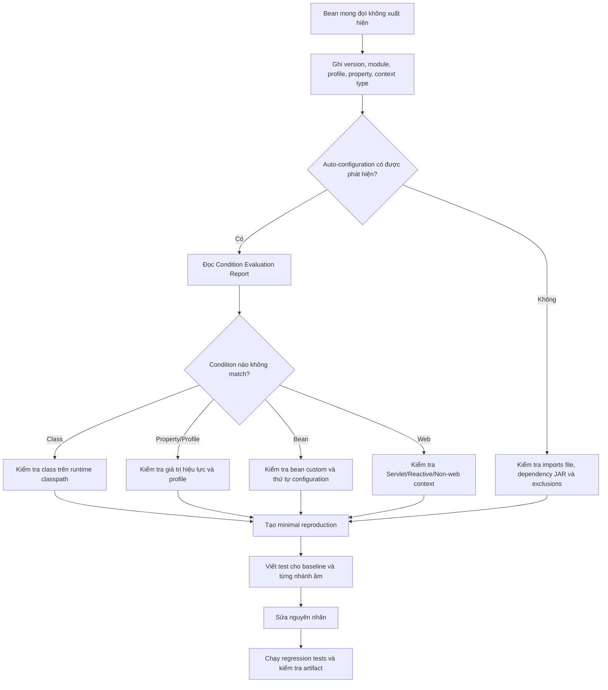

# Quy trình chẩn đoán từ tái hiện tối thiểu đến báo cáo điều kiện và kiểm thử hồi quy

## 1. Mục tiêu: tìm đúng condition làm bean không được đăng ký

Khi một bean do Spring Boot auto-configuration cung cấp không xuất hiện, đừng bắt đầu bằng cách thêm dependency hoặc sửa annotation ngẫu nhiên. Hãy tìm bằng chứng cho biết **candidate nào được xét, condition nào không match, và input nào làm condition đó không match**.

Một quy trình chẩn đoán tốt phải trả lời được năm câu hỏi:

1. Ứng dụng đang chạy đúng module, profile, version và runtime classpath nào?
2. Auto-configuration mong đợi có được Spring Boot phát hiện không?
3. Nếu được phát hiện, condition nào quyết định không đăng ký bean?
4. Có thể tái hiện kết quả đó trong một context nhỏ, không cần database hay dịch vụ bên ngoài không?
5. Có test hồi quy chứng minh cả trường hợp bật, tắt và các trường hợp biên không?

Bài này dùng một ví dụ xuyên suốt: bean `TextNormalizer` chỉ được cung cấp khi Apache Commons Lang có trên classpath, property `acme.text.enabled=true` và ứng dụng chưa tự khai báo bean thay thế.

Quy tắc mong đợi có thể viết thành biểu thức:

```text
textNormalizerPresent =
    commonsLangPresent
    AND acmeTextEnabled
    AND noUserDefinedTextNormalizer
```

Nếu bean không xuất hiện, chỉ cần một vế sai là đủ để giải thích kết quả. Công việc chẩn đoán là xác định chính xác vế nào sai.

## 2. Ghi lại hiện trạng trước khi thay đổi

Trước khi tái hiện, ghi lại một bộ thông tin nhỏ nhưng đủ để người khác chạy lại đúng tình huống:

| Thông tin | Cần ghi |
| --- | --- |
| Java | Kết quả `java -version` và JDK được Maven/Gradle sử dụng |
| Spring Boot | Version thực tế sau dependency management |
| Build tool | Maven/Gradle version và command đã chạy |
| Module consumer | Module thực sự khởi động ứng dụng |
| Dependency | Runtime graph và version được chọn |
| Profile | Các profile active khi khởi động |
| Properties | Giá trị liên quan, nguồn cấu hình và command-line arguments |
| Context type | Non-web, Servlet hay Reactive |
| Triệu chứng | Bean name/type mong đợi, bean thực tế, exception đầu tiên và thời điểm xảy ra |

Đừng chỉ ghi POM hoặc file properties. Giá trị hiệu lực có thể đến từ environment variables, command-line arguments, profile-specific file, Config Server hoặc test customizer. Hãy ghi giá trị mà tiến trình thật sự nhìn thấy.

### Phân biệt “bean không tồn tại” với “bean tạo thất bại”

Hai triệu chứng này cần hướng điều tra khác nhau:

- **Bean không được đăng ký:** thường liên quan đến auto-configuration candidate, condition, profile, dependency hoặc thứ tự xử lý configuration.
- **Bean đã được đăng ký nhưng khởi tạo thất bại:** thường có exception khi resolve dependency, gọi factory method, tạo proxy hoặc chạy initializer.
- **Ứng dụng khởi động được nhưng bean không có:** kiểm tra condition report và bean registry.
- **Ứng dụng không khởi động:** đọc exception gốc đầu tiên trong cause chain; đừng chỉ nhìn dòng cuối cùng như `ApplicationContextException`.

Nếu bean chỉ không có trong test, hãy ghi annotation test, test slice, property override và nested configuration đang được nạp. Test context có thể khác ứng dụng production.

## 3. Tạo tái hiện tối thiểu có giá trị

Một minimal reproduction tốt giữ lại đúng các yếu tố có thể làm thay đổi kết quả, đồng thời bỏ các phần không liên quan.

### 3.1. Giữ lại những gì có ảnh hưởng

Giữ:

- Lớp auto-configuration đang bị nghi ngờ.
- Bean method hoặc nested configuration có condition.
- Dependency liên quan đến classpath condition.
- Property/profile làm thay đổi condition.
- User-defined bean nếu condition có `@ConditionalOnMissingBean` hoặc `@ConditionalOnBean`.
- Kiểu ApplicationContext nếu condition phụ thuộc web application.

Có thể bỏ trong lần tái hiện đầu tiên:

- Database thật và dữ liệu nghiệp vụ.
- HTTP call, message broker và cloud service.
- Controller/repository không liên quan.
- Scheduled jobs, background worker và phần UI.
- Các integration khác không ảnh hưởng tới condition đang điều tra.

Không bỏ dependency hoặc property đang là nghi phạm. Nếu bỏ nhầm input gây lỗi, reproducer sẽ không còn tái hiện đúng triệu chứng.

### 3.2. Chỉ thay đổi một biến trong mỗi lần thử

Ví dụ, bắt đầu với trạng thái:

```text
Commons Lang present = true
acme.text.enabled = true
Custom TextNormalizer = absent
Expected bean = present
```

Sau đó thay từng yếu tố:

1. Giữ classpath, đổi property thành false.
2. Giữ property true, ẩn Commons Lang.
3. Giữ classpath/property, thêm custom bean.
4. Khôi phục baseline và xác nhận bean xuất hiện lại.

Nếu cùng lúc đổi dependency, property và profile, bạn không thể biết yếu tố nào đã làm condition đổi kết quả.

### 3.3. Tái hiện bằng ApplicationContextRunner

Với auto-configuration, `ApplicationContextRunner` thường phù hợp hơn việc khởi động toàn bộ ứng dụng. Nó tạo một context nhỏ với tập auto-configuration, property, user configuration và classloader được kiểm soát.

Nếu lỗi chỉ xảy ra khi có component scan, EnvironmentPostProcessor, web context hoặc cấu hình chính của ứng dụng, sau khi đã cô lập condition hãy tạo thêm một integration test bằng `@SpringBootTest` để xác minh tương tác trong ứng dụng đầy đủ.

Spring Boot cung cấp `WebApplicationContextRunner` và `ReactiveWebApplicationContextRunner` cho auto-configuration phụ thuộc Servlet hoặc Reactive context. `ApplicationContextRunner` không chạy trong Native Image; hãy chạy các test này trên JVM và có smoke test riêng cho native executable nếu dự án triển khai Native Image.

## 4. Quy trình chẩn đoán theo thứ tự



Thứ tự này giúp tránh hai lỗi phổ biến: điều tra condition của một class chưa từng được import, và sửa dependency trong khi condition thực sự bị property tắt.

### Bước 1 — Xác nhận auto-configuration có phải candidate không

Kiểm tra file trong JAR:

```text
META-INF/spring/org.springframework.boot.autoconfigure.AutoConfiguration.imports
```

File phải liệt kê fully-qualified class name của auto-configuration, mỗi class trên một dòng. Kiểm tra cả artifact đã đóng gói, vì file đúng trong source tree chưa chắc đã được đưa vào JAR.

Đồng thời kiểm tra:

- Auto-configuration có bị loại qua thuộc tính `spring.autoconfigure.exclude` không?
- Ứng dụng có truyền `exclude` hoặc `excludeName` trên `@SpringBootApplication` / `@EnableAutoConfiguration` không?
- Dependency chứa auto-configuration có thực sự nằm trong runtime graph không?
- Tên class trong imports có đúng package và class đã được build không?
- Có vô tình đặt auto-configuration vào component scan thay vì đăng ký qua imports không?

Nếu candidate không được phát hiện, condition bên trong nó chưa có cơ hội quyết định bean.

### Bước 2 — Xác định condition cụ thể không match

Bật condition report bằng `--debug`:

```bash
java -jar app.jar --debug
```

Tìm tên auto-configuration, nested configuration và bean method liên quan. Report cho biết condition nào match, condition nào không match và message giải thích.

Các nhóm condition thường gặp:

| Condition | Câu hỏi cần trả lời |
| --- | --- |
| `OnClassCondition` | Class bắt buộc có trong runtime classpath không? |
| `OnPropertyCondition` | Property có tồn tại và có đúng giá trị `havingValue` không? |
| `OnBeanCondition` | Bean được yêu cầu đã có, hoặc bean custom khiến default phải back off? |
| `OnWebApplicationCondition` | Context hiện tại là Servlet, Reactive hay non-web? |
| `OnResourceCondition` | Resource được yêu cầu có trong classpath/file system không? |
| `OnExpressionCondition` | SpEL expression trả về kết quả nào? |

Nếu report cho thấy nhiều condition cùng không match, hãy lần lượt xử lý từng condition. Không suy luận rằng condition đầu tiên nhìn thấy là nguyên nhân duy nhất.

## 5. Đọc Condition Evaluation Report đúng cách

### 5.1. Report chứa gì?

Condition Evaluation Report ghi lại kết quả đánh giá điều kiện của configuration và auto-configuration.

Trong endpoint Actuator `/actuator/conditions`, cấu trúc quan trọng gồm:

- `contexts`: các ApplicationContext được báo cáo.
- `positiveMatches`: configuration/bean method có condition match.
- `negativeMatches`: configuration/bean method có condition không match.
- `condition`: tên condition đã chạy.
- `message`: lý do condition match hoặc không match.
- `unconditionalClasses`: các class không có condition tương ứng.

Ví dụ rút gọn, chỉ để minh họa cách đọc:

```json
{
  "contexts": {
    "application": {
      "negativeMatches": {
        "TextAutoConfiguration.CommonsTextConfiguration": {
          "notMatched": [
            {
              "condition": "OnClassCondition",
              "message": "Required class was not found"
            }
          ],
          "matched": []
        }
      }
    }
  }
}
```

Message thực tế do Spring Boot tạo ra và có thể khác theo version, annotation, class name và trạng thái Environment. Dùng report để tìm nguyên nhân; tránh viết test phụ thuộc vào nguyên văn message.

### 5.2. Bật endpoint conditions khi cần

Nếu ứng dụng có dependency Actuator, có thể expose endpoint:

```properties
management.endpoints.web.exposure.include=health,conditions
```

Sau đó đọc:

```bash
curl http://localhost:8080/actuator/conditions
```

Endpoint conditions không được expose qua HTTP chỉ vì dependency Actuator đã có mặt; cần cấu hình exposure phù hợp. Chỉ mở endpoint trong môi trường chẩn đoán được kiểm soát và áp dụng bảo vệ truy cập tương ứng, vì report có thể tiết lộ tên class, bean và cấu trúc nội bộ.

Với ứng dụng không có web server, hoặc khi không muốn expose endpoint, dùng `--debug` hoặc listener trong test.

### 5.3. In report ngay trong test

Spring Boot cung cấp `ConditionEvaluationReportLoggingListener`. Có thể thêm vào runner:

```java
import org.springframework.boot.autoconfigure.logging.ConditionEvaluationReportLoggingListener;
import org.springframework.boot.logging.LogLevel;

private final ApplicationContextRunner contextRunner =
        new ApplicationContextRunner()
                .withConfiguration(AutoConfigurations.of(
                        TextAutoConfiguration.class))
                .withInitializer(
                        ConditionEvaluationReportLoggingListener
                                .forLogLevel(LogLevel.INFO));
```

Khi test chạy, report được ghi ở log level đã chọn. Dùng cách này khi assertion cho biết bean vắng mặt nhưng chưa rõ condition nào đã chặn nó.

### 5.4. Phân biệt candidate không được phát hiện với candidate bị condition loại

| Quan sát | Diễn giải | Việc tiếp theo |
| --- | --- | --- |
| Auto-configuration không xuất hiện trong report | Có thể chưa được import hoặc bị exclude | Kiểm tra imports file, JAR, `spring.autoconfigure.exclude` |
| Auto-configuration có trong report, nested class negative | Condition ở cấp configuration không match | Đọc `OnClassCondition`, `OnPropertyCondition` hoặc condition khác |
| Configuration match nhưng bean method negative | Condition riêng trên bean method không match | Kiểm tra `@ConditionalOnMissingBean`, property và bean type |
| Bean có trong context nhưng gọi method lỗi | Đây không còn là lỗi đăng ký bean | Đọc exception, dependency version, initialization và runtime behavior |
| Bean có trong test nhưng mất ở app thật | Hai context có input khác nhau | So profile, classpath, property source, web type và user configuration |

Đừng kết luận “Spring không chạy auto-configuration” chỉ từ việc bean không có. Phải xác định lớp cấu hình đã được phát hiện và condition đã chạy hay chưa.

## 6. Xác minh classpath và dependency graph của đúng consumer

Khi report chỉ ra class không có, xác minh ở runtime graph của **ứng dụng đang chạy**, không chỉ trong module auto-configuration.

### 6.1. Maven

Chạy tại consumer module:

```bash
mvn -pl consumer dependency:tree -Dscope=runtime
mvn -pl consumer dependency:tree -Dverbose -Dincludes=org.apache.commons:commons-lang3
```

Lệnh đầu cho thấy runtime dependency tree; lệnh thứ hai lọc artifact cần điều tra và hiển thị thêm thông tin mediation. Trong project Maven đơn, chạy tại thư mục POM và bỏ `-pl consumer`.

Kiểm tra các nguyên nhân:

- Dependency được đánh dấu `optional=true` ở thư viện trung gian.
- Scope là `provided` hoặc `test` nên không có ở runtime consumer.
- Một dependency bắc cầu bị loại bằng `<exclusions>`.
- Dependency có mặt qua nhiều đường nhưng Maven chọn version khác do nearest-definition mediation.
- Đang xem POM của module library thay vì POM của module thực sự chạy.

`dependencyManagement` quản lý version khi artifact được đưa vào graph; nó không tự thêm dependency vào graph.

### 6.2. Gradle

Dùng runtime configuration:

```bash
./gradlew :consumer:dependencies --configuration runtimeClasspath
./gradlew :consumer:dependencyInsight --dependency commons-lang3 --configuration runtimeClasspath
```

`dependencies` cho thấy toàn bộ graph của configuration. `dependencyInsight` cho biết dependency được yêu cầu từ đâu, version nào được chọn và lý do lựa chọn.

Đừng chỉ đọc `compileClasspath` nếu lỗi xảy ra khi khởi động. Một dependency có thể được nhìn thấy khi compile nhưng bị thiếu trong runtime.

### 6.3. Kiểm tra artifact cuối cùng

Với executable JAR của Spring Boot, thư viện thường nằm trong `BOOT-INF/lib`:

```bash
jar tf target/app.jar | grep "BOOT-INF/lib/commons-lang3"
```

Trên Windows PowerShell có thể thay `grep` bằng `findstr`. Nếu artifact không có JAR cần thiết, hãy lần ngược dependency graph và cấu hình packaging.

Đây là bước quan trọng khi IDE và command line cho kết quả khác nhau, hoặc ứng dụng chạy bằng container khác với cách chạy local.

### 6.4. Optional và exclusion có ý nghĩa khác nhau

- Maven `optional=true` do nhà phát triển thư viện khai báo: consumer không tự nhận dependency đó qua cạnh dependency của thư viện.
- Maven `exclusions` do consumer khai báo: loại dependency qua một nhánh cụ thể.
- Gradle exclusion cũng gắn với dependency path/configuration; một path khác vẫn có thể đưa artifact vào graph.

Sau khi sửa dependency, chạy lại report và test. Không dùng `@ConditionalOnClass` để che một version conflict; class có mặt không bảo đảm method hoặc field mà code cần cũng tồn tại.

## 7. Ví dụ tối thiểu: một bean chỉ xuất hiện khi đủ ba điều kiện

Ví dụ dùng Java 17 và Spring Boot 3.3.5. Module auto-configuration có Commons Lang là dependency optional. Bean `TextNormalizer` cần cả class Commons Lang và property `acme.text.enabled=true`; nếu ứng dụng tự cung cấp bean cùng kiểu, default phải nhường chỗ.

### 7.1. Cấu trúc project

```text
acme-text-autoconfigure/
├── pom.xml
└── src/
    ├── main/
    │   ├── java/demo/text/
    │   │   └── TextNormalizer.java
    │   ├── java/demo/autoconfigure/
    │   │   └── TextAutoConfiguration.java
    │   └── resources/META-INF/spring/
    │       └── org.springframework.boot.autoconfigure.AutoConfiguration.imports
    └── test/java/demo/autoconfigure/
        └── TextAutoConfigurationTests.java
```

### 7.2. `pom.xml`

```xml
<project xmlns="http://maven.apache.org/POM/4.0.0"
         xmlns:xsi="http://www.w3.org/2001/XMLSchema-instance"
         xsi:schemaLocation="http://maven.apache.org/POM/4.0.0 https://maven.apache.org/xsd/maven-4.0.0.xsd">
    <modelVersion>4.0.0</modelVersion>

    <parent>
        <groupId>org.springframework.boot</groupId>
        <artifactId>spring-boot-starter-parent</artifactId>
        <version>3.3.5</version>
        <relativePath/>
    </parent>

    <groupId>com.acme</groupId>
    <artifactId>acme-text-autoconfigure</artifactId>
    <version>1.0.0</version>

    <properties>
        <java.version>17</java.version>
    </properties>

    <dependencies>
        <dependency>
            <groupId>org.springframework.boot</groupId>
            <artifactId>spring-boot-autoconfigure</artifactId>
        </dependency>

        <dependency>
            <groupId>org.apache.commons</groupId>
            <artifactId>commons-lang3</artifactId>
            <version>3.14.0</version>
            <optional>true</optional>
        </dependency>

        <dependency>
            <groupId>org.springframework.boot</groupId>
            <artifactId>spring-boot-starter-test</artifactId>
            <scope>test</scope>
        </dependency>
    </dependencies>
</project>
```

Commons Lang có trong compile/runtime classpath của module này để code và test tích hợp biên dịch. Do dependency optional, consumer chỉ phụ thuộc artifact auto-configuration sẽ không tự nhận Commons Lang.

### 7.3. Bean cần thư viện tùy chọn

Tệp `src/main/java/demo/text/TextNormalizer.java`:

```java
package demo.text;

import org.apache.commons.lang3.StringUtils;

public class TextNormalizer {

    public String normalize(String value) {
        return StringUtils.normalizeSpace(value);
    }
}
```

Input `"  Spring   Boot  "` được chuẩn hóa thành `"Spring Boot"`.

### 7.4. Auto-configuration

Tệp `src/main/java/demo/autoconfigure/TextAutoConfiguration.java`:

```java
package demo.autoconfigure;

import demo.text.TextNormalizer;
import org.springframework.boot.autoconfigure.AutoConfiguration;
import org.springframework.boot.autoconfigure.condition.ConditionalOnClass;
import org.springframework.boot.autoconfigure.condition.ConditionalOnMissingBean;
import org.springframework.boot.autoconfigure.condition.ConditionalOnProperty;
import org.springframework.context.annotation.Bean;
import org.springframework.context.annotation.Configuration;

@AutoConfiguration
public class TextAutoConfiguration {

    @Configuration(proxyBeanMethods = false)
    @ConditionalOnClass(
            name = "org.apache.commons.lang3.StringUtils")
    @ConditionalOnProperty(
            prefix = "acme.text",
            name = "enabled",
            havingValue = "true")
    static class CommonsTextConfiguration {

        @Bean
        @ConditionalOnMissingBean(TextNormalizer.class)
        TextNormalizer textNormalizer() {
            return new TextNormalizer();
        }
    }
}
```

Nested configuration bảo vệ code phụ thuộc thư viện tùy chọn. Outer auto-configuration không đặt class tùy chọn trong chữ ký `@Bean`. `@ConditionalOnMissingBean` cho phép ứng dụng thay default bằng bean riêng.

### 7.5. Đăng ký candidate

Tệp `src/main/resources/META-INF/spring/org.springframework.boot.autoconfigure.AutoConfiguration.imports` có nội dung:

```text
demo.autoconfigure.TextAutoConfiguration
```

Khi đóng gói, kiểm tra file này có mặt trong JAR. Test bên dưới gọi `AutoConfigurations.of(...)` trực tiếp để tập trung vào condition; kiểm tra imports file là một bước packaging riêng.

## 8. Viết regression tests cho từng nhánh condition

Một test chỉ xác nhận bean tồn tại trong trường hợp thuận lợi chưa đủ. Bộ test cần chứng minh cả điều kiện bật, từng lý do loại trừ và khả năng override của ứng dụng.

### 8.1. Test class đầy đủ

Tệp `src/test/java/demo/autoconfigure/TextAutoConfigurationTests.java`:

```java
package demo.autoconfigure;

import demo.text.TextNormalizer;
import org.apache.commons.lang3.StringUtils;
import org.junit.jupiter.api.Test;
import org.springframework.boot.autoconfigure.AutoConfigurations;
import org.springframework.boot.autoconfigure.logging.ConditionEvaluationReportLoggingListener;
import org.springframework.boot.logging.LogLevel;
import org.springframework.boot.test.context.FilteredClassLoader;
import org.springframework.boot.test.context.runner.ApplicationContextRunner;
import org.springframework.context.annotation.Bean;
import org.springframework.context.annotation.Configuration;

import static org.assertj.core.api.Assertions.assertThat;

class TextAutoConfigurationTests {

    private final ApplicationContextRunner runner =
            new ApplicationContextRunner()
                    .withConfiguration(AutoConfigurations.of(
                            TextAutoConfiguration.class))
                    .withInitializer(
                            ConditionEvaluationReportLoggingListener
                                    .forLogLevel(LogLevel.INFO));

    @Test
    void createsNormalizerWhenAllConditionsMatch() {
        this.runner
                .withPropertyValues("acme.text.enabled=true")
                .run(context -> {
                    assertThat(context).hasNotFailed();
                    assertThat(context).hasSingleBean(TextNormalizer.class);
                    assertThat(context.getBean(TextNormalizer.class)
                            .normalize("  Spring   Boot  "))
                            .isEqualTo("Spring Boot");
                });
    }

    @Test
    void skipsNormalizerWhenPropertyIsMissing() {
        this.runner.run(context -> {
            assertThat(context).hasNotFailed();
            assertThat(context).doesNotHaveBean(TextNormalizer.class);
        });
    }

    @Test
    void skipsNormalizerWhenPropertyIsFalse() {
        this.runner
                .withPropertyValues("acme.text.enabled=false")
                .run(context -> {
                    assertThat(context).hasNotFailed();
                    assertThat(context).doesNotHaveBean(TextNormalizer.class);
                });
    }

    @Test
    void skipsNormalizerWhenOptionalLibraryIsMissing() {
        this.runner
                .withPropertyValues("acme.text.enabled=true")
                .withClassLoader(new FilteredClassLoader(StringUtils.class))
                .run(context -> {
                    assertThat(context).hasNotFailed();
                    assertThat(context).doesNotHaveBean(TextNormalizer.class);
                });
    }

    @Test
    void userDefinedNormalizerReplacesTheDefault() {
        this.runner
                .withPropertyValues("acme.text.enabled=true")
                .withUserConfiguration(UserTextConfiguration.class)
                .run(context -> {
                    assertThat(context).hasNotFailed();
                    assertThat(context).hasSingleBean(TextNormalizer.class);
                    assertThat(context).getBean("customTextNormalizer")
                            .isSameAs(context.getBean(TextNormalizer.class));
                    assertThat(context).doesNotHaveBean("textNormalizer");
                });
    }

    @Configuration(proxyBeanMethods = false)
    static class UserTextConfiguration {

        @Bean
        TextNormalizer customTextNormalizer() {
            return new TextNormalizer();
        }
    }
}
```

### 8.2. Ý nghĩa của từng test

| Test | Input được thay đổi | Assertion chính |
| --- | --- | --- |
| `createsNormalizerWhenAllConditionsMatch` | Class có, property true, không có custom bean | Có đúng một bean và method hoạt động |
| `skipsNormalizerWhenPropertyIsMissing` | Không truyền property | Context thành công, bean không tồn tại |
| `skipsNormalizerWhenPropertyIsFalse` | Property false | Context thành công, bean không tồn tại |
| `skipsNormalizerWhenOptionalLibraryIsMissing` | Filter class Commons Lang | Context thành công, bean không tồn tại |
| `userDefinedNormalizerReplacesTheDefault` | Thêm user configuration | Custom bean được giữ, default không được đăng ký |

`FilteredClassLoader` mô phỏng class/package không thể được tìm thấy trong context đang test. Đây là cách kiểm tra nhánh classpath mà không cần xóa JAR khỏi máy hoặc tạo một build riêng cho từng test.

Listener `ConditionEvaluationReportLoggingListener` in report trong lúc chạy test. Khi một assertion fail, log cho biết condition nào đã match hoặc không match.

### 8.3. Chạy test

Tại thư mục project:

```bash
mvn test
```

Khi test pass, Maven trả exit code 0. Không nên dựa vào một đoạn stdout cố định vì log phụ thuộc Surefire, Maven version và cấu hình logging; hãy xem kết quả test report do Surefire tạo ra.

### 8.4. Kiểm tra dependency ở consumer riêng

Trong consumer chỉ khai báo thư viện auto-configuration:

```xml
<dependency>
    <groupId>com.acme</groupId>
    <artifactId>acme-text-autoconfigure</artifactId>
    <version>1.0.0</version>
</dependency>
```

Commons Lang là optional nên không tự truyền tới consumer. Khi consumer cần feature, thêm dependency trực tiếp:

```xml
<dependency>
    <groupId>org.apache.commons</groupId>
    <artifactId>commons-lang3</artifactId>
    <version>3.14.0</version>
</dependency>
```

Sau đó kiểm tra dependency tree của consumer. Test `FilteredClassLoader` chứng minh nhánh class-absent ở cấp condition; consumer fixture chứng minh dependency metadata thực tế có truyền đúng như dự định.

## 9. Chọn đúng loại test: runner hay toàn bộ ứng dụng?

| Công cụ | Dùng khi | Phạm vi |
| --- | --- | --- |
| `ApplicationContextRunner` | Test một hoặc vài auto-configuration | Nhỏ, nhanh, kiểm soát property/classpath/user beans |
| `WebApplicationContextRunner` | Condition yêu cầu Servlet context | Web context Servlet |
| `ReactiveWebApplicationContextRunner` | Condition yêu cầu Reactive context | Web context Reactive |
| `@SpringBootTest` | Lỗi chỉ xuất hiện khi toàn ứng dụng cùng chạy | Component scan, Environment, imports và integration thật |
| Test consumer fixture | Cần xác minh dependency transitivity/packaging | POM hoặc Gradle graph của ứng dụng sử dụng starter |
| Native smoke test | Sản phẩm chạy GraalVM Native Image | Runtime hints, reflection, resources và executable native |

Không dùng `@SpringBootTest` cho mọi tổ hợp condition nếu runner đã kiểm tra được chúng. Ngược lại, runner không thay thế một integration test khi nguyên nhân liên quan đến cấu hình chính, EnvironmentPostProcessor, component scanning hoặc tương tác nhiều starter.

Một chiến lược cân bằng:

1. Dùng runner để kiểm tra từng nhánh condition.
2. Dùng một test consumer để kiểm tra dependency graph và auto-configuration imports.
3. Dùng một `@SpringBootTest` cho đường khởi động chính nếu có tích hợp phức tạp.
4. Nếu deploy Native Image, bổ sung native smoke test riêng.

## 10. Sửa nguyên nhân rồi chứng minh bằng cùng reproducer

Khi đã xác định được condition sai, sửa đúng nguồn input:

| Nguyên nhân được chứng minh | Hướng sửa |
| --- | --- |
| Optional dependency không truyền tới consumer | Consumer khai báo dependency trực tiếp hoặc starter feature cung cấp nó |
| Dependency bị loại bởi exclusion | Bỏ/điều chỉnh exclusion đúng cạnh, sau đó kiểm tra graph |
| Sai scope | Đưa thư viện cần lúc runtime vào runtime graph |
| Property sai hoặc thiếu | Sửa key, value, profile hoặc thứ tự property source |
| User bean làm default back off | Xác nhận đó là chủ đích; nếu không, sửa bean type/name hoặc condition |
| Auto-configuration chưa được phát hiện | Sửa `AutoConfiguration.imports`, packaging hoặc exclusion |
| Sai web context | Dùng đúng Servlet/Reactive context hoặc sửa điều kiện web |
| Auto-configuration xử lý quá sớm | Khai báo `after`/`before` nếu có dependency thực sự giữa bean definitions |
| Class có mặt nhưng API không tương thích | Đồng bộ version qua BOM/constraints và loại version conflict |

Sau khi sửa:

1. Chạy lại đúng minimal reproducer đã thất bại.
2. Chạy toàn bộ regression tests.
3. Chạy dependency report của consumer.
4. Đóng gói lại JAR và xác minh imports/dependency.
5. Chạy smoke test của ứng dụng thật.
6. So sánh report trước và sau để xác nhận condition đã đổi vì input dự kiến.

Không xóa test âm sau khi fix. Test âm chứng minh starter vẫn an toàn khi dependency hoặc property không có.

## 11. Những lỗi chẩn đoán thường gặp

1. **Thêm dependency trước khi đọc report.** Có thể che mất property hoặc bean condition mới là nguyên nhân. Đọc condition trước rồi xác minh classpath.
2. **Chỉ xem POM của thư viện.** Condition chạy trong consumer; phải xem runtime graph của module khởi động ứng dụng.
3. **Dùng compileClasspath thay cho runtimeClasspath.** Dependency có thể compile được nhưng vắng mặt khi chạy.
4. **Không phân biệt candidate với bean.** Auto-configuration chưa được import thì không có condition bên trong để đánh giá.
5. **Đọc report nhưng không kiểm tra message.** Tên condition chỉ cho biết nhóm; message thường nêu class/property/bean cụ thể.
6. **Hard-code nguyên văn report vào test.** Message có thể thay đổi theo version; hãy assertion bean presence/absence và behavior.
7. **Tạo reproducer quá lớn.** Database, web server và cloud service làm chậm việc xác định condition. Giữ lại đúng các dependency ảnh hưởng.
8. **Tạo reproducer quá nhỏ.** Bỏ profile, user bean hoặc context type đang làm condition đổi kết quả thì test không còn đại diện.
9. **Đổi nhiều biến cùng lúc.** Không biết sửa đổi nào làm issue biến mất. Thay từng input và ghi lại kết quả.
10. **Chỉ test happy path.** Starter có thể hoạt động khi mọi dependency có mặt nhưng làm ứng dụng consumer khác thất bại khi thiếu thư viện.
11. **Dùng `FilteredClassLoader` nhưng không kiểm tra consumer graph.** Test classloader xác nhận condition; dependency report mới xác nhận metadata build.
12. **Dùng runner để kết luận toàn ứng dụng chắc chắn đúng.** Runner không nạp toàn bộ component scan, environment customization và external integrations của app.
13. **Nhầm condition không match với exception tạo bean.** Nếu bean method đã chạy và ném exception, điều tra exception gốc thay vì chỉ nhìn report.
14. **Sửa condition để che version conflict.** Class presence không đảm bảo method API tương thích; kiểm tra version được chọn.
15. **Không lưu reproducer và regression test.** Lỗi có thể quay lại khi starter, Boot version hoặc dependency graph thay đổi.

## 12. Mẫu báo cáo sự cố có thể giao cho người khác tái hiện

Một báo cáo hữu ích nên có đủ input, bằng chứng và bước xác minh. Ví dụ:

```text
Title:
TextNormalizer bean is missing in consumer-app

Expected:
Bean TextNormalizer exists when:
- commons-lang3 is on runtime classpath
- acme.text.enabled=true
- no user-defined TextNormalizer exists

Observed:
Application starts, but TextNormalizer is absent.

Environment:
- Java: 17
- Spring Boot: 3.3.5
- Build: Maven
- Module: consumer-app
- Active profiles: local
- Context: non-web

Condition report:
- Candidate: TextAutoConfiguration
- Nested configuration: CommonsTextConfiguration
- Failed condition: OnClassCondition
- Message: required Commons Lang class was not found

Dependency evidence:
- Runtime dependency tree does not contain commons-lang3
- acme-text-autoconfigure marks commons-lang3 optional

Minimal reproduction:
- Reproduced with ApplicationContextRunner
- FilteredClassLoader test passes for the missing-class branch

Fix:
- Consumer declares commons-lang3 directly

Regression tests:
- class present + property true -> default bean exists
- class missing -> context starts and bean is absent
- property false/missing -> bean absent
- user bean present -> default backs off

Validation:
- mvn test: PASS
- consumer dependency:tree: commons-lang3 present
- packaged JAR: dependency and AutoConfiguration.imports present
```

Trong báo cáo thực tế, thay message minh họa bằng message report thật và ghi rõ version được chọn. Nếu chưa tìm ra nguyên nhân, ghi các giả thuyết đã loại trừ và bằng chứng còn thiếu; đừng biến phỏng đoán thành kết luận.

## 13. Checklist trước khi đóng sự cố

- [ ] Đã ghi Java, Spring Boot, build tool, module, profile và context type.
- [ ] Đã xác nhận bean thực sự không tồn tại thay vì khởi tạo thất bại.
- [ ] Đã xác nhận auto-configuration có được phát hiện từ imports file.
- [ ] Đã đọc Condition Evaluation Report và xác định condition không match.
- [ ] Đã xác minh class/dependency trong runtime graph của consumer.
- [ ] Đã kiểm tra property hiệu lực và nguồn cấu hình.
- [ ] Đã kiểm tra user-defined bean, bean type và configuration ordering.
- [ ] Đã tạo reproducer nhỏ giữ nguyên các input liên quan.
- [ ] Đã thay đổi từng biến một để xác định nguyên nhân.
- [ ] Đã viết regression tests cho baseline và từng nhánh âm.
- [ ] Đã test dependency absent bằng `FilteredClassLoader` khi phù hợp.
- [ ] Đã test bean override bằng user configuration.
- [ ] Đã kiểm tra dependency tree và artifact sau packaging.
- [ ] Đã chạy integration smoke test nếu issue phụ thuộc toàn ứng dụng.
- [ ] Đã lưu report và reproducer để người khác có thể lặp lại.

## Tài liệu chính thức

- [Spring Boot 3.3 — Creating Your Own Auto-configuration](https://docs.spring.io/spring-boot/3.3/reference/features/developing-auto-configuration.html): auto-configuration imports, condition annotations, `ApplicationContextRunner`, report listener và `FilteredClassLoader`.
- [Spring Boot 3.3 — Conditions Evaluation Report](https://docs.spring.io/spring-boot/3.3/api/rest/actuator/conditions.html): cấu trúc `positiveMatches`, `negativeMatches`, condition và message.
- [Spring Boot 3.3 — Testing Spring Boot Applications](https://docs.spring.io/spring-boot/3.3/reference/testing/spring-boot-applications.html): `@SpringBootTest`, test context và test slices.
- [Maven — Introduction to the Dependency Mechanism](https://maven.apache.org/guides/introduction/introduction-to-dependency-mechanism.html): transitive dependency, mediation, scopes, optional và exclusion.
- [Gradle — Viewing and Debugging Dependencies](https://docs.gradle.org/current/userguide/viewing_debugging_dependencies.html): dependency graph và `dependencyInsight`.
