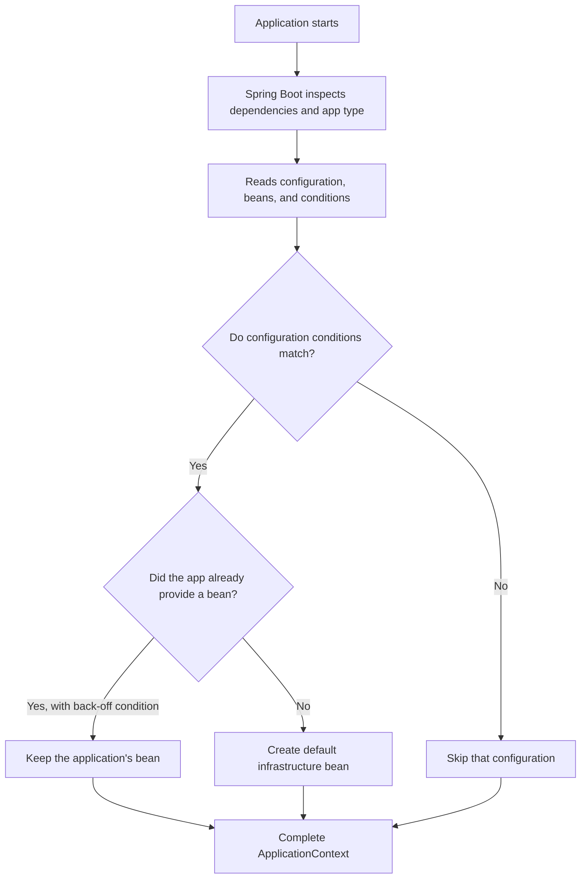

# Sensible Defaults, Auto-configuration, and Developer Control

> **Context:** Spring Boot Fundamentals → The Spring Boot Picture. This lesson explains why a Spring Boot application can run with very little configuration, what the framework actually decides on its own, and how developers control those decisions when requirements change.

## 1. Three Ideas to Distinguish

When starting with Spring Boot, we often just add a starter, write a `@SpringBootApplication` class, create a controller, and have a working HTTP API. It feels as if Spring Boot "did everything." In reality, there are three related but non-identical mechanisms:

| Concept | Question Addressed | Example |
| --- | --- | --- |
| **Convention / Default** | If the developer does not choose, what value or organization does the framework use? | The HTTP server typically listens on port `8080` if no other port is configured. |
| **Auto-configuration** | Based on the libraries, configuration, and beans present, which infrastructure components should Spring Boot create? | When matching Spring MVC libraries exist on the classpath, Spring Boot sets up the components needed to receive and process HTTP requests. |
| **Explicit control** | How does the developer change, supplement, or replace the default choices? | Set `server.port=9090`, define your own beans, or exclude an unnecessary auto-configuration. |

These three mechanisms work together. **Conventions** reduce repetitive decisions; **auto-configuration** wires together suitable components; **explicit control** lets the application serve real-world requirements without being locked into default settings.

Spring Boot is built on top of the Spring Framework. The Spring Framework provides the IoC container, dependency injection, MVC, transaction management, and many core components. Spring Boot packages startup, dependency management, configuration, and integration so an application has a convenient starting point. Boot does not replace Spring's core principles.

## 2. Sensible Defaults: Less Configuration, Not Less Design Responsibility

Before unified conventions existed, every project had to choose how to connect numerous infrastructure pieces, declare detailed configuration, and organize startup steps. Spring Boot makes generally sensible choices for most applications so you only need to declare **what differs**.

Some familiar conventions:

- For servlet-based web applications with an appropriate web starter, Boot can start an embedded server; in common configurations, the default port is `8080`.
- `application.properties` or `application.yml` is used to supply application configuration.
- Components annotated with `@Component`, `@Service`, `@Repository`, `@Controller`, or `@RestController` can be discovered via component scanning within the appropriate package scope.
- Logging, HTTP message conversion, and error handling have initial defaults so the application can run early.

These examples depend on the application type, Spring Boot version, dependencies, and specific configuration. For example, without web libraries, you cannot assume the application will open an HTTP server. Conventions only apply **when the conditions for using them are satisfied**.

### 2.1. How Does "Convention Over Configuration" Operate?

Suppose the API can run on the default port. There is no need to write:

```properties
# application.properties
# No need to declare server.port if the default port meets your needs.
```

When an environment requires port `9090`, you only change the part needed:

```properties
server.port=9090
```

The same program can receive the value from the `SERVER_PORT` environment variable or a startup argument:

```bash
java -jar app.jar --server.port=9090
```

In a typical configuration, command-line arguments have higher precedence than values in `application.properties`. Spring Boot has multiple configuration sources, so when values overlap, you need to check **which source takes precedence** according to the externalized configuration rules of the version you are using.

### 2.2. Conventions Are Not an Immutable Contract

Default values can change across versions, classpath dependencies, or application types. Therefore:

1. Understand defaults to start quickly.
2. Explicitly declare values that carry operational or business significance.
3. When upgrading versions, check changes related to defaults instead of assuming they always remain unchanged.

For example, for a production environment, decisions such as network ports, data sources, access secrets, resource limits, log levels, and security policies must be managed explicitly. "Having a default" does not mean "the default fits every system."

## 3. Auto-configuration: Spring Boot Makes Decisions Based on Conditions

Auto-configuration is the mechanism by which Spring Boot registers pre-configured beans when the application context satisfies corresponding conditions. This is **conditional configuration**, not Spring Boot guessing the developer's entire business intent.

A simple mental model:



The diagram describes the general principle; **not every auto-configuration uses the exact same condition**. Some configurations depend on properties, web application type, specific beans, or the presence of other beans.

### 3.1. How Does a Starter Differ from Auto-configuration?

These two concepts are very easy to confuse:

- **Starter** is a convenient bundle of dependencies. Instead of selecting a long list of compatible libraries yourself, you declare the starter matching your need.
- **Auto-configuration** is the logic that checks the environment and creates appropriate configurations/beans. Starters usually bring the required libraries onto the classpath so auto-configuration conditions can be satisfied.

Illustrative example in a Spring Boot 3.x project using Maven:

```xml
<dependency>
    <groupId>org.springframework.boot</groupId>
    <artifactId>spring-boot-starter-web</artifactId>
</dependency>
```

This dependency gives the project the libraries needed for a Spring MVC application. At startup, Spring Boot evaluates conditions to set up the corresponding web infrastructure, such as DispatcherServlet, message converters, and an embedded server in common servlet web configurations.

Starter names or groupings may change across major versions; for real projects, use the dependencies recommended by the documentation of the **Spring Boot version you are deploying**.

**Adding a starter does not guarantee all of its features will immediately work.** For instance, adding database access libraries does not produce a valid database connection if the driver or required connection details are missing.

### 3.2. Common Conditions

In the source code of auto-configuration classes, you will encounter annotations such as:

| Condition | Common Meaning | Typical Scenario |
| --- | --- | --- |
| `@ConditionalOnClass` | Activates only if the required class is on the classpath. | Avoids setting up an integration when the corresponding library has not been added. |
| `@ConditionalOnMissingBean` | Creates a bean only if no matching bean already exists. | Allows default configuration to yield to a bean defined by the application. |
| `@ConditionalOnBean` | Activates only if a matching bean already exists. | A component depends on a previously declared infrastructure component. |
| `@ConditionalOnProperty` | Based on configuration property values. | Enables or disables a configured feature. |
| `@ConditionalOnWebApplication` | Applies only in the appropriate web application type. | A web-specific configuration does not apply to a pure batch application. |

An example of **pseudocode to illustrate the mechanism**, not a copy of Spring Boot's internal source code:

```java
@AutoConfiguration
@ConditionalOnClass(SomeClient.class)
class ExampleClientAutoConfiguration {

    @Bean
    @ConditionalOnMissingBean(SomeClient.class)
    SomeClient someClient() {
        return new SomeClient();
    }
}
```

If the library containing `SomeClient` is present and the application does not yet have a `SomeClient` bean, the configuration above can provide a default bean. If the application already has a matching bean, `@ConditionalOnMissingBean` prevents creating a second one. This is commonly called **back off**.

Key takeaway: an application-defined bean **only causes auto-configuration to back off when that configuration's condition actually checks for that corresponding bean**. You should not assume every custom bean automatically overrides default beans.

## 4. An Example from Startup to HTTP Response

Consider a small Java application with root package `com.example.catalog`. Bootstrap class:

```java
package com.example.catalog;

import org.springframework.boot.SpringApplication;
import org.springframework.boot.autoconfigure.SpringBootApplication;

@SpringBootApplication
public class CatalogApplication {
    public static void main(String[] args) {
        SpringApplication.run(CatalogApplication.class, args);
    }
}
```

Create a controller in the subpackage `com.example.catalog.api`:

```java
package com.example.catalog.api;

import org.springframework.web.bind.annotation.GetMapping;
import org.springframework.web.bind.annotation.PathVariable;
import org.springframework.web.bind.annotation.RequestMapping;
import org.springframework.web.bind.annotation.RestController;

@RestController
@RequestMapping("/api/books")
public class BookController {

    @GetMapping("/{id}")
    public BookResponse findBook(@PathVariable long id) {
        return new BookResponse(id, "Spring Boot Fundamentals");
    }

    public record BookResponse(long id, String title) {}
}
```

With an appropriate web starter declared and the application started successfully, the request:

```http
GET /api/books/7 HTTP/1.1
Host: localhost:8080
```

can return JSON:

```json
{
  "id": 7,
  "title": "Spring Boot Fundamentals"
}
```

Breaking down each part's role:

1. **The developer writes business logic:** defines the URL, response data type, and request-handling rules.
2. **Spring Framework handles general mechanisms:** creates and manages controller beans, maps requests to handlers, and performs dependency injection when needed.
3. **Spring Boot assists startup:** sets up appropriate web components via dependencies, auto-configuration conditions, and defaults.
4. **Conventions reduce declarations:** in familiar configurations, you do not have to write code to start an HTTP server or serialize simple Java objects into JSON.

### 4.1. Role of `@SpringBootApplication`

This annotation combines three important ideas:

- `@SpringBootConfiguration`: marks the application's main configuration class, built on Spring's `@Configuration` mechanism.
- `@EnableAutoConfiguration`: enables the mechanism that selects auto-configurations.
- `@ComponentScan`: scans for components starting from the package containing the bootstrap class, including subpackages by default.

Because of this package-scanning rule, placing the bootstrap class in the application's root package is usually convenient. If you put a controller in a package outside the scan scope, the controller may not be registered even though the code compiles successfully. Auto-configurations are loaded via a separate import mechanism, **not** by scanning all auto-configuration classes as regular components.

### 4.2. The Difference Between "Discovered" and "Auto-configured"

A `@Service` you write usually becomes a bean through component scanning. An infrastructure bean provided by Boot may appear through auto-configuration. Both live inside the Spring `ApplicationContext`, but **the path to registration** differs:

| Bean | Who Decides the Bean's Behavior? | Typical Registration Path |
| --- | --- | --- |
| `BookController` in the example | Developer | Component scan from `@RestController` |
| Custom `BookService` | Developer | Component scan from `@Service` |
| Appropriate HTTP message converter | Framework with application customizations | Auto-configuration, depending on dependencies and conditions |
| Default `DataSource` (if sufficiently configured) | Framework based on properties/dependencies | Conditional auto-configuration |
| Custom-declared `DataSource` | Developer | `@Bean` method inside a `@Configuration` class |

## 5. Three Levels of Developer Intervention

When defaults do not meet requirements, choose an intervention mechanism **proportional to the degree of change**.

### Level 1 — Change a Property, Keep the Auto-configured Infrastructure

This is usually the simplest step:

```yaml
# src/main/resources/application.yml
server:
  port: 9090

logging:
  level:
    com.example.catalog: DEBUG
```

The application still uses the web setup configured by Spring Boot; only the port and log level are changed. Properties are configuration inputs; changing a value does not mean Spring Boot creates an entirely new bean design every time.

Prefer this level when the framework already provides an official property for the requirement at hand.

### Level 2 — Add Custom Configuration or Beans, Leverage the Rest of the Infrastructure

Suppose the application wants to read its own business settings:

```yaml
app:
  catalog:
    page-size: 25
```

Define a type-safe class to bind the configuration data:

```java
package com.example.catalog.config;

import org.springframework.boot.context.properties.ConfigurationProperties;

@ConfigurationProperties(prefix = "app.catalog")
public record CatalogProperties(int pageSize) {}
```

Register that class by adding `@EnableConfigurationProperties` to a Spring-managed configuration class:

```java
package com.example.catalog.config;

import org.springframework.boot.context.properties.EnableConfigurationProperties;
import org.springframework.context.annotation.Configuration;

@Configuration(proxyBeanMethods = false)
@EnableConfigurationProperties(CatalogProperties.class)
public class CatalogConfiguration {}
```

A service can receive `CatalogProperties` via constructor injection and use `pageSize()`. In larger projects with many similar configuration classes, `@ConfigurationPropertiesScan` is another option to discover these classes.

Notice: **the `app.catalog.page-size` property is not a hidden Spring Boot default**. It is a convention defined by the application itself. Spring Boot provides the binding mechanism to convert it into strongly typed data.

You can also customize component behavior using official extension points such as `WebMvcConfigurer`, customizer beans, or framework-supported callbacks, depending on the case. That approach usually preserves more helpful defaults than replacing the entire component.

### Level 3 — Define Your Own Bean Instead of the Default Configuration

Suppose the application has the JDBC starter and an appropriate driver and wants to manage the database connection bean itself. An example using `DataSourceProperties` bound by Boot from configuration:

```java
package com.example.catalog.config;

import javax.sql.DataSource;

import org.springframework.boot.autoconfigure.jdbc.DataSourceProperties;
import org.springframework.context.annotation.Bean;
import org.springframework.context.annotation.Configuration;

@Configuration(proxyBeanMethods = false)
public class DatabaseConfiguration {

    @Bean
    DataSource dataSource(DataSourceProperties properties) {
        return properties.initializeDataSourceBuilder().build();
    }
}
```

The corresponding configuration can come from the deployment environment:

```yaml
spring:
  datasource:
    url: jdbc:postgresql://localhost:5432/catalog
    username: catalog_app
    # password provided via an appropriate secret / environment variable
```

If this bean is registered successfully and the related auto-configuration has `@ConditionalOnMissingBean(DataSource.class)`, Boot will not create another default DataSource in that spot. This illustrates **backing off**; the custom bean can still take advantage of Spring Boot utilities.

In real systems, you usually **do not need** to create a `DataSource` bean yourself just to change the URL, username, or pool size: check the `spring.datasource.*` and corresponding pool properties first. When you manage a bean manually, the developer takes on additional responsibility for initialization, resources, lifecycle, compatibility, and testing.

### Special Level — Exclude an Auto-configuration

If an auto-configuration does not apply at all, you can exclude it. Illustrative example:

```java
import org.springframework.boot.autoconfigure.SpringBootApplication;
import org.springframework.boot.autoconfigure.jdbc.DataSourceAutoConfiguration;

@SpringBootApplication(exclude = DataSourceAutoConfiguration.class)
public class CatalogApplication {
    // ...
}
```

Only do this when you **truly do not want** that infrastructure to be auto-created, after understanding why it was activated. Exclusion does not remove dependencies and does not supply components your code still needs; if a service still requires a `DataSource`, the application may fail to start.

You can use `spring.autoconfigure.exclude` when exclusion needs to be configured via properties. Auto-configuration class names and lists depend on the version, so check against your actual Boot version.

## 6. Externalized Configuration: Same Source Code, Multiple Environments

An application typically has to operate on developer machines, staging environments, and production. Spring Boot allows sourcing configuration from multiple places without modifying Java code on every deployment.

Example layout:

```text
src/main/resources/
├── application.yml
├── application-dev.yml
└── application-prod.yml
```

`application.yml` holds shared values:

```yaml
app:
  catalog:
    page-size: 25

logging:
  level:
    root: INFO
```

`application-dev.yml` can enable detailed logging:

```yaml
logging:
  level:
    com.example.catalog: DEBUG
```

When activating the `dev` profile:

```bash
java -jar app.jar --spring.profiles.active=dev
```

the properties for the `dev` profile are evaluated alongside the shared configuration according to the appropriate precedence rules.

**Profiles are not a secret-protection tool.** Do not commit production passwords, private keys, or tokens to the repository simply because you separated an `application-prod.yml` file. For sensitive values, use a secret manager, environment variables, or secure configuration sources from the deployment environment.

### 6.1. Why Can the Same Property Produce Different Results?

For example, `server.port` might appear in `application.yml`, an environment variable, and a command-line argument. Spring Boot resolves conflicts according to `PropertySource` precedence. With common configuration sources, command-line arguments can override values from configuration files; external environments can also override values packaged inside the application.

When troubleshooting, do not open just one `application.yml` file and conclude that it holds the effective value. Check active profiles, environment variables, startup arguments, and external configuration sources.

## 7. When Auto-configuration Does Not Do What You Expect

Suppose a controller does not receive requests or the application reports it cannot find a `DataSource`. Instead of adding annotations at random, trace the configuration conditions:

| Symptom | Causes to Check | Investigation Path |
| --- | --- | --- |
| App starts, but endpoint returns 404 | Controller is outside component scan; path mismatch; web config differs from expectations | Inspect the main class package, `@RestController`, `@RequestMapping`, and request URL. |
| App has no embedded server | Missing appropriate web dependency or app configured as non-web | Check the dependency tree and `spring.main.web-application-type` if set. |
| Cannot create `DataSource` bean | Missing driver, URL, credentials, or invalid datasource config | Check dependencies, `spring.datasource.*`, and startup error messages. |
| Default bean does not appear | Another bean causes `@ConditionalOnMissingBean` to evaluate false | Inspect declared application beans and the condition evaluation report. |
| Property changed, but app uses old value | Another config source has higher precedence, or a different profile is active | Check runtime arguments, environment variables, active profiles, and external configs. |
| After excluding a configuration, app fails dependency injection | An application bean still depends on the excluded infrastructure | Identify what is actually required before deciding to keep or remove the exclusion. |

### 7.1. Reading the Condition Evaluation Report

Spring Boot has a **Condition Evaluation Report** that shows which auto-configurations matched or did not match conditions and why. In many cases, running the application with:

```bash
java -jar app.jar --debug
```

provides additional diagnostic output, including the auto-configuration condition report. Read both the matched and did-not-match sections; a skipped configuration may be the **intended** behavior because a required dependency or bean does not exist yet.

If the application includes Spring Boot Actuator, the `conditions` endpoint can also assist diagnostics when installed and appropriately exposed. Do not automatically expose internal diagnostic endpoints to the public Internet.

### 7.2. An Effective Reasoning Workflow

When a component does not appear, ask these questions in order:

1. **Are the right dependencies present?** A missing classpath entry often causes conditions to fail immediately.
2. **Is the application the right type?** Servlet, reactive, and non-web configurations are not identical.
3. **Which property governs the behavior?** Where is the effective value coming from?
4. **Does a bean already exist?** Did a custom bean cause the default configuration to back off?
5. **Which condition actually failed to match?** Use the condition report to verify instead of guessing.

This checklist separates business-code bugs, dependency mistakes, component-scan issues, and auto-configuration behaving as designed.

## 8. The More Control You Take, the More Responsibility You Assume

We can view the levels of control as a spectrum:

| Approach | What the Framework Assists With | What You Take Responsibility For |
| --- | --- | --- |
| Use conventions and defaults | Most startup setup and common infrastructure | Business logic, verifying defaults fit requirements |
| Change properties | Existing auto-configuration remains in place | Choosing environment-appropriate values; managing configuration |
| Add extension points / customizers | Preserves most framework integrations | Understanding extension-point contracts and custom behavior |
| Provide your own bean | Framework still manages the bean and DI | Detailed configuration, compatibility, lifecycle, and impact on other beans |
| Exclude auto-configuration | Reduces or removes corresponding auto-setup | Providing alternatives if other components still depend on it |

No single level is always right for every situation. A pragmatic rule is to start with official configuration properties, extend via extension points when needed, and take full ownership of infrastructure when there is a clear technical reason. Controlling every detail of a component can be useful in specialized systems, but it also increases the application code you must maintain when upgrading Spring Boot.

### 8.1. Common Misconceptions

**"Spring Boot does everything automatically, so you don't need to understand Spring."** False. Developers still need to understand beans, IoC, scopes, dependency injection, lifecycle, and request handling. Boot reduces boilerplate declarations; it does not replace foundational concepts.

**"Having a starter guarantees having the bean."** Not necessarily. Dependencies are only one of many conditions. Properties, application type, and the presence of other beans can determine whether a bean is created.

**"Declaring a `@Bean` overrides everything."** Not necessarily. Whether a custom bean replaces a default configuration depends on conditional logic. Even with matching bean names, standard Spring Boot setups do not allow arbitrary bean definition overriding by name; replacement configuration must be designed intentionally.

**"Changing a property turns off auto-configuration."** Incorrect. Most properties only tune the behavior of an existing mechanism. Disabling or excluding is a separate decision.

**"Auto-configuration is unverifiable magic."** Incorrect. Conditions are declared via annotations and evaluated with diagnostic reporting tools; you can trace dependencies, properties, and beans to explain Boot's decisions.

## 9. Short Practice Exercise

Use the `CatalogApplication` and `BookController` from section 4 to observe the three mechanisms firsthand:

1. Run the web application with default settings. Access `GET /api/books/7` and note the actual port in the startup log.
2. Add `server.port=9090` to `application.properties`. Run again and access the same endpoint on the new port. Verify that **controller code did not change**.
3. Run with `--server.port=9191` and compare with the value in the file. Identify which configuration source wins.
4. Move `BookController` to a package not underneath `CatalogApplication`'s package. Observe that the bean/controller is no longer discovered by default component scanning; move the controller back to the right place.
5. Run with `--debug` and locate the web configurations that matched conditions. Read the reason for at least one non-matching configuration. There is no need to edit code to "force" every configuration to match.

Self-check questions:

- Why does changing the port not require rewriting web server initialization code?
- Why is adding a dependency different from creating a bean yourself?
- When an application defines its own infrastructure bean, what must you check before concluding Spring Boot will back off?
- If a property in a file has no effect, which configuration sources should you inspect?
- When very specific behavior is needed, how do you choose among properties, customizers, `@Bean`, and exclusions?

## 10. Core Takeaways

Spring Boot strikes a balance between **convenient startup** and **controllability**. Sensible defaults answer "what to use if nothing is specified"; auto-configuration answers "given what is present, what infrastructure should be assembled"; and explicit configuration lets developers answer "what does this application actually need."

Once you understand the boundary between these three ideas, you can start projects quickly while still knowing how to explain, inspect, and change framework decisions. That is the foundation for moving from a working demo app to a well-configured, environment-appropriate, maintainable Spring Boot application.
