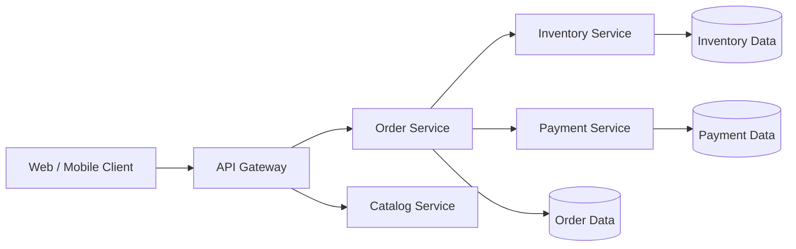
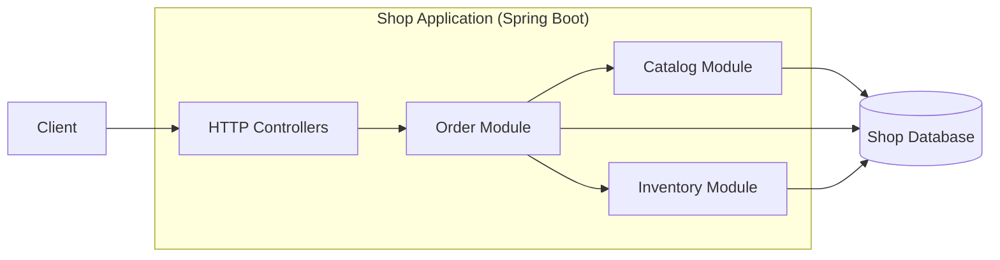
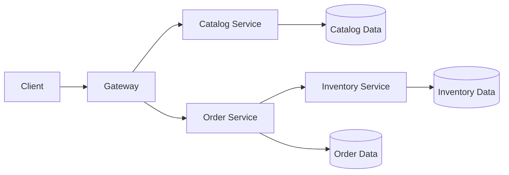

# Distinguishing Spring Boot from Spring Cloud and Microservices Architecture

When starting to learn Spring Boot, learners often encounter three names side by side: **Spring Boot**, **Spring Cloud**, and **microservices**. They are closely related, yet they are not in the same category. Spring Boot is a tool for building applications; Spring Cloud is an ecosystem supporting common concerns in distributed systems; and microservices is a way of designing and organizing a software system.

Understanding these boundaries helps you pick the right tools, recognize when splitting services is truly warranted, and avoid turning a simple application into a system that is hard to operate.

## 1. Three Concepts Answering Three Different Questions

| Concept | Core Question | Nature | Examples |
|---|---|---|---|
| **Spring Boot** | How do we create, configure, and run a Spring application quickly and consistently? | Application development framework and tooling built on the Spring Framework | A REST API application with controllers, services, repositories, configuration, and health endpoints |
| **Spring Cloud** | When multiple applications/services communicate over a network, how do we handle distributed infrastructure needs? | Ecosystem of projects/libraries that integrate with Spring Boot | API Gateway, centralized configuration, service discovery, client-side load balancing, circuit breakers |
| **Microservices** | How should a system be divided into independent business and deployment units? | Software architecture style | An e-commerce system with Order Service, Inventory Service, and Payment Service communicating via clear contracts |

Placing **Spring Framework** into the picture as well:

- **Spring Framework** provides the foundation such as dependency injection, IoC container, bean management, Spring MVC/WebFlux, transactions, and data integration.
- **Spring Boot** builds on the Spring Framework, adding configuration conventions, auto-configuration, starter dependencies, packaging/execution models, and operational tools.
- **Spring Cloud** provides libraries addressing challenges that arise when multiple applications collaborate; most Spring Cloud applications are built with Spring Boot.
- **Microservices** is an architectural decision: choosing service boundaries, data ownership, communication patterns, deployment, and operations.

You can visualize it as:

```text
Spring Framework  →  Foundation for Java application development
       │
       └── Spring Boot  →  Convenient way to create and run Spring applications
                  │
                  ├── Can build a monolith / modular monolith
                  ├── Can build a microservice
                  └── Can integrate Spring Cloud when distributed capabilities are needed

Microservices = a system-wide architectural decision,
not a sub-framework of Spring Boot or Spring Cloud.
```

**Core takeaway:** Using Spring Boot **does not mean** you are building microservices. Using Spring Cloud **does not automatically** turn an application into microservices. And building microservices **does not require** using Spring Cloud.

## 2. Spring Boot Solves Problems at the Single-Application Level

Spring Boot lets developers spend less effort on repetitive initialization and configuration and focus on business logic.

Representative capabilities:

1. **Auto-configuration:** Based on available libraries, beans, and configuration, Boot proposes suitable configuration. Developers can still override or define their own.
2. **Starters:** Need-based dependency groups, such as `spring-boot-starter-web` for Spring MVC apps or `spring-boot-starter-data-jpa` for JPA.
3. **Standalone runnable applications:** For appropriate web apps, it can package an embedded server and run via `java -jar`.
4. **Externalized configuration:** Uses `application.yml`, environment variables, command-line arguments, and supported config sources to separate configuration from source code.
5. **Production-ready features:** Spring Boot Actuator provides monitoring endpoints and capabilities such as health and metrics, depending on dependencies and configuration.

For example, a simple Spring Boot application:

```java
import org.springframework.boot.SpringApplication;
import org.springframework.boot.autoconfigure.SpringBootApplication;
import org.springframework.web.bind.annotation.GetMapping;
import org.springframework.web.bind.annotation.PathVariable;
import org.springframework.web.bind.annotation.RequestMapping;
import org.springframework.web.bind.annotation.RestController;

@SpringBootApplication
public class CatalogApplication {
    public static void main(String[] args) {
        SpringApplication.run(CatalogApplication.class, args);
    }
}

@RestController
@RequestMapping("/api/products")
class ProductController {
    @GetMapping("/{sku}")
    ProductView findBySku(@PathVariable String sku) {
        return new ProductView(sku, "Demo product");
    }
}

record ProductView(String sku, String name) {}
```

With a suitable web starter, the application exposes `GET /api/products/{sku}`. It is **a Spring Boot application**. Looking only at `@SpringBootApplication` or `@RestController`, you **cannot conclude** whether it is a microservice.

If this application contains all product, cart, order, and payment modules within a single deployable process, you may be building a **monolith**. If it owns only catalog functionality within a system of multiple independent services, it could be the **Catalog Service** in a microservices architecture. Basic Spring Boot code is not the deciding factor; **system boundaries and operations** are what decide.

### Spring Boot Does Not Automatically Provide All Distributed System Behavior

Spring Boot helps build HTTP APIs, HTTP clients, configuration, and application observability. Yet once a request spans multiple services, new questions arise:

- Where are the network addresses of other services discovered?
- If multiple instances exist, how are requests distributed?
- If a downstream service is slow, failing, or temporarily down, how do we handle it?
- When a single request traverses three services, how do we trace the flow?
- If an order has been saved but payment fails, how do we maintain data consistency?

Some of these problems can be addressed with Spring Cloud; others require design policies, deployment infrastructure, or different data patterns. No framework solves all of them automatically.

## 3. Microservices Is an Architecture, Not a Dependency Name

**Microservices** divides a system into relatively small services focused on business capabilities, communicating over explicit contracts, and capable of being changed and deployed with high independence. The word "micro" does not mean each service must have very few lines of code, only one controller, or only one table.

Commonly targeted characteristics:

- **Clear business boundaries:** For instance, order management differs from inventory management; boundaries can be chosen using Domain-Driven Design bounded contexts.
- **Encapsulation of logic and data:** Each service owns its business rules and data access. Other services communicate via APIs or events instead of directly modifying internal tables.
- **Independent deployment:** Order Service can be updated without necessarily re-releasing the entire system, provided contracts and dependencies remain compatible.
- **Network communication:** Commonly uses HTTP/REST, gRPC, or messaging/events. Network communication introduces latency, timeouts, partial failures, and observability overhead.
- **Demand-driven scaling:** You can scale up instances of a heavily loaded service rather than always scaling the whole application.
- **Responsible autonomy:** Each service needs appropriate testing, observability, operations, and deployment policies; independence does not mean permission to break consumer contracts.

An illustrative architecture:



Each "Service" box can be a separate Spring Boot application. The Gateway can use Spring Cloud Gateway or another gateway solution. The arrows represent **logical communication relationships**, not a requirement that every request make synchronous calls along those paths.

### "Owning Data" Differs from "Every Service Must Have a Dedicated Database Server"

In microservices, the critical principle is **data ownership and access boundaries**. For example, Inventory Service decides how much stock remains; Order Service should not directly update Inventory Service's inventory table. Two services might use separate database infrastructure or share a database cluster early on, as long as ownership is isolated and neither tightly couples to the other's internal schema.

If code is split into five applications that all modify the same set of tables, must be deployed together, and a single table change breaks the other four applications, the system easily turns into a **distributed monolith**: paying distributed system costs without achieving the desired independence.

## 4. Monolith, Modular Monolith, and Microservices

Having multiple business modules does not automatically make a system microservices. Three common organizational styles:

| Criterion | Monolith | Modular Monolith | Microservices |
|---|---|---|---|
| Deployment unit | Usually one application | One application | Multiple services |
| Code organization | Layered or intermingled | Business modules with clear internal boundaries | Business services in separate processes |
| Inter-module communication | In-process method/bean calls | In-process APIs / module boundaries | Network APIs or events |
| Data transactions | Easy to use local transactions | Easy to use local transactions with shared data store | Cross-service transactions require dedicated design |
| Release | Usually released together | Usually released together | Services can be released individually |
| Operations | Fewer moving parts | Fewer parts, easier to protect boundaries | Many deployments, logs, configs, connections, failure policies |
| Reasonable fit | Small products, MVPs | Systems needing clean structure without distribution yet | Stable business boundaries, strong need for independent release/scaling |

A **modular monolith** is often a strong starting point: separating Catalog, Order, and Inventory into modules with explicit interfaces while still running inside one Spring Boot application. If you later truly need to extract a service, well-defined boundaries reduce risk.

Microservices is a choice with real costs. It is not inherently faster, more secure, or "more modern" than a well-designed modular monolith.

## 5. Which Problems Does Spring Cloud Support?

Spring Cloud is an **ecosystem of projects**, not a single server named "Spring Cloud" that you install to finish a distributed architecture. Each component has a specific purpose; pick according to real problems.

| Need | Example Solution in Spring Cloud Ecosystem | Meaning |
|---|---|---|
| Entry point for multiple APIs | **Spring Cloud Gateway** | Routes requests and handles edge policies such as filters, integrated auth, or rate limiting as configured |
| Managing config from a shared source | **Spring Cloud Config** | Multiple apps fetch config from a central source; requires security policies and environment separation |
| Locating service instance addresses | **Spring Cloud Discovery** and adapters such as Eureka when suitable | Helps clients locate services by logical name instead of hardcoding instance addresses |
| Selecting an instance to call | **Spring Cloud LoadBalancer** | Client-side load balancing across discovered instances |
| Preventing cascading failures | **Spring Cloud CircuitBreaker** with an implementation such as Resilience4j | Provides circuit breaker abstraction; timeouts, retries, and fallbacks must be intentionally designed |
| Convenient HTTP service calls | **Spring Cloud OpenFeign** in systems using Feign | Declarative interface-based HTTP clients; pay attention to version compatibility and maintenance status |
| Broker/event communication | **Spring Cloud Stream** | Messaging integration abstraction; does not replace event design, delivery guarantees, and idempotency |
| Kubernetes integration | **Spring Cloud Kubernetes** when genuinely needed | Integrations with Kubernetes APIs and corresponding config/service discovery |

You do not need to install all of the above. One application might use only Spring Cloud Gateway; another uses Config; a third service uses no Spring Cloud at all.

### 5.1. API Gateway

In a system with Catalog, Order, and Payment Services, clients should not necessarily know every internal address. A gateway can accept `/api/products/**` and route to Catalog Service, and accept `/api/orders/**` and route to Order Service.

A gateway can also handle edge concerns: initial authentication, CORS, rate limiting, logging, correlation, and routing. However, **a gateway does not replace authorization checks inside individual services**; each service must still protect the operations and data under its responsibility.

Spring Cloud Gateway is only one option. NGINX, Traefik, Envoy, a cloud provider's API Gateway, or Kubernetes ingress/gateway can perform similar roles. Choose based on topology, security needs, operations team, and existing stack.

### 5.2. Service Discovery and Load Balancing

Suppose Inventory Service has three instances:

```text
inventory-instance-1:8080
inventory-instance-2:8080
inventory-instance-3:8080
```

If addresses change due to autoscaling, hardcoding individual IPs inside Order Service is brittle. Discovery reports which instances are available; load balancing picks an instance to send the request to.

However, Kubernetes environments already provide **Services and DNS** for many service lookup and traffic distribution scenarios. In that case, you do not necessarily have to run Eureka or enable application-level discovery. Using Spring Cloud Discovery/LoadBalancer versus relying on platform infrastructure depends on your deployment model.

### 5.3. Centralized Configuration

For a single application, `application.yml` and environment variables are often sufficient. With many services and environments, needs arise for centralized, versioned configuration management with access policies.

Spring Cloud Config is one solution. Yet container platforms also offer ConfigMaps, Secrets, secret managers, or provider configuration services. **Centralized configuration does not mean putting passwords into Git or logs**; secrets must be managed with proper access controls and security mechanisms.

### 5.4. Circuit Breakers and Partial Failures

When Order Service calls Payment Service, failures in Payment can cause Order threads/requests to wait too long or fail en masse. A circuit breaker tracks failures and can temporarily short-circuit calls to a struggling dependency, easing pressure and giving the system a chance to recover.

Circuit breakers do not replace **timeouts**, **bounded retries**, or business design. In particular, retrying a payment creation call can cause duplicate charges if the API does not support an **idempotency key**. Fallbacks also must not arbitrarily return "payment succeeded" without confirmation.

### 5.5. Observability

When requests pass through a gateway, Order, and Inventory, reading logs from a single application is not enough. You need logs with correlation IDs, metrics, distributed tracing, alerts, and appropriate dashboards.

In the modern Spring ecosystem, **Spring Boot Actuator, Micrometer, and Micrometer Tracing** support many observability needs; they can integrate with OpenTelemetry/collectors/backends according to deployment design. **Distributed tracing does not require installing Spring Cloud Sleuth**; Sleuth belongs to older tool generations and should not be treated as the default choice for new projects.

## 6. Practical Relationships: What Combinations Exist?

| Construction Approach | Valid? | Scenario |
|---|---|---|
| **Spring Boot + monolith** | Yes | One backend managing users, products, and orders; deployed as a single application |
| **Spring Boot + modular monolith** | Yes | One application with Catalog, Order, and Inventory modules separated by internal boundaries |
| **Multiple Spring Boot services, no Spring Cloud** | Yes | Independent services communicating over HTTP, DNS/Kubernetes Service, brokers, and existing infrastructure |
| **Multiple Spring Boot services + selected Spring Cloud projects** | Yes | Needs Spring Cloud Gateway, Config, CircuitBreaker, or discovery as required |
| **Spring Cloud without microservices** | Possible | An app uses a Cloud library for a specific need; dependencies alone do not prove architecture |
| **Microservices without Java/Spring** | Yes | Services built with Go, Node.js, .NET, Python, or a mix of stacks |

This helps interpret the phrase "we are building a Spring Boot microservices system": it usually means **each service is built with Spring Boot**, while the overall system architecture is microservices. The technology name and the architecture name play two different roles.

## 7. End-to-End Example: E-Commerce System

Suppose a store needs three capabilities: viewing products, creating orders, and checking inventory.

### Option A: One Spring Boot Application with Multiple Modules



In this case:

- Catalog, Order, and Inventory run together inside **a single application process**.
- Order Module can call an interface exposed by Inventory Module directly in-process.
- Local database transactions can be used when operations genuinely belong to the same transaction scope.
- Only one main application deployment pipeline is needed; there is no mandatory separate gateway or service registry.

This is still genuine **Spring Boot Fundamentals**: building APIs, dependency injection, layering, data management, transactions, configuration, and testing. Good module organization from the start makes the system easier to evolve later.

### Option B: Splitting into Spring Boot Microservices



In this option:

1. **Catalog Service** owns product information and lookup APIs.
2. **Order Service** owns order lifecycles and processing states.
3. **Inventory Service** owns stock levels and reservation/deduction rules.
4. Clients can enter through a Gateway; Order Service calls Inventory Service or uses events depending on the business flow.
5. Each service has its own artifact, configuration, instance count, and deployment lifecycle.

The critical shift is **not** changing an annotation from `@Service` to some "microservice annotation." You must define API contracts, data ownership, failure handling, cross-service transactions, observability, and deployment.

### An Order Flow and What Can Break

Suppose a synchronous flow:

```text
POST /orders
    ↓
Order Service creates PENDING order
    ↓
Order Service asks Inventory Service to reserve stock
    ├── Success      → order proceeds to payment step
    ├── Out of stock → reject / cancel order
    └── Timeout      → unknown whether reservation succeeded or failed
```

The "timeout → unknown" case is a major difference from local method calls. A timeout does not prove Inventory failed to process the request. If Order automatically retries without a stable request ID or idempotency, stock may be reserved twice.

A practical design typically considers:

- Defining order and reservation states such as `PENDING`, `RESERVED`, `REJECTED`.
- Using an **idempotency key** or request identifier to handle duplicate calls.
- Setting explicit timeouts; retrying only safe operations or those protected against duplicates.
- Having compensation mechanisms when a multi-step workflow fails, such as releasing reserved stock after a failed payment.
- For event-driven flows, using outbox/inbox or equivalent techniques to close the gap between database writes and publishing/consuming events.

**Sagas**, event-driven communication, and eventual consistency are distributed systems design techniques. They are not enabled automatically by adding Spring Cloud to `build.gradle`.

## 8. An HTTP Example Showing What Is Boot and What Is Architecture

Suppose Catalog Service from section 2 runs on port 8081. Another Order Application wants to read product names. Using just Spring Boot and Spring Framework, you can create an HTTP client **without needing Spring Cloud**.

In Order Application's configuration:

```yaml
catalog:
  base-url: http://localhost:8081
```

A controller illustrating the call:

```java
import org.springframework.beans.factory.annotation.Value;
import org.springframework.web.bind.annotation.GetMapping;
import org.springframework.web.bind.annotation.PathVariable;
import org.springframework.web.bind.annotation.RequestMapping;
import org.springframework.web.bind.annotation.RestController;
import org.springframework.web.client.RestClient;

@RestController
@RequestMapping("/api/orders")
class OrderController {
    private final RestClient catalogClient;

    OrderController(
            RestClient.Builder builder,
            @Value("${catalog.base-url}") String catalogBaseUrl
    ) {
        this.catalogClient = builder.baseUrl(catalogBaseUrl).build();
    }

    @GetMapping("/product-name/{sku}")
    String findProductName(@PathVariable String sku) {
        ProductView product = catalogClient.get()
                .uri("/api/products/{sku}", sku)
                .retrieve()
                .body(ProductView.class);
        return product == null ? "Unknown product" : product.name();
    }
}

record ProductView(String sku, String name) {}
```

This snippet uses Spring Framework's `RestClient` API and Spring Boot's auto-configured builder appropriate for supported versions. Two processes communicate over HTTP via a fixed address, so this is an **inter-application communication example**; that alone does not prove the system is well-architected microservices.

In a real environment, you need at least timeouts, error status handling, security, contract testing, and observability. If there are multiple Catalog instances whose addresses change, you can use platform DNS/services, discovery/load balancing, or different routing configurations.

**Note on sample code:** `@Value("${catalog.base-url}")` reads the `catalog.base-url` property from configuration. This is a statically configured address for the example; dynamic service discovery requires appropriate infrastructure support.

### What Changes If Spring Cloud Is Added?

You can add **a gateway service** built on Spring Boot and Spring Cloud Gateway so clients only call one entry point. You can add Spring Cloud CircuitBreaker around the Catalog call and add Config/Discovery sources if needed. Those libraries **support communication and operations mechanisms**; they do not decide which tables Catalog owns or where the boundary between Order and Catalog should be drawn.

A conceptual routing illustration:

```text
Client calls GET /api/products/ABC
  → Gateway matches path /api/products/**
  → Forwards to Catalog Service
  → Returns response to Client
```

Exact configuration properties and starters for Spring Cloud Gateway can vary by version and Servlet/WebFlux stack choice. When practicing, read the documentation for the exact **Spring Boot and Spring Cloud version pair** you are using, and build the gateway application matching the chosen stack.

## 9. What Makes Microservices Harder Than a Single Application?

### 9.1. The Network Is Not as Reliable as In-Process Calls

Normal Java calls either succeed or throw an exception within the program's execution context. HTTP calls can drop the connection after the receiver has already finished processing; without a confirmation protocol, the client does not know the outcome. Distinguish:

- **Confirmed failure:** The service returns a clear business error, e.g., out of stock.
- **Infrastructure failure:** DNS, connection, TLS, gateway, or dependency outage.
- **Unknown outcome:** Timeout before receiving a response, even though the receiver may have written data.

For state-changing operations, handling duplicate requests safely matters more than blindly "retrying until it succeeds."

### 9.2. Cross-Service Transactions

Within one database and one local transaction, Spring can manage commit/rollback more easily. Across Order Database and Inventory Database, a `@Transactional` in Order Service **does not** automatically roll back a transaction already committed in Inventory Service.

You must design an appropriate business workflow: intermediate states, events, sagas/compensation, or explicit synchronization mechanisms. Eventual consistency means data across locations can temporarily differ, so APIs and UX must reflect "in-progress" states.

### 9.3. Independent Deployment Requires Compatible Contracts

If Catalog changes its response field from `productId` to `sku`, Order can break even though both services build cleanly on their own. That is why contract versioning, contract testing, backward compatibility, and release/rollback strategies are required.

### 9.4. Observability and Operations Become More Complex

Instead of one log file and one instance, there are many services, instances, and environments. You must answer: where did a request start, which step failed, which dependency increased latency, and how many users are affected? Health/readiness checks, metrics, structured logging, tracing, and alerting become essential operational capabilities.

### 9.5. Organizational Cost Is Architectural Cost

Each new service brings its own pipeline, permissions, dependencies, configuration, tests, dashboards, and operational ownership. A small organization without solid CI/CD and observability may incur more risk than benefit by splitting services too early.

## 10. Deciding When to Use Spring Boot, Spring Cloud, and Microservices

Make decisions based on the **problem**, not a checklist of popular technologies.

| Context | Often Sensible Choice | Why |
|---|---|---|
| Starting a REST API, CRUD, authentication, persistence app | **Spring Boot** | Need a stable single application before considering distribution |
| App with multiple business domains, one team, synchronized releases | **Spring Boot + modular monolith** | Keeps clean structure while avoiding distributed systems overhead |
| Business areas have distinct release/scaling needs and independent team ownership | **Consider microservices** | Independence may deliver more value than its operational cost |
| Multiple services need a unified entry point and edge policies | **Gateway** (Spring Cloud Gateway or platform solution) | Handles routing and edge policies |
| Service instances change dynamically | **Environment-appropriate discovery/load balancing** | Can use Kubernetes Services/DNS or Spring Cloud |
| Inter-service calls need cascading failure protection | **Timeouts, resilience, and circuit breakers where appropriate** | Improves fault tolerance, though idempotency and retry limits are still needed |
| Multiple services need centralized configuration management | **Spring Cloud Config or config/secret platform** | Pick one configuration source operated consistently |

A pragmatic decision sequence:

1. **Start from business capabilities** and module boundaries.
2. **Measure real needs:** team structure, release cadence, load, availability, compliance requirements, and operational model.
3. **If independent deployment is not needed yet,** use a modular monolith to keep the system simple.
4. **If splitting is needed,** define ownership, API/event contracts, data model, failure modes, and observability first.
5. **Select Spring Cloud modules only for specific gaps,** after checking whether your deployment platform already provides those capabilities.

### Version Compatibility Considerations

Spring Boot and Spring Cloud follow a **version compatibility matrix**. In real projects, choose a Spring Cloud release train compatible with your Spring Boot version, manage dependencies via the corresponding BOM/dependency management, and check individual starter guides. Do not copy a starter or example from an old course and assume it supports every new version.

Additionally, many older resources mention **Netflix Ribbon**, **Hystrix**, or **Spring Cloud Sleuth** as defaults. For modern projects, prioritize current documentation on Spring Cloud LoadBalancer, Spring Cloud CircuitBreaker/Resilience4j, and Micrometer Tracing respectively. Do not equate legacy library names with the entire modern Spring Cloud ecosystem.

## 11. Common Misconceptions

| Statement | True or False? | Accurate Understanding |
|---|---|---|
| "Having `@SpringBootApplication` makes it a microservice." | **False** | It is the entry point/configuration of a Boot app; architecture is evaluated at the system level |
| "To build microservices you must install Spring Cloud." | **False** | You can use Spring Boot + Kubernetes/DNS/brokers or other technologies |
| "Spring Cloud replaces Spring Boot." | **False** | Spring Cloud adds libraries for distributed needs, typically on top of Spring Boot apps |
| "Just adding Eureka and a Gateway turns a system into microservices." | **False** | You still need business boundaries, ownership, contracts, deployment, and operations |
| "Every controller should be its own service." | **False** | Services should align with business capabilities, not endpoint counts |
| "Microservices always run on public cloud." | **False** | They can run on-premises; "microservices" and "cloud hosting" are separate decisions |
| "Every microservice must have its own repository and database server." | **False** | Repositories and physical servers are organizational choices; what matters is boundaries and ownership |
| "A circuit breaker makes every transaction safe to retry." | **False** | Transactions also require idempotency, timeouts, business states, and unknown-outcome handling |
| "A monolith is always a bad design." | **False** | A modular monolith can be an excellent choice when distribution is unnecessary |

## 12. Thought Exercise

Examine the three systems below and answer: **Which ones are Spring Boot applications? Which ones are microservices? Is Spring Cloud required?**

**Scenario A.** One Spring Boot application contains User, Product, and Order modules, one database, and one deployable artifact. Modules communicate through internal interfaces.

**Scenario B.** Three separate Spring Boot applications split Order, Catalog, and Inventory; each service owns its data and deploys independently. They communicate over HTTP and Kubernetes DNS names without any Spring Cloud dependencies.

**Scenario C.** A system is split into five applications with Eureka and a Gateway, yet every application modifies the same database tables and every schema change forces all five to be released together.

**Suggested answers:**

- **A:** This is a Spring Boot modular monolith, not microservices simply because it has multiple modules; Spring Cloud is not required.
- **B:** This can be a genuine microservices architecture if boundaries and operations are truly independent. Spring Cloud is not needed just to earn the "microservices" label.
- **C:** It has infrastructure pieces commonly seen in distributed systems, but data boundaries and independent deployability are weak; it is likely a distributed monolith. Eureka/Gateway cannot fix that design problem.

Try drawing diagrams for all three cases and marking: **deployment units**, **data boundaries**, **communication style**, and **potential failure points**. These four factors usually reveal the architecture more clearly than framework names in `build.gradle`.

## 13. Takeaways for Further Spring Boot Topics

- **Spring Framework** is the foundation for DI, web, data, and many other application capabilities.
- **Spring Boot** makes creating, configuring, running, and operating a Spring application easier. You can use Boot for a monolith, a modular monolith, or a microservice.
- **Microservices** is a design choice for multiple services along business boundaries, with relatively independent contracts and operations. Splitting processes introduces networking, distributed data, and organizational challenges.
- **Spring Cloud** is a collection of tools supporting specific problems across services; choose individual tools based on real needs and existing infrastructure.

Whenever you encounter a new technology in the Spring ecosystem, ask: **"Does it help my single application run better, help multiple services coordinate better, or represent a decision about how the whole system is divided?"** That question puts Spring Boot, Spring Cloud, and microservices in their proper places in the architectural picture.
