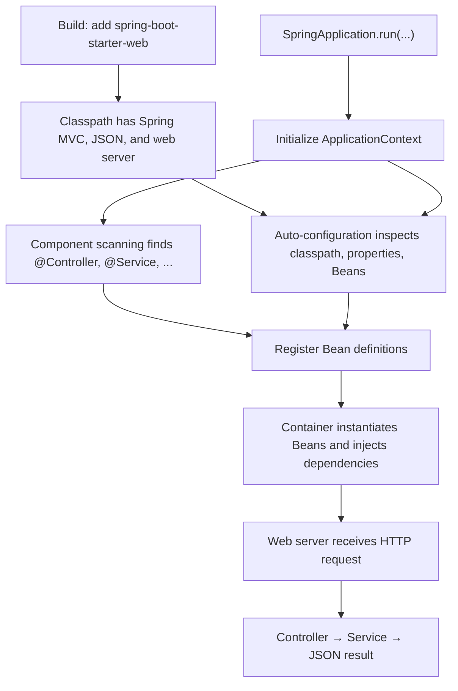
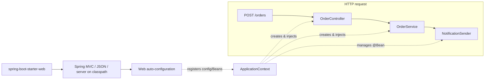

# Beans, Containers, Dependency Injection, Starters, and Auto-configuration in One Picture

When you first start learning Spring Boot, something seems surprising: just add a dependency, write a few annotated classes, run `main`, and the application already has an HTTP server, a JSON-returning API, and objects that automatically find one another. This easily creates the impression that Spring Boot is doing everything mysteriously.

In reality, **five concepts work together**:

- **Bean**: an object registered and managed by Spring.
- **Container** (typically `ApplicationContext`): holds metadata about beans, instantiates them, wires dependencies, and manages their lifecycle.
- **Dependency injection (DI)**: how an object receives the objects it needs from the outside, usually supplied by the container.
- **Starter**: a pre-selected dependency bundle curated by Spring Boot for a specific need, such as building a REST API or accessing a database.
- **Auto-configuration**: the mechanism by which Spring Boot inspects what is on the classpath, application configuration, and declared beans to propose appropriate configurations and beans.

The crucial point is that **starters do not inject dependencies**, **DI does not decide which libraries are needed**, and **auto-configuration does not replace the container**. All of them converge in one place: the container managing the beans that form the application.

## 1. Big Picture: From Dependency to HTTP Request

Suppose you want to write a REST API that accepts an order creation request. You declare `spring-boot-starter-web`, create a controller, and create a service. Conceptually, the process unfolds as follows:



The diagram simplifies some internal phases. It shows causal relationships rather than the strict execution order of every callback during Spring startup. For example, a `@Lazy` bean may only be created when needed, and auto-configuration conditions are evaluated during configuration processing.

| Component | Question Answered | Example |
|---|---|---|
| Bean | "Which objects are under Spring's management?" | An instance of `OrderService` |
| Container | "Who creates, stores, wires, and manages those objects?" | `ApplicationContext` |
| DI | "How does `OrderService` receive `NotificationSender`?" | Via constructor parameter |
| Starter | "Which libraries do I need to build a REST API?" | `spring-boot-starter-web` |
| Auto-configuration | "Given the available libraries and settings, what configuration is needed?" | Appropriate Spring MVC, JSON, and web server setup |

## 2. Bean: A Java Object Managed by Spring

A regular Java object created with `new`:

```java
OrderService service = new OrderService(sender);
```

This is just an object; it does not automatically become a Spring bean. It becomes a bean when **registered with the Spring container**. From there, the container knows the bean's type, name, scope, required dependencies, and lifecycle callbacks applicable to it.

Spring has several ways to register beans; the two most common are:

**Approach 1 — annotate the class so component scanning discovers it:**

```java
@Service
public class OrderService {
    // Business logic
}
```

Annotations such as `@Component`, `@Service`, `@Repository`, and `@Controller`/`@RestController` allow a class to be detected as a component when it resides within the scanned package scope. `@Service` clearly expresses a business-logic role; `@Repository` is intended for the data access layer and also participates in Spring's data-access exception translation mechanism.

**Approach 2 — declare a factory method with `@Bean`:**

```java
@Configuration(proxyBeanMethods = false)
public class NotificationConfiguration {

    @Bean
    NotificationSender notificationSender() {
        return new ConsoleNotificationSender();
    }
}
```

This approach fits when the object comes from an external library and you cannot or should not modify the class to add `@Component`. With `@Bean`, the **return value** of the method is registered as a bean. The method name normally becomes the default bean name; you can also specify a name explicitly using `@Bean("customSender")`.

Key points to remember:

- A class annotated with `@Service` **will not necessarily** become a bean if it lies outside the scan scope or is not imported/registered another way.
- A class with no Spring annotations at all **can still** become a bean via `@Bean` or another registration mechanism.
- Two beans can share the same Java type while having different names and configurations. When injecting by type, Spring may have to choose among candidates.
- An object you instantiate directly with `new` somewhere in the app does not automatically receive bean lifecycle management or DI.

### Bean Does Not Mean Class, Nor Does It Mean JVM-Wide Singleton

A bean is **a managed object**, whereas a class is a type definition. By default, beans have `singleton` scope: the container typically maintains **one instance per bean definition within that container**. This does not guarantee that only one instance of the class exists across the entire JVM.

Common scopes:

| Scope | Meaning |
|---|---|
| `singleton` (default) | One instance per bean definition in the container |
| `prototype` | Creates a new instance every time the container is asked for that bean |
| `request` | One instance per HTTP request; requires a web-aware context |
| `session` | One instance per HTTP session; requires a web-aware context |

In a singleton bean, avoid storing request-specific mutable data in fields like `currentUser` or `currentOrder`: concurrent requests share the same instance, leading to race conditions or state leakage. Singleton services should typically hold no per-request state, keeping only thread-safe shared dependencies.

## 3. Container: Where Beans Form a System

**Inversion of Control (IoC)** means transferring the responsibility for creating and wiring most application objects from business code to an external mechanism. In Spring, that mechanism is the IoC container.

Two key interfaces:

- `BeanFactory` provides the core capabilities for managing and retrieving beans.
- `ApplicationContext` extends `BeanFactory` with features such as events, resources, internationalization messages, and configuration environment integration. Spring Boot applications normally work with an `ApplicationContext`.

The call:

```java
SpringApplication.run(ShopApplication.class, args);
```

starts Spring Boot and creates/refreshes an application context matching the application type. In a standard Servlet web application, the context coordinates preparing the embedded server and HTTP-serving beans.

The container is more than a `Map<String, Object>`. It processes **bean definitions** (metadata on how to construct a bean), dependencies, scopes, lifecycles, and extensions such as `BeanPostProcessor`. At an introductory level, you can picture it like this:

1. Spring reads bean definition sources: scanned classes, `@Bean` methods, imported configurations, and definitions from auto-configurations.
2. Spring consolidates the definitions and resolves required dependencies.
3. When a bean needs to be created, Spring selects the constructor or factory method, supplies dependencies, and executes corresponding initialization hooks.
4. The bean is put to use in the application; when the context closes, Spring runs cleanup for beans in scopes whose destruction lifecycle it manages.

Exact ordering has exceptions: lazy or prototype beans may be created at different times; you should not assume every bean is always instantiated in step 3.

### Basic Bean Lifecycle

For a standard singleton bean:

```text
Bean definition
    ↓
Instantiate (constructor / factory method)
    ↓
Inject dependencies and process Bean
    ↓
Initialization callback (e.g., @PostConstruct)
    ↓
Bean ready to serve
    ↓
Close ApplicationContext
    ↓
Cleanup callback (e.g., @PreDestroy)
```

In Spring Boot 3, standard lifecycle annotations use the `jakarta.annotation` namespace:

```java
import jakarta.annotation.PostConstruct;
import jakarta.annotation.PreDestroy;
import org.springframework.stereotype.Component;

@Component
public class CacheLifecycle {

    @PostConstruct
    void initialize() {
        // Runs after dependencies are injected and the Bean is initialized.
    }

    @PreDestroy
    void shutdown() {
        // Clean up before this singleton Bean is destroyed by the container.
    }
}
```

In practice, avoid putting very long startup tasks or business logic that depends on HTTP requests inside `@PostConstruct`. Choose a lifecycle hook suited to the job, such as `ApplicationRunner`/`CommandLineRunner` for work that should run after the context is prepared.

## 4. Dependency Injection: Connecting Beans Without Hardcoding Instantiation

A service often needs to collaborate with other objects. For example, `OrderService` needs to send notifications. If it instantiates its own dependency:

```java
public class OrderService {
    private final ConsoleNotificationSender sender =
            new ConsoleNotificationSender();
}
```

then order logic is tightly coupled to one notification mechanism. Switching to real emails or writing unit tests with a fake sender forces you to edit or patch object creation code.

With **constructor injection**, the service simply declares what it needs:

```java
public interface NotificationSender {
    void send(String recipient, String message);
}

@Service
public class OrderService {
    private final NotificationSender sender;

    public OrderService(NotificationSender sender) {
        this.sender = sender;
    }

    public void placeOrder(String customer) {
        sender.send(customer, "Order created");
    }
}
```

When Spring constructs `OrderService`, the container finds a bean assignable to `NotificationSender` and passes it into the constructor. This is DI. The service **does not need to know** whether that bean was produced by component scanning, a `@Bean` method, or auto-configuration.

Constructor injection is usually preferred because:

- Required dependencies appear directly in the constructor signature; the object cannot exist in an incomplete state after construction.
- Fields can be declared `final`, making structural immutability easy to enforce.
- Unit tests can instantiate the service directly with `new OrderService(fakeSender)` without starting a Spring context.
- Dependencies are clearly visible, making it obvious when a class is taking on too many responsibilities.

If a class has a **single constructor**, Spring automatically uses it for injection without requiring `@Autowired`. Spring also supports setter injection and field injection, though for required dependencies in application code, constructor injection is generally easier to maintain.

### Injection by Type and Multiple Beans

Suppose the container holds two beans implementing `NotificationSender`: one sends email, one writes to logs. If the constructor only asks for `NotificationSender`, Spring lacks enough information to pick one and typically fails with a multiple-candidates error such as `NoUniqueBeanDefinitionException`.

You can resolve this by specifying a qualifier:

```java
@Service
public class OrderService {
    private final NotificationSender sender;

    public OrderService(
            @Qualifier("consoleSender") NotificationSender sender
    ) {
        this.sender = sender;
    }
}
```

The snippet above assumes a bean named `consoleSender` **already exists** (via `@Component("consoleSender")` or `@Bean("consoleSender")`). Do not copy this snippet directly into the later example unless you rename the corresponding bean.

Another option is marking a default bean with `@Primary`. When a dependency is genuinely optional or multiple instances need to be iterated over, mechanisms like `ObjectProvider<T>`, `Optional<T>`, and `List<T>` can be appropriate. Do not use them to hide a missing required dependency.

A **circular dependency** occurs when `A` requires `B` in its constructor while `B` also requires `A`. Modern Spring Boot discourages and by default rejects this kind of cycle. The proper fix is redesigning responsibilities or communication flow rather than enabling a setting that permits circular references.

## 5. End-to-End Example: A Small REST API

Let's bring the concepts together in `ShopApplication`. An API `POST /orders?customer=Lan` will call a service; the service uses a sender declared with `@Bean`. This is a minimal example to show the container wiring classes together; it does not persist orders to a database yet.

### 5.1. Add the Web Starter

In a Gradle project **already configured with the Spring Boot plugin and Boot dependency management**, add:

```groovy
dependencies {
    implementation 'org.springframework.boot:spring-boot-starter-web'
}
```

You do not need to manually declare individual dependencies for Spring MVC, common JSON libraries, and the default embedded Tomcat: the starter groups them with compatible versions.

### 5.2. Package Structure

```text
src/main/java/com/example/shop/
├── ShopApplication.java
├── notification/
│   ├── NotificationSender.java
│   ├── ConsoleNotificationSender.java
│   └── NotificationConfiguration.java
└── order/
    ├── OrderReceipt.java
    ├── OrderService.java
    └── OrderController.java
```

**File `ShopApplication.java`:**

```java
package com.example.shop;

import org.springframework.boot.SpringApplication;
import org.springframework.boot.autoconfigure.SpringBootApplication;

@SpringBootApplication
public class ShopApplication {
    public static void main(String[] args) {
        SpringApplication.run(ShopApplication.class, args);
    }
}
```

**File `notification/NotificationSender.java`:**

```java
package com.example.shop.notification;

public interface NotificationSender {
    void send(String recipient, String message);
}
```

**File `notification/ConsoleNotificationSender.java`:**

```java
package com.example.shop.notification;

public class ConsoleNotificationSender implements NotificationSender {
    @Override
    public void send(String recipient, String message) {
        System.out.println("To " + recipient + ": " + message);
    }
}
```

This is a plain Java class without `@Component`. It will be registered as a bean through the configuration below.

**File `notification/NotificationConfiguration.java`:**

```java
package com.example.shop.notification;

import org.springframework.context.annotation.Bean;
import org.springframework.context.annotation.Configuration;

@Configuration(proxyBeanMethods = false)
public class NotificationConfiguration {

    @Bean
    NotificationSender notificationSender() {
        return new ConsoleNotificationSender();
    }
}
```

The `notificationSender()` method defines a bean named `notificationSender`, of type `NotificationSender`, backed by a `ConsoleNotificationSender` instance. `proxyBeanMethods = false` fits here because `@Bean` methods are not calling one another and needing proxy interception.

**File `order/OrderReceipt.java`:**

```java
package com.example.shop.order;

public record OrderReceipt(String status, String customer) {
}
```

**File `order/OrderService.java`:**

```java
package com.example.shop.order;

import com.example.shop.notification.NotificationSender;
import org.springframework.stereotype.Service;

@Service
public class OrderService {
    private final NotificationSender sender;

    public OrderService(NotificationSender sender) {
        this.sender = sender;
    }

    public OrderReceipt placeOrder(String customer) {
        sender.send(customer, "Order created");
        return new OrderReceipt("CREATED", customer);
    }
}
```

**File `order/OrderController.java`:**

```java
package com.example.shop.order;

import org.springframework.web.bind.annotation.PostMapping;
import org.springframework.web.bind.annotation.RequestMapping;
import org.springframework.web.bind.annotation.RequestParam;
import org.springframework.web.bind.annotation.RestController;

@RestController
@RequestMapping("/orders")
public class OrderController {
    private final OrderService orderService;

    public OrderController(OrderService orderService) {
        this.orderService = orderService;
    }

    @PostMapping
    public OrderReceipt create(@RequestParam String customer) {
        return orderService.placeOrder(customer);
    }
}
```

Run `ShopApplication.main()` from your IDE or run the project's configured startup task. Once the server is ready, send:

```bash
curl -X POST "http://localhost:8080/orders?customer=Lan"
```

Expected JSON output:

```json
{
  "status": "CREATED",
  "customer": "Lan"
}
```

The application also prints a message to the console similar to `To Lan: Order created`. Using `System.out.println` here is only for demonstration; real applications should use a logger.

### 5.3. How Did Spring Wire This Example?

1. `@SpringBootApplication` in `com.example.shop` enables component scanning in that package and its subpackages.
2. Spring discovers `OrderController`, `OrderService`, and `NotificationConfiguration`; the `@Bean` method in the configuration registers `NotificationSender`.
3. When the container creates `OrderService`, it finds the `NotificationSender` bean to pass to the constructor.
4. When creating `OrderController`, the container passes the `OrderService` bean into the controller's constructor.
5. Web-related auto-configurations set up Spring MVC components, JSON conversion, and the embedded server if matching conditions are met.
6. Upon receiving `POST /orders`, Spring MVC invokes the controller method; the controller calls the service; the service calls the sender; the `OrderReceipt` object is serialized into JSON for the response by an appropriate HTTP message converter.

Distinguish **dependency relationships** from **request processing flow**:



Here, `OrderService` **does not look up** `NotificationSender` from the context on every request. It received its dependency when instantiated and uses that instance during business execution.

### 5.4. Try Swapping a Dependency Without Editing the Service

Suppose you have an `EmailNotificationSender` implementing the same interface. You only need to change the bean factory configuration:

```java
@Bean
NotificationSender notificationSender() {
    return new EmailNotificationSender(/* required dependencies */);
}
```

This snippet illustrates the idea and is not standalone runnable code: you need an `EmailNotificationSender` class and its specific dependencies. What stands out is that `OrderService`'s constructor and logic **do not change**. This is the practical payoff of programming to interfaces combined with DI.

## 6. Starters: A Curated Set of Dependencies

Starters operate at the **build/dependency layer**. You add one convenient dependency, and Maven/Gradle resolves the required transitive dependencies.

Common examples:

| Starter | Typical Need | Related Components |
|---|---|---|
| `spring-boot-starter-web` | REST APIs on Spring MVC | Spring MVC, JSON, default embedded Servlet server |
| `spring-boot-starter-data-jpa` | JPA and persistence | Spring Data JPA, Hibernate, and related infrastructure |
| `spring-boot-starter-validation` | Bean Validation | Jakarta Validation API and compatible provider |
| `spring-boot-starter-actuator` | Observability and health checks | Actuator endpoints and health/metrics support |
| `spring-boot-starter-test` | Testing | Testing tools curated by Boot |

A starter **does not guarantee** every component works out of the box without configuration. For instance, to connect to a real database, you still need the appropriate driver, connection settings, and a running database. Adding the JPA starter does not create a production database for you.

Why do starters assist auto-configuration? Because starters put specific libraries onto the **classpath**. Auto-configuration can check for the presence of classes to infer which capabilities may be enabled. Yet starters and auto-configuration are **two different mechanisms**: starters bring dependencies; auto-configuration evaluates conditions and registers configurations/beans.

A library can also provide auto-configuration without being packaged as a standalone starter. Conversely, dependencies can usually be added manually without a starter; you simply take on more responsibility for selection and version compatibility.

## 7. Auto-configuration: Conditional Decisions

Without auto-configuration, you would have to manually declare many infrastructure components before getting an HTTP server or JSON converter. Spring Boot cuts down this boilerplate by providing **conditional default configuration**.

`@SpringBootApplication` combines three core annotations:

```java
@SpringBootConfiguration
@EnableAutoConfiguration
@ComponentScan
```

This explains the constituent annotations, not a snippet to paste onto `ShopApplication`. Specifically:

- `@SpringBootConfiguration` marks the application's primary configuration class (based on `@Configuration`).
- `@EnableAutoConfiguration` enables loading auto-configurations provided on the classpath.
- `@ComponentScan` discovers components in the corresponding package scope.

Auto-configuration commonly relies on conditions such as:

| Condition | Illustrative Meaning |
|---|---|
| `@ConditionalOnClass` | Activates only when required classes/libraries exist |
| `@ConditionalOnMissingBean` | Registers a default bean only when no matching bean exists yet |
| `@ConditionalOnBean` | Activates only when a required bean is already present |
| `@ConditionalOnProperty` | Activates only when a property meets the condition |
| `@ConditionalOnWebApplication` | Activates only in an appropriate web application type |

Imagine a configuration provided by a library client:

```java
// Illustrative example of auto-configuration in a custom library.
@AutoConfiguration
@ConditionalOnClass(GreetingClient.class)
public class GreetingAutoConfiguration {

    @Bean
    @ConditionalOnMissingBean(GreetingClient.class)
    GreetingClient greetingClient() {
        return new GreetingClient();
    }
}
```

Assuming the library actually contains `GreetingClient` and properly registers `GreetingAutoConfiguration`, this configuration can create a default client only if the class is present and no `GreetingClient` bean exists yet. If the application already defines a matching bean, this auto-configuration **backs off** in favor of the application's configuration.

In Spring Boot 3, auto-configuration libraries typically list their configuration classes in:

```text
META-INF/spring/org.springframework.boot.autoconfigure.AutoConfiguration.imports
```

containing fully qualified configuration class names, one per line, for example:

```text
com.example.greeting.GreetingAutoConfiguration
```

This part is for **library/starter authors**, not something every Spring Boot application needs to create.

### A More Familiar Example: JSON

In the web application above, the web starter puts a standard JSON library on the classpath. Related auto-configurations can conditionally create or customize JSON-handling beans. Thus, a controller returning `OrderReceipt` can be converted to JSON by Spring MVC without you writing a serializer.

If an application declares a compatible `ObjectMapper`, Boot's default configuration may back off depending on the bean type and related conditions. However, **replacing the entire `ObjectMapper`** can drop Boot's default customizations; if you only want to tweak serialization settings, prefer Boot-supported customization hooks instead of needlessly replacing the whole bean.

Auto-configuration does not mean "Boot always turns everything on." Having a library on the classpath is not enough; conditions can also depend on web application type, properties, the presence or absence of beans, and other criteria.

### How Do Component Scanning and Auto-configuration Differ?

| | Component Scanning | Auto-configuration |
|---|---|---|
| Primary source | Classes inside the scanned package scope | Configuration classes registered with Boot by the framework/libraries |
| Common markers | `@Service`, `@RestController`, `@Component` | `@AutoConfiguration`, `@Conditional...` annotations |
| Purpose | Discover application code you wrote | Provide infrastructure configuration suited to the environment |
| Output | Application bean definitions | Additional configurations and bean definitions when conditions match |
| Where they meet | Both processed and managed by the container | Both processed and managed by the container |

Note: configuration you write yourself with `@Configuration`/`@Bean` is also a source of bean registration; it is not necessarily component scanning of the returned bean's class itself, nor is it automatically auto-configuration.

## 8. When You Configure Things Yourself, How Does Spring Boot React?

The guiding philosophy is **sensible defaults while allowing intentional overrides**.

For example, with the sender above, you explicitly registered `NotificationSender` via `@Bean`, so Spring does not need to guess an implementation. For an auto-configuration carrying `@ConditionalOnMissingBean(NotificationSender.class)`, your application bean can prevent that default definition from being created.

Distinguish these approaches:

- **Adding a property**: can alter parameters of a Boot-configured bean, such as `server.port=8081` changing the default HTTP server port.
- **Declaring a custom bean**: can cause a default configuration guarded by a "missing bean" condition to back off, or integrate via an appropriate extension mechanism.
- **Excluding an auto-configuration**: when there is a specific reason, you can exclude an auto-configuration class; this is heavier-handed and can remove an entire group of desired configurations.

Example changing the port in `src/main/resources/application.properties`:

```properties
server.port=8081
```

The sample endpoint then runs at `http://localhost:8081/orders`, provided that port is available. You do not need to write socket setup code or edit the controller.

## 9. Reading Errors and Observing What Spring Is Doing

Startup error messages become much clearer when you ask questions aligned with the five concepts:

| Symptom | Questions to Check |
|---|---|
| `NoSuchBeanDefinitionException` / "required a bean ... that could not be found" | Is the class scanned? Is there a `@Bean`? Did auto-configuration satisfy its conditions? |
| `NoUniqueBeanDefinitionException` / "found 2" | Are there multiple beans of the same type? Do you need `@Qualifier` or `@Primary`? |
| Circular dependency | Do two beans depend on each other? Should responsibilities be split? |
| API returns 404 | Is the controller inside the scan scope? Do the mapping and HTTP method match? |
| No web server starts | Is there a suitable web starter/driver and is the app running with the right web application type? |
| Infrastructure bean does not appear | Is a dependency, property, or `@Conditional...` condition unsatisfied? |

### Enabling the Condition Evaluation Report

A direct way to understand auto-configuration decisions is enabling debug mode at runtime:

```bash
java -jar app.jar --debug
```

Or setting the corresponding property in development configuration:

```properties
debug=true
```

Boot prints the auto-configuration condition evaluation report (positive/negative matches, etc.). You can search for the configuration name you care about and inspect **which conditions matched or did not match**. That is much more accurate than assuming "Boot must have created that bean."

If the application includes `spring-boot-starter-actuator`, Actuator's `conditions` endpoint can also aid analysis when enabled and permitted by configuration. In real systems, only enable/expose necessary operational endpoints under proper access controls; do not expose diagnostic data publicly to the Internet by default.

### Main Class Placement and Scan Scope

With this layout:

```text
com.example.shop.ShopApplication
com.example.shop.order.OrderService
com.example.shop.order.OrderController
```

default component scanning from `ShopApplication` sees classes in subpackages. However, if you accidentally place `OrderService` in `com.example.other`, outside the `com.example.shop` tree, it may not be scanned. In that case, the controller's constructor cannot find the required bean.

The natural solution is placing the main application class in a root package covering all application components. You can configure explicit scan packages when architecture demands it, while avoiding overly broad scans that accidentally pull unrelated beans into the context.

## 10. Common Misconceptions

**"Having `@Autowired` makes Spring automatically create any object."** Incorrect. Spring can only inject when a matching bean exists or a corresponding dependency resolution mechanism applies. The annotation does not turn a class outside the scan scope into a bean.

**"A starter is the same thing as auto-configuration."** No. A starter distributes dependencies; auto-configuration uses classpath, properties, and beans to decide configuration.

**"Beans created by Spring are always singletons."** No. Singleton is the default; prototype and web scopes also exist. Even singleton is defined per bean definition and container.

**"Adding `@Service` makes every package get scanned."** No. The scan scope determines whether Spring discovers the class.

**"DI is the `@Autowired` annotation."** No. DI is the principle of passing dependencies in from the outside. Constructor injection on a single constructor works without `@Autowired`, and you can apply DI in plain Java as well.

**"Whenever I need an object, I should call `applicationContext.getBean(...)` everywhere."** Doing that turns most business code into manual container lookups and hides dependencies. For fixed dependencies, constructor injection is much clearer. `getBean` is useful for certain integration points or dynamic infrastructure, not as the default way to write services.

**"Adding `spring-boot-starter-data-jpa` makes database connections work automatically."** No. The starter supplies dependencies; auto-configurations still need their conditions satisfied along with matching configuration, drivers, and resources.

**"Declaring a bean of the same type disables all auto-configuration."** No. Only the specific branches carrying matching conditions back off; other auto-configurations still run.

## 11. Test Your Understanding with Three Small Changes

**Experiment A — remove `@Service` from `OrderService`.** If no other registration defines it as a bean, the controller will miss a dependency and the application will typically fail to start. This highlights the role of bean registration and the container rather than an HTTP endpoint bug.

**Experiment B — add a second `NotificationSender` implementation to the container.** With two beans of the same type and no disambiguation, `OrderService`'s constructor becomes ambiguous. Add a qualifier (matching the bean name) or mark one bean primary and observe the result.

**Experiment C — change `server.port` and inspect the condition report.** Change the port while leaving the controller, service, and sender untouched. This separates web infrastructure configuration from business logic and shows how Boot applies properties to auto-configured infrastructure.

If you want to test the service in isolation without starting a server, you can pass a fake sender into its constructor:

```java
NotificationSender fakeSender =
        (recipient, message) -> System.out.println("FAKE: " + message);

OrderService service = new OrderService(fakeSender);
OrderReceipt result = service.placeOrder("Lan");

// result.status() is "CREATED"
```

This is plain Java: the container does not participate in this simple unit test. Interface-based design combined with constructor injection makes this effortless.

## 12. Combining the Five Concepts into One Mental Model

When inspecting any Spring Boot application, walk through this sequence of questions:

1. **Starters / dependencies:** Which libraries are on the classpath, and where were they added from?
2. **Auto-configuration:** Given the classpath, properties, and conditions, which configurations/beans is Boot proposing?
3. **Bean registration:** Which controllers, services, repositories, and manually configured beans are registered?
4. **Container and DI:** Which bean depends on which, and how does Spring instantiate and inject them?
5. **Runtime:** How does an HTTP request or business task flow through those beans?

In the `ShopApplication` example:

```text
spring-boot-starter-web
          ↓
Web MVC, JSON, and web server libraries on the classpath
          ↓
Matching auto-configuration + application configuration code
          ↓
ApplicationContext manages Beans
          ├── OrderController
          │       └── OrderService
          │               └── NotificationSender
          │                       └── ConsoleNotificationSender
          └── Framework-configured HTTP/JSON infrastructure Beans
          ↓
POST /orders → controller → service → sender
          ↓
OrderReceipt → JSON response
```

You can look at any annotation or dependency in the code and place it into this picture. `@Service` answers how a **bean is registered**, constructors answer how **dependencies are received**, `ApplicationContext` is where **relationships are managed**, starters **bring libraries into the project**, and auto-configuration **assembles default infrastructure conditionally**. Understanding that division of labor is the foundation for reading startup errors, configuring custom beans, and building testable, extensible Spring Boot applications.
