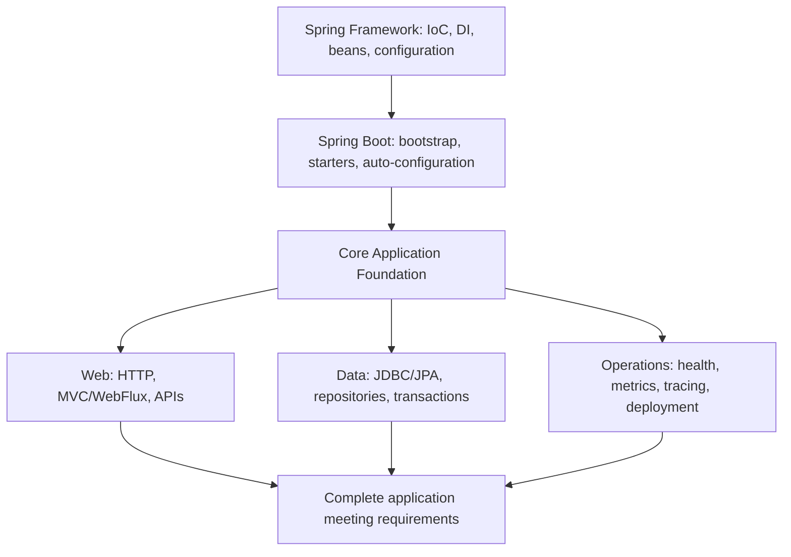
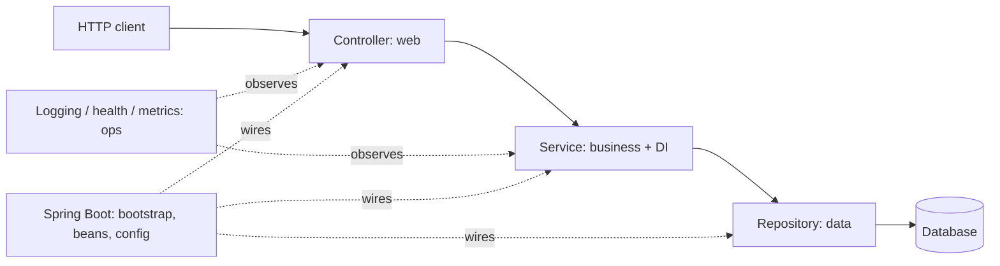

# Boundaries Between Core Boot Fundamentals and Data, Web, and Advanced Operations

In the **Spring Boot Fundamentals** track, what matters is not only knowing how to get an application running, but also knowing **which concepts belong to Spring Boot's core mechanisms** and **which belong to a specific integration domain**. Without distinguishing these two scopes, learners easily equate Spring Boot with REST APIs, JPA, or Docker, and struggle to pinpoint root causes when an application fails.

This lesson builds a knowledge map: how Spring Boot handles initializing and wiring components by convention, when you cross into web or data integration, and when the problem enters advanced operations.

## 1. Understanding Spring Boot's Role Accurately

**Spring Framework** provides application programming mechanisms such as the IoC container, Dependency Injection (DI), beans, configuration, AOP, transactions, and integration modules. **Spring Boot** builds on the Spring Framework to reduce initial setup work and give applications a more consistent way to launch, package, and configure.

Three concepts to keep separate:

| Component | Question Answered | Examples |
| --- | --- | --- |
| Spring Framework | How are application objects created, managed, and wired? | `ApplicationContext`, `@Bean`, `@Service`, constructor injection |
| Spring Boot | How is a Spring application bootstrapped, auto-configured, fed external configuration, and launched? | `@SpringBootApplication`, auto-configuration, starters, `SpringApplication.run` |
| Integration & infrastructure modules | How does the application speak HTTP, store data, authenticate users, or run in production? | Spring MVC, Spring Data JPA, Spring Security, Actuator, containers, Kubernetes |

Spring Boot does not automatically mean a web application. An app using Spring Boot can be a task-running process, a batch data-processing tool, an HTTP service, or a scheduled application. Whether an HTTP server, database connection, or monitoring system exists depends on **actual dependencies, configuration, and source code**.

Mental map:



The branches in the diagram are **capability groups**, not a mandatory fixed sequence. An application might need only the data branch, only the web branch, or all three combined. Core mechanisms are the shared foundation for understanding how these branches attach to the application.

## 2. What Belongs to Spring Boot Fundamentals?

A topic should be considered **fundamental** when it helps learners explain how Spring Boot creates and runs the `ApplicationContext`, even without any HTTP endpoints, database, or real deployment system.

### 2.1. Bootstrap and Application Lifecycle

Core topics include:

- The role of the `@SpringBootApplication` class, the `main` method, and calling `SpringApplication.run(...)`.
- Building the `ApplicationContext`, component discovery, bean registration, dependency resolution, and running startup hooks such as `CommandLineRunner` or `ApplicationRunner`.
- Distinguishing compilation errors, bean creation errors, configuration binding errors, and runtime business-logic errors.
- Knowing that process shutdown, closing the context, and releasing resources relate to bean lifecycles; infrastructure-level shutdown policies sit at a deeper operational level.

At the Fundamentals level, the goal is to understand **what happens and why an application starts up or fails**. You do not need to dissect every internal step of Spring Boot's source code.

### 2.2. Beans, IoC, and Dependency Injection

This is the direct bridge between the Spring Framework and Spring Boot. Learners need to understand:

- A bean is an object managed by the Spring container; an object created with `new` in normal code does not automatically become a bean.
- `@Component`, `@Service`, `@Repository`, and `@Configuration`/`@Bean` are ways to declare or supply components to the container.
- Constructor injection makes dependencies explicit and allows swapping implementations during testing.
- Component scan scope, multiple beans of the same type, or a missing bean can all cause startup failures.

Advanced topics such as AOP proxies, bean post-processors, or specialized lifecycles only need to be studied when a specific situation calls for them.

### 2.3. Starters and Auto-configuration

A **starter** is a convenient bundle of dependencies for a given need. **Auto-configuration** consists of configurations Spring Boot considers activating based on conditions such as the classpath, existing beans, properties, and application type.

For example:

- `spring-boot-starter` provides the core dependencies of a Boot application.
- `spring-boot-starter-web` adds common components for Servlet web applications, including Spring MVC and the default starter embedded server.
- `spring-boot-starter-data-jpa` adds the foundation for JPA and Spring Data JPA; connecting to a database still requires a driver and matching configuration.
- `spring-boot-starter-actuator` adds application monitoring and management capabilities, though it does not build a complete production observability platform by itself.

The key point is that **adding a starter enables the conditions for features to appear**, rather than guaranteeing every feature is ready to use. Auto-configuration is conditional; user-declared beans can change or suppress default configurations.

### 2.4. Externalized Configuration and Profiles

Fundamentals learners need to know `application.properties`/`application.yml`, environment-provided properties, profile-based configuration, and how Spring Boot binds values into application components. Understand that a property can control beans or startup behavior; never embed passwords or secret keys directly in source code.

Example:

```yaml
spring:
  application:
    name: learning-catalog

app:
  greeting-prefix: "Hello"
```

Changing `app.greeting-prefix` only has an effect if source code reads that property. Similarly, setting `spring.profiles.active=dev` does not automatically create a dev database; profiles only select corresponding configurations and beans **if they have been defined**.

Advanced territory begins when you need secrets management systems, multi-environment configuration strategies, distributed configuration, or managing config updates across a cluster.

### 2.5. Packaging, Logging, and Minimal Testing

Fundamentals also includes just enough knowledge to:

- Distinguish source code, dependencies, build artifacts, and a running Java process; understand the purpose of an executable JAR and application launch commands.
- Read startup logs, exceptions, and `caused by` chains to pinpoint where an error occurred.
- Know how to test a business class in isolation and when loading the Spring context via `@SpringBootTest` is warranted.
- Understand that context-based tests differ in cost and scope from plain unit tests; specialized HTTP, database, or container tests belong to integration testing topics.

You do not need to implement CI/CD, log aggregation, distributed tracing, or zero-downtime deployment strategies to master the fundamentals.

## 3. An Example Using Only Core Mechanisms

Consider an application that prints a greeting on startup. Assume the project is configured for Spring Boot and has the core `spring-boot-starter` dependency. The example below **does not require Spring MVC, JPA, or an HTTP server**.

```java
package com.example.learning;

import org.springframework.boot.CommandLineRunner;
import org.springframework.boot.SpringApplication;
import org.springframework.boot.autoconfigure.SpringBootApplication;
import org.springframework.context.annotation.Bean;
import org.springframework.stereotype.Service;

@SpringBootApplication
public class LearningApplication {
    public static void main(String[] args) {
        SpringApplication.run(LearningApplication.class, args);
    }

    @Bean
    CommandLineRunner demo(GreetingService greetingService) {
        return args -> System.out.println(greetingService.greet("Spring Boot"));
    }
}

@Service
class GreetingService {
    String greet(String name) {
        return "Hello, " + name + "!";
    }
}
```

What happens when run:

1. `SpringApplication.run` initializes the Spring application context.
2. Component scanning finds `GreetingService` within the matching package scope.
3. Spring instantiates the `GreetingService` bean and injects it into the `@Bean` method parameter.
4. Spring registers `CommandLineRunner` and executes it once the context is initialized.
5. The runner invokes the service and prints `Hello, Spring Boot!`.

This exercise sits squarely within Fundamentals because its core focus is **bootstrapping, bean management, dependency injection, and lifecycle hooks**. You do not need a REST controller to prove Spring Boot is working. In a command-line app with no background thread keeping it alive, the program can exit once the runner finishes.

If you change the app to serve HTTP, access a database, or expose health endpoints, you have added an integration requirement. DI and bootstrap mechanics remain shared, while the new concepts should be learned within their proper domain.

## 4. Boundary with Web Integration

**Web integration** begins when an application must receive and reply to requests over HTTP, handling paths, methods, headers, bodies, status codes, or protocol-specific concerns.

### 4.1. Intersection with Fundamentals

At the Fundamentals level, learners should understand:

- Why adding `spring-boot-starter-web` can turn a non-web app into a Servlet web app with an embedded server.
- Controllers are also Spring-managed beans; constructor injection in controllers obeys the same DI rules.
- The web server, `DispatcherServlet`, and HTTP request flow belong to the web stack, whereas context creation and auto-configuration are general Boot concepts.
- Basic values like the listening port can be configured via properties; a port conflict at startup differs from an error while handling a request.

### 4.2. When Have You Crossed Into Web Knowledge?

Extending the `GreetingService` example above:

```java
package com.example.learning;

import org.springframework.web.bind.annotation.GetMapping;
import org.springframework.web.bind.annotation.PathVariable;
import org.springframework.web.bind.annotation.RequestMapping;
import org.springframework.web.bind.annotation.RestController;

@RestController
@RequestMapping("/greetings")
class GreetingController {
    private final GreetingService service;

    GreetingController(GreetingService service) {
        this.service = service;
    }

    @GetMapping("/{name}")
    String greet(@PathVariable String name) {
        return service.greet(name);
    }
}
```

This controller is added **when the project has `spring-boot-starter-web` and related classes on the classpath**. After the web app starts cleanly, a `GET /greetings/An` request can map to `greet` and return the greeting string.

The fundamental parts of this example are beans, DI, and Boot wiring dependencies. The web parts are:

- Semantics of `GET`, routes, and path variables.
- How `@RestController` turns a return value into an HTTP response.
- Status codes, exception handling, validation, and JSON serialization.
- Servlet/MVC vs. reactive/WebFlux choices, HTTP security, CORS, filters, and interceptors.

Do not treat "being able to write a controller" as meaning you understand Spring Boot. Conversely, understanding bootstrap and DI does not mean you have mastered REST API design or the full HTTP stack.

## 5. Boundary with Data Integration

**Data integration** begins when an application needs to read, write, query, or synchronize with an external storage engine or data system.

### 5.1. Intersection with Fundamentals

Fundamentals explains why a `DataSource`, repository, or transaction manager can be created as beans; how auto-configuration decides which components to create from the classpath and configuration; and how the application context wires services to repositories.

However, Spring Boot does not replace knowledge of SQL, transactions, entity mapping, or data modeling. For example, adding `spring-boot-starter-data-jpa` **does not mean** the application is connected to a database. In typical configurations, the app still needs a database driver, valid connection details, and entities/repositories when using JPA.

### 5.2. Topics Beyond the Boundary

| Scope | Representative Knowledge |
| --- | --- |
| Data access | JDBC, `JdbcTemplate`, JPA, Hibernate, Spring Data repositories |
| Modeling and querying | Entities, relationships, SQL, pagination, N+1 queries, indexing |
| Consistency | Transaction boundaries, isolation, rollback, locking |
| Change management | Schema migrations, versioning, test data |
| Connections and performance | Connection pools, timeouts, retries, query monitoring |
| Other integrations | Caching, Redis, message brokers, external system APIs |

For example, when a `@Service` receives a repository through its constructor, Spring supplying that dependency is **fundamental**. How the repository maps entities, builds queries, manages transactions, or handles concurrent access is **data integration**.

A `NoSuchBeanDefinitionException` might come from wiring or scan scope; however, if startup fails reporting an inability to configure `DataSource` after adding JPA, inspect the data integration layer's conditions rather than assuming DI in general is broken.

## 6. Boundary with Advanced Operations

An application running successfully on a developer's laptop is only the starting point. **Advanced operations** focuses on ensuring the application can be deployed, monitored, recovered, secured, and scaled reliably in real environments.

### 6.1. What Fundamentals Needs to Cover

- Reading startup logs and exceptions; understanding log levels and never logging secrets.
- Knowing that Spring Boot can expose health and metrics via Actuator when appropriate dependencies, configuration, and access permissions are set up.
- Knowing that application configuration varies by environment and that an executable JAR is one distribution format.
- Distinguishing between an application that has started, one ready to serve traffic, and one whose critical dependencies are reachable: those states should not be lumped into one.

Actuator is **an operational support library**, not a complete monitoring platform. Having a health endpoint does not mean alerting, long-term metric storage, or distributed tracing are in place.

### 6.2. Advanced Operational Territory

| Practical Need | Deeper Knowledge Required |
| --- | --- |
| Running in other environments | Container images, cloud/Kubernetes deployment, resource limits |
| Determining healthy vs. failing | Health indicators, liveness, readiness, dependency checks |
| Observing production behavior | Metrics, centralized logging, traces, correlation IDs, alerting |
| Load handling and stability | Thread pools, connection pools, timeouts, backpressure, capacity planning |
| Recovery and releases | Graceful shutdown, rolling deployments, rollbacks, backups, disaster recovery |
| Protecting the application | Secrets management, access control, TLS, securing management endpoints |

Separate the concept of **bean lifecycle** (fundamental) from **graceful shutdown under live traffic** (operations). Similarly, knowing `server.port` is basic configuration; designing ingress, load balancers, autoscaling, and certificate management is a deployment problem.

Security frameworks such as Spring Security intersect web, data, and operations; authentication, authorization, and API protection usually require their own dedicated track.

## 7. Using One Application to Identify Boundaries

Suppose a team builds a product lookup service. Stepping through each technical decision shows when the knowledge domain shifts:

| New Requirement | Work or Learning Needed | Primary Scope |
| --- | --- | --- |
| Start the app, create `CatalogService`, inject into runner | Application context, DI, component scan, bootstrap | Spring Boot Fundamentals |
| Read app name and config settings from YAML/environment | Property sources, binding, profiles | Spring Boot Fundamentals |
| Allow users to call `GET /products/{id}` | HTTP, routing, controllers, responses, error handling | Web integration |
| Fetch products from PostgreSQL | Drivers, datasource, ORM/JDBC, transactions, SQL | Data integration |
| Restrict endpoint access to authorized users | Authentication, authorization, HTTP security | Application security |
| Check whether the service is ready to serve traffic | Actuator, readiness semantics, probes | Boot & operations intersection |
| Analyze slow requests across multiple services | Metrics, distributed tracing, query profiling | Advanced operations & integration |

Boundaries are not walls between technologies. One feature can traverse multiple layers: an HTTP request enters a controller, calls a service, queries a database, and emits a metric. The purpose of categorization is knowing **which mechanism is in play and where to look for answers when developing or debugging**.



In the diagram, Spring Boot provides bootstrapping and bean wiring based on configuration, while web, persistence, and operations follow their own business and technical rules.

## 8. Identifying Scope When Problems Occur

When an application misbehaves, ask where the **point of failure** sits before choosing what documentation to read.

| Symptom | Questions to Ask | First Knowledge Branch to Check |
| --- | --- | --- |
| App cannot instantiate a bean | Are bean registration, component scan, qualifiers, and dependencies right? | IoC/DI and Boot configuration |
| Cannot bind a property | Are the key name, data type, config source, and active profile right? | Externalized configuration |
| App runs, but `GET /items` returns 404 | Are controller and HTTP mapping right, and did the request hit the right app? | Web |
| `POST` returns 400 for invalid body | How are JSON, data binding, validation, and error responses designed? | Web |
| Cannot create `DataSource` | Are driver, URL, credentials, database availability, and config right? | Data and auto-configuration |
| API returns right result, but queries are slow | Are query plans, query counts, indexes, mappings, or pool settings problematic? | Data / performance |
| Service starts but gets pulled from traffic | How are readiness probes, dependency health, and deployment policies configured? | Operations |
| No trace across multiple services | Are instrumentation, context propagation, and backend export configured? | Observability |

Some bugs sit at the **boundary between two layers**. For instance, a datasource error surfaces while Boot builds the context: read Spring Boot's stack trace to identify the failing bean, then verify driver/config/connectivity using data knowledge. Categorization guides investigation; it never replaces reading actual evidence.

## 9. A Learning Strategy to Avoid Mixing Up Scopes

A sensible progression for beginners:

1. **Run a small non-web application:** recognize the entry point, context, beans, and DI. You can use `CommandLineRunner` to observe behavior without setting up a database or HTTP endpoints.
2. **Understand how Boot configures an application:** add a property, vary it by profile, and explain which auto-configurations relate to existing dependencies.
3. **Pick one integration path based on your goal:** if building APIs, learn HTTP and Spring MVC; if processing data, learn SQL/JDBC or JPA. You do not need to learn every integration path at once.
4. **Connect layers with a small feature:** controller calls service, service calls repository when the project genuinely needs both web and data.
5. **Move on to production runtime needs:** add health checks, security, observability, deployment mechanisms, integration testing, and tuning as concrete situations arise.

At each step, keep one verification question in mind: **If I removed HTTP and the database, would this knowledge still help explain how Boot operates?** If yes, it likely belongs to fundamentals. If no, identify which protocol, storage engine, or infrastructure layer it belongs to. This is a guiding heuristic, not a rigid wall: auto-configuration for datasources or web still involves Boot Fundamentals principles, even though the specific feature lives in an integration branch.

### Self-Check Scenarios

**Scenario A:** A `@Service` is not found because it sits outside the component scan scope. This is a component and context configuration issue. Check the `@SpringBootApplication` class location, package structure, and bean registration.

**Scenario B:** A controller works, yet returned data has duplicates or missing fields due to misconfigured JPA relationship fetching. Boot wired the application successfully; the real issue lies in entity mapping, querying, and fetch strategy.

**Scenario C:** The application runs on a laptop, but after deployment it keeps restarting due to a misconfigured liveness probe. Analyze probe settings, startup characteristics, and how the orchestrator manages the process.

**Scenario D:** Adding `spring-boot-starter-web` causes the app to open a default port and apply new auto-configurations. Explaining **why a dependency changes the application type** belongs to Boot Fundamentals; designing the new API's contract belongs to web.

## 10. Signs You Have Mastered the Fundamentals

Before diving deep into data, web, or operations, learners should be able to:

- Explain in their own words the relationship among Spring Framework, Spring Boot, starters, and auto-configuration.
- Write a minimal Boot application with a service and a runner, accurately explaining which beans are created and where dependencies are injected.
- Read a startup error and identify whether to check beans, properties, dependencies, or an integration layer first.
- Look at `build.gradle` or `pom.xml` to recognize starters and the capabilities they can enable.
- Read application configuration, understand property/profile sources, and distinguish Boot configuration from web-, datasource-, or deployment-specific configuration.
- Sketch the flow from HTTP to service, database, and observability while pinpointing where Boot handles bootstrapping and wiring.

Strong fundamentals let you expand applications based on requirements without depending on a pre-built "full template project." When stepping into HTTP, databases, or production, you keep the same mental model of context, beans, and configuration, adding only the domain-specific concepts of the problem you are solving.
