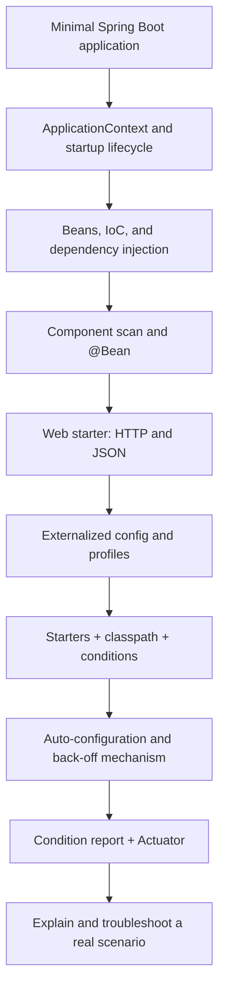
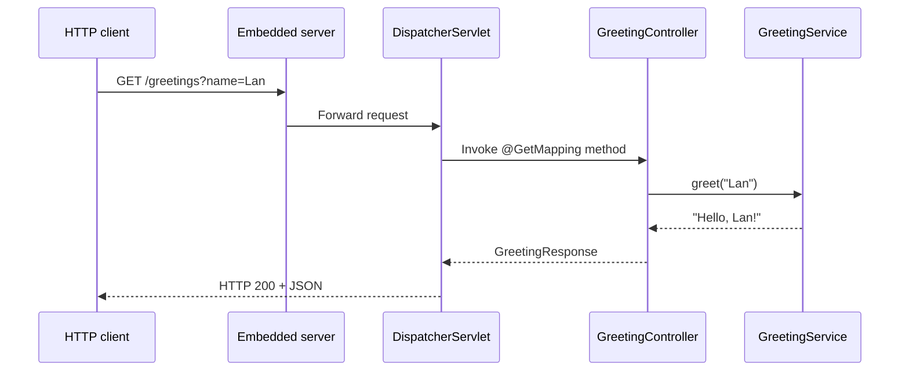
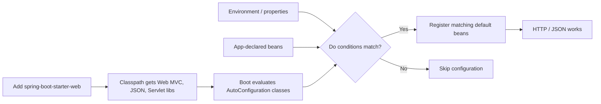

# Learning Sequence from a Minimal Application to Explaining Auto-configuration

Spring Boot often feels like "just add one dependency and one annotation and everything works automatically." That feeling is helpful at the beginning, yet without understanding what happens behind the scenes, learners struggle to explain why a bean appears, why a configuration takes effect, or why an application fails to start when changing dependencies. This lesson constructs **an observable, verifiable learning sequence**, from the smallest Spring Boot program to reading the condition evaluation report yourself and explaining *auto-configuration*.

Examples use **Java 21, Spring Boot 3.x, and Gradle**, with root package `com.example.demo`. The examples form a standalone learning project; when applying them to an existing project, follow that project's version and structure. Each stage adds one concept and one experiment on top of the previous stage's application.

## 1. Destination: Explaining, Not Just Running

After this hands-on sequence, you should be able to answer with real examples:

1. What does `SpringApplication.run(...)` create and start?
2. How does a regular Java object differ from a **Spring-managed bean**?
3. How does `@ComponentScan` discover application classes, and why can changing a package cause a bean to disappear?
4. How does adding `spring-boot-starter-web` change the *classpath* and startup behavior?
5. How does Spring Boot load configuration values from `application.yml`, profiles, environment variables, and command-line arguments?
6. Which configurations does `@EnableAutoConfiguration` pull into processing, based on which conditions, and when do they "back off" in favor of developer-defined beans?
7. How do you use `--debug` or Actuator to distinguish **applied configurations**, **skipped configurations**, and **beans that actually exist**?

An orientation diagram:



**Practice rule:** at each stage, write three things in your learning log: *what I just changed*, *what I observed*, and *which mechanism explains that observation*. That is how you move from memorizing annotations to understanding operating rules.

## 2. Stage 0 — Set Up the Environment and Keep the App Truly Small

**Goal:** run an application with a Spring context without needing an HTTP server or database yet.

Create a project via Spring Initializr or an equivalent generator with Java 21, Gradle, Spring Boot 3.x, and package `com.example.demo`. At this point, you only need the core `spring-boot-starter` dependency; do not add Spring Web, Spring Data JPA, or a database yet. Keep the generated Gradle Wrapper.

Illustrative dependency configuration in `build.gradle`:

```groovy
dependencies {
    implementation 'org.springframework.boot:spring-boot-starter'
    testImplementation 'org.springframework.boot:spring-boot-starter-test'
}
```

Create `src/main/java/com/example/demo/DemoApplication.java`:

```java
package com.example.demo;

import org.springframework.boot.SpringApplication;
import org.springframework.boot.autoconfigure.SpringBootApplication;

@SpringBootApplication
public class DemoApplication {
    public static void main(String[] args) {
        SpringApplication.run(DemoApplication.class, args);
    }
}
```

Run using the wrapper:

```bash
# Linux/macOS
./gradlew bootRun

# Windows PowerShell
.\gradlew.bat bootRun
```

You will see startup logs and then the process exits normally if nothing keeps the application running. **There is no HTTP endpoint on localhost:8080** because no web starter has been added yet. This is completely different from the application crashing.

Explain each of the three pieces in the example accurately:

| Piece | Responsibility |
|---|---|
| `main(String[] args)` | Standard Java entry point. |
| `SpringApplication.run(...)` | Prepares the environment, creates/refreshes `ApplicationContext`, initializes required beans, and executes Spring Boot startup. |
| `@SpringBootApplication` | Composite annotation enabling application configuration, component scanning, and auto-configuration. |

**Milestone:** you can answer "Why did the Spring Boot app start cleanly without opening port 8080?" before moving forward.

## 3. Stage 1 — See Spring Manage Beans

**Goal:** distinguish "I create an object with `new`" from "Spring creates and manages a bean in `ApplicationContext`."

Add a service and a runner in the same package or a subpackage of `com.example.demo`:

```java
// GreetingService.java
package com.example.demo;

import org.springframework.stereotype.Service;

@Service
public class GreetingService {
    public String greet(String name) {
        return "Hello, " + name + "!";
    }
}
```

```java
// GreetingRunner.java
package com.example.demo;

import org.springframework.boot.ApplicationArguments;
import org.springframework.boot.ApplicationRunner;
import org.springframework.stereotype.Component;

@Component
public class GreetingRunner implements ApplicationRunner {
    private final GreetingService greetingService;

    public GreetingRunner(GreetingService greetingService) {
        this.greetingService = greetingService;
    }

    @Override
    public void run(ApplicationArguments args) {
        System.out.println(greetingService.greet("Lan"));
    }
}
```

Run again and observe the line `Hello, Lan!`. You never wrote `new GreetingService()` or `new GreetingRunner(...)`. Spring scanned the `@Service`/`@Component` classes, registered beans, and automatically passed `GreetingService` into `GreetingRunner`'s constructor. This is **dependency injection** (DI), carried out by the **Inversion of Control container** (IoC container).

Temporarily remove `@Service` and restart. With no `GreetingService` bean registered, `GreetingRunner`'s constructor cannot be satisfied; startup fails with a dependency error. Restore the annotation to continue.

Another experiment: move `GreetingService` into a package outside the `com.example.demo` tree without declaring extra scan configuration. By default, `@SpringBootApplication` on the root package scans from that package downward into subpackages, so classes outside the scan scope may not be discovered.

**Takeaway to state in your own words:** annotations mark eligibility for registration, component scan scope determines which classes are inspected, and the Spring context manages lifecycle as well as dependency wiring between beans.

## 4. Stage 2 — Distinguish Component Scanning from Explicit Bean Declarations

Not every bean comes from a `@Component` class. When you want to use a library type or an object built via a factory method, you typically use `@Configuration` with `@Bean`:

```java
// TimeConfiguration.java
package com.example.demo;

import java.time.Clock;
import org.springframework.context.annotation.Bean;
import org.springframework.context.annotation.Configuration;

@Configuration(proxyBeanMethods = false)
public class TimeConfiguration {
    @Bean
    Clock clock() {
        return Clock.systemUTC();
    }
}
```

Spring scans `TimeConfiguration`, processes the `@Bean` method, and registers the returned value under type `Clock`. Afterward, another constructor can ask for `Clock` just like it asks for `GreetingService`:

```java
public GreetingRunner(GreetingService greetingService, Clock clock) {
    this.greetingService = greetingService;
    this.clock = clock; // Must also declare a corresponding Clock field.
}
```

Note: the constructor snippet above illustrates **injecting an additional dependency**; you must add the `private final Clock clock;` field if you apply it. Modifying the runner is not required to complete the lesson.

Comparison:

| Bean Creation Mechanism | Where Does Spring Find It? | Example |
|---|---|---|
| `@Component`, `@Service`, `@Repository`, `@Controller` | Classes inside the **component scan** scope | `GreetingService` |
| `@Bean` inside `@Configuration` | Factory methods in a configuration registered with Spring | `Clock` |
| **Auto-configuration** | Configuration classes imported by Boot via auto-configuration registration, then evaluated by conditions | MVC, JSON, embedded server configuration |

All three rows can produce beans, yet **the path by which configuration is discovered** differs. That distinction is the most important prerequisite before studying auto-configuration.

## 5. Stage 3 — Add Spring Web and See "Sensible Defaults"

**Goal:** change only dependencies and add one controller, then explain why the HTTP server, Spring MVC, and JSON work.

Add this starter to `build.gradle`:

```groovy
dependencies {
    implementation 'org.springframework.boot:spring-boot-starter-web'
    testImplementation 'org.springframework.boot:spring-boot-starter-test'
}
```

`spring-boot-starter-web` is a **starter dependency**: it pulls in the libraries required for a Spring MVC web app, including web components, JSON support, and the default embedded servlet container for your Boot version. The starter itself is not "magic code" creating endpoints; Spring Boot inspects libraries present on the classpath and processes matching configurations.

Add a controller:

```java
// GreetingController.java
package com.example.demo;

import org.springframework.web.bind.annotation.GetMapping;
import org.springframework.web.bind.annotation.RequestMapping;
import org.springframework.web.bind.annotation.RequestParam;
import org.springframework.web.bind.annotation.RestController;

@RestController
@RequestMapping("/greetings")
public class GreetingController {
    private final GreetingService service;

    public GreetingController(GreetingService service) {
        this.service = service;
    }

    @GetMapping
    public GreetingResponse get(
            @RequestParam(defaultValue = "friend") String name) {
        return new GreetingResponse(service.greet(name));
    }

    public record GreetingResponse(String message) {}
}
```

Run the application again and test a request:

```bash
curl "http://localhost:8080/greetings?name=Lan"
```

Expected JSON output:

```json
{"message":"Hello, Lan!"}
```

Inspect the logs: a typical web application starts an embedded servlet container and listens on port 8080 unless configured otherwise. An HTTP request flows through the web server to Spring MVC's `DispatcherServlet`, routes to the `@GetMapping` method, and the `GreetingResponse` return value is converted to JSON by a Jackson-backed HTTP message converter.



To verify the dependency's role yourself, remove `spring-boot-starter-web` and try compiling the controller: Spring MVC annotations are no longer provided by the web dependency in the example. If you keep the starter but delete the controller, the server can still start; only `/greetings` has no mapping. Those are two distinct things: **having web infrastructure** and **having application-defined endpoints**.

**Milestone:** explain why default web configuration appears even though `DemoApplication` has no method creating `DispatcherServlet` or Tomcat.

## 6. Stage 4 — Externalized Configuration Before Studying Auto-configuration

**Goal:** recognize that "which beans exist" and "which property values beans run with" are two separate questions.

Add `src/main/resources/application.yml`:

```yaml
server:
  port: 8081

app:
  greeting:
    prefix: "Hi"
```

Run again and call `http://localhost:8081/greetings?name=Lan`. The `server.port` value is used by Boot when configuring the embedded server, so the app switches to port 8081. However, `app.greeting.prefix` is an **application-defined custom property**; it will not change the greeting yet until code reads it.

For explicit type-safe binding, add a record:

```java
// config/GreetingProperties.java
package com.example.demo.config;

import org.springframework.boot.context.properties.ConfigurationProperties;

@ConfigurationProperties(prefix = "app.greeting")
public record GreetingProperties(String prefix) {}
```

Add `@ConfigurationPropertiesScan` to the main class:

```java
package com.example.demo;

import org.springframework.boot.SpringApplication;
import org.springframework.boot.autoconfigure.SpringBootApplication;
import org.springframework.boot.context.properties.ConfigurationPropertiesScan;

@SpringBootApplication
@ConfigurationPropertiesScan
public class DemoApplication {
    public static void main(String[] args) {
        SpringApplication.run(DemoApplication.class, args);
    }
}
```

And update `GreetingService` to use the properties:

```java
package com.example.demo;

import com.example.demo.config.GreetingProperties;
import org.springframework.stereotype.Service;

@Service
public class GreetingService {
    private final GreetingProperties properties;

    public GreetingService(GreetingProperties properties) {
        this.properties = properties;
    }

    public String greet(String name) {
        return properties.prefix() + ", " + name + "!";
    }
}
```

Now the HTTP response for name `Lan` is `{"message":"Hi, Lan!"}`. `@ConfigurationPropertiesScan` discovers classes annotated with `@ConfigurationProperties` within the matching package scope; Boot binds values from `Environment` onto the object under prefix `app.greeting`, and Spring injects that object into the service. In real applications, combine validation and default values to catch missing or invalid configuration early.

Try overriding the property via command-line arguments:

```bash
# Linux/macOS
./gradlew bootRun --args='--app.greeting.prefix=Hello'

# Windows PowerShell
.\gradlew.bat bootRun --args="--app.greeting.prefix=Hello"
```

The greeting now changes to `Hello, Lan!` without editing code. For environment variables, the corresponding name is typically `APP_GREETING_PREFIX`; Spring Boot supports *relaxed binding* between environment variable names and property names. Command-line arguments normally have higher precedence than file configuration.

To explore profiles, add `src/main/resources/application-dev.yml`:

```yaml
app:
  greeting:
    prefix: "[DEV] Hi"
```

Start with `--spring.profiles.active=dev` and observe the prefix change. Values in `application-dev.yml` take effect when the `dev` profile is active; if you also pass `--app.greeting.prefix=Hello` on the command line at the same time, the command-line value wins. Profiles select configuration by environment; **they do not generate new business logic**.

**Milestone:** clearly trace the three steps: properties are loaded into `Environment`, bound into a configuration object (if requested by the app), and consumed by beans.

## 7. Stage 5 — Connecting the Steps When Spring Boot Starts

Before looking inside auto-configuration internals, build an accurate startup mental model:

1. The JVM runs `main`, calling `SpringApplication.run` with the root configuration class.
2. Boot prepares `Environment` and property sources, determining the appropriate application type (servlet web, reactive, or non-web) from the classpath and configuration.
3. Boot creates `ApplicationContext`, registers initial configuration sources, and processes configurations and bean definitions.
4. `@ComponentScan` discovers components in the scan scope; `@Bean` methods provide additional bean definitions.
5. `@EnableAutoConfiguration` causes eligible auto-configuration classes to be evaluated. Conditions based on classpath, application type, properties, existing beans, etc. decide which configurations apply.
6. The context refreshes; Spring creates regular singletons, wires dependencies, and starts configured infrastructure (such as the embedded server in a web app).
7. Boot invokes runners such as `ApplicationRunner`, after which the app is ready to serve according to its application type.

This is a **learning model** of startup, not an exhaustive list of every lifecycle callback. In particular, configuration conditions are evaluated while processing configuration and registering bean definitions, so do not imagine that every bean must finish being instantiated before Boot decides auto-configuration.

Classify the components in our current project:

| Component | Origin and Reason It Exists |
|---|---|
| `GreetingService` | `@Service` inside the component scan scope. |
| `Clock` | `@Bean` method inside `TimeConfiguration`. |
| `GreetingProperties` | Scanned and registered `@ConfigurationProperties` type. |
| `GreetingController` | `@RestController` inside the component scan scope. |
| Embedded web server and default Spring MVC components | Auto-configurations matching the classpath and web environment. |
| Port `8081` | `server.port` property, not an annotation on the controller. |

If you only memorize annotation names, this table is hard to explain. Once you understand the rule **register bean definitions → evaluate conditions → instantiate/inject dependencies → consume properties**, every row has a clear cause.

## 8. Stage 6 — Dissecting `@SpringBootApplication` and Auto-configuration

`@SpringBootApplication` encompasses three core capabilities:

| Constituent Annotation | Role |
|---|---|
| `@SpringBootConfiguration` | Marks the root configuration class for the Boot app; itself built on Spring's `@Configuration` mechanism. |
| `@ComponentScan` | Scans for application components in the root package and its subpackages. |
| `@EnableAutoConfiguration` | Enables importing and processing Boot's auto-configuration candidates. |

In Spring Boot 3.x, libraries can declare auto-configuration classes in the resource:

```text
META-INF/spring/org.springframework.boot.autoconfigure.AutoConfiguration.imports
```

Configuration class names in this resource are discovered by Boot and imported into configuration processing. **They do not need to live inside the application's component scan package.** That is why a third-party JAR can supply auto-configuration without forcing developers to scan all packages of that library.

"Auto-configuration" does not mean "turn on everything included in Boot." It is a process of **conditionally selecting matching configurations**. Common annotations include:

| Condition | Question It Answers |
|---|---|
| `@ConditionalOnClass` | Is a required class or library present on the classpath? |
| `@ConditionalOnMissingClass` | Is a specific class absent? |
| `@ConditionalOnBean` | Does the context already contain a matching bean? |
| `@ConditionalOnMissingBean` | Is no matching bean present yet, so Boot can supply a default? |
| `@ConditionalOnProperty` | Does a configuration property have an enabling value? |
| `@ConditionalOnWebApplication` | Is the app running in the web environment type required by the config? |

Conditions can be placed at the auto-configuration class level, on nested configuration classes, or on `@Bean` methods. A configuration class can be imported as a candidate yet not create a specific bean because a method-level condition is not satisfied.

Condensed illustrative example of the pattern Boot commonly applies:

```java
@AutoConfiguration
@ConditionalOnClass(SomeLibraryClient.class)
public class ExampleClientAutoConfiguration {

    @Bean
    @ConditionalOnMissingBean(SomeLibraryClient.class)
    SomeLibraryClient someLibraryClient() {
        return new SomeLibraryClient();
    }
}
```

The snippet above is **illustrative code**, not a built-in Boot class. Its meaning: when the required library is present and the app has not defined a `SomeLibraryClient` bean itself, the configuration supplies a default bean. If the user already defined a matching bean, the default **backs off**. This mechanism lets Boot provide sensible defaults while allowing customization.

### How Do Starters, Classpath, and Auto-configuration Relate?



A starter **puts dependencies onto the classpath**; auto-configuration **inspects the environment** and supplies appropriate configurations/beans. The two mechanisms collaborate, yet they are not the same thing. Adding a new dependency can also change the condition results of existing configurations, even before you write a single extra line of Java.

## 9. Stage 7 — Using Evidence to See Auto-configuration in Action

**Goal:** stop saying "Boot does it automatically" without pointing to concrete evidence.

### 9.1. Enable the Condition Evaluation Report

Start the application with `--debug`:

```bash
./gradlew bootRun --args='--debug'

# On Windows:
.\gradlew.bat bootRun --args="--debug"
```

In the log, search for **CONDITIONS EVALUATION REPORT**. The report lists which configurations had matching conditions (*positive matches*), which did not (*negative matches*), and the associated reasons. Exact names and reasons can vary by Boot version and dependencies.

In our current web app, look for entries related to `DispatcherServletAutoConfiguration`, `ServletWebServerFactoryAutoConfiguration`, or `JacksonAutoConfiguration`. You do not need to memorize all names; answer:

- Which class on the classpath made the condition match?
- Does it require the application to be a servlet web application?
- Which default bean is created only if the app has not provided a matching bean?
- Was a negative match caused by a missing class, property mismatch, wrong application type, or an already existing bean?

**Important:** a *positive match* on a configuration class does not prove every bean inside it was created; inspect inner conditions or the bean list. A *negative match* is not necessarily an error either: configurations for technologies you do not use naturally will not match.

### 9.2. Using Actuator to Inspect a Running Application

Add the `spring-boot-starter-actuator` dependency:

```groovy
dependencies {
    implementation 'org.springframework.boot:spring-boot-starter-web'
    implementation 'org.springframework.boot:spring-boot-starter-actuator'
    testImplementation 'org.springframework.boot:spring-boot-starter-test'
}
```

In a local learning environment, add to `application.yml`:

```yaml
management:
  endpoints:
    web:
      exposure:
        include: health,conditions,beans
```

Keeping `server.port: 8081` from the earlier stage, test:

```bash
curl "http://localhost:8081/actuator/health"
curl "http://localhost:8081/actuator/conditions"
curl "http://localhost:8081/actuator/beans"
```

The `conditions` endpoint returns auto-configuration condition evaluations; `beans` lists beans managed by the context; `health` shows basic health status. Combining the first two endpoints links "why a configuration was considered" to "which objects were actually registered." The output can be long, so search for a few beans/entries related to Spring MVC and Jackson rather than reading top to bottom.

**Deployment note:** `conditions` and `beans` can expose internal application structure. Enable them over HTTP only in development or protect them with proper security controls; never expose them casually in production. By default, Actuator exposes only a limited set of endpoints.

### 9.3. Experimenting with "Back Off" Using Jackson

With `spring-boot-starter-web`, Boot can normally supply a default `ObjectMapper` for JSON handling. In a **temporary experimental branch**, create an explicit bean:

```java
// JsonExperimentConfiguration.java
package com.example.demo;

import com.fasterxml.jackson.databind.ObjectMapper;
import org.springframework.context.annotation.Bean;
import org.springframework.context.annotation.Configuration;

@Configuration(proxyBeanMethods = false)
public class JsonExperimentConfiguration {
    @Bean
    ObjectMapper objectMapper() {
        return new ObjectMapper().findAndRegisterModules();
    }
}
```

Start with `--debug` and inspect the condition on the `ObjectMapper` bean inside `JacksonAutoConfiguration`; the default `ObjectMapper` provider may no longer match because the application **already has a bean of the same type**. Check `/actuator/beans` to see the bean supplied by `JsonExperimentConfiguration`.

This is an experiment demonstrating **precedence of application-defined beans**, not the recommended way to configure JSON in production. Creating your own `ObjectMapper` can bypass Boot's default customizations. After observing the result, **delete the experiment class** and restart to restore the default configuration.

**Milestone:** you can prove the back-off mechanism using condition report output and the bean listing rather than guessing from a "Started" log line.

## 10. Stage 8 — Writing a Small Auto-configuration Yourself to Understand Registration

This stage is for learners who want to go one step further, from *consuming* auto-configuration to *authoring* it. Imagine a **custom library** named `greeting-support` added as a dependency to the app. The library provides an interface:

```java
package com.acme.greeting;

public interface GreetingFormatter {
    String format(String name);
}
```

Inside the library JAR, create an auto-configuration class in a package outside the application's root package:

```java
package com.acme.greeting.autoconfigure;

import com.acme.greeting.GreetingFormatter;
import org.springframework.boot.autoconfigure.AutoConfiguration;
import org.springframework.boot.autoconfigure.condition.ConditionalOnMissingBean;
import org.springframework.context.annotation.Bean;

@AutoConfiguration
public class GreetingAutoConfiguration {
    @Bean
    @ConditionalOnMissingBean(GreetingFormatter.class)
    GreetingFormatter greetingFormatter() {
        return name -> "Hello, " + name + "!";
    }
}
```

Then register the class name in the **library JAR's resource**:

```text
# src/main/resources/META-INF/spring/org.springframework.boot.autoconfigure.AutoConfiguration.imports
com.acme.greeting.autoconfigure.GreetingAutoConfiguration
```

When that JAR is on the runtime classpath, Boot can import `GreetingAutoConfiguration` from that resource even though `com.acme.greeting.autoconfigure` sits outside `com.example.demo`'s component scan. If the application does not have a `GreetingFormatter` yet, the configuration creates a default formatter. If the application declares:

```java
@Bean
GreetingFormatter vietnameseGreetingFormatter() {
    return name -> "Xin chào, " + name + "!";
}
```

then `@ConditionalOnMissingBean` causes the example's default bean to back off. The custom `@Bean` method above must live inside a `@Configuration` class discovered by the application.

In a real library, arrange modules, dependencies, and appropriate classpath/property conditions, and verify that the `AutoConfiguration.imports` resource **is actually packaged inside the built JAR**. Never rely on accidentally component-scanning the library's package to mask a broken auto-configuration registration.

To understand an on/off toggle, you can add a condition:

```java
@ConditionalOnProperty(
        prefix = "demo.greeting",
        name = "enabled",
        havingValue = "true",
        matchIfMissing = true
)
```

onto `GreetingAutoConfiguration`. When `demo.greeting.enabled=false`, this auto-configuration does not provide the default bean; if the program still requires `GreetingFormatter` and has no replacement source, creating the consuming bean may fail. That is the logical outcome of an unsatisfied required dependency, not a random bug.

## 11. Stage 9 — Explaining Scenarios Instead of Memorizing Annotations

After the stages above, explain **cause → observable signal → how to verify** in the following scenarios:

| Scenario | Mechanism-Based Explanation | How to Verify |
|---|---|---|
| Basic app starts and exits with no port 8080 | No web starter/web context; no embedded server keeping the app alive to serve HTTP. | Check dependencies and startup logs. |
| Has `@RestController`, yet app fails to start | Missing required injectable bean or dependency; the annotation alone does not guarantee a valid context. | Read the deepest root cause in the exception; inspect missing beans. |
| Service is outside root package and not injected | Default component scan did not find the service. | Check main class and service packages, plus the bean list. |
| Adding web starter causes server to listen for HTTP | Classpath and application type now satisfy servlet web auto-configurations. | Cross-check dependencies, logs, condition report. |
| Changing `server.port` changes the listening port | The auto-configured server consumes the bound configuration property. | Inspect effective properties and test old/new ports. |
| Setting a custom property does not change the greeting | The application has not bound/read that property yet. | Inspect `@ConfigurationProperties` classes and consuming beans. |
| Custom `ObjectMapper` bean changes default configuration | The missing-bean condition lets Boot back off in favor of the app's bean. | Compare condition reports before/after and check `/actuator/beans`. |
| An auto-configuration appears under "negative matches" | Specific conditions were not met; can be completely normal. | Read the match/mismatch reason message. |

A helpful diagnostic checklist when asking "why didn't Boot auto-configure X?":

1. **Dependencies:** are the required libraries and starters on the *runtime classpath*?
2. **Application type:** is the app servlet, reactive, or non-web; do the conditions require a specific type?
3. **Properties:** is an enabling flag or required property missing; which profile and configuration sources are active?
4. **Existing beans:** did user code or another library already create a bean causing the default to back off?
5. **Evidence:** what reason does the condition report give; does the expected bean actually exist in the context?
6. **Configuration registration:** if it is a custom library, is `AutoConfiguration.imports` inside the JAR?

This sequence focuses on observable causes. Do not fix every error by broadening `@ComponentScan` or randomly creating beans: such changes can hide dependency mistakes or make the context harder to understand.

## 12. Stage 10 — Lock In Knowledge with a Small Verification Test

Keep the application with `GreetingController`, `GreetingService`, `GreetingProperties`, and the web/test dependencies. Create a test to verify Spring creating and injecting the service while overriding configuration just for the test:

```java
package com.example.demo;

import static org.assertj.core.api.Assertions.assertThat;

import org.junit.jupiter.api.Test;
import org.springframework.beans.factory.annotation.Autowired;
import org.springframework.boot.test.context.SpringBootTest;

@SpringBootTest(properties = "app.greeting.prefix=Test")
class GreetingWiringTest {
    @Autowired
    GreetingService service;

    @Test
    void shouldInjectServiceAndUseBoundProperty() {
        assertThat(service.greet("Lan")).isEqualTo("Test, Lan!");
    }
}
```

When the project includes `spring-boot-starter-test` as in the example, the test uses JUnit Jupiter and AssertJ from the test dependency bundle. This test proves two claims: the context creates the service via DI, and the property supplied to the Spring test is actually bound into `GreetingProperties`. Run tests inside your practice project:

```bash
./gradlew test
```

You do not need to manually execute every scenario after every edit. Focus on the experiments that prove the mechanism you are studying: adding/removing a dependency, toggling a property, adding/removing a bean, and reading the diff in the condition report.

### Self-Assessment

Without looking back at the text, try answering aloud:

1. "I have `@SpringBootApplication` without `spring-boot-starter-web`. Why doesn't `curl localhost:8080` work?"
2. "I added the web starter without writing any Tomcat initialization code. Who creates the pieces needed for the web server to run?"
3. "Why is `GreetingService` discovered while a `@Service` class in an external package is not?"
4. "Why can a `@Bean` declared by me stop Boot from creating its default bean?"
5. "If an auto-configuration is not active, which types of conditions should I check and where do I read them?"
6. "How do a starter, an auto-configuration, a scanned component, and a configuration property differ?"

A solid answer traces **classpath → configuration/conditions → bean definitions → context/DI → observable behavior**, rather than simply listing annotation names.

## 13. Complete Sample Explanation of Auto-configuration

After completing the exercises, you should be able to deliver an explanation like this:

> When `SpringApplication.run` executes, Spring Boot prepares the environment and application context. `@SpringBootApplication` enables component scanning and auto-configuration. Component scanning discovers application classes such as controllers and services. At the same time, Boot loads auto-configuration candidates from registered resources on the classpath and evaluates their conditions: whether required libraries exist, whether the application type matches, whether properties match, and whether a corresponding bean already exists. For example, adding the Spring Web starter supplies the libraries so servlet web and Spring MVC configurations can match their conditions; Boot creates the default server/MVC infrastructure while my controller is found via component scanning. If I provide a bean where the default configuration carries `@ConditionalOnMissingBean`, Boot backs off in favor of my bean. I can verify those decisions via the condition report and confirm existing beans using Actuator or `ApplicationContext`.

To make the explanation convincing, **point to a concrete change**: before adding `spring-boot-starter-web`, there is no HTTP server; afterward, there is a servlet web context. Or before explicitly creating an `ObjectMapper`, Boot can supply a default bean; afterward, the default's missing-bean condition no longer matches. That connects theory directly to evidence.

## 14. When Are You Ready to Finish This Lesson?

You have completed the sequence when you can independently:

- Build and run the minimal app, then add a service, a runner, a controller, and a configuration properties class.
- Distinguish component scanning, `@Bean` methods, and auto-configuration using the actual classes/beans you wrote.
- Predict the outcome when adding/removing the web starter, switching profiles, changing properties, or defining custom beans.
- Read the reasoning behind at least one positive match and one negative match in the condition report.
- Explain **why Boot creates a default configuration and when it does not**, backed by evidence from your practice app.

The essence of Spring Boot Fundamentals is understanding how the **Spring IoC container**, **starter dependencies**, **externalized configuration**, and **conditional auto-configuration** fit together. Once you grasp those relationships, auto-configuration stops being a "black box": every default behavior has an origin, activation conditions, and a way to verify it.
