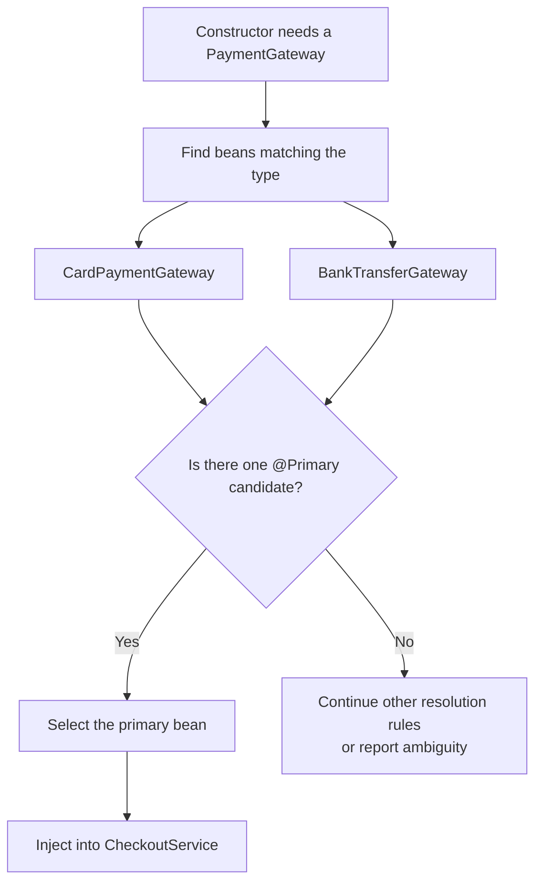
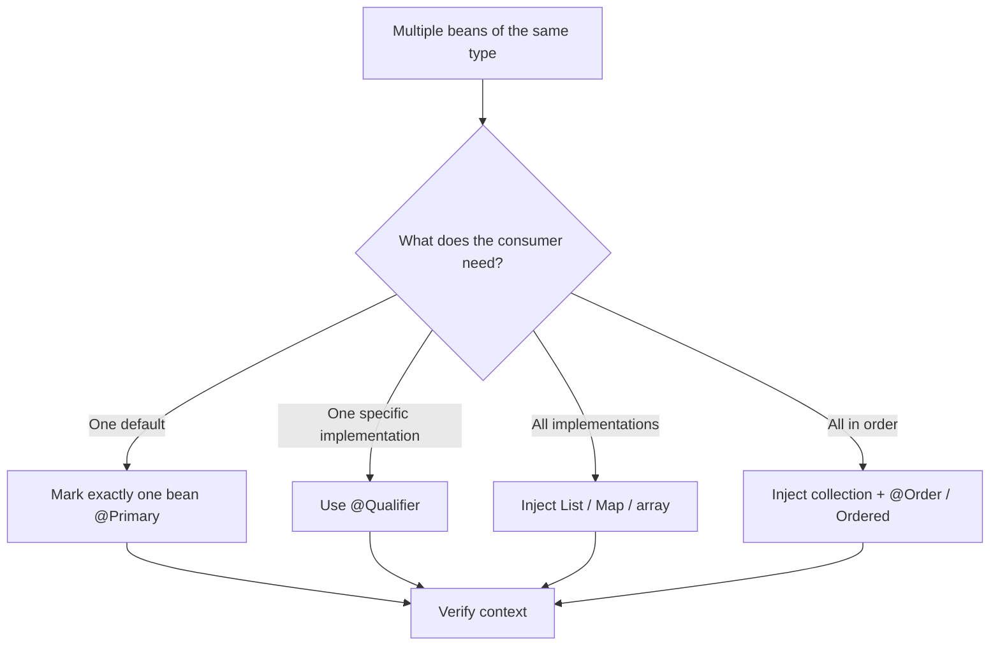

# @Primary and Preferred Candidates

When a class requires a dependency by interface, Spring normally looks for a bean of a matching type in the `ApplicationContext`. If only one bean matches, injection is straightforward. However, when multiple implementations share the same type—for example, an application has both a card payment gateway and a bank transfer gateway—Spring needs to know which bean to pick for a single-valued dependency.

`@Primary` lets you mark **one bean as the preferred candidate** within a group of matching beans. As a result, places that only ask for a single dependency can receive the default implementation you chose. The remaining beans still exist and can still be used when explicitly specified via `@Qualifier` or when injecting a collection.

This lesson belongs to the **Bean Selection** chapter of *Spring Boot Fundamentals*. We will explore how Spring resolves multiple candidates, use `@Primary` on components and `@Bean` methods, combine it with `@Qualifier`, distinguish it from `@Order`, and test bean selection in a small application.

The examples use Java 21 and Spring Boot 3.x. They assume the application already has a Spring context and foundational Spring Boot dependencies.

## 1. The problem: one interface, multiple implementations

Suppose an application has an interface for processing payments:

```java
package com.example.demo.payment;

public interface PaymentGateway {
    String pay(long amount);
}
```

The application has two payment methods:

```java
package com.example.demo.payment;

import org.springframework.stereotype.Component;

@Component
public class CardPaymentGateway implements PaymentGateway {

    @Override
    public String pay(long amount) {
        return "Paid " + amount + " by card";
    }
}
```

```java
package com.example.demo.payment;

import org.springframework.stereotype.Component;

@Component
public class BankTransferGateway implements PaymentGateway {

    @Override
    public String pay(long amount) {
        return "Paid " + amount + " by bank transfer";
    }
}
```

Suppose a service requires one `PaymentGateway`:

```java
package com.example.demo.payment;

import org.springframework.stereotype.Service;

@Service
public class CheckoutService {

    private final PaymentGateway paymentGateway;

    public CheckoutService(PaymentGateway paymentGateway) {
        this.paymentGateway = paymentGateway;
    }

    public String checkout(long amount) {
        return paymentGateway.pay(amount);
    }
}
```

If both gateways are discovered by component scanning, Spring has two beans assignable to the `PaymentGateway` constructor parameter. Without additional selection information, Spring cannot infer which business option fits better. When initializing `CheckoutService`, the application typically fails with an error like:

```text
NoUniqueBeanDefinitionException:
No qualifying bean of type 'PaymentGateway' available:
expected single matching bean but found 2
```

The exact message varies by version and where the error occurs, but the meaning is: **multiple beans match a dependency that requires exactly one bean**.

This is not a component scan failure. On the contrary, both implementations were discovered successfully. The issue occurs during the **dependency resolution** step, when Spring must select one candidate among beans of the same type.

## 2. How does `@Primary` solve candidate selection?

`@Primary` is a Spring Framework annotation, typically imported from:

```java
import org.springframework.context.annotation.Primary;
```

Place the annotation on the component class you want as the default choice:

```java
package com.example.demo.payment;

import org.springframework.context.annotation.Primary;
import org.springframework.stereotype.Component;

@Primary
@Component
public class CardPaymentGateway implements PaymentGateway {

    @Override
    public String pay(long amount) {
        return "Paid " + amount + " by card";
    }
}
```

Now Spring still sees two beans:

- `cardPaymentGateway` of type `PaymentGateway`, marked as primary.
- `bankTransferGateway`, also of type `PaymentGateway`, but not primary.

When resolving the single-valued `PaymentGateway` dependency of `CheckoutService`, Spring prefers the primary bean. Thus the constructor receives `CardPaymentGateway` without needing to change its signature.



### `@Primary` does not remove the remaining beans

After marking `CardPaymentGateway` as primary, `BankTransferGateway` remains a normal Spring bean. It is not skipped by component scanning, not removed from the context, and not replaced by the card gateway.

You can still explicitly request the bank gateway using `@Qualifier`:

```java
package com.example.demo.payment;

import org.springframework.beans.factory.annotation.Qualifier;
import org.springframework.stereotype.Service;

@Service
public class BankTransferCheckoutService {

    private final PaymentGateway paymentGateway;

    public BankTransferCheckoutService(
            @Qualifier("bankTransferGateway")
            PaymentGateway paymentGateway) {
        this.paymentGateway = paymentGateway;
    }

    public String checkout(long amount) {
        return paymentGateway.pay(amount);
    }
}
```

In this example, `@Qualifier("bankTransferGateway")` narrows the candidate group by the corresponding qualifier/name; the bank transfer bean is chosen even though the card gateway is marked `@Primary`. This clearly expresses that this service needs a specific payment method.

**Mental model to remember:** `@Primary` sets the default choice on the bean side; `@Qualifier` expresses a specific choice at the dependency injection point.

## 3. `@Primary` affects single-valued dependencies

`@Primary` primarily resolves cases where Spring needs **one bean** for an injection point. Common examples include:

- A constructor with an interface-typed parameter.
- Field or setter injection requiring a single bean by type.
- A `@Bean` method parameter requiring a single-valued dependency.
- Certain container APIs requesting resolution of a single unique bean by type.

For example:

```java
@Service
public class ReceiptService {
    private final PaymentGateway gateway;

    public ReceiptService(PaymentGateway gateway) {
        this.gateway = gateway;
    }
}
```

If there is exactly one primary candidate in the matching `PaymentGateway` group, Spring can use it to satisfy the `gateway` parameter.

`@Primary` is **not a global ranking rule for every bean access**. It does not change the bean name, bean type, or scope, does not cause the primary bean to be created earlier, and does not dictate method call order in the application.

### Primary does not replace component scanning

For `@Primary` to have effect, the bean must first be registered in the context. If the class is outside the component scan area, not declared via `@Bean`, not imported, or not registered by another mechanism, merely adding `@Primary` will not turn it into a bean.

For example, the class:

```java
@Primary
public class CardPaymentGateway implements PaymentGateway {
    // ...
}
```

Without `@Component` and without a corresponding `@Bean` configuration, Spring will not automatically create a bean just because the class carries `@Primary`. This annotation describes **the priority of a bean definition**, not a component auto-discovery mechanism.

## 4. `@Primary` can be placed on a `@Bean` method

You do not always own the source code of an implementation to add annotations to the class. With external libraries, or when you want to control how objects are instantiated, declare the bean in a configuration class:

```java
package com.example.demo.config;

import com.example.demo.payment.BankTransferGateway;
import com.example.demo.payment.CardPaymentGateway;
import com.example.demo.payment.PaymentGateway;
import org.springframework.context.annotation.Bean;
import org.springframework.context.annotation.Configuration;
import org.springframework.context.annotation.Primary;

@Configuration(proxyBeanMethods = false)
public class PaymentConfiguration {

    @Bean
    @Primary
    PaymentGateway cardPaymentGateway() {
        return new CardPaymentGateway();
    }

    @Bean
    PaymentGateway bankTransferGateway() {
        return new BankTransferGateway();
    }
}
```

In this configuration:

- `PaymentConfiguration` must be registered by Spring as a configuration class.
- The `cardPaymentGateway()` method returns the object registered as a bean.
- `@Primary` on the method marks the bean provided by that method as the primary candidate.
- `bankTransferGateway()` still registers another bean of the same type.

The default bean names for `@Bean` methods are typically the method names: `cardPaymentGateway` and `bankTransferGateway`. You can use `@Bean("cardGateway")` if you want a different explicit name.

**Choose only one registration approach per implementation in the example.** If you simultaneously keep `@Component` on the class and add a `@Bean` method returning an instance of the same kind, you may unintentionally create two beans of the same type. In that case, you need to understand the actual number of beans in the context and their names.

## 5. How do `@Primary` and `@Qualifier` differ?

Both help Spring select beans, but they express intent in two different places.

| Criterion | `@Primary` | `@Qualifier` |
|---|---|---|
| Where is it placed? | On a component class or `@Bean` method | Usually at the injection point; can also be qualifier metadata on a bean |
| Meaning | Marks the default preferred candidate within a matching group | Narrows the group of eligible beans by qualifier |
| Scope of effect | Can affect multiple single-valued injection points of the same type | Affects only injection points with the matching qualifier |
| With multiple implementations | Selects one default if one matching primary exists | Selects a specific implementation as requested |
| Removes other beans? | No | No |

### 5.1. Selecting a default with `@Primary`

Suppose most checkout flows in the application use cards:

```java
@Primary
@Component
public class CardPaymentGateway implements PaymentGateway {
    // ...
}
```

Services requesting only `PaymentGateway` will receive the card gateway under the primary rule, provided there is no qualifier or more specific selection rule.

### 5.2. Selecting explicitly with `@Qualifier`

A service dedicated to bank transfer reconciliation can declare:

```java
public BankReconciliationService(
        @Qualifier("bankTransferGateway")
        PaymentGateway gateway) {
    this.gateway = gateway;
}
```

Here, the business requirement is not "use the default," but "use bank transfer." `@Qualifier` communicates that intent right at the point of use.

### 5.3. Combining both

A bean can be marked `@Primary` and an injection point can still use `@Qualifier` to request another bean. Qualifiers determine the candidate set first; primary applies to choose from the remaining candidates if needed.

For example:

```java
@Component
@Primary
public class CardPaymentGateway implements PaymentGateway {
    // ...
}

@Component
public class BankTransferGateway implements PaymentGateway {
    // ...
}

@Service
public class BankReportService {
    private final PaymentGateway gateway;

    public BankReportService(
            @Qualifier("bankTransferGateway")
            PaymentGateway gateway) {
        this.gateway = gateway;
    }
}
```

`BankReportService` receives the bank gateway because its qualifier specifically requests that bean. Primary does not mean qualifiers are ignored.

### 5.4. A qualifier does not have to be just a bean name

You can create your own qualifier to express business meaning:

```java
package com.example.demo.payment;

import java.lang.annotation.Documented;
import java.lang.annotation.Retention;
import java.lang.annotation.RetentionPolicy;
import java.lang.annotation.Target;
import java.lang.annotation.ElementType;
import org.springframework.beans.factory.annotation.Qualifier;

@Target({ElementType.FIELD, ElementType.PARAMETER, ElementType.TYPE, ElementType.METHOD})
@Retention(RetentionPolicy.RUNTIME)
@Documented
@Qualifier
public @interface BankTransfer {
}
```

Place the qualifier on the implementation:

```java
@Component
@BankTransfer
public class BankTransferGateway implements PaymentGateway {
    // ...
}
```

And at the injection point:

```java
public BankReportService(@BankTransfer PaymentGateway gateway) {
    this.gateway = gateway;
}
```

Custom qualifiers are useful when class/bean names may change while the business role must remain stable. This example requires importing the corresponding Java and Spring annotations as shown in the declaration snippet.

## 6. What happens if there is no primary bean?

If multiple beans match and there is no primary candidate, Spring applies other dependency resolution rules. Depending on the case, the dependency name may participate in selection if it matches a bean name; qualifiers, priority, and other metadata also play roles according to container rules.

However, you should not rely on "naming a variable the same as the class name" as a substitute for deliberate selection. When there are multiple implementations and business logic requires a specific implementation, using `@Qualifier` keeps code more readable and stable.

If multiple beans remain equally eligible for a single-valued dependency after considering selection rules, Spring reports `NoUniqueBeanDefinitionException`.

### What if multiple beans are marked `@Primary`?

`@Primary` does not mean "whichever marked bean wins over the other." With a candidate set containing **multiple equally matching primary beans**, Spring still lacks a unique choice and may report an error failing to determine a candidate.

For example:

```java
@Primary
@Component
class CardPaymentGateway implements PaymentGateway {
    // ...
}

@Primary
@Component
class WalletPaymentGateway implements PaymentGateway {
    // ...
}
```

If both are registered, both satisfy `PaymentGateway`, and no qualifier or other rule resolves them, an injection point requesting only `PaymentGateway` remains ambiguous.

**Typically, each group of beans of the same type should have only one primary candidate** in the context for that default purpose. If multiple beans need to exist and consumers need different choices, use business-meaningful qualifiers instead of marking all of them primary.

## 7. Does `@Primary` affect bean lists or collections?

This is a very important point: `@Primary` is used to select **one candidate for a single-valued dependency**. When a consumer requests a collection, Spring provides the matching beans in that collection; primary does not exclude the remaining beans.

For example:

```java
package com.example.demo.payment;

import java.util.List;
import org.springframework.stereotype.Service;

@Service
public class PaymentGatewayRegistry {

    private final List<PaymentGateway> gateways;

    public PaymentGatewayRegistry(List<PaymentGateway> gateways) {
        this.gateways = gateways;
    }

    public int gatewayCount() {
        return gateways.size();
    }
}
```

If the context has card and bank transfer, `List<PaymentGateway>` can receive both beans, even when card is marked `@Primary`. The same applies to other multi-candidate injection types such as arrays, maps keyed by bean name, or streams/providers of candidates, according to the specific API used.

| Dependency type | Role of `@Primary` |
|---|---|
| `PaymentGateway` | Selects the primary when a single bean is needed and one matching primary exists. |
| `List<PaymentGateway>` | Collection of matching beans; primary does not exclude other beans from the list. |
| `PaymentGateway[]` | Collection of matching beans; primary does not turn the array into a single bean. |
| `Map<String, PaymentGateway>` | Matching beans are placed into the map keyed by bean name. |
| `ObjectProvider<PaymentGateway>` | Provider API allowing candidate retrieval; single-bean methods may apply single-valued resolution rules. |

Do not mark a bean primary expecting it to always appear first in every collection. If you need to sort beans during collection injection, look into `@Order` or `Ordered`.

## 8. How does `@Primary` differ from `@Order`?

These two annotations are easily confused because both relate to the word "priority," yet their purposes differ:

- `@Primary` selects the default bean when Spring needs **one bean** out of multiple matching candidates.
- `@Order` or the `Ordered` interface typically controls the **order** of beans in certain collections/arrays or processes that support ordering.

For example:

```java
import org.springframework.core.annotation.Order;
import org.springframework.stereotype.Component;

@Component
@Order(1)
public class CardPaymentGateway implements PaymentGateway {
    // ...
}
```

```java
import org.springframework.core.annotation.Order;
import org.springframework.stereotype.Component;

@Component
@Order(2)
public class BankTransferGateway implements PaymentGateway {
    // ...
}
```

When injecting `List<PaymentGateway>` in scenarios where Spring supports ordering, the order can follow the `@Order` values: lower values have higher ordering precedence. However, `@Order(1)` **does not automatically make the card gateway the chosen bean for a constructor accepting only a single `PaymentGateway`**. If a default is needed for a single-valued dependency, use `@Primary` or an appropriate qualifier.

### Quick comparison table

| Annotation/interface | Which question does it answer? | Typical effect |
|---|---|---|
| `@Primary` | "If one bean is needed, which bean is the default?" | Selects candidate for single-valued dependencies. |
| `@Qualifier` | "Which group/label of bean does this injection point need?" | Narrows candidates at the point of use. |
| `@Order` | "How should beans in a list be ordered?" | Ordering in mechanisms that support sorting. |
| `Ordered` | "Which API does this bean use to declare its order?" | Provides the order value programmatically. |

Do not use `@Order` in place of `@Primary`, or `@Primary` to sort a list.

## 9. A complete example with three payment options

Let us expand the example to have three implementations:

```java
public interface PaymentGateway {
    String pay(long amount);
}
```

```java
@Component
@Primary
public class CardPaymentGateway implements PaymentGateway {
    @Override
    public String pay(long amount) {
        return "CARD:" + amount;
    }
}
```

```java
@Component
public class BankTransferGateway implements PaymentGateway {
    @Override
    public String pay(long amount) {
        return "BANK:" + amount;
    }
}
```

```java
@Component
public class WalletPaymentGateway implements PaymentGateway {
    @Override
    public String pay(long amount) {
        return "WALLET:" + amount;
    }
}
```

A service using the default option:

```java
@Service
public class DefaultCheckoutService {
    private final PaymentGateway gateway;

    public DefaultCheckoutService(PaymentGateway gateway) {
        this.gateway = gateway;
    }

    public String checkout(long amount) {
        return gateway.pay(amount);
    }
}
```

A service specifically needing wallet:

```java
@Service
public class WalletCheckoutService {
    private final PaymentGateway gateway;

    public WalletCheckoutService(
            @Qualifier("walletPaymentGateway")
            PaymentGateway gateway) {
        this.gateway = gateway;
    }

    public String checkout(long amount) {
        return gateway.pay(amount);
    }
}
```

And a service needing all gateways:

```java
@Service
public class PaymentOptionsService {
    private final List<PaymentGateway> gateways;

    public PaymentOptionsService(List<PaymentGateway> gateways) {
        this.gateways = gateways;
    }

    public List<String> payWithEveryGateway(long amount) {
        return gateways.stream()
                .map(gateway -> gateway.pay(amount))
                .toList();
    }
}
```

Three requirements for three injection points:

| Consumer | Request type | Received bean |
|---|---|---|
| `DefaultCheckoutService` | One `PaymentGateway` | `CardPaymentGateway` because it is primary. |
| `WalletCheckoutService` | One `PaymentGateway` with wallet qualifier | `WalletPaymentGateway`. |
| `PaymentOptionsService` | `List<PaymentGateway>` | Card, bank transfer, and wallet. |

This is a clean combination: primary supplies the default, qualifier expresses an individual requirement, and collection allows the consumer to coordinate multiple implementations.

## 10. Using `@Primary` with environment configs and library-provided beans

An application may have a default bean from a library or auto-configuration alongside a bean defined by the application itself. In such cases, `@Primary` is one way to mark the default candidate when both match by type.

Example configuration creating a default gateway:

```java
@Configuration(proxyBeanMethods = false)
public class DefaultPaymentConfiguration {

    @Bean
    @Primary
    PaymentGateway defaultPaymentGateway() {
        return new CardPaymentGateway();
    }
}
```

If another `PaymentGateway` bean exists in the context, the bean provided by this method is the primary candidate for matching single-valued injection.

In real applications, you need to understand which beans auto-configuration already provides, whether conditions like `@ConditionalOnMissingBean` are present, and whether you are accidentally registering duplicate instances of the same implementation. `@Primary` **is not an on/off switch for auto-configuration**; it only affects selection among already-registered beans.

If a library provides a default bean with `@ConditionalOnMissingBean(PaymentGateway.class)`, declaring another bean in the application may cause the default configuration to back off before primary is ever considered. That is a separate conditional registration mechanism and should not be confused with primary bean selection.

## 11. Testing bean selection in a Spring context

To prove `@Primary` works, we need to test **which bean Spring actually injects into the consumer**, not just check whether a class has the annotation.

Suppose the project has the three gateway components and `DefaultCheckoutService` as in section 9. An integration test:

```java
package com.example.demo.payment;

import static org.assertj.core.api.Assertions.assertThat;

import org.junit.jupiter.api.Test;
import org.springframework.beans.factory.annotation.Autowired;
import org.springframework.boot.test.context.SpringBootTest;
import org.springframework.context.ApplicationContext;

@SpringBootTest
class PrimaryPaymentGatewayTest {

    @Autowired
    DefaultCheckoutService checkoutService;

    @Autowired
    WalletCheckoutService walletCheckoutService;

    @Autowired
    PaymentOptionsService optionsService;

    @Autowired
    ApplicationContext context;

    @Test
    void primaryIsUsedForSingleValuedDependency() {
        assertThat(checkoutService.checkout(100))
                .isEqualTo("CARD:100");
    }

    @Test
    void qualifierCanSelectAnotherImplementation() {
        assertThat(walletCheckoutService.checkout(100))
                .isEqualTo("WALLET:100");
    }

    @Test
    void collectionContainsAllCandidates() {
        assertThat(optionsService.payWithEveryGateway(100))
                .containsExactlyInAnyOrder(
                        "CARD:100",
                        "BANK:100",
                        "WALLET:100");
    }

    @Test
    void allGatewayBeansRemainRegistered() {
        assertThat(context.getBeansOfType(PaymentGateway.class))
                .hasSize(3);
    }
}
```

The test assumes the three gateways have been component-scanned, `@Primary` is only on card, the wallet qualifier matches the default bean name, and no test configuration replaces them. `containsExactlyInAnyOrder` is used for the collection because ordering is not what this test needs to prove.

The first test confirms the default service receives card. The second test proves a qualifier can request wallet. The third and fourth tests prove primary does not remove the other two implementations.

### Unit testing business logic without Spring

If you only want to test `DefaultCheckoutService` logic, you can instantiate the object directly:

```java
class DefaultCheckoutServiceTest {

    @Test
    void delegatesPaymentToProvidedGateway() {
        PaymentGateway fakeGateway = amount -> "FAKE:" + amount;
        DefaultCheckoutService service =
                new DefaultCheckoutService(fakeGateway);

        assertThat(service.checkout(50)).isEqualTo("FAKE:50");
    }
}
```

This unit test does not test `@Primary` because it does not start a Spring container. It verifies that the service uses the passed-in dependency properly. To confirm Spring's bean selection rules, a context test like the one above is needed.

## 12. Inspecting candidate beans for diagnostics

When encountering a multiple-beans-of-same-type error, observe which beans actually exist in the context:

```java
Map<String, PaymentGateway> gateways =
        context.getBeansOfType(PaymentGateway.class);

gateways.forEach((name, gateway) ->
        System.out.println(name + " -> " + gateway.getClass().getSimpleName()));
```

For example, it might print:

```text
cardPaymentGateway -> CardPaymentGateway
bankTransferGateway -> BankTransferGateway
walletPaymentGateway -> WalletPaymentGateway
```

Names and print order may vary by configuration. What needs to be confirmed is **how many matching beans exist**, which name corresponds to which implementation, and whether the injection point requests a single bean or a collection.

If Spring Boot Actuator is present and the `beans` endpoint is exposed in an appropriate environment, you can also view the bean list via that endpoint. You do not need to enable Actuator solely to complete this exercise.

### Questions to ask when encountering `NoUniqueBeanDefinitionException`

1. What dependency type is being requested?
2. Which beans did Spring find that are assignable to that type?
3. Is there a qualifier at the injection point?
4. Within the remaining candidate group, is there exactly one primary bean?
5. Was a bean registered twice due to both component scanning and `@Bean`?
6. Does the injection point truly need a single bean or a list of all beans?

Do not resolve every ambiguity error by arbitrarily slapping on `@Primary`. If a service needs bank transfer due to its business logic, marking card as primary is not a good fix; the service should declare an explicit qualifier.

## 13. Common pitfalls

| Situation | Outcome/meaning |
|---|---|
| Two beans of the same type, no primary and no other resolution rule | Single-valued dependency can be ambiguous. |
| Exactly one matching primary candidate | The primary candidate is preferred for single-valued dependencies. |
| Two primary candidates of the same type | Still ambiguous; primary does not create a ranking between primaries. |
| Injection point has a qualifier specifying the bank bean | Qualifier narrows candidates; another primary bean does not automatically override that qualifier. |
| Injecting `List<PaymentGateway>` | Receives matching candidates, not just the primary one. |
| Adding `@Primary` alone to a class not yet registered as a bean | Does not create a bean automatically; still needs component scanning or another registration mechanism. |
| A primary bean exists, but its type is incompatible with the dependency | Not a matching candidate, so it cannot resolve that dependency. |
| Primary bean is lazy | Primary does not mean created earlier; initialization still depends on scope and lazy semantics. |
| Has `@Order(1)` but no `@Primary` | Order does not replace primary selection for a single-valued dependency. |

### `@Primary` is not temporal priority

The word "primary" may lead you to think Spring creates that bean first or invokes it first. In reality, this annotation concerns **candidate resolution**. Instantiation timing is governed by scope, lazy initialization, and context initialization flow.

### `@Primary` is not a global default for every interface in the application

Primary is evaluated within the group of beans compatible with the dependency being resolved. Marking primary on `PaymentGateway` does not make that bean the default choice for `NotificationSender` or another type.

### `@Primary` does not automatically fix constructor cycles

If bean A needs B and B needs A, marking one implementation primary will not resolve the dependency cycle on its own. Re-analyze the dependency graph and separate responsibilities if needed.

## 14. Choosing `@Primary` or `@Qualifier` in application design?

Use `@Primary` when one implementation is genuinely the **sensible default** for the majority of consumers of a dependency type. For example, an application has one default system clock, one standard encoder, or one default implementation chosen by the application.

Use `@Qualifier` when a consumer needs an implementation for a specific requirement. For example:

- Reconciliation reports must use the bank transfer gateway.
- Refund flows must use a gateway supporting refunds.
- A transactional email service must use the correspondingly configured provider.
- A consumer needs an implementation reading data from a legacy source.

If there are multiple implementations and each consumer needs a different choice, qualifiers usually make intent clearer than altering a global primary.

### Considering bean name vs custom qualifier?

| Choice | When to use |
|---|---|
| `@Qualifier("bankTransferGateway")` | Small applications where bean names are clear and stable. |
| Custom qualifier annotation like `@BankTransfer` | Business role needs a label independent of class/bean names. |
| `@Primary` | There is a sensible default candidate for regular single-valued dependencies. |
| `@Order` / `Ordered` | Consumer needs to iterate a collection in a deterministic order. |

Do not use bean names as arbitrary strings across many places when a clear business qualifier can be used. When an implementation name changes, name-based qualifier strings must also be updated.

## 15. Hands-on lab: observing primary and qualifier

Create the `PaymentGateway` interface and the three card, bank, and wallet implementations as in section 9. Place all components in a package scanned by Spring Boot.

**Step A — Without primary.** Create `DefaultCheckoutService` requiring only `PaymentGateway`. Start the context and observe the multiple-matching-beans error. Explain why scanning succeeded while injection failed.

**Step B — Mark one primary.** Add `@Primary` to `CardPaymentGateway`. Restart and verify that the default service returns a result prefixed with `CARD:`.

**Step C — Select a specific implementation.** Create `WalletCheckoutService` with `@Qualifier("walletPaymentGateway")`. Confirm the service receives wallet even though card is primary.

**Step D — Inject a collection.** Create `PaymentOptionsService(List<PaymentGateway> gateways)`. Confirm the collection includes all three implementations.

**Step E — Create a second primary.** Temporarily add `@Primary` onto `BankTransferGateway`. Observe that the context can report ambiguity on single-valued dependencies. Restore to a single primary.

**Step F — Compare with order.** Remove primary, add different `@Order` values to two implementations, and inject a `List<PaymentGateway>`. Observe collection order. Then try a constructor requiring only `PaymentGateway` and explain why `@Order` does not replace `@Primary`.

**Step G — Register with `@Bean`.** Move one implementation to a factory method in `@Configuration`, put `@Primary` on the method, and remove the old component registration for that same implementation. Confirm bean selection rules still work because primary is tied to the bean definition, regardless of whether the bean came from component scanning or a factory method.

## 16. Workflow for handling multiple beans of the same type

When encountering a dependency resolution error, follow this sequence:

1. **Identify the type to be injected.** For example, `PaymentGateway` or `List<PaymentGateway>`?
2. **List candidates.** Use logs, `ApplicationContext`, or Actuator if available to see which beans are registered.
3. **Identify business intent.** Does the consumer need a default, a specific implementation, or all implementations?
4. **Choose the appropriate mechanism.** Single-valued default uses `@Primary`; specific requirement uses `@Qualifier`; multiple implementations use a collection; ordering uses `@Order`/`Ordered`.
5. **Check the number of primaries.** For a single-valued dependency, ensure there are not multiple matching primary candidates.
6. **Check for duplicate registration.** Do not let the same implementation be registered via both component scanning and `@Bean` unintentionally.
7. **Write tests with the right scope.** Unit tests check consumer logic; context tests check Spring's bean selection rules.



## 17. Self-assessment questions

1. Why does Spring report an error when a constructor requires `PaymentGateway` and two beans of the same type exist?
2. What does placing `@Primary` on a component class or `@Bean` method signify?
3. After marking the card gateway primary, is the bank gateway removed from the `ApplicationContext`?
4. Why can `@Qualifier("bankTransferGateway")` still select bank even when card is primary?
5. If two matching primary candidates exist, does Spring automatically pick whichever class was declared first?
6. Does `@Primary` make the primary bean appear first in `List<PaymentGateway>`?
7. How do `@Order` and `@Primary` differ?
8. If a class has `@Primary` but is not yet registered as a bean, does the annotation automatically create a bean?
9. When should you pick a default primary, and when should the consumer use a qualifier?
10. Why does a unit test instantiating a service via its constructor not verify Spring's `@Primary` rule?

### Complete explanation sample

> When a single-valued dependency has multiple beans of the same type, Spring needs a rule to select a candidate. `@Primary` marks one bean as the default preferred choice within the group of matching beans, so a constructor requiring only the interface type can receive the primary implementation. This annotation does not remove other beans and does not automatically register a class as a bean. If a consumer needs a specific implementation, `@Qualifier` narrows candidates at the injection point. If a consumer needs all implementations, inject a collection; primary does not exclude other beans from the list. `@Order` controls ordering in collections/mechanisms that support ordering, rather than replacing primary when a single bean is needed.

When you can explain why a single-valued dependency was selected, why a qualifier can request another bean, and why a collection still contains all implementations, you properly understand the role of **preferred candidates** in Spring dependency injection.
