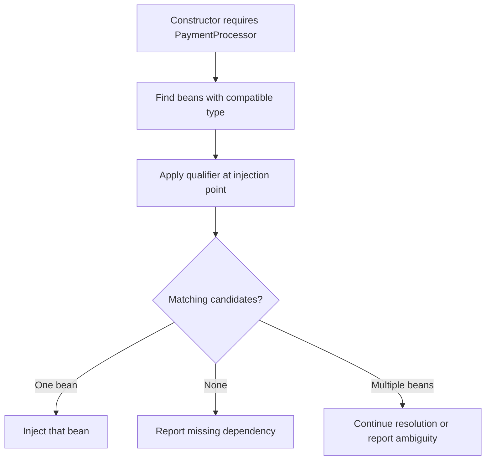

# Custom Qualifier Annotations to Describe Business Meaning

In Spring, an interface can have multiple beans of the same type. For example, an application may have multiple payment gateways, multiple notification senders, multiple data sources, or multiple regional implementations. When a constructor requires that interface, Spring needs to determine which bean is suitable to inject.

`@Qualifier` narrows the set of candidate beans using a marker. Spring also allows creating **custom qualifier annotations**: application-defined annotations meta-annotated with `@Qualifier` that carry meaning closer to business language. As a result, code can clearly state "use the card payment gateway," "use the reporting data store," or "use the APAC region adapter," rather than relying on cryptic bean names.

This lesson covers the qualifier mechanism, how to define custom annotations, how to attach qualifiers to beans and injection points, how to combine multiple qualifiers, how qualifiers differ from `@Primary`, and how to test and troubleshoot common errors.

## 1. Why are qualifiers needed?

Suppose an application has a shared contract for payment processing:

```java
public interface PaymentProcessor {
    void charge(String orderId, long amountInCents);
}
```

The application has two implementations:

```java
@Component
public class CardPaymentProcessor implements PaymentProcessor {
    @Override
    public void charge(String orderId, long amountInCents) {
        // Send request to card payment gateway.
    }
}

@Component
public class BankTransferProcessor implements PaymentProcessor {
    @Override
    public void charge(String orderId, long amountInCents) {
        // Create bank transfer request.
    }
}
```

If a service merely declares:

```java
@Service
public class CheckoutService {
    private final PaymentProcessor processor;

    public CheckoutService(PaymentProcessor processor) {
        this.processor = processor;
    }
}
```

Spring finds two beans equally compatible with `PaymentProcessor`. The container cannot automatically infer which payment method the business logic needs. The result is usually an error failing to uniquely choose one bean, such as `NoUniqueBeanDefinitionException` wrapped in `UnsatisfiedDependencyException` when instantiating the service.

This can be resolved by specifying a qualifier at the injection point. The simple string approach:

```java
@Service
public class CheckoutService {
    private final PaymentProcessor processor;

    public CheckoutService(
            @Qualifier("cardPaymentProcessor") PaymentProcessor processor) {
        this.processor = processor;
    }
}
```

This works when a bean has a matching qualifier value or a bean name matching under Spring's fallback rules. However, the string `"cardPaymentProcessor"` is a technical name. It does not directly express business meaning and can couple code to bean naming conventions.

Custom qualifiers allow expressing that meaning with a dedicated annotation type, such as `@PaymentRoute(PaymentRouteKind.CARD)`.

## 2. How do qualifiers work?

Spring's autowiring typically begins by finding beans whose type is compatible with the dependency. Qualifiers further **filter candidates by metadata** to choose the matching bean.

The process can be visualized as:



Qualifiers do not alter the Java type of the dependency. A bean marked with `@PaymentRoute(CARD)` must still implement `PaymentProcessor` if the constructor requests `PaymentProcessor`. A qualifier cannot make an object of the wrong type a valid dependency.

Another important point: a qualifier is a **bean classification marker**, not necessarily a unique bean identifier. Multiple beans can share the same qualifier if they belong to the same business group. If an injection point requests that qualifier and multiple beans still match, Spring may continue reporting ambiguity.

## 3. Defining a custom qualifier annotation

To create a custom qualifier, define an annotation and attach Spring's `@Qualifier` to that annotation itself. This is a form of *meta-annotation*: an application annotation recognized by Spring as a qualifier.

For example, an application needs to distinguish payment routes by method:

```java
package com.example.payment;

public enum PaymentRouteKind {
    CARD,
    BANK_TRANSFER
}
```

Define the annotation:

```java
package com.example.payment;

import java.lang.annotation.Documented;
import java.lang.annotation.ElementType;
import java.lang.annotation.Retention;
import java.lang.annotation.RetentionPolicy;
import java.lang.annotation.Target;
import org.springframework.beans.factory.annotation.Qualifier;

@Target({
        ElementType.TYPE,
        ElementType.METHOD,
        ElementType.FIELD,
        ElementType.PARAMETER,
        ElementType.ANNOTATION_TYPE
})
@Retention(RetentionPolicy.RUNTIME)
@Documented
@Qualifier
public @interface PaymentRoute {
    PaymentRouteKind value();
}
```

Explanation of each part:

- `@Qualifier`: marks this annotation as a qualifier that Spring can use during dependency resolution.
- `@Target`: allows the annotation to appear on classes/interfaces, methods, fields, parameters, and other annotations.
- `ElementType.TYPE`: used to attach the qualifier to implementation classes.
- `ElementType.METHOD`: used to attach the qualifier to `@Bean` methods in Java configuration.
- `ElementType.PARAMETER`: used to attach the qualifier to constructor or injection method parameters.
- `ElementType.FIELD`: supports field injection when code needs that style.
- `ElementType.ANNOTATION_TYPE`: allows the custom qualifier to be composed into another aggregate annotation.
- `@Retention(RetentionPolicy.RUNTIME)`: preserves metadata at runtime so Spring can read it.
- `@Documented`: includes the annotation in the Javadoc of elements using it.
- `PaymentRouteKind value()`: attribute holding the business classification value.

Using an enum instead of free-form strings lets the compiler catch invalid values and enables IDE autocomplete. If the value domain changes frequently or comes from dynamic configuration, a controlled string may also fit, provided conventions are standardized.

## 4. Attaching a custom qualifier to beans

You can attach the qualifier to an implementation class alongside a stereotype annotation:

```java
package com.example.payment;

import org.springframework.stereotype.Component;

@Component
@PaymentRoute(PaymentRouteKind.CARD)
public class CardPaymentProcessor implements PaymentProcessor {
    @Override
    public void charge(String orderId, long amountInCents) {
        // Handle card payment.
    }
}
```

Another implementation carries a different qualifier:

```java
package com.example.payment;

import org.springframework.stereotype.Component;

@Component
@PaymentRoute(PaymentRouteKind.BANK_TRANSFER)
public class BankTransferProcessor implements PaymentProcessor {
    @Override
    public void charge(String orderId, long amountInCents) {
        // Handle bank transfer payment.
    }
}
```

When component scanning discovers these classes, Spring registers them as beans and records the qualifier metadata from the annotations. Default bean names are still derived from class names, while bean selection in this example relies on business qualifiers.

Note: the class must lie within the component scan scope or be registered via another configuration mechanism. Simply adding `@PaymentRoute` to a class does not bring it into the context if Spring has not discovered it.

## 5. Using a custom qualifier at a constructor injection point

Now the service can be declared:

```java
package com.example.checkout;

import com.example.payment.PaymentProcessor;
import com.example.payment.PaymentRoute;
import com.example.payment.PaymentRouteKind;
import org.springframework.stereotype.Service;

@Service
public class CheckoutService {
    private final PaymentProcessor processor;

    public CheckoutService(
            @PaymentRoute(PaymentRouteKind.CARD)
            PaymentProcessor processor) {
        this.processor = processor;
    }

    public void checkout(String orderId, long amountInCents) {
        processor.charge(orderId, amountInCents);
    }
}
```

Spring processes the dependency in two broad steps:

1. Find beans compatible with the `PaymentProcessor` type.
2. Keep only beans having the `@PaymentRoute(PaymentRouteKind.CARD)` qualifier matching the metadata on the injection point.

Consequently, `CardPaymentProcessor` is chosen. The bank transfer bean does not match the required qualifier, even though it implements the same interface.

There is no need to add `@Autowired` to this constructor if the class has only one constructor. The Spring Framework 4.3+ single-constructor rule still applies; the custom qualifier simply clarifies **which bean** gets injected.

### 5.1. Qualifiers on fields or setters

Custom qualifiers can also be used on fields:

```java
@Autowired
@PaymentRoute(PaymentRouteKind.CARD)
private PaymentProcessor processor;
```

Or setter parameters:

```java
@Autowired
public void setProcessor(
        @PaymentRoute(PaymentRouteKind.CARD)
        PaymentProcessor processor) {
    this.processor = processor;
}
```

These examples illustrate the annotation's capabilities. For required dependencies in services, constructor injection is generally still the clearer choice because dependencies are declared right at object creation.

## 6. Using qualifiers on @Bean methods

Not every bean is created from a `@Component`-annotated class. A bean can be created via a `@Bean` method in `@Configuration`. Custom qualifiers can be placed on that method thanks to `ElementType.METHOD`.

```java
package com.example.payment;

import org.springframework.context.annotation.Bean;
import org.springframework.context.annotation.Configuration;

@Configuration(proxyBeanMethods = false)
public class PaymentConfiguration {

    @Bean
    @PaymentRoute(PaymentRouteKind.CARD)
    PaymentProcessor cardProcessor(CardClient cardClient) {
        return new CardPaymentProcessor(cardClient);
    }

    @Bean
    @PaymentRoute(PaymentRouteKind.BANK_TRANSFER)
    PaymentProcessor bankTransferProcessor(BankClient bankClient) {
        return new BankTransferProcessor(bankClient);
    }
}
```

`CardClient`, `BankClient`, and the client-accepting constructors in the example are illustrative types; a real application must define and register them. The key point is that qualifier metadata is attached to the bean definition produced by the factory method.

If a bean is created via `@Bean`, placing the qualifier on the factory method clearly expresses bean classification. You do not necessarily have to annotate the returned implementation class, especially when the implementation is not under the application's control.

You can combine `@Bean` with `@Primary` or other conditions when needed, but establish one place responsible for classifying beans to avoid confusing configurations.

## 7. Custom qualifiers with multiple attributes

An annotation can have multiple attributes to describe multiple business dimensions. For instance, a notification system can select by channel and region:

```java
public enum NotificationChannel {
    EMAIL,
    SMS
}

public enum RegionCode {
    APAC,
    EMEA,
    AMERICAS
}
```

Define the qualifier:

```java
@Target({
        ElementType.TYPE,
        ElementType.METHOD,
        ElementType.FIELD,
        ElementType.PARAMETER,
        ElementType.ANNOTATION_TYPE
})
@Retention(RetentionPolicy.RUNTIME)
@Documented
@Qualifier
public @interface NotificationRoute {
    NotificationChannel channel();

    RegionCode region();
}
```

Attach metadata to the bean:

```java
@Component
@NotificationRoute(
        channel = NotificationChannel.EMAIL,
        region = RegionCode.APAC
)
public class ApacEmailSender implements NotificationSender {
    // ...
}
```

At the injection point:

```java
@Service
public class CustomerNotifier {
    private final NotificationSender sender;

    public CustomerNotifier(
            @NotificationRoute(
                    channel = NotificationChannel.EMAIL,
                    region = RegionCode.APAC
            )
            NotificationSender sender) {
        this.sender = sender;
    }
}
```

Spring compares the qualifier metadata on candidate beans with the metadata requested at the injection point. Custom qualifier attributes help distinguish candidates across multiple criteria.

Designing multiple attributes should reflect truly meaningful selection dimensions. If an annotation becomes a bundle of too many flags, hard to read, or changing independently, consider splitting it into separate qualifiers.

## 8. Combining multiple custom qualifiers

Instead of creating one annotation holding all information, you can define two independent qualifiers: one for region, one for channel.

```java
@Target({
        ElementType.TYPE,
        ElementType.METHOD,
        ElementType.FIELD,
        ElementType.PARAMETER,
        ElementType.ANNOTATION_TYPE
})
@Retention(RetentionPolicy.RUNTIME)
@Documented
@Qualifier
public @interface Region {
    RegionCode value();
}
```

```java
@Target({
        ElementType.TYPE,
        ElementType.METHOD,
        ElementType.FIELD,
        ElementType.PARAMETER,
        ElementType.ANNOTATION_TYPE
})
@Retention(RetentionPolicy.RUNTIME)
@Documented
@Qualifier
public @interface Channel {
    NotificationChannel value();
}
```

A bean can carry both qualifiers:

```java
@Component
@Region(RegionCode.APAC)
@Channel(NotificationChannel.EMAIL)
public class ApacEmailSender implements NotificationSender {
    // ...
}
```

The injection point requests both:

```java
public CustomerNotifier(
        @Region(RegionCode.APAC)
        @Channel(NotificationChannel.EMAIL)
        NotificationSender sender) {
    this.sender = sender;
}
```

Multiple qualifiers on the same injection point narrow the candidate set simultaneously: a bean must satisfy all requested markers. This expresses a combined condition like "region APAC **and** channel EMAIL."

If an application has many fixed combinations, you can create a composed qualifier like `@ApacEmail` to keep consumer code shorter. However, only create one when the combination has a stable meaning in the business domain.

## 9. Composed qualifiers: creating semantically richer annotations

Custom qualifiers can serve as meta-annotations on another annotation. For example, the system frequently needs to select the email sender in APAC:

```java
@Target({
        ElementType.TYPE,
        ElementType.METHOD,
        ElementType.FIELD,
        ElementType.PARAMETER,
        ElementType.ANNOTATION_TYPE
})
@Retention(RetentionPolicy.RUNTIME)
@Documented
@Region(RegionCode.APAC)
@Channel(NotificationChannel.EMAIL)
public @interface ApacEmail {
}
```

The composed annotation can be used on the bean:

```java
@Component
@ApacEmail
public class ApacEmailSender implements NotificationSender {
    // ...
}
```

And at the injection point:

```java
public CustomerNotifier(@ApacEmail NotificationSender sender) {
    this.sender = sender;
}
```

In the example, `@ApacEmail` expresses a predefined qualifier combination: region APAC and channel EMAIL. For Spring to recognize it properly, the base annotations must be designed with appropriate retention and targets, including `ANNOTATION_TYPE` if they are placed on another annotation.

Composed qualifiers are useful when a combination repeats in many places. If it appears only once, two separate qualifiers are sometimes easier to read and extend.

### 9.1. Distinguishing composed qualifiers from aliased attributes

You may want a composed annotation to allow customizing an attribute rather than fixing every value. In that case, look into `@AliasFor` and how Spring synthesizes annotation attributes. This is an advanced mechanism: the alias must point to a valid attribute of the corresponding meta-annotation and have a compatible type.

Do not add `@AliasFor` just to make an annotation look flexible. If consumers only need to pick one of a few fixed routes, an enum or independent qualifiers are usually easier to understand.

## 10. How do qualifiers and `@Primary` differ?

Both qualifiers and `@Primary` participate in resolving cases with multiple beans of the same type, but their roles differ.

| Criterion | Custom qualifier / `@Qualifier` | `@Primary` |
| --- | --- | --- |
| Purpose | Select by specific meaning or criterion | Mark the default preferred bean |
| Decision scope | At the injection point, filtering candidates by qualifier | On the bean definition, prioritizing when multiple candidates exist |
| Can describe multiple dimensions | Yes, via multiple annotations/attributes | No; only indicates preference |
| Multiple beans with same qualifier | Possible, if in the same group | Multiple primary beans can cause ambiguity |
| Consumer expresses business intent | Clearly | Does not express specific criteria |

For example, an application has multiple payment gateways, yet most use cases default to card. You can mark the card implementation primary:

```java
@Component
@Primary
public class CardPaymentProcessor implements PaymentProcessor {
    // ...
}
```

When a consumer only requests `PaymentProcessor`, the primary bean is preferred. However, a use case needing bank transfer should still state it clearly:

```java
public RefundService(
        @PaymentRoute(PaymentRouteKind.BANK_TRANSFER)
        PaymentProcessor processor) {
    this.processor = processor;
}
```

Qualifiers express the consumer's requirement; primary sets a default on the provider side. A specific qualifier at the injection point is usually better when the choice carries clear business meaning.

## 11. A qualifier is not a bean name

A common misconception is treating `@Qualifier("x")` as a by-name bean lookup syntax equivalent to `getBean("x")`.

In type-based autowiring, qualifiers filter candidate beans by metadata. A qualifier value may sometimes match a bean name as a fallback, but a qualifier's design purpose is **classifying candidates**, not replacing by-name bean retrieval.

Compare:

```java
// Select by qualifier metadata:
public ReportService(@Region(RegionCode.EMEA) ReportStore store) {
    this.store = store;
}

// Use string-based qualifier:
public ReportService(@Qualifier("regionalStore") ReportStore store) {
    this.store = store;
}
```

If the bean name changes from `regionalStore` to `emeaReportStore`, consumer code using the business qualifier `@Region(EMEA)` needs no changes as long as the metadata is preserved.

Using bean names directly can make sense when the name itself is an intentionally managed configuration contract, but do not assign arbitrary bean names and then use those names as business language everywhere.

## 12. A qualifier must accompany a valid bean candidate

Custom qualifiers do not register beans automatically. For example:

```java
@PaymentRoute(PaymentRouteKind.CARD)
public class CardPaymentProcessor implements PaymentProcessor {
    // ...
}
```

If the class has no stereotype and is not registered via `@Bean`, `@Import`, or another mechanism, Spring has no bean candidate to choose.

A class can be registered via component scanning:

```java
@Component
@PaymentRoute(PaymentRouteKind.CARD)
public class CardPaymentProcessor implements PaymentProcessor {
    // ...
}
```

Or via a factory method:

```java
@Configuration(proxyBeanMethods = false)
class PaymentConfiguration {
    @Bean
    @PaymentRoute(PaymentRouteKind.CARD)
    PaymentProcessor cardProcessor() {
        return new CardPaymentProcessor();
    }
}
```

These two approaches are alternative registration options. Do not simultaneously scan and declare a bean method for the same implementation, as doing so can create two unintended candidate beans.

Also ensure the component lies in a scanned package, or the configuration is imported. If a bean does not appear in the context, a qualifier cannot fix the registration error.

## 13. What happens if a qualifier does not match?

Some common situations:

| Situation | Possible outcome | Resolution |
| --- | --- | --- |
| No bean of the same type | No dependency candidate | Register an implementation |
| Bean of same type exists without required qualifier | No candidate satisfies the qualifier | Check metadata on the bean |
| Qualifier values differ | Candidate is filtered out | Align enum/attributes between provider and consumer |
| Multiple beans of same type and same qualifier | Multiple candidates still remain | Add another qualifier criterion or choose an appropriate primary |
| Bean has qualifier but is not scanned/imported | Bean does not exist in context | Check registration mechanism |
| Injection point uses wrong qualifier type | No matching qualifier | Use the right annotation and value |

Example of mismatched value:

```java
@Component
@PaymentRoute(PaymentRouteKind.CARD)
class CardPaymentProcessor implements PaymentProcessor {}

// Does not match the bean above:
CheckoutService(
        @PaymentRoute(PaymentRouteKind.BANK_TRANSFER)
        PaymentProcessor processor) {
    // ...
}
```

If no bank transfer implementation is registered, Spring cannot satisfy the constructor. Do not fix it by arbitrarily removing the qualifier; determine which route the use case actually needs and register the corresponding bean.

### 13.1. Multiple beans sharing a qualifier is not an annotation error

Qualifiers can describe groups. For example, multiple adapters carry `@Region(APAC)` because all of them serve the APAC region. When injecting a single bean by `@Region(APAC)`, Spring may still see multiple candidates.

If the consumer needs all adapters, inject `List<RegionalAdapter>`. If it needs a more specific adapter, add another qualifier such as channel, data purpose, or tenant class. If a default bean is needed, consider `@Primary`.

### 13.2. Qualifiers do not replace business validation

Spring only uses metadata to choose beans. It does not prove that the selected implementation can actually process a transaction, comply with regional regulations, or meet an SLA. Business rules and configuration checks must be expressed in code, validation, or appropriate integration tests.

## 14. Testing custom qualifiers

A custom qualifier matters because it determines wiring. Service unit tests can pass dependencies directly, but context tests are also needed to verify Spring picks the right bean.

You can use `AnnotationConfigApplicationContext` in a small example:

```java
import org.springframework.context.annotation.AnnotationConfigApplicationContext;
import org.springframework.context.annotation.Bean;
import org.springframework.context.annotation.Configuration;
import org.springframework.beans.factory.annotation.Qualifier;

@Configuration(proxyBeanMethods = false)
class PaymentTestConfiguration {

    @Bean
    @PaymentRoute(PaymentRouteKind.CARD)
    PaymentProcessor cardProcessor() {
        return new CardPaymentProcessor();
    }

    @Bean
    @PaymentRoute(PaymentRouteKind.BANK_TRANSFER)
    PaymentProcessor bankTransferProcessor() {
        return new BankTransferProcessor();
    }

    @Bean
    CheckoutService checkoutService(
            @PaymentRoute(PaymentRouteKind.CARD)
            PaymentProcessor processor) {
        return new CheckoutService(processor);
    }
}
```

You can initialize the context and verify:

```java
try (var context =
        new AnnotationConfigApplicationContext(PaymentTestConfiguration.class)) {

    CheckoutService service = context.getBean(CheckoutService.class);
    PaymentProcessor selected =
            context.getBean("cardProcessor", PaymentProcessor.class);

    // You can verify the service was built with the card implementation
    // through the service's observable behavior.
}
```

The example above illustrates loading Java configuration and letting Spring resolve bean method parameters. In real tests, processors should have observable behavior (for example, recording which route was called) so assertions confirm the selection clearly; do not merely verify that the context has the service bean.

If using JUnit 5 and Spring Test, you can write tests with `@SpringJUnitConfig(PaymentTestConfiguration.class)` and inject the service. If building auto-configuration, `ApplicationContextRunner` is a useful choice for testing multiple combinations of beans and properties in a lightweight context.

Scenarios worth testing:

1. Exactly one bean carries the requested qualifier: injection succeeds.
2. No bean carries the qualifier: context fails to create the dependent bean.
3. Two beans carry the same qualifier: single-bean injection reports ambiguity.
4. A bean is marked `@Primary` while injection requests another qualifier: the qualifier still narrows candidates to the specific requirement.
5. A bean is registered via a `@Bean` method: the qualifier on the method is recognized.
6. Composed qualifier: aggregated metadata resolves as expected.

## 15. Designing readable and maintainable custom qualifiers

A good custom qualifier should represent a stable classification dimension in the business domain. Prefer names such as:

- `@PaymentRoute(CARD)`: payment route.
- `@Region(APAC)`: processing region.
- `@DataPurpose(REPORTING)`: data usage purpose.
- `@NotificationChannel(EMAIL)`: notification channel.

Avoid vague names like `@Bean1`, `@DefaultImpl`, or `@Special` when they do not explain why the bean is chosen.

### 15.1. Choosing enum or string?

| Attribute type | Advantages | Limitations |
| --- | --- | --- |
| Enum | Finite values, compiler-checked, IDE support | Adding values requires changing the enum and recompiling |
| String | Flexible, fits open or configured values | Prone to typos, requires conventions |
| Attribute-less marker annotation | Very concise for a fixed group | Cannot represent multiple variants |
| Multiple attributes | Expresses multiple selection dimensions | Can make the annotation complex |

If the selection domain is defined by code and finite, an enum is generally the safe choice. If values are extended by plugins or external configuration, a controlled string may be more suitable.

### 15.2. Do not put all configuration data into qualifiers

Qualifiers are for **bean selection**, not for holding all runtime configuration. For example, do not use annotations to store API keys, environment-varying URLs, dynamic timeouts, or credentials.

Such data should be configured via `@ConfigurationProperties`, environment variables, or secret management. Qualifiers can pick the adapter bean by role, while properties supply the data to configure that adapter.

### 15.3. Separating responsibilities between qualifiers and factories

If selection depends on runtime data—such as each request having a tenant or each order having a user-selected payment method—constructor injection of a fixed bean may not suffice. In that case, inject a registry or factory:

```java
public interface PaymentProcessorRegistry {
    PaymentProcessor forRoute(PaymentRouteKind route);
}
```

The registry is built by Spring from registered beans and qualifier metadata or explicit configuration. The service can pick an implementation based on runtime business parameters.

Do not try to use qualifier annotations to replace per-request dynamic selection: qualifiers are primarily processed during container dependency resolution, not as expressions re-evaluated on every method call.

## 16. A comprehensive example: choosing a data store by purpose

Suppose a system has two customer data stores: one optimized for transactions and one optimized for reporting. Same interface:

```java
public interface CustomerStore {
    Optional<Customer> findById(String id);
}
```

Define the qualifier:

```java
public enum DataPurpose {
    TRANSACTION,
    REPORTING
}

@Target({
        ElementType.TYPE,
        ElementType.METHOD,
        ElementType.FIELD,
        ElementType.PARAMETER,
        ElementType.ANNOTATION_TYPE
})
@Retention(RetentionPolicy.RUNTIME)
@Documented
@Qualifier
public @interface ForPurpose {
    DataPurpose value();
}
```

Two adapters:

```java
@Repository
@ForPurpose(DataPurpose.TRANSACTION)
public class TransactionCustomerStore implements CustomerStore {
    @Override
    public Optional<Customer> findById(String id) {
        // Query transaction store.
        return Optional.empty();
    }
}
```

```java
@Repository
@ForPurpose(DataPurpose.REPORTING)
public class ReportingCustomerStore implements CustomerStore {
    @Override
    public Optional<Customer> findById(String id) {
        // Query reporting store.
        return Optional.empty();
    }
}
```

Transactional business service:

```java
@Service
public class CustomerCheckoutService {
    private final CustomerStore store;

    public CustomerCheckoutService(
            @ForPurpose(DataPurpose.TRANSACTION) CustomerStore store) {
        this.store = store;
    }

    public Customer requireCustomer(String id) {
        return store.findById(id)
                .orElseThrow(() ->
                        new IllegalArgumentException("Customer not found"));
    }
}
```

Reporting service:

```java
@Service
public class CustomerReportService {
    private final CustomerStore store;

    public CustomerReportService(
            @ForPurpose(DataPurpose.REPORTING) CustomerStore store) {
        this.store = store;
    }

    public Optional<Customer> findCustomer(String id) {
        return store.findById(id);
    }
}
```

In a real application, both adapters must have corresponding query implementations and the `Customer` type must be defined. The example shows two services depending on the same interface while requesting two different storage roles. Custom qualifiers make the choice visible right in the constructor, helping readers understand the dependency's purpose without tracing bean names.

## 17. Practice exercises

### Exercise 1 — Selecting a payment gateway

Create a `PaymentProcessor` interface with two implementations for card and bank transfer. Define `@PaymentRoute` with an enum attribute. Attach qualifiers to each implementation and inject the card route into `CheckoutService`.

Requirement: when both implementations are on the classpath, the application still starts and picks the right bean.

### Exercise 2 — Creating a multi-attribute qualifier

Define `@NotificationRoute` with `channel` and `region`. Create at least three notification sender beans with different combinations. Write a service requesting email in APAC and explain why the other beans are excluded.

### Exercise 3 — Distinguishing qualifier and primary

Mark one implementation as `@Primary`, then create one consumer without a qualifier and one consumer requesting a specific qualifier. Observe how the two consumers choose beans. Explain why primary does not replace business qualifiers.

### Exercise 4 — Creating a composed qualifier

Create `@ApacEmail` based on two region and channel qualifiers. Use the composed annotation on both the bean implementation and the injection point. Verify that the meta-annotations have appropriate targets and retention.

### Exercise 5 — Checking ambiguity errors

Register two beans with the same interface and the same custom qualifier. Inject a single bean using that qualifier. Observe the error and resolve it by adding selection criteria, changing registration, or injecting a collection if the use case needs all implementations.

## 18. Key takeaways

Custom qualifier annotations turn bean selection into a readable part of the business language. Instead of coupling consumers to bean names or arbitrary strings, you can define meaningful annotations like `@PaymentRoute(CARD)` or `@ForPurpose(REPORTING)`, attach them to beans, and request the same qualifier at the constructor injection point.

A custom qualifier must be meta-annotated with Spring's `@Qualifier`, have runtime retention, and have targets matching where it is used. Spring still checks the dependency type first, then uses qualifier metadata to narrow down candidates. If no candidates match or multiple candidates remain equally eligible, initialization can still fail.

Use qualifiers for meaningful selection, `@Primary` for preferred defaults, `@Bean` or stereotypes for bean registration, and `@ConfigurationProperties` for runtime configuration. When these mechanisms are kept clearly separated, the bean graph expresses business intent accurately and becomes easier to test and maintain.
