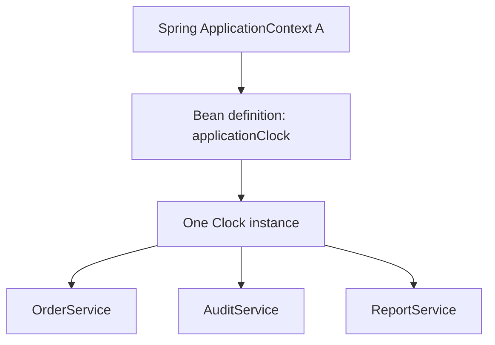
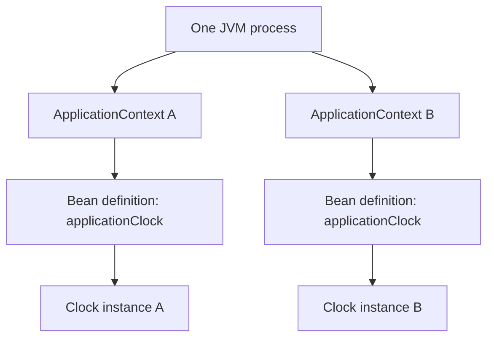
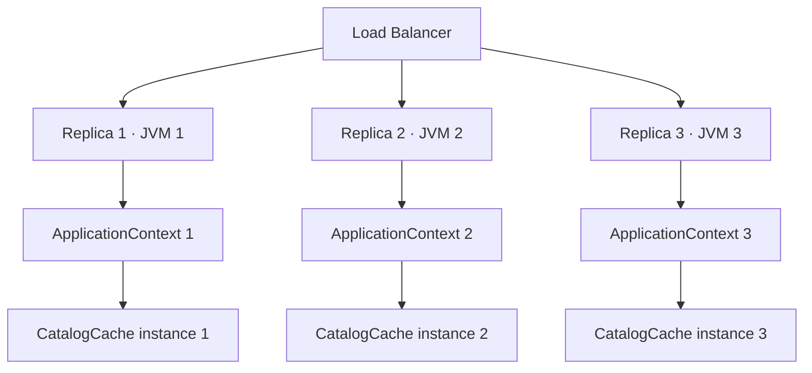
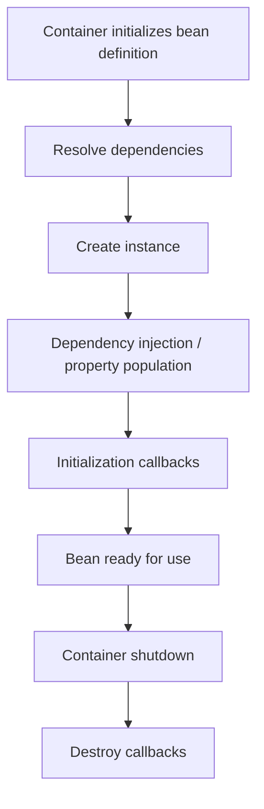

# Container-Scoped `Singleton` and How It Differs from a JVM-Wide Shared Object

> **Spring Boot Fundamentals · Bean Scopes**  
> In Spring, `singleton` is the default bean scope. This means the container manages one instance per bean definition within the scope of that container. It does **not** mean the class has only one object across the entire JVM, the entire running application, or all replicas of the system. Understanding this boundary correctly helps avoid confusing Spring scope with the Singleton design pattern, while designing state, concurrency, and testing appropriately.

## 1. What Does Singleton Mean in Spring?

When Spring creates a bean with `singleton` scope, the container retains and reuses the same instance for requests for that bean definition within the **same container**.

For example:

```java
package com.example.catalog.config;

import java.time.Clock;
import org.springframework.context.annotation.Bean;
import org.springframework.context.annotation.Configuration;

@Configuration(proxyBeanMethods = false)
public class TimeConfiguration {

    @Bean
    Clock applicationClock() {
        return Clock.systemUTC();
    }
}
```

If the configuration is loaded into a Spring ApplicationContext, the `applicationClock` bean is created and managed under the default singleton scope. Multiple services injecting a matching `Clock` in that context will receive the same bean instance.

```java
@Service
public class OrderService {

    private final Clock clock;

    public OrderService(Clock clock) {
        this.clock = clock;
    }
}

@Service
public class AuditService {

    private final Clock clock;

    public AuditService(Clock clock) {
        this.clock = clock;
    }
}
```

If both services are created in the same context and both resolve to the `applicationClock` bean, they share that `Clock` object.



This is the core meaning of singleton scope: **one instance per bean definition within the container scope**.

### 1.1. Singleton Is the Default Scope

If no other scope is specified, a regular Spring bean is singleton:

```java
@Component
public class CatalogService {
    // Default singleton scope.
}
```

Writing it explicitly is also valid:

```java
@Component
@Scope(ConfigurableBeanFactory.SCOPE_SINGLETON)
public class CatalogService {
}
```

Or with a factory method:

```java
@Bean
@Scope("singleton")
CatalogService catalogService() {
    return new CatalogService();
}
```

In most cases, there is no need to declare `@Scope("singleton")` because that is already the default. The `@Scope` annotation is useful when you want to change to prototype or another scope.

### 1.2. The Container Reuses the Bean Instead of Calling the Constructor on Every Injection

Suppose ten different beans all require `CatalogService` via their constructors. Spring does not create ten `CatalogService` objects for those ten injection points. For a singleton bean definition, the container creates the instance according to the initialization process and then provides a reference to the managed instance.

This helps:

- Share a common client or service.
- Centralize configuration and lifecycle management.
- Avoid repeatedly instantiating expensive infrastructure objects.
- Inject the same dependency into multiple consumers.

However, sharing an object also means mutable state inside it may be accessed by multiple threads. Singleton **does not automatically guarantee thread safety**; this aspect will be analyzed separately.

## 2. Important Boundary: Bean Definition and Container

The statement "Spring only creates one object per class" is inaccurate. Spring manages singletons by **bean definition**, not one unique object per Java class.

A bean definition describes how the container creates and manages a bean: type, name, scope, factory method, dependencies, lifecycle callbacks, and related metadata.

### 2.1. One Class Can Produce Multiple Singleton Beans

For example, a client class used for two partner services:

```java
public class PartnerClient {

    private final String partnerName;

    public PartnerClient(String partnerName) {
        this.partnerName = partnerName;
    }

    public String partnerName() {
        return partnerName;
    }
}
```

Configuration:

```java
@Configuration(proxyBeanMethods = false)
public class PartnerConfiguration {

    @Bean("shippingClient")
    PartnerClient shippingClient() {
        return new PartnerClient("shipping");
    }

    @Bean("billingClient")
    PartnerClient billingClient() {
        return new PartnerClient("billing");
    }
}
```

Within the same ApplicationContext, there are two distinct bean definitions:

| Bean name | Java type | Instance |
| --- | --- | --- |
| `shippingClient` | `PartnerClient` | Instance A |
| `billingClient` | `PartnerClient` | Instance B |

Both are singleton by scope, but they are **not the same object**. Each bean definition has its own instance.

Consumers must specify which bean to use:

```java
@Service
public class ShipmentService {

    private final PartnerClient client;

    public ShipmentService(
            @Qualifier("shippingClient") PartnerClient client) {
        this.client = client;
    }
}
```

If injecting by type `PartnerClient` alone when multiple beans of the same type exist, Spring needs candidate selection rules such as `@Qualifier` or `@Primary`.

### 2.2. Aliases Do Not Create Additional Instances

A bean can have multiple names:

```java
@Bean(name = {"applicationClock", "systemClock"})
Clock clock() {
    return Clock.systemUTC();
}
```

`applicationClock` and `systemClock` are names referencing the same bean definition/instance, not two independent beans.

Distinguish between:

- Two different bean definitions, even of the same type: can have two instances.
- Two aliases of the same bean: still one instance.
- Two independent containers loading the same configuration: typically have one instance in each container.

### 2.3. Naming a Bean Does Not Change Its Scope

For example, `@Bean("primaryClient")` only identifies the bean. It does not turn the bean into a JVM-wide singleton or a static object.

Similarly, `@Primary` only affects how Spring selects a bean when multiple matching candidates exist. It does not merge beans into a single object.

## 3. Container-Scoped Singleton: Multiple Instances Can Exist in the Same JVM

A Spring ApplicationContext typically contains a BeanFactory that manages its bean definitions and singletons. Singleton scope is tied to the **container/BeanFactory managing the bean**, not to the entire JVM.

We can create two contexts in the same process:

```java
AnnotationConfigApplicationContext contextA =
        new AnnotationConfigApplicationContext(AppConfiguration.class);

AnnotationConfigApplicationContext contextB =
        new AnnotationConfigApplicationContext(AppConfiguration.class);
```

If both contexts load the same `applicationClock` bean definition, each context manages its own singleton:



Therefore, two contexts can run together in one JVM while still having two instances for a bean with the same name and type. They are singletons **within each container**, not singletons across the entire process.

### 3.1. Example Verifying via Object Identity

Create a simple class:

```java
public class InstanceMarker {
}
```

Configuration:

```java
@Configuration(proxyBeanMethods = false)
public class MarkerConfiguration {

    @Bean
    InstanceMarker instanceMarker() {
        return new InstanceMarker();
    }
}
```

Test two contexts:

```java
import static org.junit.jupiter.api.Assertions.assertNotSame;
import static org.junit.jupiter.api.Assertions.assertSame;

import org.junit.jupiter.api.Test;
import org.springframework.context.annotation.AnnotationConfigApplicationContext;

class SingletonScopeTest {

    @Test
    void singletonIsScopedToEachContainer() {
        try (var contextA =
                     new AnnotationConfigApplicationContext(MarkerConfiguration.class);
             var contextB =
                     new AnnotationConfigApplicationContext(MarkerConfiguration.class)) {

            InstanceMarker firstA =
                    contextA.getBean(InstanceMarker.class);
            InstanceMarker secondA =
                    contextA.getBean(InstanceMarker.class);
            InstanceMarker firstB =
                    contextB.getBean(InstanceMarker.class);

            assertSame(firstA, secondA);
            assertNotSame(firstA, firstB);
        }
    }
}
```

Two lookups in context A return the same object; lookup in context B returns a different object. Both contexts live inside the same test/JVM process.

This is a direct way to observe scope without relying on guesses from class or bean names.

### 3.2. Parent-Child ApplicationContext

Some applications use hierarchical contexts. A child context can look up beans from its parent through the hierarchy mechanism, but a bean defined in the parent is still managed by the parent.

Conceptual example:

```text
Parent ApplicationContext
└── sharedClient (singleton owned by parent)

Child ApplicationContext
├── webController (singleton owned by child)
└── can look up sharedClient from parent
```

If the child does not redefine `sharedClient`, it can see the parent's bean and receive the exact instance managed by the parent. If the child defines its own bean with the same name/type according to the applicable hierarchy rules, that is a different bean definition and can have its own instance.

Therefore, saying "every context always creates one instance for all beans it can see" is also inaccurate: you need to distinguish **which context owns/defines** the bean from beans the child merely looks up from the parent.

### 3.3. Why Might an Application Have Multiple Contexts?

Some scenarios:

- Applications with a root context and a child web context in legacy architectures or specialized configurations.
- Tests creating independent contexts with different configurations.
- An application embedding multiple Spring contexts for separated modules.
- Tools or libraries initializing their own context to isolate configuration.
- Multiple Spring applications running in the same JVM container under special deployment setups.

In a typical Spring Boot application, you usually work with only one main ApplicationContext. Even so, understanding the container boundary helps avoid false assumptions during testing, integration, or architectural expansion.

## 4. Differences from the GoF Singleton Design Pattern

The term `singleton` also appears in object-oriented design. The **Singleton design pattern** typically ensures a class has only one instance through class-level mechanisms, such as a private constructor and a static accessor.

Simple Java example:

```java
public final class GlobalSettings {

    private static final GlobalSettings INSTANCE = new GlobalSettings();

    private GlobalSettings() {
    }

    public static GlobalSettings getInstance() {
        return INSTANCE;
    }
}
```

This object is accessed via `GlobalSettings.getInstance()`. The instance is held in a static field of the class.

A Spring singleton is different:

```java
@Component
public class CatalogSettingsService {
}
```

There is no need for a private constructor, static field, or `getInstance()`. The container creates and manages the bean; consumers receive the dependency via injection.

| Criterion | Spring singleton scope | Singleton design pattern |
| --- | --- | --- |
| Who manages the instance? | Spring container/BeanFactory | The class or static mechanism written by the developer |
| Uniqueness scope | One instance per bean definition in a container | Typically one instance per class within a classloader |
| How the object is obtained | Dependency injection or lookup via the container | Static accessor such as `getInstance()` |
| Lifecycle | Container supports init/destroy callbacks and scopes | Managed by the pattern's own code |
| Substitution in tests | Can use test context/configuration or a different dependency | Often difficult to replace if code calls the static accessor directly |
| Multiple containers | Each container can have its own instance | Static field may be shared across containers if using the same classloader |
| Dependencies | Spring can inject other beans | The class resolves them itself or requires extra design |

### 4.1. Static Singletons Are Usually Tied to a Classloader

In Java, a static field belongs to the class loaded by a specific **ClassLoader**. Within a single classloader, a class is loaded once under its corresponding class identity, so a static field is typically shared across places accessing that class.

However, if two independent classloaders load the same class name, each classloader can have its own class copy and static field. Therefore, even the static-based Singleton pattern should not be phrased simply as "one absolute single object for the entire JVM in every architecture."

A Spring singleton has its own container boundary, so two ApplicationContexts within the same classloader can still manage two different bean instances.

### 4.2. Should You Combine Spring Beans with Static Singletons?

Usually there is no need. When already using Spring, let the container manage objects and use constructor injection. Writing your own static singleton inside a Spring bean can:

- Create two confusing layers of instance management.
- Make it hard to isolate state in tests.
- Hold references longer than the context lifecycle.
- Hide dependencies, making it hard to swap implementations.
- Cause issues when running multiple contexts or parallel tests.

There may be cases where a legacy library requires static access, but that is a special integration. For new application code, a Spring bean is usually a more appropriate abstraction.

## 5. A Spring Singleton Is Not a JVM-Wide Singleton

A single JVM process can contain:

- Multiple ApplicationContexts.
- Multiple bean definitions of the same type.
- Multiple instances of a class created with `new` outside Spring.
- Multiple classloaders.
- Multiple instances of the same application in different processes.

Furthermore, an application deployed across multiple machines/containers typically has one JVM process per replica.

For example, with three replicas of a catalog service:



Each replica has its own singleton. If `CatalogCache` is an in-memory cache, data in replica 1's cache does not automatically appear in replicas 2 and 3.

### 5.1. Consequences for Data and State

Suppose a bean holds a counter:

```java
@Component
public class RequestCounter {

    private long count;

    public void increment() {
        count++;
    }

    public long current() {
        return count;
    }
}
```

Within one replica, requests may see the same counter because the bean is a singleton in that context. However, when the next request is routed by the load balancer to another replica, the counter there may have a different value.

You cannot use an instance variable of a Spring singleton as a mechanism to synchronize state across machines. If system-wide shared data is needed, consider a database, Redis, message broker, or an appropriate state storage/sharing system.

### 5.2. Singleton Scope Is Not a Distributed Singleton

A distributed singleton requires a coordination mechanism across multiple processes/machines, such as leader election, a distributed lock, or a suitably reliable coordination system. Spring singleton scope does not provide those mechanisms.

Do not use `@Scope("singleton")` and assume a scheduled job will run only once across the entire cluster. If every replica starts the same application, each replica may run its own scheduled task. To ensure only one node executes it, you need coordination at the distributed layer.

## 6. Singleton Does Not Mean Thread-Safe

A singleton bean can be used concurrently by multiple threads. In a Spring MVC application, multiple HTTP requests are usually processed in parallel by server threads. If those requests call the same singleton service, they can access the object's fields simultaneously.

Unsafe example:

```java
@Service
public class InvoiceService {

    private String currentCustomer;

    public Invoice createInvoice(String customer) {
        currentCustomer = customer;

        // Other processing can interleave here.
        return new Invoice(currentCustomer);
    }
}
```

If two requests call it concurrently:

1. Thread A assigns `currentCustomer = "Alice"`.
2. Thread B assigns `currentCustomer = "Bob"`.
3. Thread A continues reading the field and may create an invoice for Bob.

This is a race condition caused by mutable shared state. The fact that Spring creates only one instance does not automatically protect fields from concurrent access.

### 6.1. Prefer Stateless and Immutable Beans

A service should generally hold dependencies in `final` fields, while per-invocation data lives in local variables or method parameters:

```java
@Service
public class InvoiceService {

    private final InvoiceRepository repository;

    public InvoiceService(InvoiceRepository repository) {
        this.repository = repository;
    }

    public Invoice createInvoice(String customer) {
        Invoice invoice = new Invoice(customer);
        return repository.save(invoice);
    }
}
```

In this example, `customer` and `invoice` are per-call data. The service does not store "current customer" in a shared field.

This is the design that typically fits singleton services: a shared object that does not hold per-request mutable state.

### 6.2. When Mutable State Is Needed, Protect It

If an object genuinely needs to count invocations within one process, an appropriate synchronization structure can be used:

```java
@Component
public class RequestCounter {

    private final AtomicLong count = new AtomicLong();

    public long incrementAndGet() {
        return count.incrementAndGet();
    }

    public long current() {
        return count.get();
    }
}
```

`AtomicLong` supports atomic operations for a counter within a single JVM. It does not turn the counter into a distributed counter and does not replace a database/Redis when aggregation across multiple replicas is required.

Other options depending on requirements may include `synchronized`, locks, concurrent collections, or eliminating shared state. Each approach has its own cost and semantics; choose based on workload and invariants to protect.

### 6.3. Immutable Objects Are a Good Choice for Shared Beans

Objects that do not change after creation are generally easier to share across multiple threads. For example, `Clock.systemUTC()` returns a clock that can be shared safely. Configurations, formatters, or clients designed by their libraries to be thread-safe are also typically well-suited as singleton beans.

However, do not assume every library class is thread-safe. Check the documentation and contract of the specific class. Spring does not automatically turn mutable objects into immutable ones.

### 6.4. Can a Singleton Bean Hold a Cache?

Yes, if the cache implementation is safe under concurrent access by multiple threads and the semantics fit. For example, Caffeine cache is designed for concurrent access. Still, you need to determine:

- Local or distributed cache?
- How long can data be stale?
- Do multiple replicas need synchronized invalidation?
- Are keys/values mutable?
- How are capacity limits and expiry configured?

Singleton scope only means **the cache instance is shared within the context**; it does not solve the system-wide caching strategy.

## 7. Distinguishing Singleton from Prototype and Other Scopes

Spring has multiple bean scopes. Singleton is the default, but not every object should use this scope.

| Scope | Creation and reuse rule | Example use case |
| --- | --- | --- |
| `singleton` | One instance per bean definition in the container | Stateless service, configuration, shared client |
| `prototype` | Container creates a new instance each time the bean is requested from the container | Object with its own state, needing a factory to create new instances |
| `request` | One instance per HTTP request in a web-aware context | Data tied to a single request |
| `session` | One instance per HTTP session | Per-user-session state when the architecture requires it |
| `application` | One instance per ServletContext of the web application | Shared object scoped to the servlet application |
| `websocket` | One instance per WebSocket session | State tied to a WebSocket session |

Some web scopes only work when there is a web-aware ApplicationContext and the right runtime environment. Do not use request/session scope in a plain command-line application without a supporting mechanism.

### 7.1. Declaring Prototype

Example:

```java
@Component
@Scope(ConfigurableBeanFactory.SCOPE_PROTOTYPE)
public class ImportJobContext {

    private final UUID id = UUID.randomUUID();

    public UUID id() {
        return id;
    }
}
```

Each time a prototype bean is requested from the container, Spring creates a new instance:

```java
ImportJobContext first = context.getBean(ImportJobContext.class);
ImportJobContext second = context.getBean(ImportJobContext.class);

// first and second are two different instances.
```

The container typically manages prototype initialization, but does not automatically invoke full destroy callbacks for each prototype like it does for singletons. If a prototype holds resources, the consumer must take appropriate responsibility for releasing them.

### 7.2. What Is Special About Injecting a Prototype into a Singleton?

Example:

```java
@Service
public class ImportService {

    private final ImportJobContext jobContext;

    public ImportService(ImportJobContext jobContext) {
        this.jobContext = jobContext;
    }
}
```

If `ImportService` is a singleton, the `ImportJobContext` dependency is resolved when creating the service. The service typically holds the single injected prototype instance; each call to a service method **does not automatically receive a new prototype**.

If you want a new instance for each operation, use `ObjectProvider`:

```java
@Service
public class ImportService {

    private final ObjectProvider<ImportJobContext> jobContextProvider;

    public ImportService(
            ObjectProvider<ImportJobContext> jobContextProvider) {
        this.jobContextProvider = jobContextProvider;
    }

    public UUID startImport() {
        ImportJobContext context = jobContextProvider.getObject();
        return context.id();
    }
}
```

With a prototype bean, each `getObject()` call can ask the container to create a new instance. Design lifecycle/cleanup accordingly if the object holds resources.

### 7.3. How Does Request Scope Differ from Singleton?

For example, an object storing request information:

```java
@Component
@RequestScope
public class RequestMetadata {

    private String correlationId;

    public String getCorrelationId() {
        return correlationId;
    }

    public void setCorrelationId(String correlationId) {
        this.correlationId = correlationId;
    }
}
```

Each HTTP request has its own `RequestMetadata` instance under request scope. This is not an application-wide singleton. When injecting a request-scoped bean into a singleton, Spring typically uses a scoped proxy so the consumer can access the instance corresponding to the current request.

Request scope requires a web-aware context. Do not access a request-scoped bean outside an active request without an appropriate mechanism; otherwise, an inactive scope error may occur.

## 8. Spring Singleton and Static Fields: Do Not Confuse Them

A class with a static field:

```java
public class LegacyRegistry {

    public static final Map<String, String> VALUES =
            new ConcurrentHashMap<>();
}
```

can be accessed by many objects in the same classloader, including code not running inside Spring. However, a static field does not automatically have:

- Dependency injection.
- Bean lifecycle callbacks.
- Scoping by ApplicationContext.
- Profile-based configuration overrides.
- Test context mechanisms to swap implementations.

If you place a static registry inside a Spring bean, Spring manages the bean instance but **does not separately manage the lifecycle of the static field**. Static state lives per classloader and can persist data across multiple test contexts, causing state leakage between tests.

### 8.1. Example of Tests Easily Affected by Static State

```java
public class GlobalCounter {
    public static int count = 0;
}
```

If one test increments `GlobalCounter.count` to 5, another test in the same classloader may see 5. Creating a new ApplicationContext does not reset the static field.

Conversely, with a singleton bean instance field, two contexts can have two separate instances and isolated state. When a context closes, singleton instances belonging to that context are released according to the container lifecycle, whereas static fields are not automatically cleared when the context closes.

This is one reason to avoid static mutable state in Spring applications, especially when tests need isolation.

### 8.2. Do Not Use Static Accessors to Retrieve Spring Beans

Some legacy code creates an `ApplicationContextHolder` and stores the context in a static field so any class can call `getBean()`. This hides dependencies and couples code to a global Spring container.

Prefer constructor injection:

```java
@Service
public class PricingService {

    private final TaxCalculator taxCalculator;

    public PricingService(TaxCalculator taxCalculator) {
        this.taxCalculator = taxCalculator;
    }
}
```

Dependencies are declared explicitly, easy to test, and easy to swap implementations. Static access may be needed in special legacy integrations, but it should not be the default way to obtain beans.

## 9. Lifecycle of a Singleton Bean

A Spring singleton is managed through initialization and destruction steps. A simplified flow:



Specific callbacks may include `@PostConstruct`, `InitializingBean`, init methods, `@PreDestroy`, `DisposableBean`, or configured destroy methods. The exact order and mechanism depend on the callback type and framework version.

Example:

```java
@Component
public class SearchClientLifecycle {

    @PostConstruct
    void initialize() {
        // Validate or prepare resources after dependencies are injected.
    }

    @PreDestroy
    void shutdown() {
        // Close resources when context stops normally.
    }
}
```

If a singleton bean holds a thread pool, client, or resource with a close method, declare cleanup properly. Do not assume every library automatically closes resources just because the instance resides in a Spring context.

### 9.1. Eager Initialization and Lazy Initialization

Singleton beans are usually initialized eagerly when ApplicationContext refresh completes. This helps catch configuration errors at startup. A bean can be deferred:

```java
@Bean
@Lazy
ExpensiveReportClient reportClient() {
    return new ExpensiveReportClient();
}
```

The example assumes the `ExpensiveReportClient` class has a matching constructor. `@Lazy` delays creation time in supported scenarios, but if another eager bean needs to inject it right at initialization, the bean may still be created early.

Lazy initialization does not change scope: the bean is still a singleton in the container once created.

### 9.2. Closing the Context Does Not Always Mean the JVM Exits

Closing an ApplicationContext releases singleton beans managed by the context and invokes appropriate lifecycle callbacks. However, the JVM may continue running if other threads or resources remain; static fields are not automatically cleared either.

Conversely, when the JVM/process terminates, the entire process heap is reclaimed, but that does not replace necessary cleanup for external resources such as message brokers, databases, files, or remote services.

## 10. Singletons in Spring Test

Spring Test has a **context caching** mechanism: ApplicationContexts with compatible configurations can be reused across multiple test classes to speed up execution. Because of this, a singleton bean can retain state across tests if the context is cached and the bean has mutable state.

This explains some tests that "pass when run alone, fail when run as part of the full suite."

### 10.1. Bean State Can Leak Between Tests

Example bean:

```java
@Component
public class TestSequence {

    private final AtomicInteger sequence = new AtomicInteger();

    public int next() {
        return sequence.incrementAndGet();
    }

    public void reset() {
        sequence.set(0);
    }
}
```

Two tests sharing the same context can see the sequence keep incrementing. If tests assume each test starts at 1, they can become order-dependent.

How to handle this:

- Design beans to be stateless when possible.
- Reset state via fixtures/setup if state is genuinely needed.
- Use separate test configurations when independent contexts are required.
- Consider `@DirtiesContext` when a test genuinely dirties the context and needs it evicted from the cache, keeping in mind the cost of creating a new context.
- Do not use `@DirtiesContext` as a default measure for every test.

### 10.2. Two Test Contexts Do Not Necessarily Share the Same Singleton

If different test configurations cause Spring Test to create two separate contexts, each context has its own singleton instances. If a context is reused, bean instances can be shared across test classes that use that context.

Do not assume that "every test method always gets a new Spring singleton." Spring singleton scope is not the JUnit test-instance lifecycle. The two mechanisms have different scopes.

### 10.3. Testing Logic with Plain Objects When No Container Is Needed

If you only need to test a service, you can instantiate the object directly and pass fake dependencies:

```java
@Test
void calculatesPrice() {
    TaxCalculator calculator = new FixedTaxCalculator();
    PricingService service = new PricingService(calculator);

    // Call method and assert result.
}
```

This approach does not create an ApplicationContext; therefore it does not involve the Spring singleton registry. Unit tests verify class behavior, while context tests verify wiring/scope/conditionals when genuinely needed.

## 11. Common Misconceptions

| Statement | True or false? | Explanation |
| --- | --- | --- |
| "A Spring singleton has only one object per class in the JVM." | False | It is one instance per bean definition in a container; the same class can have multiple bean definitions or multiple containers. |
| "Two services injecting the same singleton bean in one context receive the same object." | True when both resolve to the same bean definition | Qualifiers/primary and bean definitions determine the candidate. |
| "Two ApplicationContexts in the same JVM share singletons." | False if each context owns its own corresponding bean definition | Each container manages its own singletons; a child can look up a bean owned by its parent. |
| "Singleton beans are always thread-safe." | False | Multiple threads can call the same object; thread safety depends on implementation and state. |
| "Singleton scope is the same as the GoF Singleton pattern." | Not the same | One is managed by the container, while the other is typically managed by class/static code. |
| "With three replicas, there is one shared Spring singleton." | False | Each replica/process typically has its own ApplicationContext and singleton instances. |
| "`@Primary` merges multiple beans into one." | False | It helps pick a candidate during autowiring; it does not merge objects. |
| "Two `@Bean` methods returning the same class always return the same object." | False | Two factory methods/bean definitions can produce two different instances. |
| "A prototype injected into a singleton automatically creates a new object on every method call." | False | Usually resolved once when creating the singleton; use a provider/factory to obtain a new one as needed. |
| "Closing the context resets static fields." | False | Static fields are tied to the classloader, not the bean lifecycle. |

## 12. When Is Singleton the Right Choice?

Singleton is generally suitable for objects that:

- Do not hold per-request mutable state, or have properly protected state.
- Can be shared among multiple consumers.
- Have significant initialization cost and need reuse.
- Have a lifecycle tied to the ApplicationContext.
- Are shared services, repositories, clients, configurations, or adapters.

Examples:

| Object type | Is singleton usually suitable? | Notes |
| --- | --- | --- |
| Stateless service | Yes | Dependencies should be immutable/final when possible |
| Spring Data repository | Yes | Persistence infrastructure managed by Spring |
| Thread-safe HTTP client | Usually yes | Check contract, timeouts, and lifecycle |
| Immutable configuration | Yes | Use typed configuration when appropriate |
| Thread-safe local cache | Yes | Data is not automatically shared across replicas |
| DTO for a single request | Usually does not need to be a bean | Created per processing call |
| Object holding per-job state | Possibly no | Prototype or a factory may be suitable |
| Request metadata | Request scope may be suitable | Requires a web-aware context |
| Shared mutable collection | Needs consideration | Must define concurrency, consistency, and lifecycle |

### 12.1. How Stateless Should a Singleton Service Be?

You do not need to make every field immutable at all costs. A service can hold dependencies such as repositories, clients, or caches. What to avoid is storing temporary data for a single operation in an instance field shared by concurrent requests.

Good example:

```java
@Service
public class OrderService {

    private final OrderRepository repository;
    private final Clock clock;

    public OrderService(OrderRepository repository, Clock clock) {
        this.repository = repository;
        this.clock = clock;
    }

    public Order create(CreateOrderCommand command) {
        Instant createdAt = clock.instant();
        Order order = Order.create(command, createdAt);
        return repository.save(order);
    }
}
```

`repository` and `clock` are shared dependencies. `command`, `createdAt`, and `order` are per-invocation data. This design usually fits singleton scope if the dependencies are used safely.

## 13. Hands-On Lab: Observing Singletons at Three Levels

This exercise uses Java 17 and a Spring Framework/Spring Boot version supporting the corresponding annotations. It can be executed in a test module.

### Step 1 — Create a Singleton Bean

```java
public class InstanceMarker {
}
```

```java
@Configuration(proxyBeanMethods = false)
class MarkerConfiguration {

    @Bean
    InstanceMarker instanceMarker() {
        return new InstanceMarker();
    }
}
```

### Step 2 — Look Up Multiple Times in One Context

```java
try (var context =
        new AnnotationConfigApplicationContext(MarkerConfiguration.class)) {

    Object first = context.getBean(InstanceMarker.class);
    Object second = context.getBean(InstanceMarker.class);

    System.out.println(first == second); // true
}
```

Explanation: both lookups go to the same bean definition in the same container.

### Step 3 — Create a Second Context

```java
try (var contextA =
             new AnnotationConfigApplicationContext(MarkerConfiguration.class);
     var contextB =
             new AnnotationConfigApplicationContext(MarkerConfiguration.class)) {

    Object fromA = contextA.getBean(InstanceMarker.class);
    Object fromB = contextB.getBean(InstanceMarker.class);

    System.out.println(fromA == fromB); // false
}
```

Both contexts reside in the same JVM, yet each context creates and manages its own bean instance.

### Step 4 — Create Two Bean Definitions of the Same Type

Add two `@Bean` methods returning `InstanceMarker` with different names. Look them up by name and compare identity. The result will be two different objects despite being in the same context and of the same class.

### Step 5 — Compare with a Static Singleton

Create a class with a static instance field and access it from two contexts. If both contexts use the same classloader, they may observe the same static instance, while each context's singleton bean remains distinct.

This observation helps distinguish **container scope** from **classloader-level static state**.

### Step 6 — Observe Concurrency

Create a singleton service called concurrently from multiple threads. Try a version storing request data in a mutable instance field and a version using local variables. Observe the race condition in the mutable version and explain why singleton does not automatically protect state.

Do not treat a race condition test as an absolute deterministic check without proper synchronization/thread control; the goal is to understand the risk of sharing mutable state.

### Self-Check Questions

1. Is Spring's singleton scope tied to a class, a bean definition, or a container?
2. What do two `getBean` calls with the same name in one context return?
3. Do two different `@Bean` methods returning the same type necessarily return the same instance?
4. Can two ApplicationContexts in the same JVM manage two singleton beans of the same type?
5. If a child context looks up a bean owned by its parent, which context manages that bean's lifecycle?
6. How does the GoF Singleton pattern differ from Spring singleton scope?
7. Are static fields reset when an ApplicationContext closes?
8. Why can a singleton service encounter race conditions when multiple HTTP requests run concurrently?
9. With three replicas of an application, how many local singleton instances of the same bean definition exist, assuming one context per replica?
10. Does a prototype bean injected into a singleton automatically create a new instance on every method call?
11. When do you use `ObjectProvider<T>` to obtain a new prototype?
12. How can Spring Test context caching cause mutable singleton state to persist across multiple test classes?

## 14. Scope Comparison Table

| Scope | What is shared? | What is not guaranteed? |
| --- | --- | --- |
| One bean definition in a Spring container | The singleton instance of that definition | Does not apply to other definitions or other containers |
| One ApplicationContext | Singleton beans owned by the context, injected/looked up via the context | Not a single unique object for every class of that type |
| One JVM/classloader | Static state of classes loaded by that classloader | Not identical to Spring bean scope |
| One JVM process with multiple contexts | Can have multiple Spring singleton instances | Does not automatically merge contexts |
| Multiple JVMs/replicas | Each process has its own objects and heap | No automatic state sharing |
| Entire cluster | Only state shared via an appropriate distributed system | Spring singleton does not provide distributed coordination |

The most important takeaway from this lesson is: **a Spring singleton is scoped per container, specifically per bean definition managed by that container**. It differs from a static/class-based singleton pattern, differs from a JVM-wide object, and is certainly not an instance shared across machines. When using singletons, think simultaneously about the number of containers/replicas, bean definitions, thread safety, and lifecycle to choose the right way to share objects.
