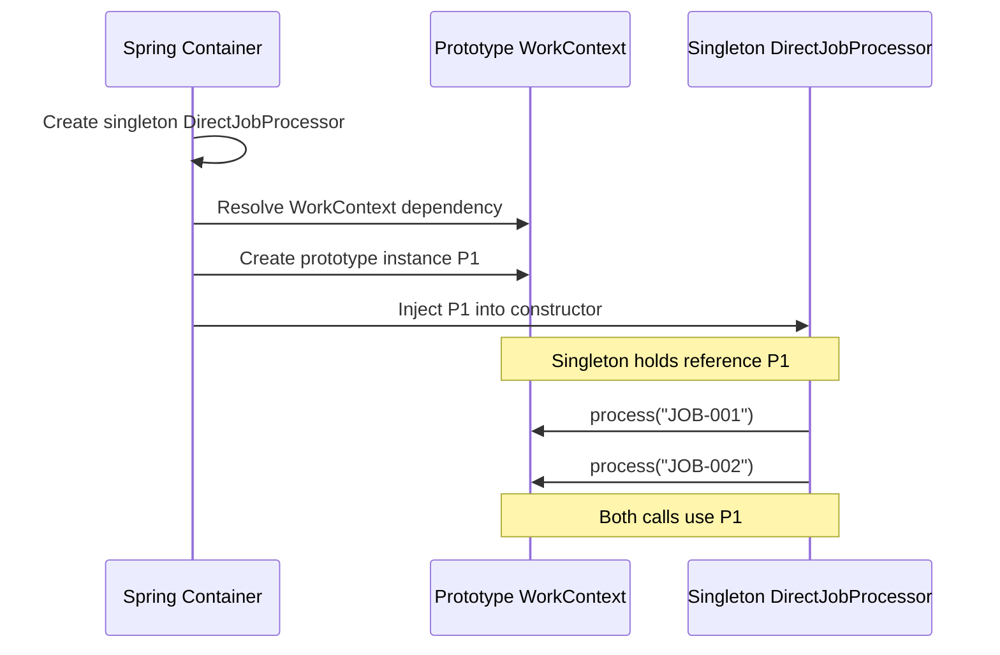
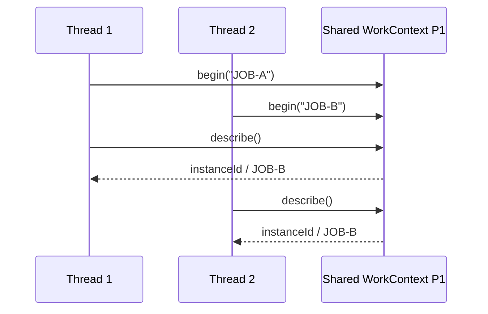
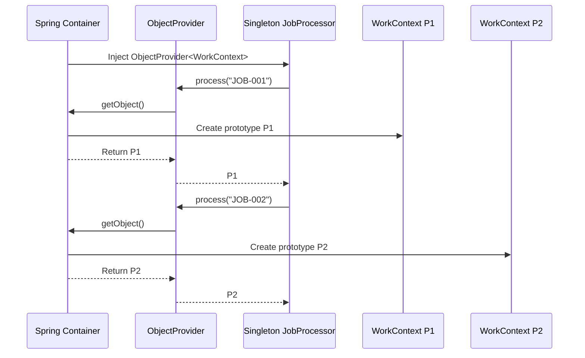

# Injecting a Prototype into a Singleton and the Consequences of Single-Time Injection

In Spring, every bean has a **scope** that determines how the container creates and shares instances. The two scopes typically learned first are `singleton` and `prototype`. Singleton is the default scope: Spring manages one instance per bean definition within an application context. Prototype instructs the container to create a new instance each time the bean is retrieved from the container.

However, a confusing situation arises when **a singleton receives a prototype via constructor or field injection**. Beginners may think that every time a method on the singleton is called, Spring will automatically create a new prototype. In reality, dependencies are resolved when the singleton is created. The prototype is created and injected **once** at that point; the singleton holds a reference to that exact instance for its entire lifetime.

This lesson explains that mechanism, its consequences for state and concurrency, how to request a fresh prototype per execution using `ObjectProvider` or method injection, and the responsibility of managing a prototype's lifecycle.

## 1. Reviewing Singleton and Prototype

Spring beans have scopes. Scope answers the question: **when the container needs to provide a bean, which instance will be used or created?**

### 1.1. Singleton

With `singleton` scope, Spring maintains one instance per bean definition within a container. This is the default scope for a Spring bean unless another scope is declared.

```java
@Component
public class PricingService {
}
```

Two components injecting the `PricingService` bean by type within the same context will normally receive the same instance. Singleton scope does not mean only one object of this class exists in the entire JVM: other code can still call `new PricingService()` outside the container, and one class can have multiple distinct bean definitions.

### 1.2. Prototype

With `prototype` scope, each time the bean is requested from the container, Spring creates a new instance. For example:

```java
@Component
@Scope(ConfigurableBeanFactory.SCOPE_PROTOTYPE)
public class WorkContext {
}
```

When code directly retrieves the bean from the context twice:

```java
WorkContext first = applicationContext.getBean(WorkContext.class);
WorkContext second = applicationContext.getBean(WorkContext.class);
```

the two lookups receive two different prototype instances, provided they resolve as two independent requests to the container.

### 1.3. Comparison

| Characteristic | Singleton | Prototype |
| --- | --- | --- |
| Behavior when container resolves bean | Uses the singleton instance of the bean definition | Creates a new instance for each resolution |
| Number of instances | Typically one instance per bean definition in context | Can have multiple instances in the same context |
| Mutable state | May be shared across multiple components and threads | Each instance has its own state, yet can still be shared after creation |
| Lifecycle management | Container manages initialization and destruction per lifecycle | Container initializes and configures; caller is typically responsible for cleanup after receiving |
| Common use cases | Stateless services, repositories, shared configuration | Short-lived stateful objects, context for a single execution |

Prototype does not mean "one instance per HTTP request," "one instance per thread," or "one instance per method call." It means **one instance per request for the bean from the container**. Who requests it, when they request it, and how long they keep the reference are matters of wiring and calling code.

## 2. What Happens When Injecting a Prototype Directly into a Singleton?

Suppose there is a class holding state for a job:

```java
package com.example.jobs;

import java.util.UUID;
import org.springframework.context.annotation.Scope;
import org.springframework.beans.factory.config.ConfigurableBeanFactory;
import org.springframework.stereotype.Component;

@Component
@Scope(ConfigurableBeanFactory.SCOPE_PROTOTYPE)
public class WorkContext {

    private final UUID instanceId = UUID.randomUUID();
    private String jobId;

    public void begin(String jobId) {
        this.jobId = jobId;
    }

    public String describe() {
        return instanceId + " / " + jobId;
    }

    public void clear() {
        jobId = null;
    }
}
```

`WorkContext` has prototype scope. Each time the container creates this bean, it gets a different `instanceId`. The `jobId` state is mutated during processing.

Now a singleton service injects it directly:

```java
package com.example.jobs;

import org.springframework.stereotype.Service;

@Service
public class DirectJobProcessor {

    private final WorkContext workContext;

    public DirectJobProcessor(WorkContext workContext) {
        this.workContext = workContext;
    }

    public String process(String jobId) {
        workContext.begin(jobId);
        return workContext.describe();
    }
}
```

Because `DirectJobProcessor` does not declare another scope, it is a singleton by default. When Spring creates this singleton, the container needs to supply the `WorkContext` parameter to the constructor. At that moment, Spring creates one prototype instance and injects it into the constructor.

After the constructor finishes, the `workContext` field holds a reference to that instance. Every time `process` is called, the code reuses the same reference. **Spring does not revisit the constructor and does not automatically re-resolve the prototype dependency on each method call.**

### 2.1. Bean Creation Sequence



Key points to remember:

1. Prototype scope is applied when the container resolves the bean.
2. Constructor injection of the singleton occurs during singleton creation.
3. The dependency resolved at that moment is a specific prototype instance.
4. The singleton retains that instance; calling methods again does not automatically trigger a new bean resolution.

## 3. Observing the Consequence with Runnable Code

We can add a runner to call the singleton twice:

```java
@Bean
CommandLineRunner directPrototypeDemo(DirectJobProcessor processor) {
    return args -> {
        System.out.println(processor.process("JOB-001"));
        System.out.println(processor.process("JOB-002"));
    };
}
```

The output looks like:

```text
8a1... / JOB-001
8a1... / JOB-002
```

Both `instanceId` values are identical because both executions use the same `WorkContext` injected at singleton initialization. The UUID portion is illustrative; actual values vary per run.

If the goal is for each job to have its own context, the desired output would look like:

```text
8a1... / JOB-001
7b2... / JOB-002
```

However, prototype scope alone does not produce that result when the dependency is injected directly into a singleton. The way the prototype is retrieved must change.

## 4. Consequence 1: Prototype State Is Retained Longer Than Intended

The name `prototype` easily leads readers to think the object only lives for a single execution. Yet when a prototype is injected directly into a singleton, **the actual reference lifetime depends on the singleton holding it**, rather than ending automatically after one method call.

In the example:

```java
public String process(String jobId) {
    workContext.begin(jobId);
    return workContext.describe();
}
```

`workContext` is a field of the singleton. It is not replaced after `process` returns. The next execution mutates `jobId` on the same object.

This can lead to:

- Stale state remaining if the method does not reset thoroughly.
- One execution reading data left behind by a previous run.
- A mid-way error leaving the object in an incomplete state.
- A singleton inadvertently accumulating data over time.
- Code that is hard to test because the dependency's state depends on method call order.

If the object is truly designed as a per-job context, reusing the same instance defeats the intent of the design.

## 5. Consequence 2: Risk of Race Conditions Under Concurrent Singleton Execution

Singletons are often used by multiple requests or multiple threads. If a singleton holds a single mutable prototype, concurrent calls can overwrite each other's state.

Example:

```java
public String process(String jobId) {
    workContext.begin(jobId);
    // Suppose time-consuming steps occur here.
    return workContext.describe();
}
```

Two threads can interleave as follows:



Thread 1 can receive job B's data because Thread 2 changed the `jobId` field on the same instance. This is a race condition caused by shared mutable state.

A prototype injected once into a singleton **does not automatically create isolation between invocations**. Even though the class bears `@Scope("prototype")`, the specific held instance is still shared like a regular field.

### 5.1. Prototype Does Not Automatically Mean Thread-Safe

Even when obtaining a fresh prototype via `ObjectProvider` for each execution, the object can still end up shared if code stores it in a singleton field, hands the same reference to multiple threads, or uses it in an asynchronous task without controlling ownership.

Principles:

- Obtain a separate instance for a single unit of work.
- Keep the reference in a local variable of the execution.
- Do not store that instance in a shared singleton field.
- Do not pass the same mutable object to multiple threads without proper synchronization design.

## 6. Recommended Approach: Inject ObjectProvider<T>

Spring provides `ObjectProvider<T>` so a bean can request a dependency from the container **when needed**, instead of receiving the prototype instance directly when the singleton is initialized.

Rewrite the service:

```java
package com.example.jobs;

import org.springframework.beans.factory.ObjectProvider;
import org.springframework.stereotype.Service;

@Service
public class JobProcessor {

    private final ObjectProvider<WorkContext> contextProvider;

    public JobProcessor(ObjectProvider<WorkContext> contextProvider) {
        this.contextProvider = contextProvider;
    }

    public String process(String jobId) {
        WorkContext context = contextProvider.getObject();
        context.begin(jobId);
        return context.describe();
    }
}
```

Here, the singleton only holds an `ObjectProvider<WorkContext>`. The provider is a Spring-supported bean retrieval mechanism. Each time `getObject()` is called, the provider asks the container to resolve `WorkContext`. Because the `WorkContext` bean has prototype scope, the container creates a new instance for that request.

Processing flow:



Expected output:

```text
instance-A / JOB-001
instance-B / JOB-002
```

Two calls to `getObject()` are two independent resolutions; with prototype scope, each call receives a new instance.

### 6.1. What Dependency Is ObjectProvider?

`ObjectProvider` is not a business bean you have to create yourself. Spring has built-in support for injecting providers as special dependencies for on-demand bean access. The singleton receives the provider at initialization, but **the prototype is only retrieved when code calls `getObject()`**.

This is the key difference:

| Singleton constructor receives | When is the prototype resolved? | Subsequent singleton method calls |
| --- | --- | --- |
| `WorkContext` | When creating the singleton | Reuse the injected instance |
| `ObjectProvider<WorkContext>` | Each time `getObject()` is called | Can obtain a fresh instance each time |

### 6.2. Using the Provider Within a Complete Execution Scope

You can make the usage scope explicit with a local variable:

```java
@Service
public class JobProcessor {

    private final ObjectProvider<WorkContext> contextProvider;

    public JobProcessor(ObjectProvider<WorkContext> contextProvider) {
        this.contextProvider = contextProvider;
    }

    public String process(String jobId) {
        WorkContext context = contextProvider.getObject();
        context.begin(jobId);
        try {
            return context.describe();
        } finally {
            context.clear();
        }
    }
}
```

In this example, `clear()` merely illustrates cleaning up state controlled by application code. If the prototype manages real resources such as file handles, streams, or connections it opened itself, the caller must close/release them per contract. Do not assume Spring will automatically call destruction callbacks on the prototype when the method ends.

## 7. ObjectFactory<T> and Provider<T>

Besides `ObjectProvider<T>`, there are similar abstractions for retrieving objects on demand.

### 7.1. ObjectFactory<T>

`ObjectFactory<T>` is a simple Spring abstraction:

```java
import org.springframework.beans.factory.ObjectFactory;

@Service
public class JobProcessor {

    private final ObjectFactory<WorkContext> contextFactory;

    public JobProcessor(ObjectFactory<WorkContext> contextFactory) {
        this.contextFactory = contextFactory;
    }

    public String process(String jobId) {
        WorkContext context = contextFactory.getObject();
        context.begin(jobId);
        return context.describe();
    }
}
```

When `WorkContext` is a prototype, each call to `getObject()` resolves a new bean. `ObjectProvider` extends `ObjectFactory` capabilities with utility operations such as checking whether a bean is available or iterating candidates in supported scenarios.

### 7.2. jakarta.inject.Provider<T>

If the application uses the corresponding Jakarta Dependency Injection API, `jakarta.inject.Provider<T>` can be used:

```java
import jakarta.inject.Provider;

@Service
public class JobProcessor {

    private final Provider<WorkContext> contextProvider;

    public JobProcessor(Provider<WorkContext> contextProvider) {
        this.contextProvider = contextProvider;
    }

    public String process(String jobId) {
        WorkContext context = contextProvider.get();
        context.begin(jobId);
        return context.describe();
    }
}
```

This requires the compatible API/provider dependency to be present in the application and supported by Spring in the current configuration. For a pure Spring application, `ObjectProvider` is usually easier to read and offers richer Spring integration.

### 7.3. Which Abstraction Should You Choose?

| Mechanism | Method to get instance | When to consider |
| --- | --- | --- |
| `ObjectProvider<T>` | `getObject()` | Spring applications needing a provider with Spring utilities |
| `ObjectFactory<T>` | `getObject()` | Only need Spring's minimal factory abstraction |
| `jakarta.inject.Provider<T>` | `get()` | Want to use the standard Jakarta DI abstraction with compatible dependencies |
| `ApplicationContext.getBean(...)` | `getBean()` | Direct container access; generally avoid in ordinary business services |

The core point is not the provider name, but **when the bean is resolved**. The singleton holds the provider; whenever a new prototype instance is needed, code invokes the provider at the right processing boundary.

## 8. Another Approach: Method Injection with @Lookup

Spring supports *lookup method injection*. A method annotated with `@Lookup` is overridden by the container via subclassing so that every time the method is invoked, the container looks up the corresponding bean.

Example:

```java
package com.example.jobs;

import org.springframework.beans.factory.annotation.Lookup;
import org.springframework.stereotype.Service;

@Service
public class LookupJobProcessor {

    public String process(String jobId) {
        WorkContext context = newWorkContext();
        context.begin(jobId);
        return context.describe();
    }

    @Lookup
    protected WorkContext newWorkContext() {
        // Spring overrides this method when creating the bean.
        return null;
    }
}
```

When `LookupJobProcessor` is a Spring-managed bean, the container generates a subclass overriding `newWorkContext()` to fetch `WorkContext` from the context. Since `WorkContext` is a prototype, each method invocation receives a new instance.

### 8.1. Limitations of @Lookup

- The bean containing the lookup method must be managed by Spring and able to be subclassed by the appropriate mechanism.
- The class cannot be `final`; the overridden method also cannot be `private` or `final`.
- Lookup method injection relies on subclassing, so it will not work as intended if you instantiate the object manually with `new`.
- This mechanism does not suit bean instances returned from `@Bean` factory methods in the usual way, because the container does not subclass an object already constructed by a factory method.
- The method body returning `null` in the example is just a placeholder for Spring to override; if called on a manually created object, it will return `null`.

`@Lookup` is handy when expressing "every time this method is called, get a new bean." However, it feels more magical than `ObjectProvider` and is harder to test in plain Java. For most modern services, **injecting a provider is usually more transparent and flexible**.

## 9. Why Not Call ApplicationContext.getBean() Directly?

One way to obtain a fresh prototype is to inject `ApplicationContext` and call:

```java
@Service
public class ServiceLocatorJobProcessor {

    private final ApplicationContext context;

    public ServiceLocatorJobProcessor(ApplicationContext context) {
        this.context = context;
    }

    public String process(String jobId) {
        WorkContext workContext = context.getBean(WorkContext.class);
        workContext.begin(jobId);
        return workContext.describe();
    }
}
```

This snippet can obtain a new prototype on every `getBean` call. However, the service now depends directly on the container and performs bean lookups itself.

Consequences:

- The `WorkContext` dependency is no longer directly visible in the constructor API.
- Unit tests have to handle `ApplicationContext` or mock a service locator instead of passing an explicit factory.
- Business/application services become aware of Spring framework internals.
- Reading the class makes it harder to see exactly which dependencies are used.

`ObjectProvider<WorkContext>` also retrieves beans on demand, yet explicitly declares the requested dependency type. It is a narrower abstraction than the global container and fits better when prototypes are needed in Spring.

Not every `getBean` call is wrong: infrastructure code, plugin registries, or framework integration points may have valid reasons. Still, in regular business services, prefer constructor injection for required dependencies and providers for retrieving multiple instances.

## 10. New Prototype Per Call or Per Unit of Work?

When using a provider, the developer decides when the prototype is created. That means you must identify the right **boundary of a single execution**.

For example, a batch processor handling a list of 100 jobs:

```java
public void processAll(List<String> jobIds) {
    for (String jobId : jobIds) {
        WorkContext context = contextProvider.getObject();
        context.begin(jobId);
        processOne(context);
    }
}
```

In this example, each job receives a prototype because the provider is called inside the loop. If the provider call is placed outside the loop:

```java
public void processAll(List<String> jobIds) {
    WorkContext context = contextProvider.getObject();
    for (String jobId : jobIds) {
        context.begin(jobId);
        processOne(context);
    }
}
```

then the entire list reuses one instance. Both are valid with respect to scope; only one matches a specific business requirement.

Distinguish:

| Desired boundary | Where to call `getObject()` |
| --- | --- |
| One instance per job | Inside the job-processing loop |
| One instance for the entire batch | Before the loop |
| One instance per service method call | Start of the method |
| One instance per request | In the request processing flow, if a request is truly the desired boundary |
| One instance per thread | Requires thread-scoped design or passing per-thread instances; prototype does not guarantee this automatically |

**Prototype is an instance-creation-per-resolution mechanism, not a policy defining units of work.** Application code itself chooses the unit of work by where it calls the provider.

## 11. Prototype and Request Scope Are Not the Same

Some developers pick prototype thinking it means "one instance per HTTP request." Those two meanings differ.

- Prototype: each time the container resolves the bean, a new instance is created.
- Request scope: one instance bound to the lifecycle of one HTTP request in a suitable web application context.

If you want data to live only for a single HTTP request, request scope expresses that intent more accurately. However, a request-scoped bean injected into a singleton typically requires a scoped proxy or an appropriate provider so the reference resolves to the current request.

Prototype does not attach itself to an HTTP request. If a singleton calls `getObject()` three times within the same request, it can receive three different prototypes. If two requests call a singleton that directly holds a prototype injected at startup, both requests can share that single instance.

Choose scope by the **logical lifecycle of the data**:

| Requirement | Mechanism that may fit |
| --- | --- |
| Shared stateless service | Singleton |
| New object each time requested from container | Prototype |
| Separate state within one HTTP request | Request scope |
| Separate state per HTTP session | Session scope, when appropriate |
| State for an application-orchestrated task | Prototype via provider or explicitly created/closed object |

## 12. Prototype and Destruction Lifecycle

This is a key difference between prototype and singleton.

For singletons, Spring manages most of the bean lifecycle in the context, including calling appropriate destruction callbacks when the context closes. For prototypes, Spring instantiates the object, injects dependencies, and applies initialization steps; after handing the instance to the client, the container **does not continue full lifecycle tracking to automatically invoke destruction callbacks when the object is no longer used**.

Example:

```java
@Component
@Scope(ConfigurableBeanFactory.SCOPE_PROTOTYPE)
public class FileWorkContext {

    private InputStream inputStream;

    public void open(Path path) throws IOException {
        inputStream = Files.newInputStream(path);
    }

    @PreDestroy
    public void close() throws IOException {
        if (inputStream != null) {
            inputStream.close();
        }
    }
}
```

This snippet requires the appropriate Java imports and `jakarta.annotation.PreDestroy` on modern Spring Boot stacks. However, **do not expect a prototype's `@PreDestroy` to be invoked automatically when each execution finishes**. Spring does not manage prototype instance destruction the way it manages singletons.

If a prototype opens resources, the caller must close them via an explicit API, for example:

```java
WorkContext context = contextProvider.getObject();
try {
    context.begin(jobId);
    context.execute();
} finally {
    context.close();
}
```

If the class implements `AutoCloseable`, the contract can be designed for `try-with-resources`:

```java
try (WorkContext context = contextProvider.getObject()) {
    context.begin(jobId);
    context.execute();
}
```

This requires `WorkContext implements AutoCloseable` and a `close()` method that releases resources. The closing mechanism must be designed explicitly; not every prototype needs explicit cleanup if it only holds ordinary Java data.

### 12.1. A Prototype's Dependencies Can Still Be Singletons

Suppose a prototype `WorkContext` receives a singleton `Clock` via its constructor. Every new prototype still receives the same `Clock` bean if `Clock` has singleton scope. A bean's scope does not automatically propagate to its dependencies.

```java
@Configuration
class WorkConfiguration {

    @Bean
    Clock clock() {
        return Clock.systemUTC();
    }

    @Bean
    @Scope(ConfigurableBeanFactory.SCOPE_PROTOTYPE)
    WorkContext workContext(Clock clock) {
        return new WorkContext(clock);
    }
}
```

In this example, each resolution of `WorkContext` creates a new context, while the `Clock` dependency is reused under the default singleton scope. This is usually the desired behavior for a stateless dependency.

## 13. Verifying Scope Behavior with Tests

You can verify directly with a small Spring context:

```java
import static org.junit.jupiter.api.Assertions.assertNotSame;
import static org.junit.jupiter.api.Assertions.assertSame;

import org.junit.jupiter.api.Test;
import org.springframework.beans.factory.config.ConfigurableBeanFactory;
import org.springframework.context.annotation.AnnotationConfigApplicationContext;
import org.springframework.context.annotation.Bean;
import org.springframework.context.annotation.Configuration;
import org.springframework.context.annotation.Scope;

class BeanScopeTest {

    @Configuration
    static class TestConfiguration {

        @Bean
        @Scope(ConfigurableBeanFactory.SCOPE_PROTOTYPE)
        WorkContext workContext() {
            return new WorkContext();
        }

        @Bean
        ObjectHolder singletonHolder(WorkContext context) {
            return new ObjectHolder(context);
        }
    }

    @Test
    void prototypeLookupReturnsDifferentInstances() {
        try (var context =
                     new AnnotationConfigApplicationContext(TestConfiguration.class)) {
            WorkContext first = context.getBean(WorkContext.class);
            WorkContext second = context.getBean(WorkContext.class);

            assertNotSame(first, second);
        }
    }

    @Test
    void prototypeInjectedDirectlyIntoSingletonIsResolvedOnce() {
        try (var context =
                     new AnnotationConfigApplicationContext(TestConfiguration.class)) {
            ObjectHolder holder =
                    context.getBean(ObjectHolder.class);

            assertSame(holder.context(), holder.context());
        }
    }

    record ObjectHolder(WorkContext context) {
    }
}
```

This test example uses `AnnotationConfigApplicationContext` to demonstrate scope without starting an entire web application. `WorkContext` in the test is a class with a suitable constructor; in a real project you can use the prototype class from earlier examples.

The first test confirms two direct `getBean` calls receive two different instances. The second test confirms the singleton holder retains only one injected reference. Calling the `context()` accessor twice does not trigger any additional bean resolution.

To test the provider solution, add a singleton bean receiving `ObjectProvider<WorkContext>` and call `getObject()` twice, then assert the two results are not the same object.

## 14. Commonly Chosen Solutions

| Approach | Behavior | When to use |
| --- | --- | --- |
| Inject prototype directly into singleton | One prototype is resolved when singleton is created and retained | Only when you actually want the singleton to keep that single instance |
| Inject `ObjectProvider<T>` | Resolves when `getObject()` is called | Need a new instance per unit of work |
| Inject `ObjectFactory<T>` | Resolves when `getObject()` is called | Need Spring's simple factory abstraction |
| Inject `Provider<T>` | Resolves when `get()` is called | When using a compatible Jakarta DI abstraction |
| `@Lookup` | Spring overrides method to look up on each call | When wanting method injection and accepting subclassing mechanics |
| Inject `ApplicationContext` and call `getBean` | Manually query container each time | Consider only in infrastructure/registry code with clear justification |
| Create plain objects via Java factory | Application code/factory constructs objects itself | When objects do not need container management |

No single approach is best for all cases. The deciding question is: **who is responsible for creating the instance, and within what boundary must the instance live?**

## 15. Common Misconceptions

| Misconception | Reality |
| --- | --- |
| "A prototype injected into a singleton becomes new on every method call." | Dependency is resolved when creating the singleton; the field holds the same prototype instance. |
| "Prototype means one object per request." | Prototype creates a new instance on each container resolution; request scope is what ties to HTTP requests. |
| "Prototypes are automatically thread-safe." | Separate instances only isolate if not re-shared; mutable objects can still be shared across multiple threads. |
| "Spring will call @PreDestroy when the prototype is no longer used." | The container does not fully track prototype destruction callbacks after handing the object to the client. |
| "Injecting ObjectProvider means the provider creates objects with new." | The provider asks the container to resolve the bean according to its registered scope and configuration. |
| "Calling getObject() once in the constructor is enough." | Doing so resolves only once; to get a new instance per execution, call the provider at the right processing boundary. |
| "Every prototype must use ObjectProvider." | Providers are only needed when multiple resolutions are required; direct injection can be right if retaining one instance is intended. |
| "@Lookup can be used on any class." | Method injection has subclassing constraints and depends on Spring-managed beans. |

## 16. Practice Exercises

### Exercise 1 – Predict the Instance ID

A singleton `@Service` injects `@Scope("prototype") WorkContext` via its constructor. The service has a method:

```java
public UUID currentId() {
    return context.getInstanceId();
}
```

How many distinct IDs will calling `currentId()` three times return? Explain based on when Spring resolves dependencies.

**Hint:** all three calls use the same reference injected when the singleton was created, so usually only one ID is returned.

### Exercise 2 – Switch to ObjectProvider

Modify the service to accept `ObjectProvider<WorkContext>`. Each call to `process(jobId)` must call `getObject()` once and keep the result in a local variable. Call the method twice and observe two IDs.

**Hint:** do not store the new prototype in a singleton field if the goal is to isolate instances per job.

### Exercise 3 – Identify the Resolution Boundary

A batch contains 50 jobs. Compare the two snippets:

```java
WorkContext context = provider.getObject();
for (String jobId : jobIds) {
    processOne(context, jobId);
}
```

and:

```java
for (String jobId : jobIds) {
    WorkContext context = provider.getObject();
    processOne(context, jobId);
}
```

Which snippet creates one context for the entire batch? Which snippet creates one context per job? Is it necessary to close or reset the context after each execution?

### Exercise 4 – Spot the Race Condition

Given a singleton service holding a mutable prototype in a field, two threads concurrently call a method and modify `jobId`. Draw the timeline, pinpoint where the overwrite happens, and propose how to obtain a separate instance for each execution.

**Hint:** inject a provider, call `getObject()` inside the method, and store the object in a local variable. If work is handed off to another thread, ensure the instance is not unintentionally shared.

### Exercise 5 – Prototype Resource Management

A prototype opens a file in `open()` and holds an `InputStream`. Design the class to implement `AutoCloseable`, then use a provider and `try-with-resources` to ensure the stream is closed after the job completes.

Explain why you should not rely on `@PreDestroy` for Spring to automatically close prototypes after each execution.

### Exercise 6 – Choose the Right Scope

Classify the following needs:

1. A calculation service holding no per-request state.
2. An object accumulating temporary data during a single job.
3. A context existing only for one HTTP request.
4. An object requested anew each time code calls the container.

**Hint:** consider singleton, prototype via provider, request scope, and prototype respectively. State clearly who creates the instance and who is responsible for ending its lifecycle.

## 17. Key Takeaways

When a singleton receives a prototype directly via constructor, Spring creates the prototype while resolving dependencies for the singleton. Thereafter, the singleton retains a reference to that instance. **Prototype scope does not automatically turn a dependency into a new instance on each method call.**

If a fresh prototype is needed per execution, inject `ObjectProvider<T>`, `ObjectFactory<T>`, or a suitable provider, and call its retrieval method at the right work boundary. `@Lookup` is another option, though it relies on subclassing and carries specific constraints.

At the same time, remember three critical consequences:

- **Reference lifetime:** a directly injected prototype can be held by the singleton for a very long time, causing stale state to linger unexpectedly.
- **Concurrency:** a mutable prototype held in a singleton can be shared across multiple requests/threads and cause race conditions.
- **Cleanup:** Spring does not fully manage prototype destruction callbacks after handing the instance to the client; if the object owns resources, calling code must close or release them per contract.

When choosing a scope, start with the question: **should an instance belong to a bean, a resolution, a request, or a unit of work?** Then choose the corresponding injection approach and retrieval point. This is the accurate way to understand the relationship between scope and dependency injection in Spring Boot.
