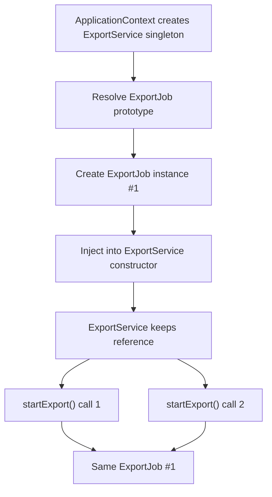
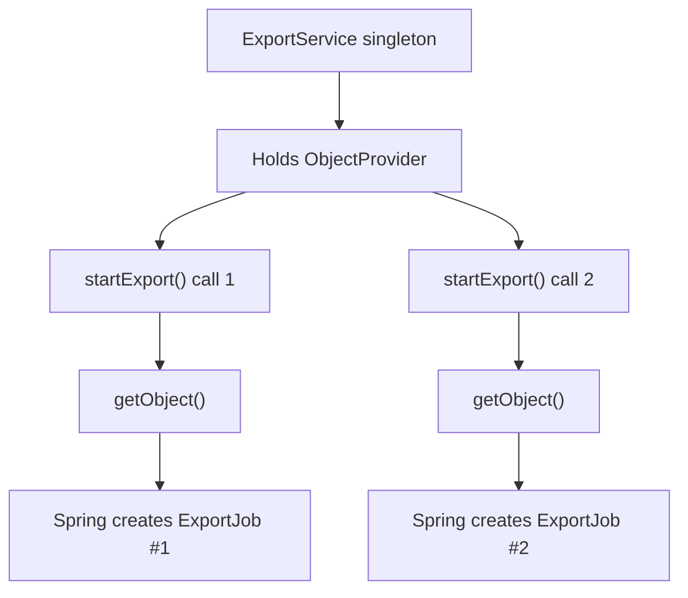
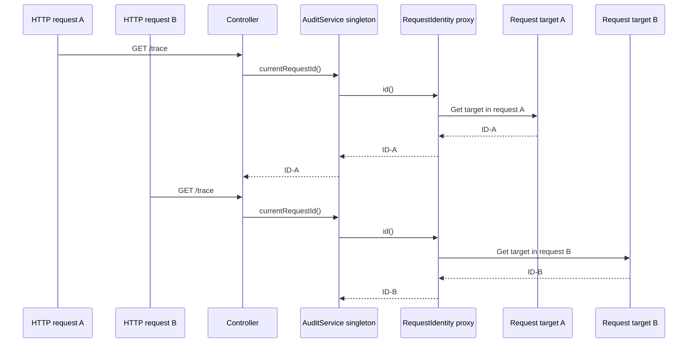

# ObjectProvider or Scoped Proxy to Obtain the Right Scoped Instance

In Spring, beans do not always share the same lifecycle. A service is usually a singleton, a job object might be a prototype, and data tied to an HTTP request should live within that request. When a longer-lived bean needs to use a shorter-lived bean, direct injection can cause the application to retain an instance for too long.

Spring provides two common ways to address this situation:

- **`ObjectProvider<T>`**: allows requesting the bean from the container at the moment it is needed. The container returns an instance according to its declared scope.
- **Scoped proxy**: injects a proxy into the consuming bean; the proxy delegates calls to the actual target instance belonging to the current active scope.

This lesson belongs to the **Bean Scopes** chapter of *Spring Boot Fundamentals*. We will start from singleton/prototype, see the problem when injecting a prototype directly into a singleton, and then use `ObjectProvider` and scoped proxies for different needs. The web section demonstrates request scope and session scope in a Spring Boot 3.x application.

The examples use Java 21 and Spring Boot 3.x. The code snippets illustrate parts of a project with appropriate Spring configuration; request/session scope examples require a web application context and an active HTTP request/session.

## 1. Reviewing Scopes: How Long Does a Bean Live?

**Bean scope** defines how Spring provides instances of a bean. Several important scopes:

| Scope | How instances are provided | Common use cases |
|---|---|---|
| `singleton` | One instance per bean definition within a Spring container | Stateless services, repositories, components |
| `prototype` | Creates a new instance each time the container is asked for the bean | Short-lived task objects with their own state |
| `request` | One instance per HTTP request | Data belonging only to a single request |
| `session` | One instance per HTTP session | Data that must persist across multiple requests of a session |
| `application` | One instance within the `ServletContext` of a web application | Shared state at the web application level |
| `websocket` | One instance within a WebSocket session | Data tied to a WebSocket connection |

If no scope is declared, a regular Spring bean defaults to `singleton`.

### Singleton and Prototype

A singleton:

```java
import org.springframework.stereotype.Component;

@Component
public class ApplicationClock {
    public long currentTimeMillis() {
        return System.currentTimeMillis();
    }
}
```

When multiple beans request `ApplicationClock`, Spring normally supplies the same singleton instance within that container.

A prototype:

```java
import java.util.UUID;
import org.springframework.beans.factory.config.ConfigurableBeanFactory;
import org.springframework.context.annotation.Scope;
import org.springframework.stereotype.Component;

@Component
@Scope(ConfigurableBeanFactory.SCOPE_PROTOTYPE)
public class ExportJob {

    private final String jobId = UUID.randomUUID().toString();

    public String getJobId() {
        return jobId;
    }
}
```

When the container is asked for `ExportJob` multiple times, it creates a new instance each time. Each instance has its own `jobId`.

Key point to remember: scope defines **how the container provides instances**, not when business logic calls methods. If you hold a reference to a prototype object, that reference continues pointing to the exact instance received.

## 2. The Problem: Injecting a Prototype Directly into a Singleton

Suppose a singleton service needs to create multiple export jobs:

```java
import org.springframework.stereotype.Service;

@Service
public class ExportService {

    private final ExportJob exportJob;

    public ExportService(ExportJob exportJob) {
        this.exportJob = exportJob;
    }

    public String startExport() {
        return exportJob.getJobId();
    }
}
```

`ExportService` is a singleton by default. `ExportJob` has prototype scope. Many expect each call to `startExport()` to get a new `ExportJob`, but that **does not happen automatically**.

What actually happens:

1. Spring creates the `ExportService` singleton during context initialization.
2. While creating `ExportService`, Spring resolves the `ExportJob` dependency and creates one prototype instance.
3. That instance is passed into the constructor and stored in the `exportJob` field.
4. `ExportService` keeps this reference throughout the singleton's lifecycle.
5. Each call to `startExport()` calls the same `ExportJob` instance injected initially.



This is the difference between the **scope of the bean provided by the container** and the **lifetime of the reference held by the consumer**. Prototype scope does not turn a field in a singleton into a fresh object lookup on every access.

## 3. Using `ObjectProvider<T>` to Obtain an Instance When Needed

`ObjectProvider<T>` is Spring's abstraction for querying beans from the container on demand. Instead of injecting `ExportJob` directly, we inject `ObjectProvider<ExportJob>`:

```java
import org.springframework.beans.factory.ObjectProvider;
import org.springframework.stereotype.Service;

@Service
public class ExportService {

    private final ObjectProvider<ExportJob> exportJobs;

    public ExportService(ObjectProvider<ExportJob> exportJobs) {
        this.exportJobs = exportJobs;
    }

    public String startExport() {
        ExportJob job = exportJobs.getObject();
        return job.getJobId();
    }
}
```

Each time `exportJobs.getObject()` is called, the provider asks Spring to resolve the `ExportJob` bean. Because `ExportJob` has prototype scope, the container creates a new instance for each call. The `ExportService` singleton only holds the provider, not a single prototype instance.



This is the appropriate approach when the consumer wants to **explicitly obtain an instance at the moment of use**.

### 3.1. A Provider Does Not Create Prototypes If the Scope Is Singleton

`ObjectProvider` does not force a bean to become a prototype. It simply asks the container to supply the bean according to its existing scope configuration:

| Dependency scope | Result when calling `getObject()` multiple times |
|---|---|
| `singleton` | Returns the same singleton instance for that bean definition. |
| `prototype` | Creates a new instance on each request. |
| `request` | Within the same active request, returns that request's instance; other requests get different instances. |
| `session` | Within the same session, returns the instance bound to that session; other sessions get different instances. |

Therefore, if you want multiple independent `ExportJob` instances, **prototype scope must be declared properly**. Changing the field to `ObjectProvider<ExportJob>` while leaving `ExportJob` as a singleton still returns the same singleton bean on every `getObject()` call.

### 3.2. Useful Methods of `ObjectProvider`

`ObjectProvider<T>` extends Spring's provider mechanism and offers several retrieval methods:

| Method | Meaning |
|---|---|
| `getObject()` | Retrieves a bean; if none exists or it cannot be uniquely resolved, an exception may be thrown. |
| `getObject(args...)` | Requests a bean with creation arguments, in scenarios where the bean factory supports explicit arguments. |
| `getIfAvailable()` | Retrieves the bean if present; returns `null` if there is no candidate, though ambiguity can still fail. |
| `getIfUnique()` | Retrieves the bean when there is a single unique choice per resolution rules; returns `null` if no unique choice exists. |
| `ifAvailable(consumer)` | Executes the consumer if the bean can be provided. |
| `ifUnique(consumer)` | Executes the consumer if a unique candidate exists. |
| `stream()` | Accesses a stream of matching candidate beans. |
| `orderedStream()` | Accesses a stream in container-supported order. |

Example of an optional dependency:

```java
import org.springframework.beans.factory.ObjectProvider;
import org.springframework.stereotype.Service;

@Service
public class ReportService {

    private final ObjectProvider<ReportExporter> exporters;

    public ReportService(ObjectProvider<ReportExporter> exporters) {
        this.exporters = exporters;
    }

    public void export(Report report) {
        exporters.ifAvailable(exporter -> exporter.export(report));
    }
}
```

This example expresses that the exporter may be absent. If the exporter is a required dependency, use direct constructor injection so Spring fails fast when the bean is missing. Do not use a provider solely to mask missing configuration.

### 3.3. How Do `getIfAvailable` and `getIfUnique` Differ?

These two methods address two different conditions:

- `getIfAvailable()` checks whether a matching bean is available. If multiple beans exist but a valid selection rule applies (e.g., primary/qualifier), a bean can be returned.
- `getIfUnique()` only returns a bean when the container identifies a single unique candidate under resolution rules; if there is no unique candidate, it returns `null`.

If the application has multiple implementations and needs to pick a specific one, combine the provider with a qualifier:

```java
@Service
public class BankExportService {

    private final ObjectProvider<ReportExporter> exporters;

    public BankExportService(
            @Qualifier("csvReportExporter")
            ObjectProvider<ReportExporter> exporters) {
        this.exporters = exporters;
    }

    public void export(Report report) {
        exporters.getObject().export(report);
    }
}
```

The qualifier name here is an example, assuming a matching bean exists in the application. The qualifier identifies which candidate the provider requests; the provider still respects the selected bean's scope.

## 4. How Does `ObjectProvider` Differ from `ObjectFactory` or `Provider`?

Spring supports several abstractions for on-demand dependency retrieval:

| API | Characteristics |
|---|---|
| `ObjectFactory<T>` | Small Spring API with `getObject()` to obtain an object from the factory. |
| `ObjectProvider<T>` | Extends `ObjectFactory<T>`, adding methods for optional/unique candidates and streams. |
| `jakarta.inject.Provider<T>` | Standard Jakarta Inject API with `get()` to obtain an instance. Supported by Spring in suitable environments. |

When Spring-specific bean selection and resolution capabilities are needed, `ObjectProvider` is usually more convenient. If only a minimal provider abstraction is needed or you want to depend on a standard API, consider `ObjectFactory` or Jakarta `Provider` depending on context.

Do not confuse a provider with an object that constructs instances using `new`. A provider asks the Spring container to resolve the bean, so the bean is still created according to its bean definition, scope, qualifiers, and container dependency management.

## 5. What Is a Scoped Proxy?

A scoped proxy is a **proxy object representing a bean from another scope**. Instead of injecting the real target instance directly into the consumer, Spring injects a proxy. When the consumer invokes a method on the proxy, the proxy locates the actual target instance belonging to the current scope and forwards the call.

This is especially useful when a singleton bean needs to use an HTTP request-scoped or HTTP session-scoped bean.

For example, a singleton service needs to know the ID of the current request. We do not want the service to hold stale data from an old request and mistakenly reuse it for subsequent requests.

### 5.1. Declaring a Request-Scoped Bean

Define an interface:

```java
package com.example.demo.web;

public interface RequestIdentity {
    String id();
}
```

Implementation:

```java
package com.example.demo.web;

import java.util.UUID;
import org.springframework.context.annotation.ScopedProxyMode;
import org.springframework.stereotype.Component;
import org.springframework.web.context.annotation.RequestScope;

@Component
@RequestScope(proxyMode = ScopedProxyMode.INTERFACES)
public class DefaultRequestIdentity implements RequestIdentity {

    private final String requestId = UUID.randomUUID().toString();

    @Override
    public String id() {
        return requestId;
    }
}
```

`@RequestScope` is a specialized annotation for request scope. It is equivalent to a request scope configuration with a default scoped proxy; in this example, we explicitly specify `proxyMode = ScopedProxyMode.INTERFACES` so Spring creates a proxy implementing the `RequestIdentity` interface.

The implementation has a `requestId` field initialized once per request-scoped target instance. Two different HTTP requests receive two different targets and therefore different IDs. Multiple calls within the same request use that request's target.

### 5.2. Injecting into a Singleton Service

```java
package com.example.demo.service;

import com.example.demo.web.RequestIdentity;
import org.springframework.stereotype.Service;

@Service
public class AuditService {

    private final RequestIdentity requestIdentity;

    public AuditService(RequestIdentity requestIdentity) {
        this.requestIdentity = requestIdentity;
    }

    public String currentRequestId() {
        return requestIdentity.id();
    }
}
```

`AuditService` is a singleton. Its constructor receives a `RequestIdentity` reference, but that reference is a **scoped proxy**, not a fixed request target.

When `currentRequestId()` is called during an active HTTP request:

1. `AuditService` calls `id()` on the proxy.
2. The proxy asks the current Spring request scope for the `DefaultRequestIdentity` target.
3. If the target for the current request has not been created yet, Spring creates it.
4. The `id()` method call is forwarded to that target.
5. The next request uses a different target.



This is the advantage of a scoped proxy: a singleton can depend on a shorter-lived abstraction without holding onto the first request's target directly.

## 6. Why Does Request Scope Need a Proxy When Injected into a Singleton?

If you try to inject a request-scoped object directly into a singleton, there is a lifecycle mismatch:

- The singleton is created once during application startup.
- No HTTP request exists at that moment.
- A request-scoped bean only has an instance when a request is active.
- A singleton holding a direct reference could not automatically switch to a new request's target.

A scoped proxy solves this by separating the **stable reference** from the **scope-specific target**. The singleton holds the proxy; the proxy looks up the corresponding target when methods are called inside the active request.

Do not think that the proxy turns request scope into singleton. The proxy is only an access point. The target is still managed per request.

### When Does the Proxy Have No Target?

If you call a method on a request-scoped proxy when no HTTP request is active, Spring cannot locate a matching target and typically throws an error like:

```text
Scope 'request' is not active for the current thread
```

This can occur if a singleton invokes a request-scoped dependency during:

- Constructor or initialization phases at application startup.
- A scheduled task not bound to an HTTP request.
- A background thread without request scope configured.
- A unit test that does not set up a corresponding request context.

Therefore, only invoke request-scoped dependencies in execution paths with a valid active request scope. If background work needs data from a received request, pass the required data as parameters or create a separate context for the task, instead of keeping a request proxy inside independent jobs.

## 7. Can You Use `ObjectProvider` for Request Scope Too?

Yes. Instead of injecting a scoped proxy, the singleton can inject `ObjectProvider<RequestIdentity>`:

```java
@Service
public class AuditService {

    private final ObjectProvider<RequestIdentity> requestIdentities;

    public AuditService(ObjectProvider<RequestIdentity> requestIdentities) {
        this.requestIdentities = requestIdentities;
    }

    public String currentRequestId() {
        return requestIdentities.getObject().id();
    }
}
```

If `RequestIdentity` is a request-scoped bean and a current request is active, `getObject()` asks Spring to return that request's target. Thus both providers and scoped proxies can bridge the lifecycle mismatch.

The difference lies in how the consumer uses them:

| `ObjectProvider` | Scoped proxy |
|---|---|
| Consumer explicitly calls `getObject()` when an instance is needed. | Consumer calls methods directly on the proxy like a normal dependency. |
| Makes on-demand bean retrieval explicit in code. | Hides target lookup behind the proxy. |
| Useful when a dependency may not exist or multiple prototype instances are needed. | Useful when using a scoped bean like a regular collaborator inside a longer-lived bean. |
| Consumer decides when to invoke the provider. | Each method call on the proxy resolves the target according to its configured scope. |
| Must handle cases where no active scope exists when calling the provider. | Also requires an active scope when the proxy needs the target. |

Choose based on intent. For prototype jobs needing a new instance per operation, `ObjectProvider` is usually very intuitive. For request/session contexts used by a service like an ordinary collaborator, scoped proxies often keep consumer code cleaner.

## 8. Scoped Proxies with Request and Session

Spring provides concise annotations for web scopes:

### 8.1. `@RequestScope`

A bean created per HTTP request:

```java
@Component
@RequestScope
public class RequestMetadata {
    private final String traceId = UUID.randomUUID().toString();

    public String getTraceId() {
        return traceId;
    }
}
```

`@RequestScope` defaults to a class-based scoped proxy in standard configurations. If an interface-based proxy is needed, you can specify `proxyMode = ScopedProxyMode.INTERFACES` as in section 5.

### 8.2. `@SessionScope`

A bean created and retained within an HTTP session:

```java
package com.example.demo.web;

import java.util.ArrayList;
import java.util.List;
import org.springframework.stereotype.Component;
import org.springframework.web.context.annotation.SessionScope;

@Component
@SessionScope
public class ShoppingSession {

    private final List<Long> productIds = new ArrayList<>();

    public void addProduct(long productId) {
        productIds.add(productId);
    }

    public List<Long> getProductIds() {
        return List.copyOf(productIds);
    }
}
```

This bean retains data within the session boundary: requests belonging to the same session see the same product list. Different sessions get different instances.

Do not use session scope to replace a database for data requiring durable persistence. Sessions can expire, be evicted, or be stored according to server configuration; business data requiring durable storage must be managed by the persistence layer.

### 8.3. Differences Between Request Scope and Session Scope

| Characteristic | Request | Session |
|---|---|---|
| Lifetime | Within one HTTP request | Within an HTTP session lifecycle |
| Next request | Receives a new target | May receive the same session's target again |
| Suitable data | Trace ID, request metadata, per-request computed data | Temporary user interaction state within a session |
| Risks | Cannot be accessed when no request is active | State can live long; must manage size and sensitive data |

If a singleton bean needs a session bean, a scoped proxy lets the singleton call the bean for the current session. Still, avoid storing sensitive or large data in sessions without an appropriate management strategy.

## 9. Complete Web Example: Returning a Request ID

To run the request scope example, the project needs the web starter:

```groovy
dependencies {
    implementation 'org.springframework.boot:spring-boot-starter-web'
    testImplementation 'org.springframework.boot:spring-boot-starter-test'
}
```

This is an illustrative dependency block in a Gradle project configured with the Spring Boot plugin and appropriate dependency management.

Assume we already have:

- `RequestIdentity` and `DefaultRequestIdentity` as in section 5.
- `AuditService` injecting `RequestIdentity` via constructor.

Controller:

```java
package com.example.demo.web;

import com.example.demo.service.AuditService;
import org.springframework.web.bind.annotation.GetMapping;
import org.springframework.web.bind.annotation.RestController;

@RestController
public class TraceController {

    private final AuditService auditService;

    public TraceController(AuditService auditService) {
        this.auditService = auditService;
    }

    @GetMapping("/trace")
    public TraceResponse trace() {
        return new TraceResponse(auditService.currentRequestId());
    }

    public record TraceResponse(String requestId) {
    }
}
```

Run the application and send two requests:

```bash
curl http://localhost:8080/trace
curl http://localhost:8080/trace
```

Each response looks like:

```json
{"requestId":"some-uuid"}
```

Two independent requests typically receive two different UUIDs. If invoked multiple times within the same request execution, the request-scoped target remains a single instance for that request.

### A Note When Using Browsers or Sessions

Request scope is not browser session scope. Every HTTP request has its own request scope, even when requests belong to the same user or carry the same session cookie. Session scope is what binds to the server-recognized HTTP session.

## 10. Prototype Beans and Lifecycle Limits After Retrieving an Instance

When using `ObjectProvider<ExportJob>`, each `getObject()` call can create a prototype instance. However, Spring **does not manage the full lifecycle after handing a prototype instance to the client** the way it manages singletons.

The container is responsible for instantiating the prototype and running necessary initialization steps. Still, destruction callbacks such as `@PreDestroy` are not automatically called by Spring on prototype instances after handing them to the client, because the container does not keep a tracking list to destroy all created prototype objects.

If a prototype has resources to close (file handles, streams, connections owned by the object itself), the code receiving the instance must have an appropriate release strategy:

```java
try {
    ExportJob job = exportJobs.getObject();
    job.execute();
} finally {
    // Close resources owned by ExportJob if any.
}
```

The snippet above only illustrates where cleanup belongs; the exact closing API depends on the class. If an object manages resources, you can design it to implement `AutoCloseable` and use try-with-resources when ownership and cleanup workflows match. Do not assume Spring automatically destroys every prototype instance right after the calling method finishes.

For request/session scopes, scope termination is tied to the corresponding web context lifecycle. Still, if a bean holds off-heap or external resources, appropriate cleanup and timeout handling for the technology in use are still necessary.

## 11. `ObjectProvider` and Scoped Proxies in Testing

### 11.1. Verifying Multiple Prototype Creations

A context test can prove that the provider obtains fresh instances:

```java
package com.example.demo.export;

import static org.assertj.core.api.Assertions.assertThat;

import org.junit.jupiter.api.Test;
import org.springframework.beans.factory.ObjectProvider;
import org.springframework.beans.factory.annotation.Autowired;
import org.springframework.boot.test.context.SpringBootTest;

@SpringBootTest
class ExportJobProviderTest {

    @Autowired
    ObjectProvider<ExportJob> exportJobs;

    @Test
    void eachLookupGetsANewPrototypeInstance() {
        ExportJob first = exportJobs.getObject();
        ExportJob second = exportJobs.getObject();

        assertThat(first).isNotSameAs(second);
        assertThat(first.getJobId()).isNotEqualTo(second.getJobId());
    }
}
```

The test assumes `ExportJob` is registered as a prototype bean as in section 1. It boots a Spring context to verify scope/container behavior; this is a context test rather than a pure unit test.

### 11.2. Testing Request Scope with MockMvc

In web applications, `MockMvc` can dispatch requests through Spring MVC's test infrastructure. The example below verifies that two requests receive two different IDs:

```java
package com.example.demo.web;

import static org.springframework.test.web.servlet.request.MockMvcRequestBuilders.get;
import static org.springframework.test.web.servlet.result.MockMvcResultMatchers.jsonPath;
import static org.springframework.test.web.servlet.result.MockMvcResultMatchers.status;

import org.junit.jupiter.api.Test;
import org.springframework.beans.factory.annotation.Autowired;
import org.springframework.boot.test.autoconfigure.web.servlet.AutoConfigureMockMvc;
import org.springframework.boot.test.context.SpringBootTest;
import org.springframework.test.web.servlet.MockMvc;
import org.springframework.test.web.servlet.MvcResult;

@SpringBootTest
@AutoConfigureMockMvc
class RequestScopeTest {

    @Autowired
    MockMvc mockMvc;

    @Test
    void eachRequestHasItsOwnIdentity() throws Exception {
        MvcResult first = mockMvc.perform(get("/trace"))
                .andExpect(status().isOk())
                .andReturn();

        MvcResult second = mockMvc.perform(get("/trace"))
                .andExpect(status().isOk())
                .andReturn();

        assertThat(first.getResponse().getContentAsString())
                .isNotEqualTo(second.getResponse().getContentAsString());
    }
}
```

This test requires importing AssertJ's `assertThat`, or you can parse the JSON and compare the `requestId` field. Each `mockMvc.perform(get("/trace"))` creates a separate test request, so request scope provides a separate target. This test assumes the controller, service, request-scoped bean, and web dependencies are configured as in section 9.

Do not use this test to prove session scope. To test session scope, send requests with the same session (e.g., keeping a `MockHttpSession`) and compare against a request using a different session.

### 11.3. Testing a Singleton Service Using a Request-Scoped Proxy

You can verify that a singleton service does not hold onto a fixed request target by sending multiple requests as in the test above. On each call, the service remains a singleton while the proxy resolves different request targets. Do not assert proxy identity as though it should equal target identity.

## 12. Choosing `ObjectProvider` or Scoped Proxy?

The two mechanisms overlap in goal, yet express intent differently in code.

| Requirement | Usually suitable choice | Why |
|---|---|---|
| Singleton needs a fresh prototype each time a job is created | `ObjectProvider<PrototypeBean>` | Consumer calls `getObject()` right when a new instance is needed. |
| Singleton needs a request-scoped context like a regular dependency | Scoped proxy or `ObjectProvider` | Proxy forwards method calls to the current request's target; provider allows explicit resolution. |
| Singleton needs a session-scoped object | Scoped proxy is usually convenient | Proxy routes to the target for the current session. |
| Dependency might not exist | `ObjectProvider` | Offers `getIfAvailable()`, `ifAvailable()`, and candidate selection rules. |
| Need access to all beans of the same type | `ObjectProvider.stream()` or collection injection | Retrieves multiple candidates instead of picking one bean. |
| Consumer wants to make instance retrieval timing explicit | `ObjectProvider` | `getObject()` shows exactly when the container is queried. |
| Consumer wants to invoke the dependency like an ordinary object | Scoped proxy | Avoids calling `getObject()` before every use. |

### Do Not Use Proxies Just to Dodge Dependency Design

If a singleton needs to create prototypes for a clear business operation, `ObjectProvider` is usually easy to read. If a bean needs request context throughout request handling, a scoped proxy accurately expresses the scope semantics.

If a background job needs user data from a preceding HTTP request, pass the necessary data into the job explicitly. Do not let a background job hold a request-scoped proxy and call it after the request has already finished.

## 13. Common Errors

| Symptom | Common cause | Resolution |
|---|---|---|
| Prototype only has one instance when used in a singleton | Prototype was injected directly once into the singleton | Use `ObjectProvider<T>` or an appropriate scoped proxy. |
| Calling a request-scoped bean at startup fails | No active HTTP request exists to create the target | Access only within a request, or pass needed data into the task. |
| Request-scoped proxy reports scope is not active | Called from scheduler/background thread or test without request context | Redesign request boundaries; use mock/web tests or explicit data. |
| `ObjectProvider.getObject()` reports no bean found | Bean is not registered or condition/profile disallows it | Check bean definitions, component scanning, and conditions. |
| `getObject()` reports multiple beans | Multiple candidates exist without a unique selection rule | Use qualifiers, `@Primary`, or inject a collection. |
| Using `ObjectProvider` yet the instance never changes | The bean is actually still a singleton | Check the declared scope of the dependency. |
| Scoped proxy cannot be created | Proxy mode incompatible with type/class, e.g., `final` class with class-based proxy | Use an interface proxy or proxyable class; check injected type. |
| Different requests in the same session have different data | Used request scope instead of session scope | Choose `@SessionScope` if data genuinely belongs to the session. |
| Prototype resources are not cleaned up | Assumed Spring automatically calls destroy callbacks for all prototypes | Caller manages cleanup after receiving prototype instances. |

### Class-Based Proxies vs. Interface-Based Proxies

A scoped proxy can be interface-based or class-based depending on `proxyMode`. With `ScopedProxyMode.INTERFACES`, the bean must expose a suitable interface for consumers to inject. With class-based proxies, Spring typically uses subclassing; `final` classes/methods or proxy limitations can cause issues.

In the `RequestIdentity` example, using an interface helps consumers depend on an abstraction. If using `TARGET_CLASS`, you can inject the concrete class, keeping inheritance/proxy constraints in mind.

### Do Not Call Request Scope Arbitrarily on Background Threads

Request scope is tied to the current HTTP request context. Offloading work to an executor or another thread does not automatically guarantee the request context propagates to that thread. Pass necessary data via task parameters or use a context propagation mechanism specifically designed for the system, rather than assuming a proxy will always find the request.

## 14. Practice Exercise Combining Prototype and Request Scope

Build a small web application with two requirements:

1. Each time a user requests an export, the application needs a fresh prototype `ExportJob`.
2. Each HTTP request has its own `RequestIdentity` to attach an ID to logs or responses.

Components:

- `ExportJob`: `@Component` and `@Scope("prototype")`, holding a job ID.
- `ExportService`: singleton, injecting `ObjectProvider<ExportJob>` and calling `getObject()` inside the job creation method.
- `RequestIdentity`: interface for the request context.
- `DefaultRequestIdentity`: `@Component` and `@RequestScope`, generating a request ID.
- `AuditService`: singleton, injecting the `RequestIdentity` scoped proxy.
- `ExportController`: controller receiving requests, calling `ExportService` and `AuditService`.

Illustrative controller:

```java
package com.example.demo.web;

import com.example.demo.service.AuditService;
import com.example.demo.service.ExportService;
import org.springframework.web.bind.annotation.PostMapping;
import org.springframework.web.bind.annotation.RestController;

@RestController
public class ExportController {

    private final ExportService exportService;
    private final AuditService auditService;

    public ExportController(
            ExportService exportService,
            AuditService auditService) {
        this.exportService = exportService;
        this.auditService = auditService;
    }

    @PostMapping("/exports")
    public ExportResponse start() {
        String jobId = exportService.startExport();
        String requestId = auditService.currentRequestId();
        return new ExportResponse(jobId, requestId);
    }

    public record ExportResponse(String jobId, String requestId) {
    }
}
```

On each call to `POST /exports`:

- `ExportService` requests a new prototype job via the provider.
- `AuditService` stays a singleton yet reads the request ID from the active request's target through the proxy.
- The response contains two identifiers with two distinct scopes: `jobId` belongs to the job instance; `requestId` belongs to the HTTP request.

This illustrates choosing mechanisms based on actual data lifetimes rather than forcing one scope on every bean.

## 15. Self-Assessment Exercises

Without looking back at the code, explain the following scenarios:

1. Why does injecting a prototype bean directly into a singleton not create a new prototype on every method call?
2. What does `ObjectProvider<ExportJob>` change in how the singleton obtains the prototype?
3. If the bean retrieved by the provider has singleton scope, does calling `getObject()` multiple times create new objects?
4. How does a scoped proxy differ from a provider in consumer usage and target resolution timing?
5. Why does a request-scoped bean need a proxy when injected into a singleton?
6. What happens when calling a request-scoped proxy outside an active HTTP request?
7. How does request scope differ from session scope?
8. How can `@Primary` or `@Qualifier` affect how a provider resolves a bean when multiple candidates exist?
9. Why does Spring not automatically call destroy callbacks for prototype beans after handing the instance to the consumer?
10. Why should a background task not depend directly on a request-scoped context after the request finishes?

### Complete Sample Explanation

> Scope determines the lifecycle under which the container supplies instances. If a singleton injects a prototype directly into its constructor, Spring resolves the prototype only when creating the singleton; the singleton then retains a reference to that same instance. Using `ObjectProvider<T>` lets the singleton request the bean at the time of use, so each `getObject()` obeys the bean's actual scope; for prototypes, each request creates a new instance. For request or session scope, a scoped proxy supplies a stable reference while routing calls to the target belonging to the current request/session. Thus the singleton does not hold onto the first request's target. The proxy only works when the corresponding scope is active; request-scoped beans cannot be accessed arbitrarily during startup or from background threads. Choose a provider when explicit instance retrieval or multiple prototypes are needed; choose a scoped proxy when you want to use a web-scoped bean like a normal dependency.

Once you can clearly explain the **bean's scope**, **when the instance is obtained**, and the **reference the consumer holds**, you can choose `ObjectProvider` or a scoped proxy that matches your application's data lifecycles.
