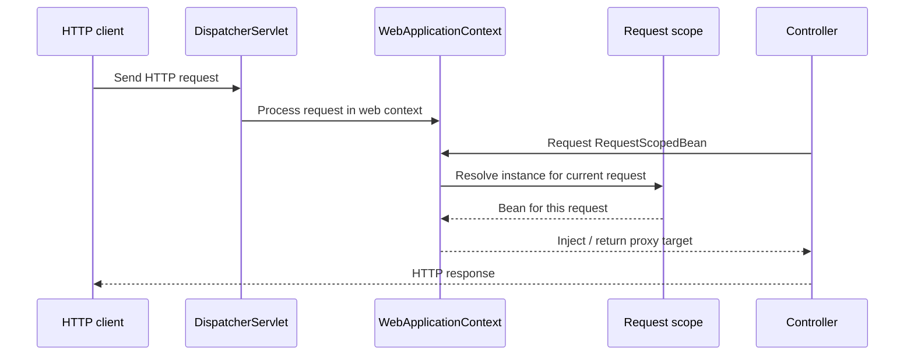
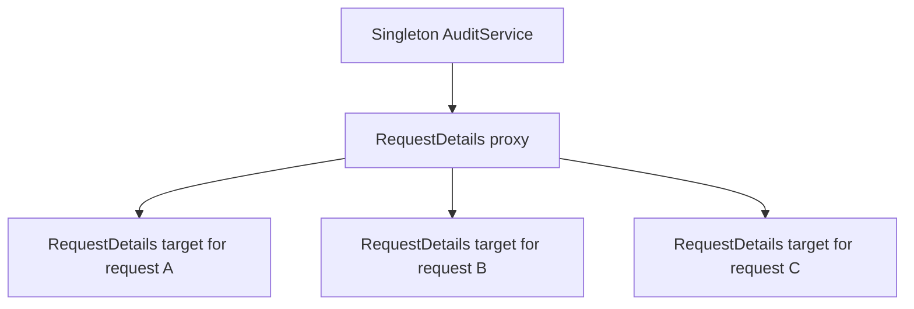

# Web Scopes Only Work When an Appropriate Context Exists

Spring manages bean lifecycles across several types of scopes. Alongside `singleton` and `prototype`, web applications have scopes tied to HTTP lifecycles such as `request`, `session`, and `application`. They are very useful when a component needs data or state that only makes sense within a single request, a user session, or a web application.

What must be clearly understood is that **web scopes are not plain Java scopes that can be used anywhere**. Spring can only create and resolve beans belonging to a web scope when the bean is managed inside a suitable web context and the corresponding lifecycle is currently active. If you access a request-scoped bean from a background process with no active HTTP request, Spring cannot guess which request to use.

This lesson focuses on the prerequisites for web scopes to work, the lifecycle of each scope, how to inject short-lived beans into singletons, scoped proxies, common errors, and how to test in Spring Boot.

## 1. What Is a Bean Scope?

Scope defines **the lifecycle and sharing boundary of a bean instance**. It answers the questions: when will Spring create an instance, within what boundary will it be reused, and when will its lifecycle end?

Registering a class as a bean does not mean every injection or call creates a new object. That behavior depends on the bean definition's scope.

Common scopes:

| Scope | Sharing boundary | When instance is created |
| --- | --- | --- |
| `singleton` | One instance per bean definition within an `ApplicationContext` | Typically created when the context initializes if eager singleton |
| `prototype` | Each time the container is asked for the bean, it typically creates a new instance | When the bean is requested |
| `request` | One instance per HTTP request | When the bean is first resolved within the request |
| `session` | One instance per HTTP session | When the bean is first resolved within the session |
| `application` | One instance per `ServletContext` | When the bean is first resolved within application scope |
| `websocket` | One instance per WebSocket session in environments supporting this scope | When the bean is resolved within the WebSocket session |

`singleton` and `prototype` are core scopes commonly used in Spring containers. `request`, `session`, `application`, and `websocket` are scopes tied to the corresponding web/messaging environments. Not every `ApplicationContext` has these scopes.

### 1.1. Singleton Does Not Mean One Object for the Entire JVM

In Spring, singleton means one instance per bean definition within one `ApplicationContext`. If an application has multiple contexts, each context can have its own instance. If three replicas of the application run on three JVMs or containers, each process also has its own set of beans.

### 1.2. Prototype Is Not the Same as Request Scope

Prototype creates a new instance whenever the container is asked to resolve a prototype bean. Spring manages instantiation and initialization callbacks, yet does not fully track the subsequent lifecycle to automatically invoke all destruction callbacks when the object is no longer used.

Request scope, by contrast, binds an instance to a specific HTTP request. Accesses to the same bean within one request share the same instance; the next request receives a different instance.

## 2. Web Scopes Require a Web Context

Spring defines web scopes on top of web environment lifecycle objects. For Spring MVC applications on the Servlet stack, scopes such as `request`, `session`, and `application` rely on the current request, HTTP session, and `ServletContext`.

A standard Spring Boot Web MVC application has a web-aware `ApplicationContext` and `DispatcherServlet`. During request processing, Spring MVC exposes the current request information so the corresponding scopes can locate the right instance.

High-level flow:



Two conditions to distinguish:

1. **Web-aware context:** Spring must know about the corresponding web scopes and have a mechanism to manage them.
2. **Active scope:** at the moment the target bean is accessed, the corresponding request/session/application context must be present.

A class annotated with `@RequestScope` does not manufacture an HTTP request on its own. The annotation only declares the intended lifecycle; the web environment must supply the context for Spring to execute it.

### 2.1. Role of WebApplicationContext

`WebApplicationContext` is a type of `ApplicationContext` designed for web environments. It is associated with `ServletContext` and provides the infrastructure to integrate beans with the Servlet environment.

In a Spring Boot MVC application, auto-configuration and `DispatcherServlet` normally set up these components. You usually do not have to construct a `WebApplicationContext` manually.

Conversely, a plain Java `AnnotationConfigApplicationContext` does not include request scope out of the box. If you register a `@RequestScope` bean in this context and ask to create its target, Spring has no suitable web scope to resolve the bean.

### 2.2. How Is Request Context Bound to the Processing Thread?

In the Servlet stack, `RequestContextHolder` provides access to the current request attributes via a thread-bound context mechanism. Spring MVC's `DispatcherServlet` exposes the request context automatically during processing. If an application uses a Servlet other than `DispatcherServlet` and still needs Spring request context, `RequestContextListener` or `RequestContextFilter` can be configured depending on the deployment architecture.

Example listener in plain Servlet configuration:

```java
import org.springframework.web.context.request.RequestContextListener;

public class WebInitializer {
    // Register RequestContextListener in the Servlet container
    // via the application's initializer/registration mechanism.
}
```

This snippet merely illustrates the listener type; a standard Boot MVC application already has request context through `DispatcherServlet`. Do not register extra listeners or filters just because you see request scope used, if the existing setup already provides the context.

## 3. Request Scope: One Instance per HTTP Request

`request` scope fits data that only has meaning within a single HTTP exchange. Examples:

- Correlation ID or request ID.
- Metadata extracted from the request.
- A helper object for per-request logging.
- Temporary data serving multiple layers within the same request.
- A presentation context used only during the current processing pass.

`@RequestScope` is Spring's convenience annotation, equivalent to declaring request scope and defaulting to a class-based scoped proxy.

### 3.1. Declaring a Request-Scoped Bean

Example bean reading a request ID from a header:

```java
package com.example.web.context;

import jakarta.servlet.http.HttpServletRequest;
import org.springframework.stereotype.Component;
import org.springframework.web.context.annotation.RequestScope;

@Component
@RequestScope
public class RequestDetails {
    private final String requestId;

    public RequestDetails(HttpServletRequest request) {
        String header = request.getHeader("X-Request-Id");
        this.requestId = (header == null || header.isBlank())
                ? "generated-by-server"
                : header;
    }

    public String requestId() {
        return requestId;
    }
}
```

When the first access to `RequestDetails` occurs in a request, Spring creates the target bean scoped to that request. Subsequent accesses within the same request reuse that target. The next request gets its own target.

In this example, the fallback string is purely illustrative. Real applications should generate unique request IDs in a trusted component, validate/normalize headers received externally, and avoid treating client-sent values as authentication proof.

### 3.2. Injecting a Request-Scoped Bean into a Singleton Service

A service, which is singleton by default, may need to read the request ID:

```java
package com.example.audit;

import com.example.web.context.RequestDetails;
import org.springframework.stereotype.Service;

@Service
public class AuditService {
    private final RequestDetails requestDetails;

    public AuditService(RequestDetails requestDetails) {
        this.requestDetails = requestDetails;
    }

    public void record(String action) {
        String requestId = requestDetails.requestId();
        // Write action together with requestId to log/audit sink.
    }
}
```

This works because `@RequestScope` creates a scoped proxy by default. Spring injects the proxy into the `AuditService` singleton. When `requestDetails.requestId()` is invoked inside an active request, the proxy looks up the target instance matching the current request and delegates the call to that target.

Diagram:



Each request gets its proper target even though the singleton service keeps the exact same proxy reference.

**This does not mean the singleton service holds a shared request object.** It holds a stable proxy; the proxy looks up the target in the active context at call time.

### 3.3. Why Not Inject the Request Bean Target Directly into a Singleton?

A singleton outlives a request. If a singleton held a direct request target instance, that instance would become invalid right after the first request, or no request would exist to resolve when the singleton is created.

Scoped proxies bridge this lifecycle mismatch via an intermediary object. That is why the `@RequestScope` annotation uses proxy mode by default.

If you disable proxy mode and inject a request-scoped target directly into a singleton, Spring may detect a scope mismatch or bean creation will fail when no request is active. For dependencies shorter-lived than the consumer bean, an appropriate lookup or lazy resolution mechanism is required.

## 4. Session Scope: One Instance per HTTP Session

`session` scope stores one bean instance per HTTP session. Different requests belonging to the same session access the same target instance. When the session ends or is invalidated, the corresponding session-scoped bean ends its lifecycle according to session management rules.

Potentially suitable cases:

- Multi-step wizard state.
- Temporary user selections during a workflow.
- A session shopping cart if business requirements and architecture allow that storage model.
- Filters or UI preferences persisting across multiple requests.

Do not store all user data in the session. A session is server-side state with memory cost, may require replication or persistence across multiple instances, and requires explicit expiration policies.

### 4.1. Declaring with @SessionScope

```java
package com.example.web.session;

import java.util.ArrayList;
import java.util.List;
import org.springframework.stereotype.Component;
import org.springframework.web.context.annotation.SessionScope;

@Component
@SessionScope
public class ShoppingSession {
    private final List<String> selectedProductIds = new ArrayList<>();

    public void select(String productId) {
        selectedProductIds.add(productId);
    }

    public List<String> selectedProductIds() {
        return List.copyOf(selectedProductIds);
    }
}
```

`@SessionScope` is the specialized annotation for session scope and uses a scoped proxy by default. A singleton controller or service can receive a `ShoppingSession` proxy; when accessed during a request with a corresponding session, the proxy resolves the session-scoped target bean.

### 4.2. Session Scope Is Not a Place for Arbitrary Authentication State

Spring Security has dedicated mechanisms for `SecurityContext` and authentication. Do not build a custom session-scoped bean to replace authentication, authorization, or session fixation protection. Session data should contain only information needed for the user experience or workflow, without storing passwords, sensitive tokens, or credentials in an uncontrolled manner.

### 4.3. Sessions Can Span Multiple Requests and Nodes

If the application runs across multiple instances, sessions may be managed via session affinity or a shared store such as Spring Session with Redis. In that case, session data must be compatible with serialization/deserialization and distributed lifecycles.

A session-scoped object in one JVM's memory does not automatically replicate to other instances. When designing multi-node systems, choose a concrete session solution rather than assuming web scopes solve distribution.

## 5. Application Scope: One Instance per ServletContext

`application` scope has a lifecycle bound to a web application's `ServletContext`. It is typically used for data or components shared across the entire web application, spanning multiple HTTP sessions.

You can declare:

```java
package com.example.web.context;

import java.util.concurrent.atomic.AtomicLong;
import org.springframework.stereotype.Component;
import org.springframework.web.context.annotation.ApplicationScope;

@Component
@ApplicationScope
public class ApplicationRequestCounter {
    private final AtomicLong count = new AtomicLong();

    public long increment() {
        return count.incrementAndGet();
    }

    public long current() {
        return count.get();
    }
}
```

Every request can invoke this counter and share the instance within the same `ServletContext`.

However, this is only an in-memory counter to demonstrate scope. It resets when the web application restarts, is not shared across multiple JVMs/replicas, and requires thread-safe structures because many requests can call it concurrently. `AtomicLong` protects simple increments/reads, yet does not turn complex business operations into transactions.

### 5.1. Application Scope Differs from Singleton Scope

The two scopes may look alike in a simple Boot application, yet their management boundaries differ:

| Criterion | Spring singleton | Web application scope |
| --- | --- | --- |
| Boundary | One bean definition within one `ApplicationContext` | One bean instance for one `ServletContext` |
| Web dependency | No | Yes |
| Number of contexts | Has an instance per context | Tied to the corresponding `ServletContext` |
| Usable outside web context | Yes | No |
| Lifecycle | Bean lifecycle within the context | Web application lifecycle |

In an application with only one web application context tied to one `ServletContext`, the two boundaries often seem equivalent. However, in applications with multiple contexts or multiple web applications, they cannot be treated as the same concept.

### 5.2. Do Not Use Application Scope as a Distributed Data Store

An application-scoped bean is shared only within its `ServletContext`. If multiple containers run, each container has its own instance. For data that must stay consistent across nodes or survive redeployments, use a database, distributed cache, or appropriate storage service.

## 6. Declaring Scopes with @Scope

Besides convenience annotations, scopes can be declared directly using `@Scope`:

```java
import org.springframework.context.annotation.Scope;
import org.springframework.context.annotation.ScopedProxyMode;
import org.springframework.stereotype.Component;
import org.springframework.web.context.WebApplicationContext;

@Component
@Scope(
    value = WebApplicationContext.SCOPE_REQUEST,
    proxyMode = ScopedProxyMode.TARGET_CLASS
)
public class RequestTrace {
    // ...
}
```

This is semantically equivalent to using `@RequestScope` in simple examples. Web scope constants are typically taken from `WebApplicationContext`:

- `SCOPE_REQUEST`
- `SCOPE_SESSION`
- `SCOPE_APPLICATION`

Using the specialized annotations is usually easier to read:

| Annotation | Corresponding scope | Default proxy |
| --- | --- | --- |
| `@RequestScope` | request | `TARGET_CLASS` |
| `@SessionScope` | session | `TARGET_CLASS` |
| `@ApplicationScope` | application | `TARGET_CLASS` |

When using `@Scope` directly, choose the proxy mode according to how the bean is injected and its type. `ScopedProxyMode.NO` creates no proxy; `INTERFACES` creates an interface-based proxy; `TARGET_CLASS` creates a class-based proxy. Class-based proxies normally require proxyable classes/methods, so avoid marking classes or methods requiring proxying as `final`.

## 7. Scoped Proxies Resolve Different Lifecycles

A common scenario is a singleton service needing a request-scoped or session-scoped dependency. If Spring injected the target directly, the consumer bean would outlive the dependency's lifecycle.

Scoped proxies allow the singleton to hold a stable reference while resolving the scoped target on each use.

### 7.1. Request Scope Has a Proxy by Default

`@RequestScope` is equivalent to declaring request scope with target-class proxy mode. Therefore the following example works inside a request:

```java
@Component
@RequestScope
public class CurrentRequest {
    private final String path;

    public CurrentRequest(HttpServletRequest request) {
        this.path = request.getRequestURI();
    }

    public String path() {
        return path;
    }
}

@Service
public class RequestLogger {
    private final CurrentRequest currentRequest;

    public RequestLogger(CurrentRequest currentRequest) {
        this.currentRequest = currentRequest;
    }

    public void log() {
        System.out.println(currentRequest.path());
    }
}
```

`RequestLogger` is a singleton by default. It does not receive a fixed `CurrentRequest` target; instead it receives a proxy. When `log()` runs during a request, the proxy resolves the right target.

### 7.2. Proxies Do Not Create Fake Requests

If `requestLogger.log()` is invoked from a scheduled task with no HTTP request, the proxy cannot conjure a fake request to fulfill `currentRequest.path()`. Spring then reports that request scope is not active or no request is bound to the current thread/context.

A scoped proxy only resolves **how to reference a short-lived bean**. It does not fabricate the required lifecycle context.

### 7.3. Use Interface Proxies When Appropriate

If a bean has an interface, you can choose `ScopedProxyMode.INTERFACES`:

```java
public interface RequestMetadata {
    String requestId();
}

@Component
@RequestScope(proxyMode = ScopedProxyMode.INTERFACES)
public class DefaultRequestMetadata implements RequestMetadata {
    // ...
}
```

Consumers should inject via the `RequestMetadata` interface. Interface-based proxies reduce the need to subclass concrete classes. Ensure injection points use the matching interface type; do not inject the implementation class when the exposed proxy only implements the interface.

## 8. Using ObjectProvider When On-Demand Bean Lookup Is Needed

Another option is injecting `ObjectProvider<T>` and requesting the bean where needed:

```java
import org.springframework.beans.factory.ObjectProvider;
import org.springframework.stereotype.Service;

@Service
public class RequestAwareAuditService {
    private final ObjectProvider<RequestDetails> requestDetailsProvider;

    public RequestAwareAuditService(
            ObjectProvider<RequestDetails> requestDetailsProvider) {
        this.requestDetailsProvider = requestDetailsProvider;
    }

    public void record(String action) {
        RequestDetails details = requestDetailsProvider.getObject();
        // Use the request-scoped bean within the active request.
    }
}
```

`ObjectProvider` defers resolving the dependency until `getObject()` is called. However, that call still requires an active scope. If called inside a scheduler or worker thread without a request context, it still fails.

Use `ObjectProvider` when intentional lookup is desired or the bean is genuinely optional. If you simply want a singleton service to use a request-scoped collaborator during requests, scoped proxies usually keep the code simpler.

## 9. What Happens When a Web Scope Is Used Outside an Appropriate Context?

This is the core theme of the lesson: **web scopes only work when an appropriate context exists**.

Two groups of errors must be distinguished.

### 9.1. No Web Scope Registered

If you create a generic context like `AnnotationConfigApplicationContext` and ask Spring to initialize a request-scoped bean, that context does not have web scopes pre-registered like a `WebApplicationContext`. Spring may report an error similar to:

```text
No Scope registered for scope name 'request'
```

This is an **ApplicationContext type** problem. The current context has no `request` scope registered.

Illustrative example:

```java
var context = new AnnotationConfigApplicationContext();
context.register(RequestScopedConfiguration.class);
context.refresh();

// If the context needs to create a request-scoped target bean here,
// resolving scope "request" has no registered web scope.
```

Do not use a generic context to run an application needing web scopes without setting up the corresponding web infrastructure.

### 9.2. Web Scope Exists, but No Request Is Currently Active

In a web-aware context, request scope may already be registered. Yet if you invoke the target bean when no request is active, Spring may report:

```text
Scope 'request' is not active for the current thread;
consider defining a scoped proxy for this bean if you intend
to refer to it from a singleton
```

The exact message may vary by version and call path. This is a **current scope lifecycle** problem: the container knows what request scope is, yet no request is bound to the current execution.

Examples of situations where this can happen:

- A `@Scheduled` method calls a service using a request-scoped bean.
- An `@Async` task accesses a request proxy after being dispatched to an executor thread.
- A command-line runner invokes a web-aware service at application startup.
- A unit test calls a bean directly outside `MockMvc` or an established request context.
- A message consumer processes a message with no HTTP request.

### 9.3. Do Not Confuse Scope Errors with Missing Bean Errors

| Error | Meaning |
| --- | --- |
| `NoSuchBeanDefinitionException` | No matching bean definition/candidate found |
| `NoUniqueBeanDefinitionException` | Multiple candidate beans cannot be uniquely resolved |
| `No Scope registered for scope name 'request'` | Context has no `request` scope registered |
| `Scope 'request' is not active` | Scope is known, yet no request is active when resolving the target |

Distinguishing the root cause helps pick the right fix: registering the bean, adjusting the context, or changing how data crosses the request boundary.

## 10. Request Scope and Background Tasks

A common design mistake is reading data from a request-scoped bean inside background work.

Example:

```java
@Service
public class ReportService {
    private final RequestDetails requestDetails;
    private final ReportWorker worker;

    public ReportService(RequestDetails requestDetails, ReportWorker worker) {
        this.requestDetails = requestDetails;
        this.worker = worker;
    }

    public void schedule(String reportId) {
        worker.generate(reportId, requestDetails.requestId());
    }
}
```

If `schedule` is called during a request, reading the request ID right then and passing the string to the worker makes sense. However, if the worker holds onto `RequestDetails` and invokes it later on an executor thread, request scope may no longer be active.

A safer design is to **read request data at the request boundary, then pass the needed data as explicit values**:

```java
public record ReportCommand(String reportId, String requestedBy, String correlationId) {}

@Service
public class ReportService {
    private final RequestDetails requestDetails;
    private final ReportWorker worker;

    public ReportService(RequestDetails requestDetails, ReportWorker worker) {
        this.requestDetails = requestDetails;
        this.worker = worker;
    }

    public void schedule(String reportId, String userId) {
        ReportCommand command = new ReportCommand(
                reportId,
                userId,
                requestDetails.requestId()
        );
        worker.generate(command);
    }
}
```

`ReportWorker` receives `ReportCommand` as standalone data, needing no knowledge of Servlet requests or request-scoped beans. When the job executes after the HTTP response has been sent, it still has all required data.

### 10.1. @Async Does Not Automatically Carry Request Context

`@Async` shifts execution to an executor thread. Contexts bound to the current thread do not automatically appear on another thread. Do not assume request-scoped proxies will automatically work in every asynchronous task.

Spring MVC supports its own async request lifecycle, in which the framework coordinates dispatches and request context according to its pipeline. That differs from manually submitting a `Runnable` to an executor or invoking an independent scheduled task. Be clear on whether the work is an async response within the same HTTP request or a background job decoupled from the request.

### 10.2. Do Not Retain HttpServletRequest for Later Use

Do not store `HttpServletRequest` in a singleton field or pass that reference into a background job. Request objects have lifecycles bound to the Servlet request; using them after the request finishes can cause errors or undefined behavior.

Extract only needed values—such as request ID, authenticated user ID, locale, or permitted client metadata—and pass them via immutable commands/events.

### 10.3. Request Context Propagation Has Limits

You can configure mechanisms to propagate certain contexts across executors (such as security context or tracing context) with suitable integrations. Yet propagation does not keep an HTTP request alive forever and does not turn request-scoped beans into data safe to use indefinitely.

For truly independent background jobs, explicit, self-contained payloads are usually better than relying on thread-local web contexts.

## 11. Scopes in Spring MVC and Spring WebFlux

The `HttpServletRequest` examples in this lesson belong to the Servlet stack, commonly used with `spring-boot-starter-web` and Spring MVC.

Spring WebFlux is the reactive stack. It uses a different request-handling model than Servlet and you must not mechanically assume request context always lives in a running thread's `ThreadLocal`. A reactive pipeline can switch threads during processing; context data must follow reactive context mechanisms and the framework's corresponding support.

When developing with WebFlux:

- Use APIs and scopes supported in your specific Spring Framework/WebFlux version.
- Do not rely on `RequestContextHolder` as a general way to read requests inside reactive callbacks.
- Do not pass Servlet APIs like `HttpServletRequest` into reactive handlers.
- Pass needed metadata through the reactive pipeline or an appropriate context abstraction.
- Test under the exact web application type your application deploys with.

Do not mix both Web MVC and WebFlux starters just for convenience annotations. Pick the right web stack and understand how that stack manages request lifecycles.

## 12. Testing Web-Scoped Beans

Testing request/session scope requires establishing the corresponding context. A unit test calling a service directly does not automatically have an HTTP request.

### 12.1. Using MockMvc for Spring MVC

A suitable approach is `@SpringBootTest` combined with `@AutoConfigureMockMvc`, or `@WebMvcTest` for controller slices. When `MockMvc` dispatches a request through `DispatcherServlet`, Spring MVC sets up the request context so request-scoped beans resolve during handling.

Conceptual integration test example:

```java
@SpringBootTest
@AutoConfigureMockMvc
class RequestScopeIntegrationTest {
    @Autowired
    private MockMvc mockMvc;

    @Test
    void requestScopedValueIsAvailableDuringHttpRequest() throws Exception {
        mockMvc.perform(get("/request-info"))
                .andExpect(status().isOk());
    }
}
```

This test requires the `/request-info` endpoint and its dependencies to be defined in the application. The goal is verifying requests pass through MVC infrastructure, not calling request-scoped targets outside a request.

### 12.2. Verifying Two Requests Have Two Separate Targets

You can create a request-scoped bean with an identifier generated at initialization and return it via an endpoint. Send two independent requests and verify the two IDs differ. To verify multiple accesses within the same request, return the same ID twice in the response to confirm the target is shared within that request.

Do not test by comparing the proxy reference from the singleton: the proxy can be the exact same object across all requests, while the target behind the proxy changes per request.

### 12.3. Testing Session Scope

Send a first request and retain the corresponding cookie/session; send the next request with that same session to verify state is preserved. Then send a request without that session to verify isolated state.

`MockMvc` supports working with `MockHttpSession` in tests. Distinguish reusing a session from sending two completely independent requests.

### 12.4. Manually Setting Up Request Context in Unit Tests

In certain low-level unit tests, you can attach `ServletRequestAttributes` to `RequestContextHolder`:

```java
MockHttpServletRequest request = new MockHttpServletRequest();
ServletRequestAttributes attributes =
        new ServletRequestAttributes(request);

RequestContextHolder.setRequestAttributes(attributes);
try {
    // Call code requiring request scope in this test.
} finally {
    RequestContextHolder.resetRequestAttributes();
    attributes.requestCompleted();
}
```

This is a low-level testing technique. Always reset in `finally` to prevent leaking context into other tests or making tests order-dependent. For regular MVC testing, `MockMvc` is closer to the real execution path and reduces manual setup.

## 13. Common Errors and Troubleshooting

| Symptom | Possible cause | Resolution |
| --- | --- | --- |
| `No Scope registered for scope name 'request'` | Using a generic context without web scopes registered | Run in a web-aware context or configure the proper web environment |
| `Scope 'request' is not active` | Called request-scoped target outside a request | Access only within a request or pass needed data explicitly |
| Singleton cannot inject request bean | Injected short-lived target without proper proxy/lazy resolution | Use `@RequestScope` default proxy or a provider |
| Request bean mixed between two requests | Stored mutable request data manually in a singleton | Move state to request scope and do not copy targets into singletons |
| Session state lost across requests | Cookie/session not resent, session expired, or different session store | Check cookies, session lifecycle, and session storage configuration |
| Request scope fails inside @Async | Executor thread lacks request context | Read data in the request and pass a command |
| Unit test fails with scope error | Test calls bean directly without a request context | Use `MockMvc` or bind request attributes with cleanup |
| Application scope not shared across replicas | Scope is per `ServletContext` of each web application | Use a distributed cache/database if cross-node sharing is needed |
| Proxy cannot be created | `final` class/method or injection type incompatible with proxy mode | Use a proxyable class or an appropriate interface proxy |

### 13.1. Error Investigation Process

When encountering a web scope error:

1. Determine whether the application runs Spring MVC/Servlet or WebFlux.
2. Confirm the bean definition is registered in the context.
3. Verify the context supports the corresponding web scope.
4. Check whether a current request/session exists when the target is invoked.
5. Check whether the consumer bean outlives the target scope and needs a scoped proxy or provider.
6. Check whether code invokes the proxy from a scheduler, listener, executor, or test outside a request.
7. If it is a background task, evaluate converting request values into explicit command/event data.

Do not fix every error by adding `@Lazy`, enabling sessions, or binding request attributes to threads manually. First understand which lifecycle the bean is being called in.

## 14. Choosing Scope by the Nature of the Data

Some selection examples:

| Data/component | Scope usually considered | Reason |
| --- | --- | --- |
| Stateless business service | singleton | Reuses one instance, keeps no request state |
| Stateless repository/adapter | singleton | Shares infrastructure dependencies per context |
| Request ID, request metadata | request | Exists only for one HTTP request |
| A user's wizard state | session | Needs to persist across multiple requests of the same session |
| Temporary counter within one `ServletContext` | application | Shared within one web application |
| Immutable configuration data | singleton or configuration properties | No need to recreate per request |
| Background job running after response | Do not rely on request scope | Receives required data via command/event |
| Cache shared across multiple replicas | Not just application scope | Needs a shared storage system |

### 14.1. Do Not Use Request Scope to Dodge Stateless Design

If a service has a `currentUser` or `currentRequestId` field solely because multiple methods need that data, consider passing explicit parameters instead of converting the entire service to request scope. Request scope is useful when a collaborator genuinely has a per-request lifecycle and is shared by multiple components within the request.

A stateless singleton is usually simpler, easier to test, and uses fewer resources than creating instances for every request.

### 14.2. Do Not Use Session Scope for Derivable Data

Sessions store state server-side. If data can be queried from a database or derived from the authentication context, storing a mutable copy in the session can cause stale data, update conflicts, and higher memory usage. Store only what must persist across requests, with clear expiration and synchronization policies.

## 15. Complete Example: Request Scope in a Boot MVC Application

The example below includes a request-scoped bean, a singleton service, and a controller. All classes sit under the root package so default component scanning finds them.

### 15.1. Request Metadata

```java
package com.example.demo.request;

import jakarta.servlet.http.HttpServletRequest;
import org.springframework.stereotype.Component;
import org.springframework.web.context.annotation.RequestScope;

@Component
@RequestScope
public class RequestMetadata {
    private final String requestPath;
    private final String requestId;

    public RequestMetadata(HttpServletRequest request) {
        this.requestPath = request.getRequestURI();
        String id = request.getHeader("X-Request-Id");
        this.requestId = (id == null || id.isBlank())
                ? "not-provided"
                : id;
    }

    public String requestPath() {
        return requestPath;
    }

    public String requestId() {
        return requestId;
    }
}
```

### 15.2. Singleton Service Using a Proxy

```java
package com.example.demo.audit;

import com.example.demo.request.RequestMetadata;
import org.springframework.stereotype.Service;

@Service
public class RequestAuditService {
    private final RequestMetadata metadata;

    public RequestAuditService(RequestMetadata metadata) {
        this.metadata = metadata;
    }

    public String describe(String action) {
        return action
                + " path=" + metadata.requestPath()
                + " requestId=" + metadata.requestId();
    }
}
```

### 15.3. Controller Calling the Service During a Request

```java
package com.example.demo.web;

import com.example.demo.audit.RequestAuditService;
import org.springframework.web.bind.annotation.GetMapping;
import org.springframework.web.bind.annotation.RequestParam;
import org.springframework.web.bind.annotation.RestController;

@RestController
public class RequestInfoController {
    private final RequestAuditService auditService;

    public RequestInfoController(RequestAuditService auditService) {
        this.auditService = auditService;
    }

    @GetMapping("/request-info")
    public String info(@RequestParam(defaultValue = "view") String action) {
        return auditService.describe(action);
    }
}
```

### 15.4. Application Class

```java
package com.example.demo;

import org.springframework.boot.SpringApplication;
import org.springframework.boot.autoconfigure.SpringBootApplication;

@SpringBootApplication
public class DemoApplication {
    public static void main(String[] args) {
        SpringApplication.run(DemoApplication.class, args);
    }
}
```

When sending:

```http
GET /request-info?action=inspect
X-Request-Id: req-100
```

Illustrative response body:

```text
inspect path=/request-info requestId=req-100
```

The next request with header `X-Request-Id: req-200` resolves a different `RequestMetadata` target. `RequestAuditService` remains a singleton and retains the same proxy, yet the proxy returns the metadata of the current active request.

This example requires appropriate Web MVC dependencies (usually `spring-boot-starter-web`) and a Servlet container. Moving the code to a generic Spring context or calling `RequestAuditService.describe()` from a background job without a request will make the request-scoped target unresolvable.

## 16. Takeaways

Web scopes are tied to web environment lifecycles. Request scope creates one target per HTTP request; session scope retains a target across multiple requests within the same HTTP session; application scope shares a target within one `ServletContext`. They are not scopes pre-registered in every Spring context, nor are they synonymous with singletons or data shared across servers.

In Spring MVC applications, the web-aware context and `DispatcherServlet` provide the request context so Spring can resolve these beans. `@RequestScope`, `@SessionScope`, and `@ApplicationScope` use scoped proxies by default, enabling singleton beans to reference shorter-lived beans. Proxies only route to targets when the corresponding scope is active; they do not manufacture substitute requests or sessions.

When running schedulers, background executors, message listeners, or plain unit tests, do not assume an active HTTP request exists. Extract needed data during the request and pass it via commands/events, or set up a test context with cleanup when genuinely testing web scopes. Pick scopes according to data lifecycles, keep services stateless where possible, and clearly distinguish missing bean errors, missing scope registration errors, and inactive scope errors.
