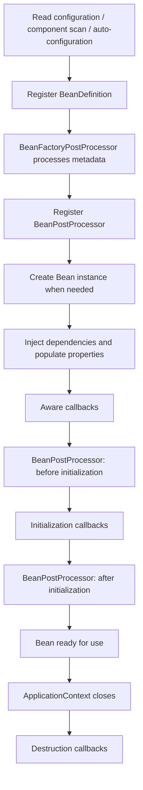
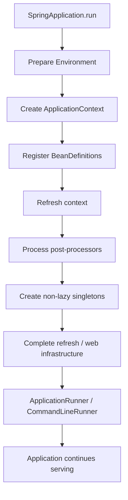
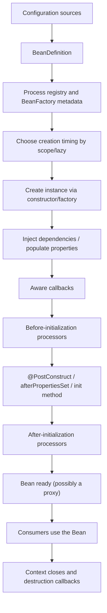

# From BeanDefinition to a Ready-to-Use Object

When Spring Boot starts up, the container does not simply scan classes and call `new` for everything. Before a Bean can serve business logic, Spring needs to know **how to create the Bean**, prepare its dependencies, invoke lifecycle callbacks, and possibly apply additional processing such as validation, proxies, or AOP.

A central concept of that process is the **BeanDefinition**. A BeanDefinition describes a Bean: the class or factory method used to create it, scope, constructor arguments, property values, dependencies, and related metadata. From this definition, Spring creates a **Bean instance** (the actual object), injects dependencies, and completes initialization.

Let's distinguish two states:

- **Registered BeanDefinition:** the container knows how the Bean needs to be created. This does not yet mean the object exists.
- **Ready Bean instance:** the object has been created, dependencies have been provided, required initialization steps have run, and the Bean can be used according to its contract.

For a regular eagerly initialized singleton, these two phases typically follow one after another during application context refresh. For a lazy or prototype Bean, the instance may only be created when requested. Therefore, "present in the container" and "initialized" are not always synonymous.

## 1. Overview of the Bean Lifecycle

At a high level, the lifecycle of a managed Bean can be visualized as follows:



This diagram is an easy-to-learn model of a regular Bean. The actual process has branches such as factory methods, `FactoryBean`, early proxy creation, lazy initialization, non-singleton scopes, and specialized extension points. Not every Bean goes through every step in the same way or at the same time.

Key stages:

1. Spring collects configuration information and registers BeanDefinitions.
2. Post-processors at the BeanFactory level can modify metadata before regular Beans are created.
3. Spring creates the instance via a constructor or factory method.
4. The container resolves and injects dependencies, then invokes environment/container awareness callbacks.
5. Initialization callbacks are executed in a defined order.
6. BeanPostProcessors may wrap the Bean with a proxy; the final object is published by the container to consumers.
7. When the container closes, destruction callbacks are invoked for scopes whose destruction the container manages.

## 2. What Is a BeanDefinition?

`BeanDefinition` is the metadata Spring uses to describe how to create and manage a Bean. It can contain information such as:

| Information | Meaning |
|---|---|
| Bean class or factory method | Which class or method the object is created from |
| Scope | Singleton, prototype, or another scope |
| Constructor arguments | Values/dependencies passed into the constructor |
| Property values | Values assigned to properties/fields per configuration |
| Lazy initialization | Whether to defer instance initialization |
| Primary | Whether it is prioritized when resolving a dependency of the same type |
| Depends-on | Which Beans need to be initialized before this Bean |
| Init/destroy method | Custom initialization and destruction callbacks |
| Qualifier and other metadata | Information supporting Bean selection and container processing |

BeanDefinitions do not necessarily have to be written directly as a separate file. Spring can create them from multiple sources:

- Classes discovered via component scanning, e.g. `@Component`, `@Service`, `@Repository`.
- `@Bean` methods inside configuration classes.
- Spring Boot auto-configuration.
- XML or programmatic BeanDefinition registration mechanisms in applications using the corresponding configuration.

### Class and BeanDefinition Are Not the Same

A Java class can exist on the classpath without becoming a Bean if Spring does not detect or register it. Conversely, a Bean can be created from a factory method where the implementation class carries no Spring annotations.

For example:

```java
public class GreetingFormatter {
    public String format(String name) {
        return "Hello " + name;
    }
}
```

This class by itself is just a Java class. For the container to manage an instance, we can declare:

```java
@Configuration(proxyBeanMethods = false)
public class GreetingConfiguration {

    @Bean
    GreetingFormatter greetingFormatter() {
        return new GreetingFormatter();
    }
}
```

Spring registers a BeanDefinition for the Bean provided by the `greetingFormatter()` method. The default Bean name is the method name, i.e., `greetingFormatter`.

### BeanDefinition and Bean Instance

Imagine:

```text
BeanDefinition: "greetingFormatter"
    beanClass / factory method: GreetingConfiguration.greetingFormatter()
    scope: singleton (default)
    lazy: false (default)
              |
              v
Bean instance: a concrete GreetingFormatter object
```

A BeanDefinition can exist long before the instance is created. With non-lazy singletons, Spring typically creates the instance during context refresh. With `@Lazy`, the container can hold the definition without creating the instance until the Bean is requested.

## 3. Where Does Spring Get BeanDefinitions From?

### Component scanning

For example:

```java
@Service
public class OrderService {
}
```

When component scan passes through the package containing this class, Spring detects the stereotype annotation and registers the corresponding BeanDefinition. The default name is typically `orderService`, unless named otherwise or a custom naming strategy is configured.

### Java configuration and @Bean

```java
@Configuration(proxyBeanMethods = false)
public class PaymentConfiguration {

    @Bean
    PaymentGateway paymentGateway() {
        return new HttpPaymentGateway();
    }
}
```

Here the BeanDefinition describes a Bean created via a factory method. Spring can know the return type is `PaymentGateway` and use that metadata when resolving dependencies.

### Auto-configuration

Spring Boot adds conditional configurations based on the classpath, properties, and already registered Beans. For example, an auto-configuration can create a default Bean when a library exists and the application has not provided its own Bean for the same role.

The key point: auto-configuration also contributes BeanDefinitions to the container. When the instance is created, that Bean still goes through Spring's lifecycle management mechanism.

### Programmatic registration

Libraries/frameworks can use `BeanDefinitionRegistry` or `ImportBeanDefinitionRegistrar` to register definitions programmatically. This is how infrastructure or frameworks extending Spring are built; regular business applications rarely need to register BeanDefinitions manually.

## 4. Steps Before Creating a Bean Instance

After configuration sources are read, Spring has a set of BeanDefinitions to use. However, before creating regular instances, the container also has important extension points.

### BeanDefinitionRegistryPostProcessor

`BeanDefinitionRegistryPostProcessor` allows registering additional BeanDefinitions or adjusting the registry during the registry processing phase. Several of Spring's configuration and scanning mechanisms are organized through processors in this group.

It runs at the **registry/metadata** level, before regular business Beans are initialized. This is not a per-instance callback.

### BeanFactoryPostProcessor

`BeanFactoryPostProcessor` can read or modify BeanDefinitions already registered in the BeanFactory before regular Beans are created.

For example, Spring can resolve placeholders in configuration or adjust metadata. An application rarely needs to write this processor itself; if it does, it must avoid calling `getBean(...)` arbitrarily inside the callback because doing so can cause Beans to be initialized too early, before other post-processors are fully registered.

### BeanPostProcessor

`BeanPostProcessor` processes **instances** before and after initialization. This is a different mechanism from BeanFactoryPostProcessor:

| Extension point | Target processed | Primary timing |
|---|---|---|
| BeanDefinitionRegistryPostProcessor | Registry of BeanDefinitions | Before regular BeanFactoryPostProcessors |
| BeanFactoryPostProcessor | BeanDefinitions/metadata in the factory | Before creating regular Beans |
| BeanPostProcessor | Bean instance | During the initialization of each Bean |

The difference between metadata and instance is the key to understanding why Spring can modify configuration before an object is created, and then continue wrapping or adjusting the object after creation.

## 5. Creating a Bean Instance: Constructor or Factory Method

When the container decides to create a Bean, it needs to create the initial instance.

### Constructor instantiation

For a component:

```java
@Component
public class InventoryService {
    private final InventoryRepository repository;

    public InventoryService(InventoryRepository repository) {
        this.repository = repository;
    }
}
```

Spring selects the appropriate constructor, resolves `InventoryRepository`, and then calls the constructor to create the instance. With a single constructor, Spring automatically uses it for constructor injection.

### Factory method instantiation

For a Bean declared with `@Bean`:

```java
@Configuration(proxyBeanMethods = false)
public class ClientConfiguration {

    @Bean
    ApiClient apiClient(ClientProperties properties) {
        return new ApiClient(properties.baseUrl());
    }
}
```

Spring calls the factory method `apiClient(...)` after resolving the `ClientProperties` parameter. The returned object becomes the instance managed according to the corresponding BeanDefinition.

### FactoryBean

`FactoryBean<T>` is a special contract: a factory Bean itself produces another product object. When retrieving a Bean by its regular name, the container normally returns the **product** of the FactoryBean. The `&` prefix allows retrieving the FactoryBean itself:

```java
Object product = context.getBean("clientFactory");
Object factory = context.getBean("&clientFactory");
```

This is an advanced mechanism; it is not the same as a `@Bean` factory method. Both can create objects through a factory, but FactoryBean is a special type of Bean whose convention the container understands specifically.

## 6. Dependency Injection and Property Population

After having the initial instance, Spring provides the dependencies and values declared in the BeanDefinition or annotations/configuration.

Example of constructor injection:

```java
@Service
public class CheckoutService {
    private final PaymentGateway gateway;

    public CheckoutService(PaymentGateway gateway) {
        this.gateway = gateway;
    }
}
```

Constructor dependencies are resolved **before the constructor completes** because Spring needs those objects to invoke the constructor. After the instance is created, the container also has a property population phase to handle other injections required by configuration, such as setter/field injection or property values.

With constructor injection, required dependencies are passed in as soon as the object is formed. That is why this approach suits classes that need a valid state from the very beginning.

### Dependency resolution

Spring can consider:

- Parameter type.
- Parameter/Bean name and related metadata when resolution is needed.
- `@Qualifier` to narrow down candidates.
- `@Primary` to prioritize a Bean.
- Collections or maps when multiple Beans of the same type are needed.
- Special types such as `ObjectProvider<T>` or `Optional<T>` for dependencies that may be absent or resolved lazily.

If no required candidate exists or multiple candidates cannot be disambiguated, Bean creation fails. The container cannot produce a complete object meeting the constructor's requirements.

## 7. Aware Callbacks: The Bean Learns About the Container and Environment

After the instance is created and dependencies are populated, Spring may invoke `Aware`-group callbacks if the Bean implements the corresponding interface.

Some interfaces:

| Interface | Information the Bean receives |
|---|---|
| `BeanNameAware` | Bean name registered by the container |
| `BeanClassLoaderAware` | Associated ClassLoader |
| `BeanFactoryAware` | BeanFactory managing the Bean |
| `EnvironmentAware` | Environment containing properties/profiles |
| `ApplicationContextAware` | ApplicationContext |
| `ResourceLoaderAware` | ResourceLoader |

Example:

```java
@Component
public class ContextAwareComponent implements BeanNameAware {
    private String beanName;

    @Override
    public void setBeanName(String name) {
        this.beanName = name;
    }

    public String getBeanName() {
        return beanName;
    }
}
```

Spring calls `setBeanName(...)` during initialization, so the Bean can know the name assigned to it by the container.

You should not implement every Aware interface just because you can. In particular, depending directly on `ApplicationContext` can tightly couple the class to Spring and hide dependencies. Only use Aware when the component is genuinely infrastructure that needs to integrate with the container or needs special information that standard DI cannot express cleanly.

## 8. BeanPostProcessor Before Initialization

After Aware callbacks, Spring invokes BeanPostProcessors in the before-initialization phase:

```java
Object postProcessBeforeInitialization(
        Object bean, String beanName) throws BeansException;
```

Each BeanPostProcessor can return the original object, a modified object, or `null` according to the processing contract. Many framework mechanisms are implemented via this processor.

For example, `@PostConstruct` processing is integrated through a specialized processor. Therefore, the `@PostConstruct` callback takes place within the before-initialization processing chain, before `InitializingBean.afterPropertiesSet()` and any custom init method.

An important point: a processor can be applied to many Beans. The BeanPostProcessor itself must also be registered in the container; when initializing a processor, avoid circular dependencies or pulling too many business Beans up too early.

## 9. Initialization Callbacks: When the Bean Completes Its Own Initialization

After dependencies have been supplied and the corresponding before-initialization steps have run, Spring executes the initialization callbacks declared by the Bean.

Common approaches:

1. `@PostConstruct` annotation.
2. `InitializingBean` interface with the `afterPropertiesSet()` method.
3. Custom init method declared in `@Bean(initMethod = "...")` or equivalent metadata.

### @PostConstruct

In Spring Boot 3 / Spring Framework 6, the standard annotation is imported from `jakarta.annotation.PostConstruct`:

```java
import jakarta.annotation.PostConstruct;
import org.springframework.stereotype.Component;

@Component
public class CacheWarmup {

    @PostConstruct
    void initialize() {
        // Dependencies have been injected.
        // Necessary internal state can be prepared.
    }
}
```

This method typically takes no parameters and should not be used as a long-running business execution entry point. Avoid calling external systems in a way that can block for a long time or create hard-to-control side effects inside an initialization callback.

### InitializingBean

```java
import org.springframework.beans.factory.InitializingBean;
import org.springframework.stereotype.Component;

@Component
public class ClientRegistry implements InitializingBean {
    @Override
    public void afterPropertiesSet() {
        // Validate or finalize configuration after dependencies have been assigned.
    }
}
```

This interface belongs to Spring. It is useful in certain infrastructure components, but business classes wishing to reduce Spring API coupling can usually choose `@PostConstruct` or a custom init method.

### Custom init method

```java
@Configuration(proxyBeanMethods = false)
public class SearchConfiguration {

    @Bean(initMethod = "start")
    SearchClient searchClient() {
        return new SearchClient();
    }
}
```

Assume `SearchClient` has an appropriate `start()` method. This approach is useful when the class belongs to an external library and you cannot add annotations or implement Spring interfaces on that class.

### Order of initialization callbacks

For a Bean managed through the standard process, the key order is:

```text
Dependency injection / populate properties
        ↓
Aware callbacks
        ↓
BeanPostProcessor.postProcessBeforeInitialization(...)
        ↓
@PostConstruct
        ↓
InitializingBean.afterPropertiesSet()
        ↓
Custom init method
        ↓
BeanPostProcessor.postProcessAfterInitialization(...)
```

`@PostConstruct` is invoked by the corresponding processor during the before-initialization phase. Therefore, you should not interpret it as Spring always running all before-init BeanPostProcessors completely and only then invoking `@PostConstruct` as a totally separate stage; this annotation is part of that processor chain.

## 10. BeanPostProcessor After Initialization and Proxies

After initialization callbacks, Spring proceeds to call:

```java
Object postProcessAfterInitialization(
        Object bean, String beanName) throws BeansException;
```

This is a crucial point because a processor can return a different object, typically a **proxy** wrapping the original Bean. Mechanisms such as AOP, transactions, and several framework features rely on creating proxies during post-processing steps.

For example:

```java
@Service
public class TransferService {
    @Transactional
    public void transfer() {
        // Perform data operations inside a transaction.
    }
}
```

When transaction infrastructure is configured and conditions are met, Spring can provide a proxy to apply the transaction interceptor when the method is called through the proxy. Thus, the object that a consumer receives may be a proxy rather than necessarily the original target instance.

This explains several behaviors:

- The runtime instance type sometimes differs from the concrete class you expect, especially with JDK dynamic proxies.
- Calling an internal method from another method within the same object (self-invocation) may bypass the proxy, and therefore not trigger advice the way you expect.
- Looking up or injecting by interface is usually more resilient when a Bean might be proxied by interface.

Not every Bean is proxied. A proxy only appears when infrastructure or a post-processor needs to apply additional behavior.

## 11. When Is a Bean Considered Ready to Use?

For a regular Bean, after:

- The instance has been created.
- Required dependencies have been resolved and injected.
- Relevant Aware callbacks have run.
- The initialization chain has completed.
- After-initialization BeanPostProcessors have processed the Bean.

the container can publish the Bean to consumers via the corresponding management mechanism. For a proxied Bean, the object consumers receive is normally the post-processed object.

However, "ready" must be understood within Spring's lifecycle scope. It does not guarantee that all external systems are healthy, all requests will succeed, or all background work has finished. For example:

- A service may have been created, but the database disconnects afterward.
- A client may be initialized, but credentials are no longer valid when calling the API.
- A lazy Bean may not yet be created even though the application context has finished refreshing.
- A Spring Boot runner may perform work after context refresh, depending on the application type and configuration.

If you need to execute work after the context has initialized, consider an appropriate lifecycle/event mechanism such as `ApplicationRunner`, `CommandLineRunner`, or an application context event. Do not assume `@PostConstruct` is the right time for every startup task.

## 12. Spring Boot Connects the Bean Lifecycle to Application Startup

The familiar command:

```java
public static void main(String[] args) {
    SpringApplication.run(ShopApplication.class, args);
}
```

starts the Spring Boot workflow. At a high level:

1. Boot prepares the Environment, reads configuration, and determines the application type.
2. Boot creates the appropriate ApplicationContext.
3. Configuration sources are processed: component scan, imports, and auto-configuration contribute BeanDefinitions.
4. Context refreshes; BeanFactoryPostProcessors/BeanPostProcessors are processed and non-lazy singletons are typically initialized.
5. For web applications, the context and web server are prepared according to the context type; required web components are initialized.
6. After context refresh, Spring Boot invokes registered runners according to the application lifecycle.

Diagram:



This is a simplified diagram; server initialization details and events may vary by application type (Servlet, Reactive, non-web). What matters is that the Bean lifecycle takes place inside the broader ApplicationContext lifecycle.

### How does @PostConstruct differ from ApplicationRunner?

| | `@PostConstruct` | `ApplicationRunner` |
|---|---|---|
| Scope | One specific Bean | Application-level callback |
| Timing | During initialization of that Bean | After the ApplicationContext has refreshed |
| Receives ApplicationArguments? | No | Yes |
| Suited for | Internal state validation, finalizing local configuration | Startup work requiring the context to be ready |
| Should it do long tasks? | Avoid | Possible, but startup time and failure handling must be considered |

If a task requires all other Beans to already be initialized, `@PostConstruct` of one Bean should not be assumed to run after every singleton in the application is ready. A runner or context-level lifecycle hook is usually more appropriate.

## 13. Singleton, Lazy, and Prototype Change Instance Creation Timing

A BeanDefinition can describe scope and initialization strategy.

### Default singleton

```java
@Component
public class CurrencyService {
}
```

A regular singleton Bean is created eagerly during context refresh, unless marked lazy or subject to special conditions. The container keeps one instance for that Bean definition within the context.

### Lazy initialization

```java
@Lazy
@Component
public class ExpensiveReportClient {
    public ExpensiveReportClient() {
        System.out.println("Creating report client");
    }
}
```

The BeanDefinition is still registered, but the instance may be created the first time a consumer requests it. If an eager singleton Bean directly depends on a lazy Bean, that dependency can still cause the lazy Bean to be created during the consumer's initialization.

### Prototype

```java
@Scope(ConfigurableBeanFactory.SCOPE_PROTOTYPE)
@Component
public class WorkSession {
}
```

Each time the container is asked for a prototype Bean, it normally creates a new instance. The container does not manage the full destruction lifecycle of a prototype like a singleton; if the object needs resource cleanup, the consumer side must have a clear strategy.

### Comparison

| Characteristic | Singleton | Lazy singleton | Prototype |
|---|---|---|---|
| BeanDefinition registered | Yes | Yes | Yes |
| Typical creation timing | During context refresh | First time requested | Each time requested |
| Instances per context | One instance for the definition | One instance for the definition after creation | Potentially many |
| Container manages destruction | Yes via singleton lifecycle | Yes after instance is created | Does not automatically manage full cleanup |

## 14. Destruction Callbacks: When the Container Closes

The lifecycle does not end when the Bean is ready. For managed singletons, when the ApplicationContext closes, Spring can invoke destruction callbacks to release resources.

Common approaches:

- `@PreDestroy`.
- `DisposableBean.destroy()`.
- Custom destroy method via `@Bean(destroyMethod = "...")`.

Example:

```java
import jakarta.annotation.PreDestroy;
import org.springframework.stereotype.Component;

@Component
public class BackgroundClient {

    @PreDestroy
    void close() {
        // Close resources owned by the Bean.
    }
}
```

Or declare a custom method:

```java
@Bean(destroyMethod = "close")
ExternalClient externalClient() {
    return new ExternalClient();
}
```

The example assumes `ExternalClient` has a `close()` method. For many libraries, Spring can automatically infer cleanup methods by convention; if configured explicitly, make sure not to close the same resource twice unintentionally.

The general destruction order for a regular singleton is:

```text
ApplicationContext closes
        ↓
@PreDestroy
        ↓
DisposableBean.destroy()
        ↓
Custom destroy method
        ↓
Singleton Bean cleanup completes
```

Destruction callbacks follow a detailed order per lifecycle contracts and registration mechanisms; you should not rely on ordering between independent Beans if they have no explicitly expressed dependency relationship. If one Bean needs another Bean for cleanup, the lifecycle/dependency relationship needs careful design.

## 15. Example Observing Callback Order

We can write a small component to log each step. This example illustrates the basic order of a regular Bean:

```java
import jakarta.annotation.PostConstruct;
import jakarta.annotation.PreDestroy;
import org.springframework.beans.factory.BeanNameAware;
import org.springframework.beans.factory.InitializingBean;
import org.springframework.stereotype.Component;

@Component
public class LifecycleProbe
        implements BeanNameAware, InitializingBean {

    private String beanName;

    public LifecycleProbe() {
        System.out.println("1. Constructor");
    }

    @Override
    public void setBeanName(String name) {
        this.beanName = name;
        System.out.println("2. BeanNameAware: " + name);
    }

    @PostConstruct
    void postConstruct() {
        System.out.println("3. @PostConstruct: " + beanName);
    }

    @Override
    public void afterPropertiesSet() {
        System.out.println("4. afterPropertiesSet");
    }

    public void customInit() {
        System.out.println("5. custom init");
    }

    @PreDestroy
    void preDestroy() {
        System.out.println("6. @PreDestroy");
    }
}
```

To use the custom init method, you can declare the class with `@Bean(initMethod = "customInit")` instead of `@Component`, or configure a custom init method on the corresponding BeanDefinition. You should not both scan the class as a Bean and create another Bean of the same class unless you intend to have two Bean definitions.

A complete configuration replacing `@Component` in the example:

```java
@Configuration(proxyBeanMethods = false)
public class LifecycleConfiguration {
    @Bean(initMethod = "customInit")
    LifecycleProbe lifecycleProbe() {
        return new LifecycleProbe();
    }
}
```

In this case, remove `@Component` on the `LifecycleProbe` class so only one Bean is registered. The logs show the constructor runs first, followed by the Aware callback, `@PostConstruct`, `afterPropertiesSet()`, and custom init. When the context closes gracefully, `@PreDestroy` is invoked for the singleton.

Note that the example only illustrates the callback order of this Bean. Logs from other Beans and infrastructure may interleave, so do not infer application-wide ordering from a single output snippet.

## 16. Custom BeanPostProcessor: Observing Before and After Initialization

To understand the extension point, you can create a simple processor:

```java
import org.springframework.beans.BeansException;
import org.springframework.beans.factory.config.BeanPostProcessor;
import org.springframework.stereotype.Component;

@Component
public class LifecycleLoggingProcessor implements BeanPostProcessor {

    @Override
    public Object postProcessBeforeInitialization(
            Object bean, String beanName) throws BeansException {
        if (beanName.equals("lifecycleProbe")) {
            System.out.println("Before init: " + beanName);
        }
        return bean;
    }

    @Override
    public Object postProcessAfterInitialization(
            Object bean, String beanName) throws BeansException {
        if (beanName.equals("lifecycleProbe")) {
            System.out.println("After init: " + beanName);
        }
        return bean;
    }
}
```

This is an illustrative processor. In real applications, a BeanPostProcessor typically affects many Beans, so you must filter target objects accurately and avoid creating circular dependencies. Beans created very early to serve post-processor registration may not pass through all processors like regular Beans; Spring usually warns if a Bean is initialized too early and not processed by all BeanPostProcessors.

If a processor returns a proxy object instead of the original Bean, subsequent consumers may receive the proxy. Do not replace instances arbitrarily without understanding type, identity, and lifecycle constraints.

## 17. Common Errors in the Bean Lifecycle

| Symptom | Possible cause | Resolution |
|---|---|---|
| Bean not found | BeanDefinition not registered or configuration conditions not met | Check package scan, imports, `@Bean`, and auto-configuration |
| Bean creation error | Constructor/factory method threw an exception or dependency could not be resolved | Read the root cause in the stack trace |
| `@PostConstruct` does not run | Bean not yet created, callback not detected, or Bean not managed by Spring | Check registration, annotation namespace, and lifecycle |
| Dependency in `@PostConstruct` not ready as expected | Work depends on other Beans not yet finished or having lazy/deferred behavior | Choose an appropriate context-level hook, e.g. a runner |
| Proxy not applied on internal method call | Self-invocation bypasses the proxy | Extract the method to another Bean or redesign the call site |
| `@PreDestroy` does not run | Context did not close gracefully, or Bean is not in a scope with managed cleanup | Ensure the context is closed and check the scope |
| Bean created unexpectedly early | An eager Bean depends on it or code calls `getBean` inside a post-processor | Inspect the dependency graph and lookup timing |

A note on errors in initialization callbacks: if a constructor or init callback throws an exception, Spring cannot treat that Bean as ready. Context creation can fail, causing dependent Beans to fail creation as well. Read the nested exceptions inside to find the root cause instead of looking only at the outermost `BeanCreationException` line.

## 18. Testing Lifecycle with a Spring Boot Test

To observe the container in a test, you can use `@SpringBootTest`:

```java
import static org.junit.jupiter.api.Assertions.assertNotNull;
import static org.junit.jupiter.api.Assertions.assertTrue;

import org.junit.jupiter.api.Test;
import org.springframework.beans.factory.annotation.Autowired;
import org.springframework.boot.test.context.SpringBootTest;
import org.springframework.context.ApplicationContext;

@SpringBootTest
class BeanLifecycleTest {

    @Autowired
    ApplicationContext context;

    @Test
    void lifecycleBeanIsAvailableAfterContextStarts() {
        LifecycleProbe probe = context.getBean(LifecycleProbe.class);

        assertNotNull(probe);
        assertTrue(context.containsBean("lifecycleProbe"));
    }
}
```

This test verifies that the Bean can be looked up after the test context starts. It does not test every callback order across the entire application; to verify a specific order, design a test that records events or uses an isolated test context.

Do not use plain unit tests to conclude that Spring injected dependencies or ran lifecycle callbacks: when calling `new LifecycleProbe()` directly, no container automatically performs those steps.

## 19. Key Distinctions to Remember

**A BeanDefinition is not a Bean instance.** A definition is a description; an instance is an object created from that description. A lazy Bean can be registered without yet being created.

**BeanFactoryPostProcessor differs from BeanPostProcessor.** One processes metadata before regular Beans are created; the other processes instances during the lifecycle.

**Dependency injection happens before initialization callbacks.** Constructor dependencies are resolved to invoke the constructor; property/setter/field injection is populated before init callbacks.

**Aware callbacks are not ordinary dependency injection.** They are a special contract for a Bean to receive information about the container/environment.

**@PostConstruct is not ApplicationRunner.** The former belongs to a single Bean's lifecycle; a runner executes at the application level after context refresh.

**A ready Bean does not mean the entire system is always healthy.** It only states that the Bean's initialization steps have completed; external systems can still fail later.

**The post-initialization object may be a proxy.** A BeanPostProcessor can replace the object exposed to consumers with a wrapper/proxy to apply framework behavior.

## 20. Hands-On Practice Along the Timeline

With a small Spring Boot project, carry out the following steps:

1. Create a `@Component` class with a constructor that prints a log. Start the app and observe when the constructor runs.
2. Add a required dependency to the constructor, register the dependency's implementation as a Bean, and observe creation order.
3. Add `@PostConstruct` and implement `InitializingBean` to compare callbacks.
4. Register a custom init method with `@Bean(initMethod = "...")` and observe its position in the initialization chain.
5. Write a BeanPostProcessor that prints Bean names before/after initialization. Filter for the target Bean so logs are not overwhelming.
6. Mark the Bean as `@Lazy`. Check the definition first, then look up the instance to see initialization timing change.
7. Switch the Bean to prototype, retrieve it twice, and compare identity.
8. Close the context in a test and observe the singleton's `@PreDestroy`.

When practicing, do not just look at the logs—ask **which level the log belongs to**: definition registration, instance creation, injection, initialization callback, or destruction. The same word "startup" might refer to ApplicationContext refresh, initializing an individual Bean, or running application tasks after refresh.

## 21. Putting Together the Picture from Definition to Object



When you see a Bean in a Spring Boot application, ask: **where does its definition come from, when is the instance created, how are dependencies supplied, which callbacks run, and is the final object proxied?** These questions help you read startup logs, understand BeanCreation errors, design a sensible lifecycle, and avoid placing work in the wrong phase.

A Bean only becomes a ready-to-use object after the container completes the necessary steps in its lifecycle. The BeanDefinition is the blueprint to start with; the constructor/factory creates the instance; injection supplies dependencies; initialization finalizes state; post-processing may add proxies; and the container continues managing the Bean until the corresponding scope/lifecycle ends.
