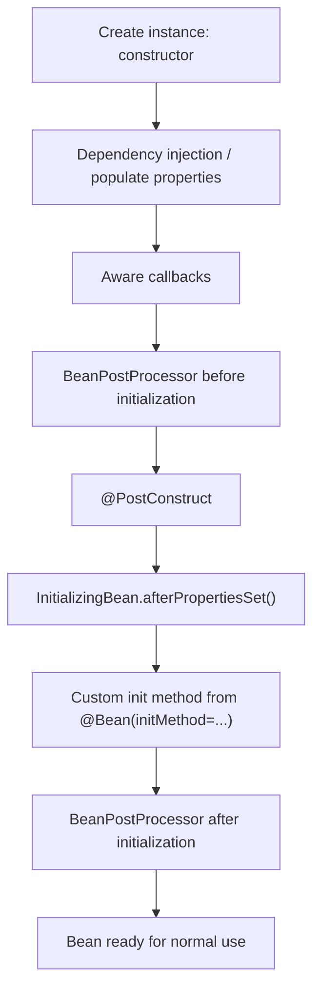
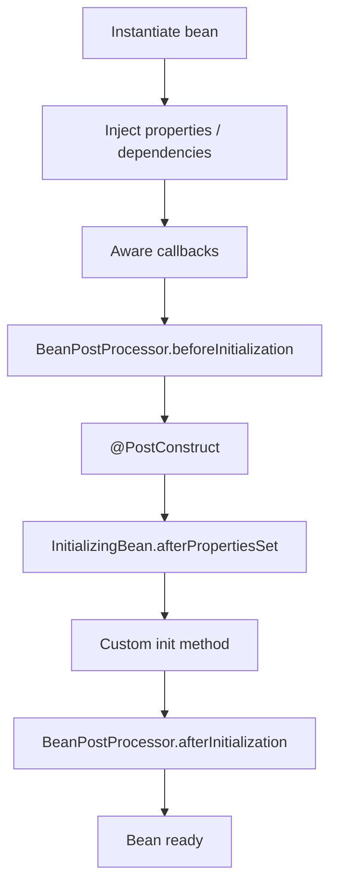

# InitializingBean and initMethod on @Bean

In Spring's bean lifecycle, creating a new Java object is only the first step. The container still has to supply dependencies, invoke required callbacks, and complete initialization before the bean enters normal use.

Spring provides several ways for a bean to perform work **after dependencies have been set**. Two important ways covered in this lesson are:

- **InitializingBean:** the bean implements Spring's interface and defines the afterPropertiesSet() method.
- **initMethod on @Bean:** configuring the name of a custom initialization method for Spring to call after setting up the bean.

Both belong to the **initialization callback** phase of the lifecycle. They do not replace constructors, are not places to receive initial dependencies, and do not mean Spring automatically invokes any method named init.

## 1. Position of Initialization Callbacks in the Bean Lifecycle

Suppose a service needs an endpoint configuration and a client to operate. When Spring creates the bean, the container must finish basic steps before the bean is ready.

Simplified flow of a regular bean:



This is the conceptual order during bean initialization. Some callbacks are performed by BeanPostProcessors, so do not treat them all as direct calls from the constructor.

Key steps:

1. **Instantiation:** Spring creates the object, typically calling the constructor.
2. **Populate properties:** Spring sets configured dependencies and properties.
3. **Aware callbacks:** if the bean implements interfaces such as BeanNameAware or BeanFactoryAware, the container invokes the corresponding callbacks.
4. **Before-initialization post-processors:** BeanPostProcessors process the bean before initialization; @PostConstruct is called during this phase by the corresponding processor.
5. **InitializingBean.afterPropertiesSet():** Spring invokes the interface callback if the bean implements it.
6. **Custom init method:** Spring invokes the method specified by initMethod or equivalent init-method configuration.
7. **After-initialization post-processors:** processors complete processing, which may create AOP proxies.
8. The bean completes initialization according to the container lifecycle.

**Key takeaway:** InitializingBean and initMethod run after dependencies have been set, but before the bean finishes all post-initialization post-processing steps.

## 2. What Is InitializingBean?

InitializingBean is an interface in Spring Framework:

```java
package org.springframework.beans.factory;

public interface InitializingBean {
    void afterPropertiesSet() throws Exception;
}
```

A bean implementing this interface must define afterPropertiesSet(). Spring calls the method after setting container-managed properties/dependencies.

Example:

```java
package com.example.shop;

import org.springframework.beans.factory.InitializingBean;
import org.springframework.stereotype.Component;

@Component
public class SearchService implements InitializingBean {

    private final SearchClient searchClient;

    public SearchService(SearchClient searchClient) {
        this.searchClient = searchClient;
    }

    @Override
    public void afterPropertiesSet() {
        searchClient.verifyConfiguration();
    }
}
```

Suppose SearchClient is also a valid bean and has a verifyConfiguration() method. When Spring creates SearchService:

- The container finds and supplies SearchClient.
- SearchService's constructor is called.
- Dependency setup steps complete.
- Spring calls afterPropertiesSet().
- If the callback completes normally, initialization continues.

### 2.1. Why is it named afterPropertiesSet?

The method name reflects the callback timing: container-managed properties have already been set. With constructor injection, dependencies were passed via the constructor before object construction finished. With setter/field injection, the callback runs after the container performs the corresponding injection steps.

The method name does not mean you have to use property setters. A bean using constructor injection can still implement InitializingBean.

### 2.2. Callbacks can validate state after injection

For example, a bean needs to validate required configuration:

```java
@Component
public class PaymentSettings implements InitializingBean {

    private final PaymentGateway gateway;

    public PaymentSettings(PaymentGateway gateway) {
        this.gateway = gateway;
    }

    @Override
    public void afterPropertiesSet() {
        if (!gateway.isConfigured()) {
            throw new IllegalStateException(
                    "Payment gateway is not configured"
            );
        }
    }
}
```

If configuration is invalid, the callback throws an exception and the bean cannot complete initialization. During application startup, this error usually causes the Spring context to fail when creating a required bean.

Only check conditions that truly belong to the bean's initialization responsibility. Do not turn afterPropertiesSet() into a place that runs entire business workflows.

## 3. What Is initMethod on @Bean?

When creating a bean using Java configuration, the @Bean annotation has an initMethod attribute. This attribute accepts the **method name** that Spring will call after creating and setting up the bean.

Example:

```java
package com.example.shop.config;

import org.springframework.context.annotation.Bean;
import org.springframework.context.annotation.Configuration;

@Configuration
public class SearchConfiguration {

    @Bean(initMethod = "initialize")
    public SearchIndex searchIndex() {
        return new SearchIndex();
    }
}
```

The SearchIndex class does not need to implement InitializingBean:

```java
package com.example.shop;

public class SearchIndex {

    public void initialize() {
        System.out.println("Search index initialized");
    }

    public void rebuild() {
        // Logic to update the index when requested
    }
}
```

Spring creates SearchIndex from the @Bean method, sets dependencies/properties per configuration, and then calls the initialize() method as declared.

**initMethod = "initialize" does not invoke the method immediately when Java executes the line new SearchIndex().** It is lifecycle metadata on the bean definition; the container executes the callback during the initialization phase.

### 3.1. Why use initMethod instead of forcing a class to implement an interface?

There are classes you do not want to or cannot modify:

- Third-party library classes.
- Classes belonging to another module that should not depend directly on Spring.
- A POJO with its own initialization API, such as open(), connect(), or initialize().
- A class that needs to be registered under a specific Java configuration.

You can configure the lifecycle outside the class:

```java
@Bean(initMethod = "connect")
public ExternalClient externalClient() {
    return new ExternalClient();
}
```

The ExternalClient class does not need to know Spring exists. @Configuration takes responsibility for linking the connect() method to the bean's lifecycle.

This is a key advantage of initMethod: **decoupling creation and lifecycle integration from the managed class's code**.

### 3.2. The init method must have an appropriate signature

With @Bean(initMethod = "..."), use a parameterless method:

```java
public void initialize() {
    // Prepare resources
}
```

An init method is not a factory method from which Spring takes a return value as the bean. It is a callback after the bean has already been created. Use void to express the intent clearly; a callback's return value is not the registered bean object.

The method name must match an actual method on the created instance. If a wrong name is declared or the method cannot be invoked properly, bean creation will fail.

## 4. Comparing InitializingBean and initMethod

Both mechanisms allow running logic after the bean is set up, but the declaration style differs.

| Criterion | InitializingBean | @Bean(initMethod = "...") |
|---|---|---|
| Declaration | Class implements InitializingBean | Configure method name on @Bean |
| Callback | afterPropertiesSet() | Custom method, e.g. initialize() |
| Spring API dependency in class | Yes | Not required |
| Suited for | Classes you control and accept Spring integration on | POJOs or external classes you do not want coupled to Spring |
| Can they be used together? | Yes | Yes |
| Timing | Initialization phase | Initialization phase, after afterPropertiesSet() if both are used |

### 4.1. When to use InitializingBean?

Use InitializingBean when:

- The class belongs to the application and integrating with Spring is an intentional choice.
- The callback is a natural part of the class's lifecycle contract.
- You want to express via the Java type that the class has an initialization completion step.
- You do not need to keep the class completely independent of Spring.

Example:

```java
@Component
public class LocalCache implements InitializingBean {

    private final CacheLoader loader;

    public LocalCache(CacheLoader loader) {
        this.loader = loader;
    }

    @Override
    public void afterPropertiesSet() {
        loader.loadInitialEntries();
    }
}
```

### 4.2. When to use initMethod?

Use initMethod when:

- The class should not depend on Spring.
- The class comes from a third-party library.
- The callback name already exists in the class's API.
- You want to place lifecycle wiring in the configuration layer.

Example:

```java
@Configuration
public class ClientConfiguration {

    @Bean(initMethod = "open")
    public LegacyClient legacyClient() {
        return new LegacyClient();
    }
}
```

LegacyClient only needs an appropriate open() method; it does not need to import InitializingBean.

### 4.3. Should both be used?

Both can be used. When a bean both implements InitializingBean and configures initMethod, the typical callback order in the initialization phase is:

1. @PostConstruct.
2. InitializingBean.afterPropertiesSet().
3. Custom init method configured via @Bean(initMethod = "...").

Example:

```java
public class CompositeClient implements InitializingBean {

    @PostConstruct
    public void postConstruct() {
        System.out.println("1. PostConstruct");
    }

    @Override
    public void afterPropertiesSet() {
        System.out.println("2. afterPropertiesSet");
    }

    public void initialize() {
        System.out.println("3. custom initMethod");
    }
}
```

Configuration:

```java
@Configuration
public class CompositeClientConfiguration {

    @Bean(initMethod = "initialize")
    public CompositeClient compositeClient() {
        return new CompositeClient();
    }
}
```

When the bean is created following the standard lifecycle, the illustrative log order is:

```text
1. PostConstruct
2. afterPropertiesSet
3. custom initMethod
```

Do not declare three callbacks that do the exact same job. If they all open connections, load data, or initialize the same resource, you may accidentally perform the operation multiple times.

## 5. Comparing with @PostConstruct

In Spring applications, @PostConstruct is another way to declare a callback after dependencies are set. This annotation belongs to Jakarta Annotations; modern versions use the jakarta.annotation package.

Example:

```java
import jakarta.annotation.PostConstruct;
import org.springframework.stereotype.Component;

@Component
public class ReportService {

    private final ReportRepository repository;

    public ReportService(ReportRepository repository) {
        this.repository = repository;
    }

    @PostConstruct
    public void initialize() {
        repository.verifyAccess();
    }
}
```

Comparison of the three approaches:

| Mechanism | Where declared | Characteristics |
|---|---|---|
| @PostConstruct | Annotation on a bean method | Standard Jakarta callback, no need to implement a Spring interface |
| InitializingBean | Class implements a Spring interface | Explicit lifecycle contract, but class depends on Spring |
| @Bean(initMethod = "...") | Java configuration | Configures the callback outside the class |

In a regular bean, pick one appropriate mechanism. If the class should not depend on Spring, @PostConstruct or configuring initMethod may fit better than InitializingBean; if you want configuration entirely outside the class, initMethod is the direct choice.

**Version note:** modern Spring Boot projects use the Jakarta namespace jakarta.annotation.PostConstruct. Older documentation may show javax.annotation.PostConstruct; do not copy the old import into a new project if current dependencies use Jakarta.

## 6. Complete Example: Bean Using InitializingBean

Suppose an application needs a service holding a list of product codes prepared from configuration. We want to validate the data after Spring injects dependencies.

### 6.1. Dependency providing data

```java
package com.example.catalog;

import java.util.List;
import org.springframework.stereotype.Component;

@Component
public class ProductCatalogSource {

    public List<String> loadProductCodes() {
        return List.of("P-100", "P-200", "P-300");
    }
}
```

### 6.2. Bean implementing InitializingBean

```java
package com.example.catalog;

import java.util.List;
import org.springframework.beans.factory.InitializingBean;
import org.springframework.stereotype.Service;

@Service
public class ProductCatalog implements InitializingBean {

    private final ProductCatalogSource source;
    private List<String> productCodes;

    public ProductCatalog(ProductCatalogSource source) {
        this.source = source;
    }

    @Override
    public void afterPropertiesSet() {
        this.productCodes = List.copyOf(source.loadProductCodes());

        if (productCodes.isEmpty()) {
            throw new IllegalStateException(
                    "Product catalog must not be empty"
            );
        }
    }

    public List<String> productCodes() {
        return productCodes;
    }
}
```

### 6.3. Using the bean after context initialization

```java
package com.example.catalog;

import org.springframework.stereotype.Service;

@Service
public class CatalogQueryService {

    private final ProductCatalog catalog;

    public CatalogQueryService(ProductCatalog catalog) {
        this.catalog = catalog;
    }

    public boolean contains(String productCode) {
        return catalog.productCodes().contains(productCode);
    }
}
```

When CatalogQueryService is created, Spring needs ProductCatalog. The container completes initialization of ProductCatalog before supplying that bean to regular dependents. Therefore, the list is already prepared when the service uses the bean after the context is ready.

This example demonstrates a callback used to **establish internal state based on injected dependencies**. If loading the list is actually a slow task, requires network calls, or can fail temporarily, consider readiness, retry, and operational workflows instead of unintentionally prolonging startup.

## 7. Complete Example: initMethod on @Bean

Suppose a library provides the ExternalIndex class. We do not modify this class to implement InitializingBean, yet it has a start() method to prepare resources.

### 7.1. POJO class with no Spring dependency

```java
package com.example.search;

public class ExternalIndex {

    private boolean started;

    public void start() {
        // Example: open resources or load required metadata.
        this.started = true;
        System.out.println("ExternalIndex started");
    }

    public boolean isStarted() {
        return started;
    }

    public void search(String query) {
        if (!started) {
            throw new IllegalStateException("Index is not started");
        }
        System.out.println("Searching: " + query);
    }

    public void stop() {
        this.started = false;
        System.out.println("ExternalIndex stopped");
    }
}
```

### 7.2. Registering the bean and declaring lifecycle

```java
package com.example.search.config;

import com.example.search.ExternalIndex;
import org.springframework.context.annotation.Bean;
import org.springframework.context.annotation.Configuration;

@Configuration
public class SearchConfiguration {

    @Bean(initMethod = "start", destroyMethod = "stop")
    public ExternalIndex externalIndex() {
        return new ExternalIndex();
    }
}
```

When Spring creates the bean:

- The externalIndex() method creates the object.
- The container completes bean setup steps.
- Spring calls start() per initMethod.
- When the singleton context closes gracefully, Spring calls stop() per destroyMethod.

destroyMethod appears in the example to illustrate the initialization/destruction lifecycle pair. The lesson's focus remains initMethod; destruction callbacks belong to a different phase.

### 7.3. Using the bean

```java
@Service
public class SearchService {

    private final ExternalIndex index;

    public SearchService(ExternalIndex index) {
        this.index = index;
    }

    public void search(String query) {
        index.search(query);
    }
}
```

SearchService does not need to call index.start() itself in its constructor. Spring handles the callback declared in the bean definition.

## 8. Callback Order When Combining Multiple Mechanisms

A bean can use multiple lifecycle callbacks. The conceptual order before the bean finishes post-processing is:



A few points to keep in mind:

- @PostConstruct is executed by the appropriate BeanPostProcessor.
- afterPropertiesSet() is called by Spring if the bean implements InitializingBean.
- Custom init method is called after afterPropertiesSet() if declared.
- After-initialization BeanPostProcessors can wrap the bean in a proxy or perform other processing.
- Order among application-defined processors also depends on configuration and registration order.

### 8.1. Why shouldn't you call other bean dependencies too early?

Inside an initialization callback, a bean can call its injected dependencies. However, do not assume **the entire ApplicationContext has finished startup**.

For example, if A's init callback calls another service and that service expects a listener or another singleton to have completed all initialization steps, premature interaction can occur. Beans are created in dependency order, yet not every singleton in the context has necessarily been created at the moment that callback runs.

For work that must wait for the entire context to finish refreshing, consider an appropriate lifecycle event such as ApplicationReadyEvent or another startup coordination mechanism. Do not use afterPropertiesSet() as a substitute for the "application is ready" event.

### 8.2. AOP proxies may not yet be ready inside init callbacks

An important technical point: the BeanPostProcessor that creates AOP proxies typically wraps the bean during the **after initialization** phase. Consequently, internal method calls inside @PostConstruct, afterPropertiesSet(), or a custom init method usually occur before the final proxy is exposed externally.

Therefore, do not expect AOP annotations such as @Transactional, @Async, or @Cacheable to be applied the same way as when calling the bean through its proxy after the context completes. For instance, putting @Transactional on the init method itself is not a reliable way to open a transaction for the initialization step.

If initialization needs a transaction, design a separate component called through a ready proxy at the right time, or use an appropriate post-startup coordination mechanism.

## 9. Handling Exceptions in Initialization Callbacks

afterPropertiesSet() can declare throws Exception, as specified by the interface. A custom init method can also encounter errors during execution.

Example:

```java
@Component
public class RequiredConfiguration implements InitializingBean {

    @Override
    public void afterPropertiesSet() {
        if (!configurationIsValid()) {
            throw new IllegalStateException(
                    "Required configuration is invalid"
            );
        }
    }

    private boolean configurationIsValid() {
        return false;
    }
}
```

If the callback fails, Spring cannot complete bean creation as expected. The exception is typically wrapped in a bean creation error, such as BeanCreationException, and can cause context startup to fail if that bean is a required application dependency.

### 9.1. Should you catch exceptions and ignore them?

Do not swallow exceptions silently:

```java
@Override
public void afterPropertiesSet() {
    try {
        initializeRequiredResource();
    } catch (Exception ex) {
        // Do not simply log and continue when the resource is required.
    }
}
```

If a resource is required for the bean to operate, continuing startup can leave the bean in an invalid state. Let the error propagate or convert it into an informative exception.

If the task is genuinely optional, explicitly model an unavailable state, retry capability, or appropriate fallback. Do not treat every initialization error as safe to ignore.

### 9.2. Should initialization perform long-running work?

These callbacks run during bean creation. If a callback loads large datasets, calls remote services, waits on a broker, or rebuilds an index for a long time, startup may drag on or fail because infrastructure is not ready yet.

Distinguish between:

- **Fast internal initialization:** validating configuration, preparing small data structures, establishing invariants.
- **Initialization needing external resources:** opening connections, checking dependencies, loading data.
- **Background or business tasks:** large synchronizations, data imports, index rebuilds, sending notifications.

Not every task belongs inside an init callback. For long-running tasks or tasks requiring retries, consider lifecycle events, runners, dedicated jobs, or an appropriate readiness/health mechanism.

## 10. Scope and How Many Times Callbacks Are Invoked

Callbacks are tied to **each time the container creates a bean instance under the corresponding lifecycle**, not a function guaranteed to "run exactly once across the entire JVM" in all scenarios.

| Scope / scenario | General behavior |
|---|---|
| Singleton | One instance per bean definition in a container; init callback runs when the instance is created |
| Prototype | Each time the container creates a new instance, the init callback runs for that instance |
| Request/session scope | Callback is tied to the instance created in the corresponding scope |
| Multiple ApplicationContexts | Each context can create its own instance and run its own callbacks |

For eager singletons, the callback normally runs during context startup. For lazy singletons, the callback may only run when the bean is requested for the first time. Therefore, do not assume every lazy bean has already initialized just because the application logged that startup completed.

**Note on prototypes:** Spring invokes initialization callbacks when creating a prototype bean, but the container does not manage the full destruction lifecycle of prototypes like singletons. If a prototype owns resources that need closing, the consumer side must typically take responsibility for releasing them properly.

## 11. Comparing Init Callbacks with ApplicationRunner and ApplicationReadyEvent

A common mistake is using afterPropertiesSet() for everything that needs to run at application startup. However, these mechanisms have different timing.

| Mechanism | Timing | Suitable purpose |
|---|---|---|
| @PostConstruct | During the bean's initialization callbacks | Internal bean initialization after dependencies are set |
| InitializingBean.afterPropertiesSet() | After @PostConstruct, during initialization | Checking invariants or finalizing bean state |
| @Bean(initMethod = "...") | After afterPropertiesSet() if present | Calling a class's lifecycle method from configuration |
| ApplicationRunner | After context refresh and before the app reports ready | Running startup tasks that receive application arguments |
| CommandLineRunner | Same runner stage after refresh | Handling startup tasks from raw command-line arguments |
| ApplicationReadyEvent | When the application is ready per Boot lifecycle | Reacting to the application-ready milestone |

ApplicationRunner example:

```java
@Component
public class StartupDataLoader implements ApplicationRunner {

    @Override
    public void run(ApplicationArguments args) {
        System.out.println("Application startup task");
    }
}
```

ApplicationReadyEvent example:

```java
@Component
public class ReadyListener {

    @EventListener
    public void onReady(ApplicationReadyEvent event) {
        System.out.println("Application is ready");
    }
}
```

Use bean callbacks to finalize **that specific bean**. Use runners/events when the work depends on **the context or application having reached a broader startup milestone**.

## 12. Common Mistakes When Configuring initMethod

### 12.1. Wrong method name

```java
@Bean(initMethod = "initialize")
public SearchIndex searchIndex() {
    return new SearchIndex();
}
```

Yet the class only has start() and no initialize(). Spring cannot invoke the declared method; bean creation fails.

Make sure the name in initMethod matches a method on the actual returned object.

### 12.2. Method requiring parameters

Unsuitable example:

```java
public void initialize(String path) {
}
```

initMethod is a callback invoked by the container by name; Spring does not automatically infer and pass an arbitrary parameter to this method. If data is needed, inject/configure the data into the bean beforehand so the callback reads established state, or use the factory method to construct the object with appropriate constructor arguments.

### 12.3. Calling initialization manually an extra time

```java
@Bean(initMethod = "initialize")
public SearchIndex searchIndex() {
    SearchIndex index = new SearchIndex();
    index.initialize(); // Manual call
    return index;
}
```

In this example, Spring also calls initialize() via initMethod after creating the bean. If the method is not idempotent, resources can be opened twice or data loaded redundantly.

Pick one place responsible for lifecycle. Do not duplicate both approaches for the same operation.

### 12.4. Putting the callback on the wrong class

```java
@Configuration
public class ClientConfiguration {

    @Bean(initMethod = "initialize")
    public Client client() {
        return new Client();
    }

    public void initialize() {
        // This is a method on the configuration class,
        // not a method on the Client instance.
    }
}
```

initMethod applies to **the bean instance returned from the @Bean method**, namely Client, rather than automatically invoking initialize() on the ClientConfiguration class.

If you want Client to be initialized, ensure the method exists on the actual returned class.

### 12.5. Calling a service that is not ready yet

Bean A may be created before an unrelated bean B during startup. If A's init callback calls B through a complex dependency path, it can create a dependency cycle or premature interaction.

Declare real dependencies via constructor/bean method when A needs B to initialize. If work needs to wait for the entire context, use an appropriate post-refresh mechanism.

### 12.6. Placing @Transactional on an init method and expecting the proxy to apply

Initialization methods are normally called before the after-initialization post-processing phase that creates AOP proxies. Therefore, do not rely on @Transactional on the init callback itself to obtain a transaction like a normal post-startup service call.

Move transactional operations to another bean/service and call it through its proxy at an appropriate time.

## 13. Combining initMethod and destroyMethod

Even though the focus is initialization, when a bean opens resources you need to think about closing them as well.

Example:

```java
public class FileWatcher {

    private boolean running;

    public void start() {
        running = true;
        System.out.println("Watcher started");
    }

    public void stop() {
        running = false;
        System.out.println("Watcher stopped");
    }
}
```

Registration:

```java
@Configuration
public class WatcherConfiguration {

    @Bean(initMethod = "start", destroyMethod = "stop")
    public FileWatcher fileWatcher() {
        return new FileWatcher();
    }
}
```

In a typical singleton lifecycle:

```text
Context refresh
   |
   v
Create FileWatcher
   |
   v
Call start()
   |
   v
Bean used by application
   |
   v
Context close
   |
   v
Call stop()
```

Spring also has destruction callbacks via DisposableBean and @PreDestroy. Destruction order is a separate part of the lifecycle and should not be confused with initialization order. If a class already implements AutoCloseable or has close()/shutdown() by convention, Spring may apply destroy method inference depending on bean declaration and configuration. When resources must be released precisely, explicit configuration is usually clearer to read.

For prototype beans, the container does not manage full destruction callbacks like singletons; whichever side owns the instance must release resources by design.

## 14. Principles for Designing Initialization Callbacks

Use initialization callbacks for work belonging to bean preparation, such as:

- Validating required configuration.
- Building small internal caches or data structures.
- Preparing clients/resources needed before the bean is used.
- Verifying injected dependency state.
- Establishing invariants that business methods can rely on.

Avoid:

- Running entire application business logic inside the callback.
- Calling multiple services in a complex chain creating hidden dependencies.
- Sending emails, processing payments, or performing irreversible side effects just because the context created a bean.
- Running long tasks, infinite retries, or waiting on unstable infrastructure directly in the callback.
- Swallowing exceptions and leaving the bean running in an invalid state.
- Using multiple callbacks to do the same job.
- Relying on a completed AOP proxy inside an init callback.

A good callback is short, has clear responsibility, is testable, and fails with an informative message if the bean cannot operate properly.

## 15. Hands-On Exercise: Comparing the Two Initialization Approaches

Goal: observe Spring invoking afterPropertiesSet() and initMethod after dependencies have been set.

### 15.1. Create the dependency

```java
package com.example.lifecycle;

import org.springframework.stereotype.Component;

@Component
public class StartupSettings {

    public String environmentName() {
        return "development";
    }
}
```

### 15.2. Bean using InitializingBean

```java
package com.example.lifecycle;

import org.springframework.beans.factory.InitializingBean;
import org.springframework.stereotype.Component;

@Component
public class CacheService implements InitializingBean {

    private final StartupSettings settings;
    private boolean initialized;

    public CacheService(StartupSettings settings) {
        this.settings = settings;
    }

    @Override
    public void afterPropertiesSet() {
        if (settings.environmentName().isBlank()) {
            throw new IllegalStateException("Environment name is required");
        }

        initialized = true;
        System.out.println(
                "CacheService initialized for " + settings.environmentName()
        );
    }

    public boolean isInitialized() {
        return initialized;
    }
}
```

### 15.3. Bean using initMethod

```java
package com.example.lifecycle;

public class SearchClient {

    private final StartupSettings settings;
    private boolean connected;

    public SearchClient(StartupSettings settings) {
        this.settings = settings;
    }

    public void connect() {
        connected = true;
        System.out.println(
                "SearchClient connected for " + settings.environmentName()
        );
    }

    public boolean isConnected() {
        return connected;
    }
}
```

Register the bean:

```java
package com.example.lifecycle;

import org.springframework.context.annotation.Bean;
import org.springframework.context.annotation.Configuration;

@Configuration
public class SearchClientConfiguration {

    @Bean(initMethod = "connect")
    public SearchClient searchClient(StartupSettings settings) {
        return new SearchClient(settings);
    }
}
```

The @Bean method accepts StartupSettings as a dependency. Spring supplies that bean to the factory method, creates SearchClient, and then invokes connect() per the init method configuration.

### 15.4. Verify after context initialization

```java
package com.example.lifecycle;

import org.springframework.boot.ApplicationRunner;
import org.springframework.context.annotation.Bean;
import org.springframework.context.annotation.Configuration;

@Configuration
public class LifecycleCheckConfiguration {

    @Bean
    ApplicationRunner lifecycleCheck(
            CacheService cacheService,
            SearchClient searchClient
    ) {
        return args -> {
            System.out.println(
                    "Cache initialized: " + cacheService.isInitialized()
            );
            System.out.println(
                    "Search connected: " + searchClient.isConnected()
            );
        };
    }
}
```

When the application runs, you expect to see the initialization messages before ApplicationRunner performs the check. Order among beans without dependencies on each other can depend on context creation; do not write tests requiring a global order that is not guaranteed.

### 15.5. Test controlled failures

Change StartupSettings.environmentName() to an empty string. Then CacheService.afterPropertiesSet() throws IllegalStateException. Observe startup failing and read Caused by to find the cause.

After observing, restore the valid value. Try changing initMethod = "connect" to a nonexistent method name on SearchClient to see that invalid lifecycle configuration also causes bean creation to fail.

These experiments help distinguish:

- Errors caused by a missing dependency.
- Errors caused by an init callback itself throwing an exception.
- Errors caused by an invalid init method name.
- Errors that only occur when the application executes business logic after startup.

## 16. Common Misconceptions

| Statement | True or false? | Explanation |
|---|---|---|
| InitializingBean is called before the constructor | **False** | The constructor creates the instance first; the callback runs after setting dependencies/properties |
| Only beans using setter injection can use afterPropertiesSet() | **False** | Constructor-injected beans implement the interface normally |
| @Bean(initMethod = "init") calls a method on the @Configuration class | **False** | It calls a method on the bean instance returned by the factory method |
| The init method name can be anything even if the class lacks that method | **False** | The corresponding method must exist and be callable appropriately |
| initMethod is a factory method to return a bean | **False** | The factory method is the @Bean method; init method is a callback on the already-created bean |
| InitializingBean and initMethod cannot be used together | **False** | They can be combined; afterPropertiesSet() runs before the custom init method |
| @PostConstruct runs after afterPropertiesSet() | **False** | In the standard lifecycle, @PostConstruct runs before |
| An init callback means the entire application is ready | **False** | The callback belongs to a single bean; the context may still be creating other beans |
| @Transactional on an init method always runs through an AOP proxy | **False** | The callback typically happens before the post-processing step that creates the final proxy |
| An init callback runs strictly once per JVM | **False** | Count depends on instances, scope, and number of ApplicationContexts |
| InitializingBean automatically closes resources when the context stops | **False** | This interface is only an initialization callback; destruction has separate mechanisms |
| Enabling initMethod automatically creates dependencies | **False** | Dependencies must still be declared via constructors, properties, or bean configuration |

## 17. Self-Check Questions

**Question 1.** Which method does InitializingBean require implementing?

**Answer:** afterPropertiesSet(), invoked during the initialization phase after the container has set the bean's properties/dependencies.

**Question 2.** A library class has an open() method but does not implement any Spring interface. Can open() be called after Spring creates the bean?

**Answer:** Yes. Declare @Bean(initMethod = "open") on the factory method returning that instance.

**Question 3.** If a bean has @PostConstruct, implements InitializingBean, and configures initMethod, what is the typical order?

**Answer:** @PostConstruct → afterPropertiesSet() → custom init method.

**Question 4.** Why shouldn't you put @Transactional on afterPropertiesSet() itself and expect the transaction interceptor to run?

**Answer:** Initialization callbacks are typically invoked before the after-initialization post-processing step that creates AOP proxies; the callback call does not necessarily pass through a proxy.

**Question 5.** Can initMethod automatically receive parameters from Spring like a constructor?

**Answer:** Not in that way. An init method is a parameterless callback; dependencies should be supplied to the bean via constructor/property or factory method before the callback runs.

**Question 6.** If afterPropertiesSet() throws an exception, what can happen?

**Answer:** The bean does not complete initialization; the error is typically wrapped in a bean creation exception and can cause context startup to fail if the bean is a required component.

**Question 7.** If you need to run a task after the entire application is ready, should you default to afterPropertiesSet() or ApplicationReadyEvent?

**Answer:** ApplicationReadyEvent suits the application-ready milestone better; afterPropertiesSet() only reflects the initialization phase of a single bean.

## 18. Key Takeaways

- **InitializingBean** is a Spring contract with the afterPropertiesSet() callback.
- **@Bean(initMethod = "...")** declares a custom initialization method on the instance returned by the factory method.
- Both run after dependencies/properties have been set and during the bean's initialization phase.
- When combining common callbacks, the order is **@PostConstruct → afterPropertiesSet() → custom init method**.
- initMethod fits when a class should not depend directly on Spring, especially POJOs or external libraries.
- An initialization callback does not mean the entire ApplicationContext is ready; post-startup work should use appropriate runners/events.
- Do not place long business logic, hard-to-reverse side effects, or logic depending on AOP proxies into init callbacks.
- When a bean opens resources, also design the release step using an appropriate destruction callback.

When reading a bean in Spring Boot, ask yourself: **"Where were dependencies provided, what does the bean need to finalize before use, and which callback best expresses that responsibility?"** The answer will help you choose clearly among constructors, InitializingBean, @PostConstruct, initMethod, and application-level startup mechanisms.
