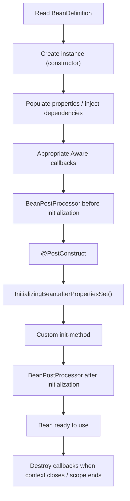
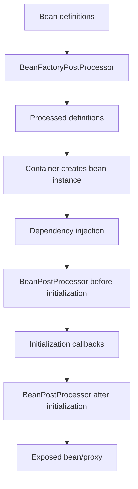
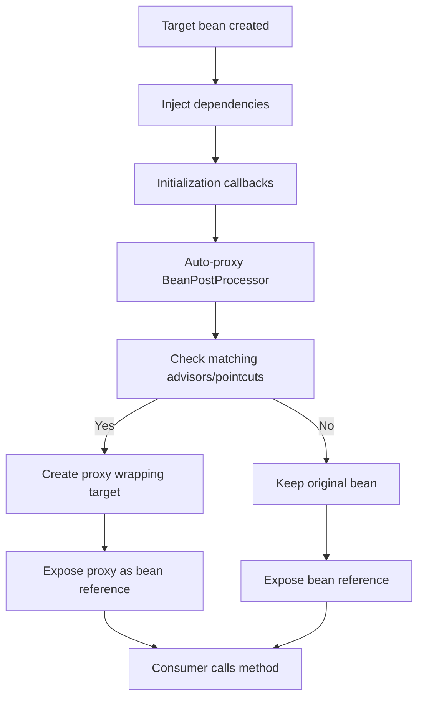

# BeanPostProcessor Before and After Initialization and the Ability to Return a Proxy

In Spring, a bean is not simply created and handed straight to the application for use. While building the `ApplicationContext`, the container performs multiple steps to inject dependencies, invoke lifecycle callbacks, apply configuration, and potentially wrap the object in a proxy. A key mechanism participating in this process is **`BeanPostProcessor`**.

`BeanPostProcessor` lets Spring or an application intervene on a **bean instance** before and after initialization callbacks. Its two primary methods are `postProcessBeforeInitialization` and `postProcessAfterInitialization`. Each method can return either the original object or a replacement object—often a proxy wrapping the original bean.

In the **Bean Lifecycle** chapter of *Spring Boot Fundamentals*, it is important to understand where these two callbacks sit in the lifecycle, how processors are chained together, why Spring AOP can create proxies, and the implications when a bean is injected as a proxy rather than the original class instance.

## 1. BeanPostProcessor Operates on Bean Instances

`BeanPostProcessor` is a Spring Framework extension point. It allows registering an object capable of receiving beans as the container creates them, then performing an action before or after the initialization phase.

The interface has two core methods:

```java
package org.springframework.beans.factory.config;

import org.springframework.beans.BeansException;

public interface BeanPostProcessor {

    Object postProcessBeforeInitialization(
            Object bean,
            String beanName
    ) throws BeansException;

    Object postProcessAfterInitialization(
            Object bean,
            String beanName
    ) throws BeansException;
}
```

The snippet above illustrates Spring's contract; when writing an application, we import the interface from the Spring library rather than redefining it. The two parameters mean:

- `bean` is the current object being processed by the container. It may be the original instance or an object already wrapped by an earlier processor.
- `beanName` is the bean name in the container, useful when the processor only applies to a specific bean or group of beans.

Both methods return `Object` because a processor may return:

1. The input bean itself, if it only needs to observe or adjust state.
2. Another wrapper/proxy, if it wants to alter how other components interact with the bean.

**BeanPostProcessor processes object instances.** This is what distinguishes it from `BeanFactoryPostProcessor`, which works with bean definitions and configuration metadata before regular beans are created.

## 2. Position of BeanPostProcessor in the Bean Lifecycle

A regular singleton bean goes through several steps. Conceptually:



This diagram is simplified to show the main order. Some callbacks such as `@PostConstruct` are invoked through a Spring BeanPostProcessor during the `postProcessBeforeInitialization` phase, so it is not an isolated step outside the post-processor system.

### 2.1. Before initialization does not mean before constructor

`postProcessBeforeInitialization` is invoked **after the instance has been created and required dependencies/properties have been populated**. It is not a hook that runs before the constructor is called.

Consequently, a processor can observe a bean that already has its initial state and injected dependencies. However, the bean's initialization callbacks have not yet completed.

Example:

```java
@Component
public class ReportService {

    private final ReportRepository repository;

    public ReportService(ReportRepository repository) {
        this.repository = repository;
    }

    @PostConstruct
    void initialize() {
        // Prepare state after dependencies have been injected.
    }
}
```

When a processor handles `ReportService` in the before-initialization phase, the constructor has already run and `repository` has been supplied. `@PostConstruct` has not yet been called at that point if the processor runs ahead of the processor executing that callback in the processing order.

### 2.2. Where does @PostConstruct sit?

In modern Spring, `@PostConstruct` is handled by a specialized BeanPostProcessor (via the lifecycle annotation processing mechanism). Thus, it executes within the `postProcessBeforeInitialization` phase.

With the common initialization callback order:

1. Before-initialization processors are applied; Spring's processor invokes the `@PostConstruct` method.
2. `InitializingBean.afterPropertiesSet()` is invoked if the bean implements this interface.
3. Custom init method is invoked if configured, e.g., via `@Bean(initMethod = "...")`.
4. After-initialization processors are applied.

Do not confuse `@PostConstruct` with `BeanPostProcessor.postProcessAfterInitialization`. One is an initialization callback on the bean; the other is an extension point running after initialization callbacks.

## 3. Writing a BeanPostProcessor That Only Observes Beans

The simplest example is logging as beans pass through both phases:

```java
package com.example.shop.infrastructure;

import org.springframework.beans.BeansException;
import org.springframework.beans.factory.config.BeanPostProcessor;

public class LifecycleTracePostProcessor implements BeanPostProcessor {

    @Override
    public Object postProcessBeforeInitialization(
            Object bean,
            String beanName
    ) throws BeansException {
        System.out.println("Before initialization: " + beanName);
        return bean;
    }

    @Override
    public Object postProcessAfterInitialization(
            Object bean,
            String beanName
    ) throws BeansException {
        System.out.println("After initialization: " + beanName);
        return bean;
    }
}
```

This processor only observes the bean name and returns the exact original object. It neither modifies the bean nor creates a proxy.

### 3.1. Registering the processor in the Spring context

It can be registered through a `@Bean` method:

```java
package com.example.shop.config;

import com.example.shop.infrastructure.LifecycleTracePostProcessor;
import org.springframework.context.annotation.Bean;
import org.springframework.context.annotation.Configuration;

@Configuration
public class LifecycleConfiguration {

    @Bean
    static LifecycleTracePostProcessor lifecycleTracePostProcessor() {
        return new LifecycleTracePostProcessor();
    }
}
```

Notably, the factory method creating the BeanPostProcessor is declared `static`. Spring must register and use BeanPostProcessors fairly early during context initialization. Declaring a static factory method lets the container obtain the processor without instantiating the configuration class early, reducing the risk that some beans get created before all processors are registered.

Another way is registering the processor class as a bean through an appropriate mechanism. Remember: **a BeanPostProcessor must be present early enough to participate in processing regular beans**.

### 3.2. Observed output

When the application starts up, logs may contain lines like:

```text
Before initialization: reportService
After initialization: reportService
Before initialization: orderRepository
After initialization: orderRepository
```

Actual order and bean list depend on initialization flow, dependency graph, lazy initialization, and other processors. Do not treat the log order of all beans as a stable business contract.

The processor can be called for many kinds of beans in the context, not just `@Component` classes. Beans created via `@Bean`, beans from auto-configuration, and many infrastructure components may also pass through the appropriate post-processor chain.

## 4. Both Callbacks Can Return a Different Object

The power of `BeanPostProcessor` is that the methods are not required to return the exact input object. A processor can replace the bean with a wrapper:

```java
@Override
public Object postProcessAfterInitialization(
        Object bean,
        String beanName
) {
    if (bean instanceof SomeService) {
        return new SomeServiceWrapper((SomeService) bean);
    }
    return bean;
}
```

`SomeServiceWrapper` is a hypothetical type in this example. If it is incompatible with the type required by injection points, creating a proxy/wrapper can cause dependency resolution or method calls to fail. Therefore, a wrapper must ensure **compatibility with the contract seen by other beans**.

When a processor returns a proxy, components injected afterward may receive the proxy instead of the target object. The proxy receives calls and forwards them to the target, optionally adding logic before/after the call.

Common goals include:

- Measuring method execution time.
- Recording invocations or metrics.
- Applying transactions, security, or caching.
- Adding lazy lookup or remote access mechanisms.
- Swapping an implementation with an adapter/proxy having equivalent behavior.

In practice, Spring AOP and infrastructure processors already provide many of these features. Writing a proxy manually via BeanPostProcessor is useful for understanding the mechanism or implementing a specialized integration, but do not reimplement built-in abstractions unnecessarily.

## 5. Example Returning a Proxy After Initialization

Suppose the application has a payment contract:

```java
package com.example.shop.payment;

import java.math.BigDecimal;

public interface PaymentGateway {
    String charge(BigDecimal amount);
}
```

A simple implementation:

```java
package com.example.shop.payment;

import java.math.BigDecimal;
import org.springframework.stereotype.Component;

@Component
public class DemoPaymentGateway implements PaymentGateway {

    @Override
    public String charge(BigDecimal amount) {
        return "PAYMENT-" + amount.toPlainString();
    }
}
```

We want to measure execution time of calls to the gateway. A BeanPostProcessor can wrap the bean after initialization with a proxy:

```java
package com.example.shop.infrastructure;

import com.example.shop.payment.PaymentGateway;
import org.aopalliance.intercept.MethodInterceptor;
import org.springframework.aop.framework.ProxyFactory;
import org.springframework.beans.BeansException;
import org.springframework.beans.factory.config.BeanPostProcessor;

public class PaymentTimingPostProcessor implements BeanPostProcessor {

    @Override
    public Object postProcessAfterInitialization(
            Object bean,
            String beanName
    ) throws BeansException {
        if (!(bean instanceof PaymentGateway)) {
            return bean;
        }

        ProxyFactory proxyFactory = new ProxyFactory();
        proxyFactory.setTarget(bean);
        proxyFactory.setInterfaces(PaymentGateway.class);
        proxyFactory.addAdvice((MethodInterceptor) invocation -> {
            long startedAt = System.nanoTime();
            try {
                return invocation.proceed();
            } finally {
                long elapsed = System.nanoTime() - startedAt;
                System.out.println(
                        "PaymentGateway." + invocation.getMethod().getName()
                                + " took " + elapsed + " ns"
                );
            }
        });

        return proxyFactory.getProxy();
    }
}
```

The example uses Spring AOP's `ProxyFactory` and `MethodInterceptor` from AOP Alliance. The proxy is configured to implement the `PaymentGateway` interface, so consumers should inject through this interface.

Register the processor:

```java
@Configuration
public class PaymentInfrastructureConfiguration {

    @Bean
    static PaymentTimingPostProcessor paymentTimingPostProcessor() {
        return new PaymentTimingPostProcessor();
    }
}
```

A consuming service:

```java
@Service
public class CheckoutService {

    private final PaymentGateway paymentGateway;

    public CheckoutService(PaymentGateway paymentGateway) {
        this.paymentGateway = paymentGateway;
    }

    public String checkout(BigDecimal amount) {
        return paymentGateway.charge(amount);
    }
}
```

When `CheckoutService` is created, it receives the bean after it has passed through the post-processor chain. If `PaymentTimingPostProcessor` creates the proxy successfully, the injected dependency is a proxy implementing `PaymentGateway`. When `charge` is called:

1. The consumer calls the method on the proxy.
2. The interceptor records the start time.
3. `invocation.proceed()` forwards to the target `DemoPaymentGateway`.
4. The interceptor records the end time in `finally`.
5. The result from the target is returned to the consumer.

This demonstrates `postProcessAfterInitialization`'s ability to return a proxy. For timing measurements in real applications, Micrometer Observation, metrics, or Spring AOP may be better suited than a custom processor.

### 5.1. Why does the example use an interface?

`ProxyFactory` is configured with `PaymentGateway.class`, so it creates an interface-based proxy. This proxy can be injected into a field or parameter of type `PaymentGateway`.

If a consumer demands concrete `DemoPaymentGateway`, a JDK dynamic proxy is not an instance of that class. Injection by concrete type can then fail. Designing around interfaces helps consumers depend on a stable contract without needing to know the implementation or how the proxy was created.

Spring also supports class-based proxies (typically based on subclassing). However, final classes or final/private methods have restrictions with inheritance-based proxies. The proxy strategy choice must match the bean type and API that consumers require.

## 6. How Does the BeanPostProcessor Chain Work?

An application context can register multiple BeanPostProcessors. Spring applies them in registration order for each bean. The result from an earlier processor becomes the input to the next processor.

Suppose there are three processors:


For example:

- Processor A logs the lifecycle.
- Processor B wraps the bean in a timing proxy.
- Processor C inspects or adds metadata on the object it receives.

If processor B returns a proxy, processor C may receive that proxy rather than the original target instance. Therefore, processor order affects what object subsequent processors observe and what final object gets exposed.

### 6.1. Two phases have separate chains

Spring applies the `postProcessBeforeInitialization` chain before initialization callbacks and the `postProcessAfterInitialization` chain after callbacks. A processor may override only one of the two methods; the other defaults to returning the bean unchanged.

If processor A swaps the object in the before-initialization phase, subsequent steps may operate on the replaced object. If processor B wraps the object in the after-initialization phase, consumers receive the result after the after-initialization chain finishes.

Do not assume every processor always receives the exact same object identity in every callback. Check the return value of each processor.

### 6.2. What does returning null mean?

Per Spring's contract, if a processor returns `null`, the corresponding processing chain stops applying remaining BeanPostProcessors for that bean. Spring retains the current object from before the processor returned null as the chain's result, rather than treating null as the final bean to inject.

Thus, when writing a normal processor, **always return a valid bean or wrapper**, unless you explicitly intend to halt the chain. Returning null by accident can prevent other processors from running on that bean and create hard-to-diagnose behavior.

## 7. BeanPostProcessor Registration Order

When multiple processors coexist, order can affect proxies and lifecycle behavior. Spring supports ordering mechanisms:

- `PriorityOrdered`: group of processors prioritized to register first.
- `Ordered`: group of processors ordered after the PriorityOrdered group, by order value.
- Processors not implementing ordering interfaces are processed according to the remaining registration order.

Do not rely on `@Order` on a BeanPostProcessor as if it always had the same effect as ordering ordinary beans. For BeanPostProcessors themselves, use the `PriorityOrdered`/`Ordered` contracts when you need to control registration order.

Example:

```java
public class OrderedTracePostProcessor
        implements BeanPostProcessor, Ordered {

    @Override
    public int getOrder() {
        return 100;
    }

    @Override
    public Object postProcessAfterInitialization(
            Object bean,
            String beanName
    ) {
        return bean;
    }
}
```

A lower order value means higher priority within the corresponding ordering group. However, if a processor implements `PriorityOrdered`, it still belongs to a higher-priority group than processors implementing only `Ordered`, regardless of numeric order comparisons between the two groups.

For processors that do not need a specific order, do not add ordering just to "be safe." Every ordering constraint increases coupling between infrastructure components.

## 8. BeanPostProcessors Are Initialized Very Early

An important detail when registering processors in Spring Boot: the container must create BeanPostProcessors before completing creation of regular beans. This produces several consequences.

### 8.1. Beans created too early can miss some processors

If a BeanPostProcessor depends on another bean, that dependency may be created early while the container is registering processors. A bean created early may not yet be processed by all BeanPostProcessors in the context.

Spring can emit a warning stating that a bean **is not eligible for getting processed by all BeanPostProcessors**. That does not necessarily make the bean unusable, though it may prevent it from receiving proxies or expected behaviors.

### 8.2. Use static @Bean to declare a BeanPostProcessor

With a configuration class:

```java
@Configuration
public class InfrastructureConfiguration {

    @Bean
    static BeanPostProcessor tracePostProcessor() {
        return new LifecycleTracePostProcessor();
    }
}
```

A static method allows Spring to create the processor without instantiating the configuration class early. This is an important recommendation when declaring BeanPostProcessors via Java configuration.

### 8.3. Minimize dependencies of the processor itself

A BeanPostProcessor should have minimal dependencies. Avoid injecting large business services, repositories, or beans with many dependencies into a processor unless genuinely required. Those dependencies can be initialized early and bypass parts of the processing chain applied to regular beans.

If the processor needs simple metadata or configuration, consider passing values directly via constructor/factory method or using a small abstraction intentionally designed for early creation.

## 9. Distinguishing BeanPostProcessor and BeanFactoryPostProcessor

The two names look very similar but operate on two different layers:

| Criterion | BeanFactoryPostProcessor | BeanPostProcessor |
| --- | --- | --- |
| Target processed | Bean definitions / configuration metadata | Bean instances |
| Timing | Before initializing regular beans | During the initialization of each bean |
| Purpose | Modify bean definitions, property metadata, container configuration | Observe, adjust, or wrap object instances |
| Can directly return a proxy instance? | Not the purpose of this extension point | Yes, via the callback return value |
| Example | Read/resolve property placeholders in configuration | Create proxies, process lifecycle annotations |

Diagram:



If you want to change **metadata describing a bean before the instance exists**, look into BeanFactoryPostProcessor. If you want to intervene on **an already-created object**, BeanPostProcessor is the right fit.

## 10. @PostConstruct and BeanPostProcessor Are Not the Same Thing

`@PostConstruct` is typically used to run an initialization task on the bean itself:

```java
@Component
public class ReferenceDataCache {

    @PostConstruct
    void load() {
        // Load required initialization data.
    }
}
```

The `load()` method belongs to the `ReferenceDataCache` bean's lifecycle. In contrast, `BeanPostProcessor` is an infrastructure component that can apply across many different beans.

| Question | @PostConstruct | BeanPostProcessor |
| --- | --- | --- |
| Who writes it? | The bean class needing initialization | Container extension component |
| Scope | One specific bean/method | Can apply to multiple beans |
| Timing | During Spring's before-initialization phase | Before or after initialization callbacks |
| Can it replace the exposed object? | Not the goal of the callback | Can return a wrapper/proxy |
| What is it for? | Finalizing internal state after injection | Cross-cutting processing, inspection, wrapping, or proxying beans |

Do not move all initialization logic of a single bean into a BeanPostProcessor. If a class needs to load its own internal data, a lifecycle callback on the bean is usually clearer. Only when you need a shared mechanism across many beans is BeanPostProcessor the right extension point.

## 11. Spring AOP Uses Post-Processing to Create Proxies

Features such as transactions, method security, caching, or various AOP capabilities often require a proxy wrapping the target bean. A proxy enables inserting behavior before/after method calls without editing business class logic.

Conceptual flow:



In practice, Spring AOP uses infrastructure processors such as auto-proxy creators to decide which beans need proxying. Not every bean is proxied. A bean must match an advisor/pointcut or corresponding AOP mechanism.

### 11.1. @Transactional example

```java
@Service
public class OrderService {

    private final OrderRepository repository;

    public OrderService(OrderRepository repository) {
        this.repository = repository;
    }

    @Transactional
    public void placeOrder(Order order) {
        repository.save(order);
    }
}
```

Conceptually, Spring can supply a proxy for `OrderService`. When a consumer calls `placeOrder` on the proxy, transaction advice begins a transaction, forwards the call to the target, and then commits or rolls back based on the outcome.

The business code still writes a normal repository call. The proxy handles cross-cutting behavior. This is a classic example of why `BeanPostProcessor`'s ability to return proxies matters in Spring.

However, `@Transactional` is not just "a one-line BeanPostProcessor." The real mechanism also involves transaction advisors, pointcuts, interceptors, transaction managers, and proxy rules. Having the annotation does not guarantee a transaction runs if configuration or invocation does not route through the proxy appropriately.

### 11.2. Self-invocation and proxies

With proxy-based AOP, if one method on the target directly calls another method on the same object using `this.otherMethod()`, that internal call normally bypasses the proxy. Consequently, advice like `@Transactional` on the internally invoked method may not be applied as expected.

Example:

```java
@Service
class ReportService {

    public void generate() {
        this.writeReport();
    }

    @Transactional
    public void writeReport() {
        // ...
    }
}
```

If `generate()` is called externally via the proxy, the internal `this.writeReport()` call inside the target does not go back through the proxy. `writeReport()`'s transaction advice may not execute as desired. Typical design solutions are extracting the transactional method to another bean or structuring calls to go through the proxy properly.

This is a consequence of proxy-based interception, not a specific bug of `BeanPostProcessor`.

## 12. Is the Proxy Created After Initialization Always the Only Proxy?

Not necessarily. Spring may have multiple wrapping mechanisms, such as a custom processor, AOP's auto-proxy creator, or processors from other libraries. When multiple mechanisms participate, understand their order and coordination to avoid unwanted nested proxies.

Some considerations:

- A later processor may receive a proxy already created by an earlier processor.
- A bean can end up wrapped in multiple layers if independent processors do not coordinate.
- Spring AOP has infrastructure to coordinate advisors and proxies in normal cases; do not add a separate custom proxy for the same purpose without a reason.
- Proxies can alter the type visible to consumers, especially with JDK interface proxies.
- Some frameworks need early target references during circular dependencies and have early-reference mechanisms; not every proxy is created strictly once in a simple after-initialization callback.

### 12.1. Early proxy references in circular dependencies

In certain singleton circular dependency scenarios, Spring may need to provide an early reference to a bean before initialization completes. Processors in the `SmartInstantiationAwareBeanPostProcessor` family can participate in obtaining early bean references, for example to ensure a consistent proxy is used.

This is an advanced scenario. At the Fundamentals level, remember **not to assume every proxy is only created inside postProcessAfterInitialization**. Spring's auto-proxy creator can coordinate with early reference mechanisms to handle circular dependencies.

If an application hits an error where one place receives a raw bean and another receives a proxy in a circular reference, read Spring's message and examine the circular dependency design before trying to enable circular references.

## 13. An Injected Bean May Be a Proxy, Not the Original Class

Suppose the target bean is `DemoPaymentGateway` while the processor returns a JDK proxy implementing `PaymentGateway`. A consumer receiving the interface:

```java
private final PaymentGateway gateway;
```

works and invokes methods through the proxy.

However, if the consumer requests:

```java
private final DemoPaymentGateway gateway;
```

then a JDK proxy is not an instance of `DemoPaymentGateway`. The dependency may fail to inject or casting will fail.

This underscores a design principle: **consumers should depend on the contract provided by the bean**, especially when the framework may replace the implementation with a proxy.

### 13.1. JDK dynamic proxy

A JDK proxy implements one or more interfaces. It fits when consumers call methods belonging to the interfaces exposed by the proxy.

### 13.2. Class-based proxy

A class-based proxy creates a subclass of the target class. It can expose class methods without requiring an interface, though it is constrained by inheritance mechanics: final classes or final methods cannot be overridden as required; constructors and visibility also matter.

Do not assume every Spring Boot application uses one fixed proxy type. Proxy strategy depends on Spring AOP configuration, framework choices, and how the proxy is built. For example, `ProxyFactory` in this lesson explicitly configures interfaces to demonstrate a JDK proxy.

## 14. What Not to Do Inside a BeanPostProcessor

BeanPostProcessor is a container-level mechanism. Because it runs across many beans and very early, logic inside it requires care.

Avoid these practices:

- **Running application business logic in a processor:** a processor is not the place for order processing, payments, or per-request notifications.
- **Injecting multiple interdependent services into a processor:** can cause beans to initialize prematurely, miss some processors, or create circular dependencies.
- **Creating type-incompatible proxies:** consumers request a concrete class while the processor returns a JDK proxy implementing only an interface.
- **Accidentally returning null:** halts the post-processor chain for that bean.
- **Unconditionally wrapping all beans:** can alter types, debugging, and performance on a broad scale.
- **Unnecessarily reimplementing @Transactional/AOP:** easy to miss exception semantics, proxy behavior, and infrastructure integration.
- **Keeping global mutable state in a processor:** processors are usually singletons and can process multiple beans/threads; shared state must be managed safely.

If a processor needs to apply to a group of beans, select them by type, annotation, or explicit metadata. If only observing the lifecycle, keep the processor's behavior as simple as possible.

## 15. Checking Whether a Bean Is Being Proxied

Spring provides utilities to inspect proxies during development and testing. For example:

```java
import org.springframework.aop.support.AopUtils;

boolean proxy = AopUtils.isAopProxy(bean);
boolean jdkProxy = AopUtils.isJdkDynamicProxy(bean);
boolean cglibProxy = AopUtils.isCglibProxy(bean);
```

These functions help observe the proxy kind. They do not prove that specific advice ran or that a transaction committed. To verify behavior, invoke methods through the injected reference and check actual results/effects.

### 15.1. Testing a proxy-creating BeanPostProcessor

A minimal test context can verify the retrieved bean is a JDK proxy:

```java
import static org.junit.jupiter.api.Assertions.assertTrue;

import com.example.shop.infrastructure.PaymentTimingPostProcessor;
import com.example.shop.payment.DemoPaymentGateway;
import com.example.shop.payment.PaymentGateway;
import org.junit.jupiter.api.Test;
import org.springframework.aop.support.AopUtils;
import org.springframework.beans.factory.config.BeanPostProcessor;
import org.springframework.context.annotation.AnnotationConfigApplicationContext;
import org.springframework.context.annotation.Bean;
import org.springframework.context.annotation.Configuration;

class PaymentProxyTest {

    @Configuration
    static class TestConfiguration {

        @Bean
        static BeanPostProcessor paymentPostProcessor() {
            return new PaymentTimingPostProcessor();
        }

        @Bean
        PaymentGateway paymentGateway() {
            return new DemoPaymentGateway();
        }
    }

    @Test
    void paymentGatewayIsExposedAsJdkProxy() {
        try (var context =
                     new AnnotationConfigApplicationContext(TestConfiguration.class)) {
            PaymentGateway gateway =
                    context.getBean(PaymentGateway.class);

            assertTrue(AopUtils.isJdkDynamicProxy(gateway));
            gateway.charge(new java.math.BigDecimal("100"));
        }
    }
}
```

The test above is an illustrative example of the mechanism, requiring the corresponding classes/interfaces and Spring AOP/JUnit dependencies in the project. It confirms the proxy is exposed and methods can be called via the interface. To verify timing logic, inject a test collector/recorder instead of only watching stdout.

### 15.2. Testing lifecycle callbacks

To test before/after initialization, you can use a test bean with a `@PostConstruct` method and a processor recording events. Conceptual expected order:

```text
processor.beforeInitialization
    -> @PostConstruct
    -> InitializingBean.afterPropertiesSet
    -> custom init-method
    -> processor.afterInitialization
```

In real tests, record events into a test-owned collection and assert the specific order of callbacks the application depends on. Do not assert the exact ordering of every internal Spring processor if that is not part of your application's contract.

## 16. Can BeanPostProcessor Modify a Bean Before Initialization?

Yes. The contract of `postProcessBeforeInitialization` also returns `Object`, so technically a processor can return a wrapper or different object before initialization callbacks proceed.

However, be cautious:

- Subsequent initialization callbacks will operate on the object passed forward in the chain.
- The wrapper must be compatible with callbacks and types required by the container.
- Replacing the target too early can affect how Spring invokes initialization interfaces or lifecycle annotations.
- Some wrappers/proxies require the target to have completed initialization, so after-initialization is usually the more appropriate time for regular proxies.

If you only want to alter method call behavior after the bean has initialized, `postProcessAfterInitialization` is typically easier to understand and safer. Use before-initialization for specific goals once you fully understand the lifecycle and wrapper contract.

## 17. When Is BeanPostProcessor Needed and When Is It Not?

| Need | Typically appropriate mechanism |
|---|---|
| Initialize internal state of a single bean | `@PostConstruct` or init callback |
| Provide an object with a special constructor/configuration | `@Bean` |
| Create beans via package scanning | `@Component` and `@ComponentScan` |
| Edit metadata/bean definitions before creating instances | `BeanFactoryPostProcessor` |
| Apply cross-cutting behavior to multiple bean instances | `BeanPostProcessor` or Spring AOP |
| Transactions, caching, method security | Specialized Spring AOP/annotation mechanisms |
| Measure metrics/tracing per operation | Micrometer/Observation and matching integrations |
| Perform business work after the application is ready | Appropriate application event listener or runner |

BeanPostProcessor is a powerful extension point, but not the default tool for solving every lifecycle problem. If a feature already has a higher-level abstraction, prefer that abstraction to reduce custom infrastructure code.

## 18. Practice Exercises

### Exercise 1 – Record both post-processing phases

Write a `LifecycleTracePostProcessor` implementing `BeanPostProcessor`. In each callback, log the bean name and callback method name. Register the processor using a static `@Bean`.

Create a component with `@PostConstruct`. Observe and describe the before callback, `@PostConstruct`, and after callback in order.

### Exercise 2 – Distinguish timing

A bean has a constructor, a field dependency, `@PostConstruct`, and `InitializingBean.afterPropertiesSet()`. Draw the order of steps Spring performs. Explain why `postProcessBeforeInitialization` does not run before the constructor.

### Exercise 3 – Wrap PaymentGateway with a proxy

Create `PaymentTimingPostProcessor` using `ProxyFactory` and `MethodInterceptor`. Only wrap beans implementing `PaymentGateway`. Call `charge` from a service accepting the interface and observe timing logs.

Then try injecting the concrete implementation class instead of the interface. Explain why a JDK proxy may not satisfy that type.

### Exercise 4 – Ordering multiple processors

Create two processors:

- Processor A logs and returns the original bean.
- Processor B checks the bean and returns a wrapper/proxy.

Observe which processor receives the original object and which receives the wrapper. Try changing registration order, then explain the impact on the final object.

### Exercise 5 – Distinguish BeanFactoryPostProcessor and BeanPostProcessor

Given two requirements:

1. Change a property value in a bean definition before the bean is created.
2. Measure method timing on a bean after initialization.

Select the suitable extension point for each requirement and explain why.

### Exercise 6 – Handle premature bean initialization warnings

A BeanPostProcessor directly injects a large service, and Spring warns that the service is not eligible for processing by all processors. Explain why the processor is initialized early, then propose how to reduce dependencies and declare a static factory method.

## 19. Key Takeaways

`BeanPostProcessor` is a lifecycle extension mechanism at the **instance** level. `postProcessBeforeInitialization` runs after the object has been created and dependencies injected, yet before initialization callbacks. `postProcessAfterInitialization` runs after initialization callbacks and is a common place to return a proxy replacing the original bean.

Keep these distinctions in mind:

- `@PostConstruct` is a bean callback; BeanPostProcessor is a component processing many beans.
- BeanFactoryPostProcessor modifies bean definitions; BeanPostProcessor processes bean instances.
- A processor can return the original target or a compatible wrapper/proxy.
- Processors are applied in order; a later processor may receive an object already wrapped by an earlier processor.
- BeanPostProcessors need early registration; static `@Bean` and minimal dependencies help prevent premature bean initialization.
- Proxies can alter the type visible at consumers; depending on interfaces reduces coupling to concrete implementations.
- Spring AOP uses proxy mechanisms and infrastructure processors for many features; there is no need to write custom processors to replace `@Transactional` or existing abstractions.

When a service is injected, the object it receives may be a Spring-created proxy rather than the original class instance. Understanding both post-processing phases clearly explains how Spring adds cross-cutting behavior without forcing business code to contain all infrastructure logic.
