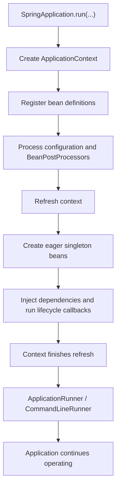
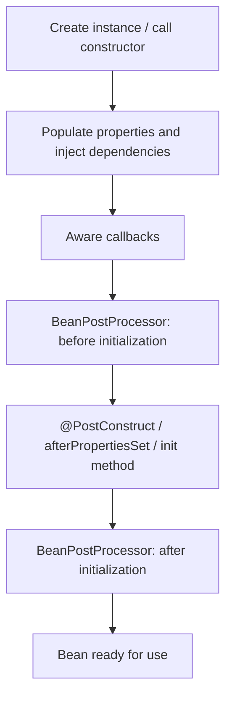
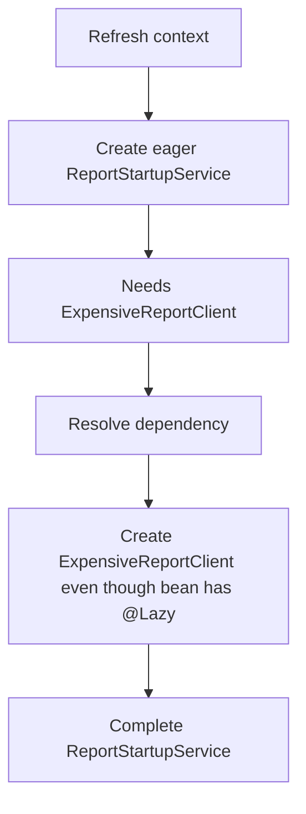

# Eager Initialization, @Lazy, and When Configuration Errors Are Detected

When a Spring Boot application starts up, Spring must create and wire many beans before the application is ready. By default, ordinary singleton beans undergo **eager initialization** during application context refresh. As a result, many configuration and bean-creation errors are detected right at startup. For beans not needed immediately, Spring allows deferring instance creation via **lazy initialization**, typically using `@Lazy`.

Choosing eager or lazy directly affects startup time, when errors surface, and first-use latency. This lesson belongs to the **Bean Lifecycle** chapter of *Spring Boot Fundamentals*. We will trace the singleton lifecycle during context refresh, experiment with deferring a bean, learn why an eager bean's dependency can still cause a lazy bean to be created early, and compare lazy beans against lazy-resolution proxies and application-wide lazy configuration.

Examples use Java 21 and Spring Boot 3.x. Code snippets focus on the Spring container; verification can be run in a Spring Boot project or an appropriate Spring Context project.

## 1. What Is Eager Initialization?

**Eager initialization** means a bean is created early during container initialization, rather than waiting until code first requests the bean. With `singleton` scope, Spring defaults to pre-instantiating non-lazy singleton beans when the application context is refreshed.

Example:

```java
package com.example.demo.service;

import org.springframework.stereotype.Component;

@Component
public class CatalogService {

    public CatalogService() {
        System.out.println("CatalogService constructor");
    }

    public String findCatalogName() {
        return "Main catalog";
    }
}
```

With normal component scanning and lazy initialization disabled, `CatalogService`'s constructor is typically called while Spring initializes the context, even before any controller or runner calls `findCatalogName()`.

Spring chooses eager initialization as the default to detect configuration errors early. If a constructor cannot run, a required dependency is missing, or an initialization callback throws an exception, the application can fail right at startup instead of waiting until a user happens to trigger that feature.

### Eager does not mean every object is created immediately

The rule above mainly refers to **non-lazy singleton beans**. Do not conclude that Spring creates every object in the application immediately on startup:

- Prototype beans are typically created when the container is asked to supply an instance, not pre-instantiated like singletons.
- Beans annotated with `@Lazy` can be deferred.
- Objects created manually via `new` outside the container are not part of Spring's pre-instantiation.
- Certain internal, factory, and infrastructure beans have their own initialization rules.

Therefore, when observing constructor logs, check the scope and registration method of the bean before drawing conclusions about eager initialization.

## 2. At Which Stage Does Spring Create Eager Singletons?

A Spring Boot application starts from:

```java
@SpringBootApplication
public class DemoApplication {
    public static void main(String[] args) {
        SpringApplication.run(DemoApplication.class, args);
    }
}
```

During execution, Boot creates and refreshes the `ApplicationContext`. At a high level, key bean-related steps include:

1. Reading and registering bean definitions from configuration, component scan, auto-configuration, and other sources.
2. Processing container extensions such as `BeanFactoryPostProcessor` and registering `BeanPostProcessor`s.
3. Refreshing the context and pre-instantiating non-lazy singleton beans.
4. For each created bean, Spring resolves dependencies, instantiates it, and runs appropriate lifecycle callbacks.
5. Once context refresh finishes, the application continues Spring Boot startup steps; runners like `ApplicationRunner` and `CommandLineRunner` are invoked at a later stage of startup.

Simplified diagram:



This is a model for understanding initialization timing, not an exhaustive list of every callback or internal Spring Boot step. Key point: **eager singletons are created during context refresh, before the application finishes startup and runs runners**.

## 3. Bean Lifecycle and Errors During Initialization

When Spring creates a bean, a common sequence of steps is:



Detailed ordering can have additional steps and vary by bean type, yet the diagram shows errors can arise at multiple stages:

- Constructor throws an exception.
- Spring cannot find a required dependency.
- A dependency of the bean itself cannot be created.
- `@PostConstruct` method throws an exception.
- `InitializingBean.afterPropertiesSet()` or custom init method fails.
- A BeanPostProcessor or proxy infrastructure encounters an error processing the bean.

With eager singletons, errors belonging to bean creation normally appear right during context refresh. That is **fail-fast** behavior: the application does not report ready when an essential configuration piece cannot be initialized.

### Example of a bean failing right at startup

```java
package com.example.demo.service;

import org.springframework.stereotype.Component;

@Component
public class BrokenClient {

    public BrokenClient() {
        throw new IllegalStateException("Missing client configuration");
    }
}
```

If `BrokenClient` is within the component scan area and is not marked lazy, Spring typically tries to create the bean during context refresh. The constructor throws an exception causing bean initialization to fail; the error can prevent the application context from refreshing successfully and prevent Spring Boot from completing startup.

This is an intentional error created for learning. In real applications, constructors should validate required configuration and initialize internal state; network operations or external connections should be designed with explicit timeouts and failure policies.

## 4. What Is `@Lazy`?

`@Lazy` is a Spring annotation imported from:

```java
import org.springframework.context.annotation.Lazy;
```

It tells the container that the annotated bean or configuration should **be initialized when needed** rather than created early during context refresh.

Marking a component:

```java
package com.example.demo.report;

import org.springframework.context.annotation.Lazy;
import org.springframework.stereotype.Component;

@Component
@Lazy
public class ExpensiveReportClient {

    public ExpensiveReportClient() {
        System.out.println("ExpensiveReportClient initialized");
    }

    public String loadReport() {
        return "Report data";
    }
}
```

If no eager bean needs `ExpensiveReportClient` right at startup and no code requests it during startup, the constructor may not have run once context refresh completes.

When another bean or application code first requests this bean from the container, Spring creates the instance. For a lazy singleton, the instance once created remains the singleton for that context.

**Lazy initialization defers when a bean is created; it does not remove the bean from the context and does not turn the bean into a prototype.**

## 5. Verifying Bean Creation Timing with a Small Context

You can observe eager and lazy without setting up a REST API. Example using `AnnotationConfigApplicationContext`:

```java
import org.springframework.context.annotation.AnnotationConfigApplicationContext;
import org.springframework.context.annotation.Bean;
import org.springframework.context.annotation.Configuration;
import org.springframework.context.annotation.Lazy;

public class LazyDemo {

    static class EagerClient {
        EagerClient() {
            System.out.println("EagerClient created");
        }
    }

    static class LazyClient {
        LazyClient() {
            System.out.println("LazyClient created");
        }
    }

    @Configuration(proxyBeanMethods = false)
    static class AppConfig {

        @Bean
        EagerClient eagerClient() {
            return new EagerClient();
        }

        @Bean
        @Lazy
        LazyClient lazyClient() {
            return new LazyClient();
        }
    }

    public static void main(String[] args) {
        try (var context =
                     new AnnotationConfigApplicationContext(AppConfig.class)) {
            System.out.println("Context is ready");

            context.getBean(LazyClient.class);
            System.out.println("Lazy client was requested");
        }
    }
}
```

Output in order will look like:

```text
EagerClient created
Context is ready
LazyClient created
Lazy client was requested
```

When the context is refreshed, `eagerClient()` is called because the bean is a non-lazy singleton. `lazyClient()` is not called until `context.getBean(LazyClient.class)` requests the bean. This is direct evidence of the difference between eager and lazy.

In real Spring Boot examples, the same principle applies to beans registered via `@Component`, `@Bean`, and bean definitions created from other configuration sources, as long as that bean definition supports the corresponding lazy rule.

## 6. Marking Lazy on Components, Bean Methods, and Configuration Classes

### 6.1. Marking a single component

```java
@Component
@Lazy
public class PdfRenderer {
    // ...
}
```

Only the `PdfRenderer` bean is marked lazy. Other components still follow their own eager/lazy rules.

### 6.2. Marking a `@Bean` method

```java
@Configuration(proxyBeanMethods = false)
public class ReportConfiguration {

    @Bean
    @Lazy
    PdfRenderer pdfRenderer() {
        return new PdfRenderer();
    }

    @Bean
    ReportFormatter reportFormatter() {
        return new ReportFormatter();
    }
}
```

In the example, `pdfRenderer` is deferred; `reportFormatter` stays eager by default absent other conditions.

### 6.3. Marking an entire configuration class

```java
@Configuration(proxyBeanMethods = false)
@Lazy
public class OptionalIntegrationConfiguration {

    @Bean
    ExternalDocumentClient externalDocumentClient() {
        return new ExternalDocumentClient();
    }

    @Bean
    DocumentPreviewService documentPreviewService(
            ExternalDocumentClient client) {
        return new DocumentPreviewService(client);
    }
}
```

Placing `@Lazy` on a configuration class makes `@Bean` methods in that configuration lazy by default, unless a specific bean is overridden with `@Lazy(false)`. This configuration is useful when an entire group of integrations is unnecessary at startup.

However, if an external eager bean requires `ExternalDocumentClient`, that dependency can still be created early. Merely marking a configuration class lazy does not stop an eager bean from needing its dependencies.

## 7. An Important Point: A Lazy Bean Can Still Be Created Eagerly Due to Dependencies

Consider:

```java
@Component
@Lazy
public class ExpensiveReportClient {
    public ExpensiveReportClient() {
        System.out.println("Report client created");
    }
}

@Component
public class ReportStartupService {

    private final ExpensiveReportClient client;

    public ReportStartupService(ExpensiveReportClient client) {
        this.client = client;
    }
}
```

`ExpensiveReportClient` is marked lazy, but `ReportStartupService` is an eager singleton and its constructor requires the client. While creating `ReportStartupService`, Spring must resolve dependencies. To satisfy the constructor, Spring creates `ExpensiveReportClient` even though the client's bean definition is marked lazy.

Thus, `@Lazy` on a **bean definition** only tells the container not to proactively pre-instantiate that bean during refresh. It does not mean Spring refuses to create the bean when a required dependency demands it.



This is one reason learners turn on `@Lazy` yet do not see startup time drop as expected.

## 8. `@Lazy` at the Injection Point: Lazy-Resolution Proxy

If the goal is **not creating the dependency even when the consuming bean is eager**, you can place `@Lazy` at the injection point:

```java
@Component
public class ReportStartupService {

    private final ExpensiveReportClient client;

    public ReportStartupService(@Lazy ExpensiveReportClient client) {
        this.client = client;
    }

    public String preview() {
        return client.loadReport();
    }
}
```

In this case, Spring can supply a **lazy-resolution proxy** for the constructor parameter. `ReportStartupService` is still created at startup, but the real `ExpensiveReportClient` dependency is resolved when the proxy is first used.

The difference:

| `@Lazy` placement | Meaning |
|---|---|
| On `@Component` class or `@Bean` method | The bean definition is marked lazy; the container does not proactively pre-instantiate that singleton. |
| On `@Configuration` class | `@Bean` methods in that configuration default to lazy, unless overridden. |
| On injection point (constructor parameter, field, setter parameter) | Creates a proxy/lazy-resolution mechanism for the injected dependency, so the real bean can be resolved when used. |

### When is the real dependency created?

With a lazy-resolution proxy, the first business method call through the proxy requests the target bean. Spring resolves and creates the target if it does not yet exist, then forwards the call. If the target's constructor or target initialization fails, the error surfaces at the moment the proxy needs the target.

That means the application can finish startup, yet the first time a user opens the reports page it fails because `ExpensiveReportClient` cannot initialize. **The error was deferred, not fixed.**

### What difference can a proxy make?

Consumer code holds a reference to the proxy, not necessarily the real implementation instance. This usually works transparently when the consumer only calls business methods on the dependency. For concrete class types, Spring needs an appropriate proxy mechanism; constraints on the class type or method invocation style can affect proxy capability. When designing abstractions, injecting by interface usually keeps dependency boundaries cleaner.

If you want explicit control over when a dependency is retrieved, consider `ObjectProvider<T>` instead of a lazy proxy:

```java
@Component
public class ReportStartupService {

    private final ObjectProvider<ExpensiveReportClient> clientProvider;

    public ReportStartupService(
            ObjectProvider<ExpensiveReportClient> clientProvider) {
        this.clientProvider = clientProvider;
    }

    public String preview() {
        return clientProvider.getObject().loadReport();
    }
}
```

Here, the consumer explicitly requests the bean using `getObject()` when needed. This makes dependency resolution timing visible in code. `ObjectProvider` also has useful methods for optional dependencies or multiple candidates, depending on need.

## 9. Enabling Lazy Initialization for the Entire Spring Boot Application

Instead of marking individual beans, Spring Boot allows enabling lazy initialization at the application level via a property:

```yaml
spring:
  main:
    lazy-initialization: true
```

Or in `application.properties`:

```properties
spring.main.lazy-initialization=true
```

When enabled, Boot configures application beans broadly toward lazy initialization. This can reduce initialization work during startup, especially with beans only used in rarely invoked features.

You can also pass the property at runtime:

```bash
./gradlew bootRun --args='--spring.main.lazy-initialization=true'
```

On Windows PowerShell:

```powershell
.\gradlew.bat bootRun --args="--spring.main.lazy-initialization=true"
```

A specific bean can be made eager again with `@Lazy(false)` on the appropriate configuration:

```java
@Component
@Lazy(false)
public class StartupValidationService {
    // Needs to be created early to validate required configuration.
}
```

Do not treat global lazy initialization as a switch that makes **all work** vanish from startup. Any bean needed as a dependency by an eager bean may still have to be created; infrastructure components, bean definition processing, and other startup tasks still run per their lifecycles.

## 10. How Does Error Detection Timing Change?

This is the most important consequence when choosing lazy initialization.

### 10.1. Eager bean: errors usually surface at startup

Suppose a bean connecting to an external service has required configuration:

```java
@Component
public class ExternalCatalogClient {

    public ExternalCatalogClient(CatalogProperties properties) {
        if (properties.baseUrl() == null
                || properties.baseUrl().isBlank()) {
            throw new IllegalStateException("catalog.base-url is required");
        }
    }
}
```

If the bean is eagerly initialized and the property is missing, the context can fail during refresh. The development team immediately catches missing configuration when deploying or running the application.

### 10.2. Lazy bean: errors may appear on first use

If the bean is marked on the class:

```java
@Component
@Lazy
public class ExternalCatalogClient {
    // ...
}
```

and no eager dependency requires it, Spring can finish startup even with broken client configuration. When a first request needs the client, Spring creates the bean and the configuration error appears then.

| Moment | Eager initialization | Lazy initialization |
|---|---|---|
| Context refresh | Attempts to create non-lazy singleton beans | Can skip lazy beans not yet requested |
| Constructor/init error | Usually fails startup | Can be deferred until first bean creation |
| Missing/broken required dependency | Usually caught when resolving beans at startup | Can be deferred if dependency is also lazy/proxied |
| First use | Bean already exists; usually incurs no initial creation cost | May pay bean creation cost and encounter first-time errors |
| Readiness | Essential configuration is checked earlier | Startup can succeed even if a feature is not ready |

### 10.3. Lazy does not defer all configuration errors

Not every error waits until bean usage. Some errors occur prior to or independently of instance creation:

- Invalid configuration syntax or structure.
- Errors reading bean definitions, importing configurations, or running certain factory/post processors.
- Missing required classes on the classpath when those classes are loaded/referenced.
- Errors resolving placeholders or configuration needed by another eager bean.
- Dependencies of an eager singleton forcing a lazy bean to be created.
- Errors in other startup tasks that do not depend on that lazy bean.

Therefore, the accurate description is that **lazy can defer bean creation and errors arising during that bean's creation**. It is not a way to disable all Spring configuration checks.

## 11. Benefits and Trade-Offs of Lazy Initialization

### When lazy helps

- The application has many optional modules, and each environment only uses a subset.
- A client connecting to an external system is only needed when the corresponding feature is invoked.
- A report-generation, file-processing, or expensive resource-initialization task only runs on demand.
- Wanting to reduce startup time in development or in certain applications with suitable workloads.

### When eager helps

- The bean is an essential component for serving every request.
- Misconfiguration needs to be caught before the application reports ready.
- Early verification of connections or required resource creation is needed.
- Wanting to avoid high initial creation latency on the first call.

| Criterion | Eager | Lazy |
|---|---|---|
| Startup time | May be longer due to creating many singletons | May be shorter if many beans are genuinely not needed yet |
| Error detection | Many bean errors surface early | Some errors shift to first use |
| First-call latency | Typically lower because beans are already created | Can be high due to first-time initialization |
| Resources | May hold resources for unused beans | Can avoid creating unneeded resources |
| Readiness state | Validates eager singletons earlier | Can mask features that are not ready |

The trade-off is not just "fast vs. slow startup." A production system needs **readiness** to reflect the ability to serve expected workloads. If an essential feature only reveals an error on the first request, users may become the first ones to discover misconfiguration.

## 12. Lazy Initialization and Real-World Performance

Suppose an application has 100 beans, 30 of which are only used for exporting reports and that feature is rarely invoked. Lazy initialization can avoid creating those beans during startup. Yet actual benefit depends on the dependency graph:

- If an eager bean needs one of those 30 beans, that bean still gets created.
- If a runner invokes the report service at startup, required dependencies get created during startup.
- If all lazy beans are called within the first few seconds, total work is merely shifted in time rather than eliminated.
- If a bean holds connections, thread pools, or caches, lazy reduces initial resource usage while making first use pay preparation time.

Example with an `ApplicationRunner`:

```java
@Component
public class StartupReportRunner implements ApplicationRunner {

    private final ReportService reportService;

    public StartupReportRunner(ReportService reportService) {
        this.reportService = reportService;
    }

    @Override
    public void run(ApplicationArguments args) {
        reportService.prepareSummary();
    }
}
```

Even if `ReportService` or its dependencies are marked lazy, the eager runner needs the service in its constructor and calls the method at startup. Thus, they may still be created before the application finishes starting up.

If the goal is reducing startup time, measure actual timings and see which beans take the most time. Turning on global lazy blindly without observation may simply shift latency onto the first request or make readiness no longer reflect full status.

## 13. Verifying Eager and Lazy with Tests

A clear approach is using `AnnotationConfigApplicationContext` and counting constructor invocations:

```java
import java.util.concurrent.atomic.AtomicInteger;

import org.junit.jupiter.api.Test;
import org.springframework.context.annotation.AnnotationConfigApplicationContext;
import org.springframework.context.annotation.Bean;
import org.springframework.context.annotation.Configuration;
import org.springframework.context.annotation.Lazy;

import static org.assertj.core.api.Assertions.assertThat;

class InitializationTimingTest {

    static class EagerWorker {
        static final AtomicInteger creations = new AtomicInteger();

        EagerWorker() {
            creations.incrementAndGet();
        }
    }

    static class LazyWorker {
        static final AtomicInteger creations = new AtomicInteger();

        LazyWorker() {
            creations.incrementAndGet();
        }
    }

    @Configuration(proxyBeanMethods = false)
    static class Config {

        @Bean
        EagerWorker eagerWorker() {
            return new EagerWorker();
        }

        @Bean
        @Lazy
        LazyWorker lazyWorker() {
            return new LazyWorker();
        }
    }

    @Test
    void eagerIsCreatedDuringRefreshAndLazyOnFirstRequest() {
        EagerWorker.creations.set(0);
        LazyWorker.creations.set(0);

        try (var context = new AnnotationConfigApplicationContext(Config.class)) {
            assertThat(EagerWorker.creations.get()).isEqualTo(1);
            assertThat(LazyWorker.creations.get()).isZero();

            context.getBean(LazyWorker.class);

            assertThat(LazyWorker.creations.get()).isEqualTo(1);
        }
    }
}
```

This test illustrates two checkpoints: after the context is created, the eager worker has been initialized while the lazy worker has not; when `getBean(LazyWorker.class)` is called, the lazy worker is created. In real projects, avoid sharing static counters across parallel tests if the test suite can run concurrently.

### Verifying that an eager dependency forces a lazy bean to be created

Add a consumer:

```java
static class EagerConsumer {
    final LazyWorker worker;

    EagerConsumer(LazyWorker worker) {
        this.worker = worker;
    }
}
```

and factory method:

```java
@Bean
EagerConsumer eagerConsumer(LazyWorker worker) {
    return new EagerConsumer(worker);
}
```

Now `EagerConsumer` is an eager singleton and its constructor needs `LazyWorker`. During context refresh, Spring must create the worker to complete the consumer. The `LazyWorker.creations` counter will increment right during startup, even though the worker's bean definition has `@Lazy`.

If you change the method parameter to:

```java
@Bean
EagerConsumer eagerConsumer(@Lazy LazyWorker worker) {
    return new EagerConsumer(worker);
}
```

Spring can inject a lazy-resolution proxy, so the real `LazyWorker` bean is deferred until the consumer uses the proxy.

## 14. Troubleshooting When Using Lazy Initialization

### 14.1. Application starts up successfully, but the first request fails

Check which lazy bean was initialized during that request. Read the deepest cause of the exception: constructor failure, missing property, external system connection, or another dependency.

If that bean is a mandatory component for serving the application, consider removing lazy or proactively checking the dependency during startup/health checks.

### 14.2. Marked lazy, yet startup is not faster

Check:

- Is the bean being required by an eager singleton in its constructor?
- Does a runner or listener invoke that bean during startup?
- Does another bean initiate a dependency chain that causes the lazy bean to be created?
- Was startup time actually spent in that bean's constructor/init?

Lazy does not eliminate required dependencies. It only changes creation timing when nothing requests them earlier.

### 14.3. First call is too slow

Measure creation time of the bean and its dependencies. You can proactively warm up certain beans after startup, keeping in mind that warming up moves work back toward startup. For web applications, use a clear readiness/initialization strategy instead of letting the first user request bear the entire cost.

### 14.4. Test context does not catch errors because beans have not been created

If tests use lazy initialization, a context refreshing successfully does not prove all lazy beans can be initialized. Request specific beans in tests or write integration tests exercising features that actually use the beans.

Example:

```java
@Autowired
ApplicationContext context;

@Test
void lazyClientCanBeCreated() {
    ExpensiveReportClient client =
            context.getBean(ExpensiveReportClient.class);
    assertThat(client).isNotNull();
}
```

This test proactively requests the bean so bean-creation errors surface in the test, rather than relying solely on the context having refreshed.

## 15. Notes on Lifecycle and Scope

### 15.1. A lazy singleton is still a singleton

`@Lazy` does not change `scope`. A lazy singleton bean is created the first time needed, after which the container retains that instance and returns the same instance within the context.

### 15.2. Prototypes are not pre-instantiated like singletons

Prototype beans are normally created each time the container supplies a new instance. Therefore, `@Lazy` on a prototype does not carry the same practical meaning as a lazy singleton during pre-instantiation; prototypes are not bulk-created at refresh under eager singleton rules anyway.

### 15.3. Resolved dependencies can still trigger bean creation

An eager bean whose constructor requires a lazy dependency causes the dependency to be created to satisfy the constructor. To defer the dependency as well in that situation, use `@Lazy` at the injection point or `ObjectProvider<T>`.

### 15.4. Lazy is not a solution for circular dependencies

`@Lazy` at an injection point is sometimes used to defer dependency resolution and can shift when a cycle is detected. However, using lazy solely to mask a dependency cycle usually makes the design harder to understand. Review bean responsibilities and dependency direction before keeping such a workaround.

### 15.5. Bean destruction still follows the container lifecycle

A lazy singleton that has been created remains managed by the context. When the context closes, appropriate destruction callbacks such as `@PreDestroy` or destroy methods can run per the lifecycle. A lazy bean **that was never created** has no instance on which to invoke destruction callbacks.

## 16. Choosing Eager or Lazy in a Spring Boot Application

A practical guideline:

- Use **eager** for essential beans that need early configuration validation or must ensure the application is ready before receiving traffic.
- Use **local lazy** for optional, resource-heavy components not needed at startup, when later error detection is acceptable.
- Use **global lazy initialization** after measuring and understanding the impact on readiness, first-use latency, and scope of deferred errors.
- Use **lazy-resolution proxies or ObjectProvider** when an eager bean needs to hold a dependency without instantiating the target until actually used.

There is no rule that "lazy is always faster" or "eager is always better." Choose based on readiness requirements, latency, resources, and how the application operates.

## 17. Comprehensive Practice Exercise

Create two beans `FastService` and `SlowService`; inside `SlowService`'s constructor, print a log or increment a counter to observe creation timing.

**Part A — Default eager.** Register both beans without `@Lazy`. Initialize the context and note which constructors are invoked before the context is ready.

**Part B — Make one bean lazy.** Place `@Lazy` on `SlowService`. Initialize the context, then call `getBean(SlowService.class)`. Compare when the constructor is called.

**Part C — Required dependency.** Make `FastService` require `SlowService` via constructor. Keep `@Lazy` on `SlowService` and observe how the eager dependency forces it to be created.

**Part D — Lazy at the injection point.** Place `@Lazy` on `FastService`'s constructor parameter. Verify the context can initialize without creating `SlowService`; invoke a method using the proxy and observe when the target is created.

**Part E — Initialization error.** Make `SlowService` throw an exception in its constructor. Compare the error appearing during context refresh when eager versus when requesting the bean/proxy when lazy.

**Part F — Global lazy.** Enable `spring.main.lazy-initialization=true`. Observe which beans are still created early due to dependencies, runners, or startup tasks.

After each experiment, answer two questions: **when was the bean created? when will errors in the bean surface?** These two questions are a concise way to evaluate the impact of eager vs. lazy.

## 18. Self-Assessment Questions

1. Why does Spring eagerly initialize ordinary singleton beans by default?
2. At which phase of application context refresh are eager singletons created?
3. What does `@Lazy` on a component change?
4. Why can a bean marked lazy still be created during startup?
5. How does `@Lazy` on a bean definition differ from `@Lazy` on a constructor parameter?
6. What does a lazy-resolution proxy defer, and when can errors surface?
7. Does `spring.main.lazy-initialization=true` mean all startup work is deferred?
8. Why doesn't a passing context test necessarily prove all lazy beans can be created?
9. How do eager and lazy differ regarding fail-fast, first-request latency, and resources?
10. When should you use `ObjectProvider<T>` instead of a lazy proxy?

### Sample complete explanation

> Spring eagerly initializes non-lazy singleton beans by default during application context refresh. This ensures dependencies and initialization errors of essential components are caught before the application finishes startup. `@Lazy` on a bean definition defers pre-instantiating the bean until requested from the container, yet an eager bean with a required dependency on that bean can still cause it to be created early. If `@Lazy` is placed at the injection point, Spring can supply a lazy-resolution proxy and only resolve the target when the proxy is used. Lazy initialization can reduce startup work while shifting some cost and errors to first use; therefore, readiness and user latency must be weighed. Enabling application-wide lazy via `spring.main.lazy-initialization` is an application-level decision and does not replace dependency design and essential configuration validation.

When you can accurately predict which beans are created during refresh, which are deferred, and whether errors will surface at startup or on first use, you understand the relationship among the **bean lifecycle**, **eager initialization**, and **`@Lazy`** in Spring Boot.
