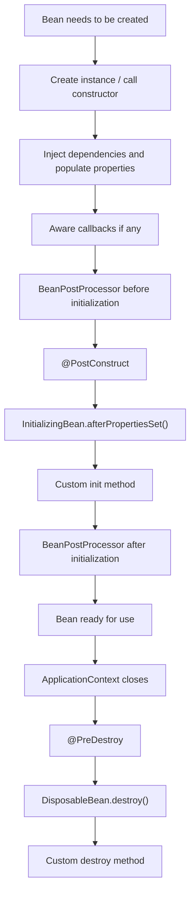
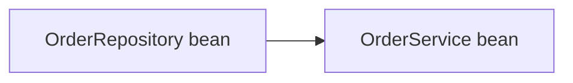
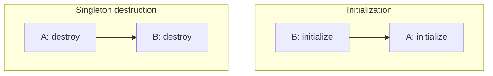
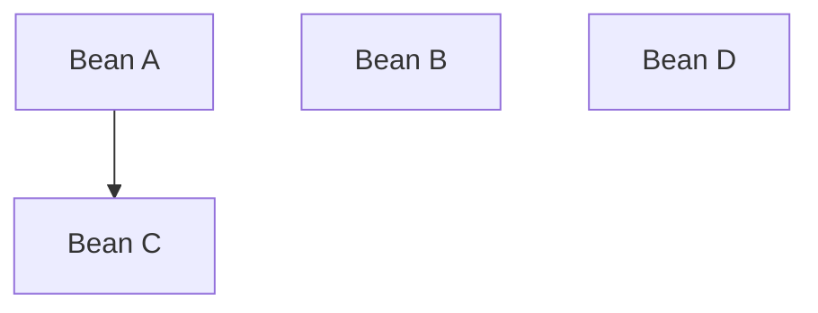

# @DependsOn and Initialization and Destruction Order Between Beans

Spring manages bean lifecycles inside an `ApplicationContext`: creating instances, injecting dependencies, calling initialization callbacks, serving the application, and finally invoking destruction callbacks when the container closes. When bean A needs bean B, a normal dependency via constructor or property already creates a natural ordering relationship: Spring must create B before it can create and finalize A.

However, sometimes a bean needs another bean to be initialized beforehand even though it **holds no reference and does not inject that bean**. For instance, a component needs a global registry to be bootstrapped, a client needs a provider registered as a side effect, or a legacy adapter reads metadata prepared by an initializer. The `@DependsOn` annotation allows explicitly declaring such initialization ordering dependencies.

`@DependsOn` also affects singleton destruction order: the dependent bean is destroyed before the bean it depends on. This matters for resources with nested lifecycles. This lesson explains how to use the annotation, the lifecycle sequence, differences from dependency injection and other ordering mechanisms, and how to test actual ordering.

## 1. Bean Lifecycle in Spring

A Spring bean is not just an object created with `new`. The container manages creation and destruction according to bean definitions, scope, and declared lifecycle callbacks.

For a regular singleton bean, the conceptual workflow is:



The diagram describes the common order of lifecycle callbacks, omitting internal details. A bean does not have to implement every callback. If multiple callback types are used, Spring coordinates them according to the corresponding lifecycle contracts.

Common callbacks:

| Mechanism | Timing | Purpose |
| --- | --- | --- |
| Constructor | During instance creation | Establish initial state |
| Constructor / field / setter injection | During bean population | Supply dependencies |
| `@PostConstruct` | After dependencies are injected, during initialization phase | Additional initialization |
| `InitializingBean.afterPropertiesSet()` | Initialization phase | Initialization callback via Spring interface |
| `@Bean`'s `initMethod` | Initialization phase | Invoke configured init method |
| `@PreDestroy` | When singleton is destroyed | Clean up before object ends lifecycle |
| `DisposableBean.destroy()` | Destruction phase | Destruction callback via Spring interface |
| `@Bean`'s `destroyMethod` | Destruction phase | Invoke resource-closing method |

In real applications, prefer standard annotations such as `@PostConstruct` and `@PreDestroy` or clear lifecycle method configuration. Do not pack heavy initialization, uncontrolled network calls, or long business logic into constructors.

## 2. How Do Natural Dependencies Already Determine Order?

Suppose `OrderService` needs `OrderRepository`:

```java
@Service
public class OrderService {
    private final OrderRepository repository;

    public OrderService(OrderRepository repository) {
        this.repository = repository;
    }
}
```

Spring must resolve `OrderRepository` before completing creation of `OrderService`. This is a true dependency relationship: the service holds a reference to the repository and uses it during processing.

It can be represented as:



In this graph, the repository is created and initialized before the service can be completely created. When the context closes, the dependent singleton `OrderService` is destroyed before the dependency singleton `OrderRepository` according to the container-managed dependency relationship.

### 2.1. When there is no direct reference

Some components require ordering due to external side effects:

- An initializer registers a provider in a shared registry.
- A bean loads metadata into a third-party library before a client initializes.
- A bootstrapper builds structures needed by a legacy adapter.
- A component initializes a resource that another bean accesses via a static API or indirect mechanism.

In these cases, the consuming bean may not inject the initializer. Spring cannot infer the relationship merely because two classes are in the same package or component-scanned together. `@DependsOn` is used to declare an explicit ordering relationship.

Example:

```java
@Component("providerBootstrap")
public class ProviderBootstrap {
    @PostConstruct
    public void initialize() {
        // Register provider with an external registry.
    }

    @PreDestroy
    public void shutdown() {
        // Unregister or release provider if the contract requires.
    }
}
```

```java
@Component
@DependsOn("providerBootstrap")
public class LegacyProviderClient {
    public LegacyProviderClient() {
        // Assume legacy library reads the already-bootstrapped registry.
    }
}
```

Spring guarantees bean `providerBootstrap` is initialized before `LegacyProviderClient`. When the context closes, singleton `LegacyProviderClient` is destroyed before `providerBootstrap`.

The example illustrates a side-effect dependency. In new designs, if the client can accept an interface/provider via constructor, direct injection is usually clearer than `@DependsOn`. Only use `@DependsOn` when an ordering relationship is meaningful yet cannot be expressed through a normal dependency object.

## 3. What Is `@DependsOn`?

`@DependsOn` is a Spring annotation:

```java
import org.springframework.context.annotation.DependsOn;
```

It accepts one or more bean names:

```java
@DependsOn("providerBootstrap")
@Component
public class LegacyProviderClient {
    // ...
}
```

With multiple beans:

```java
@DependsOn({
    "providerBootstrap",
    "schemaRegistry",
    "cryptoProvider"
})
@Component
public class LegacyIntegrationClient {
    // ...
}
```

Values in the annotation are **bean names** (or aliases recognized by the container), not fully qualified Java class names. Use stable, clear bean names, especially when declaring dependencies from a shared library.

Key rules:

1. Beans listed in `@DependsOn` must be initialized before the annotated bean.
2. `@DependsOn` does not automatically inject objects into the current bean.
3. For singleton beans, the dependent bean is destroyed before the beans it depends on under this relationship.
4. The annotation does not impose a global total order across all beans in the application.
5. Referenced beans must still be registered in the context; if a name does not exist, bean creation can fail.

### 3.1. Declaring on a component class

When using component scanning, you can place the annotation on the class:

```java
@Component("schemaRegistryBootstrap")
public class SchemaRegistryBootstrap {
    @PostConstruct
    public void loadSchemas() {
        // Load schemas into registry accessed by shared library.
    }

    @PreDestroy
    public void clearSchemas() {
        // Clean registry when application closes.
    }
}
```

```java
@Component
@DependsOn("schemaRegistryBootstrap")
public class LegacySchemaClient {
    @PostConstruct
    public void connect() {
        // Connect after schema registry is ready.
    }
}
```

Bean `LegacySchemaClient` is created after `schemaRegistryBootstrap` finishes initialization. When the context closes, `LegacySchemaClient` is destroyed before `schemaRegistryBootstrap` if both are container-managed singletons.

### 3.2. Declaring on a @Bean method

If the bean is created using Java configuration, you can place `@DependsOn` on the factory method:

```java
@Configuration(proxyBeanMethods = false)
public class IntegrationConfiguration {

    @Bean
    SchemaRegistryBootstrap schemaRegistryBootstrap() {
        return new SchemaRegistryBootstrap();
    }

    @Bean
    @DependsOn("schemaRegistryBootstrap")
    LegacySchemaClient legacySchemaClient() {
        return new LegacySchemaClient();
    }
}
```

The default bean name of a `@Bean` method is typically the method name, so `schemaRegistryBootstrap` is the name referenced in the example. If an explicit name is given via `@Bean("...")`, `@DependsOn` must use that exact name.

Placing the annotation on the factory method keeps the relationship right where the bean is configured. That is usually more readable when beans are created from Java configuration, while placing it on the class suits component-scanned beans.

### 3.3. One bean depending on multiple beans

```java
@Bean
@DependsOn({
    "driverBootstrap",
    "schemaRegistryBootstrap",
    "securityProviderBootstrap"
})
LegacyIntegrationClient integrationClient() {
    return new LegacyIntegrationClient();
}
```

Spring must initialize all listed beans before `integrationClient`. The order among the listed beans themselves should not be relied on as an internal ordering contract if they do not also depend on each other. If an order between initializer A and B is mandatory, declare that relationship explicitly, e.g., B depends on A.

## 4. Initialization Order and Destruction Order

Suppose bean B must be ready before bean A:



`@DependsOn("B")` on A carries the meaning:

- B is initialized before A.
- A is destroyed before B.

Why destroy in reverse? If A uses resources managed by B, A needs to be closed before B releases those resources. This is the reverse dependency order principle commonly seen in resource management.

For instance, if a client is initialized using a registered provider, the client should close connections before the provider is unregistered. `@DependsOn` lets Spring record this relationship for singleton beans.

### 4.1. Callback order inside each bean

Suppose both A and B have `@PreDestroy` and custom destroy methods. `@DependsOn` determines **which bean is destroyed before which bean**; it does not change the callback order inside a single bean.

For a bean with standard callbacks, destruction order is:

1. `@PreDestroy` method.
2. `DisposableBean.destroy()` if the bean implements the interface.
3. Declared custom destroy method, e.g., `@Bean(destroyMethod = "close")`.

Example:

```java
public class ManagedConnection implements DisposableBean {
    @PreDestroy
    public void beforeDestroy() {
        // Annotation callback.
    }

    @Override
    public void destroy() {
        // Callback from Spring interface.
    }

    public void close() {
        // Custom destroy method.
    }
}
```

```java
@Bean(destroyMethod = "close")
ManagedConnection managedConnection() {
    return new ManagedConnection();
}
```

Do not declare multiple callbacks releasing the same resource in a way that could close it twice if the API does not support idempotent closing. Choose one primary lifecycle mechanism or design callbacks to be safe on repeated calls per contract.

### 4.2. Only singletons have dependency-ordered destruction guarantees?

`@DependsOn` can enforce bean initialization order across multiple scopes, yet dependency-ordered destruction rules are described by Spring for **singleton beans**. For prototypes, the container creates and supplies the instance but does not manage the prototype's full destruction lifecycle after returning it to the caller.

Do not rely on `@DependsOn` expecting Spring to automatically close every prototype object in reverse order. If the application owns prototype resources, the caller or an appropriate scope/lifecycle manager must handle releasing them.

For request/session scopes, target lifecycles are managed by the corresponding scope and may have destruction callbacks. Do not extrapolate singleton destruction-ordering guarantees to every kind of web scope.

## 5. How Does @DependsOn Differ from Constructor Injection?

Both mechanisms can produce an initialization order, yet they express two different relationships.

### 5.1. Constructor injection is a real dependency

```java
@Service
public class InvoiceService {
    private final InvoiceRepository repository;

    public InvoiceService(InvoiceRepository repository) {
        this.repository = repository;
    }
}
```

The invoice service needs the repository to do its work and calls it in methods. Spring must create the repository first to pass it into the constructor.

### 5.2. @DependsOn is an ordering relationship

```java
@Component("timezoneRegistryBootstrap")
class TimezoneRegistryBootstrap {
    @PostConstruct
    void load() {
        // Load data into the library's shared registry.
    }
}

@Component
@DependsOn("timezoneRegistryBootstrap")
class LegacyTimezoneClient {
    // Holds no reference to the bootstrap bean.
}
```

`LegacyTimezoneClient` does not use the `TimezoneRegistryBootstrap` object directly. It only needs the external registry prepared prior to initialization. That is the kind of relationship `@DependsOn` expresses.

If you can inject a collaborator directly and call its API, prefer dependency injection:

```java
@Component
class TimezoneClient {
    private final TimezoneRegistry registry;

    TimezoneClient(TimezoneRegistry registry) {
        this.registry = registry;
    }
}
```

In this case, Spring already knows the dependency relationship via the constructor; there is no need to add `@DependsOn` just to duplicate the order.

### 5.3. Comparison table

| Criterion | Constructor/property injection | `@DependsOn` |
| --- | --- | --- |
| Purpose | Supply a dependency object for the bean to use | Force another bean to be initialized beforehand |
| Does consumer bean hold a reference? | Yes | Not automatically |
| Is dependency visible in class API? | Yes | Expressed in annotation metadata |
| Initialization order | Follows dependency graph | Follows declared bean names |
| Singleton destruction order | Follows dependency relationship | Follows depends-on relationship |
| Use when | Bean needs to call collaborator | Ordering needed due to side effect or indirect relationship |
| Can be replaced by factory/service abstraction? | Often the natural structure | Yes, if the relationship is actually an object dependency |

Do not use `@DependsOn` as a way to evade constructor injection. Conversely, if bean A needs to call B, declaring B in the constructor makes code clearer and easier to test.

## 6. How Does @DependsOn Differ from @Order?

`@Order` and `Ordered` are typically used to sort beans when Spring needs an order for a collection or certain extension points. They do not mean the same thing as `@DependsOn`.

Example:

```java
@Component
@Order(1)
class FirstValidator implements OrderValidator {
    // ...
}

@Component
@Order(2)
class SecondValidator implements OrderValidator {
    // ...
}
```

When injecting `List<OrderValidator>`, Spring can sort elements according to the appropriate order metadata:

```java
@Service
class OrderValidationService {
    private final List<OrderValidator> validators;

    OrderValidationService(List<OrderValidator> validators) {
        this.validators = List.copyOf(validators);
    }
}
```

Here `@Order` controls the order inside the injected collection; it does not state that `FirstValidator` must be initialized before `SecondValidator` across the entire container. Spring may create beans according to other context needs.

Comparison:

| Annotation/interface | What does it control? | What does it NOT mean? |
| --- | --- | --- |
| `@DependsOn` | Init and destroy ordering between specific beans | Sorting all beans |
| `@Order` | Priority order in certain collections/extension points | Guaranteeing startup/shutdown order |
| `@Primary` | Preferred bean when resolving a single dependency | Initialization order |
| `@Qualifier` | Filtering bean candidates by metadata | Initializing one bean before another |
| `@Lazy` | Deferring bean initialization per configuration | Establishing order across all beans |

If the requirement is "validator A runs before validator B when iterating the list," `@Order` fits. If the requirement is "registry must be bootstrapped before the client initializes," `@DependsOn` may fit.

## 7. @DependsOn Is Not a Whole-Startup Orchestration Tool

An application has many tasks to run after the context has initialized. For example:

- Loading initial data.
- Checking connectivity to external systems.
- Starting consumers.
- Performing a task after the application is ready.
- Managing services with their own start/stop lifecycles.

`@DependsOn` only expresses creation/destruction relationships among beans. It is not a business startup orchestrator, does not wait for external systems to reach readiness, and does not replace coordination across multiple applications or nodes.

### 7.1. ApplicationRunner and CommandLineRunner

If a task needs to run after Spring Boot has created the application context, you can use `ApplicationRunner` or `CommandLineRunner`:

```java
@Component
public class InitialDataLoader implements ApplicationRunner {
    @Override
    public void run(ApplicationArguments args) {
        // Perform work after the context is initialized.
    }
}
```

Multiple runners can be ordered with `@Order` or `Ordered`. This is the runner invocation order, not the bean lifecycle dependency order.

### 7.2. SmartLifecycle for components needing start/stop

Some infrastructure components have their own start and stop lifecycles, such as listener containers or integration endpoints. Spring provides `SmartLifecycle` to participate in context start/stop and support phase ordering.

```java
@Component
public class MessageEndpointLifecycle implements SmartLifecycle {
    private boolean running;

    @Override
    public void start() {
        // Start receiving messages.
        running = true;
    }

    @Override
    public void stop() {
        // Stop receiving messages and release resources.
        running = false;
    }

    @Override
    public boolean isRunning() {
        return running;
    }

    @Override
    public int getPhase() {
        return 100;
    }
}
```

The example is an illustrative skeleton; a real implementation needs asynchronous stop handling, callbacks if needed, and idempotency. `SmartLifecycle` phases help control start/stop order among lifecycle components. It differs from `@DependsOn`, which defines bean creation relationships.

### 7.3. Event listeners for post-startup reactions

You can listen for `ApplicationReadyEvent` if an action should only run after Spring Boot announces the application is ready:

```java
@Component
public class ReadyListener {
    @EventListener
    public void onReady(ApplicationReadyEvent event) {
        // React when the application is ready.
    }
}
```

Do not use events just to replace every dependency relationship. If a client needs a registry prior to initialization, express that dependency at the appropriate lifecycle level. If a task only needs to run once the app is ready, an event or runner fits better.

## 8. Order Among Unrelated Beans

Suppose a context has three beans A, B, and C with no dependencies among them. Spring provides no global contract that A always initializes before B and then C by file, package, or alphabetical order.

Do not rely on:

- The order classes appear in a directory.
- Import order in an IDE.
- The order configuration files are viewed.
- Alphabetical class names.
- Accidental log ordering when the application starts.

If a mandatory relationship exists, declare it via constructor dependencies, factory method parameters, or `@DependsOn` when the dependency is purely a side effect. If you only need processing order inside a collection, use `@Order`.

Graph example:



The graph only mandates that C needs A initialized beforehand. It does not dictate whether B and D run before or after A, nor does it impose a linear order across all beans.

## 9. Multi-Level @DependsOn and the Dependency Graph

Relationships can be chained:

```java
@Component("providerBootstrap")
class ProviderBootstrap {
    @PostConstruct
    void start() {}
}

@Component("clientBootstrap")
@DependsOn("providerBootstrap")
class ClientBootstrap {
    @PostConstruct
    void start() {}
}

@Component
@DependsOn("clientBootstrap")
class BusinessAdapter {
    @PostConstruct
    void start() {}
}
```

Guaranteed initialization order:

1. `providerBootstrap`.
2. `clientBootstrap`.
3. `businessAdapter`.

Singleton destruction order along the dependency relationship is the reverse:

1. `businessAdapter`.
2. `clientBootstrap`.
3. `providerBootstrap`.

You do not need to add `@DependsOn("providerBootstrap")` to `BusinessAdapter` if the dependency chain is already expressed via `clientBootstrap`, unless that bean has a separate direct relationship to express. Redundant declarations can make the graph harder to read.

### 9.1. Multiple independent dependencies

If bean A depends on both B and C:

```java
@Component
@DependsOn({"bootstrapB", "bootstrapC"})
class ClientA {
}
```

Spring must ensure B and C are initialized before A. If B and C do not depend on each other, do not rely on relative order between them. If C strictly must come after B, declare that relationship separately.

### 9.2. Avoiding dependency cycles

Do not create:

```java
@Component("bootstrapA")
@DependsOn("bootstrapB")
class BootstrapA {}

@Component("bootstrapB")
@DependsOn("bootstrapA")
class BootstrapB {}
```

This is an explicit dependency cycle. Spring cannot satisfy both conditions and may report a circular depends-on relationship error during bean creation.

The solution is reviewing the lifecycle relationship: do A and B truly need each other to initialize first? You can extract a third initializer preparing the shared resource, and have both A and B depend on that initializer. Or turn communication into a clearly directed dependency object/event.

Do not add `@Lazy` just to mask an ordering cycle without resolving the root cause.

## 10. Lazy Initialization and @DependsOn

`@Lazy` defers creating a bean until it is requested, depending on placement and configuration. `@DependsOn` does not mean every bean in the application is initialized earlier; it only takes effect when the dependent bean is actually created.

Example:

```java
@Component("cacheBootstrap")
@Lazy
class CacheBootstrap {
    @PostConstruct
    void warmUp() {
        // Prepare cache.
    }
}

@Component
@Lazy
@DependsOn("cacheBootstrap")
class CacheAwareClient {
    // ...
}
```

When `CacheAwareClient` is requested to be created, Spring must resolve its depends-on dependency before finishing this bean. If the dependent bean has not yet been requested, lazy initialization can still defer the process.

Distinguish:

- `@Lazy` decides when a bean is created.
- `@DependsOn` decides which beans must be initialized before the dependent bean is initialized.
- `@DependsOn` does not turn a lazy dependent bean into an eager singleton in all cases.

If you need to guarantee a startup action runs during a specific application phase, consider runners, events, or lifecycle components rather than relying on side effects of a lazy bean.

## 11. Using @DependsOn for Resource Initialization and Cleanup

A reasonable example is a client depending on a globally configured library. A bootstrap bean registers a provider; the client reads that registry during initialization and closes connections before the provider is unregistered.

```java
@Component("providerBootstrap")
public class ProviderBootstrap {
    @PostConstruct
    public void registerProvider() {
        // Register provider with integration library.
    }

    @PreDestroy
    public void unregisterProvider() {
        // Unregister provider after dependent clients have stopped.
    }
}
```

```java
@Component
@DependsOn("providerBootstrap")
public class LegacySdkClient {
    @PostConstruct
    public void open() {
        // SDK reads registered provider and opens resources.
    }

    @PreDestroy
    public void close() {
        // Close resources before provider is unregistered.
    }
}
```

With singleton beans, the order is:

```text
Initialization:
ProviderBootstrap.registerProvider()
LegacySdkClient.open()

Destruction:
LegacySdkClient.close()
ProviderBootstrap.unregisterProvider()
```

This is why `@DependsOn` matters at both ends of the lifecycle. If you only ensure initialization order while forgetting proper destruction order, the client might close resources after the provider or registry has already been released.

Even so, global registries and hidden side effects make code harder to test. If the library offers an API to pass the provider/client directly via constructor, prefer that approach. `@DependsOn` is a tool for ordering relationships that cannot reasonably be expressed via object references, not a reason to create more global mutable state.

## 12. Testing Initialization and Destruction Order

Do not rely solely on reading startup logs to verify ordering. You can write a small test context that records lifecycle events, closes the context, and asserts the order.

Example using `AnnotationConfigApplicationContext`:

```java
import java.util.ArrayList;
import java.util.List;

public class LifecycleEvents {
    private final List<String> values = new ArrayList<>();

    public void add(String value) {
        values.add(value);
    }

    public List<String> values() {
        return List.copyOf(values);
    }
}
```

Two beans recording callbacks:

```java
public class BootstrapBean {
    private final LifecycleEvents events;

    public BootstrapBean(LifecycleEvents events) {
        this.events = events;
    }

    public void start() {
        events.add("bootstrap:start");
    }

    public void close() {
        events.add("bootstrap:close");
    }
}
```

```java
public class ClientBean {
    private final LifecycleEvents events;

    public ClientBean(LifecycleEvents events) {
        this.events = events;
    }

    public void start() {
        events.add("client:start");
    }

    public void close() {
        events.add("client:close");
    }
}
```

Java configuration:

```java
import org.springframework.context.annotation.Bean;
import org.springframework.context.annotation.Configuration;
import org.springframework.context.annotation.DependsOn;

@Configuration(proxyBeanMethods = false)
public class LifecycleConfiguration {

    @Bean
    LifecycleEvents lifecycleEvents() {
        return new LifecycleEvents();
    }

    @Bean(initMethod = "start", destroyMethod = "close")
    BootstrapBean bootstrapBean(LifecycleEvents events) {
        return new BootstrapBean(events);
    }

    @Bean(initMethod = "start", destroyMethod = "close")
    @DependsOn("bootstrapBean")
    ClientBean clientBean(LifecycleEvents events) {
        return new ClientBean(events);
    }
}
```

Test:

```java
import static org.junit.jupiter.api.Assertions.assertEquals;

import java.util.List;
import org.junit.jupiter.api.Test;
import org.springframework.context.annotation.AnnotationConfigApplicationContext;

class DependsOnLifecycleTest {

    @Test
    void initializesDependencyFirstAndDestroysDependentFirst() {
        var context =
                new AnnotationConfigApplicationContext(LifecycleConfiguration.class);

        LifecycleEvents events = context.getBean(LifecycleEvents.class);

        assertEquals(
                List.of("bootstrap:start", "client:start"),
                events.values()
        );

        context.close();

        assertEquals(
                List.of(
                        "bootstrap:start",
                        "client:start",
                        "client:close",
                        "bootstrap:close"
                ),
                events.values()
        );
    }
}
```

Both `BootstrapBean` and `ClientBean` receive `LifecycleEvents` via factory method parameters, so Spring knows they depend on the event collector. `@DependsOn("bootstrapBean")` adds the ordering relationship between client and bootstrap. When the context closes, client is destroyed before bootstrap.

In this test, the context is closed explicitly. You can use `try-with-resources` on the context if you want to guarantee closure on every execution path, keeping the `LifecycleEvents` reference outside to assert after closure.

The test above verifies **lifecycle ordering**, not the behavior of a real database, provider, or SDK. With real adapters, appropriate integration tests are needed to confirm side effects have completed before the consumer initializes.

## 13. Common Errors

| Symptom | Cause | Resolution |
| --- | --- | --- |
| `NoSuchBeanDefinitionException` or error finding depends-on bean | Declared bean name does not exist in context | Check bean name, alias, component scan, and `@Bean` methods |
| Startup reports circular depends-on | Two or more beans have a circular ordering dependency | Extract a common initializer or redesign dependency direction |
| Bean initializes in wrong expected order | Relationship undeclared or relying on accidental order | Declare real dependency or `@DependsOn` |
| Bean still not injected despite `@DependsOn` | Annotation only sets order, does not supply object reference | Use constructor injection if consumer needs to call the other bean |
| Destroy callback does not run | Context not closed cleanly, bean lacks callback, or scope does not have expected container-managed destruction | Check context shutdown and lifecycle contract |
| Prototype not automatically destroyed | Spring does not manage full prototype destruction after handing out instance | Caller is responsible for cleanup |
| Background process keeps running after dependency closed | Lifecycle component lacks proper stop coordination | Use `SmartLifecycle` or appropriate start/stop mechanism |
| Bean order in list is wrong | Used `@DependsOn` expecting to sort a collection | Use `@Order`/`Ordered` for collections |
| App only fails in a specific environment | Bean governed by profile/condition/lazy config | Check context and registration conditions per environment |

### 13.1. Wrong bean name

Example:

```java
@Component("schemaBootstrap")
class SchemaBootstrap {}

@Component
@DependsOn("schemaRegistryBootstrap")
class SchemaClient {}
```

The declared name and actual bean name do not match. Spring does not guess that these two names refer to the same class. Use a consistent name or assign an explicit bean name at registration.

### 13.2. Confusing @DependsOn with @Autowired

The following does not inject `BootstrapBean` into `ClientBean`:

```java
@Component
@DependsOn("bootstrapBean")
class ClientBean {
    // No BootstrapBean field or constructor parameter.
}
```

If code needs to call `bootstrapBean.someMethod()`, declare a constructor dependency. `@DependsOn` only ensures creation/destruction order; it does not create a reference variable to invoke methods.

### 13.3. Relying on initialization order to synchronize distributed systems

`@DependsOn` only controls beans inside a single Spring container. It does not guarantee a service on another machine is ready, a database has finished replicating, a message broker has received metadata, or another pod has finished migrations.

For dependencies across processes or nodes, use readiness probes, retry/backoff, health checks, migration orchestration, leader election, or appropriate synchronization mechanisms. Do not use in-JVM annotations to replace system-level coordination.

## 14. Choosing the Right Mechanism

You can choose based on the practical question:

| Requirement | Mechanism to consider |
| --- | --- |
| Bean A needs to call methods on bean B | Constructor injection |
| Bean A needs bean B initialized beforehand for side effects without holding a reference | `@DependsOn` |
| Need to sort validators/interceptors in a collection | `@Order` or `Ordered` |
| Need to select a default bean among multiple implementations | `@Primary` |
| Need to select an implementation by business meaning | `@Qualifier` or custom qualifier |
| Need to run a task after context creation | `ApplicationRunner` / `CommandLineRunner` |
| Need to start/stop listeners or lifecycle components by phase | `SmartLifecycle` |
| Need to react when the application is ready | `ApplicationReadyEvent` |
| Need to wait for external services to be ready | Health checks, retries, readiness, and appropriate orchestration |

An easy rule to apply: **express dependencies via object references when the bean genuinely needs to use that object; use @DependsOn when what is needed is lifecycle ordering and that relationship is not expressed via injection.**

## 15. Practice Exercises

### Exercise 1 — Observe init and destroy order

Create two singleton beans `RegistryBootstrap` and `LegacyClient`. Give each an init method and destroy method recording a string in an event collector. Use `@DependsOn("registryBootstrap")` on the client. Initialize the context, close the context, and verify event order.

### Exercise 2 — Distinguish object dependency and ordering dependency

Write two versions of a service:

- Version A accepts `SchemaRegistry` via constructor and uses it.
- Version B holds no registry reference, yet needs the registry bootstrapped beforehand because a legacy library reads a global registry in its init method.

Explain which version needs constructor injection and which can use `@DependsOn`.

### Exercise 3 — Test a depends-on cycle

Create bean A depends-on B and B depends-on A. Observe the startup error. Then extract bean C as a common initializer and make both A and B depend on C. Explain why the new graph has no cycle.

### Exercise 4 — Compare with @Order

Create three `OrderValidator` beans with different `@Order` values and inject `List<OrderValidator>`. Observe execution order. Then add `@DependsOn` between two validators and explain why it does not replace list ordering.

### Exercise 5 — Choose lifecycle API for a background listener

Suppose an application has a message listener that must start after the connection manager is ready and stop before the connection manager closes. Identify which part is dependency injection, which part is start/stop lifecycle, and whether `SmartLifecycle` fits better than using `@DependsOn` alone.

## 16. Key Takeaways

`@DependsOn` declares an ordering relationship between beans by name: the specified beans must initialize before the annotated bean. For singletons, the dependent bean is destroyed before the beans it depends on. The annotation is especially useful when ordering is needed due to side effects or a lifecycle relationship not expressed through constructor/property dependencies.

`@DependsOn` does not inject objects, does not order the entire startup sequence, does not replace `@Order` for collections, does not replace `SmartLifecycle` for components needing start/stop, and does not coordinate readiness across multiple processes. If a bean needs to use another bean, prefer constructor injection. If only an ordering relationship is needed, use `@DependsOn` with clear bean names and test both init and destroy order.

When you understand the dependency graph, scopes, and lifecycle callbacks, you can choose the right mechanism so beans initialize in a ready state and are destroyed in a safe order.
