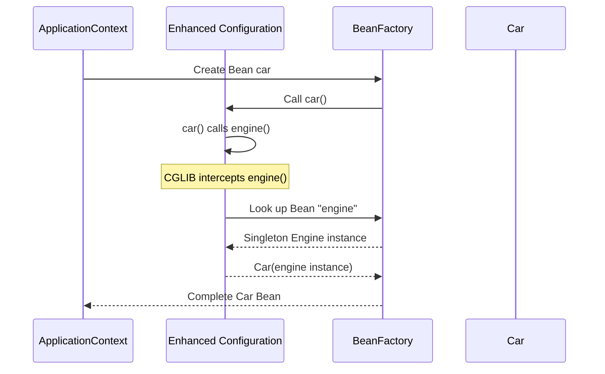
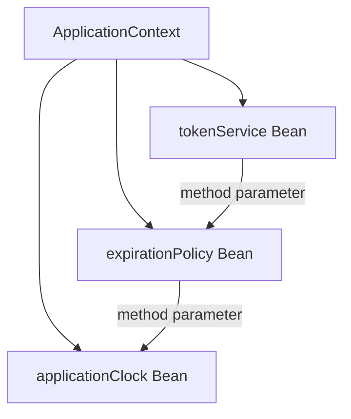

# Full Configuration, Lite Configuration, and Handling Calls Between @Bean Methods

In Spring, a method annotated with `@Bean` is a factory method: Spring calls the method to obtain an object and registers that object as a Bean in the IoC container. When one Bean needs another Bean, you commonly see two ways of writing it:

```java
@Bean
Engine engine() {
    return new Engine();
}

@Bean
Car car() {
    return new Car(engine());
}
```

Looking at it as regular Java, calling `engine()` would run the method and create a new object. However, if these two methods reside in a `@Configuration` class in its default mode, Spring can **intercept calls between `@Bean` methods** to return the container-managed Bean instead of creating an independent object.

This capability relates to two configuration modes:

- **Full configuration:** `@Configuration(proxyBeanMethods = true)`. This is the default. Spring enhances the configuration class with CGLIB to handle direct calls between `@Bean` methods.
- **Lite configuration:** `@Configuration(proxyBeanMethods = false)`, or a `@Component`/other lite configuration class that declares `@Bean` methods. The `@Bean` methods still register Beans, but Java calls from one method to another are not intercepted to look up the Bean in the container.

This difference is crucial. The exact same line `new Car(engine())` can reuse a singleton Bean in full mode, yet create a new unmanaged `Engine` outside the container in lite mode. The explicit way that works reliably in both modes is **passing the dependency as a `@Bean` method parameter**.

## 1. `@Bean` Is a Factory Method, While `@Configuration` Is a Configuration Class

A `@Bean` method describes how to create a Bean:

```java
@Configuration
public class VehicleConfiguration {

    @Bean
    Engine engine() {
        return new Engine();
    }
}
```

When this configuration is registered and processed, Spring creates a BeanDefinition corresponding to the `engine()` factory method. The default Bean name is the method name, here `engine`; the Bean type is inferred from the return type and related metadata.

A `@Bean` method does not need to return a class with Spring annotations. It is a way to register objects from external libraries or plain Java classes you cannot modify.

`@Configuration` marks a class as a source of Bean definitions. With the default `proxyBeanMethods = true` mode, Spring uses a subclass enhancement mechanism to ensure calls between `@Bean` methods in that class carry container semantics.

### Distinguishing the Two Roles

| Component | Responsibility |
|---|---|
| `@Bean` | Registers the object returned by the factory method as a Bean |
| `@Configuration` | Marks the configuration class and, in full mode, enables enhancement for calls between Bean methods |
| `ApplicationContext` | Stores definitions, creates and manages Bean instances, and resolves dependencies |
| CGLIB enhancement | Intercepts Bean method calls in full configuration to adhere to container rules |

`@Bean` methods can exist in classes without `@Configuration`. Spring can still process them when the class is registered as a component or imported/registered via an appropriate configuration mechanism. In that case, the class normally operates under **lite configuration semantics**.

## 2. Full Configuration: `proxyBeanMethods` Defaults to `true`

When writing:

```java
@Configuration
public class FullVehicleConfiguration {
    @Bean
    Engine engine() {
        return new Engine();
    }

    @Bean
    Car car() {
        return new Car(engine());
    }
}
```

Spring processes this class in **full mode** by default because `proxyBeanMethods` defaults to `true`.

During configuration processing, Spring generates a CGLIB-enhanced subclass. `@Bean` methods can be overridden/intercepted. When one `@Bean` method invokes another `@Bean` method on the enhanced configuration instance, the call is routed to look up the appropriate Bean in the container.

Therefore:

```java
@Bean
Car car() {
    return new Car(engine());
}
```

in full configuration is not simply equivalent to:

```java
return new Car(new Engine());
```

For the `engine` Bean with default singleton scope, the `engine()` call is intercepted and returns the container-managed singleton. The `Car` Bean and `Engine` Bean therefore share the same Engine instance.

### Observing Bean Identity

Assume simple classes:

```java
public class Engine {
}

public class Car {
    private final Engine engine;

    public Car(Engine engine) {
        this.engine = engine;
    }

    public Engine getEngine() {
        return engine;
    }
}
```

Verification:

```java
try (var context =
        new AnnotationConfigApplicationContext(FullVehicleConfiguration.class)) {

    Engine engineBean = context.getBean(Engine.class);
    Car carBean = context.getBean(Car.class);

    System.out.println(engineBean == carBean.getEngine()); // true
}
```

The `true` result reflects the container's singleton semantics: the Bean looked up through the context and the Bean that `Car` received from calling `engine()` in full configuration are the exact same instance.

### Why Is Proxying Needed?

If Spring simply invoked factory methods like normal Java methods, every call to `engine()` could create a new object. Then:

- The `engine` Bean in the container is one instance.
- Calling `engine()` inside `car()` creates a second instance.
- Objects end up using an unmanaged object while the application assumes they are sharing the same singleton Bean.

Full configuration avoids that discrepancy by routing calls between Bean methods back to the container.

## 3. What Does CGLIB Enhancement Do?

Spring uses CGLIB to create a subclass of the configuration class and override interceptable methods. When code calls a `@Bean` method on the enhanced instance, Spring checks the bean creation context and retrieves the corresponding object from the BeanFactory.



The diagram depicts the simple case with a singleton. For other scopes, the container applies the corresponding scope rules when the call is intercepted.

### Constraints on Classes and Methods

Because full mode requires subclass enhancement:

- The configuration class should not be `final`.
- `@Bean` methods must be overridable/interceptable; therefore, do not declare them `private` or `final` in full mode.
- The configuration must be eligible for CGLIB enhancement by Spring.

If a class or method cannot be subclassed/overridden, the required enhancement cannot be performed and Spring may report a configuration error. When interception is not needed, lite mode is a clean alternative.

`static @Bean` methods are a special case: static methods are not overridden by the CGLIB instance mechanism. Do not rely on interception between static methods to guarantee Bean reuse; avoid calling such factory methods from other Bean methods and use method parameters to express dependencies.

## 4. Lite Configuration: Calls Between `@Bean` Methods Are Not Intercepted

You can explicitly disable method proxying:

```java
@Configuration(proxyBeanMethods = false)
public class LiteVehicleConfiguration {
    @Bean
    Engine engine() {
        return new Engine();
    }

    @Bean
    Car car() {
        return new Car(engine());
    }
}
```

In lite mode, Spring still detects both `@Bean` methods and registers two BeanDefinitions. However, it does not create an enhanced subclass to intercept the `engine()` call inside `car()`.

Thus, this call:

```java
return new Car(engine());
```

runs as plain Java: it directly calls `engine()` and creates a new object. Result:

```java
try (var context =
        new AnnotationConfigApplicationContext(LiteVehicleConfiguration.class)) {

    Engine engineBean = context.getBean(Engine.class);
    Car carBean = context.getBean(Car.class);

    System.out.println(engineBean == carBean.getEngine()); // false
}
```

The container has its own `engine` Bean, while the `car` Bean holds a different Engine created directly by the Java method. That second Engine object is not registered as a separate Bean, does not receive container injection, and does not undergo full lifecycle processing as a container-managed Bean.

This is the key point to understand when choosing lite mode: it does not render `@Bean` ineffective. It only changes the semantics of **Bean method calls from Java code**.

## 5. `@Component` with `@Bean` Methods Also Uses Lite Semantics

Example:

```java
@Component
public class VehicleFactory {
    @Bean
    Engine engine() {
        return new Engine();
    }

    @Bean
    Car car() {
        return new Car(engine());
    }
}
```

If this class is component-scanned or appropriately registered, Spring can process its `@Bean` methods. However, `@Component` is not equivalent to `@Configuration` in full mode. Calling `engine()` inside `car()` is a direct Java call, so it creates a new object according to the method logic.

This is an example of **lite configuration**: the class acts as a source of Bean definitions but is not enhanced to intercept calls between Bean methods.

Common sources of lite configuration:

- `@Configuration(proxyBeanMethods = false)` classes.
- `@Component` classes declaring `@Bean` methods.
- Configuration classes registered under corresponding lite mechanisms.

## 6. Comparison Table: Full vs. Lite Configuration

| Feature | Full configuration | Lite configuration |
|---|---|---|
| Common declaration | Default `@Configuration` | `@Configuration(proxyBeanMethods = false)` |
| CGLIB enhancement for configuration class | Yes | No |
| Direct calls between `@Bean` methods | Intercepted to look up the Bean in the container | Executed as regular Java methods |
| Can declare `@Bean`? | Yes | Yes |
| BeanDefinitions still registered? | Yes | Yes |
| Suitable when Bean methods directly call each other and need container semantics | Yes | Should not rely on direct calls |
| Enhancement overhead | Additional subclass/proxy processing | Avoids that enhancement |
| `final` classes/methods | Restricted due to subclass/override requirement | Less restricted by this enhancement |
| Recommended way to express dependencies | `@Bean` method parameters | `@Bean` method parameters |

**Do not think of full as "better configuration" and lite as "inferior configuration."** They have different semantics. If Bean methods are independent or already declare dependencies via parameters, lite mode is often simpler and more efficient. If you intentionally call Bean methods directly and want the container to treat those calls as Bean lookups, full mode serves that purpose.

## 7. Good Practice for Both Modes: Inject via `@Bean` Parameters

Instead of calling directly:

```java
@Bean
Car car() {
    return new Car(engine());
}
```

declare the dependency in the method parameters:

```java
@Configuration(proxyBeanMethods = false)
public class VehicleConfiguration {
    @Bean
    Engine engine() {
        return new Engine();
    }

    @Bean
    Car car(Engine engine) {
        return new Car(engine);
    }
}
```

Spring resolves the `Engine engine` parameter from the container before calling the `car(...)` factory method. This works in both full and lite modes because it uses official dependency resolution rather than relying on Java method call interception.

Benefits:

1. Dependency relationships are visible right in the method signature.
2. No CGLIB interception is required to ensure receiving the right Bean.
3. You can switch from full to lite mode without altering wiring behavior.
4. Spring applies scope, qualifier, primary, and dependency resolution rules as usual.
5. Easier to read and verify than relying on hidden calls between factory methods.

### What If There Are Multiple Beans of the Same Type?

You can use a qualifier:

```java
@Configuration(proxyBeanMethods = false)
public class VehicleConfiguration {

    @Bean("dieselEngine")
    Engine dieselEngine() {
        return new DieselEngine();
    }

    @Bean("electricEngine")
    Engine electricEngine() {
        return new ElectricEngine();
    }

    @Bean
    Car car(@Qualifier("electricEngine") Engine engine) {
        return new Car(engine);
    }
}
```

This example assumes `DieselEngine` and `ElectricEngine` both implement/extend a suitable `Engine` type. The qualifier explicitly states which Bean is passed into `Car`; there is no need to call the `electricEngine()` method directly.

If one Bean should be the default for all type-based injections, you can mark it with `@Primary`. Still, parameter qualifiers remain useful when a factory method needs an intentional selection.

## 8. Comparing Results with Singleton and Prototype Scopes

By default, Beans declared with `@Bean` have singleton scope. Therefore, the difference between full and lite is most noticeable when two factory methods depend directly on each other:

```java
@Bean
Engine engine() {
    return new Engine();
}

@Bean
Car car() {
    return new Car(engine());
}
```

| Mode | Call to `engine()` inside `car()` | Engine held by `Car` |
|---|---|---|
| Full | Intercepted; retrieves singleton Bean from container | Same instance as the `engine` Bean |
| Lite | Java method call; creates a new object | Separate instance, not the `engine` Bean |

With prototype scope:

```java
@Bean
@Scope(ConfigurableBeanFactory.SCOPE_PROTOTYPE)
Engine engine() {
    return new Engine();
}
```

In full mode, the call is intercepted and the container creates/retrieves a prototype instance according to scope rules when the `car` Bean is created. In lite mode, the method is called directly and also creates a new object per the method body. The two outcomes may look similar in this simple example, yet the semantics still differ: the directly constructed Java object is not managed by the container as a prototype Bean and does not go through the same Bean lifecycle and post-processing pipeline.

If you need a Bean with a special scope, proxy, lifecycle, or dependency resolution, obtain it through container semantics via method parameters/DI rather than calling the factory method manually.

### Singleton Does Not Mean One Object per Java Call

Singleton is the scope of a Bean definition in the container. In lite mode, calling a factory method directly is not asking the container for the singleton Bean; it is simply a Java call. Therefore, you can end up creating a new object outside the container even though a singleton Bean of the same type already exists.

This is why you should not assume "since the method has `@Bean`, calling the method gives the singleton." That is only true for calls intercepted by Spring in full configuration, or when you intentionally look up/inject the Bean through the container.

## 9. How Do `@Bean` Method Parameters Resolve Dependencies?

Example:

```java
@Configuration(proxyBeanMethods = false)
public class ApplicationConfiguration {

    @Bean
    Clock applicationClock() {
        return Clock.systemUTC();
    }

    @Bean
    ExpirationPolicy expirationPolicy(Clock applicationClock) {
        return new ExpirationPolicy(applicationClock);
    }

    @Bean
    TokenService tokenService(ExpirationPolicy expirationPolicy) {
        return new TokenService(expirationPolicy);
    }
}
```

The container builds the dependency graph:



Spring inspects method parameters and resolves dependencies just like constructor injection. Factory method invocation order depends on dependency relationships and when Beans are needed, not on the order methods are written in the configuration file.

### Optional Dependencies

If a dependency is genuinely optional, it can be expressed using an appropriate type:

```java
@Bean
ReportService reportService(
        ObjectProvider<OptionalExporter> exporterProvider) {
    return new ReportService(exporterProvider);
}
```

This example illustrates passing a provider for deferred resolution; if the exporter is required, inject the exporter type directly. Do not use a provider merely to avoid configuration errors for a dependency that the business logic cannot function without.

## 10. Full Mode Is Not a Way to Call Bean Methods Arbitrarily Anywhere

CGLIB enhancement has a specific scope: Bean method calls on the Spring-enhanced configuration instance. It does not mean every Java call to a method named like a Bean turns into a container lookup.

Example:

```java
VehicleConfiguration config = new VehicleConfiguration();
Car car = config.car();
```

This snippet creates a plain configuration instance using `new`, not the Spring-enhanced instance. Therefore, the `engine()` call inside runs as regular Java. Spring cannot intercept a configuration object you instantiate yourself outside the container.

Similarly, calling a factory method on a manually instantiated configuration class in a unit test does not carry full configuration semantics. If you want to test Spring configuration, start a test context and retrieve Beans from the context.

**Do not treat a configuration class as a business service and call `@Bean` methods from application code.** Those methods describe how the container creates Beans; consumers should receive Beans via injection or container lookup at integration points where truly needed.

## 11. Static `@Bean` Methods and Special Cases

A `@Bean` method can be declared `static` in certain situations:

```java
@Configuration
public class InfrastructureConfiguration {
    @Bean
    static SomeInfrastructureProcessor infrastructureProcessor() {
        return new SomeInfrastructureProcessor();
    }
}
```

Static factory methods can be useful when registering certain BeanFactoryPostProcessors or infrastructure Beans early, avoiding premature instantiation of the configuration class. However, static methods cannot be overridden via the CGLIB instance method mechanism.

Therefore:

- Do not rely on full-mode interception for static calls.
- Avoid calling a static `@Bean` method from another Bean method expecting a container-managed singleton.
- If a factory method needs dependencies, consider declaring them via parameters if the processor's lifecycle/type permits.
- For special processors that must be created very early, check the lifecycle requirements of the processor interface itself; sometimes a static method is intentional.

## 12. When to Choose Full vs. Lite?

### Full Configuration Is Suitable When

- You have a specific reason to call one `@Bean` method directly from another `@Bean` method.
- You want those calls to be intercepted and respect the container's scope/Bean lifecycle.
- The configuration class can be CGLIB-subclassed/overridden.
- You are maintaining an existing configuration that already relies on full semantics and need to preserve compatible behavior.

Example:

```java
@Configuration
public class LegacyConfiguration {
    @Bean
    Engine engine() {
        return new Engine();
    }

    @Bean
    Car car() {
        return new Car(engine());
    }
}
```

### Lite Configuration Is Suitable When

- Bean methods are independent or dependencies are passed through method parameters.
- You want to avoid CGLIB enhancement for the configuration class.
- You want more flexibility in the configuration class regarding `final`/design.
- You are declaring some Beans in a component class or lite-style configuration.

Example:

```java
@Configuration(proxyBeanMethods = false)
public class ModernConfiguration {
    @Bean
    Engine engine() {
        return new Engine();
    }

    @Bean
    Car car(Engine engine) {
        return new Car(engine);
    }
}
```

In both cases, the container still registers and manages Beans. The difference lies in how Bean method calls inside Java code are handled.

### Quick Decision Table

| Question | Direction to choose |
|---|---|
| Bean methods do not call each other directly? | Lite mode is usually suitable |
| Need a dependency from another Bean? | Declare a method parameter; works in both modes |
| Intentionally calling a Bean method directly and need the container-managed Bean? | Full mode |
| Configuration class/methods cannot be subclassed/overridden? | Use lite mode and avoid direct inter-bean calls |
| Want to reduce enhancement overhead and make dependencies explicit? | Lite mode + method parameter injection |
| Legacy configuration currently relies on CGLIB interception? | Keep full mode or migrate all dependencies to method parameters before disabling proxying |

## 13. Common Errors and How to Diagnose Them

| Symptom | Possible cause | How to resolve |
|---|---|---|
| Two supposedly identical singleton Beans have different identities | Lite configuration calls a `@Bean` method directly and creates an object outside the container | Switch to method parameter injection or enable full mode if direct calls are intentional |
| Dependent Bean does not receive the same singleton | An object is created with `new` inside a method instead of obtained from the container | Declare a method parameter or look up the Bean in a managed way |
| Spring reports an enhancement/proxy error | Full configuration class or method cannot be subclassed/overridden | Remove `final`/`private` where needed or use lite mode |
| Bean method in `@Component` creates a new object on every call | Class uses lite semantics | Do not call directly; use method parameter injection |
| Changing `proxyBeanMethods = true` to `false` changes behavior | Code was relying on implicit interception | Find all calls between `@Bean` methods and convert them to method parameters |
| Unit test calls configuration method but results differ from real context | Test manually instantiates the configuration class with `new`, not using the enhanced instance | Use an ApplicationContext test or test the Bean independently via its constructor |

### Checking Identity in the Context

When suspecting a Bean is duplicated, compare identities:

```java
try (var context =
        new AnnotationConfigApplicationContext(VehicleConfiguration.class)) {
    Engine engine = context.getBean(Engine.class);
    Car car = context.getBean(Car.class);

    System.out.println(engine == car.getEngine());
}
```

Swap the configuration class between full and lite versions to observe the output. This is a useful illustration, though in real applications you should verify according to the specific configuration and Beans rather than relying solely on an identity log.

## 14. Practice: Migrating from Direct Calls to Method Injection

Start with a full configuration:

```java
@Configuration
class MessagingConfiguration {
    @Bean
    MessageFormatter formatter() {
        return new UppercaseFormatter();
    }

    @Bean
    MessageService messageService() {
        return new MessageService(formatter());
    }
}
```

**Step 1:** change the annotation to:

```java
@Configuration(proxyBeanMethods = false)
```

**Step 2:** observe which instance `MessageService` holds:

```java
MessageFormatter formatter =
        context.getBean(MessageFormatter.class);
MessageService service =
        context.getBean(MessageService.class);

System.out.println(formatter == service.getFormatter());
```

In lite mode, the direct call can cause the result to be `false`.

**Step 3:** update the factory method:

```java
@Bean
MessageService messageService(MessageFormatter formatter) {
    return new MessageService(formatter);
}
```

Run again; the result will be `true` for the singleton formatter Bean. Now the configuration can run in lite mode while dependencies are still resolved through the container.

**Step 4:** if there are multiple `MessageFormatter` Beans, add a qualifier to the parameter:

```java
@Bean
MessageService messageService(
        @Qualifier("formatter") MessageFormatter formatter) {
    return new MessageService(formatter);
}
```

Through this exercise, you clearly see the difference between **calling a Java method** and **asking the container to provide a Bean**.

## 15. Misconceptions to Avoid

**Disabling proxying does not disable Bean registration.** `@Configuration(proxyBeanMethods = false)` still registers Beans declared with `@Bean`; it only stops intercepting calls between methods.

**Lite does not mean Beans are unmanaged by Spring.** Objects returned directly from factory methods are still Spring-created and Spring-managed Beans. Only extra objects created by direct Java calls inside another method may sit outside the container.

**Full does not turn every method call in the application into a Bean lookup.** The mechanism applies to Bean method calls on the enhanced configuration instance.

**`@Bean` method parameter injection does not require full mode.** It is clear and portable across full and lite modes.

**Singleton is a Bean definition scope, not a rule for every `new` expression.** A lite configuration class can call a factory method and create a new object even if the container holds a singleton of the same type.

**A `@Component` with `@Bean` does not automatically become a full configuration.** A component class with Bean methods normally operates with lite semantics.

## 16. Connecting to Java Configuration and the IoC Container

Java configuration provides a way to describe Beans using Java code. `@Bean` indicates which factory method creates a Bean; `@Configuration` determines how the configuration class is processed; and ApplicationContext manages definitions, instances, and the dependency graph.

```text
Full configuration:
    @Configuration (proxyBeanMethods = true)
        → CGLIB enhancement
        → @Bean-to-@Bean calls are intercepted
        → receives Beans according to container rules

Lite configuration:
    @Configuration(proxyBeanMethods = false)
    or @Component with @Bean
        → no interception of calls between methods
        → methods are called as normal Java
        → directly created objects may sit outside the container

Recommended way to declare dependencies:
    @Bean
    Car car(Engine engine) { ... }
        → container resolves the parameter
        → works in both full and lite modes
```

When designing configuration classes, choose the mode based on whether you actually need interception. If one Bean needs another Bean, prefer declaring that Bean as a parameter of the factory method. This makes dependencies explicit, prevents accidental object creation outside the container, and lets the configuration work cleanly in both full and lite modes.
