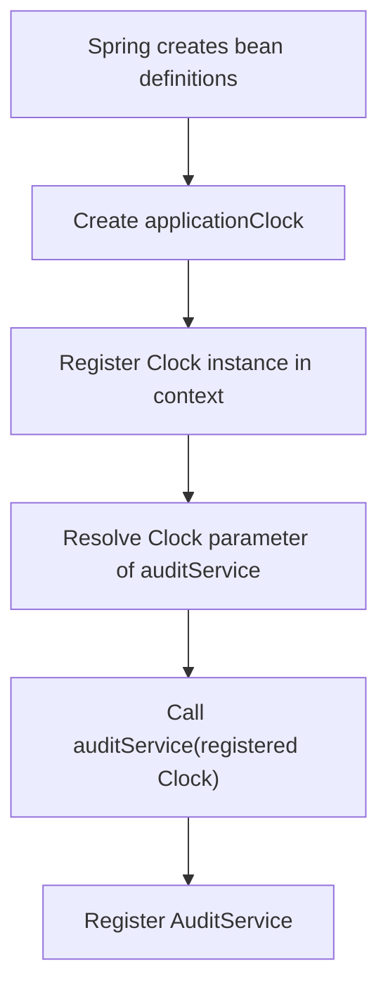
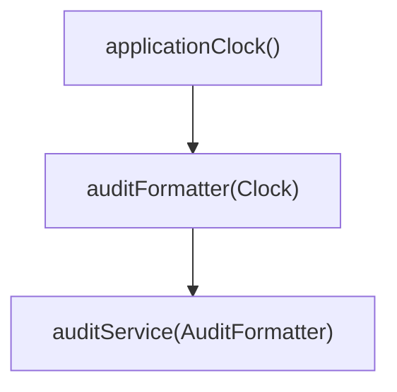

# Injecting Dependencies via `@Bean` Parameters Instead of Manual Method Calls

> **Spring Boot Fundamentals · Java configuration**  
> A method annotated with `@Bean` is a factory method that Spring invokes to create and register a bean. When one bean needs another bean, the clear and reliable approach is to **declare the dependency in the parameter list of the `@Bean` method**. Spring resolves the parameter from the ApplicationContext and passes it into the factory method. This lesson explains how to write that, why directly calling a `@Bean` method can create unintended objects, and how this relates to `@Configuration(proxyBeanMethods = true/false)`.

## 1. The Problem: Calling a Configuration Method Does Not Always Fetch a Bean from Spring

Suppose an application needs a shared `Clock` and an `AuditService` that uses that clock.

An error-prone way to write it:

```java
@Configuration(proxyBeanMethods = false)
public class AuditConfiguration {

    @Bean
    Clock applicationClock() {
        return Clock.systemUTC();
    }

    @Bean
    AuditService auditService() {
        return new AuditService(applicationClock());
    }
}
```

At first glance, the code looks reasonable: `auditService()` calls `applicationClock()` to get the clock. However, when the configuration uses `proxyBeanMethods = false`, the `applicationClock()` call inside is a **regular Java call**. It runs the method body and creates another new `Clock`.

The outcome can be:

- Spring calls `applicationClock()` to create the `applicationClock` bean and manages instance A.
- Spring calls `auditService()` to create the `auditService` bean.
- Inside `auditService()`, the code directly calls `applicationClock()`, creating instance B.
- `AuditService` holds instance B, while the container manages instance A.

In that case, the object used by the service is not the `applicationClock` bean that Spring registered. This is a source of subtle bugs such as inconsistent configuration, unexpected multiple instances, or lifecycles not managed by the container as intended.

The recommended way to write it:

```java
@Configuration(proxyBeanMethods = false)
public class AuditConfiguration {

    @Bean
    Clock applicationClock() {
        return Clock.systemUTC();
    }

    @Bean
    AuditService auditService(Clock applicationClock) {
        return new AuditService(applicationClock);
    }
}
```

Spring recognizes the `Clock applicationClock` parameter as a dependency to resolve. The container finds the matching bean and passes the **managed instance** into the factory method.



Key point: a `@Bean` method parameter is treated as a dependency injection point. You describe **what the bean needs**, and Spring is responsible for finding and passing the matching bean.

## 2. A `@Bean` Method Is a Spring-Managed Factory Method

A basic configuration class:

```java
package com.example.catalog.config;

import java.time.Clock;

import org.springframework.context.annotation.Bean;
import org.springframework.context.annotation.Configuration;

@Configuration(proxyBeanMethods = false)
public class TimeConfiguration {

    @Bean
    Clock applicationClock() {
        return Clock.systemUTC();
    }
}
```

When `TimeConfiguration` is loaded by Spring, the `applicationClock()` method is registered as a bean factory method.

Several concepts should be kept distinct:

| Component | Role |
| --- | --- |
| `@Configuration` | Marks a configuration class so Spring processes the bean declarations inside |
| `@Bean` | Marks a factory method whose result is registered as a bean |
| Return type | Indicates the type of object provided by the factory method |
| Method name | Usually the default bean name if no other name is specified |
| Method parameters | Dependencies that Spring must resolve before calling the factory method |
| `return` value | The actual object placed into the container |

A `@Bean` method is not an API for other classes to call arbitrarily like a helper method. It is part of container configuration. Calling the method is supported in certain configuration modes, but when a dependency is needed, declare the dependency as a parameter.

### 2.1. Parameters Are Resolved by Spring by Type

Example:

```java
@Bean
AuditService auditService(Clock applicationClock) {
    return new AuditService(applicationClock);
}
```

Spring looks for a bean assignable to type `Clock`. If there is exactly one matching bean, that bean is passed in.

If multiple beans of the same type exist, Spring applies candidate selection rules, such as `@Qualifier` or `@Primary`. If no matching bean exists and the dependency is required, the context usually fails during bean creation.

### 2.2. Parameter Names Do Not Create Beans Automatically

In this example:

```java
@Bean
AuditService auditService(Clock applicationClock) {
    return new AuditService(applicationClock);
}
```

The name `applicationClock` helps readers understand the role, but resolution is primarily based on type and autowiring metadata. If multiple `Clock` beans exist, merely changing the parameter name is not a reliable way to select a specific bean across all configurations/compilers.

Use an explicit qualifier:

```java
@Bean
AuditService auditService(
        @Qualifier("utcClock") Clock clock) {
    return new AuditService(clock);
}
```

This expresses the bean selection intent directly.

## 3. Parameter-Based Dependency Injection Works in Both Full and Lite Configuration

Spring supports `@Bean` methods in multiple kinds of configuration classes. Two common modes should be distinguished:

- **Full configuration mode:** a class annotated with `@Configuration` with `proxyBeanMethods = true`, which is the default.
- **Lite configuration mode:** for example, `@Configuration(proxyBeanMethods = false)` or other component classes declaring `@Bean`.

In both modes, **Spring still treats `@Bean` method parameters as dependency injection**.

The main difference lies in how Spring handles one `@Bean` method being called directly from another method within the same configuration class.

### 3.1. Full Mode: `proxyBeanMethods = true`

Example:

```java
@Configuration
public class FullAuditConfiguration {

    @Bean
    Clock applicationClock() {
        return Clock.systemUTC();
    }

    @Bean
    AuditService auditService() {
        return new AuditService(applicationClock());
    }
}
```

`@Configuration` uses `proxyBeanMethods = true` by default. Spring can generate a proxy subclass for the configuration class and intercept calls between `@Bean` methods to ensure those calls return container-managed beans according to container semantics, rather than simply creating a new object each time.

Therefore, in full mode, calling `applicationClock()` from another `@Bean` method in the same configuration is handled by the proxy and typically returns the corresponding singleton bean.

However, this relies on the proxy mechanism and has constraints:

- The configuration class must be subclassable/proxiable.
- Proxied `@Bean` methods should not be `private` or `final`.
- Calls must go through the proxied configuration instance; calling the method on a configuration object created with `new` outside the container does not share the same semantics.
- When switching to lite mode or disabling proxying, direct calls are no longer intercepted.

Therefore, even though full mode supports inter-bean method references, **declaring dependencies via parameters remains clearer and less coupled to proxy mechanics**.

### 3.2. Lite Mode: `proxyBeanMethods = false`

Example:

```java
@Configuration(proxyBeanMethods = false)
public class LiteAuditConfiguration {

    @Bean
    Clock applicationClock() {
        return Clock.systemUTC();
    }

    @Bean
    AuditService auditService(Clock applicationClock) {
        return new AuditService(applicationClock);
    }
}
```

In lite mode, Spring does not generate a CGLIB subclass to intercept `@Bean` method calls within the class. Nevertheless, Spring still reads the `@Bean` metadata and calls the factory methods to register beans.

Therefore:

- `@Bean` remains in effect.
- Factory methods are still invoked by Spring.
- Factory method parameters still receive dependency injection.
- A direct call to `applicationClock()` from Java code inside the class is a normal call and may create a new instance.

Lite mode can reduce the need for proxies and fits configurations where beans are wired via method parameters. This is an important reason to prefer method parameter injection.

### 3.3. Comparison Table: Full Mode vs. Lite Mode

| Behavior | Full mode: `proxyBeanMethods = true` | Lite mode: `proxyBeanMethods = false` |
| --- | --- | --- |
| Spring detects `@Bean` methods | Yes | Yes |
| Spring creates beans from factory methods | Yes | Yes |
| `@Bean` parameters are injected | Yes | Yes |
| Direct call to another `@Bean` method in the same config | Can be intercepted by proxy to obtain container bean | Normal Java call |
| Needs CGLIB subclass for inter-bean method interception | Yes | No |
| Suitable when beans are wired via method parameters | Yes | Yes |
| Risk of creating new objects due to manual method calls | Lower for proxy-supported internal calls, though constraints remain | Present if factory methods are called directly |

An easy rule to remember: **do not depend on Spring proxying a Java call inside a configuration class; let Spring resolve dependencies via parameters**.

## 4. Rewriting the Example Using the Recommended Style

We have three beans:

- `Clock` provides time.
- `AuditFormatter` formats audit events.
- `AuditService` uses the clock and formatter.

### 4.1. Application Classes

```java
package com.example.catalog.audit;

import java.time.Clock;
import java.time.Instant;

public class AuditFormatter {

    private final Clock clock;

    public AuditFormatter(Clock clock) {
        this.clock = clock;
    }

    public String format(String message) {
        Instant timestamp = clock.instant();
        return timestamp + " - " + message;
    }
}
```

```java
package com.example.catalog.audit;

public class AuditService {

    private final AuditFormatter formatter;

    public AuditService(AuditFormatter formatter) {
        this.formatter = formatter;
    }

    public void record(String message) {
        System.out.println(formatter.format(message));
    }
}
```

These two classes do not need Spring annotations. They simply describe behavior and constructor dependencies.

### 4.2. Declaring Beans According to the Dependency Graph

```java
package com.example.catalog.config;

import java.time.Clock;

import com.example.catalog.audit.AuditFormatter;
import com.example.catalog.audit.AuditService;

import org.springframework.context.annotation.Bean;
import org.springframework.context.annotation.Configuration;

@Configuration(proxyBeanMethods = false)
public class AuditConfiguration {

    @Bean
    Clock applicationClock() {
        return Clock.systemUTC();
    }

    @Bean
    AuditFormatter auditFormatter(Clock applicationClock) {
        return new AuditFormatter(applicationClock);
    }

    @Bean
    AuditService auditService(AuditFormatter auditFormatter) {
        return new AuditService(auditFormatter);
    }
}
```

Spring can build the graph according to dependency relationships:



Bean creation order is coordinated according to required dependencies. When creating `AuditService`, Spring ensures an appropriate `AuditFormatter` is available; when creating the formatter, Spring resolves `Clock`.

We do not need to call `applicationClock()` or `auditFormatter()` directly. The configuration describes the dependency graph, and the container decides when to invoke the factory methods.

### 4.3. Startup Class

```java
package com.example.catalog;

import com.example.catalog.audit.AuditService;
import org.springframework.boot.SpringApplication;
import org.springframework.boot.autoconfigure.SpringBootApplication;
import org.springframework.context.ConfigurableApplicationContext;

@SpringBootApplication
public class CatalogApplication {

    public static void main(String[] args) {
        ConfigurableApplicationContext context =
                SpringApplication.run(CatalogApplication.class, args);

        AuditService auditService = context.getBean(AuditService.class);
        auditService.record("Application started");
    }
}
```

In real applications, you typically inject `AuditService` into a controller, listener, or other component rather than calling `getBean` manually in `main`. The snippet above simply demonstrates that the bean is registered in the context and can be looked up.

## 5. Dependency Graph and Bean Creation Order

`@Bean` method parameters tell Spring which beans a bean depends on.

Example:

```java
@Bean
PaymentGateway paymentGateway(HttpClient httpClient,
                              PaymentProperties properties) {
    return new PaymentGateway(httpClient, properties);
}
```

The factory method needs two dependencies:

- An `HttpClient` bean.
- A `PaymentProperties` bean.

Spring resolves both before calling the factory method.

This forms a dependency graph. If `HttpClient` in turn needs an `SslContext` bean, and `SslContext` needs another bean, the container continues resolving the graph according to the declared dependencies.

### 5.1. Method Declaration Order Is Not How Creation Order Is Controlled

You do not need to place `@Bean httpClient()` above `@Bean paymentGateway()` to ensure the client is created first. The dependency relationship in the parameter already expresses that.

Example:

```java
@Configuration(proxyBeanMethods = false)
class PaymentConfiguration {

    @Bean
    PaymentGateway paymentGateway(HttpClient httpClient) {
        return new PaymentGateway(httpClient);
    }

    @Bean
    HttpClient httpClient() {
        return HttpClient.newHttpClient();
    }
}
```

Even though `paymentGateway` appears first, Spring still resolves `HttpClient` when it needs to create the gateway. Writing it this way keeps configuration independent of line order in the file.

### 5.2. Do Not Use `@DependsOn` as a Substitute for Dependency Injection

`@DependsOn` can require one bean to be initialized before another by name, but it **does not pass the object** to the consumer.

Example:

```java
@Bean
@DependsOn("httpClient")
PaymentGateway paymentGateway() {
    return new PaymentGateway(...);
}
```

This configuration only expresses initialization ordering. It does not pass the `httpClient` bean into the constructor, and the code would still have to obtain or construct the client somehow.

If a factory method needs `HttpClient`, declare:

```java
@Bean
PaymentGateway paymentGateway(HttpClient httpClient) {
    return new PaymentGateway(httpClient);
}
```

Using a dependency parameter expresses both the required ordering and supplies the exact object.

### 5.3. Dependency Parameters Are Not Method Calls

These two snippets have different meanings:

```java
// Dependency injection resolved by Spring.
@Bean
PaymentGateway paymentGateway(HttpClient httpClient) {
    return new PaymentGateway(httpClient);
}
```

```java
// Direct Java call.
@Bean
PaymentGateway paymentGateway() {
    return new PaymentGateway(httpClient());
}
```

In the first snippet, the container locates the `HttpClient` bean and passes it in. In the second snippet, the code invokes the `httpClient()` method. The outcome of the second call depends on full/lite configuration mode and can create unintended objects.

## 6. Selecting the Right Bean When Multiple Dependencies Share the Same Type

`@Bean` parameters follow Spring's autowiring rules. When multiple beans of the same type exist, you must specify which bean is appropriate.

### 6.1. Using `@Qualifier`

Suppose there are two HTTP clients:

```java
@Configuration(proxyBeanMethods = false)
class HttpClientConfiguration {

    @Bean("internalHttpClient")
    HttpClient internalHttpClient() {
        return HttpClient.newBuilder()
                .followRedirects(HttpClient.Redirect.NEVER)
                .build();
    }

    @Bean("partnerHttpClient")
    HttpClient partnerHttpClient() {
        return HttpClient.newBuilder()
                .followRedirects(HttpClient.Redirect.NORMAL)
                .build();
    }
}
```

The factory method selects the client intended for partners:

```java
@Bean
PartnerService partnerService(
        @Qualifier("partnerHttpClient") HttpClient httpClient) {
    return new PartnerService(httpClient);
}
```

`@Qualifier` explicitly identifies the candidate. This is the recommended approach when bean names represent distinct roles.

### 6.2. Using `@Primary` for the Default Candidate

If most consumers should use one default client:

```java
@Bean
@Primary
HttpClient internalHttpClient() {
    return HttpClient.newHttpClient();
}
```

A factory method accepting `HttpClient` without a qualifier can receive the primary bean if other candidates also match.

However, if a factory method needs the partner client, you should still use `@Qualifier("partnerHttpClient")`. `@Primary` does not make the other beans disappear.

### 6.3. Collection Parameters When Multiple Beans Are Needed

If all implementations are needed:

```java
@Bean
NotificationDispatcher notificationDispatcher(
        List<NotificationSender> senders) {
    return new NotificationDispatcher(senders);
}
```

Spring can inject matching beans into a collection. You can use `Map<String, NotificationSender>` when bean names are also needed.

If lazy lookup is desired, `ObjectProvider<NotificationSender>` can also be passed into a factory method or consumer. Only use a provider when on-demand lookup or candidate iteration is genuinely needed.

### 6.4. Optional Dependencies

An `Optional<T>` parameter can express a bean that may or may not be present:

```java
@Bean
AuditService auditService(
        Optional<AuditSink> auditSink) {
    return new AuditService(auditSink);
}
```

This assumes `AuditService` has a constructor accepting `Optional` and the business logic permits a missing audit sink. If auditing is mandatory, inject `AuditSink` directly so Spring fails fast when the bean is absent.

For more flexible lookup, use `ObjectProvider<T>`. If a parameter may be `null`, Spring supports appropriate nullability annotations, though `Optional` usually communicates intent more clearly in Java code.

## 7. Factory Method Parameters Can Receive Properties and Configuration

Not every parameter of `@Bean` has to be another bean. Spring also supports resolution mechanisms such as `@Value` on parameters.

Example:

```java
@Bean
HttpClient partnerHttpClient(
        @Value("${partner.connect-timeout-seconds:3}") long timeoutSeconds) {

    return HttpClient.newBuilder()
            .connectTimeout(Duration.ofSeconds(timeoutSeconds))
            .build();
}
```

Here:

- `@Value` tells Spring to resolve the property.
- If the property is absent, the expression uses the default value `3`.
- The factory method builds the client from the bound value.

For a large group of properties, use `@ConfigurationProperties` rather than many scattered `@Value` annotations.

### 7.1. Using `@ConfigurationProperties` as a Dependency

```java
@ConfigurationProperties(prefix = "partner")
public record PartnerProperties(
        URI endpoint,
        Duration connectTimeout
) {}
```

Register the properties:

```java
@Configuration(proxyBeanMethods = false)
@EnableConfigurationProperties(PartnerProperties.class)
class PartnerConfiguration {

    @Bean
    HttpClient partnerHttpClient(PartnerProperties properties) {
        return HttpClient.newBuilder()
                .connectTimeout(properties.connectTimeout())
                .build();
    }

    @Bean
    PartnerService partnerService(
            HttpClient partnerHttpClient,
            PartnerProperties properties) {
        return new PartnerService(
                partnerHttpClient,
                properties.endpoint());
    }
}
```

`PartnerProperties` is registered as a bean via `@EnableConfigurationProperties`. The factory methods receive it like any regular dependency.

In `application.yml`:

```yaml
partner:
  endpoint: https://partner.example
  connect-timeout: 3s
```

The configuration is bound once by Spring Boot's binding mechanism, then can be injected into multiple beans that need it. Ensure appropriate validation and default values; the example above assumes valid endpoint and timeout values.

## 8. `@Bean` Parameters and Dependency Scope

When a factory method accepts a dependency, the bean's scope is resolved according to Spring's rules. Keep this in mind when combining singleton, prototype, or request scopes.

### 8.1. Singleton Dependencies

Example:

```java
@Bean
AuditFormatter auditFormatter(Clock applicationClock) {
    return new AuditFormatter(applicationClock);
}
```

If `applicationClock` is a singleton, the formatter receives the container-managed clock instance. Since `auditFormatter` is also a singleton by default, it holds a reference to that clock for the bean's lifetime.

This is the common pattern for immutable or thread-safe services, clients, and configurations.

### 8.2. Prototype Dependencies in a Singleton Factory

Suppose `TaskContext` is a prototype:

```java
@Bean
@Scope(ConfigurableBeanFactory.SCOPE_PROTOTYPE)
TaskContext taskContext() {
    return new TaskContext();
}

@Bean
TaskCoordinator taskCoordinator(TaskContext taskContext) {
    return new TaskCoordinator(taskContext);
}
```

`TaskCoordinator` is a singleton by default. When creating the coordinator, Spring resolves one prototype `TaskContext` and passes it in. The coordinator then keeps that received instance.

**Parameter injection is not automatically re-invoked every time a method on the coordinator is used.** If a fresh `TaskContext` is needed for each job, inject a provider:

```java
@Bean
TaskCoordinator taskCoordinator(
        ObjectProvider<TaskContext> taskContextProvider) {
    return new TaskCoordinator(taskContextProvider);
}
```

Then `TaskCoordinator` can call `taskContextProvider.getObject()` for each job. For prototypes holding resources, plan cleanup explicitly because the container does not manage prototype destruction callbacks like it does for singletons.

### 8.3. Request-Scoped Dependencies

A factory method can accept a request-scoped bean when the configuration runs in a web-aware context and the scope is supported. If the created bean is a singleton, injecting a request-scoped bean directly typically requires a scoped proxy or provider mechanism to access the instance belonging to the current request.

Example:

```java
@Bean
RequestAwareService requestAwareService(RequestMetadata metadata) {
    return new RequestAwareService(metadata);
}
```

If `RequestMetadata` is a request-scoped bean configured with an appropriate proxy, the singleton service can hold the proxy and each access delegates to the current request's object. Never instantiate a request-scoped object with `new` inside a factory and assume it has request scope.

## 9. Full Configuration Mode and Internal Calls: Understanding Proxying Properly

Why does Spring need proxying for `@Configuration` by default?

Consider:

```java
@Configuration
class AppConfiguration {

    @Bean
    Clock clock() {
        return Clock.systemUTC();
    }

    @Bean
    AuditService auditService() {
        return new AuditService(clock());
    }
}
```

In full mode, Spring generates an enhanced configuration class. When code calls `clock()` through the enhanced configuration instance, the proxy can check whether the bean has already been created by the container and return that bean.

Without a proxy, the method call follows Java semantics: execute the method and receive its return value.

### 9.1. Proxying Is Not a General DI Mechanism

CGLIB enhancement only applies to inter-bean method calls within supported configurations. It does not turn every method call on any object into a container lookup.

Example:

```java
AppConfiguration config = new AppConfiguration();
AuditService service = config.auditService();
```

This is an object instantiated with `new` outside Spring. There is no container management and no enhanced proxy applied. Calling `clock()` is a normal Java method call.

Similarly, if you call a configuration method through a reference that is not the Spring-enhanced instance, you should not expect container interception.

### 9.2. Why Can Full Mode Be Restricted by final/private?

The proxy needs to override/intercept the appropriate methods. A `final` or `private` method cannot be overridden the way CGLIB requires. A `final` configuration class also cannot be subclassed.

Therefore, when relying on full mode, adhere to Spring's proxy constraints. The way to avoid depending on these details is to use method parameter injection.

### 9.3. Lite Mode Does Not Mean Inferior Configuration

`@Configuration(proxyBeanMethods = false)` does not invalidate `@Bean`. It only disables inter-bean method interception.

If beans are wired via parameters:

```java
@Configuration(proxyBeanMethods = false)
class AppConfiguration {

    @Bean
    Clock clock() {
        return Clock.systemUTC();
    }

    @Bean
    AuditService auditService(Clock clock) {
        return new AuditService(clock);
    }
}
```

the configuration still has full dependency injection and singleton semantics. Lite mode is well suited when you want explicit factory methods and do not need method calls between beans.

## 10. When Should You Use `@Bean` Parameters Instead of Helper Methods?

Not every method call inside a configuration is wrong. You can have pure Java helper methods to compute values, normalize strings, or build part of an internal structure. The issue arises when that helper method is actually another `@Bean` factory method and you call it directly to obtain a dependency.

Compare:

**Pure Java helper method:**

```java
@Configuration(proxyBeanMethods = false)
class ClientConfiguration {

    private Duration defaultTimeout() {
        return Duration.ofSeconds(3);
    }

    @Bean
    HttpClient httpClient() {
        return HttpClient.newBuilder()
                .connectTimeout(defaultTimeout())
                .build();
    }
}
```

`defaultTimeout()` is not annotated with `@Bean` and only returns a computed value. Calling it directly is completely normal.

**Bean dependency:**

```java
@Configuration(proxyBeanMethods = false)
class ClientConfiguration {

    @Bean
    Clock clock() {
        return Clock.systemUTC();
    }

    @Bean
    AuditService auditService(Clock clock) {
        return new AuditService(clock);
    }
}
```

`clock()` is a bean factory method. If you need that bean, request it through a parameter.

### 10.1. When Reusing Object Creation Logic Across Multiple Places

If multiple factory methods need to share object creation logic, you can extract a plain Java helper or a dedicated factory class:

```java
class HttpClientFactory {

    HttpClient create(Duration timeout) {
        return HttpClient.newBuilder()
                .connectTimeout(timeout)
                .build();
    }
}
```

Then configure the factory:

```java
@Configuration(proxyBeanMethods = false)
class ClientConfiguration {

    @Bean
    HttpClientFactory httpClientFactory() {
        return new HttpClientFactory();
    }

    @Bean
    HttpClient partnerHttpClient(
            HttpClientFactory factory,
            PartnerProperties properties) {
        return factory.create(properties.connectTimeout());
    }

    @Bean
    HttpClient internalHttpClient(
            HttpClientFactory factory) {
        return factory.create(Duration.ofSeconds(1));
    }
}
```

Here `HttpClientFactory` is an injected dependency; its `create` method is a helper that constructs an object based on parameters. Each call to `create` can produce a new client, matching the purpose of the factory.

If the two `HttpClient` beans are distinct beans, they have their own names/qualifiers and consumers must choose the appropriate client.

## 11. Circular Dependencies Between `@Bean` Methods

Declaring parameters makes the dependency graph explicit, but if the graph contains a cycle, the container cannot automatically resolve a simple constructor/factory dependency cycle.

Example:

```java
@Bean
ServiceA serviceA(ServiceB serviceB) {
    return new ServiceA(serviceB);
}

@Bean
ServiceB serviceB(ServiceA serviceA) {
    return new ServiceB(serviceA);
}
```

`ServiceA` needs `ServiceB`, and `ServiceB` needs `ServiceA`. This is a circular dependency.

Spring may fail bean creation, especially for constructor/factory method dependencies. Do not replace it with direct calls like `serviceB()` or `serviceA()` to work around the error; that can create unmanaged objects outside the container and mask the cycle.

Better ways to resolve it:

1. Extract shared logic into a third bean that both A and B depend on.
2. Invert the dependency using an interface or event.
3. Use a callback/provider/lazy lookup if there is a sound architectural reason and the cycle is genuinely needed.
4. Re-examine the responsibilities of both classes to eliminate the cyclic relationship.

Example of extracting shared logic:

```text
Before:
ServiceA <----> ServiceB

After:
ServiceA ----> SharedPolicy <---- ServiceB
```

A clear directed dependency graph makes initialization and testing much easier.

## 12. Factory Method Parameters and Bean Creation Exceptions

When Spring invokes a `@Bean` method, it must resolve parameters first. Several categories of errors can occur:

| Error | Cause |
| --- | --- |
| No bean found for required parameter | Dependency not registered, profile/condition did not match, or class not loaded |
| Multiple beans of the same type | Missing qualifier/primary or ambiguous candidate |
| Dependency bean fails to initialize | Dependency's factory throws an exception or internal configuration is invalid |
| Factory method itself throws an exception | Object construction fails, invalid property, or builder rejects configuration |
| Circular dependency | Beans depend on each other in a cycle |
| Bean matches type but wrong role | Overly generic candidate selected, missing qualifier, or unclear return type declaration |

Example:

```java
@Bean
PaymentGateway paymentGateway(
        HttpClient httpClient,
        PaymentProperties properties) {

    if (properties.endpoint() == null) {
        throw new IllegalStateException("Payment endpoint is required");
    }

    return new PaymentGateway(httpClient, properties.endpoint());
}
```

If a required endpoint is missing, failing fast at bean creation time is usually far better than creating a half-configured gateway and letting errors surface on the first request.

### 12.1. Do Not Use Optional to Hide Required Configuration

If the gateway is a core component, do not declare:

```java
@Bean
PaymentGateway paymentGateway(
        Optional<HttpClient> httpClient) {
    // ...
}
```

and silently construct a fallback client with an unclear policy. That can cause the application to run with an unintended configuration.

Only use `Optional` when the absence of a dependency is a valid state with well-defined behavior. If the dependency is required, declare it directly so Spring reports configuration errors right at startup.

## 13. Testing `@Bean` Method Wiring

You can verify which dependencies a bean is constructed with using a Spring context test.

### 13.1. Testing a Configuration with Two Linked Beans

Configuration:

```java
@Configuration(proxyBeanMethods = false)
class TestAuditConfiguration {

    @Bean
    Clock testClock() {
        return Clock.fixed(
                Instant.parse("2026-01-01T00:00:00Z"),
                ZoneOffset.UTC);
    }

    @Bean
    AuditFormatter auditFormatter(Clock testClock) {
        return new AuditFormatter(testClock);
    }
}
```

Test:

```java
@SpringJUnitConfig(TestAuditConfiguration.class)
class AuditConfigurationTest {

    @Autowired
    Clock clock;

    @Autowired
    AuditFormatter formatter;

    @Test
    void factoryMethodReceivesContainerManagedClock() {
        assertNotNull(clock);
        assertEquals(
                "2026-01-01T00:00:00Z - started",
                formatter.format("started"));
    }
}
```

This example assumes `AuditFormatter` uses `clock.instant()` and formats the string as shown in Section 4. `@SpringJUnitConfig` creates a test context from the configuration class; no full web server startup is required.

### 13.2. Verifying the Same Instance

You can inject both the bean directly and its consumer, then inspect dependency identity if the class exposes an appropriate accessor:

```java
assertSame(clock, formatter.clock());
```

In real code, only expose accessors if meaningful for the API or testing. Do not open up internal fields solely for identity assertions; test observable behavior instead.

### 13.3. Comparing Full and Lite Modes

Create two independent configurations:

- One default `@Configuration` class with direct `clock()` calls between `@Bean` methods.
- One `@Configuration(proxyBeanMethods = false)` class using the same direct call pattern.
- Then rewrite both using a `Clock clock` parameter.

You can use object identity to observe the difference. When doing so, remember not to load both configurations with identical bean names into the same context unless you intend to test conflicts.

The goal is to understand proxy semantics and see that method parameter injection yields consistent results in both modes.

## 14. Patterns to Avoid

| Pattern | Issue |
| --- | --- |
| Directly calling `anotherBean()` in lite mode to obtain a dependency | Calls the factory method as Java and can create a new object |
| Using `new SomeClient()` in multiple factories when one shared client is needed | Creates unexpected duplicate objects, hard to share lifecycle |
| Using `@DependsOn` without injecting the dependency | Controls ordering only, does not pass the object |
| Relying on parameter names to disambiguate multiple beans | Sensitive to compiler/metadata settings and less explicit than qualifiers |
| Wrapping required dependencies in `Optional` just to avoid startup errors | Masks misconfiguration or missing core components |
| Creating circular dependencies and relying on proxies to cope | Proxies do not fix cyclic dependency graph design |
| Calling `@Bean` methods on a manually `new`-ed configuration object | No container proxy or lifecycle applies |
| Declaring a bean of the same type as a Boot-configured bean without checking conditions | Can cause auto-configuration to back off or alter behavior unexpectedly |

### 14.1. Are Direct Calls in Full Mode Always Wrong?

No. Spring supports inter-bean method references in full `@Configuration` mode. Some existing codebases use that style legitimately.

However, method parameter injection is generally better because:

- It works predictably in both full and lite modes.
- It does not depend on proxy interception.
- It shows dependencies right in the factory method signature.
- It makes switching configurations to `proxyBeanMethods = false` straightforward.
- It helps readers see the dependency graph.
- It reduces the risk of accidentally creating new objects during refactoring or when calling methods on non-Spring-managed objects.

The goal is not memorizing a blanket ban; the goal is writing configurations with predictable semantics.

## 15. Practice Exercise: Fixing Manual Method Call Configuration

### Step 1 — Create Two Beans

```java
@Configuration(proxyBeanMethods = false)
public class BillingConfiguration {

    @Bean
    Clock billingClock() {
        return Clock.systemUTC();
    }

    @Bean
    InvoiceService invoiceService() {
        return new InvoiceService(billingClock());
    }
}
```

`InvoiceService` is an application class with a constructor taking `Clock`.

### Step 2 — Observe the Issue

In a test context, look up the `Clock` bean and retrieve the dependency held by `InvoiceService` (via a test accessor or suitable observable behavior). Compare identities. With lite mode and direct calling, you can see two different objects.

### Step 3 — Fix Using a Parameter

```java
@Bean
InvoiceService invoiceService(Clock billingClock) {
    return new InvoiceService(billingClock);
}
```

Re-run the test. The factory method receives the Spring-resolved instance without manually calling another factory method.

### Step 4 — Select a Bean When Two Clocks Exist

Add `utcClock` and `localClock`. Use `@Qualifier` on the parameter to specify which clock `InvoiceService` should receive.

### Step 5 — Try Full Mode

Remove `proxyBeanMethods = false` to use the default `true`. Observe that inter-bean method calls in full mode are handled by the proxy. Keep the parameterized version afterward to compare clarity and independence from proxying.

### Step 6 — Try Prototype Scope

Change a dependency to prototype scope. Inject it directly into a singleton factory and observe that the instance is retained when the singleton is created. Then use `ObjectProvider` to obtain a fresh instance per operation.

### Self-Check Questions

1. How does Spring handle parameters of a `@Bean` method?
2. Why can calling `applicationClock()` directly in lite mode create a new object?
3. What value of `proxyBeanMethods` does `@Configuration` use by default?
4. Does disabling `proxyBeanMethods` disable parameter-based dependency injection?
5. What problem does full configuration mode solve using proxying when calling another `@Bean` method?
6. Why is parameter injection less coupled to proxy implementation details?
7. When two `HttpClient` beans exist, how do you select the right bean for a factory method?
8. How does `@DependsOn` differ from a dependency parameter?
9. Does the order of `@Bean` methods in a file determine creation order?
10. If a factory method accepts a prototype bean, does the singleton consumer receive a new prototype on every method invocation?
11. When should `ObjectProvider<T>` be passed instead of `T`?
12. If two factory methods depend on each other circularly, why is calling the method directly not the right fix?

## 16. Quick Reference Table

| Need | Recommended approach |
| --- | --- |
| Factory needs another bean | Add that bean as a `@Bean` parameter |
| Factory needs properties | Use `@Value` on parameters or `@ConfigurationProperties` |
| Multiple beans of the same type | Use `@Qualifier` or `@Primary` |
| Want lite mode configuration | Use `@Configuration(proxyBeanMethods = false)` and wire beans via parameters |
| Want inter-bean method calls | Understand full mode and proxy constraints thoroughly |
| Need an optional dependency | `Optional<T>` or nullable contract when valid |
| Need lazy/repeated bean lookup | `ObjectProvider<T>` |
| Need initialization ordering only | Consider `@DependsOn`, while still injecting the object separately if needed |
| Need a fresh object per operation | Factory/provider or prototype by design |
| Need to avoid circular dependencies | Split responsibilities, introduce abstractions, or invert dependencies |

Whenever a `@Bean` factory needs another bean, express that relationship directly in its **method parameters**. Spring will resolve the dependency, apply qualifiers/primary markers, manage scope, and pass the appropriate instance. This style works consistently in both full configuration mode and lite mode while keeping the dependency graph visible in code. Direct calls to another `@Bean` method should only be used when you intentionally rely on full configuration proxy semantics; for new configurations, method parameter injection is usually the clearer and more maintainable choice.
