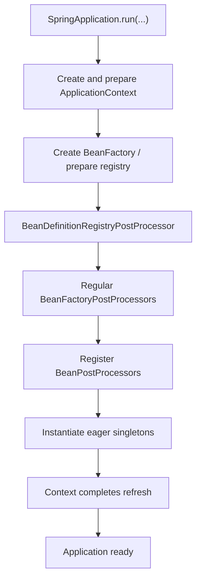
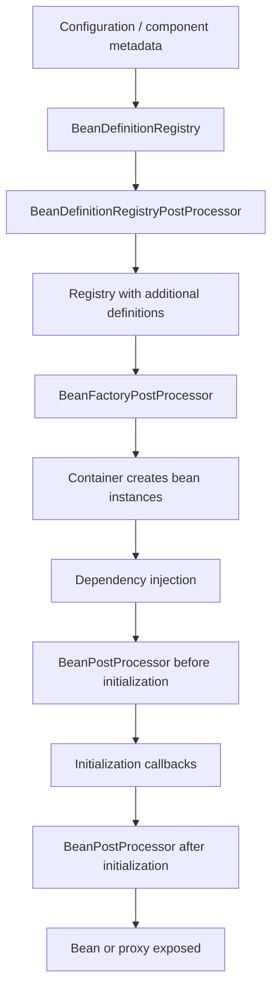
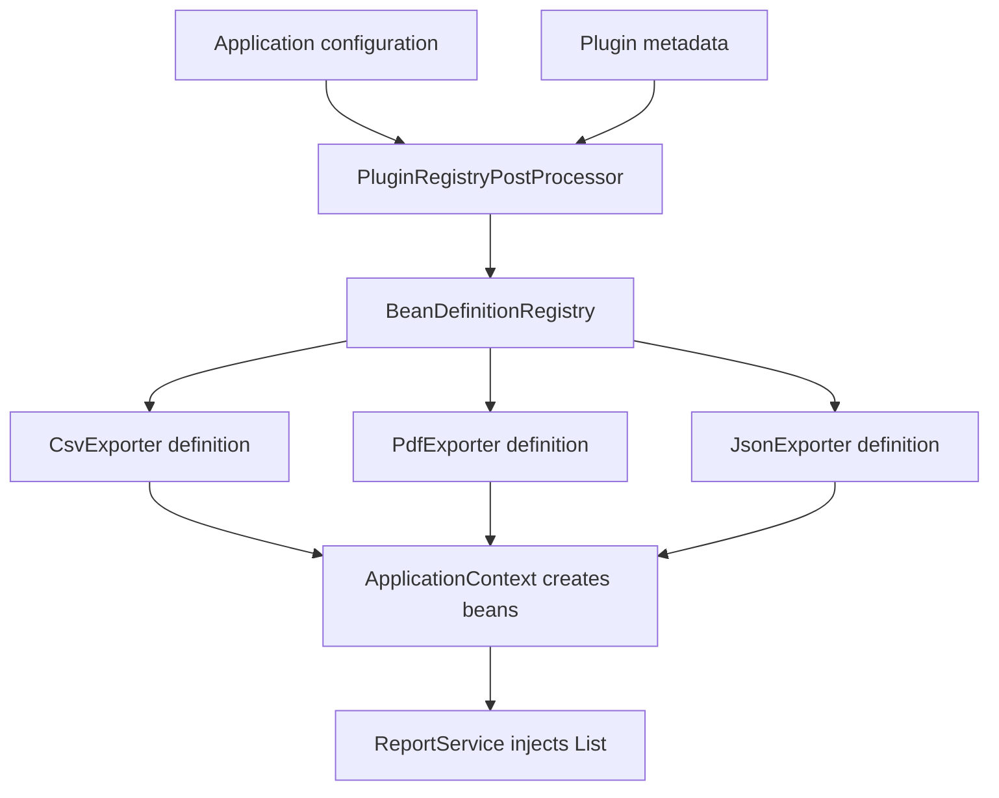

# BeanDefinitionRegistryPostProcessor and the Additional Registration Phase

In Spring, a bean does not appear in the application context merely because a Java class exists on the classpath. The container needs a **bean definition** describing how to create and manage that object. Typically, bean definitions come from component scanning, `@Bean` methods, imported configurations, or Spring Boot auto-configuration.

Some libraries and applications need a more flexible way to register beans: adding bean definitions from metadata, registering a group of module-discovered components, or adjusting the registry before Spring starts instantiating ordinary beans. The extension point designed for this need is **`BeanDefinitionRegistryPostProcessor`**.

`BeanDefinitionRegistryPostProcessor` (abbreviated as BDRPP) extends `BeanFactoryPostProcessor` and adds a callback that runs directly against `BeanDefinitionRegistry`. This allows code to **add, modify, or remove bean definitions during context preparation**, before the container instantiates most application beans.

In the **Java configuration** chapter of *Spring Boot Fundamentals*, this lesson focuses on:

- Distinguishing bean definitions from bean instances.
- Understanding the two callbacks of BDRPP and their place in context refresh.
- Writing a registry post-processor to register beans with Java configuration.
- Understanding execution order, discovery of new processors, and risks of premature initialization.
- Distinguishing BDRPP from `BeanFactoryPostProcessor`, `BeanPostProcessor`, and `ImportBeanDefinitionRegistrar`.

## 1. Why Is an Additional Registration Phase Needed?

In a typical Spring Boot application, you can declare:

```java
@Component
public class InventoryService {
}
```

or:

```java
@Configuration
public class InventoryConfiguration {

    @Bean
    InventoryService inventoryService() {
        return new InventoryService();
    }
}
```

These mechanisms work well when the classes or beans to register are known upfront. However, some situations require **building the list of bean definitions programmatically**:

- A plugin module needs to register adapters based on discovered metadata.
- An integration library needs to create proxy or factory beans for a set of interfaces.
- A framework needs to register internal components before ordinary services are initialized.
- A configuration wants to inspect the current registry and supply missing definitions.

For instance, a reporting module has a default implementation. When the application enables the module, a registry post-processor can register a `ReportExporter` bean if no matching bean definition exists yet. Other services can then receive it via constructor injection.

The core idea is **register definitions first, create instances later**. BDRPP is not where per-request work happens or where a new object is created every time a user hits an endpoint.

## 2. How Does a Bean Definition Differ from a Bean Instance?

Spring manages two distinct concepts that must be kept separate:

A **bean definition** is metadata describing a bean. It can contain:

- The class or factory method used to create the object.
- Constructor arguments and property values.
- Scope such as singleton or prototype.
- Lazy initialization, primary, role, and other metadata.
- Dependency relationships and container management details.

A **bean instance** is the Java object created from a bean definition when the container needs it.

Example:

```text
BeanDefinition:
  bean name: reportExporter
  bean class: CsvReportExporter
  scope: singleton
  constructor argument: UTF-8
           |
           v
ApplicationContext processes definition
           |
           v
Instance: a concrete CsvReportExporter object
```

`BeanDefinitionRegistryPostProcessor` operates at the metadata layer. Calling `registry.registerBeanDefinition(...)` asks the container to store a new definition. That **does not mean an instance is created immediately on that line**.

Only after the registration phase and bean factory processing steps does Spring instantiate non-lazy singletons along with dependencies required by the dependency graph. Prototypes are normally created on demand.

## 3. What Is BeanDefinitionRegistryPostProcessor?

The interface resides in the package:

```java
org.springframework.beans.factory.support.BeanDefinitionRegistryPostProcessor
```

Structurally, it extends `BeanFactoryPostProcessor` and declares one additional method:

```java
public interface BeanDefinitionRegistryPostProcessor
        extends BeanFactoryPostProcessor {

    void postProcessBeanDefinitionRegistry(
            BeanDefinitionRegistry registry
    ) throws BeansException;

    // Inherited from BeanFactoryPostProcessor:
    void postProcessBeanFactory(
            ConfigurableListableBeanFactory beanFactory
    ) throws BeansException;
}
```

In application source code, you import the interface from Spring Framework; the snippet above simply shows the contract for explanation.

The two callbacks have different responsibilities:

| Callback | Input | Responsibility |
| --- | --- | --- |
| `postProcessBeanDefinitionRegistry` | `BeanDefinitionRegistry` | Register, modify, or remove bean definitions |
| `postProcessBeanFactory` | `ConfigurableListableBeanFactory` | Continue processing the bean factory after the registry callbacks phase |

Because BDRPP is a subtype of BFPP, it participates in both phases. What makes BDRPP special is that its first callback runs while the registry is still open for registering additional bean definitions.

### 3.1. What Operations Does BeanDefinitionRegistry Provide?

The registry is the abstraction for manipulating bean definitions. Common methods include:

| Method | Meaning |
| --- | --- |
| `registerBeanDefinition(name, definition)` | Registers a definition under a bean name |
| `containsBeanDefinition(name)` | Checks whether the registry contains a definition with that name |
| `getBeanDefinition(name)` | Retrieves a definition to inspect or adjust metadata |
| `removeBeanDefinition(name)` | Removes a definition from the registry |
| `getBeanDefinitionNames()` | Retrieves the names of registered bean definitions |
| `getBeanDefinitionCount()` | Counts the number of bean definitions |

`BeanDefinitionRegistry` operates on **definitions**, not as a general-purpose API for querying every existing object instance. For instance, `containsBeanDefinition` checks definitions by name; it does not cover every way manually registered singletons can exist.

## 4. Where Does BDRPP Fit in ApplicationContext Initialization?

In a Spring Boot application, `SpringApplication.run(...)` triggers the application context refresh process. At a high level:



This is a simplified diagram. In reality, Spring also handles the environment, event multicaster, message source, lifecycle processor, listeners, and many other steps.

Key points to remember:

1. Initial bean definitions are gathered from configuration sources.
2. BDRPPs are invoked during bean factory processing while additional definitions can still be registered.
3. After the registry callbacks finish, the `postProcessBeanFactory` callbacks of BDRPPs are executed.
4. Ordinary BFPPs are invoked after the registry post-processing phase.
5. Spring registers `BeanPostProcessor`s to process bean instances.
6. The container proceeds to instantiate non-lazy singletons and completes refresh.

Consequently, BDRPP can add definitions **before most bean instances are created**. This is why this extension point suits dynamic component registration at startup.

## 5. Example: Registering a Bean Definition Programmatically

Suppose an application has a simple plugin:

```java
package com.example.shop.plugin;

public class WelcomePlugin {

    private final String productName;

    public WelcomePlugin(String productName) {
        this.productName = productName;
    }

    public String message() {
        return "Welcome to " + productName;
    }
}
```

We want the `WelcomePlugin` bean to be registered by a BDRPP. The plugin class does not need `@Component` and does not need to sit inside a scanned package.

### 5.1. Writing the BeanDefinitionRegistryPostProcessor

```java
package com.example.shop.config;

import com.example.shop.plugin.WelcomePlugin;
import org.springframework.beans.BeansException;
import org.springframework.beans.factory.config.BeanDefinition;
import org.springframework.beans.factory.support.BeanDefinitionBuilder;
import org.springframework.beans.factory.support.BeanDefinitionRegistry;
import org.springframework.beans.factory.support.BeanDefinitionRegistryPostProcessor;
import org.springframework.beans.factory.config.ConfigurableListableBeanFactory;

public class PluginRegistryPostProcessor
        implements BeanDefinitionRegistryPostProcessor {

    @Override
    public void postProcessBeanDefinitionRegistry(
            BeanDefinitionRegistry registry
    ) throws BeansException {
        if (registry.containsBeanDefinition("welcomePlugin")) {
            return;
        }

        BeanDefinition definition = BeanDefinitionBuilder
                .genericBeanDefinition(WelcomePlugin.class)
                .addConstructorArgValue("Spring Boot")
                .setRole(BeanDefinition.ROLE_APPLICATION)
                .getBeanDefinition();

        registry.registerBeanDefinition("welcomePlugin", definition);
    }

    @Override
    public void postProcessBeanFactory(
            ConfigurableListableBeanFactory beanFactory
    ) throws BeansException {
        // No further bean factory adjustments needed in this example.
    }
}
```

Step-by-step walkthrough:

- `registry.containsBeanDefinition("welcomePlugin")` avoids duplicate name registration in this example.
- `BeanDefinitionBuilder.genericBeanDefinition(WelcomePlugin.class)` creates a builder for the class definition.
- `addConstructorArgValue("Spring Boot")` provides the constructor argument.
- `setRole(BeanDefinition.ROLE_APPLICATION)` marks the definition as belonging to the application.
- `getBeanDefinition()` builds the completed metadata.
- `registerBeanDefinition(...)` inserts the definition into the registry.

The BDRPP does not call `new WelcomePlugin(...)` to hold an object instance. It registers metadata; the container creates the instance and manages dependencies/lifecycle through standard bean mechanisms.

### 5.2. Registering the BDRPP Itself via Java Configuration

A BDRPP must also be known to Spring. The common approach is declaring a `@Bean` method returning the processor type:

```java
package com.example.shop.config;

import org.springframework.context.annotation.Bean;
import org.springframework.context.annotation.Configuration;

@Configuration(proxyBeanMethods = false)
public class PluginRegistrationConfiguration {

    @Bean
    public static PluginRegistryPostProcessor pluginRegistryPostProcessor() {
        return new PluginRegistryPostProcessor();
    }
}
```

The factory method is declared `static` because the BDRPP must be instantiated very early. This lets Spring obtain the processor without instantiating `PluginRegistrationConfiguration` prematurely.

This is an important best practice: **`@Bean` methods creating BFPP/BDRPP should be `static` whenever possible**. If the factory method is non-static, the configuration class can be instantiated prematurely and fail to be processed by all `BeanPostProcessor`s like normal beans. Spring typically emits warnings about beans created too early or ineligible for full post-processing.

### 5.3. Using the Registered Bean

Another component can accept `WelcomePlugin` via its constructor:

```java
package com.example.shop;

import com.example.shop.plugin.WelcomePlugin;
import org.springframework.stereotype.Component;

@Component
public class PluginRunner {

    private final WelcomePlugin plugin;

    public PluginRunner(WelcomePlugin plugin) {
        this.plugin = plugin;
    }

    public String run() {
        return plugin.message();
    }
}
```

Application class:

```java
package com.example.shop;

import com.example.shop.config.PluginRegistrationConfiguration;
import org.springframework.boot.SpringApplication;
import org.springframework.boot.autoconfigure.SpringBootApplication;
import org.springframework.context.annotation.Import;

@SpringBootApplication
@Import(PluginRegistrationConfiguration.class)
public class ShopApplication {

    public static void main(String[] args) {
        SpringApplication.run(ShopApplication.class, args);
    }
}
```

Because `PluginRegistrationConfiguration` is imported, the `@Bean` method producing the BDRPP is processed. The BDRPP registers the `welcomePlugin` definition; Spring can then create `WelcomePlugin` and inject it into `PluginRunner`.

A runner to observe it:

```java
@Bean
CommandLineRunner pluginDemo(PluginRunner pluginRunner) {
    return args -> System.out.println(pluginRunner.run());
}
```

When the application starts, the output looks like:

```text
Welcome to Spring Boot
```

In this example, `@Import` brings the processor's configuration into the context; the BDRPP adds the definition; the container creates the bean; DI supplies the bean to the runner/service. These are distinct steps working together.

## 6. Why Register a BeanDefinition Instead of Creating Objects Directly?

An error-prone approach is:

```java
public void postProcessBeanDefinitionRegistry(BeanDefinitionRegistry registry) {
    WelcomePlugin plugin = new WelcomePlugin("Spring Boot");
    // Cannot use the registry definition API to register an object instance.
}
```

An object instantiated with `new` does not automatically become a bean definition. If you want the container to manage the bean, register a proper definition—or use another singleton registration API only when there is a very specific reason.

Using a bean definition provides benefits:

- The container knows the class/factory needed to create the object.
- Constructor arguments and property values can be described in metadata.
- Dependency injection is applied through container mechanisms.
- The bean can participate in ordinary lifecycle and post-processing steps.
- Scope, lazy initialization, primary flags, and other metadata can be declared.

If you manually create objects and store them in a static map or custom registry, the application ends up re-implementing work that Spring already solves.

**BDRPP is a tool for adding metadata to the container, not a business factory replacing Spring.**

## 7. Distinguishing BeanDefinitionRegistryPostProcessor and BeanFactoryPostProcessor

`BeanFactoryPostProcessor` (BFPP) is an extension point for adjusting the bean factory after bean definitions have been loaded. It is commonly used to modify metadata or property values before bean instances are created.

BDRPP extends BFPP and adds a dedicated phase for operating directly on the registry.

| Criterion | BeanFactoryPostProcessor | BeanDefinitionRegistryPostProcessor |
| --- | --- | --- |
| Contract | `postProcessBeanFactory` | `postProcessBeanDefinitionRegistry` and `postProcessBeanFactory` |
| Focus | Adjusting the bean factory / existing definitions | Registering or modifying definitions during the registry phase |
| Special timing | After registry post-processing | Before ordinary BFPPs |
| Adding definitions | Possible if the bean factory also implements registry, though not its dedicated purpose | Designed directly for this operation |
| Example | Adjusting metadata/properties of definitions | Programmatically registering a group of bean definitions |

BFPP example:

```java
public class PricingDefinitionPostProcessor
        implements BeanFactoryPostProcessor {

    @Override
    public void postProcessBeanFactory(
            ConfigurableListableBeanFactory beanFactory
    ) throws BeansException {
        if (beanFactory.containsBeanDefinition("pricingService")) {
            BeanDefinition definition =
                    beanFactory.getBeanDefinition("pricingService");
            definition.setLazyInit(true);
        }
    }
}
```

This example only adjusts metadata of an existing definition. When the main task is adding multiple definitions, BDRPP expresses the intent more directly.

### 7.1. BDRPP Also Has the postProcessBeanFactory Callback

A BDRPP can use the registry callback to register definitions, and then use the bean factory callback to perform additional adjustments on the bean factory. Spring invokes the registry callbacks of BDRPPs first, and only afterward invokes their bean factory callbacks.

Do not assume a BDRPP's `postProcessBeanFactory` runs immediately after that same instance's `postProcessBeanDefinitionRegistry` in every case. The container processes in phases: finishing the group of registry callbacks before moving to the bean factory callbacks group.

## 8. Distinguishing BeanDefinitionRegistryPostProcessor and BeanPostProcessor

Both names contain "PostProcessor," yet they operate on objects at two different layers.

| Criterion | BeanDefinitionRegistryPostProcessor | BeanPostProcessor |
| --- | --- | --- |
| Operates on | Bean definitions/registry | Bean instances |
| Timing | Before most ordinary beans are instantiated | During the initialization of each bean |
| Can add definitions? | Yes | Not this interface's job |
| Can return a proxy instead of the instance? | Not via the registry callback | Yes, via before/after initialization callbacks |
| Example | Registering dynamic plugin beans | Wrapping a service in a proxy |

Summary diagram:



If the goal is registering a new class so the container can instantiate it, think of BDRPP. If the goal is inspecting or wrapping an already-created object, think of BeanPostProcessor.

## 9. Distinguishing BDRPP and ImportBeanDefinitionRegistrar

`ImportBeanDefinitionRegistrar` also allows programmatic registration of bean definitions. It is commonly paired with `@Import` to package a feature or an `@Enable...` annotation.

Conceptual example:

```java
public class AuditRegistrar
        implements ImportBeanDefinitionRegistrar {

    @Override
    public void registerBeanDefinitions(
            AnnotationMetadata importingClassMetadata,
            BeanDefinitionRegistry registry
    ) {
        // Register bean definitions based on the importing class metadata.
    }
}
```

Comparison:

| Criterion | BDRPP | ImportBeanDefinitionRegistrar |
| --- | --- | --- |
| How triggered | Registered as a BDRPP bean/processor in the context | Invoked during `@Import` configuration processing |
| Input context | Bean factory registry | Importing class metadata and registry |
| Scope | Bean factory / context-level extension point | Tied to configuration import processing |
| Common use | General registry-phase definition registration | Libraries providing feature-enabling annotations |

### 9.1. Choose a Registrar When Configuration Is Triggered by @Import

If a library wants users to write:

```java
@EnableAudit
class ApplicationConfiguration {
}
```

and bean registration depends on metadata of the annotated class, `ImportBeanDefinitionRegistrar` is usually the better fit. It is called as part of configuration class processing and receives the importing class's metadata.

### 9.2. Choose BDRPP When a Broader Registry Hook Is Needed

If you need context-level registry processing not tightly bound to a specific `@Import` annotation, BDRPP can be the right choice. It can inspect existing definitions, register additional definitions, and participate in bean factory post-processing order.

The two extension points are not absolute substitutes. Identify the trigger point and the type of metadata your registration logic requires.

## 10. The Special Role of ConfigurationClassPostProcessor

Spring includes an important BDRPP named `ConfigurationClassPostProcessor`. It is a central piece of Java-based configuration.

This processor handles configurations related to:

- `@Configuration`.
- `@ComponentScan`.
- `@Import`.
- `@ImportResource`.
- `@Bean` methods.
- Related import/selector mechanisms.

Thanks to it, Spring can read configuration class metadata, analyze component scans, process imports, and register corresponding bean definitions before ordinary bean instantiation.

### 10.1. Why Does This Matter?

When you write:

```java
@Configuration
@Import(PricingConfiguration.class)
class ShopConfiguration {
}
```

Spring does not wait until a service calls `getBean` to read the annotations. Configuration classes are processed during the bean-definition registration phase. Definitions from `@Bean` and imported configurations are placed into the registry before ordinary bean creation.

This explains why `@Import`, component scanning, and `@Bean` methods work as declarative configuration mechanisms, even though they do not directly instantiate every object at the moment annotations are read.

### 10.2. Do Not Tamper Arbitrarily with ConfigurationClassPostProcessor

`ConfigurationClassPostProcessor` is a critical infrastructure processor. Reordering, removing, or registering duplicate instances can alter how Spring reads `@Configuration`, `@Import`, and `@Bean`.

In ordinary applications, stick to public configuration APIs. Only work directly with infrastructure processors when building frameworks/starters and after thoroughly understanding processing order and the contract of your Spring version.

## 11. Execution Order of Multiple BDRPPs

An application context can have multiple `BeanDefinitionRegistryPostProcessor`s. Spring must determine the order in which to invoke them because one processor may register definitions or additional processors.

At a high level, processing proceeds as follows:

1. BDRPPs registered directly on the bean factory/application context via the corresponding API are processed first.
2. BDRPPs defined in the registry implementing `PriorityOrdered` are invoked in priority order.
3. BDRPPs implementing `Ordered` are invoked next.
4. BDRPPs implementing neither ordering interface are invoked afterward.
5. Spring re-checks the registry to discover any new BDRPPs registered during earlier passes; discovery and invocation repeat until no new processors remain.
6. Once all registry callbacks complete, Spring invokes `postProcessBeanFactory` on the collected BDRPPs.
7. Only then are ordinary `BeanFactoryPostProcessor`s invoked.

This is why one BDRPP can register another BDRPP and have Spring discover it during the registry phase. Still, relying on chains of dynamic registration requires careful design because order can affect the final definitions.

### 11.1. Implementing PriorityOrdered or Ordered

Example:

```java
public class PluginRegistryPostProcessor
        implements BeanDefinitionRegistryPostProcessor, Ordered {

    @Override
    public int getOrder() {
        return 100;
    }

    @Override
    public void postProcessBeanDefinitionRegistry(
            BeanDefinitionRegistry registry
    ) throws BeansException {
        // Register definitions.
    }

    @Override
    public void postProcessBeanFactory(
            ConfigurableListableBeanFactory beanFactory
    ) throws BeansException {
        // Process bean factory if needed.
    }
}
```

`PriorityOrdered` is for processors that must belong to a higher priority group than `Ordered`. Do not implement ordering unless there is an actual dependency between processors. When two processors are independent, letting Spring use default ordering reduces coupling.

### 11.2. Do Not Confuse Processor Order with Bean Initialization Order

BDRPP ordering governs the execution order of registry callbacks. It is not a guarantee that bean instances will be instantiated in that same order.

Ordinary bean creation order is governed by the dependency graph, eager/lazy initialization, scopes, and other container mechanisms. If bean B needs bean A, that dependency is what causes Spring to create A before B when required.

## 12. Registering Another BDRPP Inside a BDRPP

A notable feature of the registry phase is that Spring can discover newly added processors while processing is underway. For instance, one processor might register another definition that is itself a BDRPP. Spring repeats BDRPP discovery to invoke it in a subsequent pass.

This is useful for infrastructure/frameworks, but should not be turned into an unpredictable chain in business applications.

If a processor registers a configuration class containing `@Bean` methods after `ConfigurationClassPostProcessor` has finished processing its configuration candidates, do not assume those new `@Bean` methods will automatically be parsed like an ordinary configuration class. To register ordinary beans, create bean definitions directly; if the goal is triggering configuration/import parsing, use an extension point in the proper phase such as `ImportBeanDefinitionRegistrar` or an import mechanism designed for it.

Principle: **registering a bean definition and asking Spring to parse a configuration class are two different things**.

## 13. Modifying Bean Definitions in the Registry

BDRPP does not only add definitions. It can also inspect and adjust existing definitions.

For example, marking an existing bean as lazy:

```java
public class LazyDefinitionPostProcessor
        implements BeanDefinitionRegistryPostProcessor {

    @Override
    public void postProcessBeanDefinitionRegistry(
            BeanDefinitionRegistry registry
    ) throws BeansException {
        if (registry.containsBeanDefinition("largeReportService")) {
            BeanDefinition definition =
                    registry.getBeanDefinition("largeReportService");
            definition.setLazyInit(true);
        }
    }

    @Override
    public void postProcessBeanFactory(
            ConfigurableListableBeanFactory beanFactory
    ) throws BeansException {
    }
}
```

This snippet illustrates modifying metadata before bean instances are created. When the bean is a lazy singleton, the container defers instantiation until requested, unless another dependency triggers earlier initialization.

### 13.1. Modifying Definitions Must Be Intentional

Attributes such as scope, lazy, primary, constructor arguments, and property values directly affect how the container builds beans. Mutating them in a BDRPP can change behavior across the application.

Before modifying a definition, be sure to:

- Verify that the bean name and definition are the exact target component.
- Check who registered that definition.
- Determine whether other beans depend on the related type or metadata.
- Avoid altering shared definitions outside the processor's feature scope.
- Ensure behavior does not depend on unguaranteed ordering.

If you merely need to supply a default bean, consider `@ConditionalOnMissingBean` in auto-configuration or plain Java configuration instead of mutating another module's definition.

## 14. BDRPP and Conditional Bean Registration

In some situations, a BDRPP checks the registry before registering:

```java
if (!registry.containsBeanDefinition("welcomePlugin")) {
    registry.registerBeanDefinition("welcomePlugin", definition);
}
```

This is a simple check to avoid name collisions. However, it is not a complete mechanism for detecting every bean of the same type, because:

- Multiple distinct bean names can share the same type.
- Singletons may be registered directly without a matching bean definition.
- A bean definition may use a factory method to produce a different implementation.
- Qualifiers, primary markers, and profiles/conditions can influence bean selection.

If the requirement is "register a default implementation only when no `PaymentGateway` bean exists yet," you must examine registry metadata and registered definitions. In Spring Boot auto-configuration, `@ConditionalOnMissingBean` is usually a better, more maintainable abstraction than writing custom type-matching logic in a BDRPP.

### 14.1. BDRPP Does Not Replace Conditional Annotations

`@ConditionalOnClass`, `@ConditionalOnProperty`, `@ConditionalOnMissingBean`, and other conditions belong to Spring Boot's conditional configuration system. They express activation conditions declaratively.

BDRPP is appropriate when programmatic registry manipulation is needed. If a bean simply needs to appear when a property is enabled, prefer conditional configuration instead of writing a custom registry post-processor.

## 15. Early Initialization Issues and BDRPP Dependencies

BDRPPs must be created before many ordinary beans to participate in the registry phase. Therefore, they are a kind of **early-initialized infrastructure bean**.

This has several consequences:

- Constructor dependencies of a BDRPP can drag other beans into early creation.
- Beans created while instantiating the processor may not have gone through all `BeanPostProcessor`s yet.
- Beans may miss AOP proxies or other post-processing expected by the application.
- Injecting a large service into a BDRPP can force the container to initialize too many components at an inappropriate phase.

### 15.1. Keep Processors Small with Minimal Dependencies

Anti-pattern:

```java
public class PluginRegistryPostProcessor
        implements BeanDefinitionRegistryPostProcessor {

    private final UserService userService;
    private final OrderRepository orderRepository;

    public PluginRegistryPostProcessor(
            UserService userService,
            OrderRepository orderRepository
    ) {
        this.userService = userService;
        this.orderRepository = orderRepository;
    }
}
```

This processor forces the container to instantiate business/persistence beans too early to satisfy its constructor arguments. They may not be processed like regular beans because other post-processors are not registered yet.

Instead, a BDRPP should focus on metadata and the registry. If information is needed to decide registration, use configuration/metadata safely accessible during early startup, or choose an abstraction designed for that lifecycle.

### 15.2. Static `@Bean` Methods

When registering a BDRPP via Java configuration:

```java
@Bean
static PluginRegistryPostProcessor pluginRegistryPostProcessor() {
    return new PluginRegistryPostProcessor();
}
```

Declaring `static` allows instantiating the processor without instantiating the configuration class containing the factory method. This is the standard recommendation for BFPPs and BDRPPs.

If the factory method declares an overly generic return type like `Object`, Spring may struggle to recognize early on that the bean is a `BeanFactoryPostProcessor`. Declare a concrete return type like `PluginRegistryPostProcessor` or at least the matching processor interface.

## 16. Should a BDRPP Instantiate Bean Instances Directly?

Normally, no. The purpose of a registry post-processor is manipulating bean definitions. Creating objects manually and calling `registry.registerBeanDefinition` does not fit because that method takes a `BeanDefinition`, not an instance.

APIs exist on some bean factories to register singleton instances directly, yet they carry different lifecycle and post-processing behavior compared to registering a bean definition prior to object creation. Unless there is a special requirement, use bean definitions so the container manages objects through the normal pipeline.

Correct example:

```java
RootBeanDefinition definition =
        new RootBeanDefinition(WelcomePlugin.class);
definition.getConstructorArgumentValues()
        .addIndexedArgumentValue(0, "Spring Boot");
registry.registerBeanDefinition("welcomePlugin", definition);
```

Or use `BeanDefinitionBuilder` for cleaner expression as shown earlier. Both approaches supply metadata to the container.

## 17. Testing BeanDefinitionRegistryPostProcessor

Because a BDRPP runs during context initialization, it can be tested with a lightweight context rather than starting the entire web stack.

Example with `AnnotationConfigApplicationContext`:

```java
import static org.junit.jupiter.api.Assertions.assertEquals;
import static org.junit.jupiter.api.Assertions.assertTrue;

import com.example.shop.config.PluginRegistrationConfiguration;
import com.example.shop.plugin.WelcomePlugin;
import org.junit.jupiter.api.Test;
import org.springframework.context.annotation.AnnotationConfigApplicationContext;

class PluginRegistryPostProcessorTest {

    @Test
    void registersPluginBeanDefinition() {
        try (var context =
                     new AnnotationConfigApplicationContext(
                             PluginRegistrationConfiguration.class
                     )) {
            assertTrue(context.containsBean("welcomePlugin"));

            WelcomePlugin plugin =
                    context.getBean("welcomePlugin", WelcomePlugin.class);

            assertEquals("Welcome to Spring Boot", plugin.message());
        }
    }
}
```

The test above requires appropriate JUnit and Spring Context dependencies. It performs:

1. Creating a context from the configuration.
2. Refreshing the context, triggering discovery and execution of the BDRPP.
3. Checking that the bean name exists in the context.
4. Retrieving the instance by type and verifying behavior.
5. Closing the context when the test finishes.

### 17.1. Checking the Definition Before Retrieving the Instance

To test strictly at the registry layer, use `ConfigurableApplicationContext` and inspect the bean factory after refresh:

```java
var beanFactory = context.getBeanFactory();
assertTrue(beanFactory.containsBeanDefinition("welcomePlugin"));
```

This checks metadata. `context.getBean(...)` afterward requests the instance. Separating these two assertions in tests helps pinpoint whether a failure lies in definition registration or bean instantiation.

### 17.2. Testing Conditions and Name Collisions

If a processor only registers when a bean definition does not already exist, write tests for both scenarios:

- Registry initially lacks the bean name: the definition is added.
- Registry already contains the bean name: the processor does not register a duplicate.

If logic depends on type, profile, or properties, test each branch. Never test only a single happy path and assume all configurations work.

## 18. Real-World Scenario: Registry Adding Plugins from Metadata

Imagine an application with an extension module. Each plugin supplies a different implementation of a `ReportExporter` interface. A registry post-processor can register bean definitions from a configured plugin list.

At the architectural level:



In this design, the BDRPP can:

1. Read a valid provided list of plugin metadata.
2. Determine the appropriate implementation class or factory bean.
3. Create a bean definition for each plugin with a stable name.
4. Register definitions in the registry.
5. Let the container manage instances and supply them via collection injection.

### 18.1. Bean Names Must Be Stable and Unique

If plugins have IDs `csv`, `pdf`, and `json`, bean names can follow a convention like `reportExporterCsv`. Normalize IDs and check for duplicates before registering.

Do not use names from untrusted data directly without validation. Bean names are identifiers inside the container; collisions can cause errors or overrides depending on allowed configuration.

### 18.2. A Registry Post-Processor Is Not a Runtime Plugin Manager

BDRPP runs during context initialization. It does not automatically load new plugins after the application has refreshed, nor is it a tool for managing dynamic per-request plugin lifecycles.

If the system needs to enable/disable plugins at runtime, design a dedicated mechanism such as a business registry, factory, event-driven module, or controlled reload system. Do not force BDRPP into a runtime requirement just because its name includes "Registry."

## 19. Common Pitfalls

| Symptom | Possible cause | How to investigate |
| --- | --- | --- |
| Bean does not appear | BDRPP was not registered or not processed by Spring | Check configuration, imports, and `@Bean` return type |
| Consumer reports missing bean | Definition was not added or type/constructor mismatch | Check registry, bean name, and bean class |
| Duplicate bean name | Another processor already registered the same name | Check `containsBeanDefinition` and registration sources |
| Bean created too early | BDRPP depends on ordinary beans | Reduce dependencies, use static factory methods |
| Bean does not receive proxies | Bean was instantiated before all BPPs were registered | Check early instantiation warnings and processor dependencies |
| New configuration does not create `@Bean`s as expected | Registering a class as a bean definition does not always parse it as a configuration candidate | Use import/registrar in the proper phase |
| Unstable registration order | Dependent processors lack explicit ordering | Use `PriorityOrdered`/`Ordered` when truly needed |
| Instance not managed by Spring as expected | Manually instantiated object or registered instance instead of definition | Register an appropriate bean definition |

### 19.1. Reading Errors by Layer

When context startup fails, determine:

1. Did the failure occur during processor discovery, definition registration, or bean instantiation?
2. Does the registry contain the expected bean name?
3. Does the definition have the right class and constructor arguments?
4. Does the bean have any unregistered dependencies?
5. Was any bean created prematurely due to processor dependencies?
6. Did another processor modify or remove the definition earlier?

Do not fix issues by blindly enabling bean overriding or arbitrarily changing ordering. First identify who owns each definition and why a conflict exists.

## 20. When to Use BDRPP and When to Choose a Simpler Approach

| Need | Mechanism to consider first |
| --- | --- |
| Register an application service | `@Component` / `@Service` |
| Construct an object with specific parameters | `@Bean` |
| Bring a configuration/module into the context | `@Import` |
| Register definitions tied to an enabling annotation | `ImportBeanDefinitionRegistrar` |
| Create beans based on classpath/property/existing bean conditions | `@Conditional...` or Boot auto-configuration |
| Adjust metadata of existing definitions | `BeanFactoryPostProcessor` |
| Add or adjust multiple definitions in the registry phase | `BeanDefinitionRegistryPostProcessor` |
| Wrap bean instances in a proxy | `BeanPostProcessor` or Spring AOP |
| Choose implementations from per-request data | Application-layer strategy/factory/registry |

BDRPP is a low-level and powerful extension point. Use it when the requirement genuinely involves manipulating the bean definition registry before ordinary beans are created. For most Spring Boot applications, component scanning, Java configuration, imports, and conditional auto-configuration are sufficient.

## 21. Practice Exercises

### Exercise 1 – Registering a Bean with BeanDefinitionBuilder

Create a `GreetingPlugin` class with a constructor taking a `language` string and a `greet()` method. Write a BDRPP that registers the `greetingPlugin` bean with constructor argument `"vi"`.

Create a service accepting `GreetingPlugin` via constructor and invoke the method. Verify the bean appears in the context even though the class has no `@Component`.

### Exercise 2 – Checking Definition Before Instance

After context refresh:

1. Use `containsBeanDefinition("greetingPlugin")` to check the definition.
2. Retrieve the bean via `getBean("greetingPlugin")`.
3. Compare the time the definition is registered with the time the instance is created.

Explain why these two operations belong to two different layers.

### Exercise 3 – Avoiding Duplicate Registration

Create a configuration that already provides the `greetingPlugin` bean. Then have a BDRPP try to register the same name. Add a registry check and explain why ownership conventions for bean definitions matter.

### Exercise 4 – Comparing Two Extension Points

Given two requirements:

- Change `lazyInit` on an existing definition.
- Add a definition for a new plugin.

Choose BFPP or BDRPP for each and explain your choice based on the API each interface provides.

### Exercise 5 – Observing Order

Create two BDRPPs: one implementing `PriorityOrdered`, one implementing `Ordered`. Log inside both the registry callback and the bean factory callback. Observe the order and explain why all registry callbacks run before bean factory callbacks.

### Exercise 6 – Designing a Module Activation Point

A library wants to provide an `@EnableAudit` annotation for users to activate a group of beans. Compare:

- Using `@Import(AuditConfiguration.class)`.
- Using `ImportBeanDefinitionRegistrar`.
- Registering a standalone BDRPP.

State which approach fits when metadata from the annotated class is needed and why.

## 22. Key Takeaways

`BeanDefinitionRegistryPostProcessor` is an extension point extending `BeanFactoryPostProcessor` to manipulate **bean definitions during the registry phase**. It enables adding or adjusting metadata before the container creates most bean instances.

Key points:

- **Definitions differ from instances:** BDRPP registers metadata; Spring remains responsible for instantiating and managing bean instances.
- **Two phases:** `postProcessBeanDefinitionRegistry` runs to manipulate the registry; `postProcessBeanFactory` runs after the registry callbacks group.
- **Early timing:** BDRPPs are created before many ordinary beans; keep processors small, minimize dependencies, and use static `@Bean` factory methods.
- **Order matters:** Spring processes `PriorityOrdered`, `Ordered`, and unordered processors, and can discover newly registered processors in subsequent passes.
- **Right tool for the right layer:** BDRPP manipulates definitions; `BeanPostProcessor` processes instances; `ImportBeanDefinitionRegistrar` ties into `@Import` processing; BFPP adjusts the bean factory.
- **Not for runtime requests:** BDRPP serves startup/context registration, not arbitrarily adding plugins after the context is running.

Whenever you need to add a group of bean definitions programmatically, clarify **which definitions must be registered, who owns the bean names, what dependencies are needed, and which phase the processor must run in**. A concise, well-scoped registry post-processor enables flexible Spring Boot module integration while letting the container manage lifecycles and dependency injection consistently.
