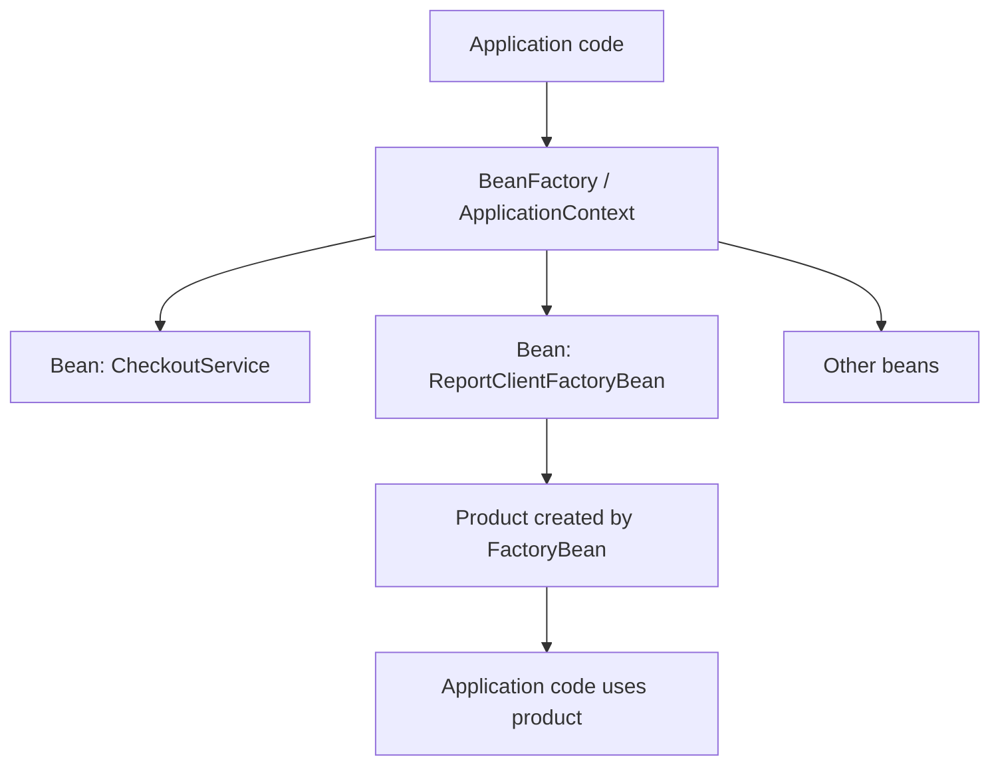
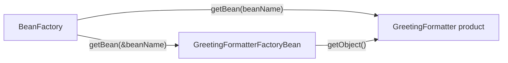
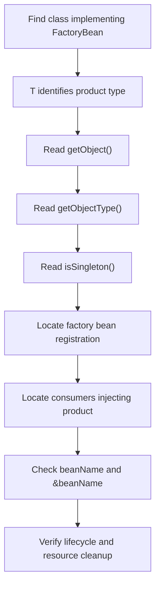

# FactoryBean vs. BeanFactory

In Spring, the two names **`BeanFactory`** and **`FactoryBean`** look nearly identical, yet they describe two very different concepts. `BeanFactory` is the core contract of the Spring IoC container: the component that manages beans and provides them to the application. `FactoryBean` is an extension point that **a specific bean implements in order to create another object and let Spring expose that object as a bean**.

This distinction matters when reading configuration code, integrating libraries, or investigating a bean originating from a factory. This lesson belongs to the **Java configuration** chapter of *Spring Boot Fundamentals*. We will start with `BeanFactory`, examine how `FactoryBean<T>` produces a product, explore the `&` prefix to retrieve the factory itself, distinguish singleton factories from singleton products, and compare `FactoryBean` with ordinary `@Bean` methods.

Examples use Java 21 and Spring Boot 3.x. The code snippets can be placed in a Spring Boot application with core dependencies or an equivalent Spring Context project.

## 1. Two Similar Names, Two Different Roles

| Concept | What is it? | Primary responsibility |
|---|---|---|
| `BeanFactory` | Core interface of the Spring IoC container | Stores and manages bean definitions, creates/supplies beans, resolves dependencies, and enforces bean lookup rules. |
| `FactoryBean<T>` | Interface for a bean acting as a factory | Creates or supplies a product of type `T` so the container exposes that product as a bean. |

You can remember it in two sentences:

- **`BeanFactory` is the container that supplies beans.**
- **`FactoryBean` is a container-managed bean that itself supplies another product.**

Diagram:



`FactoryBean` does not replace `BeanFactory` and is not a second container. A `FactoryBean` is registered inside the container; the container invokes it to obtain the product when the application requests the corresponding bean.

## 2. What Is `BeanFactory`?

`BeanFactory` lives in the package:

```java
import org.springframework.beans.factory.BeanFactory;
```

It is the fundamental interface of the Spring IoC container. It defines operations such as:

- Retrieving a bean by name: `getBean(String name)`.
- Retrieving a bean by type: `getBean(Class<T> requiredType)`.
- Checking whether a bean exists by name: `containsBean(String name)`.
- Checking singleton/prototype rules: `isSingleton(String name)`, `isPrototype(String name)`.
- Determining bean type: `getType(String name)`.
- Looking up aliases: `getAliases(String name)`.

Example:

```java
BeanFactory beanFactory = applicationContext;

PaymentGateway gateway =
        beanFactory.getBean(PaymentGateway.class);

PaymentGateway namedGateway =
        beanFactory.getBean("cardPaymentGateway", PaymentGateway.class);
```

The snippet above assumes `applicationContext` is an initialized `ApplicationContext` variable containing matching beans. `ApplicationContext` extends `BeanFactory`, so it can be used as a `BeanFactory`.

### 2.1. Is `ApplicationContext` a `BeanFactory`?

Yes. `ApplicationContext` is a higher-level interface in Spring's container ecosystem. It inherits `BeanFactory`'s bean management capabilities and adds application-level features such as:

- Publishing events and registering event listeners.
- Message source and internationalization support.
- Resource access via Spring's resource abstraction.
- Configuration, lifecycle, and annotation processing mechanisms suited to an application context environment.

In Spring Boot applications, you typically interact with or inject `ApplicationContext` rather than creating a bare `BeanFactory` yourself. Still, understanding `BeanFactory` helps establish the foundation of dependency injection.

### 2.2. Retrieving a Bean from the Container Is Not Manual Instantiation

When calling:

```java
PaymentGateway gateway = beanFactory.getBean(PaymentGateway.class);
```

you are asking the container to supply a registered bean resolved according to Spring's rules. The container may return an existing instance, instantiate one according to scope, or fail if no matching candidate is found.

`BeanFactory` is not merely a helper calling `new`. It works with bean definitions, dependency injection, scopes, lifecycles, and Spring extension points.

## 3. What Is `FactoryBean<T>`?

`FactoryBean<T>` is a Spring interface in the package:

```java
import org.springframework.beans.factory.FactoryBean;
```

A class implementing `FactoryBean<T>` is responsible for supplying an object of type `T` to the container. Main methods:

| Method | Role |
|---|---|
| `T getObject() throws Exception` | Creates or returns the product that the application receives when looking up the bean by the factory's name. |
| `Class<?> getObjectType()` | Tells the container the type of product the factory provides. |
| `boolean isSingleton()` | Indicates whether the product provided by the factory should be shared as a singleton. |

In modern Spring versions, `isSingleton()` has a default implementation returning `true`, yet when writing a factory, explicitly override it if the product is not a singleton to state the intended semantics clearly.

**Key point:** `FactoryBean` itself is also a Spring bean. The container manages the factory instance, invokes `getObject()` to obtain the product, and exposes the product under the corresponding bean name.

## 4. First Example: FactoryBean Creating a Formatter

Suppose an application needs a `GreetingFormatter` constructed from a configured prefix:

```java
package com.example.demo.greeting;

public interface GreetingFormatter {
    String format(String name);
}
```

Implementation:

```java
package com.example.demo.greeting;

public class PrefixGreetingFormatter implements GreetingFormatter {

    private final String prefix;

    public PrefixGreetingFormatter(String prefix) {
        this.prefix = prefix;
    }

    @Override
    public String format(String name) {
        return prefix + ", " + name + "!";
    }
}
```

Factory:

```java
package com.example.demo.greeting;

import org.springframework.beans.factory.FactoryBean;

public class GreetingFormatterFactoryBean
        implements FactoryBean<GreetingFormatter> {

    private final String prefix;

    public GreetingFormatterFactoryBean(String prefix) {
        this.prefix = prefix;
    }

    @Override
    public GreetingFormatter getObject() {
        return new PrefixGreetingFormatter(prefix);
    }

    @Override
    public Class<?> getObjectType() {
        return GreetingFormatter.class;
    }

    @Override
    public boolean isSingleton() {
        return true;
    }
}
```

In this example:

1. `GreetingFormatterFactoryBean` is the Spring-managed factory.
2. `getObject()` supplies a product of type `GreetingFormatter`.
3. `getObjectType()` lets Spring know the product type without necessarily invoking `getObject()` yet.
4. `isSingleton()` returns `true`, indicating the product is shared as a singleton under `FactoryBean` semantics.

We can register the factory in Java configuration:

```java
package com.example.demo.config;

import com.example.demo.greeting.GreetingFormatterFactoryBean;
import org.springframework.context.annotation.Bean;
import org.springframework.context.annotation.Configuration;

@Configuration(proxyBeanMethods = false)
public class GreetingConfiguration {

    @Bean
    GreetingFormatterFactoryBean greetingFormatterFactoryBean() {
        return new GreetingFormatterFactoryBean("Hello");
    }
}
```

`GreetingConfiguration` is a Spring-processed configuration class. The `@Bean` method returns the **factory object**. Because the returned object implements `FactoryBean`, Spring registers the factory and uses it to supply the `GreetingFormatter` product.

## 5. Retrieving the Product vs. Retrieving the FactoryBean Itself with the `&` Prefix

This is the single most important rule when working with `FactoryBean`.

Suppose the configuration method is named `greetingFormatterFactoryBean`. When requesting:

```java
GreetingFormatter formatter =
        context.getBean("greetingFormatterFactoryBean",
                GreetingFormatter.class);
```

Spring returns the **product** supplied by `GreetingFormatterFactoryBean`, i.e., a `GreetingFormatter`.

If you want the factory object itself:

```java
GreetingFormatterFactoryBean factory =
        context.getBean("&greetingFormatterFactoryBean",
                GreetingFormatterFactoryBean.class);
```

The `&` prefix asks the container to return the **`FactoryBean` itself**, rather than the product it supplies.

| Call | Object returned |
|---|---|
| `getBean("greetingFormatterFactoryBean")` | `GreetingFormatter` product |
| `getBean("&greetingFormatterFactoryBean")` | `GreetingFormatterFactoryBean` factory |
| `getBean("greetingFormatterFactoryBean", GreetingFormatter.class)` | Product matching the requested type |
| `getBean("&greetingFormatterFactoryBean", GreetingFormatterFactoryBean.class)` | Factory matching the requested type |

Spring defines the constant `BeanFactory.FACTORY_BEAN_PREFIX` for the `&` prefix. When reading code or debugging, remember that the plain bean name of a `FactoryBean` normally represents its **product**.

### 5.1. Verifying in a Runner

Example:

```java
package com.example.demo;

import com.example.demo.greeting.GreetingFormatter;
import com.example.demo.greeting.GreetingFormatterFactoryBean;
import org.springframework.boot.ApplicationArguments;
import org.springframework.boot.ApplicationRunner;
import org.springframework.context.ApplicationContext;
import org.springframework.stereotype.Component;

@Component
public class GreetingRunner implements ApplicationRunner {

    private final ApplicationContext context;

    public GreetingRunner(ApplicationContext context) {
        this.context = context;
    }

    @Override
    public void run(ApplicationArguments args) {
        GreetingFormatter formatter =
                context.getBean("greetingFormatterFactoryBean",
                        GreetingFormatter.class);

        GreetingFormatterFactoryBean factory =
                context.getBean("&greetingFormatterFactoryBean",
                        GreetingFormatterFactoryBean.class);

        System.out.println(formatter.format("Lan"));
        System.out.println(factory.getObjectType().getSimpleName());
    }
}
```

Illustrative output:

```text
Hello, Lan!
GreetingFormatter
```

The runner fetches the product for business use and fetches the factory when inspecting the object that produces the product. In typical application code, you simply inject the product type `GreetingFormatter`; retrieving the factory via `&` is mostly needed for administration, inspection, or container-level integration.

## 6. Distinguishing Singleton FactoryBean from Singleton Product

A common point of confusion is that `FactoryBean` involves two objects to think about:

1. **Factory instance** — the bean implementing `FactoryBean<T>`.
2. **Product instance** — the object returned from `getObject()`.

The factory instance has a scope defined by its bean definition. If the factory is registered via an ordinary `@Bean` method, that factory bean is usually a singleton. However, `isSingleton()` on `FactoryBean` describes the **product**, not the scope of the factory instance.

For example:

```java
@Override
public boolean isSingleton() {
    return true;
}
```

means the factory's product is treated as a singleton. Spring can cache the singleton product so subsequent lookups of the product by bean name return the same instance.

If:

```java
@Override
public boolean isSingleton() {
    return false;
}
```

then the container does not treat the product as a singleton; each request for the product can invoke the factory to obtain a new instance.

### Comparison Table

| Property | Factory instance | Product instance |
|---|---|---|
| What is it? | Object implementing `FactoryBean<T>` | Object of type `T` from `getObject()` |
| Who manages it? | Spring container like an ordinary bean | Container exposes the product per the `FactoryBean` contract |
| Where does scope come from? | The factory's bean definition | The `isSingleton()` rule and how the factory supplies products |
| Accessed by name via | `&beanName` | `beanName` |
| Example | `GreetingFormatterFactoryBean` | `PrefixGreetingFormatter` |

**Never say "singleton" without clarifying whether you mean the factory or the product.**

## 7. What Value Should `isSingleton()` Return?

The value depends on the nature of the product.

### Immutable or Safely Shareable Products

If the product is a stateless formatter, or a client designed to be thread-safe and shareable, the factory can provide a singleton product:

```java
@Override
public boolean isSingleton() {
    return true;
}
```

The container can then cache the product and return the same instance on subsequent bean lookups.

### Mutable Products That Should Not Be Shared

For instance, `MessageDigest` holds mutable state across data updates and is not designed to be shared concurrently across threads. A factory can produce a new product each time:

```java
package com.example.demo.crypto;

import java.security.MessageDigest;
import java.security.NoSuchAlgorithmException;
import org.springframework.beans.factory.FactoryBean;

public class Sha256DigestFactoryBean
        implements FactoryBean<MessageDigest> {

    @Override
    public MessageDigest getObject() throws NoSuchAlgorithmException {
        return MessageDigest.getInstance("SHA-256");
    }

    @Override
    public Class<?> getObjectType() {
        return MessageDigest.class;
    }

    @Override
    public boolean isSingleton() {
        return false;
    }
}
```

Registering the factory:

```java
@Configuration(proxyBeanMethods = false)
public class CryptoConfiguration {

    @Bean
    Sha256DigestFactoryBean sha256DigestFactoryBean() {
        return new Sha256DigestFactoryBean();
    }
}
```

Retrieving two products:

```java
MessageDigest first =
        context.getBean("sha256DigestFactoryBean", MessageDigest.class);

MessageDigest second =
        context.getBean("sha256DigestFactoryBean", MessageDigest.class);

System.out.println(first == second); // false for a non-singleton product
```

The factory instance can still be a singleton Spring bean; only the `MessageDigest` product is non-singleton according to `isSingleton()`. This is a concrete example showing the two singleton concepts are not the same.

If a factory can supply multiple product types or the product type is unknown prior to creation, `getObjectType()` may return `null`. Whenever possible, however, return the exact product type so Spring can support type prediction, type-based autowiring, and bean queries better.

## 8. Why Does `getObjectType()` Matter?

Spring does not always want to instantiate the product merely to know the bean's type. For example, a service might inject:

```java
public ReportService(ReportExporter exporter) {
    this.exporter = exporter;
}
```

If the factory declares:

```java
@Override
public Class<?> getObjectType() {
    return ReportExporter.class;
}
```

the container has metadata indicating that this `FactoryBean` can provide a product of type `ReportExporter`. That helps type-based dependency resolution and metadata queries.

If `null` is returned because the product type is unknown, some type prediction operations may fail to recognize the product before the factory actually creates it. Type-based autowiring or bean-list queries by type may then be limited or require initializing the factory/product depending on context.

**Rule of thumb:** if the product has a fixed type, return that exact type in `getObjectType()`. Do not return the factory's class:

```java
// Incorrect if the actual product is ReportExporter:
return ReportExporterFactoryBean.class;
```

Return the product type:

```java
return ReportExporter.class;
```

## 9. Is FactoryBean the Only Way to Create Beans with a Factory?

No. Spring has multiple ways to create beans. The most common approach in modern applications is a `@Bean` method inside `@Configuration`:

```java
@Configuration(proxyBeanMethods = false)
public class ExportConfiguration {

    @Bean
    ReportExporter reportExporter() {
        return new PdfReportExporter();
    }
}
```

Here:

- Spring detects `ExportConfiguration`.
- The `reportExporter()` method runs to supply an object.
- The returned object is the `ReportExporter` bean.
- No `FactoryBean` is registered.

Compare with `FactoryBean`:

```java
@Configuration(proxyBeanMethods = false)
public class ExportConfiguration {

    @Bean
    ReportExporterFactoryBean reportExporterFactoryBean() {
        return new ReportExporterFactoryBean();
    }
}
```

In the second variant, the `@Bean` method returns a **`FactoryBean`**. The container registers the factory and uses it to supply the `ReportExporter` product. Therefore, `getBean("reportExporterFactoryBean")` returns the product, whereas `getBean("&reportExporterFactoryBean")` returns the factory.

| Criterion | `@Bean` method returning a normal object | `@Bean` method returning `FactoryBean<T>` |
|---|---|---|
| Object created by the method | The actual bean used by the application | The factory instance |
| Bean retrieved by plain name | The object returned from the method | The product from `FactoryBean.getObject()` |
| Retrieving the object returned by the method | Look up the bean by name | Use the `&` prefix to retrieve the factory |
| How the product is determined | `@Bean` method returns directly | `FactoryBean.getObject()` |
| Declaring product type | Return type of the `@Bean` method | `FactoryBean.getObjectType()` supplies product metadata |

### When Should You Use `@Bean`?

For ordinary objects, a `@Bean` factory method is concise, clear, and easy to read. It fits:

- Creating objects from external libraries.
- Configuring constructors with properties or dependencies.
- Choosing implementations by profile/condition.
- Constructing objects that require a simple initialization step.

### When Should You Use `FactoryBean`?

`FactoryBean` fits when you need to encapsulate a complex object-creation mechanism into a reusable Spring container abstraction, especially when:

- The product is created via a specialized factory API or third-party library.
- Product creation requires custom management unsuitable for a simple `@Bean` method.
- Fine-grained control over product type, product singleton/non-singleton behavior, and how the container exposes the product is needed.
- Integrating a complex object/proxy system with Spring IoC.

Do not implement `FactoryBean` merely to replace every `@Bean` method. If creating the object is just `return new SomeClient(properties)`, `@Bean` is usually clear enough.

## 10. FactoryBean Is Not BeanFactory: A Direct Side-by-Side Example

Consider the code:

```java
BeanFactory container = applicationContext;

GreetingFormatter product =
        container.getBean("greetingFormatterFactoryBean",
                GreetingFormatter.class);

GreetingFormatterFactoryBean factory =
        container.getBean("&greetingFormatterFactoryBean",
                GreetingFormatterFactoryBean.class);
```

In those three statements:

- The `container` variable is a reference to the IoC container via the `BeanFactory` interface.
- The `factory` variable is a specific Spring bean implementing `FactoryBean<GreetingFormatter>`.
- The `product` variable is the `GreetingFormatter` object supplied by the factory.

Relationship diagram:



`BeanFactory` is the API for asking the container for beans. `FactoryBean` is a type of bean with a special contract for supplying products. Similar names do not mean they operate at the same level or replace each other.

## 11. Lifecycle of the Factory and the Product

A `FactoryBean` has two lifecycles to distinguish:

1. **Factory instance lifecycle:** the `FactoryBean` instance is a container-managed bean. It can be created, receive dependency injection, and run callbacks like any other bean.
2. **Product lifecycle:** the product is obtained from `getObject()` and exposed to consumers under the `FactoryBean` contract. The container applies post-processing steps to the product, while creation and singleton semantics are governed by the factory.

A factory can receive dependencies via constructor:

```java
public class ReportExporterFactoryBean
        implements FactoryBean<ReportExporter> {

    private final ExportProperties properties;

    public ReportExporterFactoryBean(ExportProperties properties) {
        this.properties = properties;
    }

    @Override
    public ReportExporter getObject() {
        return new PdfReportExporter(properties.outputDirectory());
    }

    @Override
    public Class<?> getObjectType() {
        return ReportExporter.class;
    }
}
```

When registering the factory via `@Bean`, Spring can inject `ExportProperties` into the factory method or factory constructor according to the corresponding configuration. The product is created when the container requests it.

Do not assume the factory and product always share identical callback/lifecycle behavior. If a product holds resources such as file handles, connections, or threads, design an explicit resource-closing mechanism and verify how Spring manages destruction callbacks for that product type. For non-singleton products, pay special attention to who is responsible for releasing each instance.

## 12. FactoryBean and Dependency Injection by Product Type

One benefit of `FactoryBean` is that consumers only need to know the **product interface**, without depending on the factory class.

Example:

```java
@Service
public class GreetingService {

    private final GreetingFormatter formatter;

    public GreetingService(GreetingFormatter formatter) {
        this.formatter = formatter;
    }

    public String greet(String name) {
        return formatter.format(name);
    }
}
```

The consumer only requires `GreetingFormatter`. Spring can resolve the product type supplied by the `FactoryBean` and inject the matching product. `GreetingService` does not need to know whether the product was created by a plain `@Bean` method, a component implementation, or a `FactoryBean`.

This separates:

- **How it is created:** belongs to the factory/configuration.
- **Usage contract:** belongs to the product interface.
- **Bean management and wiring:** belongs to the Spring container.

If multiple `FactoryBean`s supply the same product type, normal bean selection rules still apply for dependency injection. You can use `@Primary` or `@Qualifier` on the bean/product as configured; `FactoryBean` does not bypass candidate resolution rules.

## 13. Common Real-World Scenarios

`FactoryBean` commonly appears in library integrations or when products must be created via a specialized workflow. Some examples in the Spring ecosystem:

- `ProxyFactoryBean` creates proxy objects from AOP configuration.
- Factory beans for session factories or resource integration in several Spring modules.
- Integration libraries may supply a `FactoryBean` to encapsulate complex client, proxy, or object creation.

When reading library source code, if you see a class implementing `FactoryBean<T>`, determine:

1. What is the product type `T`?
2. How does `getObject()` create the product?
3. What metadata does `getObjectType()` provide?
4. Does `isSingleton()` indicate the product is shared?
5. Which bean name retrieves the product and which `&` prefix retrieves the factory?

Answering these questions usually clarifies an integration much faster than guessing from class names alone.

## 14. Testing FactoryBean

You can test both the product and the factory in a Spring context test.

Example with `GreetingFormatterFactoryBean`:

```java
package com.example.demo.greeting;

import static org.assertj.core.api.Assertions.assertThat;
import static org.junit.jupiter.api.Assertions.assertSame;

import org.junit.jupiter.api.Test;
import org.springframework.context.annotation.AnnotationConfigApplicationContext;
import org.springframework.context.annotation.Bean;
import org.springframework.context.annotation.Configuration;

class GreetingFormatterFactoryBeanTest {

    @Configuration(proxyBeanMethods = false)
    static class TestConfig {
        @Bean
        GreetingFormatterFactoryBean greetingFormatterFactoryBean() {
            return new GreetingFormatterFactoryBean("Hello");
        }
    }

    @Test
    void exposesProductAndAllowsFactoryDereference() {
        try (var context =
                     new AnnotationConfigApplicationContext(TestConfig.class)) {

            GreetingFormatter first =
                    context.getBean("greetingFormatterFactoryBean",
                            GreetingFormatter.class);
            GreetingFormatter second =
                    context.getBean("greetingFormatterFactoryBean",
                            GreetingFormatter.class);

            GreetingFormatterFactoryBean factory =
                    context.getBean("&greetingFormatterFactoryBean",
                            GreetingFormatterFactoryBean.class);

            assertThat(first.format("Lan")).isEqualTo("Hello, Lan!");
            assertSame(first, second);
            assertThat(factory.getObjectType())
                    .isEqualTo(GreetingFormatter.class);
        }
    }
}
```

This test proves:

- The plain bean name returns the `GreetingFormatter` product.
- The factory can be retrieved via the `&` prefix.
- Because the factory declares `isSingleton()` as `true`, two product lookups return the same instance in the context.
- The product is created with the configured `Hello` prefix.

If you change `isSingleton()` to return `false`, the `assertSame(first, second)` assertion must be changed to assert two distinct instances. Do not test factory instances vs. product instances by simply comparing class names; request each explicitly using the bean name and dereference prefix.

### Unit Testing Without a Container

You can also test the factory directly:

```java
@Test
void factoryCreatesFormatter() throws Exception {
    GreetingFormatterFactoryBean factory =
            new GreetingFormatterFactoryBean("Hello");

    GreetingFormatter formatter = factory.getObject();

    assertThat(formatter.format("Minh"))
            .isEqualTo("Hello, Minh!");
    assertThat(factory.getObjectType())
            .isEqualTo(GreetingFormatter.class);
}
```

This unit test checks product-creation logic inside the factory, but **does not** test Spring's special rules for accessing beans via plain names vs. the `&` prefix. To test container integration of the factory, use a context test as shown above.

## 15. Common Pitfalls and Misconceptions

| Symptom | Cause or correct understanding |
|---|---|
| `getBean("myFactory")` returns an object of a different class than the factory | This can be normal behavior: the plain name returns the `FactoryBean`'s product. |
| Cannot retrieve the factory itself | Use `getBean("&myFactory")` to dereference the `FactoryBean`. |
| Spring does not recognize the product by type during autowiring | Check `getObjectType()`; whenever possible, return the exact product type. |
| Every product lookup returns a new instance | The factory may declare `isSingleton()` as `false`. |
| Product is unexpectedly shared | Check `isSingleton()`; products with mutable state or non-thread-safe design must not be shared carelessly. |
| Factory is created, but product is not created yet | The product may be lazy or no consumer has requested it yet; factory and product are separate objects. |
| Multiple product beans of the same type exist | Use normal bean selection rules such as `@Primary` or `@Qualifier`. |
| Thinking `FactoryBean` is a container | `FactoryBean` is just a contract for a factory bean; `BeanFactory` is the container interface. |
| Thinking `@Bean` and `FactoryBean` are the same | `@Bean` marks a factory method; `FactoryBean` is an interface implemented by a bean to supply a product. |

### Why Must the Product Type Be Accurate?

If `getObjectType()` returns the wrong type, Spring can produce inaccurate type prediction results. Type-based dependency injection, bean queries by type, and context inspection tools may behave unexpectedly.

### Why Avoid Declaring a FactoryBean Just for Simple Objects?

If an object can be constructed easily inside a `@Bean` method, adding a `FactoryBean` class makes the code longer and forces readers to remember `&` dereferencing rules. Only use `FactoryBean` when the factory abstraction delivers clear value such as encapsulating complex creation logic, specialized product types, or product lifecycles.

## 16. Workflow for Reading a FactoryBean in a Codebase

When you encounter a class implementing `FactoryBean<T>`, read it in this order:

1. **Identify the generic type:** `T` is the product consumers receive.
2. **Read `getObject()`:** see whether the product is newly created, cached, or built from specific dependencies.
3. **Read `getObjectType()`:** check whether the container can predict the product type.
4. **Read `isSingleton()`:** determine whether the product is shared as a singleton.
5. **Find where the factory is registered:** `@Component`, `@Bean` method, XML configuration, or another registration mechanism.
6. **Find consumers:** which classes inject the product type?
7. **Check factory access:** does anything use `&beanName` to access the factory instance?
8. **Check resources/lifecycle:** if the product opens files, connections, or threads, identify who closes them and which callbacks apply.



## 17. Comprehensive Practice Exercise

Create a Spring Boot project with package `com.example.demo` and complete these steps:

**Step A — Create a `BeanFactory` consumer.** Inject `ApplicationContext` into a runner and assign it to a `BeanFactory` variable. Retrieve a bean by name and by type. Explain why `ApplicationContext` can be used as a `BeanFactory`.

**Step B — Create a `FactoryBean`.** Write `GreetingFormatterFactoryBean implements FactoryBean<GreetingFormatter>` with a configurable prefix. Register the factory using a `@Bean` method.

**Step C — Retrieve the product.** Call `context.getBean("greetingFormatterFactoryBean")` and verify the result is a `GreetingFormatter`.

**Step D — Retrieve the factory.** Call `context.getBean("&greetingFormatterFactoryBean")` and verify the result is a `GreetingFormatterFactoryBean`.

**Step E — Try a singleton product.** Return `true` in `isSingleton()`, retrieve the product twice, and compare identities.

**Step F — Try a non-singleton product.** Return `false`, retrieve the product twice, and observe two distinct instances. Use an appropriate product that does not share mutable state across uses.

**Step G — Experiment with type prediction.** Temporarily make `getObjectType()` return `null` or an inaccurate type in a test environment, and observe how type-based autowiring/querying changes. Restore the accurate product type afterward.

**Step H — Compare with an ordinary `@Bean`.** Create a `@Bean` method directly returning `GreetingFormatter` and compare the number of abstractions required against using `FactoryBean`.

For each step, answer: **which object is the container managing, which object is the consumer receiving, and what bean name is needed to access that object?**

## 18. Self-Assessment Questions

1. Which component in Spring is `BeanFactory` an interface for?
2. Is `FactoryBean<T>` a container that replaces `BeanFactory`?
3. What are the responsibilities of `getObject()` and `getObjectType()`?
4. When calling `getBean("myFactory")` on a bean implementing `FactoryBean`, why do you normally receive the product?
5. What does the `&` prefix mean in `getBean("&myFactory")`?
6. Does `isSingleton()` describe the singleton nature of the factory instance or the product instance?
7. Why does an accurate `getObjectType()` help Spring autowire by type better?
8. How does a `@Bean` method returning an ordinary object differ from a `@Bean` method returning a `FactoryBean`?
9. When should you use `FactoryBean` instead of a simple `@Bean` method?
10. If a product has mutable, non-thread-safe state, what must you consider when implementing `isSingleton()`?

### Sample Complete Explanation

> `BeanFactory` is the core interface of the Spring IoC container, providing the API to manage and retrieve beans. `FactoryBean<T>` is an interface that a specific bean can implement to produce a product of type `T`. When the container registers a `FactoryBean`, accessing the bean by its plain name normally returns the product from `getObject()`; adding the `&` prefix retrieves the factory itself. `getObjectType()` informs Spring of the product type, and `isSingleton()` describes whether the product is shared as a singleton. The factory instance itself remains a Spring bean with its own scope. An ordinary `@Bean` method directly returns the object used by the application, whereas a method returning a `FactoryBean` registers the factory so the container supplies the product. Therefore, `BeanFactory` is the container, and `FactoryBean` is a bean acting as a factory.

When you can clearly explain the **container**, the **factory instance**, and the **product instance**, and know when to use the plain bean name versus the `&` prefix, you have mastered the difference between `FactoryBean` and `BeanFactory` in Spring.
