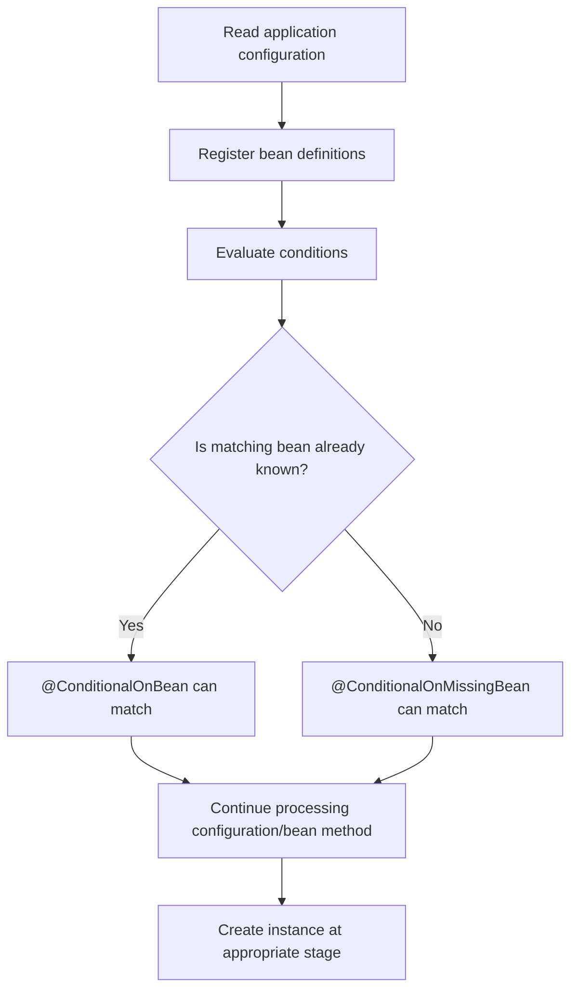
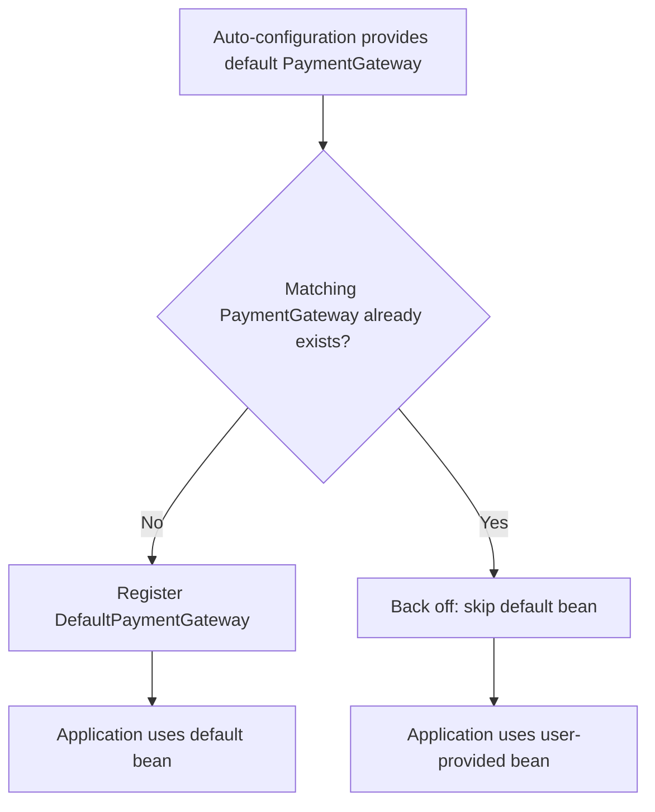

# `@ConditionalOnBean`, `@ConditionalOnMissingBean`, and Known Beans

In Spring Boot, not every bean needs to be registered in every application. A configuration may only make sense when another bean already exists; conversely, a default configuration should only create a bean when the application has not provided its own choice.

Spring Boot supports two commonly used conditions for this case:

- **`@ConditionalOnBean`**: applies a configuration or registers a bean only when the `BeanFactory` already knows about a bean matching the condition.
- **`@ConditionalOnMissingBean`**: applies a configuration or registers a bean only when no bean matching the condition exists yet.

The crucial phrase is **"already knows about"** ("known beans"). The condition inspects bean definitions that the container can identify at the time the condition is evaluated. It is not a check of whether an object has been fully initialized, connected to a database, or is actively serving requests.

Understanding the exact timing and scope of inspection helps you write customizable auto-configurations, avoid registering duplicate beans, and explain why a default bean appeared or was skipped.

## 1. Two Conditions Solve Two Different Scenarios

Suppose an application can integrate a reporting service. The reporting feature only works when a `DataSource` is available, while the library wants to provide a default `ReportService` if the application has not defined one itself.

Two questions:

1. **Does a DataSource already exist?** If yes, register the database-dependent configuration part.
2. **Has the application already provided a ReportService?** If not, register the default implementation.

Example:

```java
@Bean
@ConditionalOnBean(DataSource.class)
ReportRepository reportRepository(DataSource dataSource) {
    return new JdbcReportRepository(dataSource);
}
```

The `reportRepository` bean is only registered when the condition finds a bean matching type `DataSource`.

Another example:

```java
@Bean
@ConditionalOnMissingBean(ReportService.class)
ReportService reportService(ReportRepository repository) {
    return new DefaultReportService(repository);
}
```

The default `reportService` bean is only registered when no bean matching `ReportService` exists yet.

| Annotation | Condition for the configuration/bean to be applied | Typical usage |
|---|---|---|
| `@ConditionalOnBean` | A matching bean is already known to the BeanFactory | Enable integration only when required infrastructure or capability exists |
| `@ConditionalOnMissingBean` | No matching bean is found | Provide a default bean while giving the application the right to replace it |

Both annotations are conditions evaluated at the **`ApplicationContext` construction stage**. They are not runtime statements re-checking whether a bean exists on every service call.

## 2. What Does "Known Bean" Mean?

To understand both conditions, distinguish three states:

1. **Bean definition registered:** the `BeanFactory` knows the name, inferable type, scope, and bean creation metadata.
2. **Bean instance created:** the container has invoked the constructor/factory method and performed the corresponding initialization steps.
3. **Bean operationally ready:** external resources are connected, data is loaded, or dependencies have passed readiness checks.

Spring Boot's bean conditions primarily operate on **bean information present in the `BeanFactory` at evaluation time**, especially bean definitions and types the container can infer. A satisfied condition does not mean the bean has completed initialization or successfully handled a request.

Example:

```java
@Bean
@Lazy
DataSource reportDataSource() {
    return createDataSource();
}
```

A lazy bean can still have a bean definition in the container even when its instance has not been created yet. Therefore, bean-checking conditions should not be understood as "must call the constructor and instantiate the object first before checking."

Visualize it like this:



This is a high-level model. The actual order depends on configuration parsing, imports, and bean definition registration. That exact ordering is an important part of this lesson.

### 2.1. Where Are Beans Registered From?

A bean can become known to the `BeanFactory` through several sources:

- Component scanning discovering `@Component`, `@Service`, `@Repository`, `@Controller`.
- `@Bean` methods inside `@Configuration` classes.
- Configurations imported via `@Import`.
- Spring Boot auto-configuration.
- Bean definitions registered programmatically or by an integration framework.

Therefore, "known bean" does not simply mean the class exists on the classpath. **Having a class in a dependency does not mean a bean of that class has been registered.**

For example, adding a library containing `ReportClient` to Gradle/Maven does not automatically create a `ReportClient` bean. A bean only appears if there is an appropriate configuration or component registration.

### 2.2. Where Does a Bean Definition Get Its Type Information?

Spring can infer a bean's type from:

- A class discovered by component scanning.
- The return type of a `@Bean` method.
- Factory or bean definition metadata.
- Types exposed through configuration.

For `@Bean` methods, declaring a sufficiently specific return type helps type-based conditions identify beans more reliably.

Example:

```java
@Bean
PaymentGateway paymentGateway() {
    return new StripePaymentGateway();
}
```

The declared type is `PaymentGateway`. If a condition looks for `PaymentGateway`, this metadata fits. If a condition looks specifically for `StripePaymentGateway`, yet the method only exposes the `PaymentGateway` interface, Spring may not yet have enough specific type information to match at the condition stage.

When the implementation type matters to a condition, declare a sufficiently specific return type:

```java
@Bean
StripePaymentGateway paymentGateway() {
    return new StripePaymentGateway();
}
```

Do not use an overly generic return type if other conditions or configurations need to recognize the concrete implementation. At the same time, in application design, continue letting business services depend on interfaces where appropriate.

## 3. How Does `@ConditionalOnBean` Work?

`@ConditionalOnBean` is a Spring Boot condition. It allows a configuration or bean method to be applied only when the `BeanFactory` already contains a bean matching the declared criteria.

Simple example:

```java
@Configuration
public class ReportingConfiguration {

    @Bean
    @ConditionalOnBean(DataSource.class)
    public ReportRepository reportRepository(DataSource dataSource) {
        return new JdbcReportRepository(dataSource);
    }
}
```

If, at the time the condition is evaluated, the `BeanFactory` already knows about a bean matching `DataSource`, Spring can register the `reportRepository` bean.

If there is no `DataSource`, this `@Bean` method is skipped. Spring does not create `ReportRepository` from that method.

### 3.1. Class-Level Condition

You can place the annotation on an entire configuration class:

```java
@Configuration
@ConditionalOnBean(DataSource.class)
public class JdbcReportingConfiguration {

    @Bean
    public ReportRepository reportRepository(DataSource dataSource) {
        return new JdbcReportRepository(dataSource);
    }

    @Bean
    public ReportExporter reportExporter(ReportRepository repository) {
        return new ReportExporter(repository);
    }
}
```

When a class-level condition does not match, that configuration is not processed as an active configuration source. The bean methods inside are not registered from this configuration.

This is useful when an **entire group of beans** requires the same capability, such as a database, messaging, or a client API.

### 3.2. Method-Level Condition

If only one bean needs a specific dependency, place the annotation on the `@Bean` method:

```java
@Configuration
public class OptionalIntegrationConfiguration {

    @Bean
    @ConditionalOnBean(DataSource.class)
    public AuditRepository auditRepository(DataSource dataSource) {
        return new JdbcAuditRepository(dataSource);
    }

    @Bean
    public InMemoryAuditFormatter auditFormatter() {
        return new InMemoryAuditFormatter();
    }
}
```

Here, `auditRepository` depends on `DataSource`, while `auditFormatter` does not depend on a database and can still be registered when no `DataSource` is present.

Placing conditions at the right scope makes configuration more flexible. Do not place a condition on the whole class if only one bean in the class actually requires it.

### 3.3. Checking by Type, Name, or Annotation

Conditions can be described by class type:

```java
@ConditionalOnBean(PaymentGateway.class)
```

Or by bean name:

```java
@ConditionalOnBean(name = "primaryDataSource")
```

Or by type name as a string:

```java
@ConditionalOnBean(type = "com.example.payment.PaymentGateway")
```

You can also check for beans carrying a specific annotation. Common attributes include:

| Attribute | Purpose |
|---|---|
| `value` | Classes to check |
| `type` | Fully qualified type name as a string |
| `name` | Bean name to search for |
| `annotation` | Annotation present on the target bean |
| `search` | Scope of `BeanFactory` to search, including current context or parent contexts according to the chosen strategy |

Use `value`/class literals when the type is guaranteed to be on the classpath. Using `type` as a string can be helpful in optional auto-configuration where you do not want to reference the class directly in a location that risks class-loading failure.

Do not declare overly complex criteria when a simple condition suffices. The more complex the criteria, the harder it becomes to explain why a condition matched or did not match.

## 4. How Does `@ConditionalOnMissingBean` Work?

`@ConditionalOnMissingBean` allows Spring Boot to register a default bean **when no matching bean exists yet**.

This is the foundation of customizable auto-configuration:

- The library provides a default implementation.
- The application can define its own implementation.
- When the custom bean is already known before the auto-configuration evaluates the condition, the default bean steps aside.

Example:

```java
@Configuration
public class PaymentConfiguration {

    @Bean
    @ConditionalOnMissingBean(PaymentGateway.class)
    public PaymentGateway paymentGateway() {
        return new DefaultPaymentGateway();
    }
}
```

If the application has no bean matching `PaymentGateway` yet, Spring registers `DefaultPaymentGateway`.

If the application already has its own implementation:

```java
@Configuration
public class CustomPaymentConfiguration {

    @Bean
    public PaymentGateway paymentGateway() {
        return new AcmePaymentGateway();
    }
}
```

then the default bean from the conditional configuration can be skipped, provided the custom bean was registered before `@ConditionalOnMissingBean` was evaluated.

### 4.1. Why Is This Called a Back-Off Mechanism?

In Spring Boot documentation, this behavior is commonly called **back off**: the auto-configuration backs off when the application has already provided its own bean.



As a result, a library can provide an "out-of-the-box" experience without locking the application into a single implementation.

### 4.2. Omitting the Type Uses the `@Bean` Return Type

A common pattern in auto-configuration:

```java
@Bean
@ConditionalOnMissingBean
public Clock applicationClock() {
    return Clock.systemUTC();
}
```

When `value`, `type`, `name`, or `annotation` is not declared, the condition on a `@Bean` method can infer the type to check from the **method's return type**. The example above means: create a default `Clock` bean if no matching bean exists yet.

For reader clarity and to avoid relying on type inference in complex examples, you can also declare it explicitly:

```java
@Bean
@ConditionalOnMissingBean(Clock.class)
public Clock applicationClock() {
    return Clock.systemUTC();
}
```

If the method returns an interface, the condition infers from that interface by default. Choose a return type that reflects the exact contract the auto-configuration intends to provide.

### 4.3. Conditions Can Check Bean Names

For example, register a fallback bean with a specific name only if that name does not exist yet:

```java
@Bean
@ConditionalOnMissingBean(name = "legacyReportExporter")
public ReportExporter legacyReportExporter() {
    return new DefaultReportExporter();
}
```

Name-based conditions are useful when the name is part of a configuration contract. However, for normal business beans, type-based checking is usually more flexible because the application can name its bean freely while still providing the right abstraction.

## 5. Key Point: Conditions Only See Beans Processed Earlier

This is the most important rule of both annotations:

**`@ConditionalOnBean` and `@ConditionalOnMissingBean` only inspect bean definitions that have already been processed and are visible in the `BeanFactory` at the time the condition is evaluated. They do not predict beans that will be registered in a future step.**

Therefore, the outcome depends on configuration processing order.

### 5.1. Processing Order Example

Suppose there are two configurations:

```java
@Configuration
public class DefaultConfiguration {

    @Bean
    @ConditionalOnMissingBean(MessageSender.class)
    public MessageSender messageSender() {
        return new DefaultMessageSender();
    }
}
```

```java
@Configuration
public class UserConfiguration {

    @Bean
    public MessageSender customMessageSender() {
        return new CustomMessageSender();
    }
}
```

The goal is for the user-provided bean to be known before the condition checking the default bean is evaluated.

If the default configuration is processed before the user bean is registered, the condition may see no `MessageSender` yet and register the default bean. When the user configuration is processed later, both beans may coexist and cause ambiguity or conflict depending on names/configuration.

That is why Spring Boot recommends using bean conditions primarily in **auto-configuration**, where processing order is organized so that user application configurations are processed before auto-configuration.

### 5.2. Why Is Auto-Configuration Better Suited Than Component Scanning?

Spring Boot auto-configuration is imported through a dedicated mechanism and can be ordered before/after other auto-configurations. User application configurations are processed in an appropriate stage before auto-configuration checks beans to decide whether to back off.

Conversely, `@Configuration` classes discovered via component scanning should not rely on arbitrary scan order to decide whether a bean already exists or not.

Therefore:

- Using `@ConditionalOnMissingBean` to provide defaults in auto-configuration is a common pattern.
- Using `@ConditionalOnBean` in auto-configuration to enable integrations when a capability is already registered is reasonable.
- If placing conditions on normal application configurations, you must understand parse/registration order; do not assume every bean in another package has already been processed.
- If a condition depends on another auto-configuration, declare the appropriate ordering.

### 5.3. Ordering Auto-Configurations

Spring Boot provides mechanisms such as:

```java
@AutoConfiguration(after = DataSourceAutoConfiguration.class)
public class ReportingAutoConfiguration {
}
```

Or corresponding ordering annotations like `@AutoConfigureAfter` and `@AutoConfigureBefore` in suitable auto-configuration setups.

The purpose is to control **configuration processing order**, not bean instance initialization order. These two concepts are different:

| Ordering | What does it control? |
|---|---|
| Auto-configuration ordering | Which configuration is processed first so conditions see the appropriate bean definitions |
| Bean dependency ordering | Which bean must be provided before creating another bean |
| `@DependsOn` | Initialization constraint between specific beans when there is a valid reason |

Do not use `@DependsOn` to replace auto-configuration ordering. It does not make a future bean definition appear earlier when conditions are evaluated.

## 6. Complete Example: Auto-Configuration Providing Default Beans

Suppose a reporting library wants to provide a JDBC integration if the application has a `DataSource`, while allowing the application to replace `ReportRepository` and `ReportService`.

### 6.1. Abstractions

```java
public interface ReportRepository {
    long countReports();
}
```

```java
public interface ReportService {
    long reportCount();
}
```

Default implementations:

```java
public class JdbcReportRepository implements ReportRepository {

    private final DataSource dataSource;

    public JdbcReportRepository(DataSource dataSource) {
        this.dataSource = dataSource;
    }

    @Override
    public long countReports() {
        // Query database in a real implementation.
        return 0L;
    }
}
```

```java
public class DefaultReportService implements ReportService {

    private final ReportRepository repository;

    public DefaultReportService(ReportRepository repository) {
        this.repository = repository;
    }

    @Override
    public long reportCount() {
        return repository.countReports();
    }
}
```

### 6.2. Auto-Configuration

```java
package com.example.reporting.autoconfigure;

import javax.sql.DataSource;

import com.example.reporting.DefaultReportService;
import com.example.reporting.JdbcReportRepository;
import com.example.reporting.ReportRepository;
import com.example.reporting.ReportService;

import org.springframework.boot.autoconfigure.AutoConfiguration;
import org.springframework.boot.autoconfigure.condition.ConditionalOnBean;
import org.springframework.boot.autoconfigure.condition.ConditionalOnClass;
import org.springframework.boot.autoconfigure.condition.ConditionalOnMissingBean;
import org.springframework.context.annotation.Bean;

@AutoConfiguration
@ConditionalOnClass(JdbcReportRepository.class)
@ConditionalOnBean(DataSource.class)
public class ReportingAutoConfiguration {

    @Bean
    @ConditionalOnMissingBean(ReportRepository.class)
    public ReportRepository reportRepository(DataSource dataSource) {
        return new JdbcReportRepository(dataSource);
    }

    @Bean
    @ConditionalOnMissingBean(ReportService.class)
    public ReportService reportService(ReportRepository repository) {
        return new DefaultReportService(repository);
    }
}
```

This illustrates an auto-configuration module:

- `@ConditionalOnClass` checks that the JDBC implementation library is on the classpath.
- `@ConditionalOnBean(DataSource.class)` enables the configuration only when the application has a known `DataSource`.
- `@ConditionalOnMissingBean(ReportRepository.class)` allows the application to replace the default repository.
- `@ConditionalOnMissingBean(ReportService.class)` allows the application to replace the default service.

In a real auto-configuration, the class must be declared in the auto-configuration import mechanism appropriate for your Spring Boot version. In modern Spring Boot, the auto-configuration list is typically published in the file:

```text
META-INF/spring/org.springframework.boot.autoconfigure.AutoConfiguration.imports
```

The file contains the fully qualified names of auto-configuration classes, for example:

```text
com.example.reporting.autoconfigure.ReportingAutoConfiguration
```

### 6.3. Application Without a `DataSource`

If the application has no `DataSource` bean:

- The condition on `ReportingAutoConfiguration` does not match.
- The bean methods in this configuration are not registered from the auto-configuration.
- The application can still start if no other required component demands `ReportService`.

This is how optional integration modules avoid forcing every application to use JDBC.

### 6.4. Application with a `DataSource` but Without Custom Implementations

If `DataSource` is registered and the JDBC class is present:

- Auto-configuration can be applied.
- Default `ReportRepository` is registered if no matching repository exists yet.
- Default `ReportService` is registered if no matching service exists yet.

The application can inject `ReportService` and use the default implementation.

### 6.5. Application Provides Its Own `ReportService`

Example application-side configuration:

```java
@Configuration
public class CustomReportingConfiguration {

    @Bean
    public ReportService reportService(ReportRepository repository) {
        return new CustomReportService(repository);
    }
}
```

If this `ReportService` bean is already known before the missing-bean condition in auto-configuration is evaluated, the default bean backs off. The application uses its own implementation.

### 6.6. Application Provides Its Own `ReportRepository`

Similarly:

```java
@Configuration
public class CustomRepositoryConfiguration {

    @Bean
    public ReportRepository reportRepository(DataSource dataSource) {
        return new CustomReportRepository(dataSource);
    }
}
```

The `@ConditionalOnMissingBean(ReportRepository.class)` condition does not match, so auto-configuration skips the default repository. The default service bean can use the repository provided by the application.

**Important point:** Auto-configuration provides defaults per abstraction. An application can replace a single part without having to replace the entire module.

## 7. Bean Conditions Are Not Classpath Conditions

The two kinds of conditions often go together, yet they answer different questions:

- `@ConditionalOnClass`: does the class exist on the classpath?
- `@ConditionalOnBean`: has a matching bean been registered in the `BeanFactory`?
- `@ConditionalOnMissingBean`: has a matching bean not been registered yet?
- `@ConditionalOnProperty`: does a property have a matching value?

Example:

```java
@AutoConfiguration
@ConditionalOnClass(ReportClient.class)
@ConditionalOnProperty(
        prefix = "app.reporting",
        name = "enabled",
        havingValue = "true"
)
public class ReportingAutoConfiguration {
    // ...
}
```

The configuration above requires both the necessary class and the property enabling the feature. If a specific bean dependency also needs to exist, an appropriate bean condition can be added.

Do not use `@ConditionalOnBean` to check the classpath. A class being present does not mean a bean exists. Conversely, a bean may be registered via a factory or proxy even if the implementation class is not directly referenced where the condition is declared.

## 8. Search Criteria and `BeanFactory` Scope

Bean conditions can evaluate by type, name, annotation, and search scope.

### 8.1. Searching by Type

This is the common approach:

```java
@ConditionalOnBean(Clock.class)
```

The condition searches for beans matching the `Clock` type. The type must be recognizable by the container from the bean definition or related metadata.

### 8.2. Searching by Name

```java
@ConditionalOnBean(name = "primaryDataSource")
```

This is useful when the configuration genuinely depends on a bean with a specific name. However, it creates coupling to the bean name: if the application renames the bean, the condition may stop matching even though the capability type still exists.

### 8.3. Searching by Annotation

You can check for beans annotated with a specific annotation:

```java
@ConditionalOnBean(annotation = EnableReporting.class)
```

This is an option when the presence of a bean marked with a specific annotation serves as the signal to activate an integration.

### 8.4. Search Strategy: Current Context or Ancestor Contexts?

An application may have multiple `ApplicationContext` instances, such as parent and child contexts in some web or integration architectures. Bean conditions support search strategies such as:

- `SearchStrategy.CURRENT`: search only in the current context.
- `SearchStrategy.ANCESTORS`: search in ancestor contexts within the corresponding scope.
- `SearchStrategy.ALL`: search in the current context and ancestor contexts.

Example:

```java
@ConditionalOnBean(
        value = DataSource.class,
        search = SearchStrategy.CURRENT
)
```

The default search scope of bean conditions is configured per the annotation's search strategy; when an application has a context hierarchy, specify a search strategy if limiting or expanding the scope is part of the design requirement.

For most simple Spring Boot applications, there is usually only a single application context, so you rarely need to change this attribute. However, when writing infrastructure used in applications with parent/child contexts, the search scope needs to be clearly understood.

## 9. How Does the Return Type of `@Bean` Affect Conditions?

Conditions are evaluated during bean definition processing. Spring may need to know the bean type **before the instance is actually created**. Therefore, the return type of a `@Bean` method is very important.

Example:

```java
@Bean
@ConditionalOnMissingBean(PaymentGateway.class)
public PaymentGateway paymentGateway() {
    return new DefaultPaymentGateway();
}
```

This is a clear declaration if the abstraction to protect is `PaymentGateway`.

But if you write:

```java
@Bean
public Object paymentGateway() {
    return new DefaultPaymentGateway();
}
```

then the public metadata of the method only reveals the type `Object`. A condition looking for `PaymentGateway` may not reliably recognize this bean definition before creating an instance.

Similarly, if a condition needs a concrete implementation yet the method only returns an interface, the type information may not be sufficient to match that implementation.

**Practical rule:** declare `@Bean` return types as specifically as possible within the abstraction that other conditions and configurations need to recognize. Do not return `Object` just to be "flexible" if the container needs to know the bean type in advance.

## 10. Common Errors and Explanations

### 10.1. Expecting `@ConditionalOnBean` to Match, Yet the Bean Is Not Registered

For example, you know the project has the `DataSource` class and added the JDBC dependency, yet `@ConditionalOnBean(DataSource.class)` does not match.

Possible reasons:

- The dependency only puts the class on the classpath without creating a `DataSource` bean.
- The auto-configuration creating `DataSource` was not activated due to missing configuration or driver.
- The bean definition was registered after the condition was already evaluated.
- The condition is searching in the wrong context or search strategy.
- The bean type could not be inferred from declared metadata.

Distinguish **class presence** from **registered bean**.

### 10.2. `@ConditionalOnMissingBean` Still Creates a Default Despite an Application Custom Bean

Check the configuration processing order:

- Was the custom bean registered before auto-configuration?
- Is the default configuration a genuine auto-configuration or just a `@Configuration` picked up by component scanning?
- Does the custom bean have the exact type the condition is checking?
- Does the `@Bean` method declare a sufficiently specific return type?
- Is the condition searching for the right name/annotation/search scope?

This is usually a **condition evaluation order** or **metadata/type mismatch** issue, not Spring intentionally ignoring the user's bean.

### 10.3. Two Beans of the Same Type After Auto-Configuration Runs

The default condition may not have seen the custom bean at the time it was evaluated, or the condition may be checking the wrong abstraction.

Then two beans of the same type may be registered, leading to `NoUniqueBeanDefinitionException` during type-based injection.

Do not immediately patch it with `@Primary` if the original goal was for the default bean to back off. First fix the ordering or condition criteria so the default bean is not registered when the user bean already exists.

### 10.4. Bean Exists, Yet Instance Has Not Been Created

This does not automatically mean the condition will not match. For lazy or uninitialized singletons, the bean definition can still be recognized by the `BeanFactory`.

Do not use `@ConditionalOnBean` to ask "has the database connected successfully?". Use a health check, readiness check, or appropriate runtime status check for that question.

## 11. Observing Why Conditions Match or Do Not Match

When auto-configuration does not work as expected, Spring Boot can provide a **Condition Evaluation Report** to explain which conditions matched or did not match.

### 11.1. Enabling Debug When Running the Application

You can start the application with the flag:

```bash
java -jar app.jar --debug
```

Or configure:

```properties
debug=true
```

During startup, the condition report helps you see:

- Which auto-configurations were applied.
- Which auto-configurations were excluded due to missing classes or beans.
- Which conditions could not find required beans.
- Which missing-bean conditions did not match because a matching bean already existed.

Actual messages depend on the version and logging configuration. Look for the **CONDITIONS EVALUATION REPORT** section, the positive matches / negative matches groups, and specific reasons.

### 11.2. Actuator `conditions` Endpoint

In applications with Spring Boot Actuator, the conditions endpoint can provide information on condition evaluation. This endpoint typically has the id `conditions`; access depends on dependencies, exposure, and security configuration.

Do not expose sensitive management endpoints to public networks just for debugging. In development environments, `--debug` logs are usually the simplest way to start.

## 12. Testing Auto-Configuration with `ApplicationContextRunner`

Spring Boot provides `ApplicationContextRunner` to test configurations in a small, fast application context where registered beans can be controlled.

The goal is to prove two behaviors:

1. With `DataSource`, reporting configuration is activated.
2. If the application provides `ReportService`, auto-configuration does not register the default service.

Illustrative test example:

```java
import javax.sql.DataSource;

import org.junit.jupiter.api.Test;
import org.springframework.boot.autoconfigure.AutoConfigurations;
import org.springframework.boot.test.context.runner.ApplicationContextRunner;
import org.springframework.context.annotation.Bean;
import org.springframework.context.annotation.Configuration;

import static org.assertj.core.api.Assertions.assertThat;

class ReportingAutoConfigurationTests {

    private final ApplicationContextRunner contextRunner =
            new ApplicationContextRunner()
                    .withConfiguration(
                            AutoConfigurations.of(
                                    ReportingAutoConfiguration.class
                            )
                    );

    @Test
    void doesNotConfigureReportingWithoutDataSource() {
        contextRunner.run(context -> {
            assertThat(context).doesNotHaveBean(ReportRepository.class);
            assertThat(context).doesNotHaveBean(ReportService.class);
        });
    }

    @Test
    void backsOffWhenUserProvidesReportService() {
        contextRunner
                .withBean(DataSource.class, StubDataSource::new)
                .withUserConfiguration(UserReportConfiguration.class)
                .run(context -> {
                    assertThat(context).hasSingleBean(ReportService.class);
                    assertThat(context).hasBean("customReportService");
                    assertThat(context).doesNotHaveBean("reportService");
                });
    }

    @Configuration(proxyBeanMethods = false)
    static class UserReportConfiguration {

        @Bean
        ReportService customReportService() {
            return new CustomReportService();
        }
    }
}
```

`StubDataSource` and `CustomReportService` in the example are test classes defined by the project and must implement the required contracts. To test auto-configuration in isolation, minimal fakes/stubs or appropriate test bean configurations can be used.

Depending on the auto-configuration structure and dependencies, the second test also needs to provide other required beans. The main point is showing that `ApplicationContextRunner` can set up contexts with/without beans to observe conditions.

### 12.1. Why Test Both With and Without Beans?

A good auto-configuration needs to prove:

- When a dependency does not exist, the optional feature does not break the context.
- When the dependency appears, the bean is registered properly.
- When the user provides their own bean, the default bean backs off.
- When property/classpath conditions are not satisfied, the configuration does not activate unexpectedly.

These tests are more meaningful than checking "context loads" once in a single environment.

## 13. Similar Annotations That Answer Different Questions

| Annotation | Question it answers | Example |
|---|---|---|
| `@ConditionalOnBean` | Does a matching bean already exist? | Only create an adapter if `DataSource` exists |
| `@ConditionalOnMissingBean` | Is a matching bean missing? | Create `DefaultPaymentGateway` if user has not provided one |
| `@ConditionalOnClass` | Is the class present on the classpath? | Enable integration when the client library exists |
| `@ConditionalOnProperty` | Is the property enabled/having the right value? | Only enable reporting when `app.reporting.enabled=true` |
| `@ConditionalOnResource` | Does the specified resource exist? | Only enable configuration when a resource file is present |
| `@ConditionalOnSingleCandidate` | Is there a single candidate or a suitable prioritized candidate? | Select a type-based dependency when multiple candidate beans exist |

In particular, `@ConditionalOnSingleCandidate` differs from `@ConditionalOnBean`: having a matching bean is not enough to conclude there is only one candidate. If a configuration needs a single dependency and there may be multiple beans of the same type, the single-candidate condition may be more appropriate.

## 14. Principles for Designing Bean Conditions

When writing auto-configurations or optional configurations, follow these principles:

1. **Check the right abstraction.** If the application only needs `PaymentGateway`, condition on `PaymentGateway` instead of an unnecessary concrete implementation.
2. **Use missing-bean for defaults.** This is the standard way for applications to override default beans.
3. **Place conditions at the smallest reasonable scope.** One bean needing `DataSource` does not mean every bean in the configuration needs a database.
4. **Ensure processing order.** Bean conditions only see bean definitions already processed; auto-configuration ordering must be appropriate.
5. **Declare clear return types.** Type-based conditions rely on inferring types from bean metadata.
6. **Do not use conditions as health checks.** Bean existence does not mean the resource is operational.
7. **Do not rely on accidental component scan order.** Use supported auto-configuration and ordering mechanisms when writing libraries.
8. **Test both matching and back-off.** Test contexts with the dependency, without the dependency, and with a custom bean.

## 15. Self-Check Exercises

### Exercise 1: Bean-Based Condition

```java
@Bean
@ConditionalOnBean(DataSource.class)
ReportRepository reportRepository(DataSource dataSource) {
    return new JdbcReportRepository(dataSource);
}
```

**Question:** If the `DataSource` class is on the classpath, yet no `DataSource` bean exists, will the method be applied?

**Hint:** No. Classpath presence and bean registration are two different conditions.

### Exercise 2: Default Bean

```java
@Bean
@ConditionalOnMissingBean(PaymentGateway.class)
PaymentGateway paymentGateway() {
    return new DefaultPaymentGateway();
}
```

**Question:** When the application has already registered `AcmePaymentGateway` under type `PaymentGateway` before auto-configuration evaluates the condition, what happens?

**Answer:** The condition does not match and the default bean backs off.

### Exercise 3: Processing Order

`DefaultConfiguration` with `@ConditionalOnMissingBean` is processed before `UserConfiguration` containing a custom bean.

**Question:** Can you rely on the condition to guarantee the default bean will back off?

**Answer:** No. The condition only checks bean definitions processed up to that point. Configuration/auto-configuration ordering must be organized properly.

### Exercise 4: Lazy Bean

A `DataSource` bean has a definition and is marked lazy, yet the instance has not been created.

**Question:** Can you conclude `@ConditionalOnBean(DataSource.class)` definitely will not match because there is no object yet?

**Answer:** No. Bean conditions inspect beans known to the `BeanFactory`; whether the instance has been initialized is a separate question.

### Exercise 5: Overly Generic Return Type

A `@Bean` method returns `Object`, while another condition needs to find `PaymentGateway`.

**Question:** Why can type metadata cause a problem?

**Answer:** When the condition is evaluated, the container may only infer the type `Object` from the method signature. Declare a return type matching the abstraction that needs to be recognized.

### Exercise 6: Condition or Health Check?

An application wants to accept requests only when the database is reachable.

**Question:** Should you use `@ConditionalOnBean(DataSource.class)` to confirm the database is healthy?

**Answer:** No. The annotation only checks for the presence of a matching bean in the context. Use a health indicator/readiness probe or runtime connection check.

## 16. Takeaways

- `@ConditionalOnBean` applies a configuration only when a matching bean is already known to the `BeanFactory`.
- `@ConditionalOnMissingBean` provides a default when no matching bean exists yet, allowing auto-configuration to **back off** when the application has its own implementation.
- "Known" primarily refers to processed bean definitions/type metadata, not that instances are initialized or resources are ready.
- Conditions only see beans registered before the time they are evaluated; configuration processing order is critical.
- Bean conditions are best suited for auto-configurations with explicit ordering; do not rely on arbitrary component scan order.
- Return types of `@Bean` methods should be sufficiently specific so type-based conditions can identify beans.
- `@ConditionalOnClass`, `@ConditionalOnProperty`, and bean conditions check different kinds of information.
- Use the Condition Evaluation Report and `ApplicationContextRunner` to explain and test match/back-off behavior.

When reading a bean condition, ask yourself: **"Which beans were registered before this condition ran, by what type or name does the container identify them, and should this configuration match or back off?"** Answering those three questions will help you write Spring Boot auto-configurations that are easier to customize and predict.
